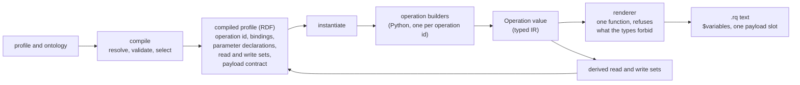

<!-- SPDX-License-Identifier: CC-BY-SA-4.0 -->

# Track H, H2: the typed operation IR and the typed payload (sketch)

**Unit:** `formal-methods-track-h`, slice H2 ([plan §4](../plans/formal-methods-track-h.md#4-h2-h3-the-typed-ir-and-the-specification-registry))
**Status:** design brief, 2026-10-10. Every question, H2-Q1 to H2-Q6, answered the same day. H2.0 is ready to branch
**Builds on:** [specification sketch §3](formal-methods-track-h-specification.md#3-the-typed-intermediate-representation)
(the hazard table, not repeated here), [aggregate-ownership sketch §12 and §15](persistence-aggregate-ownership.md#12-what-h2-inherits),
[ADR-A79](../../architecture/decisions/ADR-A79-persistence-compiler-toolchain.md),
[ADR-A122](../../architecture/decisions/ADR-A122-aggregate-ownership.md), plan [§13](../plans/formal-methods-track-h.md#13-walkthrough-the-two-assumptions-behind-check-s-3-h-d11-and-h-d12) (H-D11, H-D12)
**Proposes:** ADR-A123, *A typed operation IR for the persistence compiler*, and a dated addendum to
ADR-A79 naming the points A123 supersedes (§6)

## 1. Decisions already taken (2026-10-10)

| # | Decision |
|---|---|
| H-D18 | H2 is split into as many slices as it needs. §7 proposes ten |
| H-D19 | Option A. Each operation is built as a typed value and its SPARQL is rendered from it. The 28 Mustache templates and the `chevron` dependency are retired |
| H-D20 | the typed payload is designed here in full (§4), and the maintainer reviews it before any slice that depends on it is briefed. The test is how much configuration it asks of a user, against what the user would have to do anyway |
| H-D3 | delegated to us. We take a new ADR (A123) and a dated addendum to ADR-A79, which stays Accepted for the points A123 does not touch (§6) |
| H2-Q1 | PL-B (§4). Generated code per language (PL-D) is kept for later as a published SDK, sketched in [persistence-client-sdk.md](persistence-client-sdk.md) and discussed at the end of Track H |
| H2-Q2 | (a) and (b). Informational by default, raised to a warning by a compile option, with no new vocabulary. The maintainer confirmed this reading |
| H2-Q3 | (a), no closed-shape refusal |
| H2-Q4 | (c), the guard in the SPARQL and in the Python caller |
| H2-Q5 | (a), declarations only, on condition that it keeps the relational realisation open. H2-Q6 is the condition (§3.1) |
| H2-Q6 | (a), a logical operation contract. The SPARQL graph roles stay in the builders (§3.1) |

## 2. The scene, checked against the source

What exists, as of `09675a70`:

- `compile` resolves a profile and selects, per target, a list of `GeneratedOperation`s, each a
  template id and a list of `ParameterBinding`s (`operations.py`). It never produces SPARQL text
  (ADR-A79 point 1).
- `instantiate` reads the compiled profile, loads `templates/<id>.mustache` and renders it with
  `chevron`. Every compile-time value is an encoded `SparqlTerm` (`terms.py`), and the renderer
  refuses a bare `str` (`render.py`). This is the injection boundary of ADR-A79 point 4.
- The SPARQL structure lives in 28 template files. Its hazards (an unbound variable in an `INSERT`
  template, a blank node, a pattern in the default graph, a value comparison on a term position)
  are found after the fact by static checks S-3 and S-4 (`templatecheck.py`, H1.3) and by the
  witness harness, not prevented.
- Two request-time slots, `payloadTriples` and `logGraphs`, are passed through as Mustache tags for
  the caller to fill with "trusted, already-serialised SPARQL text"
  ([README](../../../tools/persistence/README.md#using-the-generated-sparql-directly)). The caller
  also computes `$requestDigest` from the canonical N-Triples of the payload, separately from the
  text it sends.
- A request-time variable the caller forgets is silently unbound, and an update can then write part
  of a record (TD-34).
- Nothing outside `tools/persistence` and its tests calls `instantiate` or fills the slots, so no
  compatibility is owed (H-D14).

## 3. The IR

An `Operation` is a frozen value in a new module, `persistence.ir`, built by one builder function per
operation id. Its parts, each closing a row of the specification sketch's hazard table:

| Part | Type rule | Closes |
|---|---|---|
| parameters | `Param(name, kind, required)`, kind one of `Iri`, `Long`, `String`, `LangString`, `Position`, `Digest`, `Payload`, `RegistryList`. The list is the renderer's whole domain | a missing or misspelt parameter, H-D11 |
| compile-time constants | the existing encoders of `terms.py`, reused as they are | injection from configuration (unchanged) |
| patterns | every triple pattern carries a `GraphRole` (data, meta, txn, log bucket, event bucket, keys, registry). There is no default-graph constructor | S-1, TD-40 |
| terms in a pattern | a variable, a parameter, a constant. No blank-node constructor exists | a retry that is not a no-op |
| property paths | a `PropertyPath` may appear only in a `WHERE` pattern | a path in a template |
| variables in `DELETE` or `INSERT` | tagged `Bound` (bound by a required pattern, or a `BIND` over `Bound` inputs) or `OptionalAllowed` (for example `?prevRev`, absent on a first revision). An untagged variable is refused | S-3, H-D12's first half |
| guards | `TermGuard` (`sameTerm`, or a shared pattern) or `ValueGuard` (`=`). A position is declared term-invariant or value-compared, and the renderer refuses the wrong guard | review §8.2 |
| clock | `Now()` may appear in a `BIND` for a receipt field or a bucket choice, never inside a guard | `NOW()` in a guard. The specification sketch says "audit-only position". The templates use `NOW()` for receipts and bucket months, so we read it as "never in a guard" |
| required-parameter guard | generated from the parameter list (§5, H2-Q4) | TD-34, H-D12 option D |

**Read and write sets are derived, not declared.** The renderer already walks every pattern, so the
same walk yields the graphs and subjects an operation reads (its `WHERE`, with a composite closure
read through its owned path at execution) and writes (its `DELETE` and `INSERT`). A hand-declared
set could drift from the query, and a derived one cannot. H5's models consume them from the compiled
profile.

**The compiled profile keeps ADR-A79 point 1.** `compile` still produces no SPARQL text. It emits,
per operation, the parameter declarations, the derived read and write sets and the payload contract
(§4), so a caller in another language knows what to bind without reading Python. The query structure
itself lives in the builders, and `instantiate` renders it. The alternative, the full IR as RDF in the
compiled profile, was H2-Q5's option (b), declined.

### 3.1 The operation contract and the SPARQL realisation (H2-Q6)

The relational realisation ([lattice-sql.md](../notes/rdf-engine/lattice-sql.md), out of Track H's
scope by ADR-A-FM4 decision 1) reads the resolved `dal:` profile as its transaction-scope input,
"unchanged" (its §5 and §6.1), and has its own logical and relational IRs (§6.2). It maps the same
dimensions to tables, version columns, receipt tables and unique indexes (§9), and it would generate
operations of the same kinds, a guarded replace, a create, a tombstone, a key claim. H2 does not
change the resolved profile, so the relational compiler's input stands either way. What H2 adds to
the compiled profile is where the choice matters.

| Option | The declarations in the compiled profile name | Consequence for a relational realisation |
|---|---|---|
| **(a) a logical operation contract** | the operation kind, its parameters and their kinds, and read and write sets over logical resources: the aggregate (root and members), its version row, the transaction claim, the receipt, a key claim, a log bucket. The payload contract names the boundary shape and the root, and its encoding (`dal:GroundNTriples`) is a property of the SPARQL realisation. The builders map each logical resource to its graph role | a relational compiler can implement the same contract, with rows for graphs, and the two realisations can be compared operation by operation, which is the operation oracle of `lattice-sql.md` §12. H5's models also reason about rows and claims, not graphs |
| **(b) SPARQL terms** | the same, with graph roles (meta graph, txn graph, log bucket) in place of logical resources | the declarations mean nothing to a relational realisation, which would define its own, and a comparison across realisations would need a mapping written after the fact |

**Design overheads.** (a) needs a small vocabulary of logical resources, about six terms, and one
mapping per builder. The risk is that it is designed with one realisation in hand, so its terms may
not fit SQL. We check it against `lattice-sql.md` §9's table when H2.7 is briefed, as a hypothesis to
test, not a claim. (b) costs nothing now and leaves the relational work to repeat it.

**Runtime overheads.** None for either. The declarations are read at design time.

**What neither closes.** The `OwnershipTree` of ADR-A122 stays in `persistence.boundary`, outside
`persistence.ir`, since a relational realisation reads the same classified tree as `ON DELETE
CASCADE` (lattice-sql §9, rule M37). The IR holds a reference to it, not a copy. The circularity
`sql-feedback.md` §7 warns of remains. Two realisations generated from one contract share any
misreading of it. H5's models stay the independent oracle.

**Decided: (a)** (H2-Q6, 2026-10-10).

**What is lost with Mustache.** ADR-A79 kept templates "auditable by inspection" as text files. The
builders replace them, and the audit surface becomes the builder plus a golden `.rq` per operation,
checked in and compared on every run. An adopter who rendered the templates with their own Mustache
library must now run `instantiate` once. Its `.rq` output stays plain SPARQL.

## 4. The typed payload

### 4.1 What a caller does today, and what goes wrong

To call `create-if-absent`, `cas-replace` or `unconditional-write`, a caller must, by hand:

1. build the aggregate's new state as triples, skolemised, with no blank node
2. serialise them as SPARQL triple text and substitute that text for `{{{payloadTriples}}}`
3. serialise them again as sorted canonical N-Triples, hash that with the operation kind, target and
   expected `seq`, and bind the result as `$requestDigest`
4. make sure every subject belongs to the aggregate it writes

None of the four is checked. The payload text is outside ADR-A79's injection boundary by
construction, so a payload literal containing `} } ; DROP ALL ; INSERT { {` reaches the query
structure. Steps 2 and 3 can disagree, so a confirmation read can misclassify a replay. Step 4 is
the payload check ADR-A122 decision 6 assigns to H2.

A user has to do steps 1 to 4 with or without LATTICE, since they own the data. The question is how
much they must declare so the framework can do 2 to 4 for them and check 1.

### 4.2 Options

| Option | The payload is | What it checks | New configuration a user must write |
|---|---|---|---|
| **PL-A, ground triples** | a set of `(subject IRI, predicate IRI, object IRI or literal)`, each term passed through the encoders of `terms.py`. It renders as sorted canonical N-Triples lines, and the same lines feed the digest | injection, blank nodes, a `GRAPH` break-out, digest drift (steps 2 and 3, done for the caller) | none |
| **PL-B, ground triples bounded by the boundary shape** | PL-A, plus the payload check: every subject is the root or reached from the root, within the payload, by the owned edges of the boundary shape in their declared direction | PL-A, and a subject outside the aggregate (step 4) | none for a composite family, whose boundary shape is already mandatory (ADR-A122 decisions 1 and 3). A named-graph family checks only what PL-A checks unless it names the optional `dal:boundaryShape` (decision 6), see H2-Q2 |
| **PL-C, conformance to the domain shapes** | PL-B, plus SHACL validation of the payload against the user's own shapes | value constraints, cardinalities | none, but it fails wrongly on a constraint that needs data outside the aggregate, such as `sh:class` on a reference target, and costs a SHACL run per write |
| **PL-D, generated classes** | a class per aggregate shape, generated per language | as PL-B, at the type level of the caller's language | a code generator per language, and a regeneration step for every shape change |

**Design overheads.** PL-A and PL-B add nothing a user writes. PL-B's rule is the one ADR-A122
already states for the delete set (reach by owned edges), applied to the new state, so a user has
one rule to learn for both. PL-C couples a write to every domain shape and gives false refusals that
are hard to explain. PL-D is language-specific, against ADR-A79's aim that any language can call the
SPARQL.

**Runtime overheads.** PL-A costs one sort and one hash per write, which the caller does already.
PL-B adds one reachability walk over the payload, linear in its size. PL-C adds a SHACL run.

**How a caller that does not use the Python package gets PL-B.** The store cannot check the payload
(see the next paragraph), so the check runs in the caller, before sending, in every language. A caller
using the Python package gets it inside its `Payload` type, with nothing extra to do. A caller in
another language has two duties, and the second is the extra step:

1. **PL-A, by following the payload contract.** Encode each term, emit no blank node, and compute the
   digest from the same N-Triples lines that are sent. This is today's README obligation, now stated
   as a declared type.
2. **PL-B, by running one more query.** `instantiate` renders a `payload-check` query per composite
   or shaped named-graph family, for example
   `SELECT DISTINCT ?s WHERE { ?s ?p ?o FILTER NOT EXISTS { $root <ownedPath> ?s } }`, where
   `<ownedPath>` is the same compiled path HO5 uses for the sweep, which can match no steps and so
   reaches the root itself. The caller loads its payload into a local in-memory graph, binds `$root`,
   and runs the query. It does not go to the store. An empty result passes.

Nothing forces step 2. A caller who skips it writes an unchecked payload, as every caller does today.
The [client SDK sketch](persistence-client-sdk.md) is how a supported language would get both steps
without writing them.

**Why not enforce it in the store.** The payload is new data, so a guard in the update's `WHERE` sees
the stored aggregate, not the payload. A property path cannot walk `VALUES` rows. Enforcing it in the
store would need the payload staged in a graph and a second guarded operation in the same request,
whose atomicity SPARQL 1.1 Update makes a "should". We leave it to the caller, as ADR-A122 decision 6
says, and record the staged form as an option H5's capability record could make safe later.

**The slot in the `.rq` file.** The payload stays one slot, still written `{{{payloadTriples}}}`, so
an unrendered slot remains a syntax error and fails closed. Its declared type in the compiled profile
changes from trusted text to `dal:GroundNTriples`, a set of N-Triples lines with no blank node. Any RDF
library parses and checks that form. `logGraphs` becomes a `RegistryList` of encoded IRIs in the same
way.

**A hypothesis to measure, not a finding.** In `cas-replace-composite-property` the payload sits in
an `INSERT` template evaluated once per `WHERE` solution, and the sweep gives one solution per stored
triple. A store may then build the payload once per stored triple before removing duplicates, which
is quadratic in the aggregate's size even though HO1 made the sweep linear. H2.4 measures it on rdflib
and Oxigraph. If it holds, the IR can split the write into two operations in one request, which raises
the same atomicity question as above.

**Decided: PL-B** (H2-Q1, 2026-10-10). It closes all four failure modes of §4.1 for a composite family,
asks for no configuration a composite user does not already write, and takes work off every caller.
PL-C can be added later per profile if a user asks for it. PL-D returns as a published SDK, in the
[client SDK sketch](persistence-client-sdk.md), for discussion at the end of Track H.

## 5. Questions for the maintainer

| # | Question | Options | Leaning |
|---|---|---|---|
| H2-Q1 | which typed payload | PL-A, PL-B, PL-C, PL-D (§4.2) | PL-B. **Answered 2026-10-10: PL-B**, with PL-D later as an SDK |
| H2-Q2 | a named-graph family with payload operations and no `dal:boundaryShape` | (a) PL-A only, with an informational diagnostic, (b) a compile warning, (c) refuse, so every payload is bounded | (a). The named-graph strategy replaces the root's whole graph, so a stray subject stays inside that root's own graph and cannot reach another aggregate. The harm is the one H9's "payload outside the tree" audit detects. A warning would fire on every named-graph user who has not opted in to a shape, which ADR-A122 decision 6 makes optional. **Answered 2026-10-10: (a) and (b).** Our reading, confirmed by the maintainer: informational by default, and a warning when `compile` is run with an option such as `--warn-unbounded-payload`, so no new `dal:` term. The diagnostic model gains an `INFO` severity, since today it has only `WARNING` and `ERROR` |
| H2-Q3 | should PL-B also refuse a predicate the boundary shape does not declare | (a) no, (b) yes, closed-shape semantics | (a). An undeclared edge to a node leaves that node unreachable, so PL-B already refuses it. An undeclared value property cannot move ownership. Refusing it is SHACL's job (PL-C). **Answered 2026-10-10: (a)** |
| H2-Q4 | where the required-parameter guard runs (TD-34) | (a) in the SPARQL only, `FILTER(BOUND($p))` and, for `Long`, `Position` and `Digest`, a `DATATYPE` test, at the top of `WHERE`, (b) in the caller library only, (c) both | (c). The SPARQL guard turns a partial write into no write for every caller. A guard that fails is then indistinguishable from a lost race in the confirmation read, so the Python caller refuses a missing or mistyped parameter before sending, and says why. **Answered 2026-10-10: (c)** |
| H2-Q5 | what the compiled profile carries for a caller in another language | (a) declarations only: parameters, read and write sets, payload contract, with the query structure in the builders, (b) the whole IR as RDF, so another language could render it | (a). (b) adds an RDF encoding of SPARQL algebra to the ontology, which nobody consumes, and duplicates the `.rq` output. **Answered 2026-10-10: (a)**, provided it keeps the relational realisation open, which is H2-Q6 |
| H2-Q6 | whether the compiled profile's declarations name logical resources or SPARQL graph roles (§3.1) | (a) a logical operation contract, (b) SPARQL terms | (a). It costs about six terms and one mapping per builder, and it is what lets a relational realisation implement and be compared against the same contract. **Answered 2026-10-10: (a)** |

## 6. The ADRs

ADR-A123 (next free number, A121 being claimed by the repository-catalogue sketch) decides the IR,
the renderer's refusals, derived read and write sets, the payload contract and the parameter guard.
It supersedes, of ADR-A79:

- point 3's Mustache layer. Compile-time and request-time substitution stay apart, now as constants and
  parameters of one typed value
- point 4's renderer clause. The encoders stay, and the renderer refuses by type as before, over IR
  values instead of a Mustache context. The payload enters the boundary, which ADR-A79 left outside it
- the consequence that a template is auditable by inspection, replaced by builders and golden `.rq`
  files
- `dal:templatePath` in point 1's compiled profile. `dal:templateId` and `dal:templateVersion` stay as
  the builder's identity

Points 2, 5 and 6, and the rest of 1, stand. ADR-A79 gains a dated addendum naming each superseded
point and pointing at A123, and stays Accepted. Retiring it would lose the decisions that stand.
A123 is drafted Proposed in H2.0.

## 7. Slices

Each slice keeps every behaviour test of the slice before it. The ported operations are checked by
an equivalence harness: the old template and the new builder are rendered with the same bindings,
both are parsed and translated to SPARQL algebra by rdflib, and the algebras must match apart from the
added guards. The harness and the templates go together in H2.9. Estimates are in tokens, rough,
for comparison with the actual cost.

| Slice | Delivers | Modules | Depends on | Estimate |
|---|---|---|---|---|
| H2.0 | ADR-A123, Proposed, deciding §3, §3.1, §4 and the answers of §1. ADR-A79 addendum, drafted with A123 and dated when A123 is accepted. The ADR catalogue row | docs only | this brief | 150k |
| H2.1 | `persistence.ir` and its renderer. One refusal test per type rule of §3, a parse test for every renderable form, and a property test that a rendered operation parses as exactly one update | `ir` (new) | H2.0 | 400k |
| H2.2 | the equivalence harness. `bootstrap-version-row` and `append-event`, each with its dataset-guard variant, ported. The required-parameter guard, with TD-34's demonstration as a negative test on rdflib. TD-34 closed for these operations | `ir`, `builders` (new) | H2.1 | 350k |
| H2.3 | the named-graph row writers ported: create-if-absent, cas-replace, cas-replace value guard, tombstone delete, unconditional write, with their variants (8 templates). The term and value guard tags meet their first real positions | `builders` | H2.2 | 400k |
| H2.4 | the composite family: `OwnershipTree` and `PropertyPath` as IR values, the closure read set, create, replace and tombstone (6 templates). The §4 hypothesis measured on rdflib and Oxigraph | `builders`, `paths` | H2.2 | 400k |
| H2.5 | key claims and audits ported (10 templates). `logGraphs` as a typed `RegistryList`. `Now()` kept out of every guard | `builders` | H2.2 | 400k |
| H2.6 | examples first (ADR-A-C2): the expected compiled-profile fixture with parameter declarations, read and write sets and a payload contract, for the maintainer to commit | `ontology/persistence/examples` | H2.0 | 150k |
| H2.7 | the vocabulary and its emission: `dal:ParameterDeclaration`, read and write sets over the logical resources of H2-Q6, `dal:PayloadContract`, `dal:GroundNTriples`, `dal:templatePath` removed. The logical resources checked against `lattice-sql.md` §9 at its brief. `persistence` and its shapes at 0.4.0, release tags owed | `ontology/persistence`, `compiler` | H2.6, H2.3 to H2.5 | 450k |
| H2.8 | the typed payload, per H2-Q1 to H2-Q3: the `Payload` type, canonical N-Triples and the digest, the generated `payload-check` query, the caller-side parameter check of H2-Q4, the `INFO` diagnostic and its warning option of H2-Q2 | `payload` (new), `builders` | H2.4, H2.7 | 400k |
| H2.9 | Mustache retired: the templates, `render.py`, `chevron` and the harness removed. S-3 and S-4 run over the IR's output and pass by construction, and S-3 reads the parameter declarations instead of the `$name` convention (H-D11). The injection corpus runs over the builders. README, ADR-A79 addendum, milestone FMH2 | `instantiate`, `templatecheck`, tests | H2.8 | 400k |

H2.3, H2.4 and H2.5 are independent once H2.2 lands. Removed and rewritten tests in H2.9 (the
template alignment tests, the parts of the injection corpus that load template files) are listed in
its Validation Pack for countersignature, under the non-weakening rule.

## 8. Not in H2

- H3's registry. H2's refusals are written by hand, and H3 generates them later.
- Sharding (TD-06, TD-41), infrastructure graph names (TD-05). The IR makes both easier and changes
  neither.
- PL-C, and the staged in-store payload check.
- PL-D, a published SDK, sketched separately in [persistence-client-sdk.md](persistence-client-sdk.md).
- Any relational realisation (ADR-A-FM4 decision 1). H2-Q6 only keeps its door open.
