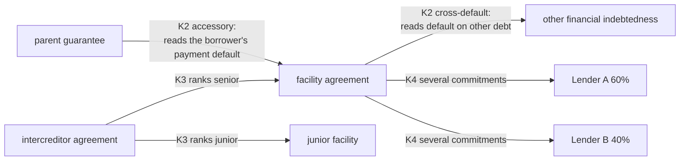
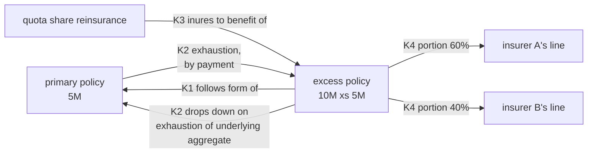
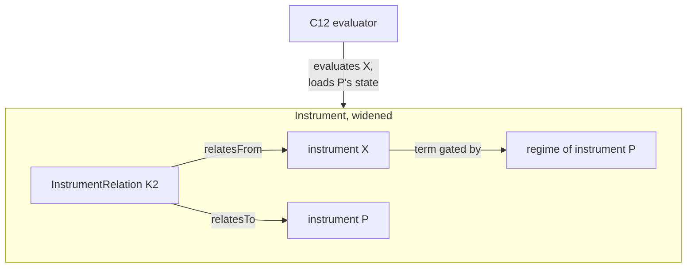
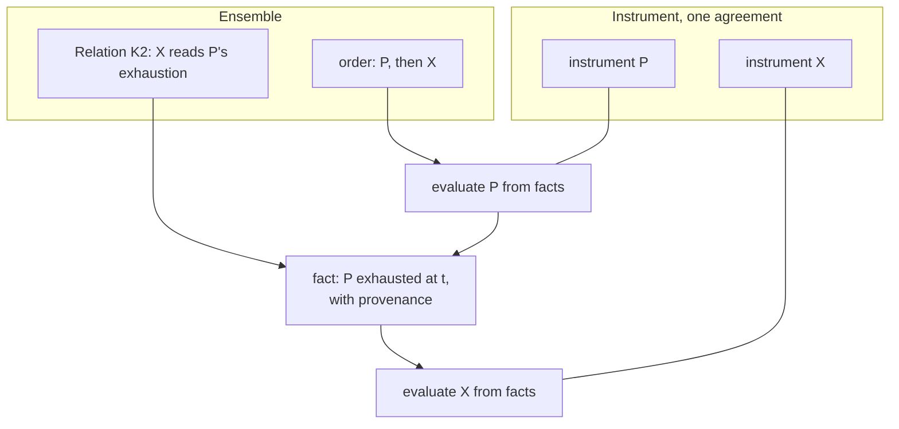
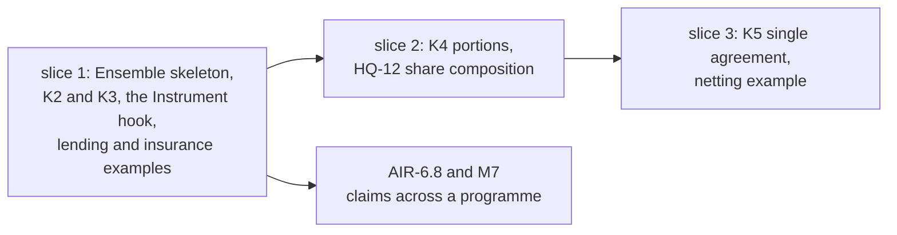

<!-- SPDX-License-Identifier: CC-BY-SA-4.0 -->

# Relations between instruments: inside Instrument, or a layer of their own

**Unit:** `instrument-relations` (sketch). **Status:** sketch, 2026-10-18. Nothing here is ratified.
**Takes up:** CCS held questions HQ-2 (gating by another agreement's state), HQ-7 (several
instruments covering portions of one order) and HQ-12 (composing shares), in the
[CCS plan](../plans/computable-contract-substrate.md) §"Held questions".
**Reads with:** the [Instrument README](../../../ontology/instrument/README.md) §6.4 (legal acts),
§11 (regimes and gating, above all §11.4), §16 (sections), C9c (incorporation by reference), and
the [claims sketch](insurance-claims-ontology.md) §10.2 (towers and erosion).

## Contents

1. [The scene](#1-the-scene)
2. [How the law and drafting answer it](#2-how-the-law-and-drafting-answer-it)
3. [The generic premise](#3-the-generic-premise)
4. [Examples](#4-examples)
5. [Option A: inside Instrument](#5-option-a-inside-instrument)
6. [Option B: a layer of its own](#6-option-b-a-layer-of-its-own)
7. [The two compared](#7-the-two-compared)
8. [Guidance](#8-guidance)
9. [Questions IR-Q1 to IR-Q6](#9-questions-ir-q1-to-ir-q6)

---

## 1. The scene

**What exists.** Instrument models one legally binding agreement thoroughly. Three constructs
already reach across agreements:

| Construct | What it does | Where |
|---|---|---|
| `ins:boundUnder` | an instrument created by exercising a power of another, for example a call-off under a framework's award power, or a policy under a binding authority | Instrument §16.3, `framework-lots.ttl` |
| legal acts under another instrument | an exercise may name a bound power of another instrument | Instrument §6.4 |
| incorporation by reference | one instrument incorporates another document's terms | CCS C9c |

**What is missing.** A relation whose effect depends on *another agreement's state*. A gate today
reads the occupancy of the relation's own instrument, or of the occasion its arising chain reaches
(§11.4). Three cases are held for this sketch:

- **HQ-2.** One contract responds only once another is exhausted, or a guarantee is called only
  once the principal debtor defaults.
- **HQ-7.** Several instruments are placed as portions of one order, on different risks or the same
  risk on different terms. They are neither one party group nor one instrument's sections.
- **HQ-12.** Shares compose. A 10% line on a contract that takes 50% of an order is 5% of the
  order.

**Why it matters.** Without these, LATTICE can say what one agreement means but not how a set of
agreements responds together. That is the common case in lending (facility, guarantee,
intercreditor), construction (main contract and subcontracts), derivatives (master and
confirmations) and insurance (layered programmes and reinsurance). HQ-2 itself notes that
dependencies across agreements "may not belong in this layer at all". This sketch weighs where they
do belong.

## 2. How the law and drafting answer it

The law starts from privity. Each contract binds its own parties, and is construed on its own
terms. Drafting then links contracts in a small number of recognisable ways. In each, the link is a
**term of one instrument that refers to another instrument or its state**, and the fact the term
needs, such as a payment, a default or an exhaustion, is evidence about the other instrument.

| Pattern | Example and source | What one instrument says about another |
|---|---|---|
| created under | a call-off under a framework agreement (Public Contracts Regulations 2015, reg. 33) | "this order is made under Lot 2 of the framework" |
| incorporates | a policy incorporating a clause set, a subcontract incorporating the main contract's specification | "the terms of X apply as if set out here" |
| accessory | a guarantee is co-extensive with the principal obligation, and falls away with it | "the guarantor will pay if the borrower fails to pay" |
| conditional on another's state | cross-default in a facility. An excess policy attaching on exhaustion of the underlying, where exhaustion by actual payment or by settlement is a question of the wording (*Zeig v Massachusetts Bonding* (1928), *Qualcomm v Certain Underwriters* (2008)) | "an Event of Default occurs if any Financial Indebtedness of the Borrower is not paid when due" |
| back to back | a subcontract mirroring the main contract. Pay-when-paid is void in UK construction contracts except on insolvency (Housing Grants, Construction and Regeneration Act 1996, s. 113) | "the subcontractor's entitlement follows the contractor's under the main contract" |
| single agreement | ISDA 2002 Master Agreement s. 1(c): the master and every confirmation form one agreement, which is what makes close-out netting work | "all Transactions … form a single agreement" |
| priority between agreements | an intercreditor agreement ranking senior and junior debt. Reinsurance applying in inuring order | "the junior lenders' claims are subordinated to the senior debt" |
| portions of one order | syndicated lending's several commitments. A placement split across policies (HQ-7) | "each Lender's obligations are several" |
| linked by statute | a linked credit agreement (Consumer Credit Act 1974, s. 19, Consumer Credit Directive 2008/48/EC, art. 3(n)) | the law, not the words, links them |

Two consequences shape the design.

- **Each instrument is evaluated on its own terms.** A term about another instrument does not merge
  the two. It reads facts about the other. The single-agreement clause is the exception the law
  itself creates, and it is drafted expressly.
- **The link carries properties of its own.** Which underlying limits count, whether exhaustion is
  by payment or by erosion, the order of priority, a share, the date it took effect. In ORM's terms
  it is an objectified fact, so it must be reified, not a plain property.

## 3. The generic premise

> A relation between instruments is a reified fact naming two or more instruments, with properties
> of its own and a valid time. Its legal effect is stated by a term of one of the instruments, or of
> a master, and evaluated against facts that include the related instrument's state. No relation
> merges the instruments it names, except a single-agreement relation that their own terms declare.

The patterns of §2 fall into five kinds, which the options below must all carry:

| Kind | Patterns | Reified properties, for example |
|---|---|---|
| **K1 derivation** | created under, incorporates | the power exercised, the edition incorporated |
| **K2 dependency** | accessory, conditional on another's state, back to back | the state read (default, exhaustion, payment), how it is reached (payment, erosion, settlement), the instruments that count towards it |
| **K3 priority** | intercreditor ranking, inuring order | rank, the measure ranked, what happens at equal rank |
| **K4 portion and share** | several commitments, portions of one order, composed shares (HQ-7, HQ-12) | the order, the share, the risk or terms the portion covers |
| **K5 single agreement** | master and confirmations | the master, the children, what the single agreement nets |

## 4. Examples

**Lending.** A facility, a parent guarantee and an intercreditor agreement.

**Construction.** A main contract and a back-to-back subcontract (K2), with the subcontract
incorporating the main contract's specification (K1).

**Derivatives.** A master agreement and its confirmations (K5). Close-out nets across every
transaction, because the parties agreed they form one agreement.

**Insurance.** A primary policy, an excess layer following form and dropping
down, and a quota share placed as portions of the excess's order.

The claims sketch §10.2 already describes the insurance case this way: each layer is an
instrument, and an excess layer's occasion reads the underlying exhaustion and nothing else. What it
lacks is a place to state the link, and a way for a gate to read a state that is not its own
instrument's.

## 5. Option A: inside Instrument

Instrument gains a relation class and widens its gates.

| Change | Detail |
|---|---|
| `ins:InstrumentRelation` | a reified relation, `⊑ fnd:Identified ⊓ fnd:TemporallyScoped`, with kinds K1 to K5 as a vocabulary, its instruments by role (`ins:relatesFrom`, `ins:relatesTo`), and properties per kind |
| qualified gates (HQ-2) | a gate may name a subject other than its own instrument: the related instrument's regime, through a relation |
| portions and shares (HQ-7, HQ-12) | a portion relation between an order and the instruments placed on it, and share composition as a law |
| single agreement (K5) | a master's sections, or a relation that makes children one agreement for stated purposes |
| `ins:boundUnder`, incorporation | stay, and are recast as K1 relations or kept as shortcuts |

**Design overheads.** One layer to learn, and the existing cross-instrument constructs sit beside
the new ones. But Instrument's laws are stated for one agreement, and its README already runs to
about 52,000 words. Mixing single-agreement laws with laws across agreements makes both harder to
state and to prove, and the formal-methods track's guarantees for one instrument would need
restating for sets of them.

**Runtime overheads.** The evaluator's unit of work grows from one instrument to a set. A gate
that reads another instrument's regime needs that instrument's state in scope, so evaluating one
instrument loads its neighbours, and the persistence aggregate grows from one instrument to a
neighbourhood. A cycle of dependencies (A reads B, B reads A, as a misdrafted cross-default can)
becomes the evaluator's problem.

## 6. Option B: a layer of its own

A new substrate layer, **Ensemble** (IR-Q1), sits above Instrument and Behaviour and
imports both. Instrument stays a model of one agreement.

| Change | Detail |
|---|---|
| a new layer | `ontology/ensemble/`, literate, with its own spec, vocabulary (K1 to K5 and their properties), shapes and laws |
| `ens:Relation` | the reified relation of §3, by kind |
| evaluation order | a set of related instruments is evaluated as a sequence of single-instrument evaluations, in an order the relations determine (dependencies before dependants, rank before rank). A cycle is rejected at design time |
| state as facts | what one instrument needs of another, such as an exhaustion, a default or a payment, reaches it as a fact with provenance, produced by evaluating the other. The single-instrument evaluator never loads a neighbour |
| one hook in Instrument | a regime's measured value, or a condition's evidence, may be supplied from outside the instrument with its source recorded. This is the only Instrument change, and it is generic |
| K1 constructs | `ins:boundUnder` and incorporation stay in Instrument, where they are already proven, and Ensemble reads them as K1 relations |
| K5 | a single-agreement relation tells the composition step to treat stated children as one agreement for stated purposes, for example netting, as their own terms say |

**Design overheads.** One more layer, an ADR, and an amendment to ADR-A01's substrate order,
recorded in the repository catalogue (ADR-A121). A reader learns that one agreement's meaning lives
in Instrument and a set's in Ensemble. The hook in Instrument is small, but it must state what an
externally supplied value may and may not do, for example that it is a fact with provenance and
never an assertion of the instrument's own state.

**Runtime overheads.** None beyond the work itself. Each evaluation stays within one instrument,
which keeps the persistence aggregate at one instrument and lets evaluations of unrelated
instruments run in parallel. The composition step is a topological order over the relations. The
facts passed between steps are recorded, so a decision on the excess cites the underlying's
exhaustion as evidence, which is how a claims file reads anyway.

## 7. The two compared

**Space.** A relation costs the same either way, about 6 to 10 triples: its type and kind, two or
more instruments by role, two or three properties of its kind, its identity and its valid time.

**Time.** Responding to one loss across a chain of *n* related instruments takes *n*
single-instrument evaluations either way. They differ in what each evaluation reads.

| Measure | Option A | Option B |
|---|---|---|
| instruments loaded to evaluate one | itself and every instrument its gates read, transitively | itself only |
| facts passed between instruments | none, the state is read in place | one per dependency, recorded |
| evaluations that can run in parallel | only instruments with no relations | every set of instruments not ordered by a relation |
| what a change to the relation model bumps | Instrument's spec, and every module importing Instrument re-pins | Ensemble's spec, and its importers re-pin |
| proofs per instrument | restated for neighbourhoods | unchanged |
| cycles | found at evaluation | rejected at design time by the order |

**A worked example.** A programme of a primary and four excess layers, each placed on two
policies (K4), so ten instruments, all evaluated for one loss:

| | Option A | Option B |
|---|---|---|
| evaluations | 10 | 10, in five ranks |
| instruments loaded, summed over the evaluations | 50: a policy on excess layer *k* loads itself and the 2*k* policies below it, so 2 + 6 + 10 + 14 + 18 | 10 |
| facts recorded between instruments | 0 | 8 (each excess reads the layer below) |
| triples added for the relations | about 80 | about 80 |

Option A loads five times as many instruments here, and the ratio grows linearly with the depth of
the chain, since the total is of order *n*² against B's *n*. Option B records eight extra facts, which a claims file needs as evidence anyway. The
costs cross only for a single pair of instruments, where A loads one neighbour and B records one
fact.

**Cascades.** Instrument has no importers inside LATTICE today, but applied modules, the claims
module and Open CBAA will import it. Under A, every refinement of relations across agreements
bumps Instrument for all of them. Under B, those refinements bump Ensemble only, and a module that
needs only single agreements never re-pins for them.

## 8. Guidance

**A leaning: Option B**, for four reasons.

1. **It follows the law.** Privity keeps each contract separate, and drafting links them by terms
   that read facts about another. B models exactly that: each instrument is evaluated alone, and
   the link supplies a fact. A models a shared state that no contract creates, except the single
   agreement, which B carries explicitly as K5.
2. **It keeps Instrument's guarantees.** The laws and proofs of one agreement stay as they are. A
   would reopen them for neighbourhoods.
3. **It scales the right way.** Evaluation stays within one aggregate, parallelises across
   unrelated instruments, and records the cross-instrument evidence a decision has to cite.
4. **It isolates change.** Relations across agreements are the newer, less settled part. B lets
   them evolve on their own version line.

**What would favour A.** If the hook in Instrument (an externally supplied, recorded fact) proved
unable to carry a real dependency, for example one where the related instrument's state must be
read at a different valid time from the one the evaluation is at, B would need more of Instrument
than one hook, and A's single layer would be simpler. The first slice should test exactly that, with
the excess-on-exhaustion case and a guarantee called on default.

**KISS.** Is it needed now? AIR's claims phase (AIR-6.8, milestone M7: one loss across a primary,
an excess and a reinsurance) needs K2 and K3. Lending and Open CBAA need K1, which exists. So the
first slice is K2 and K3, with K4 and K5 after. Nothing here needs building before AIR-6.8 is due.

## 9. Questions IR-Q1 to IR-Q6

| ID | Question | Options | Leaning |
|---|---|---|---|
| **IR-Q1** | The layer's name | Linkage (`lnk:`), Ensemble (`ens:`), Nexus (`nex:`), Composition, or another word the law uses | **Answered 2026-10-19: Ensemble, `ens:`.** The Code civil's *ensemble contractuel* (art. 1186 al. 2) is a set of contracts serving one operation, interdependent. The word is unused in LATTICE and has no market meaning. "Composition" was rejected because Party and Vocabulary already use it |
| **IR-Q2** | Option A or B | §5, §6 | **Answered 2026-10-18: B, Ensemble is a layer of its own.** [ADR-A130](../../architecture/decisions/ADR-A130-ensemble-layer.md) and ADR-A01's 2026-10-18 addendum drafted, Proposed |
| **IR-Q3** | Where `ins:boundUnder` and incorporation live | stay in Instrument and are read by Ensemble as K1, or move to Ensemble | stay. They are proven, and they concern how one instrument comes to exist |
| **IR-Q4** | The Instrument hook | a regime's measured value supplied from outside, or a condition's evidence supplied from outside, or both | both, as one rule: an externally supplied value is a recorded fact with provenance |
| **IR-Q5** | The first slice's scope | K2 and K3 only, or K2 to K4 | K2 and K3, tested on a guarantee called on default and an excess attaching on exhaustion |
| **IR-Q6** | Does this take over HQ-2, HQ-7 and HQ-12 from the CCS plan? | yes, with the CCS plan pointing here, or keep them in CCS | yes, once IR-Q2 is answered |
