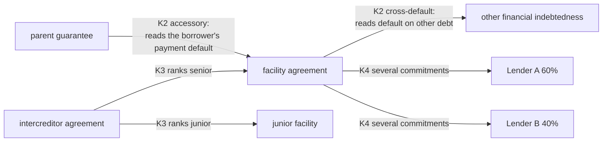
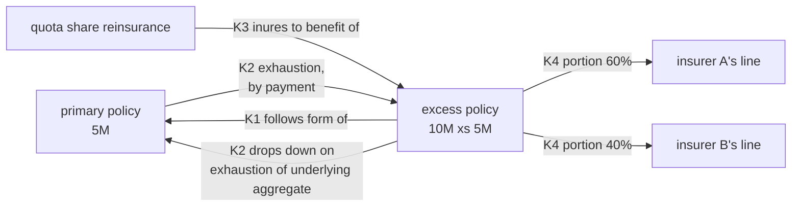
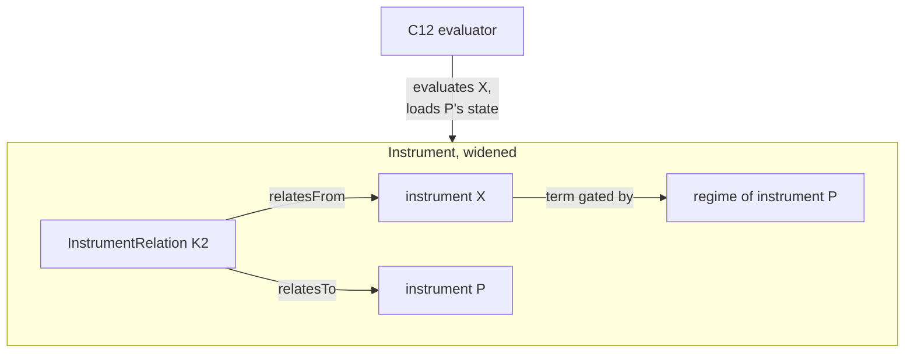
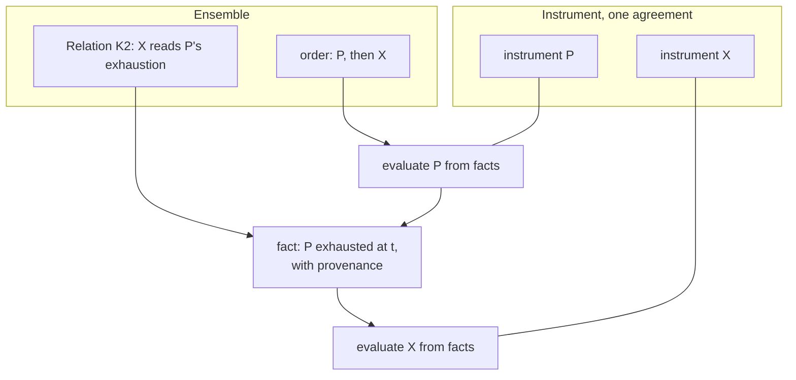
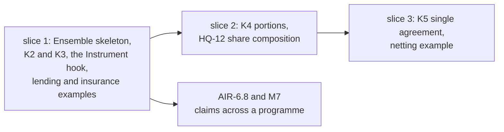
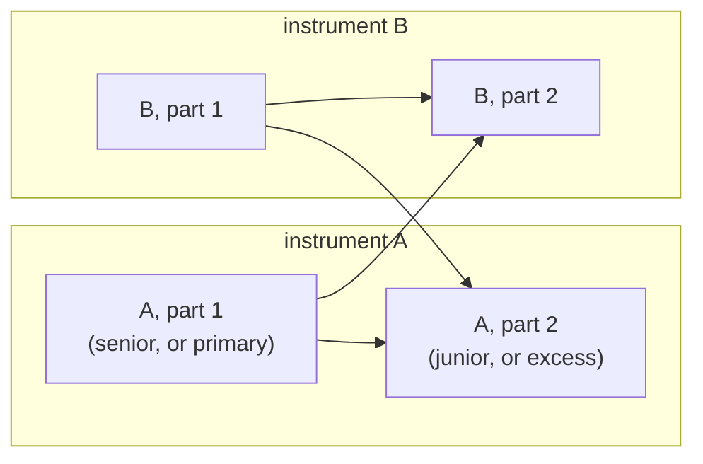
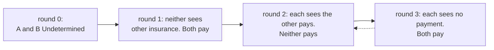

<!-- SPDX-License-Identifier: CC-BY-SA-4.0 -->

# Relations between instruments: inside Instrument, or a layer of their own

**Unit:** `instrument-relations` (sketch). **Status:** sketch, 2026-10-18. Nothing here is ratified. Option B became
[ADR-A130](../../architecture/decisions/ADR-A130-ensemble-layer.md) (Proposed), which holds the
current design as amended to 2026-10-21. §2 to §8 are the analysis that chose it, with the kinds and
the order brought into line with the ADR. §10 and §11 are dated records.
**Takes up:** CCS held questions HQ-2 (gating by another agreement's state), HQ-7 (several
instruments covering portions of one order) and HQ-12 (composing shares), in the
[CCS plan](../plans/computable-contract-substrate.md) §"Held questions".
**Reads with:** the [Instrument README](../../../ontology/instrument/README.md) §6.4 (legal acts),
§11 (regimes and gating, above all §11.4), §16 (sections), C9c (incorporation by reference), and
the [claims sketch](insurance-claims-ontology.md) §10.2 (towers and erosion).

## Contents

1. [The scene](#1-the-scene)
2. [How the law and drafting answer it](#2-how-the-law-and-drafting-answer-it)
3. [The generic premise](#3-the-generic-premise)
4. [Examples](#4-examples)
5. [Option A: inside Instrument](#5-option-a-inside-instrument)
6. [Option B: a layer of its own](#6-option-b-a-layer-of-its-own)
7. [The two compared](#7-the-two-compared)
8. [Guidance](#8-guidance)
9. [Questions IR-Q1 to IR-Q7](#9-questions-ir-q1-to-ir-q7)
10. [Needs added on 2026-10-20](#10-needs-added-on-2026-10-20)
11. [Evaluation below the instrument](#11-evaluation-below-the-instrument)

---

## 1. The scene

**What exists.** Instrument models one legally binding agreement thoroughly. Three constructs
already reach across agreements:

| Construct | What it does | Where |
|---|---|---|
| `ins:boundUnder` | an instrument created by exercising a power of another, for example a call-off under a framework's award power, or a policy under a binding authority | Instrument §16.3, `framework-lots.ttl` |
| legal acts under another instrument | an exercise may name a bound power of another instrument | Instrument §6.4 |
| incorporation by reference | one instrument incorporates another document's terms | CCS C9c |

**What is missing.** A relation whose effect depends on *another agreement's state*. A gate today
reads the occupancy of the relation's own instrument, or of the occasion its arising chain reaches
(§11.4). Three cases are held for this sketch:

- **HQ-2.** One contract responds only once another is exhausted, or a guarantee is called only
  once the principal debtor defaults.
- **HQ-7.** Several instruments are placed as portions of one order, on different risks or the same
  risk on different terms. They are neither one party group nor one instrument's sections.
- **HQ-12.** Shares compose. A 10% line on a contract that takes 50% of an order is 5% of the
  order.

**Why it matters.** Without these, LATTICE can say what one agreement means but not how a set of
agreements responds together. That is the common case in lending (facility, guarantee,
intercreditor), construction (main contract and subcontracts), derivatives (master and
confirmations) and insurance (layered programmes and reinsurance). HQ-2 itself notes that
dependencies across agreements "may not belong in this layer at all". This sketch weighs where they
do belong.

## 2. How the law and drafting answer it

The law starts from privity. Each contract binds its own parties, and is construed on its own
terms. Drafting then links contracts in a small number of recognisable ways. In each, the link is a
**term of one instrument that refers to another instrument or its state**, and the fact the term
needs, such as a payment, a default or an exhaustion, is evidence about the other instrument.

| Pattern | Example and source | What one instrument says about another |
|---|---|---|
| created under | a call-off under a framework agreement (Public Contracts Regulations 2015, reg. 33) | "this order is made under Lot 2 of the framework" |
| incorporates | a policy incorporating a clause set, a subcontract incorporating the main contract's specification | "the terms of X apply as if set out here" |
| accessory | a guarantee is co-extensive with the principal obligation, and falls away with it | "the guarantor will pay if the borrower fails to pay" |
| conditional on another's state | cross-default in a facility. An excess policy attaching on exhaustion of the underlying, where exhaustion by actual payment or by settlement is a question of the wording (*Zeig v Massachusetts Bonding* (1928), *Qualcomm v Certain Underwriters* (2008)) | "an Event of Default occurs if any Financial Indebtedness of the Borrower is not paid when due" |
| back to back | a subcontract mirroring the main contract. Pay-when-paid is void in UK construction contracts except on insolvency (Housing Grants, Construction and Regeneration Act 1996, s. 113) | "the subcontractor's entitlement follows the contractor's under the main contract" |
| single agreement | ISDA 2002 Master Agreement s. 1(c): the master and every confirmation form one agreement, which is what makes close-out netting work | "all Transactions … form a single agreement" |
| priority between agreements | an intercreditor agreement ranking senior and junior debt. Reinsurance applying in inuring order | "the junior lenders' claims are subordinated to the senior debt" |
| portions of one order | syndicated lending's several commitments. A placement split across policies (HQ-7) | "each Lender's obligations are several" |
| linked by statute | a linked credit agreement (Consumer Credit Act 1974, s. 19, Consumer Credit Directive 2008/48/EC, art. 3(n)) | the law, not the words, links them |

Two consequences shape the design.

- **Each instrument is evaluated on its own terms.** A term about another instrument does not merge
  the two. It reads facts about the other. The single-agreement clause is the exception the law
  itself creates, and it is drafted expressly.
- **The link carries properties of its own.** Which underlying limits count, whether exhaustion is
  by payment or by erosion, the order of priority, a share, the date it took effect. In ORM's terms
  it is an objectified fact, so it must be reified, not a plain property.

## 3. The generic premise

> A relation between instruments is a reified fact naming two or more instruments, with properties
> of its own and a valid time. Its legal effect is stated by a term of one of the instruments, or of
> a master, and evaluated against facts that include the related instrument's state. No relation
> merges the instruments it names, except a single-agreement relation that their own terms declare.

The patterns of §2 fall into the kinds below, which the options must all carry. ADR-A130 adds K6
(shared resource), reserves K7 (contribution) for an addendum, and adds K8 (representation), from
the needs of §10:

| Kind | Patterns | Reified properties, for example |
|---|---|---|
| **K1 derivation** | created under, incorporates | the power exercised, the edition incorporated |
| **K2 dependency** | accessory, conditional on another's state, back to back | the state read (default, exhaustion, payment), how it is reached (payment, erosion, settlement), the instruments that count towards it |
| **K3 priority** | intercreditor ranking, inuring order | rank, the measure ranked, what happens at equal rank |
| **K4 portion and share** | several commitments, portions of one order, composed shares (HQ-7, HQ-12), signed shares | the order, the share, the risk or terms the portion covers |
| **K5 single agreement** | master and confirmations | the master, the children, what the single agreement nets |

## 4. Examples

**Lending.** A facility, a parent guarantee and an intercreditor agreement.

**Construction.** A main contract and a back-to-back subcontract (K2), with the subcontract
incorporating the main contract's specification (K1).

**Derivatives.** A master agreement and its confirmations (K5). Close-out nets across every
transaction, because the parties agreed they form one agreement.

**Insurance.** A primary policy, an excess layer following form and dropping
down, and a quota share placed as portions of the excess's order.

The claims sketch §10.2 already describes the insurance case this way: each layer is an
instrument, and an excess layer's occasion reads the underlying exhaustion and nothing else. What it
lacks is a place to state the link, and a way for a gate to read a state that is not its own
instrument's.

## 5. Option A: inside Instrument

Instrument gains a relation class and widens its gates.

| Change | Detail |
|---|---|
| `ins:InstrumentRelation` | a reified relation, `⊑ fnd:Identified ⊓ fnd:TemporallyScoped`, with kinds K1 to K5 as a vocabulary, its instruments by role (`ins:relatesFrom`, `ins:relatesTo`), and properties per kind |
| qualified gates (HQ-2) | a gate may name a subject other than its own instrument: the related instrument's regime, through a relation |
| portions and shares (HQ-7, HQ-12) | a portion relation between an order and the instruments placed on it, and share composition as a law |
| single agreement (K5) | a master's sections, or a relation that makes children one agreement for stated purposes |
| `ins:boundUnder`, incorporation | stay, and are recast as K1 relations or kept as shortcuts |

**Design overheads.** One layer to learn, and the existing cross-instrument constructs sit beside
the new ones. But Instrument's laws are stated for one agreement, and its README already runs to
about 52,000 words. Mixing single-agreement laws with laws across agreements makes both harder to
state and to prove, and the formal-methods track's guarantees for one instrument would need
restating for sets of them.

**Runtime overheads.** The evaluator's unit of work grows from one instrument to a set. A gate
that reads another instrument's regime needs that instrument's state in scope, so evaluating one
instrument loads its neighbours, and the persistence aggregate grows from one instrument to a
neighbourhood. A cycle of dependencies (A reads B, B reads A, as a misdrafted cross-default can)
becomes the evaluator's problem.

## 6. Option B: a layer of its own

A new substrate layer, **Ensemble** (IR-Q1), sits above Instrument and Behaviour and
imports both. Instrument stays a model of one agreement.

| Change | Detail |
|---|---|
| a new layer | `ontology/ensemble/`, literate, with its own spec, vocabulary (the kinds and their properties), shapes and laws |
| `ens:Relation` | the reified relation of §3, by kind |
| evaluation order | a set of related instruments is evaluated as a sequence of evaluations of units (an instrument, or a part of one an endpoint narrows to), in an order over units and positions the relations determine (dependencies before dependants, rank before rank). The outcome is the least fixpoint, the same under every valid order. A cycle that remains over units and positions is rejected at design time unless an addendum admits it (§11) |
| state as facts | what one instrument needs of another, such as an exhaustion, a default or a payment, reaches it as a fact with provenance (the producing unit and version, the position, a digest of its read set), produced by evaluating the other. The single-instrument evaluator never loads a neighbour |
| one hook in Instrument | a regime's measured value, or a condition's evidence, may be supplied from outside the instrument with its source recorded. This is the only Instrument change, and it is generic |
| K1 constructs | `ins:boundUnder` and incorporation stay in Instrument, where they are already proven, and Ensemble reads them as K1 relations |
| K5 | a single-agreement relation tells the composition step to treat stated children as one agreement for stated purposes, for example netting, as their own terms say |

**Design overheads.** One more layer, an ADR, and an amendment to ADR-A01's substrate order,
recorded in the repository catalogue (ADR-A121). A reader learns that one agreement's meaning lives
in Instrument and a set's in Ensemble. The hook in Instrument is small, but it must state what an
externally supplied value may and may not do, for example that it is a fact with provenance and
never an assertion of the instrument's own state.

**Runtime overheads.** None beyond the work itself. Each evaluation stays within one instrument,
which keeps the persistence aggregate at one instrument and lets evaluations of unrelated
instruments run in parallel. The composition step is an order over units and positions, and its log is written in a canonical order. The
facts passed between steps are recorded, so a decision on the excess cites the underlying's
exhaustion as evidence, which is how a claims file reads anyway.

## 7. The two compared

**Space.** A relation costs the same either way, about 6 to 10 triples: its type and kind, two or
more instruments by role, two or three properties of its kind, its identity and its valid time.

**Time.** Responding to one loss across a chain of *n* related instruments takes *n*
single-instrument evaluations either way. They differ in what each evaluation reads.

| Measure | Option A | Option B |
|---|---|---|
| instruments loaded to evaluate one | itself and every instrument its gates read, transitively | itself only |
| facts passed between instruments | none, the state is read in place | one per dependency, recorded |
| evaluations that can run in parallel | only instruments with no relations | every set of units not ordered by a relation, and draws on one account at one position through Ledger's two phases |
| what a change to the relation model touches | Instrument's spec, read by every module that needs one agreement | Ensemble's spec only. Under one release (ADR-A129, 2026-10-20) both are a new release of the whole substrate |
| proofs per instrument | restated for neighbourhoods | unchanged |
| cycles | found at evaluation | most are acyclic over units and positions. The rest are rejected at design time, or admitted by an addendum with a resolving rule |

**A worked example.** A programme of a primary and four excess layers, each placed on two
policies (K4), so ten instruments, all evaluated for one loss:

| | Option A | Option B |
|---|---|---|
| evaluations | 10 | 10, in five ranks |
| instruments loaded, summed over the evaluations | 50: a policy on excess layer *k* loads itself and the 2*k* policies below it, so 2 + 6 + 10 + 14 + 18 | 10 |
| facts recorded between instruments | 0 | 8 (each excess reads the layer below) |
| triples added for the relations | about 80 | about 80 |

Option A loads five times as many instruments here, and the ratio grows linearly with the depth of
the chain, since the total is of order *n*² against B's *n*. Option B records eight extra facts, which a claims file needs as evidence anyway. The
costs cross only for a single pair of instruments, where A loads one neighbour and B records one
fact.

**Cascades.** Instrument has no importers inside LATTICE today, but applied modules, the claims
module and Open CBAA will import it. Since ADR-A129 (2026-10-20) the substrate is released as one
set, so any change is a new release under either option, and the version cascade no longer separates
them. What remains is that under A every module that needs one agreement loads the model of many,
and its release notes list changes to relations it never uses.

## 8. Guidance

**A leaning: Option B**, for four reasons.

1. **It follows the law.** Privity keeps each contract separate, and drafting links them by terms
   that read facts about another. B models exactly that: each instrument is evaluated alone, and
   the link supplies a fact. A models a shared state that no contract creates, except the single
   agreement, which B carries explicitly as K5.
2. **It keeps Instrument's guarantees.** The laws and proofs of one agreement stay as they are. A
   would reopen them for neighbourhoods.
3. **It scales the right way.** Evaluation stays within one aggregate, parallelises across
   unrelated instruments, and records the cross-instrument evidence a decision has to cite.
4. **It isolates change.** Relations across agreements are the newer, less settled part. B keeps
   them in their own document and their own release notes. Since ADR-A129 they share the
   substrate's release number, so this reason no longer includes a version line of their own.

**What would favour A.** If the hook in Instrument (an externally supplied, recorded fact) proved
unable to carry a real dependency, for example one where the related instrument's state must be
read at a different valid time from the one the evaluation is at, B would need more of Instrument
than one hook, and A's single layer would be simpler. The first slice should test exactly that, with
the excess-on-exhaustion case and a guarantee called on default.

**KISS.** Is it needed now? AIR's claims phase (AIR-6.8, milestone M7: one loss across a primary,
an excess and a reinsurance) needs K2 and K3. Lending and Open CBAA need K1, which exists. So the
first slice is K2 and K3, with K4 and K5 after. Nothing here needs building before AIR-6.8 is due.

The [Ensemble plan](../plans/ensemble.md) supersedes this sequence (2026-10-20).

## 9. Questions IR-Q1 to IR-Q7

| ID | Question | Options | Leaning |
|---|---|---|---|
| **IR-Q1** | The layer's name | Linkage (`lnk:`), Ensemble (`ens:`), Nexus (`nex:`), Composition, or another word the law uses | **Answered 2026-10-19: Ensemble, `ens:`.** The Code civil's *ensemble contractuel* (art. 1186 al. 2) is a set of contracts serving one operation, interdependent. The word is unused in LATTICE and has no market meaning. "Composition" was rejected because Party and Vocabulary already use it |
| **IR-Q2** | Option A or B | §5, §6 | **Answered 2026-10-18: B, Ensemble is a layer of its own.** [ADR-A130](../../architecture/decisions/ADR-A130-ensemble-layer.md) and ADR-A01's 2026-10-18 addendum drafted, Proposed |
| **IR-Q3** | Where `ins:boundUnder` and incorporation live | stay in Instrument and are read by Ensemble as K1, or move to Ensemble | **Answered 2026-10-21, as leaned:** stay. They are proven, and they concern how one instrument comes to exist |
| **IR-Q4** | The Instrument hook | a regime's measured value supplied from outside, or a condition's evidence supplied from outside, or both | **Answered 2026-10-21, as leaned:** both, as one rule: an externally supplied value is a recorded fact with provenance |
| **IR-Q5** | The first slice's scope | K2 and K3 only, or K2 to K4 | **Answered 2026-10-21, as leaned:** K2 and K3, tested on a guarantee called on default and an excess attaching on exhaustion |
| **IR-Q6** | Does this take over HQ-2, HQ-7 and HQ-12 from the CCS plan? | yes, with the CCS plan pointing here, or keep them in CCS | **Revised 2026-10-20:** HQ-2's second case, HQ-7 and HQ-12 move here. HQ-2's first case, one participant's share within one agreement, stays with Instrument and Party beside HQ-5 (ADR-A130 decision 9) |
| **IR-Q7** | The unit of evaluation, where an order over whole instruments cycles at one position (§11) | (i) units below the instrument, in order. (ii) one instrument per part, so no instrument spans a cycle. (iii) a fixpoint over whole instruments. (iv) a least fixpoint as the semantics, reached by an order over units and positions, with remaining cycles refused unless an addendum admits them | **Answered 2026-10-21: (iv).** Taken into ADR-A130 decision 5 before acceptance |

## 10. Needs added on 2026-10-20

Testing the design against layered programmes, vehicles and master arrangements found needs the
first draft did not meet. Each is stated from the law or from drafting, with examples from several
fields. The first five, with signed shares, representation and confidentiality, amend ADR-A130
before acceptance. The rest are slices of the
[Ensemble plan](../plans/ensemble.md).

| Need | Premise | Examples | Where |
|---|---|---|---|
| an ensemble with an identity | the Code civil's definition is of a set serving one operation, and the set acts as a whole: it owns shared limits, is formed and changed, and may be part of a larger set | a syndicated facility with its guarantees, a construction contract with its bonds, a master with its confirmations, a programme | ADR-A130 decision 2 |
| endpoints below the instrument, and identity or version | coordination terms target a term, a section or a limit of another agreement. Most relations survive amendment, and some are to one text | a master's shared limit over two children's limits, one section following the form of another, incorporation of one edition | ADR-A130 decision 4 |
| one agreement's participants are not an ensemble | several liability within one agreement is a matter of the agreement's parties | the lenders' several commitments in one facility agreement | ADR-A130 decision 9 |
| cycles broken by time | mutual cross-default is ordinary drafting, and each side reads the other's default as already occurred | two facilities of one borrower, each in default if the other is | ADR-A130 decision 5, now a case of its general rule over units and positions (§11) |
| a resource shared by instruments, visible at design time | a limit or aggregate shared by several contracts is stated by their terms, and reviewers need to see it without reading each term | two contracts sharing an aggregate, an authority's aggregate over the contracts bound under it | ADR-A130 decision 3, K6 derived and checked by a shape |
| a state from outside the modelled set | a contract may respond after another that is not held, whose state is known only as facts | a statutory scheme responding first, senior debt held by a lender not modelled | ES-2 |
| the composition law | option B rests on the claim that composed evaluation loses nothing against evaluating together | every ensemble acyclic over units and positions, stated as a least fixpoint (§11) | ES-3, formal methods C4, B4b, E4b |
| separate orders for draws and credits | recoveries are often applied in the reverse of the order in which loss was borne | excess layers applying a recovery from the top, a lending waterfall for recoveries | ES-8 |
| signed shares | where commitments exceed the order, each is reduced by the rule the terms state, a judgement from facts | an oversubscribed public offer of bonds scaled by the prospectus's basis of allocation, an MRC's signing provisions (lines to stand in full, the rest in equal proportion) | ADR-A130 decision 10, ES-5 |
| formation by a recorded act | a set of agreements comes into being at an act with its evidence | the signing of a facility, the closing of a bond issue, a placement completed | ES-6 |
| membership by rule | some sets are defined by a rule, not a list | every policy of a class written in a period under a treaty, the eligible receivables in a borrowing base, a framework's call-offs | ES-6 |
| nested ensembles | a set may be a member of a larger set | a vehicle participating in a layer, a facility within a group's financing | ES-6 |
| representation | one party's act may bind others whose agreements authorise it, one authority per subject, in stated tiers, with conditions, defaults and exclusions, sometimes with authority from a rule outside the agreements | an intercreditor agreement's security agent and instructing group acting across the facility, hedging and security documents, an MRC's slip leader for changes and claims agreement party for claims | ADR-A130 decision 11, ES-7 |
| confidentiality | members may agree terms the others must not see | an insurer's own security details pages on an MRC, a lender's side letter | ADR-A130 decision 12 |
| contribution | where several agreements answer one loss or debt, each bears a rateable part, by their terms or by the law where they are silent | co-sureties, policies covering the same loss | ES-8, K7 by addendum |

**Subscription.** Where several insurers subscribe a policy, each subscription is a distinct
contract with the insured unless the contrary is expressed (Marine Insurance Act 1906, s. 24(2)),
and the reported reading of *General Reinsurance Corp v Forsakringsaktiebolaget Fennia Patria*
[1983] QB 856 is that each line binds when it is written, subject to signing down. Both are to be
checked against the primary texts before a public document relies on them. The London Market
Group's MRC (Open Market) guidance v3.0 (2023) agrees: its model several liability clause reads "this
contract" as contracts in the plural, and its data dictionary records the date each written line's
contract was entered into. A subscription is then an
ensemble of one instrument per line sharing one wording, with K4 portions, and one instrument with a
group of several parties stays for a single agreement such as a syndicated facility. Where this is
modelled is the phase 7 plan's P7-Q5.

## 11. Evaluation below the instrument

Added 2026-10-21. ADR-A130 decision 5, as first drafted, ordered whole instruments and admitted a
cycle only where time breaks it. A case from two fields shows that this is too coarse.

### 11.1 The case

**Lending.** Facilities A and B each have a senior and a junior tranche. An intercreditor agreement
pays both junior tranches from shared collateral proceeds only once both senior tranches are
discharged. A's junior tranche reads B's senior discharge, and B's junior tranche reads A's.

**Insurance.** Two insurers each write a line on a primary layer and on the excess layer above it,
in one contract each, as one subscription to a placing contract with sections. Each excess section
reads the primary layer's exhaustion, which both insurers' primary sections produce.

Over whole instruments, A needs B's part 1 and B needs A's, at one position, so the draft rule
refuses an ordinary arrangement. Over parts there is no cycle: both first parts, then both second
parts.

### 11.2 The options

| | (i) units below the instrument | (ii) one instrument per part | (iii) a fixpoint over whole instruments | (iv) least fixpoint, reached by order |
|---|---|---|---|---|
| what it does | orders evaluation units, each an instrument or a part an endpoint narrows to (decision 4), and evaluates each once | splits each contract into one instrument per part, so whole-instrument order suffices | treats passed facts as Undetermined, evaluates whole instruments repeatedly until nothing changes | defines the outcome as (iii)'s least fixpoint, computes it by (i)'s order where the graph over units and positions is acyclic, and refuses a remaining cycle unless an addendum admits it |
| law | faithful | splits what the law treats as one act of writing, one agreement | faithful | faithful |
| evaluator's commitment | structural: a part can be evaluated given the facts it reads | none | semantic: an Undetermined input stays local to what reads it, and every path is monotone in the facts it is given | (i)'s, justified as the implementation of a general semantics |
| genuine cycles at one position | refused | refused | admitted, resolved or reported | refused now, admissible later by addendum with a resolving rule |

### 11.3 What a fixpoint needs

A fixpoint does not avoid a commitment from the evaluator. In the first round, A's part 1 must come
out determined while A's part 2 waits for B. If an Undetermined input made all of A's outcome
Undetermined, both instruments would stay at the bottom forever. So the evaluator must keep
Undetermined local to what reads it, which Instrument already does for relations and gates, and
must be monotone: a further fact never changes an outcome already determined.

Where the graph over units and positions is acyclic, the equations have exactly one solution, and the
round in which each fact becomes determined is the order (i) would use. (i) and (iii) then agree, and
(i) needs no monotonicity. They differ only on cycles that remain over parts. The law has some:

- **Other insurance clauses.** Two policies each say they are excess of any other valid insurance,
  or exclude cover where other insurance exists. The reported reading of *Weddell v Road Transport
  & General Insurance Co* [1932] 2 KB 563 is that such clauses cancel each other and both insurers
  contribute. *Lamb-Weston v Oregon Automobile Insurance Co*, 219 Or. 110 (1959), is reported to
  prorate conflicting clauses. Both are to be checked against the reports.
- **Circular guarantees.** Two companies in a group each guarantee the other's debt, and each one's
  ability to pay depends on the other's call.

A clause that reads the absence of other insurance is not monotone, and iterating it can oscillate:

A monotone reading can still have several fixpoints, here "both pay" and "neither pays", and the
least is "both Undetermined". The law picks its answer by a rule outside the clauses, contribution.
So a fixpoint finds such a cycle and needs a stated rule to resolve it.

### 11.4 Consequences

| | (i) | (iii) |
|---|---|---|
| checked at design time by | a shape: the graph over units and positions is acyclic | a sufficient condition at best: no closure (HQ-6) and no reading of absence over facts produced in the same component. General monotonicity is undecidable, and the condition bars other insurance clauses, the motivating case |
| determinism | one order, one answer | unique only if every member is monotone. Otherwise the answer can depend on the order of iteration |
| closures over absence | read facts already final | must never close over a fact still pending in the same component |
| a shared account inside a cycle | draws in the order | arrival order varies by round, so the order of draws must be a rule the terms state (LG-Q3), never first come. ADR-A131 decision 6 now gives this: draws are proposed, merged by the owner and settled |
| persistence | each fact written when produced | rounds held in memory, the component written at once, across several instruments' aggregates, owned by the ensemble's (ADR-A122, to confirm) |
| a late fact | re-evaluates the units downstream of it | re-evaluates the whole component from the bottom, since a superseding fact is a change, not more information |
| explaining an answer | "the primaries first, then the excess" | the same story, told by round. An oscillation reads as "these terms contradict each other" |

**Cost.** For a component of *n* instruments each spanning *d* parts, with *c* the cost of
evaluating one part:

| Strategy | Order of cost | 10 instruments, 4 parts each |
|---|---|---|
| (i) | *n·d·c* | 40 part evaluations |
| (iii), in rounds | *n·d·(d+1)·c* | 200 |
| (iii), re-running an instrument whenever an input arrives | up to *n²·d²·c* | about 1,240 |
| (iii), re-running only the relations whose inputs changed | about *n·d·c* | about 40, plus dependency tracking, which is (i)'s part-level evaluation under another name |

For one claim these are small. For a catastrophe event across a book of several thousand losses, a
factor of 5 to 30 matters. A fixpoint also holds a component's outcomes in memory until it converges,
with a round number on each fact to keep provenance well founded. It terminates in at most *k* + 1
rounds while each of *k* passed facts is a single value or Undetermined. If passed facts carry ranges
(for example "at least 30 paid"), chains are infinite and iteration needs widening, which loses
precision.

**Formal methods.**

| Track | (i) | (iii) |
|---|---|---|
| C, design models (C4) | the graph over units and positions is acyclic, a small model | iteration unrolled to the lattice's height, larger models. In return, a bounded search can find terms with several fixpoints at design time |
| B, the reference (B4b) | one order, compared with evaluating every member together | confluence across iteration orders as well, with oscillating cases |
| E, the prover (E4b) | the composition law by induction on the order, with a locality lemma: evaluating a part agrees with evaluating the whole instrument restricted to it | joint evaluation of a cyclic ensemble defined as a least fixpoint, composed evaluation equal to it by the chaotic iteration theorem, and a monotonicity proof over every Instrument and Behaviour term form |

### 11.5 Decision

**(iv), answered 2026-10-21 (IR-Q7).** The outcome is the least fixpoint. ES-3 builds the acyclic
path only, evaluating each unit once in its order, and the composition law is stated as a least
fixpoint, so its statement survives a later admission of cycles. ES-8, contribution, is where a
cyclic component may first be admitted by addendum, since the law's own cycles at one position
(other insurance clauses, circular guarantees) are resolved by contribution. Decision 5's earlier
rule for cycles broken by time becomes a case of the general one: refine the graph's nodes, by
position and then by part, until it is acyclic.
