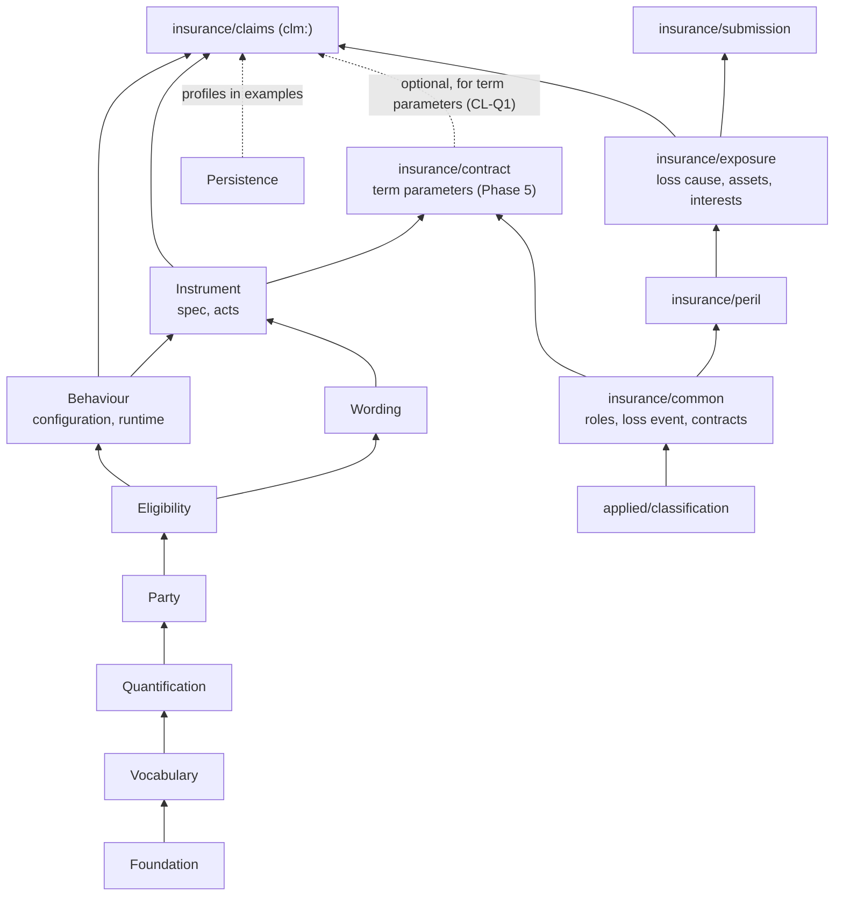
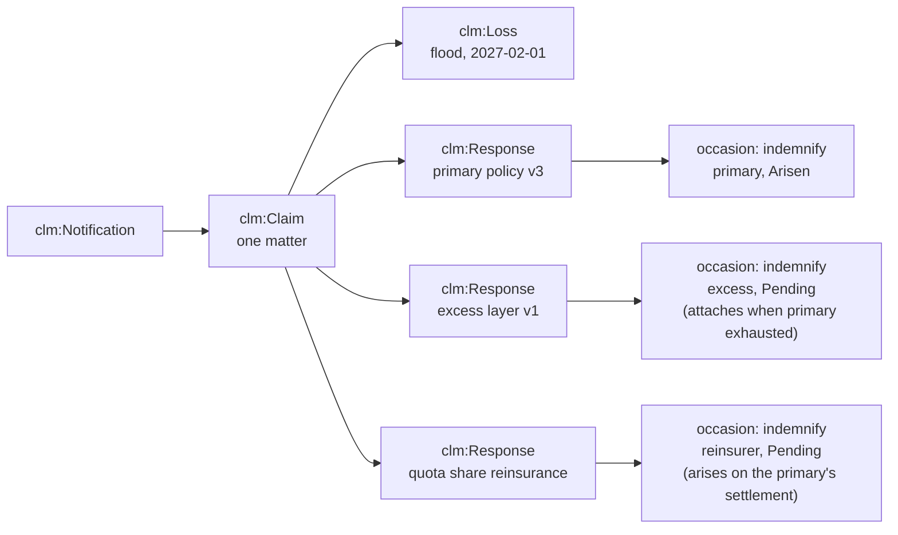
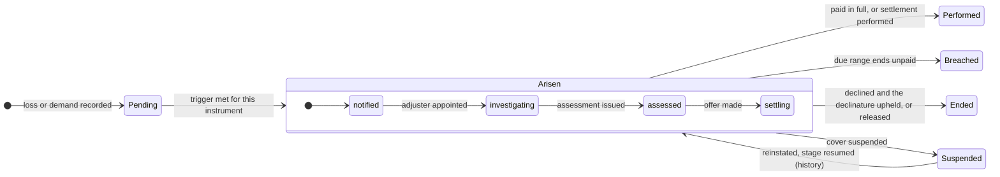
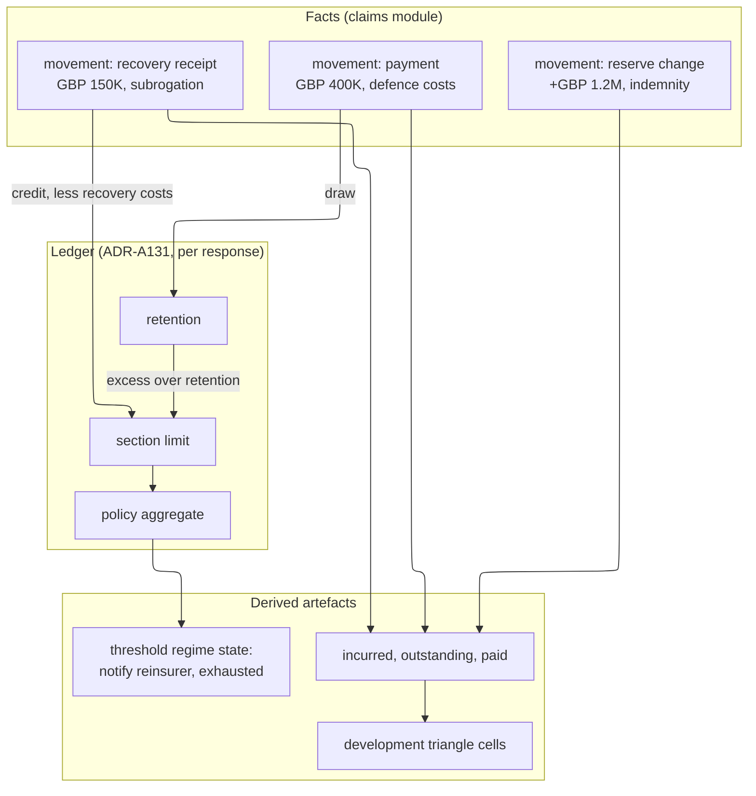
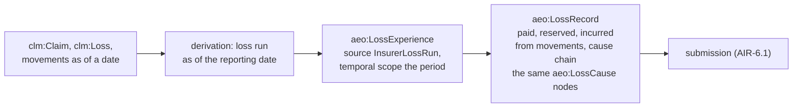

<!-- SPDX-License-Identifier: CC-BY-SA-4.0 -->

# Insurance Claims (`clm:`): Design Sketch

Version 0.1, draft for review, 2026-10-16. A sketch of the claims module of LATTICE's applied
insurance domain (`ontology/applied/insurance/claims/`). It describes what happened, who says what
about it, which contracts respond and how, what is owed, paid, reserved and recovered, and how all
of that changes over time and is known over time. Nothing here is ratified.

**Unit:** [`applied-insurance-reference`](../plans/applied-insurance-reference.md), Phase 6
(AIR-6.2 to AIR-6.4, [phase 6 plan](../plans/applied-insurance-reference-phase-6.md)). Written out
of the epic's order, ahead of Phase 5, so that the contract module and the remaining CCS slices can
be checked against what claims will need of them.

**Reads with:**

- [computable-contract-substrate.md](computable-contract-substrate.md) (CCS), §5 to §7 and the
  scenario catalogue §10, and its [plan](../plans/computable-contract-substrate.md)
- the [Instrument README](../../../ontology/instrument/README.md) §6.4 (legal acts), §10 (triggers),
  §13 (anchored time), §15 (deemings), and the [Behaviour README](../../../ontology/behaviour/README.md)
  with its examples `occasion-refinement.ttl`, `disputed-occasion.ttl` and `run-off.ttl`
- [nested-states-and-history.md](nested-states-and-history.md), [terms-in-time.md](terms-in-time.md),
  [consent-and-group-powers.md](consent-and-group-powers.md) §4.3
- [contract-amounts.md](contract-amounts.md) and [evaluation-context.md](evaluation-context.md)
- [term-parameters.md](term-parameters.md) §7 and [ADR-A102](../../architecture/decisions/ADR-A102-liability-direction-from-party-roles.md)
- [asset-exposure-ontology.md](asset-exposure-ontology.md) §5.12 and the exposure module's loss
  experience, loss record and loss cause (AIR-4.4)
- [peril-vocabulary.md](peril-vocabulary.md) §6.8, §8 and [peril-structure-whitepaper.md](peril-structure-whitepaper.md)
  §3.8, §3.11, N7, N10, W-Q2, W-Q3
- [mork-bridge.md](mork-bridge.md) §1 (B1 to B6) and §6, [workload-modelling.md](../notes/rdf-engine/workload-modelling.md) §4
- companions: [claims-sketch-references.md](claims-sketch-references.md) (what was taken from each
  source, definitions, crosswalks to ACORD and the Lloyd's claims bordereau) and
  [claims-wire-formats.md](claims-wire-formats.md) (ingress and egress of claims data)
- the [Persistence README](../../../ontology/persistence/README.md) §7.1, §7.4 and §7.9

Where this sketch and the epic or its ADRs differ, they take precedence.

---

## Contents

1. [Summary](#1-summary)
2. [How the law answers the question first](#2-how-the-law-answers-the-question-first)
3. [The words, one sense each](#3-the-words-one-sense-each)
4. [What LATTICE already gives a claims model](#4-what-lattice-already-gives-a-claims-model)
5. [Principles](#5-principles)
6. [Namespaces, layout and dependencies](#6-namespaces-layout-and-dependencies)
7. [The model](#7-the-model)
8. [Time, state and handling](#8-time-state-and-handling)
9. [Money](#9-money)
10. [Recoveries, reinsurance and towers](#10-recoveries-reinsurance-and-towers)
11. [Disputes, fraud and conduct](#11-disputes-fraud-and-conduct)
12. [Evidence, documents and personal data](#12-evidence-documents-and-personal-data)
13. [Reporting, exchange and the loop back to exposure](#13-reporting-exchange-and-the-loop-back-to-exposure)
14. [Worked examples](#14-worked-examples)
15. [Open standards](#15-open-standards)
16. [What this makes possible](#16-what-this-makes-possible)
17. [Substrate asks](#17-substrate-asks)
18. [Slices](#18-slices)
19. [Questions for the maintainer](#19-questions-for-the-maintainer)
20. [Sources consulted](#20-sources-consulted)

---

## 1. Summary

A claim is where every other part of LATTICE meets. The peril vocabulary says what caused the
loss. The exposure ontology says what was harmed and what it was worth. Wording and Instrument say
what the contracts promised, Behaviour says what has happened under them, Eligibility decides what
applies, Quantification and the evaluation context compute how much, Party says who stands where,
and Persistence keeps it all, with its history and its privacy. The claims module adds very little
of its own. What it adds is the structure that ties those together around a loss, and the
vocabulary that makes the result read right to a claims professional, a lawyer and a regulator.

The design rests on ten ideas:

| # | Idea | Where |
|---|---|---|
| 1 | **Words with one sense.** "Claim" means at least five things in practice. The model gives each its own term: the loss, the demand against an insured, the notification to an insurer, the claim matter an insurer handles, and the right to be paid | §3 |
| 2 | **A claim is a case, never a class hierarchy.** The insurer's duties to indemnify, defend, advance and pay arise once per claim as occasions of the policy's legal relations (CCS §7.6). The claims module supplies the case and its facts. It does not restate cover | §7.4 |
| 3 | **One loss, many contracts, one shared fact base.** A loss reaches a primary policy, excess layers, co-insurers, other insurance and reinsurance. Each responding instrument holds its own response, and all read the same facts | §7.5 |
| 4 | **Facts, acts and judgements kept apart.** What happened is a fact. What a party did with legal effect (a notification, a reservation of rights, an offer, a release) is a legal act. Whether cover applies, a duty is breached or a claim is fraudulent is evaluated or found, never typed in | §5 |
| 5 | **The law's own timing.** Under English law the property insurer's liability arises at the loss and the liability insurer's when the insured's liability is established and quantified. Claims-made covers trigger on the claim. The model follows the trigger the contract and its governing law use | §2, §8 |
| 6 | **Money as movements, balances derived.** Every reserve change, payment and recovery is an evidenced movement with a valid time and a record time. Incurred, outstanding, eroded limits and loss triangles are derived, on the ledger (ADR-A131) | §9 |
| 7 | **Settlement is a contract.** A settlement, a release, a Part 36 offer and its acceptance are Instrument constructs, so a settlement's terms are evaluated by the same machinery as the policy | §7.10 |
| 8 | **Recovery is a claim run the other way.** Subrogation, contribution and salvage reuse the demand, notification and settlement model, with the insurer as the party claiming | §10 |
| 9 | **Workflow is the deployment's.** Handling stages refine an occasion's arisen state (as `occasion-refinement.ttl` shows). Tasks, diaries and assignments stay with consumers (leftovers) | §8.3 |
| 10 | **Privacy and privilege by construction.** Claimants are often not the insured, often natural persons, and claims hold health and criminal data. Personal data, special category data and legally privileged material are classified on the record, not in the application | §12 |

The model is drawn from the law first, then aligned to the open standards the market uses for
claims data (ACORD, the London market's claims arrangements and bordereaux, HL7 FHIR's financial
resources for health claims, ISO 20022 for payments, IFRS 17 and Solvency II for reporting), with a
mapping through MORK wherever the standard is a format rather than a meaning (§15).

---

## 2. How the law answers the question first

AGENTS.md asks how the law and contract drafting answer a question before it is modelled. Each row
below is general background, stated as a hypothesis for the design and to be confirmed by counsel
before any rule is encoded (the whitepaper's caveat in §3.8 applies to all of them). The design
consequence is what the model must leave room for, and it does not depend on the detail of any one
rule.

### 2.1 When is the insurer liable?

| Cover | Rule, as we understand it | Design consequence |
|---|---|---|
| first-party indemnity (property), English law | the insurer's promise is to hold the insured harmless, so it is in breach, and liable in damages, as soon as the loss occurs (*Ventouris v Mountain*, *The Italia Express (No 2)* [1992] 2 Lloyd's Rep 281, *Sprung v Royal Insurance* [1999] Lloyd's Rep IR 111). The Insurance Act 2015 s.13A, inserted by the Enterprise Act 2016, adds an implied term to pay sums due within a reasonable time | the indemnity occasion arises at the loss, not at notification. Notification and proof are conditions of the separate duty to pay, whose due range is "a reasonable time", an open-textured standard read from a finding (CCS §6.4) |
| liability insurance, English law | the insured's right against the insurer arises only when its liability to the third party is established and quantified, by judgment, award or agreement (*Post Office v Norwich Union* [1967] 2 QB 363, *Bradley v Eagle Star* [1989] AC 957) | the indemnity occasion arises on a determination or settlement record, not on the demand. The defence and advancement duties arise earlier, on the demand or on tender |
| liability insurance, US law | the duty to defend is broader than the duty to indemnify and arises when a suit alleges facts potentially within cover (*Gray v Zurich Insurance* (1966) 65 Cal.2d 263). An insurer that unreasonably withholds benefits may be liable in tort for bad faith (*Gruenberg v Aetna* (1973) 9 Cal.3d 566) | the defence duty's arising condition reads the allegations (a some-value reading over the demand's alleged causes, ADR-A103). Bad faith is a finding, and its consequences relations arising on it |
| third-party rights | a third party may proceed directly against the insurer of an insolvent insured (Third Parties (Rights against Insurers) Act 2010) and, for motor, against the insurer directly (Road Traffic Act 1988 s.151, the EU Motor Insurance Directive 2009/103/EC art. 18). Many civil law jurisdictions grant a general direct action | the claimant's demand may name the insurer, and the payee may be the claimant. A statutory right is a relation `ins:impliedBy` the statute |
| reinsurance | the reinsurer follows the reinsured's settlements made honestly and in a proper and businesslike way (*Insurance Co of Africa v SCOR* [1985] 1 Lloyd's Rep 312, *Hill v M & G Re* [1996] 1 WLR 1239). A claims co-operation clause that is a condition precedent stops the liability arising without approval (*Scor v Eras (No 2)* [1995] 2 All ER 278) | already modelled by CCS C9b (`reinsurance-claims-cooperation.ttl`). The reinsured's settlement is the arising act of the reinsurer's duty |

### 2.2 Which policy, and which period, responds?

| Trigger | Responds when | Example covers |
|---|---|---|
| losses occurring | the loss happens in the period | property, most first-party |
| occurrence | the injury or damage happens in the period, whenever the claim is made | US commercial general liability |
| claims made | the demand is first made against the insured in the period | D&O, E&O, professional indemnity |
| claims made and notified | the demand is made and notified to the insurer in the period, or an extended reporting period | most London claims-made covers |
| losses discovered | the loss is discovered in the period | crime, fidelity |
| risks attaching (reinsurance) | the underlying policy incepted in the period | proportional treaties |
| long-tail theories (US) | exposure, manifestation, injury in fact, or continuous trigger from exposure to manifestation (*Keene v INA* 667 F.2d 1034 (D.C. Cir. 1981), *Montrose Chemical v Admiral* (1995) 10 Cal.4th 645) | asbestos, environmental |
| English mesothelioma | the injury is "sustained" when the victim is exposed, for employers' liability (*Durham v BAI (Run Off)*, the "Trigger litigation", [2012] UKSC 14) | employers' liability |

**Design consequence.** The trigger is a contract term (a claims basis parameter, term-parameters
§4), read against dated facts the claims module records: when the loss or injury happened, when
the demand was first made, when it was notified, when the loss was discovered, when exposure began
and when the harm manifested. A notice of circumstances under a claims-made cover is deemed, by the
wording, to make any later claim arising from those circumstances a claim made when the notice was
given. That is a relation-back deeming (CCS S25, `ins:Deeming` with `ins:forPurposeOf`).

### 2.3 How many claims, events or occurrences?

| Wording | Test, as we understand it | Source |
|---|---|---|
| "occurrence", "event" | a happening at a particular time, place and in a particular way. Hours clauses fix the window for catastrophe perils | *Axa Reinsurance v Field* [1996] 1 WLR 1026 |
| "originating cause" | wider than "event": a cause to which losses can be traced | *Axa v Field* |
| "series of related matters or transactions" | a unifying factor connecting the matters, judged as a whole | *AIG Europe v Woodman* [2017] UKSC 18 |
| "all claims arising from one act or omission" | the act or omission itself, not its consequences | *Lloyds TSB General Insurance v Lloyds Bank Group Insurance* [2003] UKHL 48 |

**Design consequence.** Aggregation decides how many retentions apply and how many limits respond.
It is a contract term evaluated over dated, located, caused losses (N7, substrate S4, contract
amounts A28, A55). The claims module records the facts aggregation reads, and every grouping it
derives is a derived artefact citing the aggregation term (§7.12).

### 2.4 Which cause governs?

Settled in the whitepaper §3.8 and the exposure ontology: proximate cause (*Leyland Shipping v
Norwich Union* [1918] AC 350), concurrent causes with one excluded (*Wayne Tank v Employers
Liability* [1974] QB 57), and the US efficient proximate cause rule, with anti-concurrent causation
clauses enforced in some states. The claims module records the chain of causes and selects the
rule by an evaluation profile chosen by governing law and wording (N10, AIR-6.4, W-Q2).

### 2.5 What may an insured lose, and how?

| Matter | Rule, as we understand it | Design consequence |
|---|---|---|
| fraudulent claim | the insurer need not pay the claim and may recover sums paid, and may treat the contract as terminated from the fraud (Insurance Act 2015 s.12). A lie that is irrelevant to the recoverability of the claim (a "collateral lie") is not a fraudulent claim (*Versloot Dredging v HDI Gerling* [2016] UKSC 45) | fraud is a finding. Its consequences are relations arising on the finding. Indicators are assessments, never findings (§11.2) |
| breach of a claims condition | the consequence depends on how the term is classified: a condition precedent defeats the claim, an innominate term gives damages or, where serious, rejection (CCS S15, `ins:classification`) | the breach chain is stated by relations arising on breach |
| late payment | damages for breach of the implied term in s.13A, subject to the insurer's reasonable grounds for disputing the claim | a finding, with the s.13A term `ins:impliedBy` the statute |
| average (underinsurance) | the insured is its own insurer for the uninsured proportion (Marine Insurance Act 1906 s.81, and pro rata average clauses) | a combinator over the sum insured and the value at risk (`proRata`, evaluation context §4) |
| contribution | an insured with double insurance is not paid twice, and insurers share rateably (Marine Insurance Act 1906 s.80) | other insurance is a responding instrument (§7.5), and the share a combinator |
| subrogation | the insurer who has indemnified stands in the insured's place against third parties (*Castellain v Preston* (1883) 11 QBD 380, Marine Insurance Act 1906 s.79) | a deeming that the payer stands in the creditor's place (CCS S34), and a recovery demand (§10.1) |

### 2.6 What does conduct regulation require?

| Regime | Requirement, in outline | Design consequence |
|---|---|---|
| UK FCA ICOBS 8.1 | handle claims promptly and fairly, give reasonable guidance, not unreasonably reject a claim, settle promptly once terms are agreed | duties `ins:impliedBy` the rule, with derived breaches feeding conduct reporting |
| UK FCA Consumer Duty (PRIN 2A) | good outcomes, including in claims, for retail customers | outcome measures are derived artefacts over claim facts, outside the T-Box |
| UK FCA DISP | complaints handling and referral to the Financial Ombudsman Service | a complaint is a demand against the insurer (§11.1) |
| US NAIC Unfair Claims Settlement Practices Act (Model #900) and Model Regulation (#902) | acknowledgement, investigation and decision within stated periods, which vary by state | duties `ins:impliedBy` each state's enactment, with due ranges per state |
| IAIS Insurance Core Principle 19 | fair treatment of customers, including claims handling | as above, by jurisdiction |
| GDPR art. 9 and 10, UK Data Protection Act 2018 Sch. 1 para. 20 | health and criminal offence data processed for insurance purposes under a stated condition | special category classification on the record (§12.2) |

**Design consequence.** Regulatory duties on the insurer are legal relations implied by law, bound
into the claim's responding instruments by the jurisdiction they fall under. Their occasions, due
ranges and breaches are evaluated like any contractual duty, so conduct monitoring is a query over
occasions, not a separate system.

---

## 3. The words, one sense each

CCS's first test is that a contract lawyer or an engineer surveying the T-Box meets no word used in
two senses. "Claim" fails that test in ordinary use:

| In practice "claim" means | Example | Term here |
|---|---|---|
| the loss or injury itself | "the claim happened in March" | `clm:Loss` (§7.1) |
| a demand made against the insured by a third party | "a claim was made against the director" | `clm:Demand` (§7.2) |
| a request to the insurer for indemnity, or notice of a loss | "we notified the claim" | `clm:Notification` (§7.3) |
| the insurer's file and handling of the matter | "the claim is under review", "claim number 12345" | `clm:Claim` (§7.4) |
| the right to payment | "the claim is worth 2 million" | an occasion of the payment obligation and its quantum (§7.6, §9) |

The other words, each with one sense:

| Word | Sense | Not to be confused with |
|---|---|---|
| **loss** | something that happened to someone or something, causing harm. Dated, located, caused | an amount of money (that is a **quantum** or a **movement**) |
| **loss event** | an occurrence in the world many losses share (`icm:LossEvent`, AIR-4.4) | an occurrence under a contract's aggregation term |
| **occurrence grouping** | the contract's grouping of losses for its limits and retentions, derived | the loss event |
| **demand** | an assertion by a claimant that someone owes them something: a letter, a suit, an arbitration, a regulatory investigation | the notification to an insurer |
| **circumstance** | a situation that may give rise to a demand, notified under a claims-made cover | a demand |
| **notification** | a legal act telling an insurer of a loss, demand or circumstance | the claim matter it opens |
| **claim** | the matter an insurer (or its agent) handles for one notification, or several related ones | the loss, the demand |
| **response** | how one instrument version responds to a claim: its relations' occasions for the claim | the claim |
| **coverage position** | an insurer's communicated stance: acceptance, reservation of rights, declinature, avoidance | the evaluated coverage, which is derived |
| **quantum** | the amount claimed, assessed, agreed or determined for a loss item | a payment |
| **reserve** | an estimate of what will be paid, with its basis and who estimates it | a payment, a provision in accounts |
| **movement** | a dated money fact on a claim: a reserve change, a payment, a receipt | a balance, which is derived |
| **settlement** | an agreement ending all or part of a claim or demand | a payment, which performs it |
| **recovery** | money or value recovered from a third party, other insurance, salvage or reinsurance | a refund of premium |
| **determination** | a finding by a court, arbitrator, expert or a party with a power to determine | an assertion by a handler |

"Instantiation" and "instantiator" keep the sense AGENTS.md gives them, and the claims module uses
neither for claims processing.

---

## 4. What LATTICE already gives a claims model

Before adding anything, each need is matched to what exists or is planned. Status is as of
2026-10-16 on `main` and the AIR branch.

| Claims need | LATTICE construct | Status |
|---|---|---|
| the insurer's duties to indemnify, defend, advance, pay | `ins:Obligation` arising per case, its occasion, due range, breach | Instrument 0.17.0, Behaviour 0.15.0 (CCS C7 to C11) |
| exclusions, write-backs, burden of establishing an exception | `ins:Exclusion`, `ins:Permission`, law I7, `exe:ExceptionNotEstablished` | CCS §5.7, built |
| notice as a condition precedent, a notice duty and its breach chain | `ins:Obligation` with `ins:arisesOn` an `ins:OnAct`, `ins:due`, `ins:arisesOnBreachOf` | CCS §5.5, built |
| a notification as an act with legal effect | `ins:LegalAct`, `ins:Declaration`, `ins:forCase` | Instrument acts, CCS C9b1 |
| an approval, a consent to settle, a claims co-operation clause | `ins:Exercise` of a power, `ins:pursuantTo`, a consent rule | C9b, `reinsurance-claims-cooperation.ttl` |
| relation back, deemed receipt, deemed failure | `ins:Deeming`, `ins:forPurposeOf`, closure declarations | ADR-A105, CCS §5.6 |
| findings, determinations, matters outside computation | finding records, exercise of a power to determine | CCS §6.4 |
| parties unknown at binding, resolved per claim | contingent `pty:RoleOccupancy`, `ins:resolvedBy`, law I11 | Party, CCS §5.3 |
| claimant, harmed party, liable party, payee | `icm-voc:Claimant`, `HarmedParty`, `LiableParty`, `Payee` | ADR-A102, `insurance/common` |
| liability direction | derived from roles and the relationship graph | ADR-A102, derivation rules in Phase 5 |
| handling stages per claim | a refinement of `bhv:Arisen`, `bhv:perOccasionOf` | `occasion-refinement.ttl` |
| a dispute per claim | a per-occasion regime | `disputed-occasion.ttl` |
| suspension of cover and resumption | history into `bhv:Live` | nested states sketch, C11a |
| claims servicing in run-off, claims authority suspended | regions of a run-off state | `run-off.ttl` |
| delegated authority, referral above a limit, loss fund | `ins:Power` with a scope limit, a referral obligation, a ledger account | CCS S46, contract amounts A12 |
| several insurers, a lead and followers, consent of a group | `pty:ParticipationGroup`, `ins:ConsentRule`, `pty:Delegation` | consent sketch, C9b |
| cause, mechanism, agency of each link in a cause chain | `aeo:LossCause`, effective characteristics, defaulted characteristics | AIR-4.4 |
| peril codes from another list, lifted exactly | crosswalks, `aeo:liftedPeril` | AIR-3.4 |
| a loss event keyed by GLIDE, PCS or PERILS | `icm:LossEvent`, `fnd:naturalKey` | AIR-4.4, ADR-A114 |
| what was harmed and its value | `aeo:Asset`, `aeo:Interest`, `aeo:Valuation` | AIR-4.1 |
| what a requirement or a lender demands | `aeo:CoverageRequirement`, `aeo:owedTo` | AIR-4.4 |
| limits, retentions, sublimits, erosion, order of payment, reinstatement | contract amounts catalogue A1 to A58, ledger accounts (ADR-A131, Ledger LG-3) and combinators | sketches, not built |
| occurrence grouping by window | substrate S4 | not built |
| causation profiles by governing law | N10, AIR-6.4 | not built, W-Q2 open |
| amounts in currencies, conversion at a date, percentages of a base | `qnt:Quantity`, `qnt:Conversion`, `qnt:DerivedValueSpace` | Quantification |
| business days and calendars | `qnt:CalendarUnit`, ADR-A94 | Quantification |
| valid time and record time | `fnd:TemporallyScoped`, `fnd:recordedAt`, Persistence history | Foundation, Persistence |
| claim numbers, unique claim references | `fnd:Key`, `fnd:KeyScheme`, `fnd:externalKey` | ADR-A114 |
| ingestion of bordereaux and messages | MORK mappings compiled to RML | MORK |
| an aggregate per claim file, a per-subject graph for a person | `dal:AggregateBoundaryProfile`, `dal:PrivacyProfile` | Persistence |
| a record of what was checked and how | assurance records (EARL, PROV-O) | formal methods track A |

**What is missing**, and so what this sketch designs or asks for:

- the claims vocabulary itself: loss, demand, notification, claim, response, loss item, quantum,
  reserve, movement, settlement, recovery, proceedings, complaint (§7 to §11)
- a pattern for one case shared by several responding instruments (§7.5)
- money movements now, and their place in the ledger later (§9)
- legal privilege, retention and legal hold, which Persistence does not yet classify (§12, §17)

---

## 5. Principles

| # | Principle | Consequence |
|---|---|---|
| CL1 | **The law's terms, one sense each** (§3) | `clm:Loss`, `clm:Demand`, `clm:Notification`, `clm:Claim` are disjoint |
| CL2 | **Cover is never restated.** The policy's relations decide what applies. The claims module supplies the case, its facts and its acts | no `clm:` class or property names a cover, a limit or an exclusion |
| CL3 | **Facts, acts, judgements** (AGENTS.md, Modelling). A fact is evidenced, a legal act is an `ins:LegalAct`, a judgement is evaluated or found | a coverage decision, a breach, fraud, a direction, an aggregation and a balance are each derived or found, and a shape reports one that is asserted without its derivation or finding |
| CL4 | **One loss, one shared fact base, a response per instrument** | §7.5. No fact is copied per insurer |
| CL5 | **Two times everywhere.** Every fact has the time it held (valid time) and the time it was known (record time), so "what did we know at the reserving date" is a query | A4 of the exposure ontology, Persistence history |
| CL6 | **Money as movements** | balances, incurred and outstanding are derived (§9) |
| CL7 | **Operative scheme is the contract's** (MORK bridge B1). A claim's cause is coded in the scheme the contract binds, lifted to the reference only through an exact crosswalk | `aeo:peril` and `aeo:liftedPeril` on each cause link, as AIR-3.4 decided |
| CL8 | **Never guess** (MORK bridge B3). A missing fact, a missing characteristic or an unestablished exception gives Undetermined with a reason, which becomes a referral | handling never auto-declines on missing data |
| CL9 | **Workflow is the deployment's.** LATTICE states what is legally and factually so, and a deployment refines states for its own handling | §8.3, [leftovers](../plans/air-leftovers.md) |
| CL10 | **Privacy and privilege on the record** | §12. A person's data and a privileged document are classified where they are stored |
| CL11 | **Standards by mapping.** The model follows the law, aligns names with open standards where that costs nothing, and maps formats through MORK | §15 |
| CL12 | **Clean room for anything general.** A substrate change motivated here follows ADR-A-C2 | §17 |

---

## 6. Namespaces, layout and dependencies

| Prefix | IRI | Content |
|---|---|---|
| `clm:` | `https://www.nebularis.org/neuro-semantic/insurance/claims#` | T-Box (proposed under ADR-A98 decision 6, CL-Q7) |
| `clm-voc:` | `https://www.nebularis.org/neuro-semantic/insurance/claims/vocab#` | scheme contracts, reference schemes, value spaces |

```
ontology/applied/insurance/claims/
    README.md                     literate source (AIR-2.0)
    spec/claims.ttl               the T-Box: losses, demands, notifications, claims, responses
    spec/claims-money.ttl         movements, reserves, quantum (a second spec document, ADR-A120)
    vocab/claims-vocab.ttl        scheme contracts and reference schemes
    shapes/structural.ttl, constraints.ttl, profiles/*.ttl, .version
    examples/
```

ADR-A98 decision 5 has `claims/` import `exposure/` and `contract/`. The contract module is
deferred (epic D2), and what claims needs of contracts is Instrument's: relations, occasions, acts,
deemings and regimes. The claims module therefore imports Instrument directly, and the contract
module only for insurance term parameters (the claims basis, the aggregation term, the limits) when
it exists. That is CL-Q1.



Dependencies run one way. Nothing below imports `claims/`. The exposure module never imports it:
the loop back from claims to loss history is a derivation that writes exposure records (§13.3).

---

## 7. The model

### 7.1 Loss

```text
clm:Loss ⊑ fnd:Evidenced ⊓ fnd:TemporallyScoped
    ≥1 clm:lossDate…       when it happened: a time, or a span for a continuing loss
    ≤1 clm:lossAt          → aeo:Location        where, when it has a place
    ≥0 clm:hasCause        → aeo:LossCause       one node per link of the cause chain (AIR-4.4)
    ≥0 clm:affects         → aeo:Asset ⊔ aeo:Interest ⊔ pty:Actor    what or who was harmed
    ≤1 clm:inLossEvent     → icm:LossEvent       an event in the world it belongs to
    ≥0 clm:harmSubject     ⊑ icm:harmSubject     property, persons, data, financial interest
```

A loss is what happened, before anyone claims anything. Its temporal scope carries the dates a
trigger may read, as distinct properties, because they differ and a contract picks one:

| Property | Meaning | Read by |
|---|---|---|
| `clm:occurredAt` | when the damage or injury happened, or began | losses occurring, occurrence triggers |
| `clm:manifestedAt` | when it became apparent | manifestation trigger, latent defects |
| `clm:discoveredAt` | when the insured discovered it | losses discovered |
| `clm:exposureFrom`, `clm:exposureTo` | the span of exposure to the cause | exposure and continuous triggers, the Trigger litigation |

Each date is evidenced and may be estimated, with its precision as metadata (as CCS §7.4.1 does for
a proposal's values). An unknown date is absent, not guessed (CL8). Neither ACORD's claims messages
nor the Lloyd's claims bordereau carries the manifestation, discovery or exposure dates
([references](claims-sketch-references.md) §8), so a claim whose trigger reads them takes them from
its documents or from a person, and stays Undetermined until it does.

The cause chain reuses the exposure module's `aeo:LossCause` (AIR-4.4), with the recorded and
effective characteristics and the lifted peril already decided. A claim's loss and a loss history's
loss record therefore read the same cause model, and the loop of §13.3 needs no translation.

### 7.2 Demand

A demand is an assertion, by a claimant, that someone owes them something. Liability, D&O, E&O and
cyber covers respond to demands against the insured. A complaint to an insurer, and a recovery
action by an insurer, are demands too (§10, §11).

```text
clm:Demand ⊑ fnd:Evidenced ⊓ fnd:TemporallyScoped
    =1 clm:madeAt              when first made (the claims-made trigger reads it)
    ≥1 clm:claimantOcc         → pty:RoleOccupancy in icm-voc:Claimant
    ≥1 clm:againstOcc          → pty:RoleOccupancy in icm-voc:LiableParty   who is alleged liable
    ≥0 clm:harmedOcc           → pty:RoleOccupancy in icm-voc:HarmedParty
    ≥0 clm:alleges             → aeo:LossCause        the wrongful acts or causes alleged
    ≥0 clm:arisesFromLoss      → clm:Loss
    =1 clm:demandForm          written demand, suit, arbitration, regulatory investigation, subpoena, complaint
    ≥0 clm:reliefSought        → clm:Relief           damages (a quantum), declaration, injunction, specific performance
    ≤1 clm:inProceedings       → clm:Proceedings      when it is litigated or arbitrated (§11.1)
```

The roles are those of ADR-A102. A demand by an insured entity against its own director has the
entity in the claimant role and the director in the liable role, and the insured-versus-insured
reading of term-parameters §7.3 derives from that, never from a flag. Allegations are
`aeo:LossCause` links too: a securities claim alleges misrepresentation (H.WRA.MIS), a breach of
duty alleges H.WRA.MGT. The duty to defend reads them with a some-value reading (ADR-A103), because
a suit with one potentially covered allegation is defended in full under US law (§2.1).

### 7.3 Notification

A notification is a legal act: an insured, or someone for it, tells an insurer of a loss, a demand
or a circumstance. It is an `ins:Declaration` (Instrument §6.4), so its time, its maker, its
evidence and its case are what Instrument already records.

```text
clm:Notification ⊑ ins:Declaration
    =1 ins:actBy            the notifying occupancy (insured, broker, claimant under direct action)
    ≥1 clm:notifiedTo       → pty:RoleOccupancy     the insurer, its lead, or an agent named for notice
    =1 clm:notificationKind notice of loss, notice of demand, notice of circumstances, proof of loss
    ≥1 clm:notifies         → clm:Loss ⊔ clm:Demand ⊔ clm:Circumstance
    ≤1 ins:forCase          → clm:Claim             the claim it opens or adds to
    ≥0 clm:viaChannel       concept: written, electronic message, portal, telephone
```

The contract decides what a notification does. A notice duty arises on the demand and falls due
within a period (CCS §5.5 shows the whole chain). A notice of circumstances is deemed to make later
demands claims made at its time (a relation-back `ins:Deeming`, CCS S25). Whether the notice was
valid, given to the right person in the right form in time, is evaluated from these facts and the
wording (CCS S27, powers with procedural conditions).

```text
clm:Circumstance ⊑ fnd:Evidenced
    ≥1 clm:mayGiveRiseTo    → a description, a potential claimant population, alleged causes
```

A circumstance names the populations that might claim (exposure's counterparty populations,
AIR-4.5), never invented claimants (ADR-A102 decision 2).

### 7.4 Claim

The claim is the matter an insurer handles, and the case its policy's relations are evaluated for
(CCS §5.3, `ins:forCase`).

```text
clm:Claim ⊑ fnd:Versioned ⊓ fnd:Governable ⊓ fnd:Evidenced
    =1 fnd:hasIdentity        → clm:ClaimIdentity      persists across versions and reopenings
    ≥1 clm:openedBy           → clm:Notification
    ≥0 clm:concernsLoss       → clm:Loss
    ≥0 clm:concernsDemand     → clm:Demand
    ≥0 clm:hasResponse        → clm:Response           one per responding instrument version (§7.5)
    ≥0 clm:hasLossItem        → clm:LossItem           heads of loss and their quanta (§7.6)
    ≥0 clm:relatedTo          → clm:Claim              asserted relatedness, for a person to judge
    ≥0 fnd:naturalKey         the insurer's claim number, a coverholder's or TPA's claim reference
                               (CRS CR0104), a London market claim reference, each a key of its own
                               scheme (ADR-A114)
```

**A claim is versioned.** Its facts change as they are learned (a second injured party, a revised
date of loss, an amended allegation), and each change is a new version superseding the last, so
the claim as known at a reserving date or a coverage decision is recoverable (CL5). Its governance
state is the record's (draft while being set up, active, closed, reopened as a new version with a
new governance state). Whether the insurer's duties are performed or breached is never this state:
it is the occasions' (§8).

**One notification, one claim, by default.** Related notifications may be joined to one claim, or a
claim split, as the handler decides, recorded as a new version with evidence. Whether claims are one
for a limit or retention is the contract's aggregation, derived (§7.12), and independent of how the
handler files them. Keeping the two apart lets a deployment file by its own practice without
changing what the contract says.

### 7.5 Response: one claim, many instruments

A loss commonly reaches several instruments at once: a primary policy and excess layers, a
co-insured placement with a lead and followers, two policies that both cover it (other insurance),
a policy and its reinsurance, an employer's policy and an employee's personal cover. Each responds
on its own terms. The model keeps one claim and one fact base, and gives each responding instrument
version a response:

```text
clm:Response ⊑ fnd:Evidenced
    =1 clm:responseOf        → clm:Claim
    =1 clm:underInstrument   → ins:Instrument         the version in force for the trigger date (§8.1)
    ≥0 clm:underSection      → wrd:Element            the sections the claim falls in (CCS §5.10)
    ≥0 clm:insurerOcc        → pty:RoleOccupancy ⊔ pty:ParticipationGroup
    ≥0 clm:position          → clm:CoveragePosition   what the insurer has said (§7.7)
```

The response holds nothing about cover itself. Cover is the occasions of the instrument's relations
for the claim, which the runtime evaluator creates and moves (CCS §7.6). A response is the index
from a claim to an instrument, and the subject that per-instrument facts hang from: the position,
the reserves, the payments and the handling stages of that insurer.



**Which instruments respond is evaluated, not filed.** The handler may record the instruments it
believes respond (with evidence, as a version of the claim), and the evaluator decides, per
instrument version, whether its trigger is met for the claim's dated facts. A response the
evaluator decides does not respond is reported, never deleted (CL3).

**Subscription.** Under a subscription placement each insurer's liability is several. One response
per instrument, with the insurer group, keeps one fact base. Where followers have their own terms
(CCS §7.4.1, "shared layers with diverging followers"), occasions differ per insurer while the
claim's facts stay shared. The Lloyd's Claims Lead Arrangements, where a lead (and for complex
claims a second lead) agrees claims for the followers, is a delegated power under a consent rule
(consent sketch), stated in the placement's terms, and read here unchanged.

### 7.6 Loss items and quantum

A claim's value is built from loss items: the heads of loss, each harmed thing, each claimant's
damages. Each carries its quanta as they evolve.

```text
clm:LossItem ⊑ fnd:Evidenced
    =1 clm:itemOf          → clm:Claim
    =1 clm:headOfLoss      ⊑ icm:consequence     direct physical damage, business interruption,
                                                  extra expense, liability to others, defence costs,
                                                  bodily injury heads (§7.6.1), and so on
    ≤1 clm:itemSubject     → aeo:Asset ⊔ aeo:Interest ⊔ pty:RoleOccupancy
    ≤1 clm:valuationBasis  ⊑ the exposure valuation basis (replacement, actual cash value, agreed)
    ≥0 clm:quantum         → clm:Quantum
clm:Quantum ⊑ fnd:Evidenced ⊓ fnd:TemporallyScoped
    =1 clm:quantumStage    claimed, assessed, agreed, determined, offered
    =1 clm:amount          → qnt:Quantity (money) or a rate with a horizon (business interruption)
    =1 fnd:assertedBy      the claimant, the adjuster, the insurer, a court
    ≥0 clm:adjustment      → clm:Adjustment     betterment, salvage value, average, depreciation
```

The quanta of one item coexist, each from its source. Which one a calculation uses is a resolution
policy (substrate S7), recorded as a derived artefact, never by overwriting. Business interruption
uses the exposure valuation's rate-and-horizon form (asset exposure sketch §5.6), so an indemnity
period is tested against the same shape the exposure set declared.

#### 7.6.1 Bodily injury

Bodily injury heads follow the law of damages, which varies by jurisdiction. The reference scheme
names the common English heads (general damages for pain, suffering and loss of amenity, special
damages, past and future loss of earnings, care and assistance, accommodation, and periodical
payments under the Damages Act 1996 s.2). A future loss is a quantum whose amount is computed: a
multiplicand and a multiplier from the Ogden tables at the prescribed discount rate. That
computation is an `ins:computedBy` target (CCS §7.9) on the evaluation context's combinators, and a
case with no computation available evaluates Undetermined (CL8). Injury coding (WHO ICD-11, and
SNOMED CT where a deployment holds a licence) is an attribute of the injured person's medical
evidence, special category data (§12.2).

### 7.7 Coverage position

An insurer's stated position is a legal act, and the evaluated coverage is a judgement. They often
differ, for good reasons (the insurer has not yet seen the facts, or disputes the evaluator's
reading), and a claims model that merges them loses the record of what was said.

```text
clm:CoveragePosition ⊑ ins:Declaration
    =1 ins:actBy           the insurer, or its agent with authority
    =1 ins:forCase         the claim
    =1 clm:positionKind    acceptance, acceptance in part, reservation of rights, declinature,
                           avoidance, rescission, non-waiver agreement
    ≥0 clm:citesTerm       → ins:Term        the clauses relied on
    ≥0 clm:reservedMatter  → the questions reserved
```

The evaluated coverage is the set of occasions and their decisions, each traced to its relations
and terms (CCS §6.5), and so to the wording. A shape can report a declinature that cites no term,
and a query can list positions the evaluation does not support, for a person to review. A waiver or
an estoppel arising from a position is a finding (CCS §6.4), not a rule the model applies.

### 7.8 Parties and roles

| Role | Scheme | Notes |
|---|---|---|
| claimant, harmed party, liable party, payee | `icm-voc:` (ADR-A102) | filled at notification or later, `pty:RoleOccupancy` versions (CCS §7.6) |
| named insured, additional insured, loss payee, lender's loss payee, mortgagee | `aeo-voc:` programme roles (AIR-4.1) | who the policy names |
| insurer, lead insurer, second lead, follower, reinsurer | `clm-voc:` | per response |
| broker, coverholder or claims administrator (TPA, DCA), loss adjuster, surveyor, expert, defence counsel, coverage counsel, recovery agent, medical expert | `clm-voc:` | handlers act under `pty:Delegation` with its own period and evidence (Party §9.2) |
| court, arbitrator, ombudsman, regulator | `clm-voc:` | the makers of findings (§11) |

**Direction is derived** (ADR-A102 decision 3) from the filled roles and the exposure
relationship graph: first party, third party, insured against insured, derivative, fourth party.
Its derivation rules are Phase 5's (AIR-5.5), and claims is their first consumer.

### 7.9 Coverage triggers, in practice

The trigger is the contract's (§2.2). For each response the evaluator needs the instrument version
in force at the trigger date and the trigger date itself:

| Trigger | Date read | Instrument version chosen |
|---|---|---|
| losses occurring, occurrence | `clm:occurredAt` of the loss, or of each injury | the version whose period contains it |
| claims made | `clm:madeAt` of the demand, or the deemed date of an earlier notice of circumstances | the version in force when made |
| claims made and notified | both, each within the period or an extended reporting period | as above, both conditions |
| losses discovered | `clm:discoveredAt` | the version in force when discovered |
| continuous (US) | the span from exposure to manifestation | every version whose period intersects the span, each responding, with allocation by contract or law (pro rata by time on risk, or all sums) |

**Allocation across periods** for a long-tail loss is a computation over the responses (pro rata by
time on risk, or "all sums" with contribution), declared, evaluated and recorded with its read set.
It is a combinator (`proRata`, evaluation context §4), not a field.

### 7.10 Settlement

A settlement is an agreement. It has wording, parties, terms (payment, release, confidentiality,
no admission of liability), and it can be breached. LATTICE already models agreements, so a
settlement is an `ins:Instrument`:

```text
clm:Settlement ⊑ ins:Instrument
    =1 clm:settles          → clm:Claim ⊔ clm:Demand ⊔ clm:LossItem    what it resolves, in full or in part
    ≥0 clm:inFullAndFinal   xsd:boolean
```

| Settlement construct | LATTICE construct |
|---|---|
| an offer, a Calderbank offer, a Part 36 offer (CPR Part 36) | `ins:Proposal` (Instrument §6.4), with its costs consequences as relations in the procedural rules, `ins:impliedBy` CPR Part 36 |
| acceptance | `ins:Assent` to the proposed version |
| "without prejudice" | a classification of the communications, held as a privilege class on the evidence (§12.3) |
| payment of the settlement sum | an obligation of the settlement, performed by a payment movement (§9) |
| release and discharge | an `ins:Exclusion` excepting the released relations, arising under the release term |
| consent to settle required by the policy | a consent rule on the insured's power to settle, or the insurer's (CCS S30, consent sketch) |
| "hammer clause" (the insured refuses a settlement the insurer recommends, and the insurer's liability is capped at that sum) | a relation arising on the insured's objection, qualified by the recommended amount |
| periodical payments | a recurring obligation (`ins:recurrence`) with an indexation computation |

Using Instrument means a settlement's terms are evaluated, rendered, amended and compared like any
contract's, and its release can be checked against the claims it was meant to close. CL-Q5.

### 7.11 Parametric and index triggers

A parametric cover pays on a measured value crossing a threshold, with no loss to prove. An
industry loss warranty pays on an industry loss index. Neither needs a demand or a loss quantum, and
both are already within reach:

| Construct | LATTICE construct |
|---|---|
| a measured intensity at a site or in a box | an intensity measure of the peril vocabulary (AIR-2.6) on its value space |
| the trigger and its payout schedule | an Eligibility interval condition, and a payout combinator (contract amounts A57) |
| the reporting agency's published value | an evidenced finding, `fnd:assertedBy` the agency |
| an industry loss index | a `clm:Quantum` of stage determined, asserted by the index provider (for example PCS or PERILS), for the loss event |

The claim for a parametric cover is a claim with a loss, a loss event and a determination, and no
demand. Its payment duty arises on the determination. CL-Q10.

### 7.12 Aggregation and grouping

```text
clm:Grouping ⊑ fnd:DerivedArtefact
    =1 clm:underTerm      → ins:Term          the aggregation term applied
    ≥1 clm:groups         → clm:Loss ⊔ clm:Demand ⊔ clm:Claim
    ≤1 clm:window         the hours clause window applied, and its chosen start where the insured selects
```

A grouping is derived for each response, by its own instrument's aggregation term, so the same
losses can be one occurrence for the primary policy and two for a reinsurance with a different
hours clause. It cites the term and its read set. Hours clauses need substrate S4 (occurrence
grouping by an anchored window). Related-claims clauses ("all claims arising from the same
originating cause") need a judgement on the unifying factor (§2.3), so they are a finding, asserted
by the handler or a court and recorded with its evidence, until a contract makes it computable.

---

## 8. Time, state and handling

### 8.1 Two clocks, and the claim as known then

Every fact in this sketch is temporally scoped (when it held) and recorded (when it was known).
Three questions every claims operation asks are then queries:

| Question | Query |
|---|---|
| what did we know at the reserving date? | the claim and its movements as recorded up to that time |
| what was the claim's value on the loss date, as we now know it? | valid time at the loss date, record time now |
| when did the insurer first know of the circumstance? | the record time of the first notification |

The endorsement example of CCS C9a (whether an endorsement is in force on the date of a loss, as
known when the loss is notified and as known later) is the same question on the contract side.

### 8.2 Occasions are the claim's legal state

The insurer's duties for the claim are occasions with the core states of CCS §7.6 (Pending, Arisen,
Performed, Breached, Ended, Suspended). They answer every legal question about the claim's state:

| Question | Occasion |
|---|---|
| is the claim covered? | the indemnity occasion's arising and its exceptions |
| is the insurer late in paying? | the payment occasion's due range, under s.13A, ICOBS 8 or a state's #902 rule |
| did the insured give notice in time? | the notice occasion, Performed or Breached |
| is defence owed? | the defence occasion, arising on the demand's allegations |
| must the insurer advance defence costs? | the advancement occasion, due within a period of bills received (CCS S1, PKG D&O 9.A(3)) |



The stages inside Arisen are the deployment's refinement, exactly as `occasion-refinement.ttl`
shows for "notified, under assessment, assessed": they never decide when an occasion is performed
or breached (law B9). A deployment that handles claims differently declares different stages, and
nothing in the reference changes.

### 8.3 Handling stays the deployment's

Diaries, tasks, assignment to handlers, service levels, queues, triage scores and reminders are
workflow, which [leftovers](../plans/air-leftovers.md) §1 already places with consumers. The
reference states what they act on and what they must respect:

| A workflow needs | The reference gives |
|---|---|
| what is overdue | occasions with due ranges past, as positioned stimuli (CCS §5.5) |
| who may decide | powers held, delegations in force, authority limits per claim (CCS S46) |
| what is missing | Undetermined decisions with the fact or characteristic they need (CL8) |
| what to ask the claimant | the open gaps, read as AIR-6.1 reads submission gaps |
| what changed | versions of the claim and their superseded facts |

These rows are what an industry claims system (a CMMN case model, a BPMN process, a DMN decision
table, §15) would call. The reference does not choose that system.

### 8.4 Regimes a claim can be in

| Regime | Kind (CCS §7.4) | Example |
|---|---|---|
| dispute | switching, per occasion | `disputed-occasion.ttl`: undisputed, disputed, settled |
| litigation | period and switching | pre-action, issued, stayed, judgment, appeal, concluded |
| reservation | switching, per response | no reservation, reserved, reservation withdrawn |
| recovery | per recovery demand | identified, pursued, recovered, abandoned (§10.1) |
| reopening | switching | closed, reopened |

Each is a template on the CCS template library, picked by the deployment or stated by a clause.

---

## 9. Money

### 9.1 Movements

```text
clm:Movement ⊑ fnd:Evidenced ⊓ fnd:TemporallyScoped
    =1 clm:movementOf     → clm:Response          the instrument and insurer it belongs to
    ≤1 clm:forItem        → clm:LossItem
    =1 clm:movementKind   reserve set, reserve change, payment, payment reversal, recovery receipt,
                          recovery reserve, fee, tax
    =1 clm:costClass      indemnity, fees, expenses, coverage counsel fees, adjusters fees,
                          defence fees, TPA fees (the Lloyd's bordereau heads), grouped as
                          allocated and unallocated loss adjustment expense where a regime asks
    =1 clm:amount         → qnt:Quantity in a currency
    ≤1 clm:payee          → pty:RoleOccupancy
    ≥0 clm:converted      → qnt:Conversion          to the settlement or reporting currency at a date
    ≤1 clm:performs       → an occasion              the obligation a payment performs
```

A movement is a fact. It is never edited: a correction is a reversing movement with evidence, and
a backdated movement has a valid time earlier than its record time, both preserved (CL5). A payment
names the occasion it performs, so whether the payment duty is Performed is decided by the
evaluator from movements.

### 9.2 Balances are derived

| Figure | Derivation |
|---|---|
| paid to date | `sum` of payment movements less reversals, per response, item and cost class |
| outstanding reserve | the latest reserve set plus changes, per response and item |
| incurred | paid plus outstanding |
| recovered and recoverable | receipts, and recovery reserves |
| net incurred | incurred less recoveries, and less reinsurance where the perspective asks |
| limit and retention erosion | draws on the response's ledger accounts (§9.3) |

Each is a derived artefact with its read set. The exposure module's loss record has paid, reserved
and incurred as recorded figures (AIR-4.4), because a loss run reports them. A claim's figures are
derived from its movements, and a loss record built from a claim (§13.3) cites the movements it
summarises.

### 9.3 The ledger

When Ledger LG-3 lands (ADR-A131), a response's limits, sublimits, retentions and aggregates are
ledger accounts: a draw on a sublimit debits each enclosing account,
defence costs within limits erode them (A23), recoveries reinstate them less costs (A25), and an
order of payments (A24) is a sequence of guarded draws. A payment movement is the trigger of a draw.
Until then, erosion is a derived figure over movements and the instrument's static limits, which is
what CCS §7.8 already prescribes ("dynamic quantities live in capacity or in Behaviour allowances", now ledger accounts, with allowances deprecated by ADR-A131).
CL-Q4 asks which comes first.



### 9.4 Reserves

A reserve is an estimate, and the model keeps it as one: who set it, on what basis, when, and with
what confidence or range where the handler gives one. Case reserves are in scope. Reserves for
claims not yet reported (IBNR) and portfolio reserving are actuarial work over the book, out of
scope here. What the claims module gives that work is clean, bitemporal movements from which
triangles are derived (§13.1).

### 9.5 Currencies and taxes

A claim may be paid in the instrument currency or another at a rate on the date the obligation is
established (contract amounts A48), and reported in a third. Every conversion is a `qnt:Conversion`
under a context at a date (ADR-A95), recorded with the movement. Insurance premium tax does not
apply to claims, but claims payments carry VAT treatment on repairs, withholding on some payments
and sanctions screening on every payee (§11.3), each a classification or a derived artefact.

---

## 10. Recoveries, reinsurance and towers

### 10.1 Recovery as a claim run the other way

A recovery reuses the claims model with the roles turned round. The insurer that has paid, standing
in the insured's place (subrogation) or in its own right (contribution, salvage, reinsurance),
makes a demand on someone else.

| Recovery | Claimant | Against | Legal basis | Model |
|---|---|---|---|---|
| subrogation | the insurer, in the insured's name | the third party responsible | *Castellain v Preston*, MIA 1906 s.79, the policy's subrogation clause | a `clm:Demand` by the insurer, arising on the deeming that the payer stands in the insured's place (CCS S34) |
| contribution | the insurer that paid more than its share | the other insurer | MIA 1906 s.80, the other insurance clauses | a demand against the other instrument's response, its quantum a `proRata` share |
| salvage | the insurer | the market, for the damaged property | the policy's salvage clause, abandonment | a recovery receipt, with the salvage asset an `aeo:Asset` whose interest passes to the insurer |
| reinsurance | the reinsured | the reinsurer | the reinsurance contract, follow the settlements, claims co-operation | a response under the reinsurance, arising on the reinsured's settlement (§2.1) |
| deductible recovery | the fronting insurer | the insured, for a deductible paid in advance | the deductible reimbursement agreement | a demand, with a collateral account |

A subrogation waiver (`aeo-voc:WaiverOfSubrogationBeneficiary`, AIR-4.1) is an exclusion excepting
the recovery demand against the beneficiary. Recoveries credit the ledger accounts they relieve
(§9.3), less recovery costs where the policy says so (A25).

### 10.2 Towers and erosion

For a layered programme each layer is an instrument, and each responds to the claim. Whether an
excess layer's indemnity occasion arises reads the underlying layers' exhaustion, a threshold
regime on the underlying ledger (CCS §7.4, §7.8), which is an Ensemble K2 fact (ES-3). Other-insurance cycles are ES-8. Drop-down on underlying insolvency or
exhaustion, follow-form provisions and "other valid and collectible insurance" (A6, A26, A27) are
terms of the excess instrument, evaluated against the same claim. The broker's question "how do
the limits erode under this scenario" is the what-if CCS §7.4.1 describes: occasions created for a
proposal as subject, with nothing copied. Phase 7's P7-Q2 and P7-Q7 now make a layer a position on which instruments are placed, and one instrument per contract, so §10.2 is corrected with phase 7.

### 10.3 Reinsurance claims

| Construct | Model |
|---|---|
| a loss advice to reinsurers | a notification under the reinsurance, `ins:forCase` the same claim |
| ultimate net loss | the reinsured's net incurred for the claim or the grouped event, derived |
| event aggregation for catastrophe excess of loss | a grouping under the reinsurance's hours clause (§7.12), separate from the inward policies' |
| reinstatement and its premium | a ledger credit and an obligation to pay premium arising on the draw (A56) |
| claims co-operation and claims control | consent rules on the reinsured's power to settle (C9b) |
| the London market's electronic claims file | a MORK mapping of the claim and its documents to the market's messages (§15) |

---

## 11. Disputes, fraud and conduct

### 11.1 Proceedings, determinations and complaints

```text
clm:Proceedings ⊑ fnd:Evidenced ⊓ fnd:TemporallyScoped
    =1 clm:forum          court, arbitration, adjudication, expert determination, mediation, ombudsman
    ≤1 clm:jurisdiction   ⊑ cls:territory
    ≥1 clm:concerns       → clm:Demand ⊔ clm:Claim   a liability suit, or a coverage dispute
    ≥0 fnd:naturalKey     the court's case number, and a judgment's ECLI where one is assigned
```

Every outcome of proceedings is a finding (CCS §6.4): a judgment, an award, an expert's
determination, an ombudsman's decision. Findings are what the policy's conditions read when the
wording says "established by final, non-appealable adjudication" (PKG D&O 4.B(1), CCS §5.7). A
coverage dispute (an action for a declaration) and a liability suit against the insured are both
proceedings, distinguished by what they concern. A complaint to an insurer is a demand against the
insurer by its customer, and an ombudsman referral is proceedings on it (UK DISP).

### 11.2 Fraud and investigation

| Thing | Kind | Why |
|---|---|---|
| an indicator (a late notification, a recent increase in cover, a match in an industry database) | an `aeo:Assessment`-like attribute on the claim, from a source, with evidence | indicators are data, not conclusions |
| a score from a model | a derived artefact of the model run, with its version | a score is reproducible or it is nothing |
| a referral to an investigator | a deployment's workflow | CL9 |
| a finding of fraud | a finding, asserted by the insurer with evidence or by a court | Insurance Act 2015 s.12. Its consequences (no liability for the claim, recovery of sums paid, termination from the fraud) are relations arising on the finding |
| a collateral lie | a finding that a statement was untrue and irrelevant to recoverability | *Versloot* [2016] UKSC 45: no fraud consequence follows |

Nothing in the model lets an indicator or a score deny a claim. A denial is an exception the insurer
must establish (law I7), so a fraud exclusion with no finding is Undetermined, naming the insurer as
bearing the burden.

### 11.3 Sanctions and payments

Every payee is screened before payment. As AIR-4.2 decided for the insured, a screening outcome is
a judgement: an assessment of kind screening run that is also a derived artefact, naming the lists
screened. A sanctions clause (for example the LMA's sanction limitation and exclusion clause) is an
exclusion whose scope reads that outcome. A payment made with no screening run is reported.

### 11.4 Conduct duties, monitored by query

Regulatory duties are relations `ins:impliedBy` the rule (§2.6), so "claims not acknowledged within
the state's period", "settlements agreed but unpaid after a reasonable time", "declinatures without
cited terms" are queries over occasions and positions. A conduct report is a derived artefact over
them, with its read set, and every row traces to a claim, an occasion and the rule.

---

## 12. Evidence, documents and personal data

### 12.1 Evidence and documents

Every fact cites `fnd:Evidence`: the proof of loss, an adjuster's report, a medical report, an
invoice, a photograph, a court order, a telephone note. Documents are stored outside the graph and
cited by external key (ADR-A114), with their kind from a `clm-voc:` scheme and their hash.

### 12.2 Personal and special category data

A claimant is often a natural person who is not the insured, never consented to the policy, and
whose data includes health (GDPR art. 9) and sometimes criminal offence data (art. 10). Children are
claimants too. The record classifies this where it is stored:

| Data | Classification | Persistence |
|---|---|---|
| a natural person's identity and contact details | personal data | a `dal:PrivacyProfile`, per-subject graph |
| injury, medical evidence, ICD-11 codes | special category, health | the same, with its own condition of processing |
| criminal allegations, convictions | criminal offence data | the same |
| a claim's facts with no person in them | internal | aggregate per claim |

The W3C Data Privacy Vocabulary (DPV) gives open terms for these classes (personal data, special
category personal data, the purposes and legal bases of processing), and the claims vocabulary
aligns its classification concepts to them with `skos:exactMatch` where they coincide.

### 12.3 Privilege, retention and legal hold

Three things Persistence does not yet classify, which claims cannot do without:

| Need | Why | Ask |
|---|---|---|
| **legal privilege** | communications with lawyers for litigation, and "without prejudice" negotiations, must not be disclosed or used as evidence of liability | a disclosure class beside the privacy class, read by any export (S-CL2, §17) |
| **retention** | claims records are kept for years after closure (limitation periods, long-tail reopening) and then destroyed | a retention rule per class, separate from receipt pruning (§7.4 of Persistence prunes history, not records) |
| **legal hold** | a dispute or a regulator suspends destruction, and suspends erasure | a hold that overrides retention and erasure while it stands, with its own evidence |

Erasure under GDPR art. 17 meets retention and legal hold head on. Persistence's
`dal:ErasurePrecedence` already names a conflict of the same shape (erasure against key-claim
monotonicity). The claims case asks for a third member: erasure deferred by a legal obligation to
retain (GDPR art. 17(3)(b) and (e)).

---

## 13. Reporting, exchange and the loop back to exposure

### 13.1 Reporting projections

| Report | Source in the model | Route |
|---|---|---|
| a claims bordereau (Lloyd's Coverholder Reporting Standards v5.2 claims fields, a deployment's own) | claims, responses, movements, losses, as of a reporting date | a MORK lowering, exact where the item exists, flagged otherwise (MORK bridge §6) |
| a loss run for a renewal | derived loss records (§13.3) | a derived artefact |
| development triangles (paid, incurred, counts by accident or underwriting year and development period) | movements by valid and record time | derived, per reporting basis |
| Solvency II S.19.01 (non-life claims information) | triangles by line of business (`icm:classOfBusiness`) | a projection, then the EIOPA XBRL taxonomy |
| NAIC Schedule P | triangles by US statutory line | a projection |
| IFRS 17 liability for incurred claims | the claims' expected cash flows and their timing, which the insurer's own models discount and adjust for risk | the claims module supplies the cash flow facts, the measurement is the insurer's |
| conduct and complaints reporting | §11.4 | derived |

### 13.2 Exchange

Claims messages between insureds, brokers, insurers, TPAs and reinsurers are formats, so each is a
MORK mapping graph per format version, compiled to RML, with the mapping as evidence on what it
produced (mork-bridge §6). Codes in them (cause of loss, head of loss, status) go through the same
crosswalks as contract and exposure codes, so a loss coded in a bordereau and a peril excluded in a
wording are compared in one scheme (CL7). §15 lists the formats.

### 13.3 The loop back to exposure

A submission's loss history (`aeo:LossExperience`, AIR-4.4) is what an insured's claims look like
from the next placement. When an insurer holds the claims, the loss history is derived from them:



The cause chain is the same `aeo:LossCause` nodes, so nothing is recoded. The figures are a
snapshot as of the reporting date, cited by their read set, so a loss run can always be rebuilt
and compared with what the insured declared.

---

## 14. Worked examples

Names are fictional, and so are the references in them. The examples are written as the README's will be: facts and acts asserted,
judgements derived, each step traced.

### 14.1 A London property and business interruption claim on a subscription placement

A manufacturer's plant floods on 2027-02-01. The placement has a lead and two followers, several
shares 40%, 35% and 25%, a retention of GBP 250,000 each and every loss, a business interruption
indemnity period of 18 months, and the Lloyd's Claims Lead Arrangements. A storm surge and river
flood combine, and the wording classifies surge as flood (peril vocabulary §8).

| Step | Record | Kind |
|---|---|---|
| 2027-02-01 | loss: flood at site A, cause chain N.MET.ETC (initiating), N.HYD.FLD.FLU (proximate), mechanism inundation | fact, `clm:Loss`, `aeo:LossCause` |
| 2027-02-01 | indemnity occasions arise, one per response (§2.1, English law, at the loss) | derived |
| 2027-02-02 | the broker notifies the lead | `clm:Notification` |
| 2027-02-02 | claim opened, response under the placement, insurer group the three | `clm:Claim`, `clm:Response` |
| 2027-02-03 | the lead appoints an adjuster under the CLA, for all three | an exercise of the lead's delegated power |
| 2027-02-15 | reserve GBP 6M property, GBP 9M business interruption (rate GBP 500K a month, horizon 18 months) | movements |
| 2027-03-10 | the lead's position: acceptance, reserving rights on the sprinkler leakage element | `clm:CoveragePosition` |
| 2027-04-01 | interim payment GBP 2M, split 40/35/25 by share | three payment movements, each performing its insurer's occasion in part |
| 2027-11-30 | the adjuster's final assessment | quanta, stage assessed |
| 2028-01-15 | settlement agreement: GBP 13.1M full and final, less the retention | `clm:Settlement` (an instrument), payments perform it |
| 2028-02-01 | subrogation demand against the river authority's contractor | recovery `clm:Demand` (§10.1) |

```turtle-example
ex:loss-1 a clm:Loss ;
    clm:occurredAt "2027-02-01T03:00:00Z"^^xsd:dateTime ;
    clm:lossAt ex:site-a ;
    clm:affects ex:plant-a , ex:income-a ;
    clm:hasCause ex:cause-1a , ex:cause-1b ;
    fnd:hasEvidence ex:adjuster-preliminary-report .
ex:cause-1a a aeo:LossCause ; aeo:peril prl-voc:N.MET.ETC ; aeo:causePosition aeo-voc:Initiating .
ex:cause-1b a aeo:LossCause ; aeo:peril prl-voc:N.HYD.FLD.FLU ; aeo:causePosition aeo-voc:Proximate ;
    aeo:mechanism prl-voc:Inundation .

ex:notice-1 a clm:Notification ;
    ins:actBy ex:broker-occ ; clm:notifiedTo ex:lead-occ ;
    clm:notificationKind clm-voc:NoticeOfLoss ; clm:notifies ex:loss-1 ;
    ins:forCase ex:claim-1 ;
    fnd:hasTemporalScope [ fnd:validFrom "2027-02-02T09:30:00Z"^^xsd:dateTime ] .

ex:claim-1 a clm:Claim ;
    fnd:hasIdentity ex:claim-1-id ;
    clm:openedBy ex:notice-1 ; clm:concernsLoss ex:loss-1 ;
    clm:hasResponse ex:resp-1 .
ex:claim-1-id fnd:naturalKey [ a fnd:Key ; fnd:keyScheme ex:LeadClaimReference ; fnd:keyValue "LD-2027-000417" ] .

ex:resp-1 a clm:Response ;
    clm:responseOf ex:claim-1 ;
    clm:underInstrument ex:placement-v1 ;
    clm:insurerOcc ex:subscribing-insurers .     # a pty:ParticipationGroup, shares 0.40, 0.35, 0.25
```

### 14.2 A US D&O securities claim, claims made and notified

A shareholder class action is filed against a listed company and two directors on 2028-05-10,
after the company notified circumstances (a restatement) on 2027-11-01, inside the 2027 policy
period. The 2028 policy has a prior notice exclusion.

| Question | How the model answers |
|---|---|
| which policy responds? | the notice of circumstances is deemed to make the later claim a claim made on 2027-11-01 (a relation-back deeming), so the 2027 policy responds and the 2028 policy's prior notice exclusion applies |
| who are the parties? | claimant: the securities holders (exposure population, AIR-4.5). Liable: the company and two directors. Direction: third party, derived |
| which sides respond? | Side A for non-indemnifiable loss of the directors, Side B for the company's indemnity of them, Side C for the company's own securities liability (term-parameters §7.4) |
| is defence owed? | the policy has no duty to defend, and a duty to advance defence costs within 90 days of bills (CCS S1). Each invoice is an advancement occasion |
| allocation between covered and uncovered parties or matters | a computation declared by the policy's allocation clause, or a finding where it says "fair and proper allocation" (CCS §6.4) |
| an insured against insured exclusion? | does not apply: the claimant is not an insured. A derivative demand by a shareholder for the company would read the derivative direction and its write-back |
| a consent to settle | the insured may not settle without the insurer's consent, not unreasonably withheld (CCS S30) |
| a hammer clause | if the insured refuses a recommended settlement, the insurer's liability is capped at that sum plus costs to that date |

### 14.3 A windstorm across a book, with catastrophe reinsurance

A hurricane makes landfall on 2027-09-12 and causes 4,200 losses in a binding authority's book over
three days. The binding authority's insurer has a catastrophe excess of loss treaty with a 72-hour
hours clause and one reinstatement at 100% additional premium.

| Step | Model |
|---|---|
| the loss event | `icm:LossEvent` keyed by its PCS catastrophe serial number and GLIDE number |
| each loss | `clm:Loss` with `clm:inLossEvent`, coded in the coverholder's list and lifted exactly where the crosswalk allows (AIR-3.4) |
| the coverholder's claims authority | each claim within the per-claim authority is settled by the coverholder, above it referred (CCS S46), payments drawn from the loss fund ledger (A12) |
| the claims bordereau | ingested monthly through a MORK mapping (Lloyd's CRS v5.2) |
| the occurrence for the treaty | a grouping under the treaty's hours clause: the insurer picks the 72-hour window that maximises the recovery (§7.12, S4) |
| ultimate net loss and recovery | derived from the grouped losses' movements, the treaty's retention and limit as ledger accounts |
| reinstatement premium | an obligation arising on the draw, its amount `proRata` as to amount (A56) |

This is also robustness-testing §4.2's catastrophe burst: about 130,000 claims in ten days on a
market-wide book. The heavy work there is coverage determination per claim, and this example is the
shape its benchmark should take.

### 14.4 A parametric earthquake cover

A cover pays USD 10M if a published peak ground acceleration at a named site exceeds 0.3 g, and
USD 20M above 0.5 g. The agency publishes 0.42 g. The claim has a loss event, a determination
asserted by the agency, and no demand. The payment duty arises on the determination, its amount the
payout combinator's (contract amounts A57), and is due within the period the cover states.

---

## 15. Open standards

How each standard relates, in the terms the peril and exposure work used: **conformed to** (the data
is built on it), **mapped** (codes carried or crosswalked), **followed** (cited in notes),
**exchanged** (a format MORK maps).

| Standard | What it covers | Relation | Where |
|---|---|---|---|
| W3C SKOS, OWL 2, SHACL, PROV-O | vocabularies, ontology, constraints, provenance | conformed | everywhere, through LATTICE |
| W3C Data Privacy Vocabulary (Community Group) | personal data categories, special categories, purposes and legal bases | mapped | §12.2 |
| W3C EARL with PROV-O (assurance records profile) | what was checked about a decision | conformed, through formal methods track A | §16 |
| ACORD P&C/Surety claims service messages (`ClaimsNotificationAddRq`, `ClaimActivityNotify`, `ClaimDownloadNotify`, `ClaimStatusInqRq`, `LossRunInqRq`), read through a published model viewer, version not stated | first notice of loss, claim activity and images, payments and reserves, loss runs | exchanged | §13.2, [references](claims-sketch-references.md) §6 |
| ACORD Global Reinsurance and Large Commercial standards, as used for the London market's electronic claims file | claims messaging between brokers, insurers and reinsurers | exchanged | §10.3 |
| Lloyd's Claims Lead Arrangements (in force from 1 June 2023) | lead and second lead agreement of claims for followers | followed | §7.5 |
| Lloyd's Coverholder Reporting Standards v5.2 (claims bordereau) | delegated authority claims reporting | exchanged | §13.1 |
| Lloyd's CRS claim references (Claim Reference CR0104, UMR CR0005, Certificate Ref CR0029) | a delegated claim's key, with its contract | mapped, as key schemes | §7.4 |
| HL7 FHIR financial module (Claim, ClaimResponse, ExplanationOfBenefit, Coverage, CoverageEligibilityRequest) | health claims and their adjudication | mapped for health and medical expense claims, and an influence on the response pattern (a claim and an adjudication per coverage) | §7.5, §7.6 |
| WHO ICD-11, SNOMED CT (licensed) | injury and diagnosis coding | mapped, on medical evidence | §7.6.1 |
| ISO 20022 (for example pain.001 credit transfer initiation, pacs.008 customer credit transfer) | claims payments | exchanged | §9.1 |
| ISO 4217, QUDT | currencies and units | conformed, through `insurance/common` | §9 |
| ISO 17442 (LEI), ISO 20275 | legal entities | conformed, through exposure | §7.8 |
| ISO 3779 (vehicle identification number) | motor claims | mapped, as a key scheme | §7.6 |
| ECLI (European Case Law Identifier), OASIS LegalDocML (Akoma Ntoso) | judgments and legal documents | mapped, as a key scheme and a document format | §11.1 |
| GLIDE, PCS catastrophe serial numbers, PERILS event identifiers | loss events | mapped, as key schemes | §7.11, §14.3 |
| Oasis Open Exposure Data and Open Results Data | exposure and modelled loss | mapped, through the peril and exposure modules | §13.3 |
| OMG CMMN, BPMN, DMN | case management, processes, decision tables | the consumer's, calling the reference (§8.3) | §8.3 |
| IFRS 17, Solvency II QRT S.19.01 (EIOPA XBRL taxonomy), NAIC Schedule P | claims liabilities and triangles | followed, as projections | §13.1 |
| Insurance Act 2015, Enterprise Act 2016 s.28, Marine Insurance Act 1906, Third Parties (Rights against Insurers) Act 2010, Road Traffic Act 1988, Damages Act 1996, CPR Part 36 | English and UK claims law | followed, as terms implied by law and findings | §2 |
| FCA ICOBS 8, PRIN 2A, DISP, NAIC Models #900 and #902, IAIS ICP 19 | claims conduct | followed, as duties implied by the rule | §2.6, §11.4 |
| GDPR art. 9, 10, 17, UK Data Protection Act 2018 Sch. 1 para. 20 | personal data in claims | followed | §12 |

Two observations from this survey shape the design. First, the open claims standards are message
formats, not meanings: ACORD and the London market's messages say how to send a claim, not what a
claim is in law. So the model follows the law and maps the formats, as MORK bridge B4 says. Second,
HL7 FHIR's financial module is the closest open standard to a claims meaning model, and its shape,
a claim against a coverage answered by an adjudication per item, is the same shape as a response
per instrument with occasions per relation and quanta per loss item. That convergence is a useful
check that the response pattern of §7.5 is not peculiar to one market.

---

## 16. What this makes possible

What a claims system built on this model does that today's claims systems, built on a policy
administration system's copy of the cover, cannot do or do only by hand:

| Capability | Why it follows |
|---|---|
| **a coverage decision that cites the words** | every decision traces from occasion to relation to term to wording element (CCS §6.5), so a declinature letter, a reservation of rights or a regulator's question is answered from the trace |
| **the claim as known on any date** | bitemporal facts and movements (§8.1). Reserving, audit and litigation ask "what did you know when" |
| **one loss, every contract** | one fact base, a response per instrument (§7.5): primary, excess, co-insurers, reinsurance and other insurance read the same facts, so their answers cannot drift apart |
| **what-if over towers and proposals** | erosion of a proposed programme under a claim scenario, with nothing copied (CCS §7.4.1) |
| **aggregation that is explained** | each grouping cites its term, window and read set (§7.12), and differs per instrument where the terms differ |
| **causation by governing law** | the recorded chain plus an evaluation profile per law (N10). The same loss can be evaluated under London and US rules side by side |
| **never guessing** | missing facts give Undetermined with the fact they need, which a workflow turns into a request to the claimant (CL8) |
| **conduct monitoring as a query** | regulatory duties are occasions (§11.4). Overdue acknowledgements are found, not sampled |
| **settlements that are contracts** | a release can be checked against what it was meant to close (§7.10) |
| **loss runs that are never retyped** | derived from claims with the same cause model (§13.3) |
| **parametric and indemnity in one model** | §7.11 |
| **privacy and privilege enforced where data lives** | §12 |
| **assured decisions** | an assurance record (EARL, PROV-O) of what was checked for a decision, which a regulator or a counterparty can verify rather than trust |
| **machine assistance under review** | a model may propose a cause code, a reserve or a coverage reading, and the proposal waits in MORK's review queue (ADR-A13). Nothing a model proposes is a fact until a person accepts it |

---

## 17. Substrate asks

Each follows ADR-A-C2: a domain-neutral premise and two non-insurance examples first.

| # | Ask | Layer | Domain-neutral premise | Examples outside insurance | Status |
|---|---|---|---|---|---|
| S-CL1 | **One case, several instruments** | Instrument, as guidance, or none | a case (a delivery, an incident) is evaluated under several agreements at once, each with its own occasions | a delivery under a supply contract and a carriage contract. A patient's treatment under a clinical trial protocol and a hospital's service agreement | probably needs no change: `ins:forCase` already lets several instruments' relations share a case. To confirm with an example |
| S-CL2 | **Disclosure class** (privilege) | Persistence | some records may be stored and used but not disclosed to a counterparty or in proceedings | legal advice to a company. A peer review in a hospital | new |
| S-CL3 | **Retention and legal hold** | Persistence | records are kept for a period after an event and then destroyed, unless a hold stands | employment records after leaving. Financial records under a tax limitation period | new |
| S-CL4 | **Erasure deferred by a duty to retain** | Persistence (`dal:ErasurePrecedence`) | GDPR art. 17(3) | as S-CL3 | new member of an existing class |
| S4 | occurrence grouping by an anchored window | Capacity, then Quantification | the substrate track | already listed | planned |
| S7 | resolution policy for conflicting assertions | Foundation | several sources for one value | already listed | planned |
| EC | ledger, combinators and environments | evaluation context | already sketched | already listed | ledger planned (ADR-A131, Ledger LG-3), combinators unplanned |
| `ins:computedBy` | computed amounts (Ogden multipliers, allocation, average) | Instrument, with EC | CCS §7.9 | already listed | open |

---

## 18. Slices

A proposal for the phase 6 plan, replacing AIR-6.2 to AIR-6.4. Each slice is literate (AIR-2.0)
and follows the documentation rule. Dependencies are named, and what can be built before Phase 5
and CCS C12 is marked.

| Slice | Content | Needs | Before Phase 5? |
|---|---|---|---|
| AIR-6.2a | module, `clm:Loss`, `clm:Demand`, `clm:Circumstance`, `clm:Notification`, `clm:Claim`, keys, roles, the two-clock examples | Instrument acts (C9b1), AIR-4.4, AIR-4.5 | yes |
| AIR-6.2b | `clm:Response`, triggers (§7.9), the responding-instrument evaluation over the CCS runtime, milestone M6's second half | CCS C11, C12 | after C12 |
| AIR-6.2c | loss items, quanta, coverage positions, settlement as an instrument | CCS C9 | yes, for the structure |
| AIR-6.2d | movements, derived balances, the loss run loop to exposure (§13.3) | AIR-4.4 | yes |
| AIR-6.3 | aggregation: groupings, hours clauses through S4, related claims as findings | substrate S4 | after S4 |
| AIR-6.4 | causation profiles by governing law | W-Q2's legal review | after review |
| AIR-6.5 | recoveries, reinsurance claims, towers (§10) | AIR-6.2b, evaluation context for erosion | after C12 |
| AIR-6.6 | proceedings, findings, fraud, conduct duties implied by rule (§11) | AIR-6.2b | after C12 |
| AIR-6.7 | privacy, privilege and retention profiles (§12), with S-CL2 to S-CL4 | Persistence ADRs | after the ADRs |
| AIR-6.8 | reporting projections and exchange mappings (§13, §15): a claims bordereau, a triangle, one ACORD message | MORK | yes, for the projections over facts |
| AIR-6.9 | worked examples §14.1 to §14.4 as README walkthroughs with expected decisions, and the catastrophe benchmark of robustness-testing §4 | all the above | last |

Milestone M6 (a claim records a loss cause chain against the contract that responds) closes in
AIR-6.2b. A new milestone M7 closes in AIR-6.9: one loss evaluated across a primary policy, an
excess layer and a reinsurance, with positions, movements, a settlement, a recovery and a derived
loss run, each traced to the words.

---

## 19. Questions for the maintainer

Each question names what exists, the options and their consequences, and a leaning. Numbered for
the record (CL-Q1 to CL-Q10).

### CL-Q1. Does claims import the contract module, or Instrument directly?

ADR-A98 decision 5 says claims imports exposure and contract. The contract module is deferred, and
everything §7 needs of contracts is Instrument's.

| Option | Design | Runtime and roadmap |
|---|---|---|
| (a) Instrument directly, the contract module optionally for term parameters | claims can be built before Phase 5. An ADR-A98 addendum | no change to evaluation. Term parameters, when built, add readings (claims basis, aggregation) without changing claims |
| (b) wait for the contract module | as ADR-A98 says | AIR-6.2 waits for Phase 5, which waits for the Open CBAA integration (D2) |

**Leaning: (a).** It follows CCS's layer flip (applied layers may build on Behaviour and Instrument
directly, CCS §7.1) and lets the claims structure be built and checked now.

### CL-Q2. When does the indemnity occasion arise?

`occasion-refinement.ttl` has the indemnity occasion arise at notification. Under English law the
property insurer's liability arises at the loss (§2.1), and the liability insurer's when the
insured's liability is established.

| Option | Consequence |
|---|---|
| (a) at the trigger the governing law gives, chosen by an evaluation profile, with notification and proof as conditions of the duty to pay | reads right to a lawyer, and s.13A's damages run from the right time. Needs two relations (indemnify, pay) where examples now have one |
| (b) at notification, everywhere | simpler, and wrong in law for English first-party cover |

**Leaning: (a)**, with the reference profile for English law and a US profile to follow W-Q2's
review. The Behaviour example stays valid as a deployment's simplification, and its README would
say so.

### CL-Q3. One claim shared by every instrument, or a claim per insurer?

| Option | Data | Consequence |
|---|---|---|
| (a) one claim, a response per instrument version (§7.5) | facts once. N responses for N instruments | no drift between insurers' facts. Each insurer's reserves and positions hang off its response |
| (b) a claim per insurer, linked | facts copied N times | matches most insurers' systems, which only see their own claim. Drift and reconciliation |

Quantified for a 10-insurer subscription with 3 layers and one reinsurance: (a) stores the loss,
its causes and its documents once and 31 responses. (b) stores them 31 times. **Leaning: (a).** An
insurer that sees only its own share is still served: its view is its response plus the shared
facts it is entitled to see, a Persistence profile choice.

### CL-Q4. Money now as movements, or wait for the ledger?

| Option | Consequence |
|---|---|
| (a) movements now, balances as derived artefacts, the ledger when Ledger LG-3 lands | claims can be built and reported now. Erosion is derived from movements and static limits until then |
| (b) wait for Ledger LG-3 | one design, later |

**Leaning: (a).** Movements are facts either way, and the ledger is a later consumer of them.

### CL-Q5. Is a settlement an `ins:Instrument`?

| Option | Consequence |
|---|---|
| (a) yes, `clm:Settlement ⊑ ins:Instrument` | reuses wording, terms, assent, breach and amendment. A release is an exclusion that can be checked |
| (b) a claims-specific record with an amount and a date | simpler, and loses the release, the conditions and the consent |

**Leaning: (a).**

### CL-Q6. Is the stated coverage position kept apart from the evaluated coverage?

**Leaning: yes, always** (§7.7). The alternative, recording only the evaluation, loses what the
insurer told the insured, which is what a waiver, estoppel, bad faith or conduct question turns on.

### CL-Q7. Prefix and module name

**Leaning:** `clm:`, `clm-voc:`, module `insurance/claims/`, under ADR-A98 decision 6, which leaves
the claims prefix to be fixed when the module is built.

### CL-Q8. Privilege, retention and legal hold: in AIR, or substrate ADRs first?

| Option | Consequence |
|---|---|
| (a) substrate ADRs (S-CL2 to S-CL4) before AIR-6.7 | general, clean room, reusable by any domain that holds records |
| (b) claims-local classes now | quicker, and every other domain reinvents them |

**Leaning: (a)**, and AIR-6.7 is late in the order, so there is time.

### CL-Q9. Reserves: case reserves only?

**Leaning: yes.** IBNR and portfolio reserving stay with the insurer's actuarial work, fed by the
movements (§9.4). A leftovers row records it.

### CL-Q10. Parametric covers: in claims, or in the contract module?

**Leaning:** the trigger and payout are the contract's (Phase 5 term parameters and contract
amounts A57). The claim, its loss event and the determination are the claims module's (§7.11), so
both are needed and neither waits for the other.

---

## 20. Sources consulted

LATTICE's own design work listed under "Reads with" above, and:

- the case law cited in §2, as general background to be confirmed by counsel
- the Insurance Act 2015 (ss. 12, 13A), the Enterprise Act 2016 (s. 28), the Marine Insurance Act
  1906 (ss. 79 to 81), the Third Parties (Rights against Insurers) Act 2010, the Road Traffic Act
  1988 (s. 151), the Damages Act 1996 (s. 2), the Civil Procedure Rules Part 36, the EU Motor
  Insurance Directive 2009/103/EC (art. 18)
- the FCA Handbook (ICOBS 8, PRIN 2A, DISP), the NAIC Unfair Claims Settlement Practices Act (Model
  #900) and Model Regulation (#902), IAIS Insurance Core Principle 19
- GDPR (arts. 9, 10, 17) and the UK Data Protection Act 2018 (Sch. 1 para. 20)
- the ACORD P&C/Surety specification's claims notification messages (`ClaimsNotificationAddRq`,
  `ClaimDownloadNotify`), read through published schema documentation
- the Lloyd's Claims Lead Arrangements and their guidance (2023), and Lloyd's claims bordereaux
  guidance on the Coverholder Reporting Standards v5.2
- the HL7 FHIR financial module (Claim, ClaimResponse, ExplanationOfBenefit, Coverage)
- ISO 20022, ISO 4217, ISO 17442, ISO 20275, ISO 3779, WHO ICD-11, ECLI, OASIS LegalDocML (Akoma
  Ntoso), W3C DPV, W3C EARL, PROV-O, OMG CMMN, BPMN and DMN
- IFRS 17, the Solvency II quantitative reporting template S.19.01 and the EIOPA XBRL taxonomy,
  the NAIC annual statement Schedule P
- GLIDE, PCS catastrophe serial numbers, PERILS event identifiers, Oasis Open Exposure Data and Open
  Results Data
