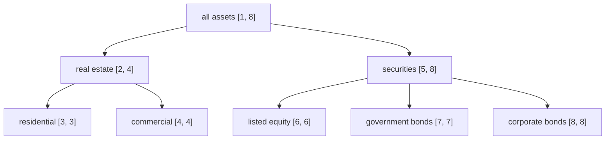
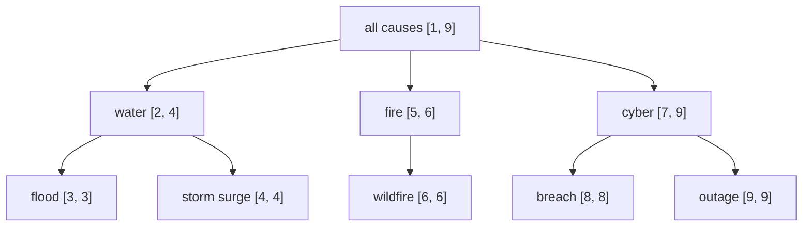

<!-- SPDX-License-Identifier: CC-BY-SA-4.0 -->

# Interval-normal scopes: concept schemes as lines, conditions as intervals

**Status:** sketch, 2026-10-21, for the maintainer's review. Nothing here is ratified.
**Plan:** [interval-normal-scopes.md](../plans/interval-normal-scopes.md) (IX-0 to IX-6).
**Reads with:** the [Eligibility README](../../../ontology/eligibility/README.md) §5.2, §5.7 and §8.3,
the [Surface README](../../../ontology/surface/README.md) (indexing),
[ADR-A85](../../architecture/decisions/ADR-A85-vocabulary-scoped-temporal-binding-resolution.md)
(scheme editions), [ADR-A27](../../architecture/decisions/ADR-A27-invalidation-and-minimal-scope-regeneration-policy.md)
(regeneration), [ADR-A128](../../architecture/decisions/ADR-A128-efficient-queries-and-shapes.md)
(efficient queries), and the CCS plan's C13a and NRS N3.

## Contents

1. [The problem](#1-the-problem)
2. [A concept scheme as a line](#2-a-concept-scheme-as-a-line)
3. [The interval-normal fragment](#3-the-interval-normal-fragment)
4. [Deciding by arithmetic](#4-deciding-by-arithmetic)
5. [Two Surface index forms](#5-two-surface-index-forms)
6. [Three values](#6-three-values)
7. [Laws](#7-laws)
8. [Cost](#8-cost)
9. [What does not change](#9-what-does-not-change)
10. [Questions IX-Q1 to IX-Q7](#10-questions-ix-q1-to-ix-q7)

---

## 1. The problem

Three needs share one answer.

1. **Design-time decisions over conditions.** CCS C13a checks a variation slot's conditions as a
   set: no two jointly satisfiable, and their union covering the admissible values. NRS N3 checks
   that an obligation and a prohibition never apply over overlapping scopes. Both reduce to
   satisfiability of a conjunction. C13a plans to ask a reasoner in the test-only harness
   (ADR-A83), so a consumer cannot run the check, and every call costs a reasoner.
2. **Retrieval at run time.** "Every term whose condition admits this concept, or a narrower one"
   is a walk up `skos:broader` for each candidate, or a Surface index per concept. Neither answers
   "which terms overlap this one" without enumerating.
3. **Knowing which conditions tools can decide cheaply.** Some conditions couple dimensions, read
   evidence along a path, or close over absence (Eligibility §5.7). Tools should know which
   conditions they can decide by arithmetic and which need a reasoner.

The answer is to read each dimension a condition constrains as a line, and each condition on it as
a finite union of intervals on that line.

## 2. A concept scheme as a line

Number the concepts of a tree-shaped scheme in depth-first order. Each concept *c* gets a pair
(pre(*c*), post(*c*)), where post(*c*) is the largest pre-order number in *c*'s subtree. Then *d* is
*c* or narrower than *c* exactly when pre(*c*) ≤ pre(*d*) ≤ post(*c*).

The same construction applies to any tree-shaped scheme. Two examples:

**Lending, eligible collateral by asset class.**

**Insurance, causes of loss.**

"Securities" is [5, 8], and "securities but not listed equity" is [5, 5] ∪ [7, 8]. Every
hierarchical, set and exact condition over the scheme becomes a finite union of intervals, and
"less some" is a difference of interval unions, which is again one.

**Editions.** Labels belong to one edition of a scheme. A condition binds a scheme through its
contract (ADR-A85), so its labels are those of the edition the contract resolves to. A new edition
gets new labels, and everything computed from the old ones is regenerated (ADR-A27).

**Polyhierarchies.** SKOS lets a concept have several broader concepts, and then one interval per
concept no longer exists. For such a scheme, a **closure bitset** per concept (one bit per concept
of the scheme, set for the concept and each of its ancestors) gives the same membership test as a
bit test, and unions and differences as bitwise operations. A scheme of 300 concepts needs 38 bytes
per concept. Whether a scheme is a tree is a fact the toolchain checks per edition.

## 3. The interval-normal fragment

A dimension has a line: a labelled scheme (§2), or a total order from Quantification (a value
space with ranges, which Eligibility's interval conditions already use).

**A condition is interval-normal** when it constrains one dimension and normalises to a finite union
of intervals on that dimension's line:

| Eligibility condition | Normal form |
|---|---|
| exact match on a concept | the concept's own label, [pre, pre] |
| set membership over concepts | the union of their labels |
| hierarchical match on a concept | its interval [pre, post] |
| interval condition over a range set | the range set as it stands |
| wildcard on a dimension | the whole line |
| any of these, less another on the same dimension | the difference |

**A profile is interval-normal** when its conditions are interval-normal and combine conjunctively
over distinct dimensions. It then denotes a box: a product, over the dimensions it constrains, of
interval unions. A profile that combines conditions disjunctively denotes a finite union of boxes,
which tools can still decide, at a cost that IX-Q3 weighs.

**Outside the fragment:**

- a condition relating two dimensions ("the asset's jurisdiction is the borrower's")
- a condition reading evidence along a path whose length depends on the data
- a closure over absence (Eligibility §5.7)
- a condition over a scheme the toolchain cannot label

These are decided as they are today.

**Membership is derived, never authored.** The toolchain classifies each condition and profile as
inside or outside the fragment, with the reason when outside, as a derived artefact with its read
set (ADR-A26). A judgement about a condition is evaluated from what the condition states, as every
judgement in LATTICE is.

## 4. Deciding by arithmetic

For two interval-normal profiles *P* and *Q*:

| Question | Arithmetic |
|---|---|
| are *P* and *Q* jointly satisfiable? | on every dimension both constrain, their interval unions intersect. A dimension only one constrains is unconstrained in the other |
| does *P* entail *Q*? | on every dimension *Q* constrains, *P*'s union lies inside *Q*'s |
| do the profiles of a slot cover the admissible values? | the admissible box, less the union of the profiles' boxes, is empty |
| which profiles apply at a point? | the boxes containing it, by an interval index per dimension |

Coverage is the one that needs care. Each dimension's line is cut at every interval endpoint any
profile uses. The cuts divide the admissible box into cells, and every profile either contains a
cell or misses it. So coverage is "every cell is in some profile", and the cells left over are the
counterexamples, stated as boxes a reviewer can read.

**A licence example.** Media rights granted by territory and medium, for one title:

| Grant | Territory | Medium |
|---|---|---|
| G1 | Europe | broadcast, streaming |
| G2 | worldwide less Europe | streaming |
| G3 | North America | physical |

Asked whether the grants cover every territory and every medium, the cut gives cells, and two of them
answer it: broadcast outside Europe, and physical media outside North America, are granted to
nobody. Asked whether G1 and G2
overlap, the answer is no, because Europe and "worldwide less Europe" are disjoint on the territory
line.

The reasoner stays the decider for everything outside the fragment, and becomes the differential
partner inside it. On the fragment, both must agree (§7, IX-L3).

## 5. Two Surface index forms

Surface's indexing contract (`srf:IndexContract`) already has three forms: `NominalClass`,
`MembershipAssertion` and `ClosureRelation`. Two more would carry the labels:

| Form | Generated | Retrieval |
|---|---|---|
| **interval labels** | per concept of a tree-shaped scheme edition, two integers, pre and post | "admits *c* or narrower" is a range filter on two literals. "Overlaps this condition" is an interval intersection |
| **closure bitsets** | per concept of a polyhierarchy, one bitset literal | "admits *c*" is a bit test. Unions and intersections are bitwise |

Labels are small. For a scheme of *n* concepts, interval labels are 2*n* triples, and bitsets are *n*
literals of *n* bits each. They live in the graph, generated and regenerated like Surface's other
artefacts, with their read set being the scheme edition.

Retrieval queries over labels follow ADR-A128. They start from the bound end, filter on literals
with `FILTER`, and keep groups small. The plan's IX-5 measures them against a walk up
`skos:broader`.

## 6. Three values

Eligibility is three-valued, and the arithmetic must not lose that. A candidate concept the scheme
cannot place gives Undetermined, never Denied (Eligibility §8.3).

| Candidate | Label | Outcome |
|---|---|---|
| inside the scheme, inside the condition's union | yes, and inside | as Eligibility decides it, usually Permitted |
| inside the scheme, outside the union | yes, and outside | as Eligibility decides it |
| broader than the required concept | yes, an interval that contains the condition's rather than lying inside it | Undetermined (L11) |
| outside the scheme, or in an edition the contract does not resolve to | none | Undetermined |

So an arithmetic check on a candidate first asks whether the candidate has a label in the bound
edition, and only then compares intervals. For design-time questions over conditions (§4) no
candidate is involved, and the arithmetic is two-valued over the labels.

## 7. Laws

| # | Law | Check |
|---|---|---|
| IX-L1 | for a tree-shaped edition, *d* is *c* or narrower exactly when *d*'s pre-order number lies in *c*'s interval | property tests over generated trees. A short Isabelle lemma (formal methods track E) |
| IX-L2 | labels are a function of the edition alone, and regenerate exactly when the edition changes | regeneration tests (ADR-A27) |
| IX-L3 | on the fragment, the arithmetic answers of §4 equal the reasoner's | differential tests over the corpus and generated profiles |
| IX-L4 | on the fragment, a candidate's arithmetic outcome equals Eligibility's three-valued decision | differential tests against the reference evaluator (`tools/reference/eligibility/`) |
| IX-L5 | normalisation preserves meaning: a condition and its interval union admit the same labelled concepts | property tests |
| IX-L6 | coverage counterexamples are sound: every reported cell is admissible and in no profile | property tests |

## 8. Cost

| Operation | Cost |
|---|---|
| labelling a tree of *n* concepts | one traversal, order *n* |
| closure bitsets for a polyhierarchy | order *n*² bits, built in order *n*·*e* for *e* edges |
| joint satisfiability of two profiles over *d* dimensions with *k* intervals each | order *d*·*k* |
| coverage of *p* profiles over *d* dimensions | cells are at most the product of the cuts per dimension, order (2*pk*)^*d*. In practice *d* is small and most profiles constrain few dimensions. IX-Q4 sets a bound past which the tool reports "not decided within the bound" |
| a reasoner on the same question | a satisfiability call per pair, in the test-only harness |

## 9. What does not change

- No condition changes meaning. Normalisation restates, and IX-L5 checks it.
- No evaluation path changes. Labels and the fragment serve design-time checks and retrieval.
- The reasoner keeps every condition outside the fragment.
- Nothing is authored that a tool can derive.

## 10. Questions IX-Q1 to IX-Q7

| # | Question | Options | Leaning |
|---|---|---|---|
| IX-Q1 | Names of the two index forms | (a) `srf:IntervalLabel` and `srf:ClosureBitset`. (b) one form with two realisations | (a). They answer different shapes of scheme, and a contract may want either |
| IX-Q2 | Is fragment membership derived or declared? | (a) derived by the toolchain, with reasons. (b) declared on the condition and checked | (a). A judgement is evaluated, never authored. An ADR is needed only if (b) is chosen |
| IX-Q3 | Disjunctive profiles (finite unions of boxes) in the fragment? | now, or later | now for joint satisfiability and entailment, later for coverage, which grows with the number of boxes |
| IX-Q4 | The bound on coverage cells | fixed, or per job | per job, recorded with the result as formal methods FP3 requires of every bound |
| IX-Q5 | Where labels live | (a) in the graph as Surface artefacts. (b) beside it | (a). They are small, and retrieval queries need them |
| IX-Q6 | Does C13a take the arithmetic as its first path? | (a) yes, the reasoner for the rest and as differential partner. (b) the reasoner throughout | (a). It makes the common case consumer-runnable |
| IX-Q7 | Is the cause scheme's shape checked per edition? | yes, a report per edition: tree or polyhierarchy, with the concepts that make it one | yes |
