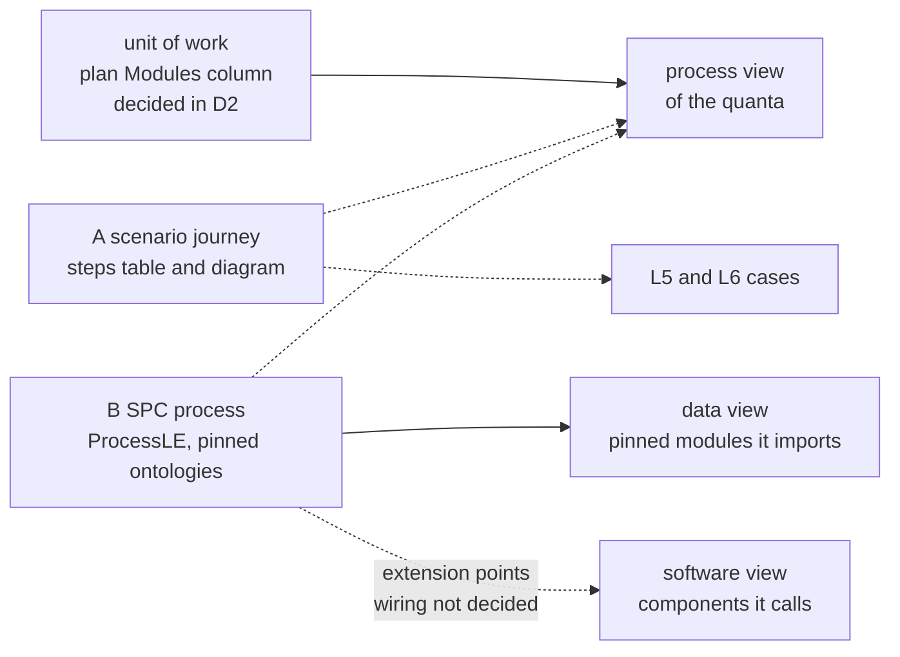
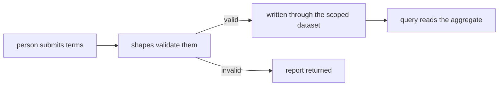

<!-- SPDX-License-Identifier: CC-BY-SA-4.0 -->

# Journeys: how a deployment's processes are described

**Unit:** [`knowledge-index`](../status/knowledge-index.md), decision D2. **Status:** sketch, 2026-10-26. The maintainer accepted the leanings of JM-Q1 to JM-Q6 the same day. Nothing is built.
**Reads with:** [ADR-A134](../../architecture/decisions/ADR-A134-knowledge-index-and-design-shape-vocabulary.md) decision 16 (a quantum is derived in each view), the [SPC README](../../../ontology/spc/README.md), and the SPC toolchain in [`tools/spc/python`](../../../tools/spc/python/README.md).

## 1. Scene

The knowledge index derives an architectural quantum separately in each view (STD-001). Its data and software views are derived today. The third, the process view, was explained to the maintainer on 2026-10-26 as two different things, and D2 settled that the process view covers the **unit of work** only, derived from the Modules column of a plan's slices. This sketch takes the other meaning, which D2 parked.

A **journey** is the path a user or a datum takes through the systems of a deployment. The word is chosen because it needs no business vocabulary, so a journey can be the placement of a document, the life of a record, or the steps of a person using a tool. The maintainer named two ways to define one.

| | A. A scenario | B. An SPC process |
|---|---|---|
| What it is | A written scenario that exercises our software and ontologies, between a sketch, a solution design and a UX journey map | A process built with the SPC DSL or ProcessLE, subject-oriented and typed with session types |
| Notations | Process diagrams in mermaid, or process models in BPMN | ProcessLE source, compiled to an A-Box over the SPC ontology |
| Bound to | nothing a tool reads, today | a pinned version of a set of domain ontologies, which import a pinned version of LATTICE |
| What is settled | nothing. There is no template, folder or header for it | the structure. The wiring of its extension points, such as egress to the outside world, is not decided |
| Who can read it | a person | a person and the SPC toolchain |

Facts checked on 2026-10-26 that constrain the options.

- SPC models "subject-oriented process structures that govern typed interaction between participants" and leaves business vocabulary to imported ontologies (SPC README §1). Its ontology covers global and local session types, runtime configurations, message pools, interfaces and open subject systems.
- The toolchain parses ProcessLE (`tools/spc/python/src/spc/processle`), encodes it to RDF, and has an `extension_encoder.py` for extension annotations and an `extension_config_gen.py` that writes JSON configuration from them. Both belong to the part the maintainer called not yet wired.
- `bpmn` and `processle` are technology values in the [facet register](../facets.md). No BPMN file exists in the repository. The claims sketch mentions BPMN as what a consumer's system might use.
- A downstream deployment pins release tags, and STD-008 records that its pins live in its own repository, which no check here can read. So this repository can derive journeys only for what it contains. That is its own local environment under `deployment/`, its examples and the tutorial's reference.
- A new kind of directory needs an accepted ADR (AGENTS.md). A header line such as `Unit type:` does not, and the lifecycle skill already uses it for Epic, Phase and Register.
- User-facing documents may not cite a sketch (ADR-A127). They may link durable guidance under `docs/developer/` and published ADRs. Where a journey lives therefore decides whether the tutorial or the site can point at it.
- The lifecycle's test levels already have L5 system end-to-end and L6 UI end-to-end. A scenario is the natural source for the cases at those levels.

## 2. Pictures

What the process view would read, by definition.

A scenario journey, as it might be written. The steps table is what a tool would read. The diagram is for a person.

| Step | Actor | Component | Data module read or written |
|---|---|---|---|
| 1 | person | a client of the platform | none |
| 2 | platform | the validation worker | the module whose shapes apply |
| 3 | platform | the scoped dataset | the module's graph |

## 3. Questions

### JM-Q1. Where does a scenario journey live?

| Option | Consequence |
|---|---|
| (a) A sketch with `Unit type: Journey`, in `docs/developer/sketches/` | No new directory and no ADR. It is a working document, so the tutorial and site cannot cite it (ADR-A127), and it is deleted or superseded as sketches are |
| (b) A new folder, such as `journey-maps/` | A clean home with its own lifecycle and a place for BPMN files. Needs an accepted ADR, and the same citation limit unless the folder is under `docs/architecture/` |
| (c) Durable documents under `docs/architecture/` | Citable from user-facing text. Heavier to change, and a scenario is exploratory when first written |

**Leaning:** (a) now. Promote a journey that has settled into a durable document, and decide the durable home when the first one does.

**Answered 2026-10-26.** The maintainer accepted the leaning.

### JM-Q2. Notation for a scenario

Mermaid renders on GitHub and in sketches and diffs as text. BPMN is an XML standard with tool support, diffs badly, and does not render on GitHub. It describes activities, where SPC is subject-oriented, so a BPMN collaboration diagram with message flows is the closest match. **Leaning:** mermaid by default, and BPMN as an attached file only where a consumer needs it, never the source. The `bpmn` facet value already exists for finding it.

**Answered 2026-10-26.** The maintainer accepted the leaning.

### JM-Q3. What must a scenario state so a tool can derive a quantum from it?

| Option | Consequence |
|---|---|
| (a) Nothing, prose and a diagram only | Cheapest to write. The process view derives nothing from scenarios, and they only inform L5 and L6 cases |
| (b) A steps table with fixed columns (step, actor, component, data module) | Readable on GitHub, and one extractor reads it. Component and module names are checked against the catalogue |
| (c) A fenced block in TOML, as the repository catalogue does | Exact, and harder to read and to write by hand |

**Leaning:** (b). It follows "show structure with metadata a tool reads" and keeps the document readable.

**Answered 2026-10-26.** The maintainer accepted the leaning.

### JM-Q4. Which deployment does a journey here describe?

The options are this repository's local environment and examples only, a reference deployment kept for the purpose, or none because every deployment is downstream. **Leaning:** the local environment and the tutorial's reference, since STD-008 means nothing else can be read here. A downstream deployment can adopt the same header and run the same extractor in its own repository.

**Answered 2026-10-26.** The maintainer accepted the leaning.

### JM-Q5. What does the SPC route need before it can feed the process view?

Participants and the pinned ontology imports give the data view now. The software view needs the extension points wired to named components, which is undecided. **Leaning:** derive the data view from SPC processes when one exists in this repository, and leave the software view until the wiring is decided. Record the gap as technical debt then and not before, since no SPC process exists here to derive from.

**Answered 2026-10-26.** The maintainer accepted the leaning.

### JM-Q6. How do the two definitions relate for one journey?

A scenario may point at the SPC process that realises it, and a process may cite the scenario it came from. Whether the two agree is a judgement no check can make, so the options are a link only, or a link plus a check that each link resolves. A scenario could also generate L5 cases, which is more work and not needed to start. **Leaning:** a link with a resolving check, and no generation.

**Answered 2026-10-26.** The maintainer accepted the leaning.

## 4. KISS

Not needed now: the SPC software view (no process to derive from), BPMN support, generated test cases and a new directory. Needed first: a header and a steps table that one extractor can read, so the process view has something besides the unit of work. Estimated at 40k to 60k tokens for the header, the table and the extractor, after JM-Q1 and JM-Q3 are answered.
