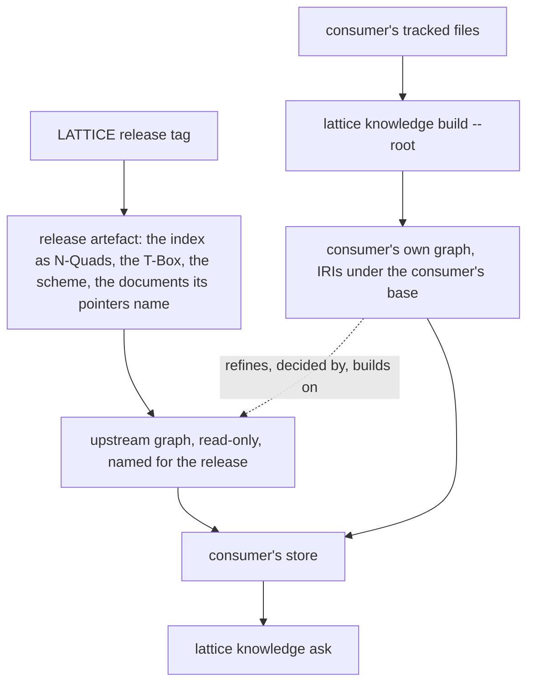
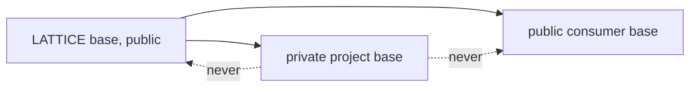

<!-- SPDX-License-Identifier: CC-BY-SA-4.0 -->

# The knowledge index in projects built on LATTICE

**Status:** sketch, 2026-10-25. Nothing here is ratified.
**Extends:** the [knowledge index](knowledge-index.md) ([ADR-A134](../../architecture/decisions/ADR-A134-knowledge-index-and-design-shape-vocabulary.md)) and [consumer distribution](consumer-distribution.md), whose plan is [consumer-distribution](../plans/consumer-distribution.md).
**Reads with:** [ADR-A117](../../architecture/decisions/ADR-A117-agent-guidance-and-skill-library.md) (agent guidance, and private guidance that spans public and private projects), [ADR-AC2](../../architecture/decisions/ADR-A-C2-clean-room-authoring-procedure.md) (clean-room authoring), [ADR-A121](../../architecture/decisions/ADR-A121-repository-catalogue.md) (the repository catalogue).

---

## 1. Premise

A project built on LATTICE pins one release and installs what it needs at that release, with nothing copied into its repository. The consumer distribution plan makes that true for ontologies, tools and skills. It says nothing of the knowledge index, so an agent working in a consumer cannot ask whether LATTICE already has the mechanism it is about to build, which standards bind its work, or which of LATTICE's decisions its design rests on.

Two needs follow, and they pull in opposite directions.

**A consumer must be able to read LATTICE's knowledge**, as of the release it pins and not as of `main`, since a standard or a mechanism changes between releases.

**Each project's knowledge must stay its own.** A consumer has decisions, registers and mechanisms of its own. A public consumer's may be read by anyone. A private project's must never reach LATTICE's index, be linked from it, or be built into anything LATTICE publishes. So there is no one index. There is one knowledge base per repository, and the design question is how they relate.

## 2. What the index assumes today

Built for one repository, it hard-wires that repository in four places.

| Assumption | Where | Breaks for a consumer because |
|---|---|---|
| identifier families and their documents | `tools/knowledge/identifiers.py`, which names LATTICE's paths | a consumer's registers and decisions live elsewhere and use other identifiers |
| node IRIs in LATTICE's namespace | `extract.py` mints `.../dev/knowledge#node/...` | a consumer's `STD-002` would be the same IRI as LATTICE's |
| the repository root | `identifiers.ROOT` | the consumer distribution's CLI takes `--root`, and this does not |
| the T-Box has no compatibility promise | ADR-A134 decisions 4 and 6, since only LATTICE consumed it | a consumer that tags its rows with `ki:` terms depends on them |

## 3. The design

One knowledge base per repository, each built by the same tooling from that repository's own tracked files. A downstream base reads its upstream base read-only, at the pinned release. Nothing runs the other way.

Six rules carry the separation, and each is checkable.

1. **A knowledge base is bound to its repository.** It is built from that repository's tracked files only, enumerated from `git ls-files`, as LATTICE's is today (ADR-A134 decision 11). A repository checked out beside another cannot leak into it, because the walk never happens.
2. **Reads run downstream to upstream, at the pin.** A consumer's store loads the upstream release's graph. An upstream base never loads, reads or links to a downstream one. This is PRI-18, downstream depends on release tags and never the reverse, applied to knowledge.
3. **An agent writes only to the base of the repository it is changing.** A session spanning two repositories reads both and writes each change to its own repository's registers.
4. **Each base mints its own IRIs**, under a base the repository's catalogue declares, so identifiers in two bases never collide, and a private base's IRIs need not resolve anywhere.
5. **A link crosses from downstream to upstream only, and names the base it crosses into**, so a consumer citing LATTICE's STD-002 is distinguishable from its own.
6. **Knowledge moves upstream only by being written afresh** under ADR-A-C2's clean-room procedure, never by copying a row, a claim or a link. A learning in a downstream base that belongs in LATTICE is restated from a generic premise in LATTICE's own registers.

### 3.1 A private project

The same mechanism, with nothing added to LATTICE. A private project builds its own base from its own tracked files and holds it in its own repository's build output, which is never committed and never published. Rules 1 and 2 already guarantee the rest: LATTICE's build reads none of the private project's files, and nothing in LATTICE's index can link to a base that LATTICE never loads.

What a private project may let leave it, and how it decides, are its own rules, applied in its own repository. ADR-A117 provides for private guidance that spans public and private projects, and LATTICE neither holds nor needs to know it. LATTICE's part is to make the boundary structural, so it does not depend on an agent remembering it.

## 4. Questions KC-Q1 to KC-Q7

**KC-Q1. How LATTICE's knowledge reaches a consumer.**

| Option | Cost |
|---|---|
| (a) the consumer builds LATTICE's base from LATTICE's sources at the pin | needs LATTICE's whole tree checked out, which the consumer distribution exists to avoid |
| (b) **a release artefact**: the index as N-Quads with the T-Box and the facet scheme, the entry vectors with the model revision that made them, and the documents its pointers name, at the tag | measured: the index graphs are 4.67 MB as N-Quads and 0.26 MB gzipped, and the vectors of 778 entries 1.7 MB. The documents are 10.08 MB. Pointers resolve against them unchanged, so `read` works offline |
| (c) a hosted endpoint at LATTICE | a resident service and a network dependency, which TSD-38 and ADR-A134 decision 14 rejected for less |

Embedding each pointer's text in the artefact, rather than shipping the documents, would carry 6.74 MB raw, two thirds of the documents' size counting overlap, and make a second copy of every section it quotes. **Leaning (b)**, built by the release task and attached to the tag, never committed.

The vectors are for a consumer's development, where an agent working in the consumer needs LATTICE's knowledge beside the consumer's own. They are never part of a deployment. A consumer ranks LATTICE's entries and its own on one scale only if it embeds its entries and its agents' questions with the same model at the same revision, since vectors from two models share no space. The artefact therefore names the revision, and `find` refuses vectors made by another, as it does within LATTICE (ADR-A134 decision 21). The model itself is fetched by revision and checksum, as LATTICE's build fetches it, and not shipped.

**KC-Q2. The T-Box's status once a consumer depends on it.**

| Option | Consequence |
|---|---|
| (a) in the substrate's release | ties development vocabulary to the ontologies, and enlarges the substrate's quantum for something that is not substrate |
| (b) **its own version line, released with each LATTICE release tag** | a published contract with semantic versioning, covering the T-Box, the facet scheme and the embedding model's revision. Adding a term or a facet value is minor, and removing one or changing the model is breaking, since a new model obliges every consumer to embed again. This ends ADR-A134 decision 6's freedom to change it at will. It becomes a quantum of its own |
| (c) kept to LATTICE, with consumers holding their own | two vocabularies for one structure, and no shared query across bases |

**Leaning (b).** It is also the first case of a quantum boundary the index itself draws.

**KC-Q3. Where a repository declares its registers and identifier families.** (a) In `identifiers.py`, as today, which serves only LATTICE. (b) **In the repository catalogue**, as a section beside the modules and roots ADR-A121 already declares there, so where a repository keeps its knowledge is stated once with everything else about where things live. (c) A separate file. **Leaning (b).**

**KC-Q4. Which of LATTICE's knowledge a consumer sees.** (a) **Everything at the pin, with an audience on each standard and principle**, as capabilities already carry, so a query can leave out what governs only LATTICE's own work, such as who commits. (b) Only published-audience rows in the artefact. **Leaning (a)**, since a consumer contributing upstream needs LATTICE's internal standards too, and filtering at query time keeps one artefact.

**KC-Q5. One store or two.** (a) **The consumer's store holds the upstream graph beside its own**, replaced whole on an upgrade and written by nothing else, with a check that no consumer quad lands in it. (b) Two stores queried together, at the cost of a federated query in every call. **Leaning (a).**

**KC-Q6. How a cross-base link is written.** (a) **A qualified identifier**, for example `lattice:STD-002`, whose prefix the catalogue maps to the upstream base, so the identifier check resolves it against the upstream graph. (b) Consumers use identifier prefixes LATTICE never does, so bare identifiers never collide, which works only while every consumer keeps to it. (c) Resolve locally first, then upstream, which makes a bare identifier ambiguous. **Leaning (a).**

**KC-Q7. How a consumer's agent is told to ask.** The instruction that activates the index in LATTICE, task A1 of the [status record](../status/knowledge-index.md), is written into the shared part of the guidance the consumer distribution's CD-1 and CD-2 provide, against `lattice knowledge ask` rather than LATTICE's own `mise` task. **Leaning: write it once, for both**, so the rule that makes the index useful is never LATTICE's alone.

## 5. Consequences

For ADR-A134, an addendum if this is accepted. Decision 4's vocabulary becomes published (KC-Q2), decision 6's freedom to change it at will ends, decision 13 gains the release artefact, and the namespace of decision 4 holds the T-Box while each base mints its own instance IRIs.

For the consumer distribution, `lattice knowledge build`, `ask` and `read` join the CLI of CD-5, each taking `--root`. CD-3's release tag carries the artefact of KC-Q1. CD-6's consumer gate runs the identifier and knowledge checks over the consumer's own base. The first consumer that proves the rest, Open CBAA (CD-Q4), proves this too.

For the quanta, a consumer's data view derives by the same rule as LATTICE's. LATTICE at the pin is upstream and pinned, so it is never inside a consumer's quantum, and the derivation needs no change to say so.

## 6. Where this sits

It depends on CD-3, the release tag a consumer pins, and on CD-5, the CLI that takes `--root`. Nothing waits on it. KC-Q2 and KC-Q3 are the two to settle first, since every other question assumes a published vocabulary and a per-repository declaration of where knowledge lives.
