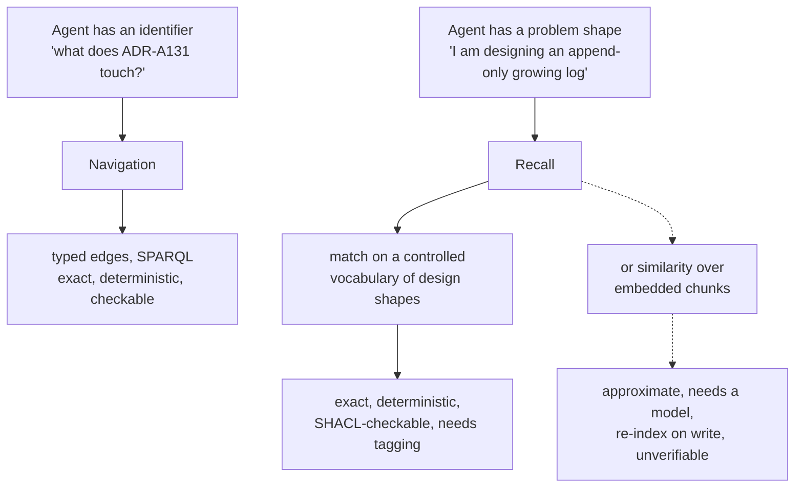
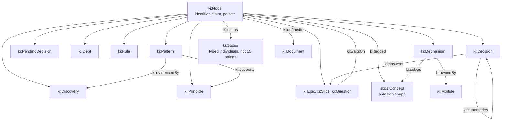
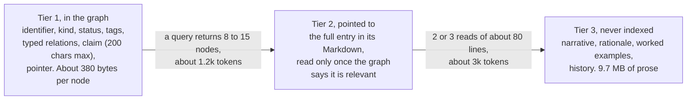
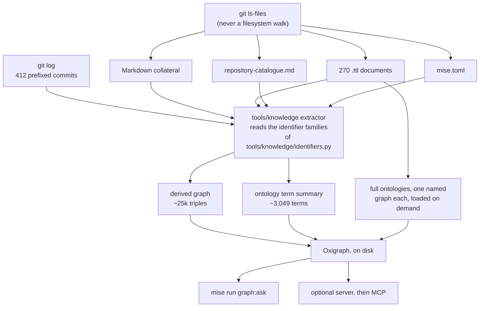
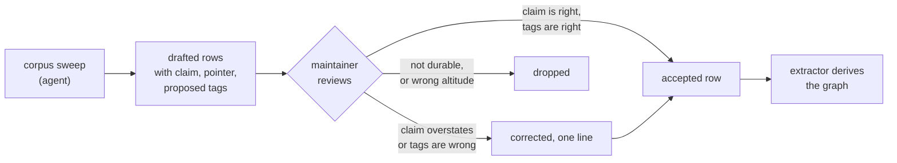
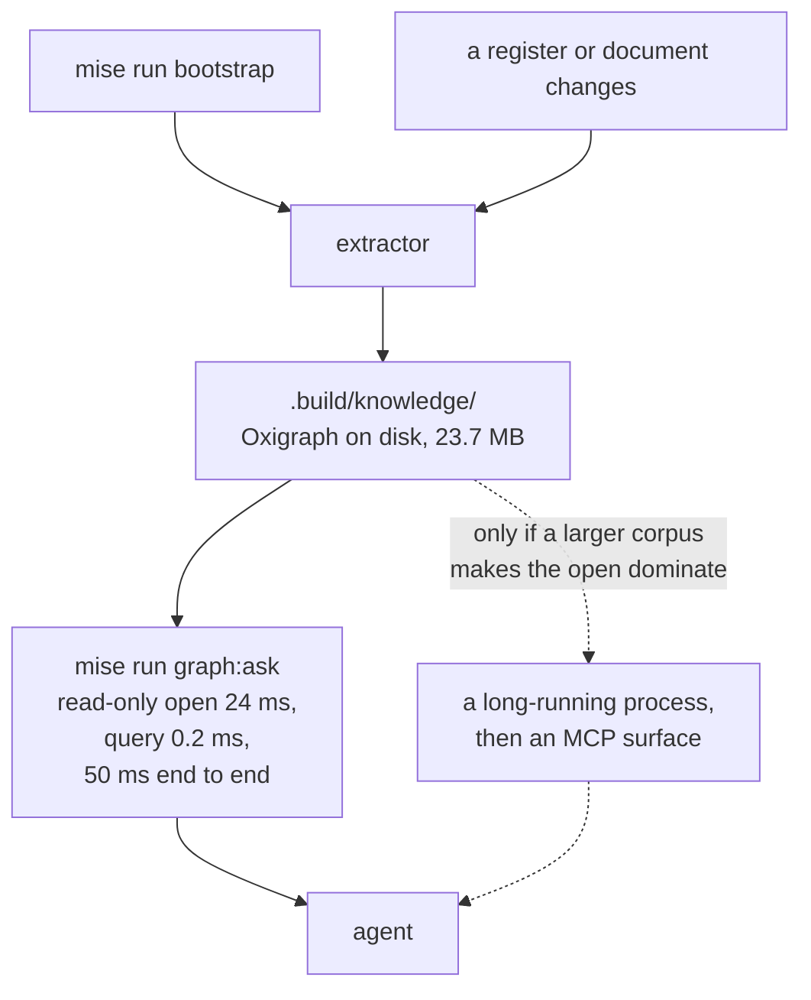

<!-- SPDX-License-Identifier: CC-BY-SA-4.0 -->

# Knowledge index: what the project knows, as a graph an agent can query

**Status:** sketch, 2026-10-24. The design is approved by the maintainer in session and recorded in [ADR-A134](../../architecture/decisions/ADR-A134-knowledge-index-and-design-shape-vocabulary.md). KI-1, the identifier check, is built (`mise run check:identifiers`). KI-2 is measured and recorded as [TSD-38](../../architecture/triple-store-discovery.md), and its result dropped KI-8. The rest is authored and not yet built.
**Comes back in with:** every epic, because the index reads their plans and registers. Nothing waits on it, and it makes nothing else harder, so it can be built alongside any slice.
**Reads with:** [efficient-queries-and-shapes.md](../../architecture/efficient-queries-and-shapes.md) (the rules a generated query obeys), [triple-store-discovery.md](../../architecture/triple-store-discovery.md) (what the store really does), [ADR-A126](../../architecture/decisions/ADR-A126-literate-specification-layout-and-grammar.md) (the extraction contract this generalises), [ADR-A121](../../architecture/decisions/ADR-A121-repository-catalogue.md) (where things live, stated once) and [ADR-A117](../../architecture/decisions/ADR-A117-agent-guidance-and-skill-library.md) (the agent guidance this shrinks).

---

## 1. Premise

An agent making a design decision in this repository has to know what the project already decided, found out, forbade and built. Today it finds that out by reading documents. The documents are large.

| To get a live view of | Files | Bytes | Tokens |
|---|---|---|---|
| AIR (`applied-insurance-reference*`) | 39 | 436 KB | ~109,000 |
| CCS (`computable-contract-substrate*`) | 26 | 720 KB | ~180,000 |
| FML (`formal-methods*`) | 24 | 696 KB | ~174,000 |
| **All three** | **89** | **1.85 MB** | **~463,000** |

Two and a half context windows to answer one question about one decision, and a decision on one branch routinely touches all three. The same cost is paid again for coding standards, for a layer's design principles, for the literate-specification requirements, and for what we know about each triple store. Agent guidance has grown a note for each of those telling an agent which directory to go and scan, and each note is a reading bill rather than an answer.

Two failures follow, and the second is worse than the cost.

**Retrieval is unaffordable, so it is skipped.** An agent that cannot afford to read the collateral works from what is in front of it.

**Recall is impossible, not merely expensive.** An agent designing an append-only log does not know the identifier of the thing it should read. It cannot look up what it cannot name. A past agent proposed building a versioning system although Foundation already models one, because nothing let it ask "does this already exist". That class of error costs a slice, not a context window.

This sketch proposes a derived graph over the repository's own working documents, queried by design shape as well as by identifier, so both questions cost about a thousand tokens.

## 2. What exists today, measured

Every figure here was measured on this branch at 2026-10-24, not estimated.

| | Count | Note |
|---|---|---|
| Tracked Markdown | 700 files, 9.7 MB | the collateral |
| Decisions | 120 ADRs, 634 KB | 99 carry `**Related:**`, 24 carry `**Unit:**` |
| `**Status:**` line shapes | ~15 distinct | freeform tails, so not a vocabulary yet |
| Working documents | 88 sketches, 54 plans, 53 status records, 157 validation packs, 32 notes | 7.7 MB |
| Distinct identifiers | 950 | across 9,645 mention sites |
| Identifier families | 7 | decisions, two registers, discoveries, rules, slices, questions |
| Ontology documents | 270 `.ttl`, 3.19 MB | ~41,330 triples, ~3,049 declared terms, 43 `owl:imports` |
| `mise` tasks | 118 | |
| Commits carrying a slice or area prefix | 412 of 669 | so git already links a commit to a work stream |

Three pieces of machinery already do most of what an index needs.

**The literate extraction pipeline.** `tools/literate_extract.py` and `tools/literate_grammar.py`, 2,061 lines, compile fenced blocks in a layer README into Turtle, a Python module and Isabelle theory, in document order, under an Extraction Contract per module ([ADR-A126](../../architecture/decisions/ADR-A126-literate-specification-layout-and-grammar.md)). Its stated principle is that the README is authoritative and the compiled artefact is derived, so the two cannot drift. That is exactly the rule this index needs, already accepted and implemented.

**The decision header parser.** `tools/published_decisions.py` already reads `**Status:**` and `**Described in:**` from every ADR header with the regexes an extractor would need.

**The store.** `pyoxigraph` 0.5.13 and `rdflib` 7.6.0 are already installed, and `pySHACL` already runs in `check`. The index adds **no new dependency**.

So the index is a new extraction contract over working documents rather than a new subsystem. That framing is the design's load-bearing decision.

## 3. Two retrieval modes, and why a vocabulary rather than embeddings

Navigation is settled: typed edges and SPARQL. Recall is the real choice, and we take the vocabulary.

The argument for it is not that embeddings do not work. It is that this repository is unusually well placed to pay the vocabulary's price and unusually badly placed to pay the embeddings' price. Maintaining a SKOS scheme with SHACL validation is the project's core competence and existing toolchain. A design-shape vocabulary makes recall a graph query that is exact, auditable, and wrong in ways a check can catch. Embeddings would buy the long tail without tagging discipline, at the cost of a dependency, a rebuild on every write, nondeterminism, and no way to tell a correct retrieval from a plausible one.

The honest cost is that an untagged node is invisible, and a half-tagged corpus looks complete while being partial. §8 is about nothing else.

The fallback is kept explicit rather than abandoned. The query surface logs every query that returns nothing. If, after the backfill, those misses are irreducibly semantic, the answer is embeddings over the ~1,400 claim sentences, which is a ~300 KB index, not over 9.7 MB of prose. `txtai` (Apache-2.0) is the candidate. That decision is deferred to evidence, and the miss log is the evidence.

## 4. The model

Two artefacts, meeting at one property. Both live under `tools/knowledge/`, outside `ontology/`, because they describe this repository rather than the domain, and because a published document may not refer to a working document ([ADR-A127](../../architecture/decisions/ADR-A127-published-architecture-decisions.md)). They are outside the substrate release of [ADR-A129](../../architecture/decisions/ADR-A129-one-release-for-the-substrate.md).

Namespace `https://www.nebularis.org/neuro-semantic/lattice/dev/knowledge#`, prefix `ki:`. The `dev` segment marks it as not part of the substrate.

### 4.1 An OWL T-Box for the node kinds and relations

A `rdfs:subClassOf` edge and a property edge are drawn alike above. The kinds hanging off `ki:Node` are its subclasses, and the labelled edges are properties with that domain.

The reason for a real T-Box rather than SKOS alone is that SHACL cannot check what has no domain and range. "No Accepted decision depends on a Proposed one" needs `ki:dependsOn` to be a property with a stated domain and range, and `ki:status` to point at a typed individual rather than one of fifteen freeform strings.

Because only this repository consumes it, changes are additive and there is no compatibility promise. One guard keeps that freedom from becoming a modelling hobby, and it belongs in the ADR rather than in this sketch. **A class or property enters the T-Box only when a query or a check needs it.**

**Declared and derived edges are different properties.** An edge a document states (`ki:waitsOn`, from a register's "Waits for" column) is trusted. An edge inferred from two identifiers appearing together (`ki:citedWith`) is a hint. SHACL constraints read only declared edges. Mixing them would make every check as reliable as a co-mention, which is to say not reliable.

### 4.2 A SKOS scheme for the design shapes

Design shapes are a taxonomy with `broader` and `narrower`, which is what SKOS is for. `append-only-log` sits under `monotonic-growth`. `ki:tagged` has range `skos:Concept`, and that is where the two artefacts meet.

A concept is phrased as a **problem or situation, never as a technique**, because an agent matches against it before knowing the solution. `checkpoint-lookup` is a shape. `computed-iri` is a pattern that serves it, and belongs in the pattern register.

Target size is 40 to 70 concepts in at most three levels. Fewer makes retrieval coarse. More makes consistent tagging impossible, which is the failure that matters.

## 5. What goes in the graph, and what stays a pointer

The rule is that the graph holds only what is matched on or reasoned over.

The constraint that keeps this from becoming a second source of truth: **the claim is extracted, never authored twice.** It is the bolded lead sentence of the Markdown entry, which `pending-design-decisions.md` already writes that way. The index holds no content of its own. Delete it and nothing is lost but speed.

A well-informed design decision costs about 4,000 tokens, against the ~463,000 of reading AIR, CCS and FML. Twenty lookups in a session is 80,000.

## 6. The extraction contract over working documents

Generalising [ADR-A126](../../architecture/decisions/ADR-A126-literate-specification-layout-and-grammar.md) from layer READMEs to working documents.

Four rules, each of which is a decision rather than a preference.

**Enumeration is from `git ls-files`, never a filesystem walk.** A checkout can hold ignored directories of confidential third-party material. A walk would read them. This is the rule the umbrella makes non-negotiable, and it is already enforced in the built slice.

**Derived facts only.** Every fact keeps exactly one source. Decision metadata comes from ADR headers, module and path facts from `repository-catalogue.md` (the graph reads it and never restates it), layer edges from `owl:imports`, slice-to-file edges from git. A fact authored only in the graph makes the graph a second thing to maintain by hand, and it will drift inside a month exactly as `docs/developer/INDEX.md` did, which is 1,005 hand-maintained lines last updated 2026-09-25.

**A family is extracted only once its definition rule is written.** A family with no rule is counted, never failed, and never silently half-indexed.

**The build is not committed.** The graph is a build output under `.build/`, made on bootstrap and refreshed when a source changes. Nothing in git, so nothing to go stale in review.

## 7. The registers the extractor reads

A maintainer never writes Turtle. The authoring interface is a Markdown table row, and the row shape is the schema. Three registers exist and four are new.

| Register | State | ID | Lives in |
|---|---|---|---|
| Decisions | 120 ADRs, exists | `ADR-A*n*` | `docs/architecture/decisions/` |
| Pending decisions | 11 rows, exists | `PDD-*nn*` | `docs/developer/plans/pending-design-decisions.md` |
| Technical debt | 49 rows, exists | `TD-*nn*` | `docs/developer/plans/technical-debt.md` |
| Store discoveries | 36 entries, exists | `TSD-*nn*` | `docs/architecture/triple-store-discovery.md` |
| Query rules | 36 entries, exists, needs a narrower reference rule | `R*n*` | `docs/architecture/efficient-queries-and-shapes.md` |
| **Principles** | new | `PRI-*nn*` | `docs/developer/plans/principles.md` |
| **Patterns** | new | `PAT-*nn*` | `docs/developer/plans/patterns.md` |
| **Mechanisms** | **83 rows drafted** | `MEC-*nn*` | [`docs/developer/plans/mechanisms.md`](../plans/mechanisms.md) |
| **Design shapes** | **58 shapes in 10 facets, built** | slug | [`tools/knowledge/design-shapes.ttl`](../../../tools/knowledge/design-shapes.ttl) |

The mechanism register is the one with no existing home and the clearest payback, because it is the register that answers "does this already exist".

## 8. The backfill: exactly what is required of a maintainer

This is the section to read if you are deciding whether to pay for this. Everything else is machinery.

### 8.1 The shape of the work

Nothing here asks a maintainer to author prose from nothing. Every row is either a claim that already exists in a document, or a claim an agent drafts from a document and a maintainer corrects. The maintainer's irreducible work is **ratification and tagging**, which is judgement rather than typing.

### 8.2 What a row looks like, per register

**A principle.** The durable design commitments, which today live scattered in `AGENTS.md`, ADRs and sketches.

| Column | Content | Who |
|---|---|---|
| ID | `PRI-03` | agent |
| Claim | **bolded, one sentence, imperative.** "Weigh the cost of storage over time with the meaning a term carries, and keep stored data to the minimum correctness and robustness need." | agent drafts from `AGENTS.md`, maintainer ratifies |
| Shapes | `storage-over-time`, `monotonic-growth` | maintainer |
| Evidenced by | `TSD-36`, `PAT-07` | agent |
| Pointer | `AGENTS.md:71-74` | agent |

**A pattern.** A named, reusable technique with a stated trade-off. The register that does not exist today.

| Column | Content | Who |
|---|---|---|
| ID | `PAT-07` | agent |
| Name | computed IRI, bound subject | maintainer |
| Claim | **bolded, one sentence, with the cost.** "A checkpoint found by an IRI computed from the account and the close position gives the seek a bound subject gives, where a bound object leaves a scan." | agent drafts, maintainer corrects the trade-off |
| Shapes | `checkpoint-lookup`, `derived-identity`, `append-only-log` | maintainer |
| Evidenced by | `TSD-36`, the ledger posting-cost benchmark | agent |
| Decided by | `ADR-A131` | agent |
| Pointer | `docs/developer/plans/ledger.md:412-431` | agent |

That is the worked example from this branch. Six cells, one of which is a sentence already written in the ledger plan, and the maintainer's own work is the Shapes cell and a check that the trade-off is stated honestly.

**A mechanism.** What already exists, so it is not rebuilt. The `problem shape` column is the one that matters, because it is what an agent matches against before it knows the mechanism's name.

| Column | Content | Who |
|---|---|---|
| ID | `MEC-12` | agent |
| Name | Foundation's versioning | agent |
| Claim | **bolded.** "A class that is a member of `fnd:Version` is versioned, and Foundation already gives it the version IRI and the ordering it needs." | agent drafts, maintainer ratifies |
| Owner | `ontology/foundation` | agent |
| Kind | ontology | agent |
| Problem shape | `versioning-an-entity-over-time` | maintainer |
| Reuse note | one clause, only where non-obvious | maintainer |
| Pointer | the README section | agent |

Had this row existed, the duplicate versioning proposal would not have happened. It is one row.

**A decision.** No new authoring. The work is normalising what is already there.

| Field | Work |
|---|---|
| `**Status:**` | collapse ~15 freeform shapes to a typed vocabulary. Agent proposes the mapping, maintainer ratifies the vocabulary once, not per ADR |
| `**Unit:**` | 96 of 120 lack it. Agent infers from the plans and git history, maintainer corrects |
| Shapes | tag each decision. Maintainer, roughly a minute each |
| Claim | the ADR title plus its decision's lead sentence, extracted |

### 8.3 The tagging rules a maintainer applies

Five rules, and they are the whole discipline.

1. **Tag the problem, not the solution.** A pattern is tagged with the shapes of problem it serves. `computed-iri` is not a tag, it is a pattern's name.
2. **Two to four shapes per node.** One is usually too coarse to be worth retrieving. Five means the node is really several nodes, or the shapes are too narrow.
3. **If no shape fits, propose one in the same change.** The check rejects an unknown tag, so the vocabulary cannot fork silently. A proposed concept carries a definition phrased as a problem and a parent.
4. **An untagged node is invisible, and that is the intended behaviour.** It is better than a node tagged with something plausible, because a wrong tag poisons every future retrieval of that shape.
5. **Never tag with a shape that names private work.** §11.

### 8.4 What it costs

Row counts below the double rule are estimates from the corpus sweep in progress and will be replaced by its figures. Minutes are maintainer minutes, not agent minutes.

| Register | Rows | Agent drafts | Maintainer, per row | Maintainer total |
|---|---|---|---|---|
| Decisions, status vocabulary | 1 vocabulary | yes | ratify once | ~30 min |
| Decisions, `Unit:` backfill | 96 | yes, inferred | review a diff | ~1 h |
| Decisions, tagging | 120 | proposes tags | ~1 min | ~2 h |
| Store discoveries, tagging | 36 | proposes tags | ~1 min | ~40 min |
| Query rules, tagging | 36 | proposes tags | ~1 min | ~40 min |
| Design shape vocabulary | 40–70 concepts | drafts the scheme | review, and fix the hierarchy | ~3 h |
| **Principles** | ~30–50 | drafts from `AGENTS.md`, ADRs | ~3 min, these are judgement | ~2.5 h |
| **Patterns** | ~40–80 | drafts, trade-off needs correcting | ~3 min | ~4 h |
| **Mechanisms** | ~80–150 | drafts, confidence marked per row | ~2 min | ~5 h |
| | | | | **~20 h** |

Twenty hours of maintainer time, almost all of it reviewing drafted rows rather than writing them, and most of it in the three new registers. The claim is that this is cheaper than one slice redone because an agent did not know something the project already knew.

Two honest caveats. The estimate assumes the sweeps produce usable drafts, and a row drafted wrongly costs more to correct than to write. And the backfill does not have to complete before the index is useful, which §8.5 is about.

### 8.5 The order to do it in

Forward-only first, backfill by demand. The index is useful from the first register.

1. **The mechanism register**, because it has no home today and prevents the most expensive error.
2. **The design shape vocabulary**, because nothing can be tagged without it.
3. **Tag what already has claims** — discoveries, query rules, decisions. Cheap, because only the tag is new.
4. **Patterns and principles**, authored as decisions are made from now on, and backfilled only where a query returns nothing.
5. **The `Unit:` and status normalisation**, last, because it serves navigation rather than recall and nothing is blocked on it.

The miss log decides step 4's depth. A shape that is queried and returns nothing names the next row to write. That is the mechanism that keeps the backfill proportionate instead of completionist.

## 9. The ontologies: a term summary, not an import

Oxigraph is a quad store with named graphs and no OWL reasoner, so it does not process `owl:imports` at all. Loading an ontology "with its imports" is not an operation it has, lazily or otherwise. So the question is not whether to import but what to hold, and there are two tiers.

**A derived term summary, always in the index.** For each layer and module, the classes, properties and vocabularies it declares, with labels, owning layer and a pointer. About 3,049 terms, a few thousand triples. This is what answers "does Foundation already model versioning" as a query rather than a README scan, and it is derived by the extractor like everything else.

**The full ontologies, one named graph each, loaded on demand.** 41,330 triples across 270 documents, for when an agent needs actual axioms. Import edges are recorded as plain facts in the index either way.

Memory pressure was the concern behind the question, and it does not arise. The summary is small, the full graphs are loaded per query, and an on-disk Oxigraph store pays no parse cost at all on a query.

### 9.1 The term summary is necessary and not sufficient, which is measured

Built and queried, 2026-10-24. `mise run graph:ask -- exists version` returns `foundation#Version` as a class at `ontology/foundation/spec/foundation.ttl:18`, which is exactly the answer that would have prevented an agent proposing a second versioning system. **`exists versioning` returns nothing.**

That gap is the whole argument for the registers, stated as sharply as it can be. The corpus declares 2,814 terms and carries an `rdfs:label` on 563 of them, so a term lookup is mostly a substring match against an identifier, and an identifier is a noun while an agent's question is a gerund. No amount of term summarising closes that, because the summary can only hold what the ontology says.

What closes it is the **mechanism register's problem-shape column**, which is written in the words an agent would use for its problem rather than the words the model uses for its solution. `versioning-an-entity-over-time` is matched by the question. `fnd:Version` is not. The register row is the bridge, and this measurement is why that register is the first backfill rather than the last.

It also sharpens what the miss log is for. A query returning nothing is not evidence that embeddings are needed, because the first thing to check is whether a register row or a shape would have answered it. Only a miss that survives that check counts.

### 9.2 Free text is not enough either, so the scheme carries synonyms

The mechanism register was built and the same question asked again. `exists versioning` now returns MEC-08, on controlled vocabularies that change by edition, because its claim happens to contain the word. **It does not return MEC-01, which is the row the agent needed.** MEC-01's problem shape reads "keeping one thing recognisable while its content is edited, restated or superseded over time", which is the problem stated well and contains no word that "versioning" matches.

So a substring match over an author's own phrasing fails for the same reason a match over an identifier does. Phrasing the problem rather than the solution was necessary and is not sufficient, and no amount of rewriting that cell fixes it, because the author cannot anticipate every word a questioner will use.

What fixes it is the one thing SKOS has that free text does not. A concept `versioning-an-entity-over-time` carries `skos:altLabel` "versioning", "version history" and "supersession", MEC-01 is tagged with it, and the question matches the concept rather than the prose. That is a requirement on the scheme rather than a nicety:

- **every concept carries `skos:altLabel`s, including the gerund and noun forms of its own words**, because a question is a gerund and a model's name is a noun
- a recall query matches `skos:prefLabel`, every `skos:altLabel` and the concept's definition, then returns what is tagged with the concept and with its `skos:narrower` concepts
- the free-text `ki:problemShape` stays as the author's phrasing, read by a human once the concept has found the row

**Built and closed, 2026-10-24.** `tools/knowledge/design-shapes.ttl` holds 10 facets and 58 shapes with 175 synonyms, `versioning-an-entity-over-time` carries `skos:altLabel` "versioning", MEC-01 is tagged with it, and `graph:ask -- exists versioning` now returns MEC-01. A tag outside the scheme is refused rather than stored, and `check:knowledge` fails on a shape with no synonym, so neither half of the rule can decay quietly. The assertion is in `test_the_gerund_reaches_the_noun`, which is the one test that fails if the index stops doing the thing it exists for.

This was found by building, not by reasoning, and it is the strongest argument in this sketch for the vocabulary over embeddings. Embeddings would have matched "versioning" to MEC-01 without being told anything. The cost is that nothing would explain why, nothing could check it, and the next question would be a coin toss. A declared synonym is cheap, auditable and exact, and the miss log is what finds the ones worth declaring.

## 10. The store, and running without a server

**There is no server, and that is now a measured conclusion rather than a preference.** KI-Q2 was the one question worth answering before building anything, and the answer removes a component. Recorded as [TSD-38](../../architecture/triple-store-discovery.md): over the whole corpus in one store, 72,832 quads and 23.7 MB on disk built in 1.17 seconds, `Store.read_only()` opens in 23.8 ms against 141 ms for a read-write open, and the queries are not the cost at all. A two-hop property path runs in 0.1 ms, a two-tag conjunctive lookup in 0.3 ms, and a `CONTAINS` filter over every label in every graph in 0.6 ms. A whole process, counting interpreter start and the import, is **50 ms end to end**.

So twenty queries in a prompt cost one second. A server would save most of that, and in exchange would need supervising, would have a lifecycle to get wrong, would need a stop command `mise` has no model for, and could not be relied on where a process does not persist. It is not worth it at this size. The dotted path above is kept because the open is a fixed cost while the queries are not, so a corpus ten times larger should be measured again rather than assumed to behave the same way.

A caller that only reads opens read-only, which is both the faster mode and the one that cannot write by accident.

The extractor must also tolerate a document it cannot parse, per [TSD-37](../../architecture/triple-store-discovery.md): one tracked fixture holds IRIs with two fragment separators, which rdflib accepts and Oxigraph refuses outright. Loading the corpus as one batch would lose all 270 documents to one bad file, so the load is per document and reports which failed.

The JVM is not in this design. `jena-text` is the only surveyed engine that offers a Lucene index inside SPARQL, and it is held in reserve for the case where keyword recall inside a query turns out to matter. The JVM's footprint rules it out until then.

## 11. Placement and the umbrella

The index covers tracked documents of this public repository and nothing else. Three rules follow, and the first two are already enforced in the built slice.

**Enumeration from `git ls-files`.** An ignored directory may hold archive or MERIDIAN-side material. No tool here walks the tree.

**No third-party indexer over this checkout.** A tool that walks the working tree, or that has a hosted tier, is excluded by the same rule, whatever its capability.

**A design shape never names private work.** Shapes are substrate-neutral problem statements: `append-only-log`, `monotonic-growth`, `derived-identity`. A shape that named a protected mechanism would make the public vocabulary a bridge out of the private estate. If a private-side index is ever wanted it is a separate graph with no link to this one, and nothing from it enters here.

## 12. What the constraint checks catch

The case for SHACL here is the checks that cannot be written today, not the Python checks it might replace. The existing checks that already read Turtle work, and rewriting them would be a lateral move.

| Check | Catches |
|---|---|
| No Accepted decision depends on a Proposed one | a decision resting on something unratified |
| Every slice names its epic, every epic its decisions | a slice with no owner, the roadmap's commonest rot |
| Every principle has at least one discovery or benchmark supporting it | an opinion promoted to a principle |
| Every pattern states a cost as well as a benefit | a technique recommended without its trade-off |
| Every mechanism points into code or an ontology | a register row that has drifted from what exists |
| No node carries a tag outside the scheme | a silently forked vocabulary |
| Every claim is at most 200 characters | a claim that has become a narrative |

One shape over the decision graph also replaces the several ad-hoc `**Status:**` parses now spread across `published_decisions.py` and its neighbours, which is a genuine consolidation rather than a lateral one.

## 13. Questions

**KI-Q1. How is the server stopped? Answered 2026-10-24, and the question is void.** There is no server, so there is nothing to stop. KI-Q2 dissolved it.

**KI-Q2. What is the no-server query latency? Answered 2026-10-24, measured and recorded as [TSD-38](../../architecture/triple-store-discovery.md).** A read-only open is 23.8 ms, a query is 0.1 to 0.9 ms, and a whole process is 50 ms end to end over 72,832 quads. The server is dropped. Re-measure if the corpus grows by an order of magnitude, because the open is a fixed cost and the queries are not.

**KI-Q3. Where do the three new registers live? Answered 2026-10-24 by precedent.** `docs/developer/plans/`, beside `pending-design-decisions.md` and `technical-debt.md`. A register is not a unit, and saying so in the file's own header is what those two already do. A `registers/` directory would be a new kind of directory, needing an accepted ADR and a catalogue entry, to hold files that already have a conventional home.

**KI-Q4. Does the pattern register overlap the query-rules guide?** `efficient-queries-and-shapes.md` already holds 36 numbered rules that are arguably patterns. The distinction proposed is that a rule is prescriptive and universal within its scope, and a pattern is a technique with a trade-off to weigh. That line is thin and may not survive contact with the corpus.

**KI-Q5. Is the claim limit 200 characters?** It is chosen to force one sentence and is otherwise arbitrary. The sweep will show what the existing bolded claims actually measure.

## 14. Where this sits in the plan

Nothing waits on this, and it makes nothing else harder, so it is not on any epic's critical path. It is built alongside other work and pays for itself per lookup.

| Slice | Content | State |
|---|---|---|
| KI-1 | the identifier families and the referential-integrity check | **built**, `mise run check:identifiers` |
| KI-2 | measure KI-Q2, record it as a discovery | **done**, [TSD-38](../../architecture/triple-store-discovery.md). It dropped KI-8 |
| KI-3 | the T-Box, the design shape scheme, and the extractor for the five existing registers | **built**. `mise run build:knowledge`, 73,046 quads in about two seconds |
| KI-4 | the mechanism register, seeded from the corpus sweep | **83 ontology rows drafted**, unratified. Tooling, checks and runtime rows are the remainder |
| KI-5 | the query surface, `mise run graph:ask`, with the miss log | **built**. `exists`, `node`, `reaches`, `sparql` |
| KI-6 | the SHACL suite of §12 | after KI-3 |
| KI-7 | the lifecycle instruction, and the agent guidance the index lets us delete | last, and it is where the token saving is realised |
| ~~KI-8~~ | ~~the optional server and the MCP surface~~ | **dropped** by KI-2's measurement. An MCP surface over `graph:ask` stays possible without a resident process |

KI-7 is the slice that closes the loop the premise opened. Each "go and scan directory X" note in the agent guidance is replaced by one query, and the guidance shrinks instead of growing.
