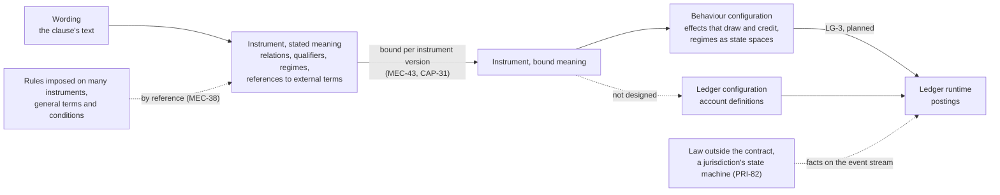
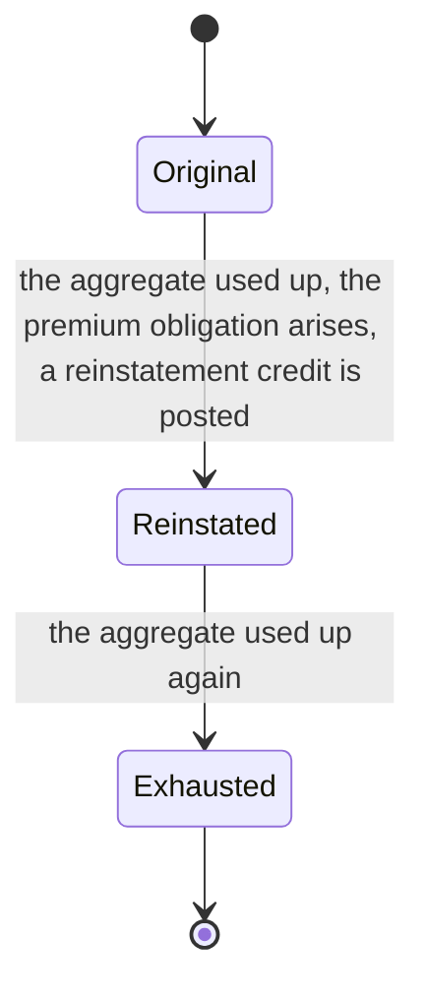

<!-- SPDX-License-Identifier: CC-BY-SA-4.0 -->

# From an instrument's clauses to a configured account

**Status:** sketch, 2026-11-11, for LG-Q21 and LG-Q22 of the [ledger plan](../plans/ledger.md), raised by the maintainer on deciding LG-Q10. **Reads** ADR-A104 and the Instrument README (relations, qualifiers, regimes, references), ADR-A85 and the Vocabulary README section 5.1 (scoped and temporal binding), ADR-A131 decisions 2, 5 and 7, ADR-A142, MEC-10, MEC-38, MEC-43, MEC-45, CAP-31, CAP-59, PRI-05, PRI-07, PRI-82, TD-102, LG-3, and the [balances sketch](ledger-balances-under-post-once.md) §4.5.

## 1. The question

The ledger's accounts are configuration: a stated amount, a unit, a parent, a period, a merge rule with its order and rounding, a ceiling, the purposes counted, and since LG-Q10 the credit kinds that restore it. The maintainer asked how that configuration comes to exist from the instrument whose clauses made the account necessary, including where a rule the deployment imposes on many instruments enters, how the reinstatement regime reaches the ledger, and how the scheme of credit kinds is resolved, when a posting is processed and when history is read, possibly in another store.

The index answers the last part from the Vocabulary layer, and has nothing on the first. **No layer or plan says how an account definition is derived from an instrument.** The Instrument layer states and binds meaning, the Ledger layer states account definitions, ADR-A131 decision 7 has Behaviour's effects draw and credit onto accounts (LG-3, planned), and nothing connects a bound clause to the account definition it should configure. That is the gap this sketch lays out.

## 2. The chain as the layers stand

Two facts constrain the missing arrow. Instrument does not import Ledger, and every layer above reaches Ledger through Behaviour (ADR-A131 decision 2). And bound meaning is derived and never the source of truth (MEC-43), so whatever produces an account definition from it must be repeatable for every instrument version.

## 3. Field by field

Every field of an account definition has a source in the contract, in a rule imposed on it, or in the law, and most of them are already stated meaning the Instrument layer holds.

| Account definition field | Where it comes from | Instrument terms it is read from |
|---|---|---|
| stated amount | the limit the clause states, or a schedule's figure | `ins:Qualifier`, its amount |
| unit of account | the qualifier's quantity and its value space (LG-Q20: one space per account) | the qualifier's `qnt:Quantity` |
| parent | "within the aggregate" makes a sublimit part of it, "in addition to" makes it stand beside | which term or relation the qualifier qualifies, and the wording's relation between qualifiers |
| period recurrence | "in any one period of insurance", "in each year" (one account per period, PDD-15) | the qualifier's reset period |
| key dimension | "per location", "for each borrower" | the qualifier's basis |
| purposes counted | "in respect of flood" | the scope of the relation the qualifier bounds |
| merge rule and its declared order | the wording ("in the order notified"), a rule imposed on the account, or the law's default (the order liability is ascertained) | relations and their scope, or a referenced term, or a fact the law's state machine asserts |
| rounding, residual and overshoot treatment | the wording or a rule imposed on it, refused by default where an overshoot is untreated (LG-Q16) | a referenced term, usually general terms |
| credit kinds that restore it | "the limit shall be reinstated", "amounts repaid may be reborrowed", "shall not exceed in all", or a rule imposed on it, all kinds by default (LG-Q10) | the regime that reinstates, and the qualifier that caps |
| credit ceiling | the stated amount unless the wording states another | the qualifier |
| owner | the persistent identity the account belongs to (ADR-A131 decision 5) | the instrument, or its ensemble |

## 4. Rules imposed on many instruments

The maintainer's point is that a deployment needs some rules applied consistently across many instruments without writing them into each one's wording, and that general terms and conditions are the canonical case, whether a contract includes them or refers to them. The Instrument layer already has the form for the referring case. A reference names a document's persistent identity, and either fixes an edition (`reliesOnEdition`, static) or means whichever edition is in force when evaluated (`reliesAsAmended`, ambulatory) (MEC-38). A deployment's rules for every instrument of a kind are then a document the instruments refer to, and its clauses are stated once and bound into each instrument that refers to it, as any clause is (PRI-05).

Two consequences follow for the ledger. An account's configuration can come from a referenced document as well as from the instrument's own clauses, so the derivation of section 5 reads bound meaning whatever its source. And where the instrument's own clause and a referenced rule disagree, which prevails is precedence between provisions (the normative rule substrate's N10), decided before the ledger is configured, never by the ledger.

## 5. Who derives the account definition, LG-Q21

| | (a) a stated mapping per kind of qualifier, applied by instantiation | (b) Behaviour's configuration states the accounts, authored beside the instrument | (c) a mapping in MORK from bound meaning to ledger configuration, compiled |
|---|---|---|---|
| what it is | one mapping, stated once for each kind of limit (an aggregate, a sublimit, a cap across reinstatements), produces the account definitions of every instrument version that binds that kind | the author writes the account definitions and their effects alongside each instrument, citing the qualifiers | the mapping of (a), written in the repository's mapping language and compiled to SPARQL |
| state meaning once (PRI-05) | yes | no, each instrument's accounts are written again | yes |
| repeatable per version (MEC-43) | yes | by hand | yes |
| where it lives | above Instrument and Ledger, beside the instantiator, reaching Ledger through Behaviour's import as ADR-A131 requires | Behaviour | the same as (a), with MORK's toolchain |
| cost | a mapping for each kind of limit, and a rule for what it does with a qualifier it has no mapping for, Undetermined | authoring effort on every instrument, and drift between the clause and the account | as (a), plus a dependency on MORK for every deployment that configures accounts |

Leaning (a), with (c) as its later implementation if the mapping is better kept as data. The question for the maintainer is whether the derivation is a stated mapping at all, and where it lives. **Answered 2026-11-12 in section 9:** it is a derivation, and it lives with Surface.

## 6. The reinstatement regime, worked

The wording of the insurance example states three things the ledger needs, and the regime that ties them together is the instrument's.

| Clause, paraphrased | Stated meaning | What reaches the ledger |
|---|---|---|
| "the aggregate limit is 10,000,000 in the period" | a qualifier on the insurer's obligation to pay | the aggregate's account definition, 10,000,000, restored by every kind |
| "the aggregate limit shall be reinstated once, on payment of a premium" | a regime with states original, reinstated and exhausted, moved by a transition on the condition that the aggregate is used up (`ins:Regime`, `ins:RegimeTransition`, `ins:OnCondition`, MEC-45), an obligation on the insured to pay the reinstatement premium arising on that transition | a Behaviour effect on the transition: a credit of kind reinstatement at the aggregate for its stated amount, which its ceiling cuts to what was used |
| "the insurer's liability shall not exceed 20,000,000 in all" | a qualifier over the aggregate across its reinstatements | the annual cap's account definition, 20,000,000, the aggregate's parent, restored by recoveries and not by reinstatements |

How many reinstatements are allowed is the number of states, a fact of the regime. The premium is an obligation the transition creates. The ledger sees one credit with its kind, and the annual cap's configuration, derived from the clause that caps the total, keeps it from restoring capacity. No posting depends on anyone knowing the tree or the history.

## 7. Resolving the scheme of credit kinds, LG-Q22

**When a posting is processed.** A credit's kind is a concept IRI. The account's restoring kinds are concepts too. Which scheme edition supplies them is the Vocabulary layer's resolution: a `voc:SchemeBinding` supplies one scheme edition for a named scope over a period, the more specific scope wins, equal scopes conflict, and `boundScheme` is the unscoped fallback (MEC-10, ADR-A85), implemented by the reference resolver (CAP-59). The scope is the instrument's (its market, its line), and the time is the posting's effective position. A conflict, or no applicable binding, leaves the credit Undetermined, which LG-Q10's guard refuses.

**When history is read.** A meaning-bearing dependency of a versioned thing must itself be versioned, content-addressed or copied into the owner's version (ADR-A142). So a historical read must not resolve the binding afresh against today's bindings. Two ways meet the rule.

| | (a) the account definition's version pins the edition | (b) each credit records the edition it was resolved against |
|---|---|---|
| what is stored | one reference per account definition version | one reference per credit |
| a historical read, in any store | reads the definition version in force at the read point and its pinned edition, so it needs the vocabulary editions and the definition versions, both versioned resources | reads the edition on each credit |
| an edition change mid-period | a new definition version, which is a change of configuration and visible as one | nothing on the definition, every later credit records the new edition |
| what it depends on | TD-102 paid: account definitions are today a plain class whose amount, ceiling and merge rule every historical balance folds against, the one instance of the mutable-parts defect still open | nothing more |

Leaning (a), since it pays TD-102, which a historical read needs anyway for the stated amount and ceiling, and it costs one reference per definition version rather than per credit. A store fed by the event stream (PRI-81) answers history the same way, provided it holds the definition versions and the vocabulary editions, which are both versioned and content-addressed.

## 8. What this sketch asks for

- **LG-Q21**, who derives an account definition from an instrument's bound meaning, leaning (a).
- **LG-Q22**, how a credit kind's scheme edition is fixed for a historical read, leaning (a), which brings TD-102 into the ledger's plan.
- No change to any decision taken. Section 4 records the maintainer's point on general terms as a case of references that already exist.

## 9. Agreed with the maintainer, 2026-11-12

**Composition, not specialisation.** Ledger stands below Behaviour, which is to import it and act on it (ADR-A131 decisions 1 and 7, LG-3, planned and not built, so section 2's arrow through Behaviour's import names an import that does not exist yet). An account's balance is the data a machine carries, never a state in a declared space, so Ledger's configuration is not rebuilt on states, transitions and guards. The rich model is Instrument's stated meaning on Behaviour, where a regime is a Behaviour state space by subclass.

**Runtime dials leave the configuration document.** A setting that tunes cost and changes no meaning, the closing recurrence that sets how often a checkpoint is written for example, belongs in a profile or is derived. Which ancestor is read in what way is always derived.

**A ledger profile exists, and it is the deployment's (LG-Q24).** It is one of the deployment's rules for every ledger it runs. It says whether a ceiling above a stated amount is admitted, off by default, and it holds the dials above.

**LG-Q21 is derivation, and its home is Surface.** An account definition is derived from an instrument's meaning by a projection contract, stated once per kind of qualifier, which lowers into a MORK mapping and compiles to a query (ADR-A17, ADR-A18). The contract names Instrument's and Ledger's terms without either layer importing the other, and lives with the deployment or the applied module that owns the kind. This replaces options (a) and (c) of section 5, whose content it keeps. It is not built in the ledger's current slices. The design only fixes where it lands.

**Authored definitions stay legal (PRI-01).** Anyone may write an account definition directly, and the shapes hold it to the same laws. Which holds where an authored and a derived definition answer the same qualifier is LG-Q25.

**Where a field's value may come from.** Four sources and no fifth.

| Source | Example |
|---|---|
| the instrument's own clauses | "the aggregate limit is 10,000,000 in the period" |
| a document the instrument refers to | general terms and conditions, by a fixed or an ambulatory reference (section 4) |
| a rule the deployment imposes on all its instruments or a filtered set of them, which no wording need refer to | a carrier's rule that a claim exceeding any limit is first refused, or that an account always pays as much of a valid claim as it can |
| Ledger's own documented default | a credit ceiling equal to the stated amount |

The third was missing from section 4. Whether such a rule is built from wordings, as an instrument of its own, or configured directly, and whether an ensemble or another mechanism applies it, is not designed. Where two sources disagree, precedence between provisions decides before the ledger is configured. Where every source is silent on a field Ledger requires, the derivation refuses and invents nothing.

**A derived definition's name outlives the generator.** A posting folds against the definition in force when it took effect, so a definition a record cites is not a cache to discard. Three rules deliver that.

1. **The definition is versioned** (TD-102). It has a persistent identity, and its stated amount, ceiling, merge rule, restoring kinds and parent are parts of a version, minted under it and never edited in place.
2. **Ledger's rule names it, never the generator's.** The identity is a function of the owner and the stated qualifier, so it survives a new version of the instrument, as the account does. A version is named by the digest of its canonical content under the substrate's digest rule. The same content derived again, under any generator or profile, has the same name, and different content is a new version beside the old.
3. **A version a record cites is kept.** A projection may discard only a version that no account, posting or checkpoint cites. That is a law Surface does not state today, owed as an addendum when the projection is built.

The record of each derivation carries what was read, the instrument's version, the editions of the documents and rules it drew on and the scheme edition of the credit kinds, which is where LG-Q22 (a)'s pin lives.

**Surface is exercised by use.** MORK entered the studio and Persistence carries it for the same reason. This derivation is where projection gets that use.
