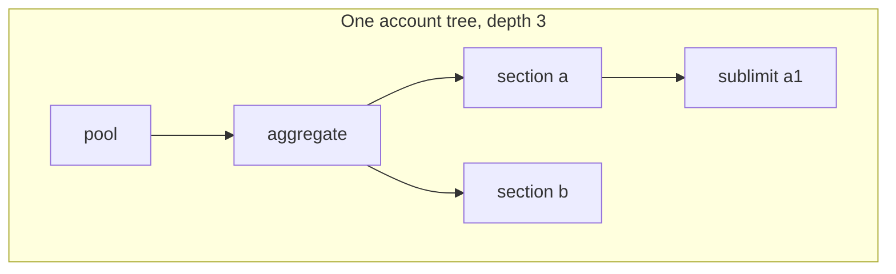
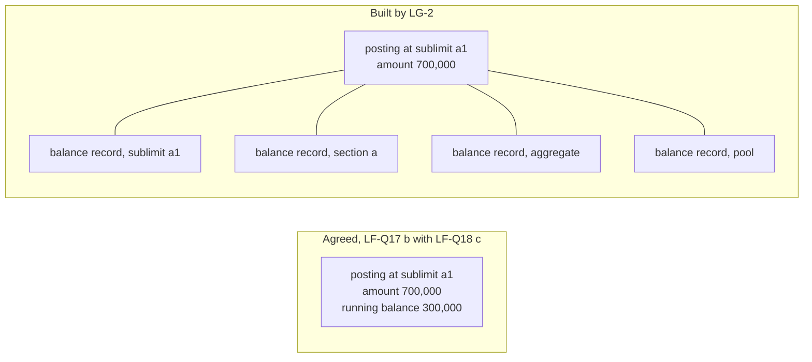
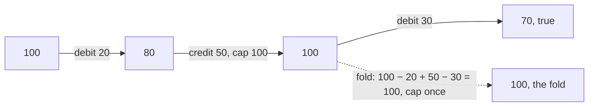
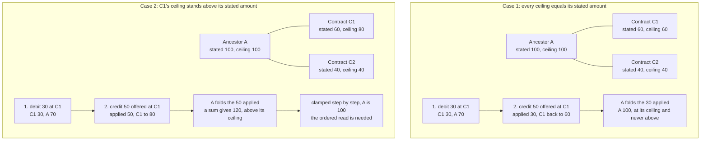
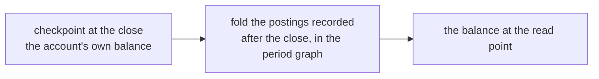
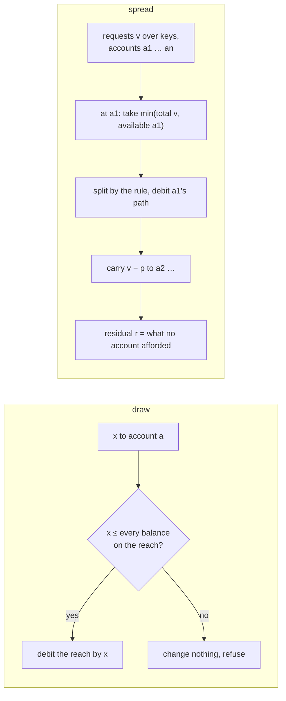

<!-- SPDX-License-Identifier: CC-BY-SA-4.0 -->

# Balances under post-once: the running balance, the fold and the capacity pool

**Unit:** `ledger` ([plan](../plans/ledger.md), [status](../status/ledger.md)). **Status:** sketched 2026-11-08 at the verification of LG-7 and LG-2, for LG-Q9, LG-Q10 and the questions LG-Q11 to LG-Q13 that the verification raised. Decisions waited for. Nothing here is built.

## 1. What was agreed, and what LG-2 built

The runtime design the maintainer decided on 2026-10-27 ([history sketch](ledger-history-and-runtime.md) §4, §5.2) has four parts. A draw is posted at the drawn account only, and an ancestor's balance is derived (LF-Q18 c). A posting carries a running balance along the recorded ordering (LF-Q17 b). A checkpoint is written at each close where the balance moved, under an IRI derived from the account and the close position (MS-Q6 a, MS-Q8 d). Each period's postings live in their own named graph, so a read of an ancestor is the checkpoint plus the fold over exactly the periods since it (STD-276, MS-Q1 a).

The [posting-cost benchmark](../../../benchmark/ledger-posting-cost/README.md) measured that design as two of its strategies. `post-once-balance-after` is the running balance, one triple more per posting, and it makes a leaf read one lookup, 0.7 postings folded against 72.1. `post-once-period-graphs` is the partition, and it makes an ancestor read flat, 0.40, 0.34, 0.34 and 0.54 ms at 1,000, 5,000, 20,000 and 100,000 events, where one graph grows to 217.53 ms. The benchmark wrote no balance records, and its README says so, so its storage figure, 240 million triples a year in the worst-case scenario, is the postings alone, against the sketch's 450 million which counted a balance record of about seven triples per account touched.

LG-2 built the first, third and fourth parts and not the second. A posting carries no running balance, and in its place a `ldg:BalanceRecord` is written for every account touched by a pass, the drawn account and each ancestor, carrying the remaining and the available value. The pack gives the reason, which is LG-Q9: under post-once an account with descendants has postings it does not carry, so a running balance read off its own postings is not its balance.

A draw of 700,000 at the sublimit is one event. The two designs write it differently.

The agreed design writes nine triples for the event. The built design writes eight for the posting and about seven for each of the four accounts on the path, thirty-six in all, and the four records are nodes with their own identity and provenance. On a path of depth *d* the built design writes 7(*d*+1) triples per pass beside the posting, which is the factor of *d* the benchmark's scenario put at 450 million triples a year and the agreed design avoids.

## 2. Why the running balance looked ambiguous, and why it is not

LG-Q9 asks which balance a posting's running balance states, and its option (b), a running sum of the account's own postings, is the one that is wrong for an account with descendants. Option (a), the balance of the posting's account with its subtree included, at the posting, is the one the pack calls expensive, because it needs every descendant's postings ordered against the account's own sequence.

That cost falls on the wrong party. The writer already has every balance it needs. To decide whether a draw may proceed it computes availability, which is the least balance along the path (LD2), so at the moment it writes the posting it holds the subtree-inclusive balance of every account from the drawn account to the root. Writing the drawn account's balance after the posting onto the posting is one triple and no further read. The running balance is therefore (a) at no cost to the write, and for a leaf (a) and (b) coincide.

The ordering difficulty is the verifier's, not the writer's. A shape that re-derives a running balance from the postings needs the order of postings across the accounts of a subtree, and the natural key LG-2 built is per account, a recorded position and a micro-position on one account. One rule makes the order well-defined for a subtree: the recorded order of a pass's postings is the pass position and then the micro-position, pass-wide, so two postings on different accounts in one pass have an order. With it a shape checks each posting against the running balance of the previous posting in its account's subtree, which is exact, and is the fix for the fold of §3 as well.

What an ancestor read costs is then as agreed. An ancestor drawn directly carries a running balance on those postings and nothing on its descendants' postings, so its balance now is the checkpoint plus the fold over the period graphs since, which is the flat read the benchmark measured.

### 2.1 The options, with their costs

The figures are per draw at depth *d*, or per read, from the benchmark's run R-I on Oxigraph at 20,000 events unless a cell says otherwise. A triple count is what is stored, and a read is what it costs now, not as of an effective position, which folds in every design (LF-Q17's answer narrowed it so).

| | A. As built by LG-2 | B. As agreed | C. B, plus the path's balances on the posting | D. A, with the record's IRI derived |
|---|---|---|---|---|
| Written per draw | 8 + 7(*d*+1) triples, *d*+2 nodes | 9 triples, 1 node | 9 + *d* triples, 1 node | as A |
| Leaf read now | the latest record, a search with a sort unless its IRI is derived, 0.04 ms at 2 passes and 1.06 ms at 200 by TSD-36's pattern | one lookup of the latest posting, 0.7 postings folded | as B | one lookup, the IRI from the account and the pass position |
| Ancestor read now | as the leaf | checkpoint plus the fold over the period graphs since, 0.34 to 0.54 ms, flat in the history | the latest posting in the subtree by recorded order, an ordered seek in the period graph, unmeasured | as the leaf |
| What the write must read | *d*+1 latest records | the path's balances, one fold per path account or one fold per pass with the path cached for the pass | as B | *d*+1 lookups |
| Verification shape | a fold from the stated amount with the ceiling applied once, §3 | each posting against its predecessor's running balance in the subtree, exact | as B | as A |
| A year of the worst-case scenario, depth 3, 10 million events | about 360 million triples at one event a pass, the sketch's 450 million with provenance | about 90 million, plus checkpoints at accounts × closes × 4 | about 120 million | as A |

The triple counts for a year are arithmetic from the per-draw counts and the scenario, not measured. B's write-side fold is the one cost the agreed design carries that A does not, and it is bounded by the closing interval, which is the dial the history sketch's §5.1 set per account. A cache of the path's balances for the duration of a pass is coordination data that rebuilds from the graph, which PRI-52 allows.

### 2.2 Leaning

Design C is not needed for a regulator's read, which is answered from history when it is asked, from a checkpoint, an archive restored to a scratch dataset or a store fed by the event stream (PRI-81, the [multi-store runtime sketch](multi-store-runtime.md) §5.3), so C is weighed on the hot path's reads alone.

B, which is the design as decided, with LG-Q9 answered (a) and the pass-wide order rule stated as a standard. `ldg:BalanceRecord` per pass leaves the runtime document, `ldg:Checkpoint` stays as the balance at a close, and the running balance goes onto `ldg:Posting`. The remaining and available values a balance record carries are then read, not stored, except at a checkpoint. A's one gain, that an ancestor's balance now is a lookup, is what C buys for *d* triples a posting without a node, and whether its ordered seek is flat is the one measurement this sketch asks for before C is preferred to B.

## 3. The fold that applies the ceiling once

LG-2's `ldg:BalanceFoldShape` computes a balance record's remaining value as the stated amount plus every credit and less every debit in the subtree from passes at or before the record's, and then caps the total at the ceiling once. The pack records this as exact unless a credit was cut by the ceiling before a later debit in the same subtree, and §13 of the README carries it as open.

It is not exact in a plausible history, and when it is wrong it refuses a correct ledger.

| Step | What happened | True balance, the ceiling applied at each credit | The fold's value |
|---|---|---|---|
| start | stated 100, ceiling 100 | 100 | 100 |
| 1 | debit 20 | 80 | 80 |
| 2 | credit 50, cut to the ceiling | 100 | min(100 − 20 + 50, 100) = 100 |
| 3 | debit 30 | 70 | min(100 − 20 + 50 − 30, 100) = 100 |

At step 3 the shape reports a violation on a record that states 70, which is right, and accepts a record that states 100, which is wrong. A recovery larger than what was drawn, followed by a loss, is this history in the insurance example's own terms, and nothing about it is exotic.

A law shape that can refuse a correct record is not a law, so the one-cap fold should not stand as one. There are two exact forms. Under design B each posting carries a running balance and the shape checks one step, the predecessor's running balance plus or less this posting's amount, capped at the ceiling where it is a credit, which applies the ceiling exactly where the writer did. Under design A the shape chains passes, taking the previous pass's record as the base rather than the stated amount, which is exact across passes and leaves only a pass that holds both a cut credit and a later debit on one subtree, closed by a rule that within a pass credits are applied before debits or by the micro-position order.

## 4. The annual cap and position 4 of the insurance example

### 4.1 The arithmetic

The example's annual cap, named a reinstatement annual cap until LG-13 renamed it (STD-325), is stated at twice the aggregate, as the hard cap across the original cover and one reinstatement. Its table reads so.

| Position | Event | Aggregate | Annual cap |
|---|---|---|---|
| before | | 10,000,000 | 20,000,000 |
| 1 | flood loss 700,000 | 9,300,000 | 19,300,000 |
| 2 | recovery 300,000 | 9,600,000 | 19,600,000 |
| 3 | loss 9,600,000 | 0 | 10,000,000 |
| 4 | reinstatement | 10,000,000 | 20,000,000 rolled up, then 10,000,000 after the annual cap's own debit |

The arithmetic is right. Capacity used across the two lives is 700,000 less 300,000 plus 9,600,000, which is 10,000,000, so 10,000,000 is left and the aggregate stands restored. What the example does to reach it is two postings in one pass, a credit of 10,000,000 at the aggregate, which rolls up to the annual cap under the fold, and a debit of 10,000,000 at the annual cap, so that the roll-up is undone.

### 4.2 What the two postings say

Read as modelling, the second posting is a correction of the first. The credit is a reinstatement, and a reinstatement restores the aggregate without adding to the capacity the annual cap measures, so the credit should never have reached the annual cap. The example makes it reach the annual cap and then takes it back, because the fold treats every credit alike. That is the structural mismatch LG-Q10 is about, and the annual cap debit is its symptom.

The annual cap debit is also a posting at an ancestor, which LF-Q18 (c) allows for a purpose-counting account only, and it is the first posting any ancestor's book carries. Under post-once an ancestor's book holds checkpoints alone, so sealing it at a close is sealing a derived record. A posting in the annual cap's book makes the annual cap's own period and close matter for a posting, and a reinstatement effective after the annual cap's close lands in PDD-14's case, a posting effective inside a sealed period. That is the sense in which the annual cap debit runs against sealed periods.

### 4.3 The options

| | What it is | Terms added | Postings per reinstatement | Posts at an ancestor | What else changes |
|---|---|---|---|---|---|
| (a) | the annual cap is also debited, as built | none | 2 | yes | LF-Q18 (c) gains an exception that is not a purpose |
| (b) | the annual cap is not an ancestor but an account a reinstatement draws on by purpose | none | 2 | no | every loss must name the purpose too, or the annual cap no longer falls with losses, which positions 1 to 3 need |
| (c) | a credit ceiling on the annual cap's subtree fold | a ceiling | 1 | no | does not work alone. After position 3 the annual cap is at 10,000,000, the roll-up takes it to 20,000,000, and 20,000,000 is the ceiling, so nothing is cut |
| (d) | the annual cap stays the ancestor, and the reinstatement is a draw that names a purpose the annual cap counts | a purpose | 2 | yes, as a purpose posting, which LF-Q18 (c) allows | the annual cap is both ancestor and purpose-counting account for the aggregate |
| (e) | a credit carries its kind, and a reinstatement is a kind of credit that restores its account and does not fold upward | a kind on a credit, two values | 1 | no | the fold shape and the kernel's `credit` take the kind, so a reinstatement stops at its own account |

On (d), an earlier reading of this sketch's author put a double-count cost on it, and that was wrong. The double count §13 names arises where a draw at an account X names a purpose counted by an ancestor P of X, so the posting at X folds to P and the purpose posting at P counts it again. A reinstatement under (d) is a draw at the annual cap itself with no posting at a descendant, so nothing folds twice. The double count is a separate open case, and the kernel already answers it, since `reach` is a set union and `debit` debits each account in it once, so the runtime rule it needs is that a purpose posting is not written at an account already on the drawn account's path.

On cost in time and space, the options do not differ. A reinstatement is a handful of events per contract a year, so two postings against one is noise beside the losses, and the kind in (e) is one triple on those postings alone. The decision is on meaning and on which laws change. (a) and (d) keep the fold as it is and add a posting at an ancestor. (e) keeps post-once intact, changes the fold's treatment of one kind of credit, and is the only option that says what a reinstatement is, which is PRI-12's test. Its cost is that LD3's `credit` gains a kind, and the fold shape a filter, which is a change to what LG-7 and LG-2 built.

### 4.4 Leaning, as first written

(e), examined before (d), on the priority PRI-80 states, correctness before performance before churn. The maintainer's question of whether a reinstatement is built as the example builds it is LG-Q10, and the sketch does not decide it.

### 4.5 Revised 2026-11-10: the kind is the world's, and the account decides

**The table above shows remaining balances, not availability.** At position 3 sublimit A1 still holds 600,000 of its own, but its availability is the least remaining along its path, min(600,000, 5,600,000, 0, 10,000,000) = 0 (LD2), so nothing more can be paid from it, as the maintainer pointed out: once a fire aggregate is used up, no further fire loss is paid, whatever an equipment-fire sublimit beneath it still holds.

**What was wrong with (e).** As written, a reinstatement's kind meant that the credit stops at its own account. That encodes the tree into the posting, so a poster would have to know the parent is a cap, and it fails where a fire sublimit's reinstatement should restore the property aggregate above it. The maintainer's point is that recovery and reinstatement differ in the world, money recovered against a restoration of a limit by a trigger in the wording, and which accounts respond to which is each account's own concern.

**Two designs the maintainer proposed, tested.**

| | P1, the poster states the real-world kind and each account declares the kinds that restore it | P2, a dual-value account, balance tracked apart from what was posted in each direction, the poster stating nothing |
|---|---|---|
| correct on the annual cap | yes, it accepts recoveries and not reinstatements | no as stated: a recovery and a reinstatement reach the aggregate as equal credits, so with nothing stated no configuration can tell them apart. The nearest working form posts a recovery as a reversal of a draw, which is the real-world kind again |
| correct on a term commitment | yes, it accepts nothing, since repaid amounts cannot be redrawn | a reversal would wrongly restore it, so a policy per account is needed anyway |
| the poster knows | what happened, a recovery, a reinstatement, a repayment, a seat returned | the same, as a direction |
| space | one triple per credit for its kind, one per restricted account definition | a second running value on every posting, under LG-Q9's running balance |
| time | one filter on kind in an ancestor's fold where its policy restricts kinds | a second dimension in every read |
| ease for us | one concept | a second dimension throughout |

| Account | Restored by | Why |
|---|---|---|
| annual cap | recoveries, not reinstatements | it measures net paid across the year |
| aggregate, or a fire sublimit | recoveries and reinstatements | a reinstatement restores the limit |
| property aggregate above a fire sublimit | recoveries and reinstatements | the maintainer's example |
| revolving facility | repayments | repaid amounts may be drawn again |
| term commitment | nothing | repaid amounts may not be drawn again |
| licence pool | seats returned | a returned seat may be used again |

**The proposal, decided by the maintainer on 2026-11-10 as LG-Q10's answer.**

1. A credit carries its kind, a concept from a scheme whose contract Ledger declares and an applied module binds, so insurance supplies recovery, reinstatement and write-back and Ledger names no domain's kinds.
2. Each account declares the kinds that restore it, all by default, so a revolving account needs nothing. No credits at all is the empty list, and recoveries only is a list of one, bound from the wording, which the terms may override.
3. An ancestor's balance folds the debits of its subtree and the credits whose kind it accepts, each account applying its own ceiling.
4. A credit with no kind, on a path where an account restricts kinds, is refused as Undetermined by a guard, never taken to restore.

The poster needs neither the tree nor the history. A reinstatement in full is posted at the stated amount, and the credit ceiling already cuts it to what was used (LD3). The multi-year worry, that "less everything drawn" reaches back past a year, does not arise, since a periodic amount is one account per period (PDD-15). How many reinstatements a contract allows is the instrument's regime, and the annual cap makes a further one impossible. Position 4 becomes one posting, a reinstatement credit at the aggregate, and the annual cap stays at 10,000,000.

### 4.6 Added 2026-11-11: where an ancestor's ceiling can bind

LG-15 found that once a credit is clamped at the account it is posted to, and an ancestor folds the amount it was applied at, no ancestor's ceiling bound in its corpus. That makes an ancestor's balance a sum rather than an ordered read (TSD-72), which matters for cost. But the corpus set every ceiling equal to its account's stated amount, which the ledger does not require (`ldg:CreditCeilingNotBelowStatedShape` only keeps a ceiling from falling below it). This section shows when the finding holds and when it does not, for LG-Q23.

**The reason it holds.** An ancestor's balance is its stated amount, less every debit in its subtree, plus every credit it accepts at the amount the credit was applied at. A credit is applied at its own account only up to that account's ceiling. Where that ceiling is the account's stated amount, a credit can only give back what was drawn from that account, so across the subtree the credits applied never exceed the debits, and the ancestor's balance never rises above its own stated amount. A kind filter only removes credits from the ancestor's fold, so it can only lower the balance. The ancestor's ceiling, at or above its stated amount, is never reached, and a plain or filtered sum gives the right balance.

**Where it fails.** Where an account below the ancestor has a ceiling above its stated amount, a credit can lift that account past what was drawn from it, by up to the difference. That surplus folds into the ancestor, and if it exceeds the ancestor's own room above its stated amount, the ancestor's ceiling binds. Its balance is then a running balance clamped at its ceiling, where order matters, and a sum is wrong.

In case 1 the credit offered 50 but only 30 had been drawn from C1, so C1 takes 30 and the ancestor folds 30, ending at 100, its ceiling, and no clamp at the ancestor is ever needed. In case 2 C1 may hold up to 80, so it takes all 50, and the ancestor's sum of 70 plus 50 is 120, which its ceiling of 100 must cut. A later debit of 10 at C2 then gives 90 under the clamp and 110 under the sum, so the error carries forward and the order of postings decides the answer.

**What it means for LG-Q23.** Whether an ancestor's fold can be a sum is known from configuration alone, before any posting. An ancestor's ceiling can bind only where the room its descendants have above their stated amounts, added up, is more than its own room above its stated amount. Where it cannot, a sum is right and costs what LG-14 and LG-15 measured for the plain and filtered folds. Where it can, the ancestor needs the ordered read of TSD-72, or a checkpoint that bounds it, or the configuration is refused. That gives three readings beside LG-Q23's own options.

| | What the ledger does with an ancestor whose ceiling can bind |
|---|---|
| refuse | a shape refuses a configuration in which descendants' room above their stated amounts exceeds an ancestor's, so every ancestor's fold is a sum |
| read in order | such an ancestor is marked, by a shape or by derivation, and read in order, every other ancestor by a sum |
| always in order | every ancestor is read in order, the simplest rule and the most costly read |

The first is the cheapest and the least general, since a contract whose credits may legitimately exceed what was drawn, an overpayment credited and held, would then need a ceiling equal to its stated amount and somewhere else to hold the surplus. The second keeps that generality and pays the ordered read only where it is needed, and the room on each account is configuration a check can read. The decision is the maintainer's under LG-Q23.

### 4.7 Added 2026-11-11: checkpoints under credit kinds and clamped credits

The maintainer asked whether the decisions of sections 4.5 and 4.6 stop the checkpoints designed earlier from working, or override them in another way. They do neither. A checkpoint is an account's balance at a close, and a read at a later point starts from the last checkpoint and folds only the postings recorded after it (ADR-A131's addenda of 2026-10-27, LF-Q17 (b), MS-Q6, MS-Q8). That works for any fold that can restart from a balance alone, and every fold the ledger now uses can.

| What changed | What the checkpoint holds | What a read after it does | Still bounded by the close |
|---|---|---|---|
| nothing, the design as benchmarked | the account's balance | sums the later postings | yes |
| credit kinds (LG-Q10) | the account's balance under its own restoring kinds, which is the only balance an account has | sums the later debits and the later credits it accepts | yes |
| a ceiling that can bind, read step by step (section 4.6) | the same | an ordered fold of the later postings, clamped at each step, which needs nothing from before the close but the balance, since a clamp depends only on the balance it starts from | yes |
| credits recorded at the amount applied (LG-Q23 (a)) | the same | sums again, with no clamp at the ancestor where section 4.6's condition holds | yes |

**What LG-15 measured.** A read from the checkpoint cost 0.02 to 0.05 of a read from the start on rdflib, on Jena in memory and on TDB2, for every fold, the stepwise fold included. The one exception was the stepwise read on Oxigraph, at 0.92, and a minimal probe traced it to Oxigraph 0.5.13 reading every graph for an `OPTIONAL` inside `GRAPH ?g` (TSD-71, the upstream report beside oxigraph/oxigraph#2008). The query asked only for the graphs after the close, and the engine read them all. That is a defect of the engine, not of the checkpoint, and a `UNION` form or a recording of the applied amount without an `OPTIONAL` avoids it.

**What the decisions do change.** Two things, neither of them the mechanism.

- **Which balance is checkpointed.** An account's balance is now its own fold under its own restoring kinds, so an ancestor that accepts recoveries only checkpoints that balance and not the sum of everything below it. A checkpoint is still one balance per account per close where the balance moved, so it costs no more triples.
- **A change of configuration within a period.** Where an account's restoring kinds or ceiling change between closes, a new version of its definition, each posting after the checkpoint must be folded under the version in force when it took effect, never under today's. A stepwise fold does that naturally. A sum must group the later postings by the version in force, which is one more reason to pay TD-102 and to decide LG-Q22, so the version in force at any point can be read.

### 4.8 Added 2026-11-12: a credit at two levels of a path, the path clamp, and a cut the writer records

**Section 4.6's condition is too weak.** It says an ancestor's ceiling cannot bind where every ceiling equals its account's stated amount. LG-15's corpus posted every credit on a contract, a leaf, and its argument, that an ancestor's outstanding draw is at least the sum of its contracts', holds for credits on leaves. LG-Q10's own answer posts a reinstatement at the aggregate, an account with accounts below it. A credit at an ancestor restores the ancestor and not the accounts below it, so a later credit below can push the ancestor past its ceiling. The history is ordinary: a loss, a reinstatement, and a recovery that arrives late. Amounts are in millions, an annual cap of 20 that accepts recoveries only, an aggregate of 10 under it, and sections S and T of 10 each under the aggregate, every ceiling equal to its stated amount.

| Step | Event | S | T | Aggregate, clamped at each step | Aggregate as a sum | Annual cap |
|---|---|---|---|---|---|---|
| start | | 10 | 10 | 10 | 10 | 20 |
| 1 | loss of 10 at S | 0 | 10 | 0 | 0 | 10 |
| 2 | reinstatement at the aggregate | 0 | 10 | 10 | 10 | 10 |
| 3 | recovery of 2 at S | 2 | 10 | 10 | 12 | 12 |
| 4 | loss of 3 at T | 2 | 7 | 7 | 9 | 9 |

From step 3 a sum overstates the aggregate by 2 and would let its second life pay 12. So the configuration test of section 4.6 does not make an ancestor's fold a sum. The condition that does, stated as a hypothesis for the proofs, is that every ceiling equals its stated amount and no credit an ancestor accepts lands on an account that lies above another account receiving one.

**The path clamp, examined and not taken.** Clamping a credit along its path when it is written, to the least room among the accounts that accept its kind, would make every ancestor a sum. At step 3 the rooms are 10 at S, 0 at the aggregate and 10 at the annual cap, so the recovery would be applied at nothing. S would stay at 0 though the money came back, and the annual cap would stay at 10 though net paid fell to 8. The accounts on a path measure different things, which is what LG-Q10 decided, so they cannot share one applied amount. The clamp is more restrictive than refusing a configuration, since it cuts a credit silently at runtime where a refusal is visible at design time, and it fails on the default configuration.

**A cut the writer records.** The writer of a credit already holds the balances along the path (LG-Q9 (a)). Where the amount applied at the posting account is more than an accepting ancestor has room for, the writer records the difference on the credit as a cut at that ancestor. An ancestor's balance is then its stated amount, less the debits in its subtree, plus the credits it accepts at the amount applied, less the cuts recorded at it. At step 3 the recovery carries a cut of 2 at the aggregate, and the aggregate reads 10 less 13 plus 12 less 2, which is 7 after step 4.

| | Refuse the configuration | Ordered read where a ceiling can bind | A cut recorded by the writer |
|---|---|---|---|
| the history above | cannot be refused, it is the decided design | the aggregate is read in order (TSD-72) | the aggregate is a sum |
| a ceiling above a stated amount | refused | read in order | a sum |
| written per credit | nothing more | nothing more | one cut, about 3 triples, only where an ancestor had less room |
| read of any ancestor | a sum | ordered, with a loop in the caller | a sum with one more term, looked up by the ancestor |
| what the writer must know | the path balances | the path balances | the path balances |
| verification | a sum | an ordered replay | an ordered replay, off the hot path |
| what the proofs owe | the leaf condition | the stepwise law, LG-9's | that the sum with cuts equals the stepwise balance |

The cut is part of the credit's own record in its period graph, never a posting in the ancestor's book, so section 4.2's objection to a posting at an ancestor does not apply. None of the costs in the table is measured. The credit kinds benchmark can measure the read with cuts, on machine R.

**What it means for the rulings.** The ruling on scenario E2, that an excess goes to a residual account and a ceiling above the stated amount is refused by default, stands as a statement of meaning. It no longer rests on cost, since with cuts a ceiling above the stated amount costs a read nothing. The residual account itself is an account that only receives and has no ancestor, so nothing binds above it, and how it is declared is for LG-Q16's treatment of a residual. LG-Q23 gains the cut as its option (d).

## 5. `draw` and `spread`, two refusal semantics

LG-7's kernel has two ways an amount reaches the tree. `draw` takes one amount to one account, debits the path and the paths of every account counting its purpose as one operation, and either succeeds whole or changes nothing (LD1, LD4). That is ADR-A131 decision 3 and PRI-43. `spread` takes a request vector over keys and a list of accounts, and at each account takes the least of what is still requested and what the account can afford, splits it among the keys by the rule, debits the path, and carries the rest to the next account. What no account affords is the residual (LC1 to LC3).

The consequences, each a question for LG-4 and some for LG-7.

1. **The kernel's merge cannot refuse.** Decision 6 names three rules, in priority order, proportional, and refuse, which leaves the draws Undetermined with a reason. The kernel's `merge` takes a rule of type amounts to amount to amounts and cuts the requests to availability whenever they exceed it, so refusal has no form in it. LG-2's `ldg:RefusedMergeShape` cites LD1, which is a draw's refusal and not a merge's. A theorem that a refused merge grants nothing and changes nothing is missing (LG-Q11).
2. **An allocation across accounts is not atomic in the kernel.** `spread` debits account by account, so a pass that allocates one amount over several accounts can, between two steps, be a partial state. LD1's atomicity is per draw per reach. Whether an allocation commits whole as one pass is a runtime law with no theorem (LG-Q12).
3. **The order of accounts is data.** `spread`'s result depends on the order of its account list, as a waterfall should, and two orders move different money on one arrangement, as LA4 shows for two rules. The order must be declared with the arrangement, never defaulted, and a shape must refuse an allocation with no declared order (LG-Q12).
4. **Purposes are absent from allocation.** `spread` debits `path`, where `draw` debits `reach`, so an allocated amount with a purpose does not debit the purpose-counting accounts. Either allocation takes `reach` or the law says a purpose is a draw's and never an allocation's (LG-Q13).
5. **The two residuals differ.** `draw`'s refusal leaves the whole amount with the drawer. `spread`'s residual is what is left after every account gave what it could, which is TD-95's residual, and reverts to the drawer. A merge rule under a binding ceiling is `spread`'s semantics at one account, and decision 6's refuse rule is `draw`'s. LG-4 must say which an allocation follows, and the answer may be both, selected by the declared rule.
6. **A negative availability is read as zero** by `spread`'s `max 0`, and LC3 keeps every balance non-negative from a non-negative start, so the case does not arise in the kernel. The runtime must keep the same start condition, which `ldg:CreditCeilingShape` and the fold do not state.

So `draw` is handled separately, and should stay so. The care the maintainer asks for is in the runtime, where a merge under a binding ceiling must say whether it refuses whole, cuts and carries a residual, or is Undetermined, by the declared rule, and in LG-7, where the refuse rule and the atomicity of a pass need theorems before LG-4 cites them.

## 6. Proof follow-ups

Each is a claim for the gate under LG-7's conventions, in the session as it stands. None needs HOL-Library, and one is simpler with it.

| Claim | What it proves | How | Size |
|---|---|---|---|
| LR3 | `ldg:LargestRemainder` sums exactly to the total and is a function of its inputs alone | floor parts as LR1, the residual given to the keys with the largest remainders `(t * w k) mod W`, ties by key order, the keys chosen by `take r` of `sort_key` over `sorted_list_of_set K`. `sort_key` is in `List`, in Main | about 60 lines, with the lemma that a chosen key's remainder is at least any unchosen key's |
| LR4 | the two integer rules are lawful in the integer sense | the four axioms over `int` when the total is at most the sum of the weights. Boundedness holds because a floor part is strictly below its weight when the total is below the sum, so adding one unit stays within it | about 80 lines |
| LR5 | the refinement, beyond one part | every rounded part is within one unit of the exact share, the recipient of a residual unit included, and the rounded fold over the tree conserves exactly while each account's rounded balance is within one unit per posting of the exact balance | about 120 lines, the second half needs an integer `spread` |
| LC3 per step | nothing is posted to any account beyond its availability at that step, for every step and not the first only | a function giving the balances before step *i*, by recursion on the account list, and an induction showing `total (ps ! i) ≤ available (before i) (accts ! i)`. The bound is `spread`'s own `min`, so the proof is bookkeeping | about 40 lines, replacing LC3's second conclusion with a reviewed restatement |
| LM1 | a refused merge grants nothing and changes nothing | a merge result type with a refusal, or a refusal decided before the rule, by LG-Q11 | about 30 lines once LG-Q11 is answered |
| LO1 over multisets | order independence as `mset ps = mset ps'` | `HOL-Library.Multiset`, reached as LG-Q14 decides, from source through a `sessions` clause under its leaning | a restatement, the proof as it is |

LO1 as proved, over two lists without repeats with the same elements, is the multiset statement for proposals that are distinct, which a second order of the same proposals always is, so the library buys the natural statement and not a stronger theorem. The library is worth having for `Multiset` and for `Sublist` in the integer `spread`. It built on machine R on 2026-11-08 under a memory limit, and a `sessions "HOL-Library"` clause loads the theories named from source, so no other machine needs the heap (LG-Q14). LG-8 holds these claims.

## 7. What this sketch asks for

- LG-Q9, leaning (a) with the pass-wide order rule, and with it design B of §2.1 and the removal of `ldg:BalanceRecord` per pass.
- LG-Q10, leaning (e) examined before (d).
- LG-Q11 to LG-Q13, raised in the plan from §5.
- One measurement, the ordered seek of §2.1's design C, before C is preferred to B.
- LG-Q14, how the session reaches HOL-Library now that it built on machine R, for LO1's statement and the integer `spread`, which LG-8 then proves.
