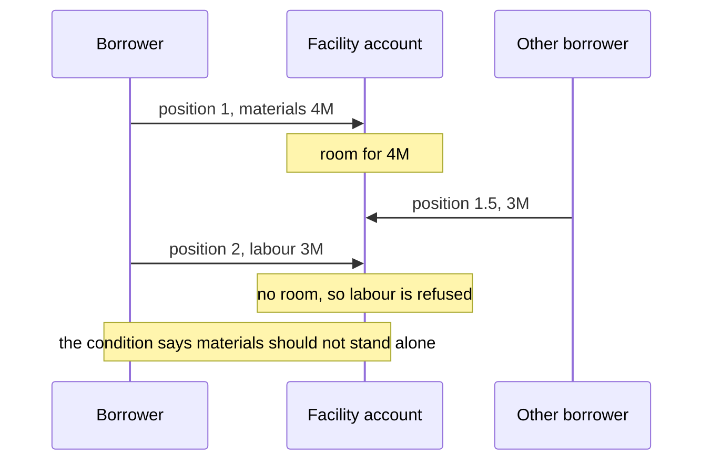
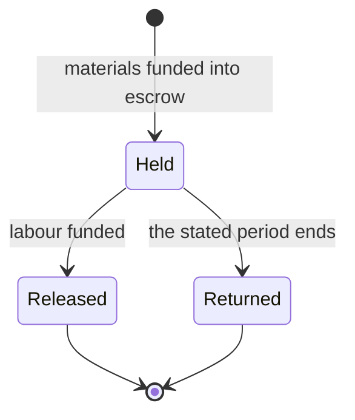

<!-- SPDX-License-Identifier: CC-BY-SA-4.0 -->

# Requests that stand or fall together across positions

**Status:** sketch, 2026-11-09, **out of scope** by the maintainer's ruling of the same day on scenario B2 of the [posting scenarios](../notes/ledger-posting-scenarios.md). It records the law and the instrument terms each reading touches, so that a later decision, BL-20, can proceed or drop the work without rediscovering them. Nothing here is planned.

**Reads:** the instrument README, sections 4.2 and 10 to 11 for relations, triggers, regimes and gating, the ledger plan's LG-Q10, LG-Q11 and LG-Q12, and PDD-14.

## 1. The scenario

A construction loan funds a materials drawing at position 1 and a labour drawing at position 2, on a condition that both fund or neither does. At position 1 there is room for materials. Another borrower's drawing at position 1.5 takes the room, so at position 2 there is none for labour.

| Reading | Outcome | The maintainer's ruling, 2026-11-09 |
|---|---|---|
| (i) each position merges alone | materials funds, labour is refused | depends on the wording, as B1's does |
| (ii) materials is held until labour is decided | a held state | a different kind of behaviour, an alternative state in which some postings are held until another state is entered. How the instrument states it is open |
| (iii) materials funds, and is recovered after labour fails | two postings and a recovery | a recovery, common, but not centred on the account. New terms govern it, the money may come back in part, late, or after a judgment |

## 2. Reading (i), each position alone

**The law.** A facility agreement states conditions precedent to the first utilisation and further conditions to each later one, commonly that the representations are repeated and no default is continuing, so each utilisation is tested when it is requested. The lenders' obligation to fund ends when the availability period does. Nothing in that structure links two utilisations, so unless the wording links them, each stands alone.

**The instrument.** The borrower's `ins:Power` to request a utilisation, its `ins:scope` the conditions of that utilisation. The lenders' `ins:Obligation` to fund, arising on the request's exercise (`ins:OnExercise`). Each request is its own position. Nothing new is needed.

## 3. Reading (ii), holding the first until the second is decided

Three forms an instrument can take, of which two need nothing new in the ledger.

### 3.1 One request for both, so there is no second position

**The law.** The usual drafting answer. Where two amounts must fund together, the borrower requests them in one utilisation, and the conditions test both at once.

**The instrument.** One exercise of the borrower's power, naming both amounts. The bundle is then at one position, and LG-Q11's decision covers it: the account's refuse policy, or a term the request carries (B1's ruling).

**The ledger.** Nothing new.

### 3.2 An escrow, so the hold is an account

**The law.** The lenders fund the first amount into an account the borrower cannot draw from, held by an agent who releases it when the second amount funds and returns it if it does not by a stated date. Behind the express terms, money advanced for a stated purpose that fails may be held on trust for the lender, which keeps it out of the borrower's insolvency (*Barclays Bank v Quistclose Investments* [1970] AC 567, *Twinsectra v Yardley* [2002] UKHL 12, whose classification of that trust is still debated).

**The instrument.**

| What | Instrument terms |
|---|---|
| funding the first amount into escrow | the lenders' `ins:Obligation`, obligee the escrow agent's role |
| the borrower may not withdraw it | an `ins:Prohibition` on the borrower, gated (`ins:appliesInState`) by a held state |
| the held, released and returned states | an `ins:Regime`, entered on the funding, left on an `ins:OnCondition` that the second amount funded, or on expiry after a stated period (`ins:after`) |
| release | the agent's `ins:Obligation` to pay the borrower, arising on entering the released state |
| return | the agent's `ins:Obligation` to pay the lenders, arising on entering the returned state |

**The ledger.** The facility is drawn at position 1, as it is under reading (i). The escrow is an account of its own, and release and return are postings between accounts at later positions. The hold is a balance, so no pending state is needed.

### 3.3 A reservation of availability, so the hold is a new kind of posting

**The practice.** A card payment is authorised first and captured later. The authorisation reserves the amount against the card's limit without paying anyone, and lapses if it is not captured. The terms are the scheme's and the issuer's, not general law.

**The instrument.** The lenders' obligation to fund the first amount arises only on capture, an `ins:OnCondition` that the second amount was granted. The reservation is the account's own mechanism and states no relation between the parties.

**The ledger.** This is the only form that changes the ledger. A reservation counts against availability and not against the balance, so availability becomes the remaining balance less the reservations along the path. Capture turns a reservation into a debit, and lapse or release removes it. It is a new kind of posting, a new law beside LD1 and LD2, a lapse driven by time, and a question for LG-Q9's running balance, which would carry a reserved amount beside the balance.

## 4. Reading (iii), paying and recovering

**The law.** A recovery stands on terms of its own, never on the first payment.

| Ground | What it gives |
|---|---|
| the facility agreement | an event of default, then the lenders' power to accelerate, then the borrower's obligation to repay, or a mandatory prepayment on a stated event |
| no express term | a claim in unjust enrichment for a payment whose basis failed, which the courts have allowed where the basis fails in part as well as in whole (to be checked against the authorities before relying on it) |
| money advanced for a purpose | the trust of section 3.2, a proprietary claim that survives the borrower's insolvency |
| an unpaid demand | a claim, a judgment, then enforcement, each a legal act at its own time, within the limitation period, six years for a simple contract (Limitation Act 1980 section 5) |

The money may by then have been paid on to suppliers, so a recovery may arrive in part, late, or never.

**The instrument.**

| What | Instrument terms |
|---|---|
| the default | an `ins:OnBreach` or `ins:OnCondition` entering a default state of an `ins:Regime` |
| accelerating | the lenders' `ins:Power`, exercised by their agent |
| repaying | the borrower's `ins:Obligation`, arising on the exercise, with `ins:due` |
| a judgment | a legal act at its own time, recorded with its provenance |

**The ledger.** The account is not at the centre, as the maintainer put it. Each amount actually recovered is a credit at the position it is received, which may be in a later period, so a recovery effective earlier than its recording is PDD-14's case. The credit carries its kind, a recovery, which is LG-Q10's credit that carries its kind, and its ceiling applies. The first posting is never reversed.

## 5. What it would take

| Form | Ledger | Instrument | Size |
|---|---|---|---|
| 3.1 one request | nothing | nothing | none |
| 3.2 escrow | nothing, an account and transfers | a regime, two obligations and a prohibition, all existing terms | an example and its tests |
| 3.3 reservation | a posting kind, a law for availability, lapse in time, the running balance extended | an obligation arising on capture | a slice of LG-2's size, and proofs |
| 4 recovery | a credit kind, which LG-Q10 already asks for | a regime, a power and an obligation, existing terms | an example once LG-Q10 is decided |

Reading (ii) needs nothing new if a wording uses 3.1 or 3.2, which suggests that a reservation is worth building only if a real use, such as card authorisations or a commitment held against a limit, needs it in the ledger rather than in an account.

## 6. Sources

Read from summaries and commentary, not the full judgments, so to be checked before any wording relies on them.

- *Twinsectra v Yardley* [2002] UKHL 12, bailii.org/uk/cases/UKHL/2002/12.html, and its summary at wikipedia.org/wiki/Twinsectra_v_Yardley
- Quistclose trusts in English law, wikipedia.org/wiki/Quistclose_trust
- The ACT borrower's guide to the LMA's facility agreements, treasurers.org/ACTmedia/ACT_guide_LMA_doc.pdf
- Slaughter and May, a borrower's guide to the LMA's investment grade agreements
