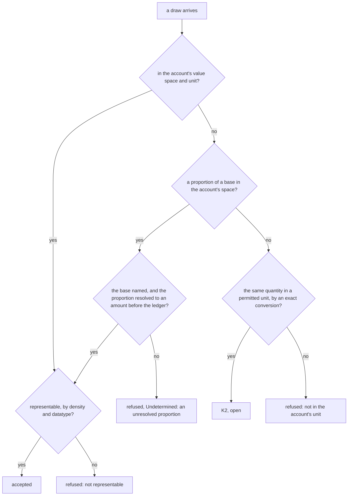

<!-- SPDX-License-Identifier: CC-BY-SA-4.0 -->

# Which draws an account accepts: compatible value spaces

**Status:** sketch, 2026-11-09, for LG-Q20 of the [ledger plan](../plans/ledger.md), **decided (a) by the maintainer the same day**. **Raised by** the maintainer on approving ADR-A131's addendum of 2026-11-09, which bars a draw in another value space than its account's. Money makes that rule matter most, but a non-monetary account raises cases the bare rule does not settle, for example a draw of 50% on a pool of 10 licences. **Reads** the Quantification README, sections 5.1.2 to 5.1.7, MEC-12, MEC-13 and MEC-17, ADR-A93, ADR-A131 decision 2 and its addendum of 2026-11-09, and PRI-75.

## 1. What already exists

The ledger's account states a unit of account, a value space that decision 2 requires to be extensive with sum and difference. Quantification already says when two quantities can be compared and what a value space admits.

| Quantification states | What it gives a draw |
|---|---|
| a value space's density, `qnt:densityKind`, and the datatype of its literals, `qnt:valueDatatype` (MEC-12) | whether an amount is representable in the account, a whole number of licences, a whole number of minor units of a currency |
| a space's unit contract and unit families, `qnt:Unit`, `qnt:UnitFamily` | whether the draw's unit is one the account's space permits |
| `qnt:Conversion`, linear by a `conversionFactor` or by a registered `qnt:ConversionFunction`, and contextual where it needs a `qnt:ConversionContext`, for example a day's exchange rate (section 5.1.7) | whether two units are related at all, and whether the relation needs facts from outside, a rate, a calendar |
| every failure of that chain ends in Undetermined, never a guess | the reason a draw is refused |
| a rate or proportion is a derived value space over a named base, so shares of different bases never add (MEC-17, ADR-A93) | a draw stated as a percentage is a quantity in a derived space, and its base is named |

## 2. The cases

| Case | Example | Under the rule as approved | What is open |
|---|---|---|---|
| K1 the same space and unit | 3 licences from a pool of licences | accepted | nothing |
| K2 the same quantity in a unit the account's space permits, related by an exact, non-contextual conversion | a draw in pence on an account in pounds, minutes on an account in hours | barred, since it is not the account's unit | whether an exact conversion by definition is the conversion the ruling bars, or only a change of unit the ledger may check |
| K3 the same kind of quantity related only by a contextual conversion | euros on a sterling facility | barred, by the ruling on scenario C4 | nothing, the conversion is made and recorded before the draw |
| K4 a proportion of a base in the account's space | 50% of a pool of 10 licences | not stated | which base, the stated amount, the remaining balance or availability, and who resolves the proportion to an amount |
| K5 a proportion whose amount is not representable | 33% of 10 licences, 3.3 | not stated | refused, as the maintainer said on raising this, and never rounded, since rounding is a merge rule's and only where it is declared |
| K6 an amount outside the space's bounds or datatype | a count beyond the datatype's range | fails before the ledger, out of scope by the ruling on C4 | the ledger still checks what it receives (PRI-75), so it refuses rather than trusts |
| K7 a different quantity altogether | a draw of money on a pool of licences, a share of one base on an account of another | barred | nothing |

## 3. Options for LG-Q20

| | (a) only the account's space and unit | (b) the account's space, with exact non-contextual unit changes checked | (c) as (b), with proportions resolved by the ledger |
|---|---|---|---|
| K2 pence on pounds | refused, the caller converts | accepted where an exact factor maps the amount to a whole number of the account's minor units, refused otherwise | as (b) |
| K4 50% of 10 licences | refused unless resolved to 5 before the ledger | the same | resolved by the ledger against a base the account declares |
| K5 33% of 10 | refused | refused | refused, not representable |
| what the ledger knows of units | its own unit only | Quantification's exact conversions, never a contextual one | the same, and how a proportion meets its base |
| separation of duties | the strictest | the ledger reads a definition, never a rate | the ledger also interprets a share, which the instrument might say differently |

**What every option keeps.** A contextual conversion never reaches the ledger. A draw that is not representable in the account's density and datatype is refused, never rounded. The refusal carries Quantification's reason, so a draw refused here and a comparison that is Undetermined in Quantification say the same thing.

**What is still undecided beyond this question.** Quantification itself declares contextual conversions, at a day's exchange rate, for comparing quantities. The maintainer doubts that any part of LATTICE should convert currencies. Whether Quantification keeps contextual conversions for comparison is a question for that layer, outside this sketch.

## 4. The lean

(a), with the representability check. It keeps the ledger to one unit per account, puts every conversion and every proportion's resolution where the instrument or an administrative process can record it, and leaves the ledger a check it can make from its own configuration. (b) is attractive for minor and major units of one currency, but the same exactness can be had by stating the account in minor units, as decision 6's exactness already expects. (c) puts the meaning of "50% of what" into the ledger, which the instrument's wording should decide.
