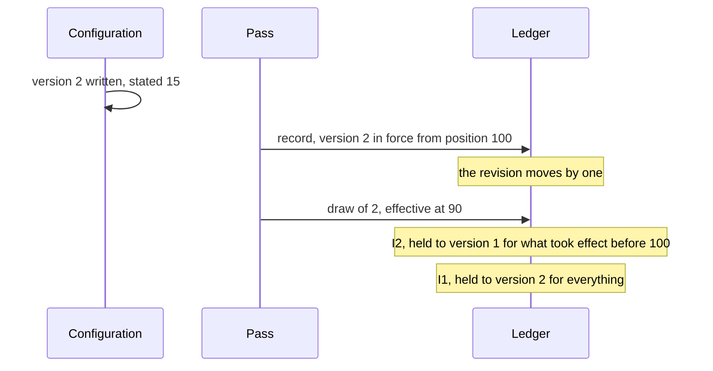
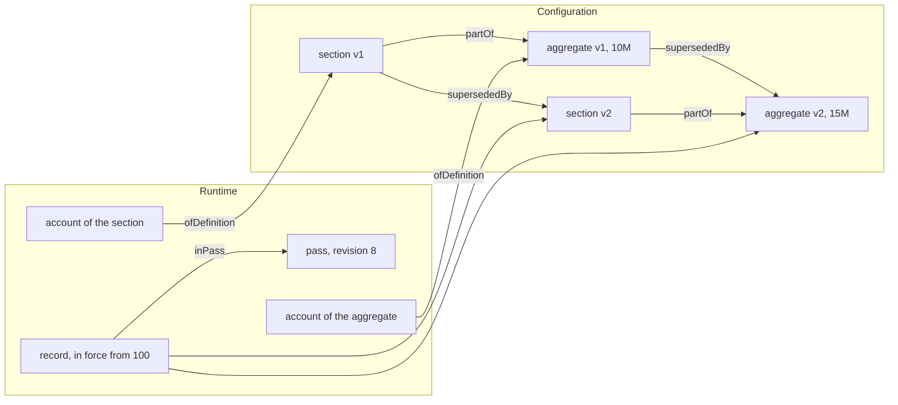

<!-- SPDX-License-Identifier: CC-BY-SA-4.0 -->

# An account under a later version of its definition, a brief for LG-29

**Unit:** ledger ([plan](../plans/ledger.md), [status](../status/ledger.md)). **Questions:** LG-Q48 to LG-Q54. **Status:** sketched 2026-11-20, worked examples and LG-Q52 to LG-Q54 added the same day.

## 1. Why now

The review of the vocabulary's rework found that an account can never reach a later version of its definition. LG-28 made the account definition a versioned thing, and an account names one version with `ldg:ofDefinition`, which is functional and part of the account's natural key. A limit raised in the middle of a period then has no account to act on, and a new account would open at the full new amount with nothing drawn.

The maintainer decided on 2026-11-20 that the same account folds against the version in force by position. That is what the [sketch on accounts from instruments](ledger-accounts-from-instruments.md), section 9, agreed on 2026-11-12, "a posting folds against the definition in force when it took effect", which reached no decision record and no register. This sketch states what is left to decide inside that rule before the layer and its proofs move.

## 2. What constrains the design

| Fact | Source |
|---|---|
| a balance read as of a revision never changes, and a ledger's revision moves only when a pass is written | ADR-A131's second addendum of 2026-11-19, and the layer's entry for `ldg:revision` |
| a posting has an effective position and a recorded position, and may take effect before the pass that records it, never after | STD-294, STD-330 |
| a running balance runs along the recorded order, and a reading as of an effective position is a fold | LG-Q9, STD-278 |
| a definition's stated amount and ceiling are quantities minted under one version, and its parent, policy, unit, recurrence and kinds' edition are named by version | LG-28 |
| a child definition names its parent by version, so a later version of a parent reaches a child only through a later version of the child | the layer's README, section 5.1 |
| an account is one definition for one owner, one key value and one period, and a period is an account of its own | the layer's README, section 5.1 |
| the kernel's `book` gives each account one stated amount, one ceiling and one parent | `tools/proofs/ledger/Kernel.thy` |

**What rests on the fixed book.** Of the ledger's twelve theories and 5,822 lines, two name the book, `Credits.thy` and `Readings.thy`, with 24 lemmas in 626 lines. The theories of draws, merges, ranks, pots, allocation, rounding and units are stated over balances and sets of accounts, and name no stated amount.

## 3. Worked examples

One account, whose first version states 10. Each history lists its steps in the order they are recorded. A draw or a credit is written as its amount and its effective position, for example 2 at 90, and a later version as its stated amount and the position it is in force from. G is a draw granted and R a draw refused, in the order of the draws. A [model](../../../tools/models/ledger-versions-in-force/versions_in_force_model.py) computes every verdict and fails where one differs from this table.

| Rule | A draw is granted where |
|---|---|
| R1 | everything recorded and the draw are within the version the account holds when the draw is recorded |
| R2 | everything recorded and the draw are within the version in force at the draw's effective position |
| R3 | R1 holds, and for each version whose successor is in force from a position after the draw's, what took effect before that position and the draw are within that version |
| R4 | what took effect up to the draw's effective position and the draw are within the version in force there |

R4 is the plainest reading of "the definition in force when it took effect". It is listed because it fails with no later version at all, in E0, where it grants a backdated draw that takes a constant amount below zero.

A cell in bold differs from our reading of the drafting.

| | History, in recorded order | Our reading of the drafting | R1 | R2 | R3 | R4 |
|---|---|---|---|---|---|---|
| E0 | 4 at 50, 6 at 120, 2 at 90, with no later version | G G R | G G R | G G R | G G R | **G G G** |
| E1 | 10 at 50, a version of 15 from 100, 3 at 120 | G G | G G | G G | G G | G G |
| E2 | 10 at 50, a version of 15 from 100, 2 at 90 | G R | **G G** | G R | G R | G R |
| E3 | 4 at 50, a version of 15 from 100, 9 at 120, 2 at 90 | G G G | G G G | **G G R** | G G G | G G G |
| E4 | 10 at 50, 3 at 120, a version of 15 from 100, 3 at 120 | G R G | G R G | G R G | G R G | G R G |
| E5 | 4 at 50, a version of 6 from 100, 3 at 120, 2 at 120 | G R G | G R G | G R G | G R G | G R G |
| E6 | 3 at 50, a version of 6 from 100, 2 at 120, 4 at 90 | G G R | G G R | **G G G** | G G R | **G G G** |
| E7 | 10 at 50, a credit of 10 at 80, a version of 15 from 100, 2 at 90 | G G | G G | G G | G G | G G |
| E8 | 10 at 50, a version of 15 from 100, a credit of 10 at 120, 2 at 90 | G R | **G G** | **G G** | G R | G R |
| E9 | 10 at 50, a version of 15 from 100, 5 at 150, a version of 20 from 200, 2 at 90, 2 at 160, 2 at 210 | G G R R G | **G G G G R** | G G R R G | G G R R G | G G R R G |
| E10 | 8 at 50, a version of 6 from 100, 1 at 120 | G R | G R | G R | G R | G R |

R1 differs from our reading in E2, E8 and E9, R2 in E3, E6 and E8, R4 in E0 and E6, and R3 in none.

- **E2, a draw that took effect under a spent version.** Before position 100 the account stated 10, and 10 was drawn. The draw of 2 took effect at 90, so the terms then in force have nothing left for it, though the later version has 5. R1 pays it from the raise.
- **E3, the same draw where the first version had room.** Before 100, 4 was drawn of 10, and the draw of 2 makes 6. Over the whole, 13 was drawn of 15, and the draw makes 15. R2 sets everything recorded, 13, against the 10 in force at 90, and refuses a draw that both versions have room for.
- **E4, a version recorded late.** The draw of 3 at 120 is refused while the account holds its first version, and the refusal stays in the records at its revision. Once a pass records the version, in force from 100, the same request made again is granted. Nothing recorded earlier changes.
- **E6, a lowered amount and a backdated draw.** After the version, 5 is drawn of 6. The draw of 4 at 90 fits the first version, at 7 of 10, and would leave 9 drawn of 6. We read it as refused, as a backdated draw on a constant amount already is in E0, since the draw of 2 at 120 was granted on what was then left.
- **E7 and E8, a credit on either side of a version's end.** A credit that took effect at 80 restores what was in force at 90, and the draw is granted. A credit that took effect at 120 restores nothing that was in force at 90. R1 and R2 set it against the earlier draw and grant.
- **E9, three versions.** A backdated draw is held to every version that ended after it took effect, one reading by position for each. The draw at 90 reads two, the draw at 160 one, and the draw at 210 none.
- **E10, a version that states less than is drawn.** No rule decides it, since the version and not a draw takes the account over its amount. It is LG-Q53.

**Two invariants say what R3 keeps.**

- **I1.** Everything recorded is within the latest version's stated amount. This is today's law that no balance falls below zero.
- **I2.** For each version that has a successor, what took effect before the successor's position is within that version's stated amount.

R3 refuses the draws that would break either, and no others. R1 keeps I1 and breaks I2 in E2, E8 and E9. R2 breaks one of the two in E6 and E8, and R4 breaks I1 in E0 and E6. So the law that checks R3 over the records is one sum for each account and each version it has left behind, and never one for each posting.

**Our reading of the drafting is a hypothesis.** A wording may say otherwise, for example that a raised amount applies to the whole period from its start, which is a version in force from the period's first position and needs no other rule.

**What the model leaves out.** A credit's ceiling and its kind, since a credit is applied in full. A tree, since it has one account. Two accounts of one definition.

## 4. Questions for the maintainer

**LG-Q48. How a later version reaches an account.**

| Option | What it is | Consequence | Cost |
|---|---|---|---|
| (a) | a record a pass writes, naming the version and the effective position it is in force from | the revision moves when the terms do, so a balance as of an earlier revision is unchanged. The history shows when, and at which revision, the terms moved | what LG-Q52 decides, between 19 and about 11,000 triples in its example, and one request |
| (b) | the configuration alone. A version states the position it is in force from, and every fold selects by position | writing a version into the configuration changes balances at revisions already read, which the second addendum of 2026-11-19 rules out. Two owners that share a definition cannot take a version at different positions | no write, and one more join in every law that reads a stated amount |

*Leaning (a).* It follows from the rule that a balance as of a revision never changes. What the record is written on is LG-Q52, and its name is LG-Q54.

**LG-Q49. Which postings count against which version.** The rules and the histories of section 3.

| Option | Consequence | Cost |
|---|---|---|
| R1 | one balance, and the kernel gains one event. A draw that took effect under narrower terms is paid under wider ones | nothing beyond the record |
| R2 | refuses E3, and grants E6 and E8 against a bound already used. The kernel's state becomes a movement, every bound is restated for a position, and a guard outside the ledger reads a balance for an effective position as well as a revision | every law that reads a balance, and Behaviour's guard |
| R3 | agrees with our reading on every history. A posting's running balance stays one number, the latest version's stated amount less everything recorded, which is R1's figure. A posting effective before a later version took force is also held to each version between, by a reading as of the position that version ended | nothing where a posting takes effect under the latest version. One fold by effective position for each version that ended after the posting took effect |

*Leaning R3.* It is R1 with one more guard for a backdated posting, so the common path costs what R1 costs. The maintainer said on 2026-11-20 that this is what they like in it, and has not yet answered.

**LG-Q50. What the versions of one identity may differ in.**

A part may differ where it bounds or arbitrates what is posted later, and leaves every recorded posting on the account and in the unit it was written in. A part may not differ where it says which account a posting belongs to, or what its amount means.

| A definition states | May versions of one identity differ in it | Why |
|---|---|---|
| its stated amount | yes | it bounds a sum. The postings stay where they are and only the bound moves |
| its credit ceiling | yes | the same, for how far a credit restores |
| the kinds that restore it, and their edition | yes | they decide which later credits count. A credit already counted stays counted, so a law reads the version held when the credit was recorded, one lookup for each credit |
| its merge policy | yes | it arbitrates later merges. A merge record is checked against the policy held when it was written |
| its owner kinds | yes | they decide who may open an account, and read no history |
| its parent, as a later version of the same parent | yes | it must, since a child names its parent by version |
| its parent, as another identity | no | every draw on the account was also counted in each ancestor. Under another parent, either the old ancestors give those draws back and the new ones take them, at positions the wording would have to state, or the tree differs by position and a path is no longer one set of accounts |
| its unit of account | no | every amount in the history is a literal in the old unit, and the ledger never converts |
| its period recurrence | no | an account's period is a bin of it, so the history would belong to other accounts |
| its key dimension | no | an account's key is a value of it |
| the purposes it counts | no | a purpose-counting account holds a posting of its own for each draw that named the purpose, so a change says other draws should have posted there |

| Option | Consequence |
|---|---|
| (a) | the table above, with a constraint that refuses two versions of one identity that differ in a part marked no. The tree is one tree at every position, and the theories of draws, merges and pots stand |
| (b) | anything a definition states. A change of parent moves a subtree's history from one ancestor to another, the kernel's parent becomes a function of position, and about 2,000 more lines of proof move |

*Leaning (a).* Nothing a wording can say is lost. For example, a sublimit with 3 drawn of 5 moves from a section of 6 to a section of 4. Whether the first section gets the 3 back, and whether the second starts 3 down, each moves money, and the wording must say which. Under (a) it says so in what the new definition states, and the old account stays as history. Under (b) the layer would have to choose. The leaning narrows what the sketch of 2026-11-12 listed as the parts of a version, where the parent is among them, and that drift is recorded with the answer. It costs one lookup for each credit and each merge record, to read the kinds and the policy held when it was written.

**LG-Q51. How the kernel states it.**

| Option | Consequence | Cost |
|---|---|---|
| (a) | a later version taking force is an event of the kernel beside a draw and a restore. The book holds the terms an account opens with, the event moves the account's balance by the difference of the stated amounts and replaces its ceiling and kinds, and the bound on a backdated posting is a reading by position | `Kernel.thy` from the book on, `Credits.thy` and `Readings.thy`, 24 lemmas to carry through one more case, and new laws for the event and the backdated bound. The other ten theories are untouched |
| (b) | the kernel stays as it is and versions live in the records and shapes alone | no proof moves, and no law is proved of an account that changes terms |

**Answered 2026-11-20, (a).** The maintainer sees no way to avoid it. The claims the README makes of a balance would otherwise hold only for an account that never changes terms. LG-29 states the rule, and its addendum to ADR-A131 is drafted with it.

**LG-Q52. What the record is written on.**

A change high in a tree is a new version of every definition below it, since a child names its parent by version. For example, a tree of 15 definitions has an annual cap, an aggregate under it, 3 sections and 10 sublimits, one of them keyed by site with 1,000 sites drawn so far. That is 1,014 accounts in one period. The aggregate is raised, which is 14 later versions, the aggregate's and one for each of the 13 definitions below it, reaching 1,013 accounts.

The diagram shows option (c). Under (a) each account has a record of its own, and under (b) each version has.

| Option | What is written | Triples in the example | An account minted later |
|---|---|---|---|
| (a) | one record for each account, with its type, account, pass, effective position and version | 5,065, and 6,078 more at the next close if a change of terms counts as the account having moved, since each account is then given a checkpoint | has no record. It names the later version and loses the first version's bound on a backdated draw, or is given a record when it is minted |
| (b) | one record for each version, with its type, owner, pass, effective position, period and version | 84 | is reached as every other account of its definition is |
| (c) | one record a pass, with its type, owner, pass, effective position and period, and one edge for each version that comes into force there | 19 | the same as (b) |

The configuration costs about 175 triples under every option, 14 versions of 11 to 16 triples each with their link to the version before. That grows with the definitions below the one changed, never with accounts or postings.

For scale, a posting is 11 to 13 triples in the layer's insurance example. So (a) writes what about 420 draws write, or about 930 with the checkpoints, and (c) writes less than two draws do. Nothing is added to a posting, a pass, a request or a checkpoint under any option, and no balance is stored for a version.

| Driver | (a) | (b) and (c) |
|---|---|---|
| defensible history | when the terms moved is stated account by account | stated once, at one revision, and the accounts reached are derived |
| storage | grows with the accounts under the changed definition | grows with the definitions under it |
| read | the version an account holds is one lookup on the account | two joins more, from the account's definition to its identity and to the versions of it that the owner's records name, over a set as small as the number of changes of terms |
| a read from a checkpoint | unchanged where each account is given a checkpoint, at the cost above | adds the difference of the stated amounts for each record written after that close |
| contention | one request of about 5,000 triples holds the ledger's one writer for longer, which is not measured | one small request |

*Leaning (c).* What it costs is that the accounts a record reaches are derived and not stated. They are the accounts of the same owner whose definition has a version in the record, in the period the record names, and each law that reads a stated amount carries that join. An account's `ldg:ofDefinition` then names the version in force when its period began, so an account of a later period starts under the later version and needs no record, and an account of an earlier period is never reached. How an account whose definition states no period finds its first version is for LG-29 to work through.

**The same gap is open for a ledger's profile.** `ldg:ledgerProfile` is functional and names a version, so a ledger cannot reach a later version of its profile either. A record written on the owner's ledger could carry it. LG-29 does not build that, and it is recorded as TD-177.

**LG-Q53. A later version that states less than is drawn.** E10 of section 3, where 8 is drawn and a version states 6.

| Option | Consequence | Cost |
|---|---|---|
| (a) | the request that records the version is refused, with a reason. No balance falls below zero stays a law of every event. An applied layer states what the wording gives another way, for example a version that states what is drawn | a refusal that is not a merge's, so a new record or an eighth reason. A state the parties can agree to is not representable. For example, 8 drawn, lowered to 6 and then restored by 3 leaves 1 under the wording, and 3 under a version that states 8 |
| (b) | the version is recorded, and the balance reads below zero until credits restore it. No draw is granted meanwhile, which the kernel's guard already gives | `ldg:runningBalance` and a checkpoint's balance return to integers, which reverses a narrowing of LG-25. The law becomes that no draw takes a balance below zero, and that a balance is below zero only after such a version |
| (c) | the version is recorded, the balance reads zero, and the excess is a record beside it that a later credit repays first | one more kind of record, and every reader of a balance must also read it |

*Leaning (b).* It models what the parties agreed and adds no record. The kernel's balances are integers already, and its guard on a draw refuses while the balance is below the draw. That such a wording occurs is a hypothesis.

**LG-Q54. What the record is called.** The first draft of this sketch proposed `ldg:Adoption`, as a plain word for an account taking a version. No layer declares the term, and it is no market's word for a change of terms. Two things count against it. Accounting has the adoption of accounts and the adoption of a standard, on a layer whose subject is accounts, which STD-325 rules out. This repository's prose calls whoever takes LATTICE up an adopter, in the ledger's own README among other places, which STD-258 rules out. An account also does not act.

| Name | For | Against |
|---|---|---|
| `ldg:Adoption` | plain, and declared by no layer | the two collisions above |
| `ldg:Supersession` | Foundation's own word. Successive versions link by `fnd:supersededBy`, and the record states that link taking effect for one owner from one position. It fits a ledger's profile as well | it names what happens to the earlier version. The configuration already states `fnd:supersededBy`, which a reader may take the record to repeat |
| `ldg:Commencement` | the law's word for a provision coming into force | reads as the start of an account or of a period |

A name built on "entry into force" collides with accounting's entry, which is a posting. The market's words for a change of terms, such as an endorsement, name the instrument above the ledger, and the layer coins nothing from market vocabulary.

*Leaning `ldg:Supersession`,* with `ldg:supersedingVersion` for its edge to each version.

## 5. What LG-29 builds once answered

- **The record and the key.** The record of LG-Q52 under the name of LG-Q54, the account's natural key on the definition's identity, and `ldg:ofDefinition`'s entry saying which version it names.
- **The laws.** The running balance and the checkpoint read the stated amount of the latest version in force by the posting's pass or the close. A law for I2. A constraint for what versions of one identity may differ in.
- **The kernel and its proofs,** as LG-Q51 was answered.
- **Examples** for E2, E3, E6, E8 and E10 of section 3, with a credit cut at a ceiling under a version that has ended, which the model leaves out.
- **The estimate** is 350k tokens, on the leanings above.

## 6. What this leaves out

- **How a version of a definition is named.** The sketch of 2026-11-12 names a derived version by the digest of its content, under the substrate's one rule for a digest. No definition is derived yet.
- **Which wording gives which rule.** The layer gives one mechanism, and an applied layer that reads a wording otherwise states separate accounts.
- **Behaviour's effect.** Whether an effect names a definition by identity or by version is BHL-Q4 of the [brief for LG-3](behaviour-on-the-ledger.md), and its leaning stands on LG-Q48.
- **A later version of a ledger's profile,** which is TD-177.
