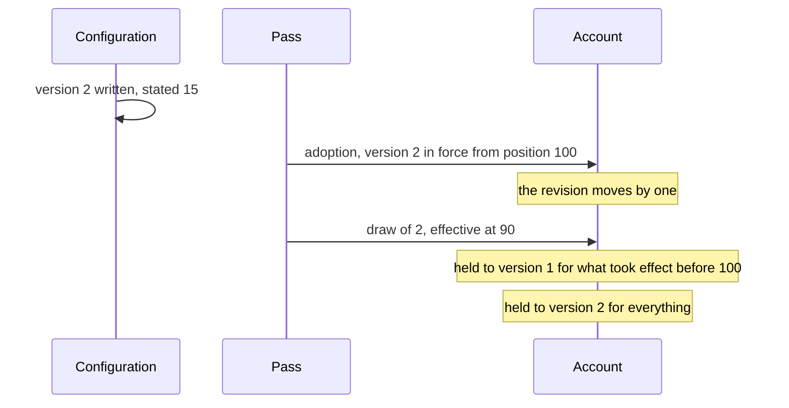

<!-- SPDX-License-Identifier: CC-BY-SA-4.0 -->

# An account under a later version of its definition, a brief for LG-29

**Unit:** ledger ([plan](../plans/ledger.md), [status](../status/ledger.md)). **Questions:** LG-Q48 to LG-Q51. **Status:** sketched 2026-11-20.

## 1. Why now

The review of the vocabulary's rework found that an account can never reach a later version of its definition. LG-28 made the account definition a versioned thing, and an account names one version with `ldg:ofDefinition`, which is functional and part of the account's natural key. A limit raised in the middle of a period then has no account to act on, and a new account would open at the full new amount with nothing drawn.

The maintainer decided on 2026-11-20 that the same account folds against the version in force by position. That is what the [sketch on accounts from instruments](ledger-accounts-from-instruments.md), section 9, agreed on 2026-11-12, "a posting folds against the definition in force when it took effect", which reached no decision record and no register. This sketch states what is left to decide inside that rule before the layer and its proofs move.

## 2. What constrains the design

| Fact | Source |
|---|---|
| a balance read as of a revision never changes, and a ledger's revision moves only when a pass is written | ADR-A131's second addendum of 2026-11-19, and the layer's entry for `ldg:revision` |
| a posting has an effective position and a recorded position, and may take effect before the pass that records it, never after | STD-294, STD-330 |
| a running balance runs along the recorded order, and a reading as of an effective position is a fold | LG-Q9, STD-278 |
| a definition's stated amount and ceiling are quantities minted under one version, and its parent, policy, unit, recurrence and kinds' edition are named by version | LG-28 |
| the kernel's `book` gives each account one stated amount, one ceiling and one parent | `tools/proofs/ledger/Kernel.thy` |

**What rests on the fixed book.** Of the ledger's twelve theories and 5,822 lines, two name the book, `Credits.thy` and `Readings.thy`, with 24 lemmas in 626 lines. The theories of draws, merges, ranks, pots, allocation, rounding and units are stated over balances and sets of accounts, and name no stated amount.

## 3. A worked example

An account states 10. A second version states 15 and is in force from position 100. Three histories follow, each with the draws in the order they were recorded.

| History | Draws, as recorded | What we read the drafting to give |
|---|---|---|
| H1 | 10 effective at 50, then 2 effective at 90 recorded after the second version | refused. What took effect before 100 is held to 10, which was spent |
| H2 | 4 effective at 50, 9 effective at 120, then 2 effective at 90 | granted. What took effect before 100 comes to 6 of 10, and everything comes to 15 of 15 |
| H3 | 10 effective at 50, then 3 effective at 120 | granted. Everything comes to 13 of 15 |

Three rules for which postings count against which version, and what each gives for the last draw of each history.

| Rule | H1 | H2 | H3 |
|---|---|---|---|
| R1, a posting folds against the version the account holds when it is recorded | granted, 15 less 10 leaves 5 | granted | granted |
| R2, a posting folds against the version in force at its effective position, less everything recorded | refused | refused, 10 less 13 | granted |
| R3, each version bounds what took effect before its successor, and the latest bounds everything | refused, the first version has 0 left | granted, the first has 4 left and the second 2 | granted |

R1 pays under terms that were not in force when the draw took effect. R2 counts a draw made under the wider terms against the narrower. R3 agrees with our reading of the drafting on all three. That reading is a hypothesis, and a wording may say otherwise, for example that a raised amount applies to the whole period.

## 4. Questions for the maintainer

**LG-Q48. How a later version reaches an account.**

| Option | What it is | Consequence | Cost |
|---|---|---|---|
| (a) | a record a pass writes on the account, naming the version and the effective position it is in force from | the revision moves when the terms do, so a balance as of an earlier revision is unchanged. A close sees the account as moved. The history shows when the account took the version | about four triples for each account and each change of terms, and one request |
| (b) | the configuration alone. A version states the position it is in force from, and every fold selects by position | writing a version into the configuration changes balances at revisions already read, which the second addendum of 2026-11-19 rules out. Two accounts of one definition cannot take a version at different positions | no write, and one more join in every law that reads a stated amount |

*Leaning (a).* It follows from the rule that a balance as of a revision never changes. The record is a new runtime class with two properties, and its name is to be chosen. We propose `ldg:Adoption`, with `ldg:adoptedVersion`, on `ldg:onAccount`, `ldg:inPass` and `ldg:effectivePosition`. An account's `ldg:ofDefinition` stays the version it was minted under, and its natural key reads the definition's identity in place of the version.

**LG-Q49. Which postings count against which version.** The three rules of section 3.

| Option | Consequence | Cost |
|---|---|---|
| R1 | one balance, and the kernel gains one event. A draw that took effect under narrower terms is paid under wider ones | nothing beyond the adoption |
| R2 | faithful to the terms at the effective position, and refuses H2. The kernel's state becomes a movement, every bound is restated for a position, and a guard outside the ledger reads a balance for an effective position as well as a revision | every law that reads a balance, and Behaviour's guard |
| R3 | agrees with the drafting on the three histories. A posting's running balance stays one number, the latest adopted version's stated amount with everything recorded, which is R1's figure. A posting effective before a later version took force is also held to each version between, by a reading as of the position that version ended | no cost where a posting takes effect under the latest version. One fold by effective position for each version adopted after the posting's effective position |

*Leaning R3.* It is R1 with one more guard for a backdated posting, so the common path costs what R1 costs. How a credit that takes effect before a version's end restores that version's bound is not worked through here, and LG-29 would bring an example.

**LG-Q50. What the versions of one identity may differ in.**

| Option | Consequence |
|---|---|
| (a) | the stated amount, the ceiling, the kinds that restore it with their edition, and the merge policy. A change of parent, unit of account, period recurrence, key dimension or counted purposes is a new identity, and so a new account. The tree stays one tree at every position, and the theories of draws, merges and pots stand |
| (b) | anything a definition states. A change of parent moves a subtree's history from one ancestor to another, the kernel's parent becomes a function of position, and about 2,000 more lines of proof move |

*Leaning (a),* with a constraint that refuses two versions of one identity that differ in the others. It narrows what the sketch of 2026-11-12 listed as the parts of a version, where the parent is among them, and that drift is recorded with the answer.

**LG-Q51. How the kernel states it.**

| Option | Consequence | Cost |
|---|---|---|
| (a) | an adoption is an event of the kernel beside a draw and a restore. The book holds the terms an account opens with, an adoption moves the account's balance by the difference of the stated amounts and replaces its ceiling and kinds, and the bound on a backdated posting is a reading by position | `Kernel.thy` from the book on, `Credits.thy` and `Readings.thy`, 24 lemmas to carry through one more case, and new laws for the adoption and the backdated bound. The other ten theories are untouched |
| (b) | the kernel stays as it is and versions live in the records and shapes alone | no proof moves, and no law is proved of an account that changes terms |

*Leaning (a).* The claims the README makes of a balance would otherwise hold only for an account that never changes terms.

## 5. What LG-29 builds once answered

- **The record and the key.** The adoption, the account's natural key on the definition's identity, and `ldg:ofDefinition`'s entry saying it names the version an account was minted under.
- **The laws.** The running balance and the checkpoint read the stated amount of the latest version adopted by the posting's pass or the close. A law for a posting effective before an adopted version. A constraint for what versions of one identity may differ in.
- **The kernel and its proofs,** as LG-Q51 is answered.
- **An example** with a raised amount and the three histories of section 3, and one with a lowered amount.
- **The estimate** is 350k tokens, on the leanings above.

## 6. What this leaves out

- **How a version of a definition is named.** The sketch of 2026-11-12 names a derived version by the digest of its content, under the substrate's one rule for a digest. No definition is derived yet.
- **Which wording gives which rule.** The layer gives one mechanism, and an applied layer that reads a wording otherwise states separate accounts.
- **Behaviour's effect.** Whether an effect names a definition by identity or by version is BHL-Q4 of the [brief for LG-3](behaviour-on-the-ledger.md), and its leaning stands on LG-Q48.
