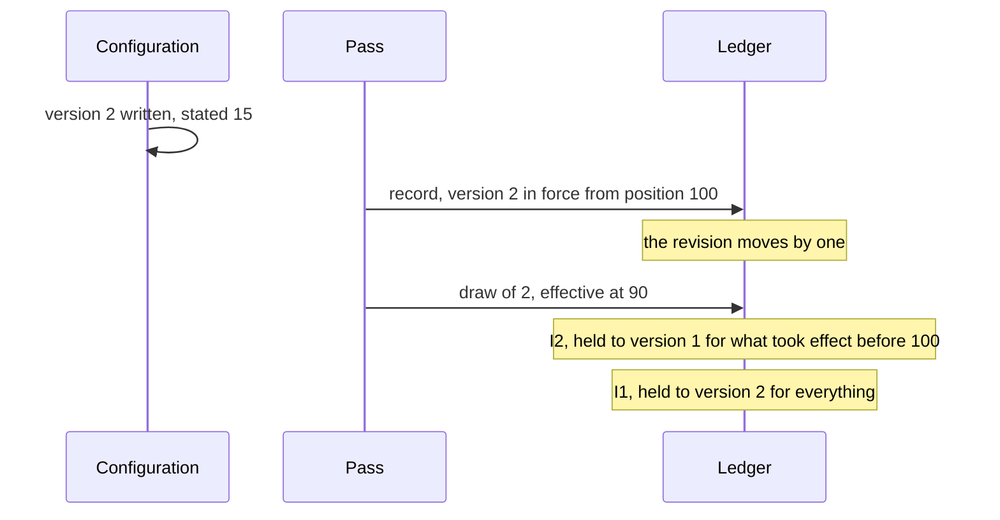
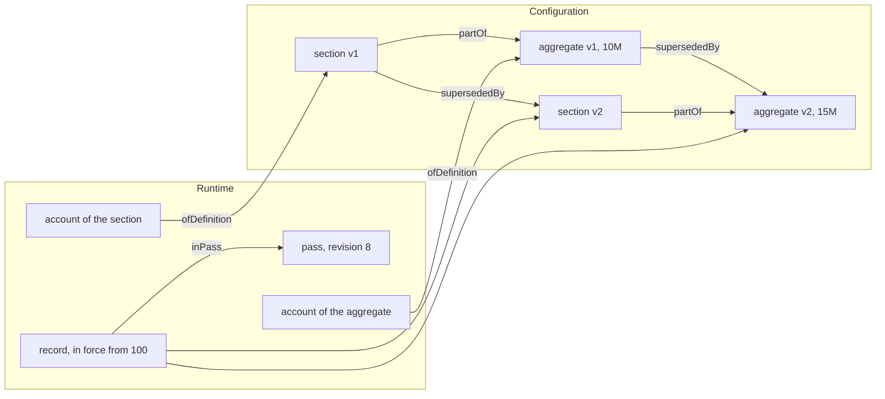

<!-- SPDX-License-Identifier: CC-BY-SA-4.0 -->

# An account under a later version of its definition, a brief for LG-29

**Unit:** ledger ([plan](../plans/ledger.md), [status](../status/ledger.md)). **Questions:** LG-Q48 to LG-Q57. **Status:** sketched 2026-11-20, worked examples and LG-Q52 to LG-Q54 added the same day, revised 2026-11-23 on the maintainer's questions.

## 1. Why now

The review of the vocabulary's rework found that an account can never reach a later version of its definition. LG-28 made the account definition a versioned thing, and an account names one version with `ldg:ofDefinition`, which is functional and part of the account's natural key. A limit raised in the middle of a period then has no account to act on, and a new account would open at the full new amount with nothing drawn.

The maintainer decided on 2026-11-20 that the same account folds against the version in force by position. That is what the [sketch on accounts from instruments](ledger-accounts-from-instruments.md), section 9, agreed on 2026-11-12, "a posting folds against the definition in force when it took effect", which reached no decision record and no register. This sketch states what is left to decide inside that rule before the layer and its proofs move.

## 2. What constrains the design

| Fact | Source |
|---|---|
| a balance read as of a revision never changes, and a ledger's revision moves only when a pass is written | ADR-A131's second addendum of 2026-11-19, and the layer's entry for `ldg:revision` |
| a posting has an effective position and a recorded position, and may take effect before the pass that records it, never after | STD-294, STD-330 |
| a running balance runs along the recorded order, and a reading as of an effective position is a fold | LG-Q9, STD-278 |
| a definition's stated amount and ceiling are quantities minted under one version, and its parent, policy, unit, recurrence and kinds' edition are named by version | LG-28 |
| a child definition names its parent by version, so a later version of a parent reaches a child only through a later version of the child | the layer's README, section 5.1 |
| an account is one definition for one owner, one key value and one period, and a period is an account of its own | the layer's README, section 5.1 |
| the kernel's `book` gives each account one stated amount, one ceiling and one parent | `tools/proofs/ledger/Kernel.thy` |

**What rests on the fixed book.** Of the ledger's twelve theories and 5,822 lines, two name the book, `Credits.thy` and `Readings.thy`, with 24 lemmas in 626 lines. The theories of draws, merges, ranks, pots, allocation, rounding and units are stated over balances and sets of accounts, and name no stated amount.

## 3. Worked examples

One account, whose first version states 10. Each history lists its steps in the order they are recorded. A draw or a credit is written as its amount and its effective position, for example 2 at 90, and a later version as its stated amount and the position it is in force from. G is a draw granted and R a draw refused, in the order of the draws. A [model](../../../tools/models/ledger-versions-in-force/versions_in_force_model.py) computes every verdict and fails where one differs from this table.

| Rule | A draw is granted where |
|---|---|
| R1 | everything recorded and the draw are within the version the account holds when the draw is recorded |
| R2 | everything recorded and the draw are within the version in force at the draw's effective position |
| R3 | R1 holds, and for each version whose successor is in force from a position after the draw's, what took effect before that position and the draw are within that version |
| R4 | what took effect up to the draw's effective position and the draw are within the version in force there |

R4 is the plainest reading of "the definition in force when it took effect". It is listed because it fails with no later version at all, in E0, where it grants a backdated draw that takes a constant amount below zero.

A cell in bold differs from our reading of the drafting.

| | History, in recorded order | Our reading of the drafting | R1 | R2 | R3 | R4 |
|---|---|---|---|---|---|---|
| E0 | 4 at 50, 6 at 120, 2 at 90, with no later version | G G R | G G R | G G R | G G R | **G G G** |
| E1 | 10 at 50, a version of 15 from 100, 3 at 120 | G G | G G | G G | G G | G G |
| E2 | 10 at 50, a version of 15 from 100, 2 at 90 | G R | **G G** | G R | G R | G R |
| E3 | 4 at 50, a version of 15 from 100, 9 at 120, 2 at 90 | G G G | G G G | **G G R** | G G G | G G G |
| E4 | 10 at 50, 3 at 120, a version of 15 from 100, 3 at 120 | G R G | G R G | G R G | G R G | G R G |
| E5 | 4 at 50, a version of 6 from 100, 3 at 120, 2 at 120 | G R G | G R G | G R G | G R G | G R G |
| E6 | 3 at 50, a version of 6 from 100, 2 at 120, 4 at 90 | G G R | G G R | **G G G** | G G R | **G G G** |
| E7 | 10 at 50, a credit of 10 at 80, a version of 15 from 100, 2 at 90 | G G | G G | G G | G G | G G |
| E8 | 10 at 50, a version of 15 from 100, a credit of 10 at 120, 2 at 90 | G R | **G G** | **G G** | G R | G R |
| E9 | 10 at 50, a version of 15 from 100, 5 at 150, a version of 20 from 200, 2 at 90, 2 at 160, 2 at 210 | G G R R G | **G G G G R** | G G R R G | G G R R G | G G R R G |
| E10 | 8 at 50, a version of 6 from 100, 1 at 120 | G R | G R | G R | G R | G R |

R1 differs from our reading in E2, E8 and E9, R2 in E3, E6 and E8, R4 in E0 and E6, and R3 in none.

- **E2, a draw that took effect under a spent version.** Before position 100 the account stated 10, and 10 was drawn. The draw of 2 took effect at 90, so the terms then in force have nothing left for it, though the later version has 5. R1 pays it from the raise.
- **E3, the same draw where the first version had room.** Before 100, 4 was drawn of 10, and the draw of 2 makes 6. Over the whole, 13 was drawn of 15, and the draw makes 15. R2 sets everything recorded, 13, against the 10 in force at 90, and refuses a draw that both versions have room for.
- **E4, a version recorded late.** The draw of 3 at 120 is refused while the account holds its first version, and the refusal stays in the records at its revision. Once a pass records the version, in force from 100, the same request made again is granted. Nothing recorded earlier changes.
- **E6, a lowered amount and a backdated draw.** After the version, 5 is drawn of 6. The draw of 4 at 90 fits the first version, at 7 of 10, and would leave 9 drawn of 6. We read it as refused, as a backdated draw on a constant amount already is in E0, since the draw of 2 at 120 was granted on what was then left.
- **E7 and E8, a credit on either side of a version's end.** A credit that took effect at 80 restores what was in force at 90, and the draw is granted. A credit that took effect at 120 restores nothing that was in force at 90. R1 and R2 set it against the earlier draw and grant.
- **E9, three versions.** A backdated draw is held to every version that ended after it took effect, one reading by position for each. The draw at 90 reads two, the draw at 160 one, and the draw at 210 none.
- **E10, a version that states less than is drawn.** No rule decides it, since the version and not a draw takes the account over its amount. It is LG-Q53.

**Two invariants say what R3 keeps.**

- **I1.** Everything recorded is within the latest version's stated amount. This is today's law that no balance falls below zero.
- **I2.** For each version that has a successor, what took effect before the successor's position is within that version's stated amount.

R3 refuses the draws that would break either, and no others. R1 keeps I1 and breaks I2 in E2, E8 and E9. R2 breaks one of the two in E6 and E8, and R4 breaks I1 in E0 and E6. So the law that checks R3 over the records is one sum for each account and each version it has left behind, and never one for each posting.

**Our reading of the drafting is a hypothesis.** A wording may say otherwise, for example that a raised amount applies to the whole period from its start, which is a version in force from the period's first position and needs no other rule.

**What the model leaves out.** A credit's ceiling and its kind, since a credit is applied in full. A tree, since it has one account. Two accounts of one definition.

## 4. Questions for the maintainer

**LG-Q48. How a later version reaches an account.**

| Option | What it is | Consequence | Cost |
|---|---|---|---|
| (a) | a record a pass writes, naming the version and the effective position it is in force from | the revision moves when the terms do, so a balance as of an earlier revision is unchanged. The history shows when, and at which revision, the terms moved | what LG-Q52 decides, between 19 and about 11,000 triples in its example, and one request |
| (b) | the configuration alone. A version states the position it is in force from, and every fold selects by position | writing a version into the configuration changes balances at revisions already read, which the second addendum of 2026-11-19 rules out. Two owners that share a definition cannot take a version at different positions | no write, and one more join in every law that reads a stated amount |

**Answered 2026-11-23, (a), now ADR-A131's addendum of 2026-11-23.** Decided by the maintainer. It follows from the rule that a balance as of a revision never changes. What the record is written on is LG-Q52, and its name is LG-Q54.

**LG-Q49. Which postings count against which version.** The rules and the histories of section 3.

| Option | Consequence | Cost |
|---|---|---|
| R1 | one balance, and the kernel gains one event. A draw that took effect under narrower terms is paid under wider ones | nothing beyond the record |
| R2 | refuses E3, and grants E6 and E8 against a bound already used. The kernel's state becomes a movement, every bound is restated for a position, and a guard outside the ledger reads a balance for an effective position as well as a revision | every law that reads a balance, and Behaviour's guard |
| R3 | agrees with our reading on every history. A posting's running balance stays one number, the latest version's stated amount less everything recorded, which is R1's figure. A posting effective before a later version took force is also held to each version between, by a reading as of the position that version ended | nothing where a posting takes effect under the latest version. One fold by effective position for each version that ended after the posting took effect |

**Answered 2026-11-23, R3, now ADR-A131's addendum of 2026-11-23.** Decided by the maintainer, on the histories of section 3. It is R1 with one more guard for a backdated posting, so the common path costs what R1 costs. The addendum states it as the two invariants I1 and I2.

**LG-Q50. What the versions of one identity may differ in.**

A part may differ where it bounds or arbitrates what is posted later, and leaves every recorded posting on the account and in the unit it was written in. A part may not differ where it says which account a posting belongs to, or what its amount means.

| A definition states | May versions of one identity differ in it | Why |
|---|---|---|
| its stated amount | yes | it bounds a sum. The postings stay where they are and only the bound moves |
| its credit ceiling | yes | the same, for how far a credit restores |
| the kinds that restore it, and their edition | yes | they decide which later credits count. A credit already counted stays counted, so a law reads the version held when the credit was recorded, one lookup for each credit |
| its merge policy | yes | it arbitrates later merges. A merge record is checked against the policy held when it was written |
| its owner kinds | yes | they decide who may open an account, and read no history |
| its parent, as a later version of the same parent | yes | it must, since a child names its parent by version |
| its parent, as another identity | no | every draw on the account was also counted in each ancestor. Under another parent, either the old ancestors give those draws back and the new ones take them, at positions the wording would have to state, or the tree differs by position and a path is no longer one set of accounts |
| its unit of account | no | every amount in the history is a literal in the old unit, and the ledger never converts |
| its period recurrence | no | an account's period is a bin of it, so the history would belong to other accounts |
| its key dimension | no | an account's key is a value of it |
| the purposes it counts | no | a purpose-counting account holds a posting of its own for each draw that named the purpose, so a change says other draws should have posted there |

| Option | Consequence |
|---|---|
| (a) | the table above, with a constraint that refuses two versions of one identity that differ in a part marked no. The tree is one tree at every position, and the theories of draws, merges and pots stand |
| (b) | anything a definition states. A change of parent moves a subtree's history from one ancestor to another, the kernel's parent becomes a function of position, and about 2,000 more lines of proof move |

**What a change of parent inside one identity would mean.** A definition has one persistent identity and a version for each statement of it. An account is keyed by that identity, so two versions of one identity are the terms of the same account, which keeps its postings. A change of parent inside one identity is then a second version that states another parent, with the account carrying on. For example, an aggregate of 10 has a section A of 6 and a section B of 4, and a sublimit of 5 under A has 3 drawn, so A has 3 left and B has 4. A second version of the sublimit states B as its parent, in force from 100.

| Reading | A after | B after | What it asks of the layer |
|---|---|---|---|
| the history moves with the account | 6 left | 1 left | A's balance rises with no credit recorded and B's falls with no draw recorded, and both changed at revisions already read |
| the history stays where it was drawn | 3 left | 4 left | a draw on the sublimit effective at 120 is counted in B and one effective at 90 in A, so the account has two paths and each ancestor's fold counts a part of the account's postings, chosen by effective position |

The first reading breaks the rule that a balance as of a revision never changes. The second is what option (b) would build. The kernel's parent is a function of the account, a path is one set of accounts, and an ancestor's balance is its stated amount less everything drawn in its subtree. Under the second reading each of the three is stated for a position, which is where the 2,000 lines come from. The second reading is also what two definitions already say, the old sublimit under A, drawn no further, and a new one under B that states what the wording gives it.

**Answered 2026-11-23, (a), now STD-338.** Decided by the maintainer, row by row. No drafting moves a sublimit from one section to another while its contract is in force and carries its erosion with it, in insurance or outside it. Where balances do change branch, for example loans redesignated between tranches, the drafting moves them by postings or by a new entitlement. The nearest insurance case, a location reassigned from one zone's aggregate to another's, is a new account, or a new construct such as a regime under which a new account is linked, and never the same account under a later version. A reinstatement added, or a kind of credit newly accepted, is uncommon and is supported, and so is a changed merge policy. A changed unit, period, key or counted purpose is a new identity, since neither of us can name drafting that does it to a live account. The maintainer agreed the same day that owner kinds may differ.

Nothing a wording can say is lost, since under (a) the wording says what it means in what the new definition states, with the old account kept as history. The answer narrows what the sketch of 2026-11-12 listed as the parts of a version, where the parent is among them.

**The lookup that (a) brings, and whether it can be avoided.** Where the kinds that restore an account or its merge policy may differ between versions, whatever checks a credit or a merge record must know the version held when it was written. Three things could remove that, and each costs more than it saves.

| Way | What it costs |
|---|---|
| the kinds and the policy may not differ between versions | a change of either is a new account that starts with nothing drawn, the fault this slice exists to remove |
| each credit and each merge record names the version it was decided under | one triple for each such record for ever, to save a lookup that only a check or a replay makes |
| an ancestor that does not accept a credit's kind records a cut of the whole amount | four triples for each such credit and ancestor, and it reverses the ruling of 2026-11-15 that nothing is recorded in that ancestor's book |

The lookup falls on the laws and on a reading by effective position, which replay the records. It does not fall on a draw's decision, which reads a running balance already computed, nor on the write of a credit, where the evaluator holds the latest version. For an account whose definition has one version, which is nearly every account, it is the hop from the account to its definition that the laws make today. So it is avoidable, and the maintainer keeps it, since versions that differ in the kinds and the policy are supported.

**LG-Q51. How the kernel states it.**

| Option | Consequence | Cost |
|---|---|---|
| (a) | a later version taking force is an event of the kernel beside a draw and a restore. The book holds the terms an account opens with, the event moves the account's balance by the difference of the stated amounts and replaces its ceiling and kinds, and the bound on a backdated posting is a reading by position | `Kernel.thy` from the book on, `Credits.thy` and `Readings.thy`, 24 lemmas to carry through one more case, and new laws for the event and the backdated bound. The other ten theories are untouched |
| (b) | the kernel stays as it is and versions live in the records and shapes alone | no proof moves, and no law is proved of an account that changes terms |

**Answered 2026-11-20, (a), now ADR-A131's addendum of 2026-11-23.** The maintainer sees no way to avoid it. The claims the README makes of a balance would otherwise hold only for an account that never changes terms. LG-35 builds it.

**LG-Q52. What the record is written on.**

A change high in a tree is a new version of every definition below it, since a child names its parent by version. For example, a tree of 15 definitions has an annual cap, an aggregate under it, 3 sections and 10 sublimits, one of them keyed by site with 1,000 sites drawn so far. That is 1,014 accounts in one period. The aggregate is raised, which is 14 later versions, the aggregate's and one for each of the 13 definitions below it, reaching 1,013 accounts.

The diagram shows option (c). Under (a) each account has a record of its own, and under (b) each version has.

| Option | What is written | Triples in the example | An account minted later |
|---|---|---|---|
| (a) | one record for each account, with its type, account, pass, effective position and version | 5,065, and 6,078 more at the next close if a change of terms counts as the account having moved, since each account is then given a checkpoint | has no record. It names the later version and loses the first version's bound on a backdated draw, or is given a record when it is minted |
| (b) | one record for each version, with its type, owner, pass, effective position, period and version | 84 | is reached as every other account of its definition is |
| (c) | one record a pass, with its type, owner, pass, effective position and period, and one edge for each version that comes into force there | 19 | the same as (b) |

The configuration costs 159 triples under every option, counted on the layer's insurance example. The aggregate's later version is 16, its type, identity, parent, unit, owner kind, policy, comment, two amounts of three triples each with their two edges, and the link from the version before. Each of the 13 below is 11, having one amount and no comment. The figure is the same with 1,014 accounts or with one, and with no posting or a million, since it counts definitions. An earlier draft said about 175, which counted the 14 links twice.

For scale, a posting is 11 to 13 triples in the layer's insurance example. So (a) writes what about 420 draws write, or about 930 with the checkpoints, and (c) writes less than two draws do. Nothing is added to a posting, a pass, a request or a checkpoint under any option, and no balance is stored for a version.

| Driver | (a) | (b) and (c) |
|---|---|---|
| defensible history | when the terms moved is stated account by account | stated once, at one revision, and the accounts reached are derived |
| storage | grows with the accounts under the changed definition | grows with the definitions under it |
| read | the version an account holds is one lookup on the account | two joins more, from the account's definition to its identity and to the versions of it that the owner's records name, over a set as small as the number of changes of terms |
| a read of a balance | the record can carry the account's balance after it, one triple more for each, so the latest record on an account still gives its balance in one read | starts from the latest posting or checkpoint and adds the difference of the stated amounts for each record written after it, one lookup by owner and definition that nearly always finds nothing, and that is not measured |
| contention | one request of about 5,000 triples holds the ledger's one writer for longer, which is not measured | one small request |

**No checkpoint is written for an account only because its terms moved.** The addendum of 2026-11-19 decided, on the benchmarks, that a close writes a checkpoint only for an account a posting moved, and that the read pays. A later version is not a posting, so that rule already answers it, and the 6,078 triples under (a) are what ignoring it would cost. One sentence of that addendum changes, where it says an earlier checkpoint is still exactly true. Its totals are, and its balance is true less the difference of the stated amounts.

**What each option brings beyond its size.**

- **(a), for.** An account's own records show that its terms moved, the accounts reached are stated and not derived, and no read gains a lookup.
- **(a), against.** Storage and the size of one request grow with the accounts. An account minted later needs a rule of its own. A thousand records of one change can disagree, for example by leaving one account out, so a law must check that every account reached has one.
- **(b), for.** Storage grows with the definitions, and each version's coming into force is a node that can be cited alone.
- **(b), against.** Fourteen nodes repeat one pass, one owner, one position and one period, and nothing says they are one change. The reach is derived, as under (c).
- **(c), for.** The least storage, and one node says these versions came into force together, so a change is recorded whole or not at all.
- **(c), against.** The reach is derived, so every law that reads a stated amount and every read of a balance carries the lookup above. Nothing can be said of one account alone, for example that one site keeps the earlier terms, which the terms would state as another definition. Versions that take force at different positions are separate records. The record is on no account, so it names its owner, and the law that a pass writes one ledger reads that as well. A definition that states no period needs a rule for the version its accounts open under.

Under every option the account's natural key moves from a version of its definition to the definition's identity, which changes the key laws LG-28 built.

**Measured 2026-11-23, by LG-32.** The [benchmark](../../../benchmark/ledger-supersession-read/README.md) holds one history four ways, the three options and option (a) with the account's balance on each record, on the tree above with 1,014 accounts. Every read equals a plain model under every variant on every engine. The figures below are medians at 20,000 postings, on a laptop, with pyoxigraph 0.5.13 on disk, Jena ARQ 5.1.0 and rdflib 7.6.0, and the [pack](../validation/LG-32.md) has the rest. Where a cell has three figures they are for no change of terms, one and ten.

| Measure | (a) | (a) with a balance | (b) | (c) |
|---|---|---|---|---|
| triples one change writes at runtime | 5,065 | 6,078 | 70 | 18 |
| stored after ten changes, above none | 52,270, or 21% | 62,400, or 25% | 2,320, or 0.9% | 1,800, or 0.7% |
| writing one change, Oxigraph, ms | 39 to 42 | 46 to 47 | 3.1 to 3.5 | 3.0 to 3.1 |
| a leaf's balance now, Oxigraph, ms | 0.39, 0.44, 0.72 | 0.22, 0.32, 0.38 | 0.46, 0.50, 0.82 | 0.46, 0.49, 0.82 |
| the same, Jena, ms | 1.24, 0.99, 1.16 | 0.50, 0.51, 0.58 | 1.31, 1.04, 1.30 | 1.32, 1.05, 1.27 |
| the same, rdflib, ms | 15.2, 13.0, 14.1 | 5.6, 5.7, 6.4 | 16.3, 14.9, 21.6 | 16.4, 14.6, 19.4 |
| the amount in force for every account in one query, Oxigraph, ms | 7.3, 35, 257 | 7.2, 34, 252 | 9.5, 12.9, 25 | 9.5, 12.4, 24 |
| the same, Jena, ms | 36, 68, 161 | 36, 68, 161 | 25, 26, 31 | 25, 26, 30 |
| the same, rdflib, ms | 112, 194, 701 | 112, 194, 700 | 33, 69, 1,544 | 33, 60, 181 |

- **The lookup that (c) adds to a leaf's read is 0.05 to 0.10 ms on Oxigraph,** 11% to 19% above (a) at the same number of changes. It is 6% to 9% on Jena and 8% to 38% on rdflib.
- **It is paid with no change of terms as well,** 0.46 ms against 0.39 on Oxigraph, since the read must look before it finds nothing.
- **A leaf's read grows with the changes under every option,** by 1.8 times at ten on Oxigraph under (c), since it finds the latest of them.
- **A balance on each record halves a leaf's read,** which is then one query, at the largest storage of the four.
- **The query a law would run is cheaper under (c),** by ten times on Oxigraph at ten changes, five on Jena and four on rdflib, since it reads 14 versions and not 1,013 records for each change.
- **An ancestor's balance does not differ between the options,** since its fold over the subtree is 104 ms and more on Oxigraph and the lookup is a thousandth of that.

**What the figures do not cover.** Periods, a lowered amount, more than ten changes, more than one keyed definition, a store other than these three, and writers in contention. Each write time is one sample. The bulk query's time depends on its form by three orders of magnitude on two engines, and the figures are for the form that was kept, which is TD-178. On Oxigraph an ancestor's read rises by about a third after the first change under every option. The session that built the benchmark traced part of that to a write made after a bulk load, and the review did not repeat its probe.

**Answered 2026-11-23, (c), now ADR-A131's addendum of 2026-11-23.** Decided by the maintainer on the measurement. A tenth of a millisecond on a leaf's read buys a change of terms that writes 18 triples and not 5,065, and a law that runs ten times faster. Option (a) with a balance is the one to take instead if a leaf's read is ever what limits a deployment. What it costs is that the accounts a record reaches are derived and not stated. They are the accounts of the same owner whose definition has a version in the record, in the period the record names, and each law that reads a stated amount carries that join. An account's `ldg:ofDefinition` then names the version in force when its period began, so an account of a later period starts under the later version and needs no record, and an account of an earlier period is never reached. How an account whose definition states no period finds its first version is for LG-29 to work through.

**The same gap is open for a ledger's profile.** `ldg:ledgerProfile` is functional and names a version, so a ledger cannot reach a later version of its profile either. A record written on the owner's ledger could carry it. LG-29 does not build that, and it is recorded as TD-177.

**LG-Q53. A later version that states less than is drawn.** E10 of section 3, where 8 is drawn and a version states 6. The state is real in the layer's own example domains, for example a seat quota cut from 10 to 6 with 8 seats in use, or a facility's commitment reduced below what is drawn. Each says two things of it, that nothing is available and that the account is over by 2. A release of 3 then leaves 1 available.

| Option | Consequence | Cost |
|---|---|---|
| (a) | the request that records the version is refused, with a reason. No balance falls below zero stays a law of every event | a refusal that is not a merge's, so a new record or an eighth reason. A state those domains have is not representable. A version that states 8 in its place leaves 3 after the release, where the terms give 1 |
| (b) | the version is recorded, and the balance reads below zero until credits restore it | withdrawn. The maintainer objected on 2026-11-23 that a balance below zero makes no sense for an amount consumed and restored. The layer's own law, that no balance falls below zero, says the same |
| (c) | the version is recorded, the balance reads zero, and the account states what it is over by. They are two amounts, neither below zero, of which at most one is above zero. No draw is granted while the account is over, and a credit reduces what it is over by before it restores the balance | one datatype property, stated on a posting recorded while its account is over. Nothing is written when the version takes force, since the first posting after it computes both from the last balance and the difference of the stated amounts. `ldg:runningBalance` is never below zero, as today, and what an account is over by has its datatype, `xsd:decimal`. The proofs keep one number, the balance less what the account is over by, as they do today. An earlier draft said LG-25 had narrowed the balance to a natural number, which was wrong, since LG-25 narrowed the positions and a balance is a decimal held to zero or more by the layer's law |

**How it arrives from drafting.** A reduced amount is a variation of a contract in force, which needs the parties' agreement, and whether that variation is valid is Instrument's to say and not the ledger's. The ledger is asked only whether it can record the result. Drafting gives both answers. Some terms forbid the state, for example a facility whose commitment may be cancelled only as far as it is undrawn, and an endorsement that reduces a limit is checked against what is paid before it is agreed. Other terms allow it and say what follows, for example a borrowing base that falls below what is drawn, where the excess is to be repaid, or a seat quota cut below the seats in use, with a time to come back under it.

**Answered 2026-11-23, both, with refusal where nothing admits the state, now ADR-A131's addendum of 2026-11-23.** Decided by the maintainer. A later version that states less than is drawn is refused unless it is admitted. Where it is admitted, it is recorded as (c), a balance of zero beside what the account is over by, so a report can show both. Option (b) stays withdrawn. Where the admission is stated is LG-Q55.

**LG-Q55. Where it is stated that a version below what is drawn is admitted.**

| Option | Consequence | Cost |
|---|---|---|
| (a) | on the ledger profile, as `ldg:admitsCeilingAboveStated` is, and refused where it is unstated | one rule for every ledger a deployment runs, in the place the layer already keeps such a rule. Two contracts in one deployment that differ, for example a plain facility and one with a borrowing base, cannot both be served |
| (b) | on the account definition, as a part of its terms | each contract says what its drafting says. A deployment cannot forbid it for all, and the part is one more that bears meaning and that a version may differ in |
| (c) | both. The definition states it, and it holds only where the ledger's profile admits it | the terms decide and the deployment can still forbid. Two places to state it, and a shape that reads both, as the check of a ceiling above a stated amount does |

**Answered 2026-11-23, (c), now ADR-A131's addendum of 2026-11-23.** Decided by the maintainer. The drafting differs by contract, which (a) cannot say, and the maintainer expects a deployment to set it by its policy or general terms, which (b) cannot say. A refusal is recorded with a reason of its own, an eighth, and refuses the whole record, so a change of terms that would take any account it reaches over its amount is not recorded in part.

**LG-Q54. What the record is called.** The first draft of this sketch proposed `ldg:Adoption`, as a plain word for an account taking a version. No layer declares the term, and it is no market's word for a change of terms. Two things count against it. Accounting has the adoption of accounts and the adoption of a standard, on a layer whose subject is accounts, which STD-325 rules out. This repository's prose calls whoever takes LATTICE up an adopter, in the ledger's own README among other places, which STD-258 rules out. An account also does not act.

| Name | For | Against |
|---|---|---|
| `ldg:Adoption` | plain, and declared by no layer | the two collisions above |
| `ldg:Supersession` | Foundation's own word. Successive versions link by `fnd:supersededBy`, and the record states that link taking effect for one owner from one position. It fits a ledger's profile as well | it names what happens to the earlier version. The configuration already states `fnd:supersededBy`, which a reader may take the record to repeat |
| `ldg:Commencement` | the law's word for a provision coming into force | reads as the start of an account or of a period |

A name built on "entry into force" collides with accounting's entry, which is a posting. The market's words for a change of terms, such as an endorsement, name the instrument above the ledger, and the layer coins nothing from market vocabulary.

Instrument and Wording each declare an `Amendment`, for the act and for the change to the words, so that name is taken by the layers above (STD-258).

**Answered 2026-11-23, `ldg:Supersession`, with `ldg:supersedingVersion` for its edge to each version.** Decided by the maintainer, who agrees that a commencement reads as a start. LG-29 declares both terms.

**LG-Q56. Three names the answers need.** Each is a proposal, held to STD-258 and STD-325 as the record's name was.

| For | Proposed | Grounds |
|---|---|---|
| the statement, on a definition and on a ledger profile, that a version below what is drawn is admitted | `ldg:admitsStatedBelowDrawn` | it follows `ldg:admitsCeilingAboveStated`, the layer's one other admission, word for word in its form |
| what an account is over by | `ldg:overdrawnValue` | the layer's amounts are named as values, such as `ldg:cutValue` and `ldg:residualValue`, and its own example of a draw beyond what is available is called an overdraw. An excess is ruled out, since the layer uses it for a unit over in rounding and insurance uses it for a deductible |
| the eighth reason for a refusal | `ldg:StatedBelowDrawn` | the seven are named for the condition that held, such as `ldg:ExceedsAvailable` and `ldg:KindNotAccepted` |

**Answered 2026-11-23, all three as proposed.** Decided by the maintainer, who notes that overdrawn is common parlance. None is declared by any layer. LG-29 declares them.

**LG-Q57. Which version an account opens under, and which accounts a supersession reaches.** The addendum leaves the first open, and LG-29 cannot state `ldg:ofDefinition` without it. A period is an account of its own, so an account of last year must not come under a version in force from this year. For example, last year's account has 8 drawn of 10, and a version of 6 is in force from a position in this year. Read against the latest version, last year's account would be over by 2, where its terms never changed.

| Option | Consequence |
|---|---|
| (a) | an account names the version in force for its owner at the first position of its period, and at the first position of all where its definition states no period. A supersession states the period its effective position falls in, where its definitions state a recurrence, and reaches the accounts of that period. An account of a later period opens under the later version and needs no record. An account of an earlier period is never reached |
| (b) | an account names the version in force when it is first drawn on. An account first drawn on after a supersession opens under the later version, and a draw backdated onto it is never held to the earlier one, which is the fault E2 of section 3 shows |
| (c) | a supersession names each account it reaches. This is option (a) of LG-Q52, which the maintainer decided against |
| (d) | an account names its definition's identity and no version, and every version, the first too, reaches an owner by a supersession. One mechanism, and nothing to choose when an account is minted. Every read of a balance then makes the lookup, where under (a) an account whose terms never changed reads its version in one hop. Every owner needs a supersession before its first draw in each period, about 20 triples for a tree of 15 definitions, and `ldg:ofDefinition`'s range moves from a version to an identity, which changes what LG-28 built |

**The four accounts a supersession meets.** A version is in force from a position in this year.

| Account | Under (a) | Under (b) |
|---|---|---|
| last year's, which a loss reported late still draws on | names last year's version and is not reached | not reached only if something else says so, since nothing on the record names a period |
| this year's, open before the supersession | names the first version and is reached | the same |
| this year's, first drawn on after the supersession | names the first version and is reached, so a draw backdated onto it is held to the first version | names the later version, and a draw backdated onto it is never held to the first |
| next year's | names the later version, and needs no record | the same |

**What (a) costs.**

- **One lookup when an account is minted,** for the version in force at the start of its period, where (b) uses the version the evaluation already holds. It is the lookup LG-32 measured at 0.1 to 0.3 ms on Oxigraph, paid once in an account's life.
- **One triple on the supersession,** its period key, and a law that holds it to the recurrence.
- **A change of terms is written once for each period whose accounts it changes.** A pass that changes terms under two recurrences writes two supersessions. A change in force from a position in last year, recorded this year, writes one for last year's accounts and one for this year's, since this year's accounts were opened under the earlier version. Each is 5 triples and one for each version.
- **An account's version is no longer the one its first draw saw.** A reader who wants the terms a draw was decided under reads the supersessions, never `ldg:ofDefinition` alone.

**What (a) gives.** The same facts recorded in another order give the same `ldg:ofDefinition`, where under (b) it depends on whether an account's first draw was recorded before or after the supersession. The accounts a supersession reaches are found by an equality of period keys, which the records hold, and never by comparing a position with the bounds of a period, which they do not.

*Leaning (a).* It is what LG-Q52's option (c) described, a record with its period, carried to the account that states no period. LG-29 is built on (a) while this waits, and a different answer changes one entry and one law under (b), and the range of `ldg:ofDefinition` and every account under (d).

## 5. What LG-29, LG-34 and LG-35 build

The work is three slices, since one of 350k tokens across the vocabulary, the laws and the proofs is more than a review can hold. The kernel goes first, since a proof may still refute a detail of the rule and the laws cite its theorems.

- **LG-35, the kernel and its proofs.** A supersession as an event of the kernel, the two invariants I1 and I2 as theorems, and the 24 lemmas of `Credits.thy` and `Readings.thy` carried through the new case. It works through a credit cut at a ceiling under a version that has ended, which the model leaves out. 150k tokens.
- **LG-29, the record and the key.** `ldg:Supersession` and `ldg:supersedingVersion`, the names of LG-Q56, the account's natural key on the definition's identity, `ldg:ofDefinition`'s entry saying which version it names, and the constraint that enforces STD-338. 120k tokens.
- **LG-34, the laws and the examples.** The running balance and the checkpoint read the stated amount in force by the posting's pass or the close. A law for I2. The refusal of a version below what is drawn and the account that is over where it is admitted. Examples for E2, E3, E6, E8 and E10 of section 3. 130k tokens.

## 6. What this leaves out

- **How a version of a definition is named.** The sketch of 2026-11-12 names a derived version by the digest of its content, under the substrate's one rule for a digest. No definition is derived yet.
- **Which wording gives which rule.** The layer gives one mechanism, and an applied layer that reads a wording otherwise states separate accounts.
- **Behaviour's effect.** Whether an effect names a definition by identity or by version is BHL-Q4 of the [brief for LG-3](behaviour-on-the-ledger.md), and its leaning stands on LG-Q48.
- **A later version of a ledger's profile,** which is TD-177.
