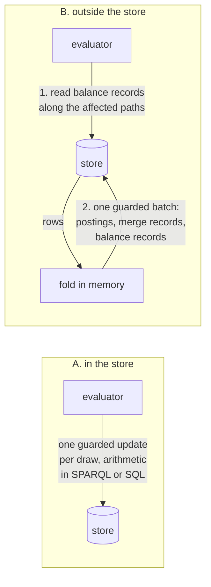
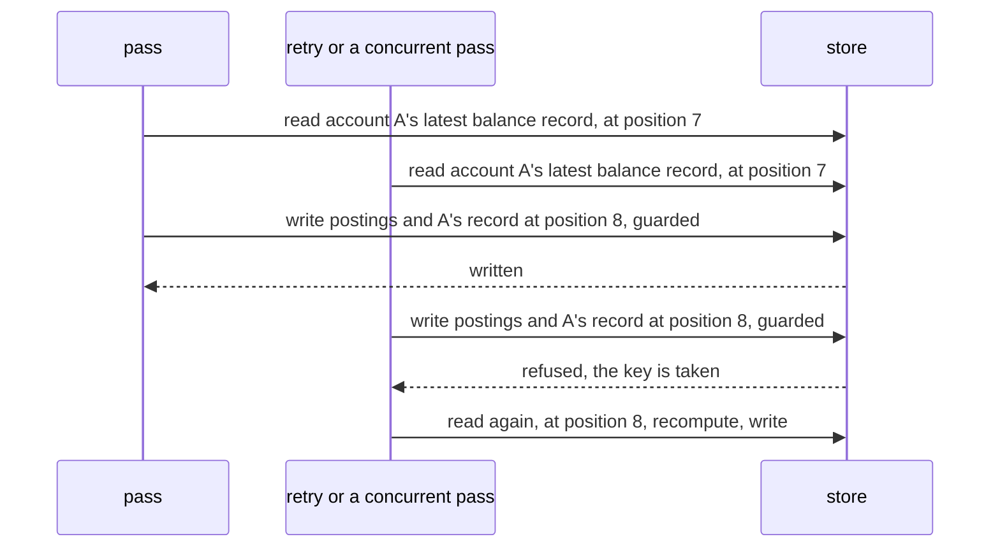
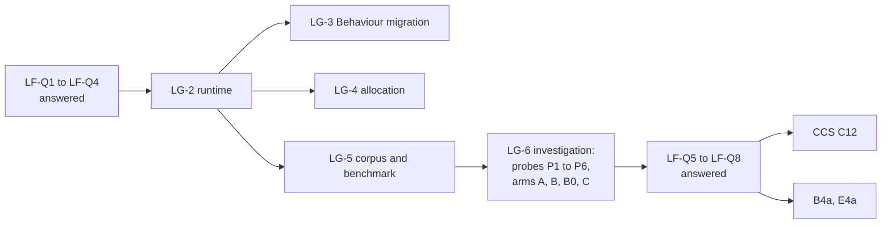

<!-- SPDX-License-Identifier: CC-BY-SA-4.0 -->

# Ledger: exactness, folds and where they run

**Status:** sketch, 2026-10-23. Investigative. Nothing here changes the model until its questions are answered. The formal-methods work it describes does not start until LF-Q5 sets a direction.
**Comes back in with:** the [Ledger plan](../plans/ledger.md), at LG-2 for LF-Q1 to LF-Q4 and at the investigation slice (§11) for the rest. The [formal-methods epic](../plans/formal-methods.md) (B4a, E4a) and CCS C12 wait on LF-Q5.
**Reads with:** [ADR-A131](../../architecture/decisions/ADR-A131-ledger-layer.md) (decision 6 and its Consequences on realisations), [ADR-A123](../../architecture/decisions/ADR-A123-typed-operation-ir.md) (derived read and write sets), [ADR-A-FM1](../../architecture/decisions/ADR-A-FM1-formal-methods-prover-choice.md) (Isabelle, Haskell and Scala targets), [ADR-A124](../../architecture/decisions/ADR-A124-benchmark-root.md) (benchmarks), [triple-store-discovery.md](../../architecture/triple-store-discovery.md), [efficient-queries-and-shapes.md](../../architecture/efficient-queries-and-shapes.md).

---

## 1. Premise

Ledger's law is conservation. A balance is the stated amount less what was drawn plus what was restored, so a balance is a fold of postings. Two things about that fold were settled on the assumption that rdflib and Oxigraph are the stores that matter.

- **How exact the numbers are.** ADR-A131 decision 6 and LG-Q6 keep postings in the account's unit and proportions exact. Rounding at posting creates a residual, and splitting a residual between equal claims needs a tie-break that the current model does not define well.
- **Where the fold runs.** The plan assumes the store can compute and check balances with SPARQL.

Production will run on Jena, and later probably on one of RDFox, GraphDB or Stardog. A SQL back end may follow. This sketch sets out what we believe about both questions across those stores, separates what is known from what is hypothesis, and proposes probes and benchmarks, including A/B comparisons, to decide a direction before we build anything that depends on one.

## 2. What the model says today

Each point is checked against the source on 2026-10-23.

| Fact | Source |
|---|---|
| Postings are in the account's declared unit of account. A rule that rounds states its rounding and its residual allocation, "so the parts still sum to the amount" | ADR-A131 decision 6 |
| A realisation outside the graph is allowed, adds no semantics, and is held to the model by an agreement law, that folding its postings gives the balance records | ADR-A131 Consequences, "Realisations" |
| Proportions stay exact (`owl:rational`, or a numerator and denominator pair), and postings are rounded in the account's unit | LG-Q6, answered (c) |
| `ldg:amountValue`, `ldg:remainingValue`, `ldg:availableValue`, `ldg:requestedValue` and `ldg:grantedValue` are `xsd:decimal` | the plan's vocabulary for LG-2 |
| Balance records are materialised once per pass, so a read is one lookup | LG-Q5, answered (a) |
| A reset is a credit posting of the amount consumed in the period, and a credit that would pass the ceiling is refused, never clamped on read | `licence-seats.ttl`, LG2-05 |
| LG-2 checks recorded values with shapes. Computing them is the evaluator's (CCS C12, B4a) | LG-2's invariant |
| `ldg:LargestRemainder` breaks ties "by the total order of account keys", and `ldg:ToFirstInOrder` names an order nothing defines | the plan's vocabulary, the README |
| `authority-aggregate.ttl` gives its residual by the order in which proposals were made | the example's comment block |

The performance section speaks of "integer arithmetic on the hot path" while the amounts are `xsd:decimal`. The two agree when a decimal is held at the unit's scale, for example two places for sterling, since such a decimal is an integer count of minor units written with a point. Nothing states that scale today (LF-Q4).

## 3. Exactness and the residual

### 3.1 Why rounding happens at posting

An aggregate is eroded by what is paid against it, and payments are made in whole minor units. If Ledger kept three postings of exactly 100/3 and the payment layer paid 33.33 three times, the ledger would show the aggregate exhausted while 0.01 of it was never paid. Conservation would hold inside Ledger over amounts that never happened. Reconciling the two needs a posting of the difference, which brings the rounding back into Ledger one step later.

The granularity belongs to the unit of account, not to money. Seats and minor currency units are indivisible. Tonnes or hours may be divisible to a stated precision. That precision is a property of the value space in Quantification.

### 3.2 The residual and its tie-break

With indivisible units, a merge rule cannot always both exhaust the account exactly and treat equal claims equally. Three equal claims on 100 units give 33 each and one unit left. Some rule has to say where it goes, or that it goes nowhere.

| Option | What decides the residual | Where it works | Cost |
|---|---|---|---|
| A | the total order of account keys | allocation across several accounts | breaks no tie within one account, where every proposal has the same account key |
| C | a priority the terms state, replacing `ldg:ToFirstInOrder` | where the terms give one | silent where they do not |
| D | C, otherwise the proposals' natural keys | everywhere | the order of natural keys is arbitrary, so equal claims are treated unequally for no reason the terms give |
| E1 | nobody. The residual stays in the account | single-account merges | grants sum to less than availability, so "exhausted" needs a definition (Ensemble ES-3) |
| E2 | nobody. Postings are exact rationals | in principle everywhere | §3.3 and §4 |
| E3 | an act of determination by a party the terms name | where the terms name one | a further record and a party to model |

The combined design we lean towards is E1 by default, with C and E3 where the terms provide for them, and A kept for allocation. It conflicts with the wording of decision 6, since under E1 a merge's parts do not sum to the amount. Decision 6 states one rule for two cases:

- **allocation**, one amount split across several accounts, which must conserve exactly, every unit going somewhere, with A breaking ties
- **a merge**, several claims on one account, which under E1 may grant less than availability and leave the rest in the account, so conservation holds over the account and not over the grants

The combined design therefore needs a dated addendum to ADR-A131 separating the two, and LG-2's L6 shape becomes "at most the availability, and short only by a residual that cannot be split among tied claims".

### 3.3 Why not E2

E2 moves rounding out of Ledger without removing it (§3.1), and it breaks every in-store sum (§4.2). It also needs an amendment to decision 6. We lean towards dropping it (LF-Q1).

## 4. Numbers in stores

### 4.1 What the standards say

SPARQL 1.1 defines arithmetic and comparison for `xsd:integer`, `xsd:decimal`, `xsd:float` and `xsd:double` and their derived types. `owl:rational` belongs to OWL 2, not XSD, so to a conforming SPARQL engine `"1/3"^^owl:rational` is a literal of an unrecognised datatype. It compares by term identity only, so `"2/6"` and `"1/3"` are different terms unless every writer reduces them, and it has no arithmetic and no ordering. This follows from the specification and is expected to hold in every store below. Some engines accept custom functions (Jena, Stardog), which a portable shape cannot use.

XSD lets a minimally conforming processor stop at 18 decimal digits, and SPARQL leaves the precision of decimal division to the implementation. Integers are exact in the specification.

### 4.2 What each representation allows

| Representation | Compare in SPARQL | `SUM` in SPARQL | Divide | Portable |
|---|---|---|---|---|
| `owl:rational` | term identity only | no | no | as an opaque value only |
| numerator and denominator, two `xsd:integer` | yes, as a×d against c×b | no, a sum of fractions needs a common denominator | no | yes, for comparison |
| `xsd:decimal` at the unit's scale | yes | yes, exact while within the engine's precision | precision differs by engine | yes, for sums |
| `xsd:integer` in minor units | yes | yes | integer division only | yes |

So amounts that are summed and checked must be integers or decimals at a fixed scale. Exact rationals fit only where a value is cited and compared, never summed, as `ldg:grantedProportion` is.

### 4.3 What we believe of each store, to probe

Every row is a hypothesis until a probe records it in the discovery record.

| Store | Decimal | Integer | `owl:rational` |
|---|---|---|---|
| rdflib | Python `Decimal`, precision from its context | arbitrary precision | opaque |
| Oxigraph | fixed point, believed to be 18 fractional digits | believed 64-bit | opaque |
| Jena (ARQ, TDB2) | `BigDecimal`, arbitrary. Division's scale to probe | `BigInteger` | opaque, unless a custom datatype is registered |
| GraphDB (RDF4J) | `BigDecimal`. Division's scale to probe | `BigInteger` | opaque |
| Stardog | unknown | unknown | opaque |
| RDFox | unknown | believed 64-bit | opaque |

**SQL.** `NUMERIC(p, s)` has a fixed scale per column and holds 1/3 only rounded. A rational needs two integer columns, with the same summing problem as in SPARQL. `BIGINT` in minor units, or `NUMERIC` at the unit's scale, is exact and sums the same everywhere. Which SQL engine is open (LF-Q7).

## 5. Which folds a store can run

Whether a fold is cheap in a store depends on its algebra. A commutative and associative fold can run in any order, so the store needs no sort. A fold that is associative but not commutative needs the postings in order, and SPARQL 1.1 has no ordered fold.

| Fold | Example | Algebra | SPARQL 1.1 | SQL |
|---|---|---|---|---|
| balance | stated less debits plus credits | commutative monoid, `SUM` | linear | linear |
| availability on a path | the least balance along the ancestors | commutative, `MIN` over a property path | bounded by depth | recursive CTE |
| balance as of a position | postings at or before (position, micro-position) | `SUM` with a lexicographic filter | yes | yes |
| balance since a reset | a reset period | `MAX` subquery, then `SUM` | nested | yes |
| a capped restoration | a credit that stops at the ceiling | associative, not commutative | only as a self-join, quadratic | window function or recursive CTE |
| a waterfall | LG-4 allocation by seniority | prefix sums | only as a self-join, quadratic | window function |
| exact rational sums | proportional parts | needs a common denominator | no | no |

Each capped posting is a map $x \mapsto \min(a,\ x+b)$, and two compose to one map of the same form:

$$\min(a_2,\ \min(a_1,\ x+b_1)+b_2) = \min(\min(a_2,\ a_1+b_2),\ x+(b_1+b_2))$$

The fold is associative, but its order matters. SPARQL can write it only as a minimum over suffix sums, joining every posting with every later one.

**Effective amounts at write.** If whatever depends on order is resolved when a posting is written, and the posting records the amount it applied, every read is a `SUM` or a `MIN` along a path. The settle phase already writes each account in order. The current examples already do this, since a reset is a credit of the amount consumed and a credit past the ceiling is refused (§2). LF-Q4 asks whether to state it as a rule of the model.

## 6. Where the fold runs

**A, in the store.** The availability check and the write are one guarded update, so the check is atomic. The arithmetic is written once per dialect, at least portable SPARQL and SQL. A merge (sorting proposals, rounding, a residual) cannot be written in SPARQL at all, so a merge would be computed outside anyway.

**B, outside the store.** The evaluator reads the latest balance records along the affected paths, computes postings, merge records and new balance records in memory, and writes them in one batch. Atomicity comes from the guard on the write, not from arithmetic in the store. A balance record's natural key (account, owner, key, position, micro-position) is unique, so a write whose key is already taken fails, and the evaluator re-reads and recomputes. Whether the existing persistence guards serve unchanged is a hypothesis for the investigation.

**In-store folds stay, as checks.** The agreement law, the LG-2 shapes, reporting, and an adopter who uses only the ontology all need a fold in the store. With effective amounts recorded (§5), these are `SUM` and `MIN` only, so one SPARQL query and one SQL query cover them.

**Cost, as estimates.** The plan's catastrophe pass is 5,000 losses, each drawing on a section and an aggregate (*d* = 2), with up to 10,000 balance records and about 120,000 triples written.

| | A, per draw | B, with balance records | B without balance records |
|---|---|---|---|
| round trips | 5,000 | 2 | 2 |
| read | *d* balance records per update, about 10,000 lookups | the affected accounts' latest balance records, at most 10,000 | every posting ever made on the affected accounts and their descendants, growing with history |
| written | 5,000 updates | one batch of about 120,000 triples | one batch |
| arithmetic | once per dialect, merges outside regardless | one implementation | one implementation |

Pulling data out costs nothing extra only when what is pulled is small. A full-history fold moved out of the store keeps the store's cost of finding the rows and adds the transfer, so it can only lose. With balance records, the read is a few rows per account, and round trips matter more than bytes. Embedded TDB2 has no network round trip, while Fuseki over HTTP adds one per query. Our hypothesis is that B, with balance records, matches or beats A and is far simpler to keep correct across stores. That is untested.

## 7. What can be guaranteed about a query's footprint

| Guarantee | How | Strength |
|---|---|---|
| **the logical footprint** | an Isabelle theorem that a balance at position *p* depends only on the account's path, its last balance record and the postings after it up to *p*. The key lemma is that folding a concatenation equals combining the folds of its parts | proved |
| **the query's shape** | a read fragment in ADR-A123's typed IR where every pattern starts from a bound term (efficient-queries R8), and the derived read set compared with the proved footprint | enforced by type rules, as ADR-A123 decision 2 does for writes |
| **what the engine scans** | an assumption, "a pattern with a bound subject is an index lookup", recorded as a field in the capability record with a probe per store, as ADR-A123 decision 7 does for atomicity. For SQL, `EXPLAIN` checked in a test | measured, never proved, since the planner is outside any proof |

With balance records the footprint is bounded by tree depth plus the postings since the last pass, not by an account's lifetime. That matters for an authority's aggregate drawn by many contracts over years.

## 8. Formal methods, once a direction is set

ADR-A-FM1 chose Isabelle, with Haskell and Scala as code-generation targets. Scala fits Jena, since an exported fold could run in the same JVM as TDB2. Theorems worth proving:

- the monoid and balance-record laws (§7)
- a draw on a path succeeds or fails whole
- conservation, for allocation exactly and for a merge over the account (§3.2)
- a merge gives the same postings whatever order its proposals arrive in, which is where a tie-break is tested

The limits:
- **Scala export has not been run yet.** ADR-A-FM1 decision 2 calls it near-term work.
- **The proof covers the algorithm, not the code that maps store rows into its types.** That code is checked by adequacy tests against fixtures, as in the spike.
- **There is no Python target.** The Python reference stays hand-written and checked against the same fixtures.

None of it starts until LF-Q5 is answered.

## 9. The investigation

All probes follow `lattice-triple-stores` and add entries to the discovery record. All benchmarks live under `benchmark/` and fail only on a wrong result (ADR-A124).

**Probes.**

| ID | Probe | Stores |
|---|---|---|
| P1 | `owl:rational` literals: parse, compare, sort, round-trip, reduction | rdflib, Oxigraph, Jena, then those of LF-Q7 |
| P2 | `xsd:decimal` storage precision and the scale of decimal division | the same |
| P3 | `xsd:integer` range, and what happens on overflow | the same |
| P4 | whether a pattern with a bound subject is an index lookup, from each engine's plan or statistics | Jena, Oxigraph, then those of LF-Q7 |
| P5 | whether a write guarded by a balance record's natural key refuses a second writer, in one request and under concurrency (with TSD-Q4 and TSD-Q13) | Jena TDB2 and Fuseki first |
| P6 | the same as P1 to P3 for the SQL engine of LF-Q7 | one SQL engine |

**Benchmarks**, on LG-5's generated corpus (account trees and draws at the plan's volumes).

| Arm | Fold | Variables |
|---|---|---|
| A | in the store, one guarded update per draw | store, depth, draws per pass |
| B | outside, balance records read, one guarded batch | store, depth, draws per pass, embedded or over HTTP |
| B0 | outside, every posting read, no balance records | as B, to measure what balance records save |
| C | the check folds only (L1, L2, the agreement law) in SPARQL and SQL | store, postings per account, history length |

We record wall time per pass, round trips, rows or triples read where the engine reports them, and retries under contention. A and B run on identical corpora and must produce identical records, so each A/B run is also a test of agreement. Jena is in every run, since it is the production store and has never been run on our benchmarks (TSD-Q12, TSD-Q14, TSD-Q18).

## 10. Questions LF-Q1 to LF-Q8

| ID | Question | Options | Leaning | Needed by |
|---|---|---|---|---|
| **LF-Q1** | Drop E2, exact rational postings? | (a) drop it. (b) keep it open for dense units of account | (a), §3.1 and §4.2 | LG-2 |
| **LF-Q2** | How a merge's residual is decided | §3.2's A, C, D, E1, E2, E3, or the combined design | the combined design, with an addendum to ADR-A131 decision 6 | LG-2, since L6, the README's residual definitions and `authority-aggregate.ttl` follow from it |
| **LF-Q3** | The form of `ldg:grantedProportion` | (a) the numerator and denominator pair now, since §4.1 expects `owl:rational` to be opaque everywhere. (b) LG-2's probe on rdflib and Oxigraph decides, as LG-Q6 says. (c) (b), widened to Jena | (a), which takes the probe off LG-2's path. P1 still runs in the investigation | LG-2 |
| **LF-Q4** | Do we state effective amounts at write, and each amount's scale, as rules of the model? | (a) state both in the README and as shapes. (b) state effective amounts only. (c) leave both implicit, as the examples are | (a). It costs one sentence and one shape each, and keeps every check a `SUM` or a `MIN` | LG-2 |
| **LF-Q5** | Where the hot-path fold runs | (a) in the store. (b) outside, with balance records and a guarded batch. (c) either, chosen per deployment | after §9's benchmarks | CCS C12, B4a, E4a |
| **LF-Q6** | How the footprint is assured | §7's three guarantees, all or some | after LF-Q5 | LF-Q5's realisation |
| **LF-Q7** | Which further stores we probe | one of RDFox, GraphDB or Stardog, subject to licence terms, and one SQL engine | the maintainer's choice | P1 to P6 beyond Jena |
| **LF-Q8** | Does a fold exported from Isabelle become the production fold? | (a) yes, Scala in the JVM beside Jena. (b) a hand-written fold checked against the proved one. (c) proofs only, with no generated code | after LF-Q5 | E4a |

## 11. Where this sits in the plan

LG-2 records values and checks them with shapes, and leaves computing them to the evaluator, so where the fold runs changes no ontology term. The examples already record effective amounts. So the model can carry on, with the investigation later, except for LF-Q1 to LF-Q4, which change what LG-2 writes into the README and its shapes.

| Unit | Effect |
|---|---|
| Ledger plan | LG-2 takes the answers to LF-Q1 to LF-Q4. LG-6 is added after LG-5 and shares its corpus |
| ADR-A131 | an addendum to decision 6 if LF-Q2 takes the combined design |
| Ensemble | ES-3 defines exhaustion under E1, where a residual may remain |
| Formal methods | B4a and E4a wait on LF-Q5. C5, the Alloy model of the laws, does not depend on where the fold runs |
| Triple-store discovery | P1 to P5 add entries, and TSD-Q12 and TSD-Q18 gain a reason to run on Jena |
