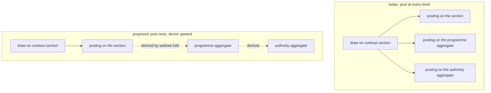

<!-- SPDX-License-Identifier: CC-BY-SA-4.0 -->

# Ledger history and runtime profile

**Status:** sketch, 2026-10-24. Investigative. Nothing here changes the model until its questions are answered.
**Sits above:** [ledger-folds-and-stores.md](ledger-folds-and-stores.md), whose LF-Q1 to LF-Q8 are downstream of the three structural questions in §2.
**Comes back in with:** the [Ledger plan](../plans/ledger.md) at LG-2, and the [formal methods epic](../plans/formal-methods.md) at C4, which cannot be built until LF-Q9 is settled.

Grading as in the engine papers. **Fact** means a document or specification says so. **Judgement** means a reasoned estimate a measurement could overturn. Every triple count below is a judgement, calibrated against the Ledger plan's own figure of about 24 triples per loss at depth 2.

## 1. Premise

The folds sketch asks where arithmetic runs and how exact it is. It does not ask what a posting *is*, how many orderings it carries, or what the record costs to keep. Those questions sit above it, and answering the arithmetic first risks writing shapes we then migrate.

Two obligations pull against each other, and the model has to carry both.

| Obligation | What it demands |
|---|---|
| **Defensible history** | every economic event is a fact of its own, a balance is derived from facts rather than asserted, a reading can be taken as of any point, and a replay reproduces the numbers |
| **Enterprise runtime** | storage grows with economic events rather than with evaluations, a read is bounded, and concurrent work is not serialised behind a shared counter or a shared row |

Where the tension cannot be carried in one model, the richer model is projected through Surface onto a second T-Box tuned for reading. §6 argues that this is not needed here, and names the one case where it is.

## 2. The three structural questions

These are upstream of LF-Q1 to LF-Q8.

| ID | Question | Answered |
|---|---|---|
| **LF-Q11** | How many orderings does a posting carry, one (recorded) or two (recorded and effective)? | **two**, 2026-10-24 |
| **LF-Q9** | May an evaluation read a balance mid-pass, after earlier settlements in the same pass? | **yes**, 2026-10-24 |
| **LF-Q17** | Is a posting an independent fact, or does it carry a claim about the postings before it? | **a running balance**, along the recorded ordering, with checkpoints at closings, 2026-10-27 |

### 2.1 LF-Q11, two orderings

Insurance is retroactive by nature. An endorsement takes effect from inception, a loss is notified months after it occurred, a reinstatement restores capacity as of the event that exhausted it. A single ordering cannot hold both when a fact was recorded and when it takes effect, so the model carries both.

- **Effective position.** Where the fact sits in the world the contract describes. Supplied by the domain, comparable across accounts, and never assigned by an evaluator.
- **Recorded position.** Where the fact sits in the account's own append-only sequence. Assigned by the writer, monotonic, and total only within one account.

This is the bitemporal pair in append-only form. No row is ever mutated, so the natural-key guard and the append-only hypothesis of the footprint theorem both survive. A correction is a compensating posting whose effective position is that of the fact it corrects and whose recorded position is current.

Two consequences follow, and the second is the one that matters for §5.

1. The footprint theorem needs restating over two axes. A balance as of an effective position depends on every posting whose effective position is at or before it, whatever its recorded position, so a late-recorded backdated posting changes a historical reading. That is correct behaviour and it must be stated, because it means a reading is reproducible only when paired with the recorded position it was taken at.
2. **The cross-account axis is effective position, not a counter.** §5 uses this.

### 2.2 LF-Q9, mid-pass reads

Yes. LG-4's seniority waterfall reads what earlier settlements in the same pass left, so micro-position is semantically load-bearing and not audit metadata. Three things follow.

- The evaluator carries an in-memory view of the pass's own uncommitted postings, which settles LF-Q5 on correctness grounds at option (b). Arm A, one guarded update per draw in the store, cannot see a pass's uncommitted work.
- Micro-position needs a total order defined on the data, not on arrival. The folds sketch's §3.2 critique of arbitrary natural-key orders applies, so this order is for sequencing settlements and never for breaking a merge tie.
- C4's step graph gains a third level below position. ADR-A130's model of propose, merge and settle is unaffected in shape, but its checks C4-A2, A4 and A5 are stated over positions and must be restated over (position, micro-position). **C4 waits on this.**

## 3. What the record costs

The question that prompted this sketch. A posting is appended and never removed, so every count below is permanent growth rather than a working set.

**Today, per economic event**, at depth *d* a draw posts to the drawn account and to every ancestor.

| Node | Triples (judgement) |
|---|---|
| posting | ~8: type, account, owner, key, position, micro-position, direction, amount |
| balance record | ~7: type, account, owner, key, position, micro-position, remaining |
| per account touched | ~15 |
| per event at *d* = 2 | ~30, against the plan's measured ~24 |

At *d* = 3 and 10 million events a year, that is of the order of 450 million triples a year, every one of them permanent. Adding the effective position and the configuration binding of §2.1 and §4 makes it worse before anything makes it better.

**The levers, with their multipliers.** Each is a judgement and each has a semantic price.

| Lever | Effect on storage | Semantic price |
|---|---|---|
| post at the drawn account only, derive ancestors | ÷ *d* | an ancestor's balance becomes a subtree fold, §5.1 |
| mint an account-instance IRI, so a posting names one node rather than account, owner and key | −2 per posting | adds a node class, which ADR-A131 decision 4 declined |
| record a signed amount rather than direction and magnitude | −1 per posting | direction is derived from the sign for display |
| a running balance on the posting rather than a balance record | −6 per account touched | the posting carries a claim about its predecessors, §4 |
| do not persist speculative evaluation | ÷ (1 + scenarios per event) | needs a committed/speculative distinction, §5.3 |
| close the period and archive the detail | hot store becomes O(closing interval) rather than O(account lifetime) | adds a closing concept, §5.2 |

The first and the last are worth more than the rest together. The middle three are each worth roughly a tenth to a quarter and are cheap to take.

## 4. LF-Q17, is a posting an independent fact?

The one structural question still open, and it is the real content of the running-balance proposal.

| | Independent fact, with balance records | Carries a running balance (`ldg:balanceAfter`) |
|---|---|---|
| Storage per account touched | ~15 triples | ~9 triples |
| Read of that account as of a point | last record at or before, then fold the postings after | one indexed lookup, no fold |
| Concurrent writers at one account | independent, the record reconciles them | the second must read the first's running balance |
| A broken chain is localised to | the pass | the one posting |
| Duplicate-insert hazard | a balance record with a derived IRI merges silently under set semantics, leaving two remaining-value triples on one node | the hazard disappears with the node class |

The usual objection to a running balance is that it serialises writers at an account. §5.1 removes that objection for the case where it bites, because the accounts with many concurrent writers stop being written to at all.

A running balance is also not a denormalisation in the pejorative sense. It is the running balance every bank statement carries, which matters for §6.

**Open.** Whether a running balance is recorded along the recorded ordering only. It cannot be a running balance along both axes at once, so a reading as of an effective position still folds. That narrows its benefit to the common read, which is "the balance now".

## 5. A model that carries both obligations

### 5.1 Post once, derive the rollup

A draw is recorded only at the account it is drawn on. An ancestor's balance is its stated amount less the draws in its subtree, which is still a fold over facts, still definitional, and still checkable.

Three effects, of which the third was not on the table when the folds sketch was written.

1. **Storage falls by a factor of *d*.** At depth 3 that is the largest single reduction available.
2. **Ancestor reads get more expensive**, from "postings on this account since its last record" to "postings in this subtree since its last checkpoint". §5.2 bounds it.
3. **The shared-ancestor write hotspot disappears.** An authority aggregate drawn by a thousand contracts is written by every one of them today. Under this model it is never written by a draw at all. That is a throughput result rather than a storage one, and it is the answer to serialising concurrent work behind a shared row.

A purpose-counting account (`ldg:countsPurpose`) is not in the drawn account's subtree, so it cannot be derived this way and keeps its own posting. That is a small declared exception, and it is a further reason to settle the deduplication rule the purpose closure needs.

### 5.2 Close the period

Each account carries a closing recurrence. At each close, the account's balance at that point is written once as a checkpoint, and the detail before it is archived rather than deleted.

A balance as of a point is then the last checkpoint at or before it, plus the fold over the postings since. Both terms are bounded, the first by one lookup and the second by the closing interval.

Storage in the hot store becomes O(accounts × checkpoints retained + postings since the last close) rather than O(every posting ever written). Read cost for an ancestor becomes O(subtree width × closing interval), which is the dial §5.1 needs.

Closing recurrence is a property of the account definition, so a heavily drawn aggregate closes daily and a quiet one closes yearly, and the trade between storage and read cost is set per account rather than for the whole system. Quantification already models recurrence (`qnt:Recurrence`, `qnt:RecurrenceBin`, `qnt:AnchorBinding`), so this reuses declared machinery rather than adding any.

### 5.3 Committed and speculative evaluation

A scenario run, a what-if and a dispute replay produce the same volume as a real pass. Where every evaluation is persisted, scenarios rather than economic events set the growth rate, and the ratio is unbounded.

Only a committed pass belongs in the system of record. A speculative pass is written to a graph that can be dropped, or is never written. This is a semantic distinction rather than a storage trick, since a scenario result is not a fact about the instrument.

### 5.4 Ordering, stated without a global counter

§2.1's answer supplies the cross-account axis, so nothing needs a global ordinal.

| Axis | Scope | Assigned by | Contention |
|---|---|---|---|
| effective position | comparable across every account | the domain, from the contract and the event | none |
| recorded position | one account | that account's writer | one account's writers only |
| micro-position | one account at one recorded position | the evaluator, by a data-defined order | within one pass |

A pass is a node with an identity and a recorded time, and it stamps every posting it writes, which gives replay and cross-account correlation. It does not need a globally ordered ordinal, and so it is not a counter every writer contends for.

The merge is a barrier only where proposals at one account together exceed availability, which the README already states. Where capacity is ample there is nothing to arbitrate and no barrier, so the barrier is rare rather than per draw.

### 5.5 Exactness, restated

The stored amount and the working precision are different questions.

- **Stored.** A posting's amount is a fixed-granularity decimal in the account's unit, which is an exact integer count of minor units. The granularity is declared on the value space by `qnt:granularityFloor`, with `qnt:densityKind` of `qnt:Discrete`, both of which Quantification already carries. A maximum magnitude per space is the one genuinely missing declaration.
- **Working.** Apportionment multiplies an amount by a ratio, and the intermediate needs more precision than the stored granularity. The intermediate is an exact rational, rounded once at the end by the declared apportionment method.

LF-Q1 drops exact rational *postings*, which stays right. It does not ban rationals from the computation, and the distinction needs saying because the two are easily conflated.

## 6. Does this need a second T-Box?

**Judgement: no, for the ledger's own semantics.** The mechanisms §5 needs for performance are mechanisms accounting already has for its own reasons.

| Mechanism | Performance role | Domain meaning |
|---|---|---|
| post once, derive the rollup | ÷ *d* storage, removes the write hotspot | the sub-ledger and general-ledger split |
| close the period | bounds the hot store and the read | closing a period is a legal act, not a cache refresh |
| running balance on the posting | O(1) read of the common case | the running balance on a statement |
| committed against speculative | bounds growth by events rather than evaluations | a scenario is not a fact about the instrument |

A projection onto a second T-Box earns its keep where the optimisation has no domain meaning. Each row above has one, so each belongs in the T-Box, and stratifying them would move domain concepts out of the layer that owns them.

**Where a projection is still needed.** A current-balance read at OLTP rates, for example a limit check at thousands a second, is not served by checkpoint-plus-delta in a triple store at any closing frequency. That is a cache of current state, projected through Surface, with the graph remaining the system of record. It projects one number per account instance rather than the history, so it is a cache rather than a second model of the ledger, and it does not change anything in §5.

**What would overturn this.** If the measured read cost of an ancestor at a realistic subtree width stays unacceptable at the shortest closing interval the write rate allows, then checkpoints are not enough and a projected rollup is needed. That is the one result from the benchmarks that forces a split, and it is worth designing the benchmark to find it.

## 7. Questions

| ID | Question | Options | Leaning | Needed by |
|---|---|---|---|---|
| **LF-Q17** | Is a posting an independent fact, or does it carry a running balance? | (a) independent, with balance records. (b) a running balance along the recorded ordering, with checkpoints at closings | **answered (b)**, 2026-10-27, the maintainer. A running balance along the recorded ordering, with checkpoints at closings | answered |
| **LF-Q18** | Post at the drawn account only, or at every level? | (a) drawn account only, ancestors derived. (b) every level, as today. (c) drawn account only, with declared exceptions for purpose-counting accounts | **answered (c)**, 2026-10-27, the maintainer. The drawn account only, with declared exceptions for purpose-counting accounts | answered |
| **LF-Q19** | Does an account instance gain a minted IRI? | (a) yes, which reverses ADR-A131 decision 4. (b) no, postings keep account, owner and key | **answered (a)**, 2026-10-27, the maintainer. An account instance gains a minted IRI, reversing ADR-A131 decision 4. MS-Q2's graph template now rests on it | answered, needs an ADR-A131 addendum |
| **LF-Q20** | Is closing recurrence declared per account definition? | (a) yes, on the definition. (b) one system-wide interval. (c) no closings, unbounded history | **answered (a)**, 2026-10-27, the maintainer. On the account definition, so the interval is per account | answered |
| **LF-Q21** | How is a speculative pass kept out of the record? | (a) a droppable named graph. (b) never written. (c) a flag on the pass, filtered by every query | **answered (a)**, 2026-10-27, the maintainer, a droppable named graph. MS-Q11 argues the better frame is a lifecycle boundary, and that stays open | answered, MS-Q11 open |
| **LF-Q22** | Is a maximum magnitude declared per value space? | (a) yes, in Quantification. (b) no, rely on the 18-digit floor | **answered (a)**, 2026-10-27, the maintainer. Declared per value space in Quantification | answered |

## 8. What this changes elsewhere

| Unit | Effect |
|---|---|
| Ledger plan | LG-2 takes LF-Q17 to LF-Q21. The runtime vocabulary gains the effective position, the pass stamp, the configuration binding and the checkpoint |
| ADR-A131 | an addendum for decision 4 if LF-Q19 takes (a), and for the two orderings |
| ADR-A130, C4 | the step graph gains micro-position. C4 waits on LF-Q9, now answered, and on LF-Q17 |
| Quantification | a maximum magnitude per value space (LF-Q22), and `ldg:unitOfAccount` required to be Discrete with a granularity floor |
| Formal methods | the footprint theorem is restated over two axes, with append-only as an explicit hypothesis |
| Surface | the current-balance projection of §6, if the read SLA needs it |
