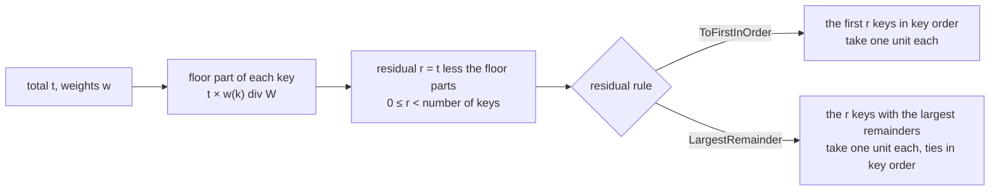

<!-- SPDX-License-Identifier: CC-BY-SA-4.0 -->

# The residual to the first in order: what the rule is, and what changing it costs

**Status:** sketch, 2026-11-09, for LG-Q15 and LG-Q16 of the [ledger plan](../plans/ledger.md). **Raised by** LG-8's first finding ([its pack](../validation/LG-8.md)), where machine S proved `ldg:ToFirstInOrder` lawful on positive weights only. **Reads** the ledger README sections 6 and 10, `tools/proofs/ledger/Kernel.thy` and `Rounding.thy`, ADR-A131 decision 6, the versioning policy and the reference evaluator sketch's RE-Q4.

## 1. The finding

A rounded split works in whole minor units. Each key takes the floor of its exact share, which leaves a residual of whole units, fewer than there are keys, and a residual rule says which keys take one more unit each. `ldg:ToFirstInOrder` gives them to the first keys in key order. `ldg:LargestRemainder` gives them to the keys whose floor division threw away the most.

The instance machine S found, `Rounding.to_first_can_exceed_a_zero_weight`: one unit split over three keys whose weights are 0, 3 and 3.

| Key | Weight | Exact share | Floor part | Remainder | To the first in order | Largest remainder |
|---|---|---|---|---|---|---|
| 0 | 0 | 0 | 0 | 0 | **1** | 0 |
| 1 | 3 | 0.5 | 0 | 3 | 0 | 1 |
| 2 | 3 | 0.5 | 0 | 3 | 0 | 0 |

Key 0 asked for nothing and is given a unit. That breaks the second of the four axioms ADR-A131 decision 6 holds every merge rule to, that no key is granted more than its own amount. Largest remainder cannot do this, since a key it reaches has a positive remainder and so a positive weight. Machine S therefore stated LR4 for the first in order under a hypothesis that every weight is positive, proved the split across accounts (`spread_int`) for largest remainder alone, and left the choice of what to do about the rule to the maintainer.

## 2. Where a weight of zero comes from

A zero weight is not an oddity of a test. It arises in each of the three places the ledger rounds.

| Where | What the weights are | How a zero arises |
|---|---|---|
| a merge at one position | the amounts the proposals ask for, summed per proposer | a proposer whose proposals net to nothing, or one listed for completeness with no request |
| an amount drawn across several accounts in turn | what each key still asks for when the next account is reached | a key fully met by an earlier account, which is the ordinary case from the second account on |
| attribution across parties (LC4) | each party's share of a posting | a party with no share in this posting, listed because it has one in others |

The second is why the finding matters for LG-4. Allocation with conservation walks a sequence of accounts, and after the first account some keys are met. Under the rule as it stands, a key already paid in full can be handed a unit at every later account.

## 3. What the term says today, in three places that disagree

| Place | Text | Reading |
|---|---|---|
| the vocabulary table, README section 6 | "The residual is allocated to the first proposal in order." | the whole residual to one proposal |
| the laws' prose, README section 10 | "allocating that residual one unit at a time to the first parts in key order" | one unit each to the first *r* keys |
| the kernel, `to_first` | `take (nat (leftover t K w)) (sorted_list_of_set K)` | one unit each to the first *r* keys, whatever their weight |

The vocabulary's singular reading is unlawful even where every weight is positive. Three units over four keys of weight 1 leave floor parts of 0 and a residual of 3, and one proposal taking all three is granted 3 against a request of 1. So the published definition already needs correcting, whatever is decided here, and the kernel's reading is the one to keep. No example, applied module, tool or benchmark in the repository states `ldg:ToFirstInOrder`. The one example that states a residual rule, `authority-aggregate.ttl`, states `ldg:LargestRemainder`.

## 4. The options

| | (a) retire the rule | (b) the first in order among keys of positive weight | (c) keep it, with a stated precondition | (d) keep it, and have every caller drop zero-weight keys first |
|---|---|---|---|---|
| lawful on | not applicable | every non-negative weight | positive weights only | every non-negative weight, where the caller remembers |
| the kernel | `to_first` and LR2 removed | `take r` over the keys filtered to positive weight | unchanged | unchanged |
| the vocabulary | an individual removed | the definition corrected | the definition corrected, with the precondition stated | the definition corrected |
| the proofs | less to carry | LR2 re-proved, LR4 without its hypothesis, LR5's split provable for both rules, about 80 lines | as machine S left them | a lemma per caller that the filtered set is what the rule sees |
| the runtime | one rule | a filter before `take`, the same cost | a refusal, or Undetermined, wherever a zero weight appears | a filter in every caller |
| allocation across accounts | largest remainder only | either rule | largest remainder only, since zeros arise there by construction | either rule |
| what a consumer must know | that the term is gone | nothing new | when the rule may be used | nothing, if every caller is right |
| versioning, at major zero | a removal, MINOR | a correction, PATCH on the reading of section 5, MINOR on a stricter one | PATCH | PATCH |

## 5. Why (b) is lawful, and why it changes nothing that was right

Write *W* for the sum of the weights, *r* for the residual and *n⁺* for the number of keys of positive weight. The total is between 0 and *W*.

- **There are always enough keys.** The residual times *W* equals the sum of the remainders. A key of zero weight has remainder zero, and every remainder is below *W*, so *r* × *W* is below *n⁺* × *W*, and *r* is below *n⁺*. The first *r* keys of positive weight exist.
- **No key exceeds its weight.** Where the total is below *W*, a key of positive weight has a floor part strictly below its weight, so one more unit stays within it. Where the total equals *W* the floor parts are the weights and the residual is zero.
- **A key of zero weight takes nothing.** Its floor part is zero and it is never among the keys the rule looks at.
- **The parts still sum to the total**, since exactly *r* keys take a unit.

This is machine S's own theorem `to_first_lawful_on_positive_weights` applied to the keys of positive weight, since dropping a key of zero weight changes neither *W* nor any floor part. So the proof is a short reduction and not new mathematics.

On positive weights the filter removes nothing, so (b) gives exactly what the rule gives today. The only inputs on which the two differ are those with a key of zero weight among the first *r*, and there today's answer breaks an axiom. (b) is therefore a correction in the versioning policy's sense, prose and behaviour brought to what was already documented as intended, namely that every merge rule satisfies the four axioms. A stricter reading calls any change of result a narrowing, which at major zero is a MINOR bump. Either way the substrate release moves, and by the import rule so does every module that imports it, so the change is worth batching with the next substrate change rather than releasing alone.

The instance of section 1 under (b):

| Key | Weight | Floor part | Under (b) |
|---|---|---|---|
| 0 | 0 | 0 | 0 |
| 1 | 3 | 0 | **1** |
| 2 | 3 | 0 | 0 |

## 6. What follows from (b), consumer by consumer

| Consumer | Consequence |
|---|---|
| the ledger README, section 6 | the vocabulary table's definition of `ldg:ToFirstInOrder` becomes "one unit at a time to the first proposals in order that asked for an amount", which also removes the whole-residual reading |
| the README's kernel block, section 10 | `to_first` takes `take r` over `filter (λk. 0 < w k) (sorted_list_of_set K)`, extracted to `Kernel.thy`, and every claim record is redigested, since the gate's digest covers every definition |
| LR2 | re-proved for the new definition. Summing exactly now needs the residual below the count of positive-weight keys, which section 5 gives |
| LR4 | `to_first` joins `largest_remainder` under `int_lawful` with no hypothesis, and the negative instance becomes a positive one, the key of weight zero taking nothing |
| LR5 | the split across accounts can be proved for either rule, which LG-4 then cites for a waterfall whichever rule an account declares |
| a merge at one position over whole units | either rule may be used, once that merge is stated (section 8) |
| the reference evaluator, B4a | implements the filter, one line. RE-Q4's default stays largest remainder |
| shapes | none changes. A shape checks a recorded grant against its request, which either rule satisfies under (b) and which the rule as it stands can fail |
| examples and data | none states the rule, so nothing is migrated |
| code export | the filtered `take` is executable as it stands |

## 7. What the rule still is, and is not, after (b)

- **It still favours the early keys.** Among keys with a stake, the first in order take the odd units every time. That is the rule's purpose where order is contractual, the first-named party bearing or taking the rounding difference, and it is why the order of keys is data as load-bearing as the rule (LG-Q12).
- **It is deterministic and easy to explain.** "The first *r* proposals that asked for something take one more unit" needs no remainders, where largest remainder must compute and compare them and explain a tie.
- **Neither rule is monotone in the total.** Weights 1, 1, 3 and 3: a total of 2 gives 1, 1, 0, 0 under the first in order, and a total of 3 gives 1, 0, 1, 1, so the second key loses a unit as the total rises. Largest remainder has the same property under another name. LN1 already says nothing above the ledger may assume a balance is monotone in its input, so this is not an argument between the two.

| | First in order, under (b) | Largest remainder |
|---|---|---|
| who takes the odd units | the earliest keys with a stake | the keys rounded down the most |
| reads | the weights' signs and the key order | the remainders and the key order |
| a tie | cannot arise | broken by key order |
| lawful on | every non-negative weight | every non-negative weight |
| proved for a split across accounts | provable under (b), not yet proved | proved, LR5 |
| the evaluator's default (RE-Q4) | no | yes |

## 8. What retiring it, or keeping it as it is, would mean

**Retiring it, (a).** One rule is less to prove, test and explain, and the evaluator's default is the one that remains. The cost is that a term leaves a published vocabulary, a removal that the policy classes MAJOR and that major zero makes a MINOR bump, and that the simplest rule a contract can state, the first-named party takes the difference, can no longer be said. An adopter whose wording says exactly that would have to model it as a priority order outside the residual rule. The decision is also hard to undo, since a term once removed and later restored has two histories.

**Keeping it with a precondition, (c).** This is the state machine S left, and it costs nothing today. Down the line the rule cannot be used for allocation across accounts at all, since zeros arise there by construction, so an account declaring it could be merged at one position and never drawn across. The precondition is on runtime values, which no configuration shape can check, so every evaluator needs a refusal path for it, and a declared rule that sometimes refuses is a second kind of Undetermined to explain. It also leaves the proofs split, with LR5 holding for one rule only.

**Leaving the filter to callers, (d).** The result is (b)'s wherever the caller is right, with the duty repeated at every call and no theorem saying the rule itself is lawful.

## 9. A neighbouring gap this turns up: the rounding method and a signed residual

The kernel rounds by floor only, so its residual is never negative. The vocabulary also declares `ldg:roundingMethod`, with `ldg:HalfEven`, `ldg:HalfUp` and `ldg:TowardZero`, and says the residual may leave the sum "short of, or over" the total. Under half-even or half-up the rounded shares can sum to more than the total, and then units must be taken away, which neither residual rule defines.

| Total, in minor units | Keys | Exact share each | Half-even each | Sum | Residual |
|---|---|---|---|---|---|
| 100 | 3 equal | 33.33 | 33 | 99 | +1, one unit to give |
| 200 | 3 equal | 66.67 | 67 | 201 | −1, one unit to take back |

Nothing mechanised covers the second row, and the repository's one example of a rounded merge, `authority-aggregate.ttl`, declares half-even with largest remainder. So either the rounding method applies only to how a single share is displayed and the allocation is always floor then residual, in which case the method and the residual rule are not independent choices and the vocabulary should say so, or a signed residual needs its own rule and its own theorems, units taken from the keys rounded up the most. That is LG-Q16, raised with this sketch, and it belongs with the merge over whole units, which LG-8 left out because `merge` takes a rule over exact amounts.

## 10. What this sketch asks for

- **LG-Q15**, how `ldg:ToFirstInOrder` treats a key of zero weight, leaning (b). Since the maintainer's ruling of 2026-11-09 on scenario C1, "in order" throughout this sketch means the declared order, never the keys' own (TD-161, LG-Q18). The vocabulary table's whole-residual wording is corrected under every option.
- **LG-Q16**, what a rounding method means beside a residual rule, and whether a negative residual is defined, open with no leaning yet beyond wanting it settled before LG-4.
- The change under (b) batched with the next substrate change, since any move of the substrate release cascades to every importing module.
