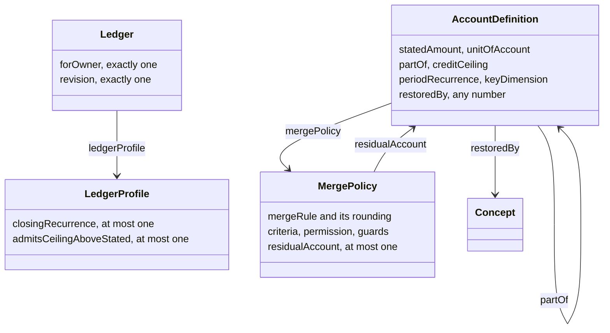
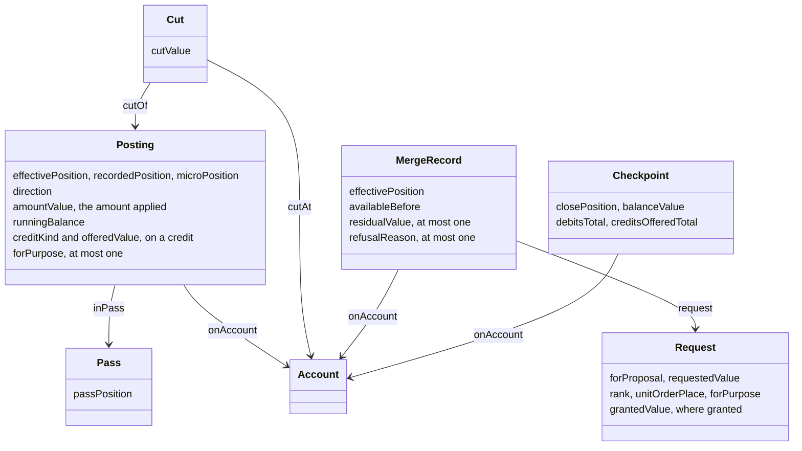
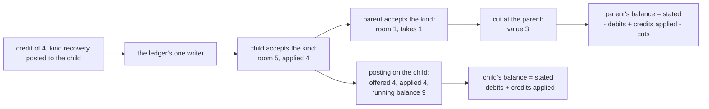
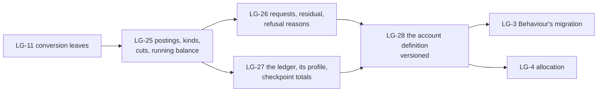

<!-- SPDX-License-Identifier: CC-BY-SA-4.0 -->

# The ledger's vocabulary and runtime records, reworked for the decided design

**Unit:** `ledger`, prefix LG ([plan](../plans/ledger.md), [status](../status/ledger.md)). **Status:** sketched 2026-11-18, for the maintainer's answers to LG-Q37 to LG-Q43. Nothing here is built. It is the brief the registers call "LG-2's rework", which had no slice of its own until now.

## 1. Why

The design of the ledger is decided. [ADR-A131](../../architecture/decisions/ADR-A131-ledger-layer.md) carries nine decisions and ten addenda, the kernel is proved, and the merge policy and the rounding difference are declared. The layer's documents are behind all of it in one direction and ahead of it in another.

- **Behind.** A credit has a kind, records what was applied and its cuts, and an account says which kinds restore it. A request carries a rank. A merge states its residual and why it was refused. A checkpoint carries two flow totals. A deployment authors a ledger profile. None of these has a term.
- **Ahead.** The runtime document still declares the balance record for each account and pass, which the maintainer decided out on 2026-11-09, and the conversion terms, which left the ledger the same day.

Every later slice reads these documents. LG-3 moves Behaviour onto accounts, LG-4 allocates across them, and the ensemble and the programme module follow. The verification rig's ledger questions are gaps until the terms exist.

## 2. What is decided and has no term

Each row is decided, with its source. The existing terms were listed from the README on 2026-11-18.

| Carried on | What | Source |
|---|---|---|
| account definition | the kinds of credit that restore it, all by default | first addendum of 2026-11-16 |
| account definition | that it is versioned, and pins the edition of the scheme its kinds were resolved against | LG-Q22, TD-102, ADR-A142 decision 5 |
| a scheme | the kinds of credit, declared by Ledger with no member and filled by an applied module | LG-Q10 |
| merge policy | the account that takes a residual, optional | second addendum of 2026-11-16, LG-Q32 |
| merge rules | a rule for requests of no use in part | second addendum of 2026-11-16 |
| a scheme | the reasons for a refusal, seven of them | LG-Q31, fourth addendum of 2026-11-16 |
| a request | its rank, its place among requests of one rank, its purpose | second addendum of 2026-11-16, LG-Q18, LG-Q33 |
| a posting | a credit's kind, the amount offered beside the amount applied | first addendum of 2026-11-16, STD-330 |
| a posting | the running balance at the account drawn on | LG-Q9 |
| a cut | the ancestor, and by how much it took less than was applied | LG-Q23, MEC-106 |
| merge record | the residual, and the reason for a refusal as a value of the scheme | LG-Q17, LG-Q31 |
| checkpoint | the debits and the accepted credits offered that were recorded by its close | STD-331 |
| ledger profile | whether a ceiling above a stated amount is admitted, and the closing recurrence | LG-Q24, MEC-105 |
| a ledger | the revision its one writer moves with each write | third addendum of 2026-11-16 |

## 3. What is declared and decided out

| Term | Decided out by | Still declared in |
|---|---|---|
| `ldg:BalanceRecord`, `ldg:remainingValue`, `ldg:availableValue`, and the three laws over them | LG-Q9, the running balance sits on the posting | the runtime document and `shapes/runtime.ttl` |
| `ldg:conversionMethod`, `ldg:amountAsDrawn`, `ldg:conversionUsed`, and the law that ties them | the addendum of 2026-11-09, slice LG-11 | both documents |
| `ldg:closingRecurrence` on the account definition | LG-Q24, it moves to the profile | the configuration document |

`ldg:resetRecurrence` stays deprecated until LG-3 removes it with Behaviour's allowance terms.

## 4. The shape proposed

### 4.1 Configuration

Two nodes are new, the ledger and its profile (LG-Q37). The account definition gains the kinds that restore it and loses the closing recurrence and the conversion method. The merge policy gains the residual account (LG-Q41).

### 4.2 Runtime records

- **A posting keeps one amount for the fold.** `ldg:amountValue` is the amount applied, for a debit and a credit alike, so a balance is read from one property. A credit also carries `ldg:offeredValue`, which only the reading of flows needs.
- **The balance record goes**, and the running balance sits on the posting at the account drawn on.
- **A cut is a node of its own**, since one credit can be cut at several ancestors (LG-Q39).
- **A request replaces the grant** as the node a merge record holds (LG-Q38).

### 4.3 A credit that is cut, as the writer records it

This is the addendum's own conformance case, a parent and a child each stated at 10.

### 4.4 What it costs to store

The count of triples for one posting, on a path of three accounts. No read cost changes, since the fold already reads one amount for each posting and the benchmark measured the cut's join.

| Record | Today | Proposed |
|---|---|---|
| a debit's posting | 8 | 9, with the running balance |
| a credit's posting | 8 | 11, with its kind and the amount offered |
| balance records for the pass | 15, five for each of three accounts | none |
| a cut, where an ancestor had less room | none | 4 |
| **a debit in all** | **23** | **9** |

For 20,000 postings of which 6,000 are credits and 600 are cut, that is about 460,000 triples today and about 194,400 proposed. The figures are a worked example on stated numbers, and the benchmark's README has the measured shares.

A merge record gains one triple for a residual. A request gains up to three, its rank, its place and its purpose. A checkpoint gains two.

## 5. Slices

More than fifteen tests and two modules split a slice, so the rework is five, each with its own Validation Pack.

| Slice | Holds | Removes |
|---|---|---|
| LG-11, planned already | | the conversion terms |
| LG-25 | the credit kind and its scheme, the kinds that restore an account, the amount offered, the cut, the running balance, and the laws that a balance is a sum less its cuts | the balance record and its laws |
| LG-26 | the request with its rank, place and purpose, the residual on a merge record and its account, the seven reasons, the rule for requests of no use in part | the grant |
| LG-27 | the ledger node, its profile and revision, the checkpoint's two totals | the closing recurrence on the definition |
| LG-28 | the account definition as a versioned thing, its meaning-bearing edges marked, the scheme edition it pins | |

All five change published meaning, so they are released together as one minor release at the next merge into `main`.

## 6. Questions for the maintainer

**LG-Q37. Is a ledger a node, and where does its revision live?** The profile is named by "each owner's ledger" and the writer moves "one revision for the owner's ledger", and no node is a ledger today.

- (a) A `ldg:Ledger` node, one for each owner and minted from the owner, names its profile by a pinned edge and holds the revision. An account reaches its ledger through its owner, so no account gains a triple. Each pass also records the revision it moved the ledger to, one triple a pass, so the replay order the writer is held to is in the records.
- (b) No node. The owner's persistent identity names the profile and holds the revision. That puts a fact every write changes on a node of Foundation's, which other writers of that identity then contend for.
- (c) No node and no revision in the ontology. The profile is bound in the deployment's configuration, and the revision is the store adapter's.

*Leaning (a).* LG-Q44 of the plan asks which unit is the ledger's aggregate, and if it is the owner's ledger this node is its root. The revision is the one fact of a ledger that changes in place, and it is better on a node the ledger owns than on someone else's. Under (c) the agreement that a writer's records equal a replay in revision order could not be checked from the records.

**LG-Q38. Does a request have a record of its own, and is a refusal's request kept?** Today a merge record holds a `ldg:Grant` for each proposal granted, and a refused merge must hold none. So a merge refused for a tie records no rank, though the decision says the record shows what decided the order.

- (a) As today. A refusal records its reason and nothing of what was asked.
- (b) One node for each request on every merge, `ldg:Request`, carrying what was asked, its rank, its place and its purpose, and what it was granted where the merge granted. `ldg:Grant` is retired. A refused merge holds its requests with no granted value. A credit refused alone is recorded the same way, as a record with one request and a reason.
- (c) Two nodes, a request and a grant that names it. About two more triples for each granted request, for no query that (b) cannot answer.

*Leaning (b).* A refusal is never a grant of nothing, so a refused request should not be typed as a grant, and a history that cannot show what was refused is hard to defend. It costs four to six triples for each refused request.

**LG-Q39. Does a cut copy its posting's position?**

- (a) Joined. A cut names its posting and the ancestor and states its value, and a read by position joins it to the posting.
- (b) Copied. The cut also states its posting's position, one more triple, so the read needs no join. It added 1.84% to the store at 20,000 postings, and its read has not been timed on the current corpora.

*Leaning (a).* A copied position is a second record of one fact, and LG-17's probe showed it can drift unnoticed without a law of its own. The copy can be added later if a timing shows the join matters.

**LG-Q40. Is the account definition versioned in this rework?** It is the last open instance of the rule that a versioned thing's meaning-bearing parts cannot change under it (TD-102). The pin of a scheme edition and of a merge policy's version both lean on it.

- (a) Yes, as LG-28, last, once the other terms have settled. Every example's definitions gain an identity, and the edges to the stated amount, the ceiling, the parent and the policy are marked as bearing meaning. Foundation's check then reads those edges, and a quantity that is neither versioned nor minted under its definition is warned on, which the slice has to answer.
- (b) Not now. The pins are stated as intended and TD-102 stays open.

*Leaning (a).* The rework already breaks every example, so this is the cheapest moment, and LG-3 and LG-4 should build on a definition that will not change shape again.

**LG-Q41. Where is the residual account named?**

- (a) On the merge policy, beside the permission to leave a residual.
- (b) On the account definition.

*Leaning (a).* What happens to a residual is part of the treatment a scope states. A scope whose accounts need different residual accounts states different policies.

**LG-Q42. Are the five slices and their order right, with LG-11 first?** Section 5 has them. The alternative is one large slice, which would exceed our own sizing rule and give one very large pack to verify.

*Leaning: as drawn.*

**LG-Q43. Which accounts does a checkpoint cover at a close?** Three texts differ. The README writes one for each account whose balance moved since its last checkpoint. ADR-A131's first addendum of 2026-11-16 speaks of a checkpoint of every account's balance at each close. STD-331 says an account that did not move is reached by carrying its earlier checkpoint forward.

- (a) Only the accounts that moved, and an account that did not move is read from its last checkpoint.
- (b) Every account at every close.

*Leaning (a).* It is what the README and STD-331 say and what the benchmarks stored, and (b) writes a record for every quiet account at every close. The addendum's sentence would be corrected by a short addendum.

## 7. What this leaves out

- **Reports and readings.** No layer models a report, so the declaration of a reading has no home yet.
- **Allocation across accounts**, which is LG-4, with the law that an allocation is written whole.
- **Behaviour's use of accounts**, which is LG-3, and with it the removal of `ldg:resetRecurrence`.
- **Persistence's record families** for the ledger's records.
- **The writer itself.** The third addendum of 2026-11-16 is a rule for a runtime. Only the revision it guards is a term.
- **The two kinds of split**, deferred by LG-Q34.
- **A derived account definition's link to its projection contract**, which waits for that derivation to be built.
