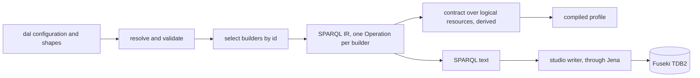
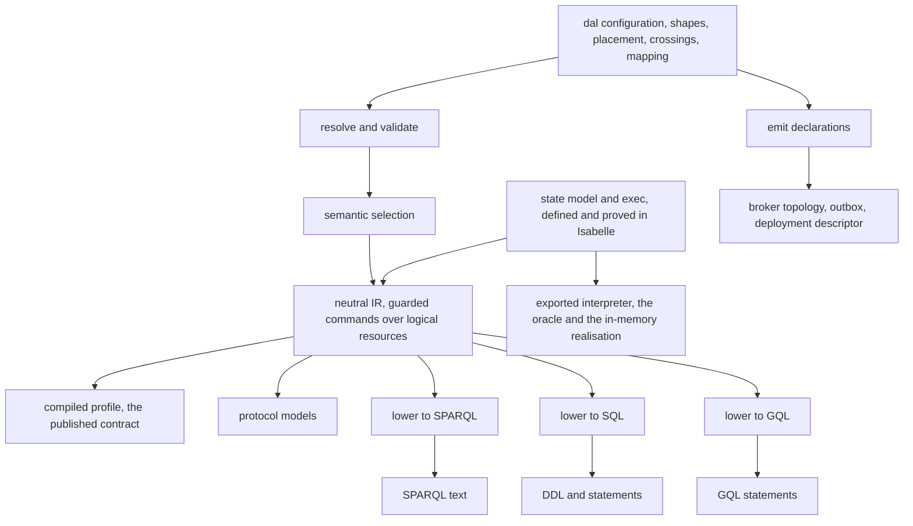
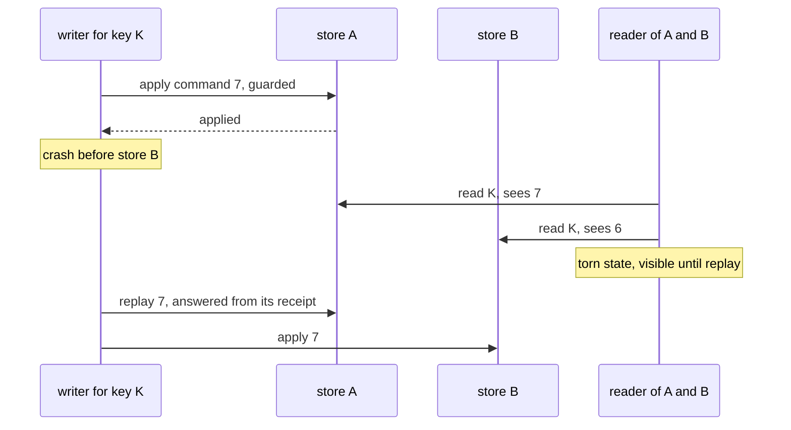
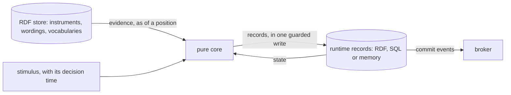
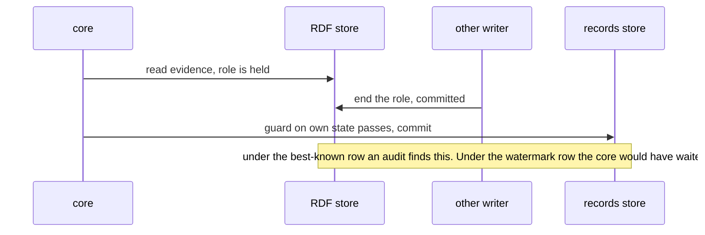
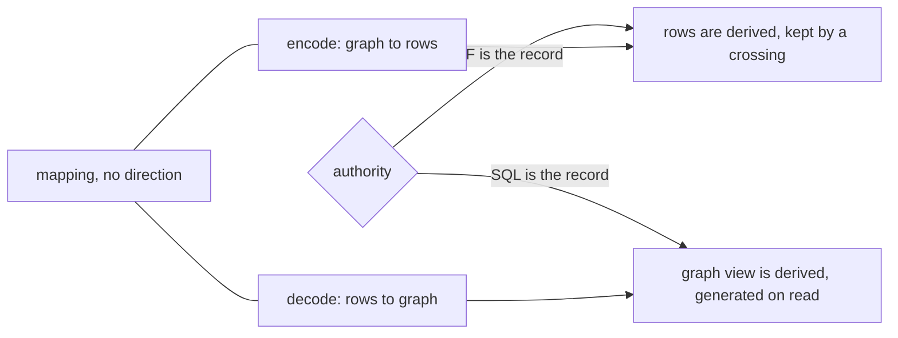
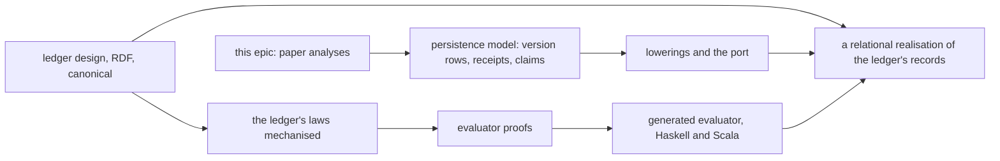
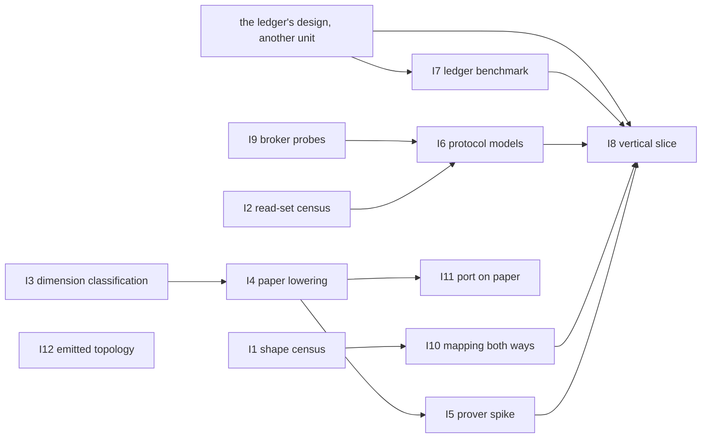

<!-- SPDX-License-Identifier: CC-BY-SA-4.0 -->

# Sketch: multi-store architecture, a store-neutral IR and the store port

**Unit:** `multi-store-architecture`, proposed as an epic. The name and the question prefix MSA are provisional until the maintainer confirms them (MSA-Q14)
**Status:** draft, 2026-11-12, for the maintainer's review. §3 records what the maintainer decided on that day. Every position in §4 is a leaning, ratified by the maintainer as their own leaning on 2026-11-12, and none is a decision. The sketch's job is to try to disprove each one and to name the work that would settle it. Revised the same day after the maintainer's review of the placement and of the oracle, which changed §4.2, §4.3, §4.5 and §4.6 and added §4.14 and §4.15
**Order of concern:** correctness, then performance, then ease of use. Impact on the existing code is weighed last, since the change is known to be large
**Reads on:** [multi-store-runtime.md](multi-store-runtime.md), [ledger-folds-and-stores.md](ledger-folds-and-stores.md), [sparql-ir.md](sparql-ir.md), [formal-methods-track-h-protocols.md](formal-methods-track-h-protocols.md), [projections-maintained-in-the-write.md](projections-maintained-in-the-write.md), [persistence-client-sdk.md](persistence-client-sdk.md), the notes [lattice-sql.md](../notes/rdf-engine/lattice-sql.md), [sql-feedback.md](../notes/rdf-engine/sql-feedback.md), [lpg-backend-options.md](../notes/lpg-backend-options.md), [distirbuted-queries.md](../notes/rdf-engine/distirbuted-queries.md), [compiled-persistence-profiles.md](../notes/rdf-engine/compiled-persistence-profiles.md), [persistence-fml.md](../notes/rdf-engine/persistence-fml.md) and [workload-modelling.md](../notes/rdf-engine/workload-modelling.md), and [ADR-A48](../../architecture/decisions/ADR-A48-transaction-boundary-catalogue.md), [ADR-A74](../../architecture/decisions/ADR-A74-graph-primary-realm-model.md), [ADR-A75](../../architecture/decisions/ADR-A75-three-tier-store-spi.md), [ADR-A123](../../architecture/decisions/ADR-A123-typed-operation-ir.md), [ADR-A16](../../architecture/decisions/ADR-A16-surface-projection-mechanism.md) and the patterns guide, Chapter 25
**Placement:** open. Platform, tooling and substrate configuration, nothing domain-specific

## 1. Premise

A deployment is made of units that are released apart, and each unit holds the store it uses. One family of data may stay in an RDF store while another, linked to it, is held in a relational store or a property graph. For example, a loan agreement and its wording stay in RDF, and the facility's account and its state machine are held in PostgreSQL. LATTICE has to say, as configuration, where each family lives, what crosses between them and with what guarantee, and it has to generate what each store runs.

The RDF realisation stays the default. The ledger continues to be built on RDF, and a relational realisation of it is an option a deployment may choose. So nothing in this sketch may weaken the RDF path, and the RDF realisation is the first thing every other realisation is compared with.

## 2. The scene

Each fact was checked against the source on 2026-11-12.

| Fact | Source |
|---|---|
| A generated operation is a typed value in a SPARQL-shaped IR, and its contract over logical resources is derived from that value by walking its patterns and mapping each graph role to a resource | `tools/persistence/src/persistence/contract.py`, `contract_of` and `resource_of` |
| An operation is selected by a builder id that carries its logical kind together with variants only SPARQL has, such as `-rows`, `-patch-log` and `-dataset-guard` | `operations.py`, `select_operations` |
| The capability record has six fields. The patterns guide's record has about twenty-five, and neither describes a transport | `capability.py`, guide §25.2 |
| The store port has one read method, `ScopedDataset.read(GraphReference)`. `platform/graph-spi` does not exist. The studio's writer runs the generated operations through Jena directly | `platform/semantic-dataset-spi`, `platform/config-studio-core` |
| The studio serialises every write of a workspace through one partition of a RabbitMQ super stream, applied by a single active consumer in batches of one request | `StreamWriter.java`, `Topology.java` |
| The studio's broker topology is written by hand three times | `contracts/config-studio/amqp-topology.json`, `Topology.java`, `workers/src/lattice_workers/config-studio-topology.json` |
| The outbox has an in-memory implementation only | `platform/platform-outbox` |
| The JDBC ledgers and the workers' PostgreSQL stores are authored and referenced by nothing that runs | `platform/surface-workflow`, `platform/release-integration`, `workers/sql` |
| The protocol models of Track H, FMH-5 onward, are planned in outline and none is built | [formal-methods-track-h status](../status/formal-methods-track-h.md) |
| The ledger's aggregate read is flat at 0.34 to 0.54 ms over a hundredfold history on Oxigraph with period graphs, and the shape holds on Jena TDB2 | [multi-store-runtime.md](multi-store-runtime.md) §1, CAP-84, CAP-85 |
| A capped restoration and an allocation by seniority are linear folds in SQL and quadratic self-joins in SPARQL 1.1 | [ledger-folds-and-stores.md](ledger-folds-and-stores.md) §5 |

The picture shows the fault this sketch starts from. The logical contract is an output of the SPARQL realisation, so a second realisation has nothing to be lowered from.

## 3. Decided on 2026-11-12

These are the maintainer's decisions. The texts they change are listed in §8 and are amended with the plan, never by this sketch.

| # | Decision | Changes |
|---|---|---|
| D1 | The compiler emits declarations that a provisioner applies, and applies nothing itself | restates MS-Q5 of the multi-store runtime sketch, whose option (b) was refused on 2026-10-27 |
| D2 | A derived tier may live in a store other than the RDF store | reverses PM-Q5 of the projection maintenance sketch |
| D3 | The store port's Core tier is restated as a logical port, with SPARQL 1.1 and the Graph Store Protocol as one realisation of it | ADR-A75, PRI-51, LPG-Q4 |
| D4 | No consensus protocol is designed or built. §4.13 records what would reopen it | none |
| D5 | The epic adopts FMH-5 of Track H, the capability record extension, the toolchain spike and protocol models A to D | Track H plan §5, ADR-A-FM4 decision 1 |
| D6 | ADR-A48's catalogue is kept and extended, never replaced by a CAP dial | ADR-A48 |
| D7 | The model's proofs are built with no abandonment condition, and their cost is examined afterwards | §4.6, MSA-I5 |
| D8 | The exported interpreter stays plain and is used as generated, and the two Isabelle developments share one prelude | §4.14, §4.15 |

## 4. The leanings, each with the case against it

The target in one picture, then each leaning in turn. Each subsection states the leaning, argues against it, and names what would settle it. The investigations are defined once, in §6.

### 4.1 An aggregate never spans stores

**Leaning.** An aggregate is the unit of placement. Every interaction between stores is between aggregates, and each such crossing is declared.

**Why it is plausible.** ADR-A13's addendum makes the partitioned unit an aggregate root so that whole-graph replace keeps its meaning. ADR-A122 gives a class one owner. A ledger account is an aggregate of its own, owned by a persistent identity (ADR-A131 decision 5), and Behaviour's state belongs to the persistent identity (ADR-A106 decision 5).

**The case against.**

- **A reference across stores cannot be enforced.** An account in SQL names an identity in RDF. Nothing stops the identity being tombstoned or erased while the account stands. Erasure of a subject then has to reach both stores, which is a saga with a reaper and never one delete.
- **Colocation becomes the easy answer to every hard crossing.** Two aggregates in one store can share a transaction, so each crossing that proves awkward is an argument to move the other family too. The design can drift until runtime state is all in SQL and RDF holds configuration only. That may be a sound deployment. It should be chosen and never arrived at by accident.
- **Derived records read across aggregates.** An occasion's state is derived from records (law B1 of ADR-A106) and records its read set. Where those records sit in two stores the derivation is a cross-store read, and its read set names resources in both.

**What would disprove it.** A correctness-path operation in the existing examples that needs one atomic change to two families which a deployment would reasonably place apart, with no declared crossing that preserves its law. MSA-I2 looks for one.

### 4.2 The catalogue, extended to six rows and declared per crossing

**Leaning.** Each crossing names one mechanism and the least guarantee it accepts. The compiler checks the declaration against the capability record of each store and of the transport.

| Mechanism | Guarantee claimed | Under a partition between the units |
|---|---|---|
| single-store transaction | atomic, isolated to the store's level | unaffected |
| outbox | the change and its message commit together, applied at least once downstream | the writer continues, the consumer lags |
| named saga | each step durable, with a compensation, a detector and a reaper | continues, intermediate states visible |
| one serialised writer per key | every write of a key applied in one order, each at most once in effect | that key's writes stall, other keys continue |
| read as of a stated position, gated on the source's watermark | the evidence is exactly what the source held at that position | the evaluation waits for the watermark |
| read of the best known, with the read set and its positions recorded | the decision is defensible as of what was read, and an audit finds a read that was superseded before the commit | the evaluation continues |

The last two rows are the choice between consistency and availability, made for each read of evidence. They rest on what the model already has. Time is an input (PRI-56), a guard receives its decision time as a stimulus (ADR-A67), and evidence such as a role occupancy is a temporally scoped version (ADR-A106 decision 7). A read of a pinned version is the first of the two with nothing to wait for, since a version cannot change.

**The case against.**

- **The serialised writer row was overstated when first proposed.** One writer applying to two stores gives order and idempotence. It gives no atomic visibility. A crash between the two applies leaves the first store ahead, and a reader of both sees a torn state until the replay. The row is therefore ordered and eventually applied, and a read that must be correct either reads one store or waits on a watermark, as PM-Q6 has a reader do.

- **A single active consumer is a liveness device and never a safety one.** During a broker partition two members may both believe they hold a partition for a time. Safety has to come from the guard in each store, the version row or a fencing token (`pat:fence`), which is what the studio relies on today. A store with no such guard cannot take this row.
- **Guarantees are properties of an operation and pairs do not compose.** ADR-A48 catalogues operations, each touching named stores. A declaration per pair of families says nothing about an operation that touches three. The declared unit is more likely the multi-aggregate operation, with the pair as a default it inherits (MSA-Q2).
- **A read as of a position needs positions that compare across stores.** Each store orders its own writes. "What the source held at the decision time" needs the source's watermark to have passed that time, which is the dataset tier of the patterns guide with its late-arrival hazard. A source with no watermark can serve only the best-known row.
- **The best-known row moves a correctness question to an audit.** A decision taken on evidence that had already changed is found later and has to be answered by the domain, as a correction or a new act. Whether that is acceptable belongs to the deployment and never to LATTICE, so the row must be chosen by name and never be a default.
- **A saga needs a compensation the domain accepts.** A ledger has one, since a credit reverses a debit. A recorded act often has none, and PDD-14 already found that reversing a settled draw is unworkable. The saga row will be refused for many crossings, which narrows the real choice to the other four.

**What would settle it.** MSA-I6 models each row with a crash, a partition and a reader, and states each guarantee as the property the model checks. MSA-I9 probes what the broker gives.

### 4.3 Evaluation in a pure core, with the stores holding records

**Leaning, revised.** A guard is evaluated in a pure core and never in a store. The core takes state, a stimulus and evidence, and yields decisions, effects and postings. A store persists the runtime records through generated operations, and atomicity comes from the guard on the write, as option B of the ledger folds sketch §6 has it. Where a deployment splits its stores, versioned meaning stays in RDF and mutable runtime records may be held elsewhere, in a relational store or in memory.

The first draft of this section assumed a guard runs where the state is stored. That made Behaviour in SQL wait for an SQL backend of Eligibility. With the core outside the store it does not wait, and evaluation inside a store becomes an optional derived engine.

**An in-memory realisation.** Behaviour's runtime may be held in memory, following the runtime document in structure and shaped for its language. The default is that the core is a pure function between a read and a guarded write, which raises no new consistency question. A deployment's shell may instead hold the state, which is the serialised-writer row with a log as the record. We expect to build reference implementations of that state management, as examples and as a baseline that later implementations are tested against.

**The case against.**

- **Evidence in another store can change between the read and the commit.** The core's guard on its own write does not cover it. §4.2's last two rows are the answer, and the first of them needs a watermark the source may not have.

- **Reads then writes cost round trips.** In-store evaluation is one request. A core outside reads state and evidence, then writes. The ledger folds sketch estimates two round trips a pass with balance records, against one a draw in the store, and holds that as a hypothesis.
- **The performance case for a relational store is unmeasured.** The workload note finds throughput is no risk in the cases it sized, and the RDF ledger's read is already flat. What SQL would buy is ordered folds, native uniqueness and row locks.
- **Records with legal weight leave the graph.** Postings and occupancies are derived artefacts with read sets and evidence links (ADR-A92). Outside RDF those links are fields that name RDF nodes, and a reader of the record needs both stores or the generated view.
- **This depends on work other units own.** The core is the subject of the `evaluator-implementation` plan, and its laws wait on a concrete ledger design. §4.14 sets out the order.

**What would settle it.** MSA-I2 says which guards read evidence outside their own aggregate and whether that evidence is versioned. MSA-I7 measures the ledger's records on PostgreSQL against the RDF arms, with the core outside the store in both.

### 4.4 Records held in SQL are never stored as triples, and MS-Q7 narrows

**Leaning.** Under a placement that puts a family in SQL, the rows are the record. Each record keeps the IRI its minting recipe gives it, and an RDF reading is generated on demand. MS-Q7 becomes the rule that a derived copy of mutable state is never on the correctness path, and a copy of a pinned version may be.

**The case against.**

- **A graph reference's hash has to agree across realisations.** ADR-A30's contract carries a revision hash. `"1.0"` and `"1.00"` are different terms in RDF and one value in a `numeric` column. Either both realisations write canonical lexical forms or the hash is defined over values. LF-Q4's rule that an amount is held at its unit's scale helps for money and settles nothing for other literals.
- **Shapes no longer run where the data is.** The ledger's conservation shapes validate an RDF graph. In SQL each becomes a `CHECK`, a deferred trigger or a run over the generated view. The law to hold is that the store accepts a state exactly when the shapes conform, in both directions, and a deferred trigger is unsound under concurrency unless every child write serialises on the root.
- **Pinned is narrower than it sounds.** A concept scheme's membership resolved at a time is deterministic. Its governance state is mutable. A copy of vocabulary in SQL for foreign keys is therefore partly pinned and partly a copy of mutable state, which the narrowed rule forbids on the correctness path.
- **Direct SPARQL over the family is lost.** Eligibility's and Behaviour's direct SPARQL profiles (ADR-A15) cannot run in the store against rows. They run over a snapshot or through a virtual view, and a view is read-only.

**What would settle it.** MSA-I1 measures how much of the shapes estate is closed and bounded, which the round trip depends on. MSA-I8 checks hash agreement and constraint preservation on one family.

### 4.5 Mapping, authority and crossing are three declarations, and the mapping reads both ways

**Leaning.** A mapping says how a shape-closed aggregate is laid out in a store and has no direction. An authority declaration says which side is the record (ADR-A74). A crossing declaration says how the other side is kept. RDF as authority with SQL derived is a Surface target in another store. SQL as authority with RDF derived is a persistence realisation with a view. The synchronisation contract that ADR-A16 names is the crossing declaration. Placement and authority belong in Persistence, and the mapping in a module that SQL and GQL share.

**Targets are open, and a target is more than a layout.** Tables and labels are two targets. A language is another, and its idiom may carry more than structure. For example an Erlang realisation of a state space may be a state machine behaviour, a Prolog or Datalog one a set of clause heads, and a Haskell one may derive part of the mapping from its own types. So a target is a lowering of a configuration and its runtime document in that target's idiom, of which a structural mapping is one kind. What holds them together is the shared conformance corpus (ADR-A15) and the model of §4.6, never a common structure.

**The case against.**

- **The round trip holds only for conforming, covered graphs.** `sh:closed` restricts focus nodes. A triple about a node no shape targets validates and has nowhere to go. The mapping needs a coverage condition, and nobody has measured how much of LATTICE's shapes meet it.
- **Encoding is not injective for several types.** `timestamptz` drops the offset, a discrete range is canonicalised, an empty range loses its bounds, and `P1M` equals `P30D` as an interval. Each needs a rule or a refusal, and each is a place the two directions disagree.
- **R2RML cannot say everything the decode needs.** It has no list constructor and one constant language tag per map. The decode is more likely RML or a generated codec.
- **Most Surface contracts do not invert.** A promotion along a path is many to one, and a lossy one by declaration. Only a derived family's own shape maps both ways. So "the reverse of Surface" is the mapping of a family whose authority is elsewhere, and a promotion stays one-directional.
- **Reading the configuration both ways is the easy half.** Changing a family's authority while both stores are live is a cutover with a window in which two records exist. That procedure is where a write is lost or applied twice.

**What would settle it.** MSA-I10 writes one ledger family and one promotion's derived family in one mapping vocabulary. MSA-I1 gives the coverage figure. The cutover is model X4 of MSA-I6.

### 4.6 A neutral IR defined in Isabelle, lowered to SPARQL, SQL and GQL

**Leaning, revised.** The state model and the neutral IR are defined in Isabelle. The IR is a datatype of guarded commands over logical resources, with one `exec` function over it. Laws are proved about `exec`, for example one receipt for each target, epoch and sequence, a resend that changes nothing, and outcomes that are total and disjoint. The interpreter is exported and executes the same IR values the lowerings consume. It is the oracle, and it is also an in-memory realisation of the port. SPARQL, SQL and GQL are lowerings, each with its own dialect IR, printer and type rules. Eligibility conditions, ledger folds and read paths have small IRs of their own. Arbitrary SHACL-SPARQL is refused or ported by hand.

This does not clash with the formal-methods work. The laws are those FMH-6 outlines for `Positions.thy`, `Encoding.thy` and `Outcomes.thy`, and the ledger's theories under `tools/proofs/ledger` are the precedent. Concurrency stays with the protocol models, since `exec` is one atomic step.

**Options considered.**

| Option | Shape | Operations written | Where a misreading hides |
|---|---|---|---|
| (a) neutral IR with three lowerings | about 27 logical operations, lowered per dialect | 27 once, then a lowering per dialect | in the model's definitions, which the proved laws constrain |
| (b) independent builders per dialect over the resolved profile | the relational note's design, with its own logical IR | 52 SPARQL builders today, about as many again per dialect | in each dialect alone, found by comparison |
| (c) translate the SPARQL text at run time | a facade | none | in a translator as large as a query engine, and writes meet the view-update problem |

**What a proved model covers.**

| | Covered | Not covered |
|---|---|---|
| the model keeps its stated laws | proved | that the laws are the right ones. A wrong specification still proves |
| the exported code matches the model | trusted, since Isabelle's code generator is unverified | Rocq has a verified extraction path |
| a lowering agrees with the model | tested, by reading each store's state back into the model after every operation | the function that reads it back, unless the mapping's decode generates it |
| concurrency | nothing | the protocol models |

**The provers.** Isabelle is the canonical home (ADR-A-FM1), exporting Scala for the oracle, which runs in the JVM beside the Jena test kit. Rocq returns as a second formalisation of the same operations, extracted to OCaml through its verified path, so that two models written apart are compared by running both. The machinery is in the tree from the prover comparison, `spikes/formal-prover/rocq` with the `bootstrap:formal-images` and `bootstrap:formal-native-rocq` tasks. Whether Rocq stays after the spike is MSA-Q16.

**One state model, declared once.** Isabelle and the protocol models both need the state. The leaning is to declare its closed datatypes once in the literate source, as `Kernel.thy` is generated today, and to generate the Isabelle records and the model checker's type declarations from that. Only the types are generated. The transitions are written by hand in each, since one is an atomic step and the other interleaves steps under an isolation level. They are held together by trace validation, in which each committed operation in a model checker's trace is replayed through the exported `exec` and must give the same state.

**The case against (a).**

- **It may turn out thin.** What makes the SPARQL realisation hard, the guard's own group, the sweep along the owned path, rows against templates, lives in the lowering. If every interesting rule stays there, the neutral IR buys a contract, a proved model and an in-memory realisation, and little of the lowering's difficulty.
- **It was designed with one realisation in hand.** The paper check of FMH-2.6 found five places where the contract is silent for SQL, among them the transaction claim's table, the retention mark and the tombstone.
- **Every change to the IR is a change to a theory.** That friction is right for a published contract and slows a design that is still moving, so the IR should be mechanised only after MSA-I4 has settled its shape on paper.
- **Two provers can become two sources.** A second formalisation helps only while it is written apart and compared. Kept as a parallel source of truth it is one more thing to drift.
- **The regression surface is large.** The conformance run has about 4,700 tests on three engines and a golden text per builder. The SPARQL text must not change when its builders move under the IR.
- **GQL is a third target with no stated need.** LPG-Q1 is unanswered, ISO GQL support is uneven, and exact decimals are doubtful on at least one major store. The door should stay open and nothing should be built.

**The proofs are built, and their cost is examined afterwards.** Decided by the maintainer on 2026-11-12. The spike has no abandonment condition and no fallback to a hand-written interpreter. It runs with a large budget, Isabelle's memory is already limited by configuration, and a cloud agent takes a build the laptop cannot. A theory is expected to change rarely once the IR reaches a stable major release, so the cost of repairing one is recorded and never used as a gate. One acceptance criterion remains. The exported interpreter is used as it comes, with no hand edit, and replays the existing behaviour tests' histories within ten times the time the RDF realisation takes on Oxigraph. MSA-I5 reports what was spent on each law, on the export and on the second prover, and that report informs how the remaining operations are planned.

**What would settle it.** MSA-I4 lowers four operations on paper to all three dialects and fails if the IR needs a construct only one dialect has. MSA-I5 mechanises those four. The switch itself is a strangler, with the contract derived both ways and held equal until the old derivation is removed.

### 4.7 Operation selection in two stages

**Leaning.** Semantic selection reads the resolved profile and yields logical operations. Realisation selection reads the dialect and the capability record and yields a form of each. An operation has a logical id, and a builder is named by logical id, dialect and form.

**The case against.** The line between the two is not fixed across dialects. `dal:firstWrite` decides whether a create can suffer write skew on a SPARQL store, and collapses in SQL where an insert with a conflict clause is atomic. The meta topology is a layout choice that changes the guarantee on a store whose conflict detection is coarser than a statement. So a dimension is semantic where any dialect's guarantee depends on it, and its effect is stated per dialect. The design standard gives the test, which is that a distinction earns its place only where some query or check answers differently because of it.

**What would settle it.** MSA-I3 classifies every dimension against every dialect.

### 4.8 The port over an executor

**Leaning.** The Core tier is a logical port, defined as a contract under `contracts/` with conformance by vectors and the conformance kit. An executor that runs generated statements is the adapter's internal seam.

**The case against.**

- **The guide's port is RDF-shaped.** Its `CasCommand` carries triples to delete and insert. A relational adapter given triples has to decode them into rows on every write, which is the mapping at run time. The port is more likely "execute this logical operation with these parameters and this payload", which is the generated ingress of the client SDK sketch.
- **Vectors cannot test concurrency.** Conformance by vectors suits digests and checks. Isolation needs a live store, so the conformance kit remains the larger half.
- **The transaction boundary differs.** A SPARQL operation is one request. An SQL operation is several statements in one transaction, with a row lock taken first. The port has to own the boundary, and outcome classification differs, a documented conflict state against a confirmation read.
- **Ports multiply.** Java and Python today, each against every store.

**What would settle it.** MSA-I11 writes the port and moves the studio's operations onto it on paper. MSA-I7 measures what a payload decode costs per write.

### 4.9 The outbox lives in the store, receipts are the RDF outbox, and log-first needs none

**Leaning.** The outbox row commits with the state change. In SQL it is a table. In RDF the receipts and patch log already written in the same request serve. Where a command goes to a stream first and one writer applies it, no outbox is needed.

**The case against.**

- **Receipts as an outbox need a patch log and a global read.** A receipt without a delta tells a consumer that something changed and nothing about what. A relay that reads every stream's receipts needs the dataset tier, with the late-arrival hazard the patterns guide records for an unbounded read. TDB2 has no change feed of its own.
- **Log-first makes the broker part of the record for a time.** A command is durable only in the stream until it is applied. The studio keeps a week or a gibibyte. Retention, backup and replay of the stream become correctness concerns.
- **Log-first bounds a key's throughput by one writer.** On TDB2 a commit costs more than the operations in it (TSD-44), which batching answers. The bound on another store is unmeasured.

**What would settle it.** MSA-I9 probes the stream's deduplication and failover. Model X3 of MSA-I6 checks a relay that reads receipts.

### 4.10 Emitted declarations

**Decided as D1.** What remains open is what is emitted and how its limit is held.

**The case against the scope.** A relational schema is part of the realisation and has to be emitted. A broker topology is one file in the broker's own import format. Past those, every provisioning tool has its own format, and emitting each is how a configuration vocabulary becomes an orchestration tool, which the multi-store runtime sketch §10 warned of. The leaning is one neutral deployment descriptor that names units, stores and crossings, from which an operator's own tooling is templated (MSA-Q9).

**A check this makes possible.** Architectural quanta are derived from coupling (STD-001), today from the compose files. A descriptor that names the crossings lets the quanta be derived from the declaration, and a crossing by a broker should separate two quanta where a shared store joins them. A disagreement between the two derivations is a finding.

**What would settle it.** MSA-I12 generates the studio's topology from one declaration and compares it with the three copies.

### 4.11 Audit the configuration space first

**Leaning.** The first slice classifies every dimension, extends the capability record to the full store record with three values, adds a transport record, and adds placement, authority, crossing and mapping declarations.

**The case against.** An audit with no end stalls the epic. The persistence review argues the enabling move is to hold the rules as data in one registry, from which shapes, the compiler's checks and the tables are generated. That is a larger change than an audit and may be the right one. The leaning is to time-box the audit as a paper exercise (MSA-I3) and to decide the registry on its result (MSA-Q11).

### 4.12 The RDF realisation as the oracle

**Leaning.** A relational realisation is compared with the RDF one, operation by operation.

**The case against.** Both come from one contract. The comparison finds a fault in a lowering and is blind to a fault in the contract. The two also differ by design, since a unique index prevents what four of the RDF audits only detect. So the comparison is of outcomes and logical state, never of infrastructure, and the independent oracles are the interpreter exported from the model and the protocol models.

### 4.13 What would reopen a consensus protocol

Decided as D4. Two findings would reopen it. The first is a crossing that needs atomic visibility across two stores and cannot be met by colocation. The second is a need for more than one writer of a key at once, across regions. In either case the first answer to try is a store that already provides it, never a protocol of our own.

### 4.14 The order of work across units

The evaluator's chain has an order that this epic must not disturb. A concrete ledger design in the canonical RDF realisation frees the formal work that states the model's laws. Those laws free the proofs for the evaluator. The proofs yield a generated evaluator in Haskell and Scala, with other targets undecided.

The persistence model of §4.6 is about version rows, receipts and claims. It rests on no ledger law, so it can proceed beside the ledger's design. Everything that names the ledger waits for that design, which is why MSA-I4 lowers no ledger operation and MSA-I7 and MSA-I8 follow the ledger's own slices.

**One prelude for both developments.** Agreed by the maintainer on 2026-11-12. The evaluator's theories and this model both want one prelude and one treatment of positions and amounts, and built apart they can disagree on a shared definition. They share `tools/proofs/base` and agree the shared types before either mechanises them.

### 4.15 The in-memory realisation

**Leaning.** The interpreter exported from the model is an in-memory realisation of the port. It serves as every consumer's test store and as the persistence of an in-memory Behaviour.

**The oracle stays plain.** Agreed by the maintainer on 2026-11-12. An oracle that is also used as a store acquires users, and users ask for speed and features. An oracle changed for speed is no longer the plain reading of the model, and this epic builds no in-memory database. The exported code is used as generated, and a fast in-memory store, should one be wanted, is a separate realisation tested against it.

## 5. Space and time

Figures marked measured are from the benchmarks cited in §2. The rest are judgements from the notes, to be replaced by MSA-I7.

| Cost | RDF realisation | Relational realisation | Basis |
|---|---|---|---|
| a guarded write changing n facts | about 20 + 3n quad operations | one row update, n row changes, a receipt row and a claim row | judgement, compiled-profiles note §9.6 and the review of the relational note §8.1 |
| an aggregate balance read | 0.34 to 0.54 ms, flat in the history | unmeasured | measured on Oxigraph, CAP-84 |
| a capped restoration over k postings | k squared pattern matches | k rows through a window | by the algebra, ledger-folds §5 |
| a guard's read of a pinned version in another store | none | one round trip, of the order of 2 ms in one data centre, or none where copied | judgement, distributed-queries note §6.2 |
| a write through a serialised writer | one broker hop and a share of a batched commit | the same | TSD-44 for TDB2, unmeasured elsewhere |
| a payload decoded from canonical triples to rows | none | linear in the payload, per write | unmeasured, MSA-I7 |
| storage per record of k attributes | k triples with their indexes | one row | judgement |

## 6. Investigations

Nothing is built until the paper analyses have had their chance to falsify a leaning cheaply. Estimates are in tokens.

| ID | Kind | What it does | Tests | Falsified when | Estimate |
|---|---|---|---|---|---|
| MSA-I1 | script | a census of every shapes graph: closed shapes, bounded counts, path kinds, logical constraints, targets, and the share of a sample graph's subjects that a closed shape covers | §4.4, §4.5 | the share that maps is too small to be worth a mapping, at a threshold agreed first | 60k |
| MSA-I2 | paper | for every guard and effect in the Behaviour, Ledger and Eligibility examples, what it reads, in which aggregate, and whether that is pinned or mutable | §4.1, §4.3, §4.4 | a common guard reads mutable state that a natural placement would put in another store | 80k |
| MSA-I3 | paper | every dimension against SPARQL, SQL and GQL: semantic, a layout choice, a parameter or without meaning, with the capability fields each depends on | §4.7, §4.11 | no stable classification exists, so two-stage selection has no line to draw | 100k |
| MSA-I4 | paper | four operations lowered to the neutral IR and from it to all three dialects: a create, a delta replace under a patch log, an event append and a key claim write. No ledger operation, which waits for the ledger's design (§4.14) | §4.6 | the IR needs a construct only one dialect has, or a resource has no relational counterpart | 150k |
| MSA-I5 | prover spike | the state model and those four operations in Isabelle with their laws, the interpreter exported to Scala and run against the existing behaviour tests' histories, and the same four in Rocq extracted to OCaml and compared by running both. It reports its costs afterwards and has no abandonment condition (§4.6) | §4.6, §4.12, §4.15 | the exported interpreter needs a hand edit, is slower than §4.6's criterion allows, or cannot reproduce the RDF realisation's outcomes without SPARQL-specific state | 450k, an estimate and no limit |
| MSA-I6 | models | the toolchain spike and model A of FMH-5, then four new models: X1 a two-store serialised apply with a crash and a reader, X2 a core reading evidence across stores under each of §4.2's last two rows, X3 a relay reading receipts, X4 a change of authority while live. Each grounded by isolation probes on PostgreSQL and Fuseki, and held to the Isabelle model by trace validation | §4.2, §4.3, §4.5, §4.9 | a row of the catalogue cannot state a guarantee the model keeps | 400k |
| MSA-I7 | benchmark | the ledger's arms of ledger-folds §9 with a PostgreSQL arm on the same corpus, every constraint and receipt enabled, the core outside the store in every arm, plus the payload decode per write. Reads the ledger unit's benchmarks of read cost on every backend first, which are built and not yet merged, and follows the ledger's design | §4.3, §4.8 | PostgreSQL shows no gain on the ordered folds, or the decode dominates a write | 250k |
| MSA-I8 | proof of concept | once the ledger's design allows, one ledger family held in PostgreSQL behind the port, with its instrument pinned in RDF, compared with the RDF ledger, and checked for round trip, hash agreement and constraint preservation on mutated graphs | all of §4 | any law fails with no rule or refusal that restores it | 500k |
| MSA-I9 | probes | the super stream under failover and partition: whether two consumers are ever active, publisher deduplication, offset tracking after a crash | §4.2, §4.9 | the transport gives less than the serialised-writer row assumes | 80k |
| MSA-I10 | paper | one ledger family and one promotion's derived family written in one mapping vocabulary, each read in both directions, with what R2RML and RML can and cannot say | §4.5 | the two need different vocabularies | 100k |
| MSA-I11 | paper | the logical port written out, with the studio's create, replace and tombstone moved onto it and the outcome classification of each store set side by side | §4.8 | the studio needs something the port cannot say | 80k |
| MSA-I12 | proof of concept | the studio's broker topology generated from one declaration and compared with the three hand copies, and quanta derived from the declaration compared with those derived from compose | §4.10 | the declaration cannot express the topology the studio runs | 80k |

Six of the twelve are paper or script and cost about 570k tokens together. They can refute the neutral IR, the mapping, the placement and the selection split before any code or theory is written.

## 7. Questions

Each leaning below was ratified by the maintainer as their own leaning on 2026-11-12. None is answered.

| ID | Question | Options | Leaning | Settled by |
|---|---|---|---|---|
| **MSA-Q1** | Is the aggregate the unit of placement, with no aggregate spanning stores? | (a) yes. (b) an aggregate may span stores under a declared crossing | (a) | MSA-I2 |
| **MSA-Q2** | What is the declared unit of a crossing? | (a) a pair of families. (b) a multi-aggregate operation. (c) the operation, with the pair as its default | (c), since guarantees belong to operations and pairs do not compose | MSA-I6 |
| **MSA-Q3** | Which mechanisms may a crossing name? | (a) ADR-A48's three. (b) those and the serialised writer and the two reads of evidence, each with the guarantee its model keeps | (b), with the serialised writer stated as ordered and eventually applied, and the read of evidence as two rows, as of a position or best known | MSA-I6, MSA-I9 |
| **MSA-Q4** | How does MS-Q7 read once a family's authority may be a relational store? | (a) unchanged. (b) a derived copy of mutable state is never on the correctness path, and a copy of a pinned version may be. (c) reversed | (b) | MSA-I2 |
| **MSA-Q5** | Where do placement, authority, crossing and mapping live? | (a) all in `dal:`. (b) placement, authority and crossing in `dal:`, the mapping in a new module shared by SQL and GQL. (c) outside the ontology | (b), which needs a decision record for the module | MSA-I10 |
| **MSA-Q6** | Is the published contract a neutral IR from which every dialect is lowered? | (a) yes. (b) independent builders per dialect. (c) a run-time translation of SPARQL | (a), defined in Isabelle, with the exported interpreter as the oracle | MSA-I4, MSA-I5 |
| **MSA-Q7** | Is GQL built? | (a) designed for and not built until LPG-Q1 names a need. (b) built beside SQL | (a) | MSA-I4 |
| **MSA-Q8** | What is the Core tier's port? | (a) the guide's `compareAndSet` over triples. (b) execute a logical operation, with a statement executor beneath as the adapter's seam | (b) | MSA-I11 |
| **MSA-Q9** | What does the compiler emit for provisioning? | (a) the schema and broker topology only. (b) those and one neutral deployment descriptor. (c) a format per provisioning tool | (b) | MSA-I12 |
| **MSA-Q10** | Where is a guard evaluated? | (a) in a pure core outside every store, with in-store evaluation an optional derived engine. (b) in the store that holds the state | (a), which frees Behaviour from waiting on an SQL backend of Eligibility | MSA-I2, MSA-I7 |
| **MSA-Q11** | Does the audit of the configuration space become a registry of rules held as data? | (a) an audit on paper, the registry decided on its result. (b) the registry now | (a) | MSA-I3 |
| **MSA-Q12** | How does a graph reference's hash agree across realisations? | (a) canonical lexical forms written by every realisation. (b) a hash over values. (c) a hash per realisation, named in the reference | (a) | MSA-I8 |
| **MSA-Q13** | What does this epic take from other units? | FMH-5 (decided, D5). The ledger's LF-Q5 and LF-Q7 with its investigation slice. The part of FMH-6 that states the laws of positions, encodings and outcomes. PDD-06, as the SPARQL dialect IR beneath the neutral one. BL-06, the client SDK, as the port's ingress. BL-01 where a setting names a store. The core's interface from `evaluator-implementation`, in the order of §4.14 | take each as listed, agreed with its owning unit | the plan |
| **MSA-Q15** | Does the in-memory realisation hold state? | (a) the core is a pure function between a read and a guarded write, and holding state is a deployment's shell. (b) LATTICE specifies a state-holding runtime | (a) as the default, with reference implementations of state management built as examples and as a baseline to test against | MSA-I6 |
| **MSA-Q16** | Which prover holds the model, and what is exported? | (a) Isabelle alone, exporting Scala. (b) Isabelle as the canonical model exporting Scala, with Rocq as a second formalisation extracted to OCaml and compared by running both. (c) Rocq alone | (b) for the spike, and whether Rocq stays is decided on its result | MSA-I5 |
| **MSA-Q17** | How do the Isabelle model and the protocol models keep one state model? | (a) the closed datatypes declared once in the literate source and generated into both, with transitions written in each and held together by trace validation. (b) each written by hand. (c) the protocol models generated from Isabelle | (a) | MSA-I5, MSA-I6 |
| **MSA-Q18** | What is a mapping target? | (a) a structural layout only, tables, labels or records. (b) a lowering in the target's own idiom, of which a layout is one kind | (b), so a language target is not narrowed to records | MSA-I10 |
| **MSA-Q14** | What are the unit's name and slice prefix? | `multi-store-architecture` and MSA, or the maintainer's choice | none | the maintainer |

## 8. What this changes elsewhere

| Text | Effect |
|---|---|
| ADR-A75 and PRI-51 | the Core tier restated as the logical port (D3). Both are Proposed |
| ADR-A48 | two rows added and the catalogue made a declaration (D6). Proposed |
| ADR-A74 | its consequence that LATTICE provides no mapping for a non-default authority is reversed by MSA-Q5 |
| ADR-A30 | "RDF remains semantic source of truth" narrows to meaning, since records may be held elsewhere. Accepted, so by addendum |
| ADR-A16 and the Surface README §4 | the synchronisation contract they name gains a definition, the crossing declaration |
| ADR-A-FM4 decision 1 | relational work was out of Track H's scope. This epic owns it, and adopts FMH-5 (D5) and the laws of FMH-6 that §4.6 names |
| PRI-47 and PDD-19 | an interpreter exported from a proof and used as a test oracle and a test store is within PRI-47 as it stands. Its use as a deployment's in-memory store waits on PDD-19 |
| `evaluator-implementation` plan | the pure core and its codec are its subject. This epic takes the interface and follows the order of §4.14 |
| `spikes/formal-prover/rocq` and its mise tasks | brought back into use by MSA-I5 |
| ADR-A79 decision 6 and ADR-A123 decision 4 | the store port and a contract that is the source of every lowering, where today it is derived from one |
| `AGENTS.md`, the platform guardrails | the lines for PRI-51 and PRI-52 still speak of the RDF store and of rebuilding from the graph |
| multi-store runtime sketch | MS-Q5 restated (D1), MS-Q7 narrowed if MSA-Q4 is answered (b) |
| projection maintenance sketch and plan | PM-Q5 reversed (D2) |
| the LPG and relational notes | LPG-Q2, LPG-Q3, LPG-Q4 and RS-D4, RS-D5 are taken up by MSA-Q5 to MSA-Q8 |
| `tools/persistence` | selection splits in two, the contract becomes an input, and the builders become the SPARQL lowering |
| `platform/semantic-dataset-spi` | grows into, or is replaced by, the port |

## 9. Not in this sketch

A unified SPARQL view over several stores, which the distributed-queries note treats and which a read-only virtual layer can serve later. A custom engine. Federation across tenants. Any domain's worked example beyond the ledger and a state machine.
