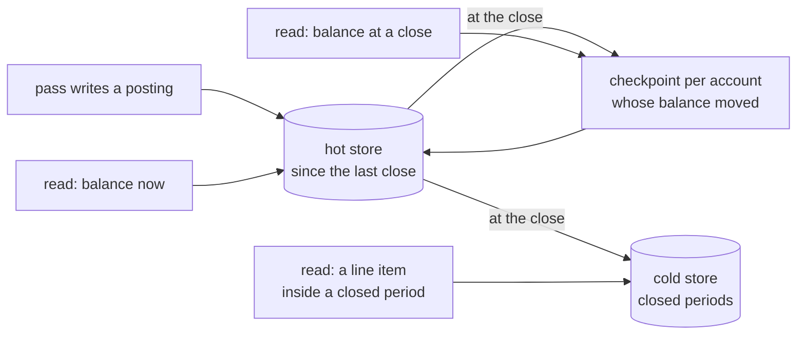
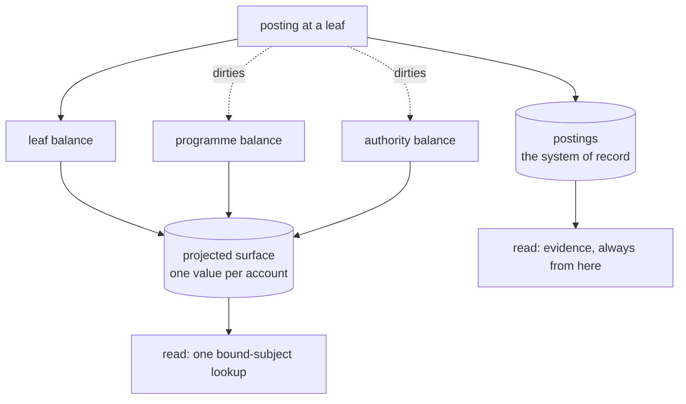
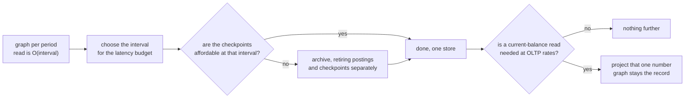

<!-- SPDX-License-Identifier: CC-BY-SA-4.0 -->

# Sketch: boundaries in the runtime, archiving and projection

**Unit:** `ledger`, reaching into `persistence` and `surface`
**Status:** exploratory, 2026-10-24. Nothing here is decided.
**Reads on:** [ledger-history-and-runtime.md](ledger-history-and-runtime.md) §5.2 and §6, [ledger-folds-and-stores.md](ledger-folds-and-stores.md) §6 and §7, the [Persistence README](../../../ontology/persistence/README.md) §5.6, the [Surface README](../../../ontology/surface/README.md) §11 and §12
**Measured on:** `benchmark/ledger-posting-cost`, run of 2026-10-24, Oxigraph 0.5.13, depth 3, 20,000 events

## 1. Premise

[ledger-history-and-runtime.md](ledger-history-and-runtime.md) §5.2 claims that closing a period bounds the cost of reading an aggregate's balance. The benchmark measured that claim and found it true of the arithmetic and false of the time. A checkpoint cuts the postings an authority read folds from 3,604 to 42 and the fold stops growing with the history, while the time falls only from 46.8 ms to 33.4 ms. The position bound in the fold is a `FILTER`, so the engine visits every posting in the subtree before discarding nearly all of them. The arithmetic was bounded and the scan was not.

That result opens a question wider than the ledger. A read whose cost is set by the volume of data the engine must *visit*, rather than by the volume it must *use*, has three remedies. The data it must not visit can be in a graph the query does not name, or in a store the query does not reach, or the answer can be computed already. This sketch takes all three, against the backdrop that nothing in LATTICE says a deployment has one store.

**The first remedy has now been measured and it works.** A fifth benchmark strategy puts each period's postings in a named graph per programme and per closing period, so "the postings since the last checkpoint" is a graph selection rather than a filtered scan. The authority read becomes flat in the history.

| Authority read, measured 2026-10-24 | 1,000 events | 5,000 | 20,000 |
|---|---|---|---|
| post-once, filtered scan | 2.70 ms | 11.36 ms | 46.79 ms |
| post-once-checkpointed, filtered scan | 2.20 ms | 8.55 ms | 33.41 ms |
| post-once-period-graphs | **0.44 ms** | **0.39 ms** | **0.51 ms** |

The postings folded are identical to the checkpointed strategy's at every account and every read point, and the stored triples are identical too, at 178,254 at 20,000 events. The whole gain is in postings the engine no longer visits. A by-hand probe at 100,000 events read an authority in 1.5 ms against 213 ms checkpointed.

This reorders the sketch's conclusion, and §10 states the new leaning. The graph boundary costs nothing in transactional guarantees and removes the read's dependence on the history, so archiving and projection are no longer needed to bound the *read*. They are still needed, for other costs, which §5 and §6 quantify.

Two things are deliberately out of scope. Federated query, where one query plan spans stores it does not control, is a hard problem and nothing here depends on solving it. The analytic question, reading across a whole book, is treated in §8 only to say why it is not the driver.

## 2. What LATTICE already has

The design skill asks for the constraining facts, checked against the sources. These were read for this sketch.

**Persistence already addresses the boundary, partly.** §5.6's dimensions include an aggregate boundary whose default is one named graph per aggregate root (`dal:NamedGraphBoundary`, with `dal:graphIriTemplate`), a scope that selects by graph prefix (`dal:GraphPatternScope`, `dal:graphPrefix`), a resource role for the IRI that says **where a graph is stored** (`dal:GraphLocatorRole`, documented as deployment-local), a meta topology with shard counts, a retention stance on receipts (`dal:PrefixOnlyRetention`, `dal:BucketAnyRetention`, `dal:asOfFloorSource`), an epoch bumped on restore or migration, and an erasure strategy that can drop a per-subject graph.

So the vocabulary for *naming* a graph and for saying where it lives exists. What does not exist is any statement that a read may need more than one store, which store answers which read, or how an answer that crosses a boundary is composed. `dal:GraphLocatorRole` names the locator without saying what reads it.

**Surface already addresses projection, and already constrains it.** §1 declares three operations, promotion, indexing and projection, and projection lowers into a MORK mapping graph rather than emitting directly. §11 decides staleness by read-set hashes, with no change classification needed, and gives an impact table for how much to recompute. §12 states two consequences that bear directly on option 3 and are quoted here because they decide it.

> A conformant surface does not raise the conformance level of the graph it indexes.

> A surface is never the evidence for an admissibility decision or an execution record. Those cite declarations.

A projected aggregate balance can therefore make a limit check fast. It can never be the number shown to a regulator, which must be read from the postings. That is already settled, and it means a projection is an addition to the ledger read path and never a replacement for it.

**Quantification already models the closing interval.** `qnt:Recurrence`, `qnt:RecurrenceBin` and `qnt:AnchorBinding` carry a per-account closing recurrence, as §5.2 of the history sketch uses.

**The store's behaviour on graph selection is already recorded.** [TSD-04](../../architecture/triple-store-discovery.md) observes that a `GRAPH ?g` inside an inner group, with `?g` bound outside it, passes the binding in and reads one graph, on both rdflib and Oxigraph. A graph named by the caller is a seek rather than a scan. That is the finding the graph-partitioned fold rests on, and §1's measurement is it holding at the scale that matters. The graph-selection result is itself a store finding and should be added to the discovery record, as §12 notes.

## 3. Four boundaries, not one

"Split the store" conflates four separable decisions. Each bounds a different cost and each charges a different price.

```mermaid
flowchart LR
    subgraph G["1. graph, one dataset"]
        GA["graph per partition<br/>per closing period"]
        GB["graph per aggregate root"]
    end
    subgraph D["2. store, one deployment"]
        DA["hot: since the last close"]
        DB["cold: archived periods"]
    end
    subgraph S["3. service, one process"]
        SA["earlier phase"]
        SB["later phase"]
    end
    subgraph E["4. estate, another technology"]
        EA["analytic store"]
        EB["event feed"]
    end

    G -->|"keeps every guarantee<br/>bounds the scan"| D
    D -->|"loses the transaction<br/>bounds the working set"| S
    S -->|"adds a call<br/>bounds contention"| E
```

| Boundary | What it bounds | What a read across it costs | Transaction scope | Declared today |
|---|---|---|---|---|
| **graph**, one dataset | what the engine visits for one read | nothing, one query names several graphs | unchanged, one store's guarantees hold | `dal:NamedGraphBoundary`, `dal:graphIriTemplate` |
| **store**, one deployment | the size of the working set, and so index depth and cache behaviour | a second query and a join outside the store | lost, no update spans both | `dal:GraphLocatorRole` names where, nothing says who reads it |
| **service**, one process | write contention, and the blast radius of a failure | a call, with its latency and its failure modes | lost, and now a distributed-failure question | nothing |
| **estate**, another technology | the cost of a question the graph answers badly | a transform, and a staleness window | lost, and the model differs on both sides | `dal:DerivedFeed` as an ordering tier only |

The boundaries are ordered by what they cost to cross, and each one should be reached for only when the cheaper one above it does not bound the cost in question. The graph boundary is nearly free and keeps every guarantee. The estate boundary costs a second model of the data and buys a question the graph cannot answer at all.

**This ordering is the main claim of the sketch.** §5.2 of the history sketch reached for the store boundary, by archiving, when the graph boundary may bound the same scan. The benchmark is measuring that now.

## 4. Where a boundary may be drawn

A boundary is safe when no query that must be correct crosses it. That is the whole test, and it makes the choice of axis a question about the queries rather than about the data.

| Axis | Bounds | Breaks | Safe because |
|---|---|---|---|
| **period** | the scan for any read of recent state | an as-of read inside a closed period, and any read spanning a close | a closing is already a boundary in the domain, and a closed period is immutable |
| **aggregate root** | contention, and the blast radius of a write | a read over several roots | the aggregate is already the unit of consistency (Persistence §5.6.1) |
| **tenant** | the working set, and contention, almost completely | a read across tenants, which should not exist | correctness never crosses it, and privacy says it should not |
| **lifecycle phase** | the working set of each phase | a read that spans phases, such as a claim citing the terms as placed | the phases run at different times, with different write rates, on data that is immutable once the earlier phase closes |
| **line of business or segment** | the working set | an aggregate over the whole book | a business categorisation, so it tracks how the work is actually organised |

The period axis is the one §5.2 already needs, and it is the only one of the five that is forced by the runtime rather than offered by the domain. The other four are available to an adopter and none of them is LATTICE's to decide, which is the framework rule. What LATTICE owes an adopter is the vocabulary to say which axis they chose and the generated reads that respect it.

The lifecycle-phase row carries one trap worth naming. A later phase reading an earlier phase's output is a read across the boundary, and it is a read that must be correct. It is safe only because the earlier phase's data is immutable by then, so the later phase can hold its own copy or read a cold store without a consistency question. If the earlier data can still change, the boundary is unsafe and the axis is wrong.

## 5. Option 2, archive

### 5.1 What it is

At each close, the account's balance is checkpointed and the detail before the close moves out of the hot store. A balance read becomes the last checkpoint plus a fold over the postings since, and the hot store holds only the current period.

Three reads, three costs. The first is bounded by the closing interval. The second is one lookup, provided old checkpoints stay in the hot store. The third is the expensive one, and it is the regulator's read.

### 5.2 Quantified

Every figure below rests on two measured constants and arithmetic. The run of 2026-10-24 read an authority in 46.8 ms over a subtree of about 10,000 postings under the filtered scan, which is **4.6 µs per posting the engine visits**, and its period-graph fold took about 0.3 ms over an interval's share of about 250 postings, which is **of the order of 2 µs per posting in the interval**. The scenario is the one the history sketch sets, depth 3 and 10 million events a year, with an authority covering half the stream.

| Closing interval | Postings in the interval, authority share | Authority read, period graphs | Authority read, filtered scan | Checkpoint triples a year, 100,000 accounts | Against 80M posting triples a year |
|---|---|---|---|---|---|
| hourly | 571 | 1.1 ms | 23 s | 3,500M | 44× |
| daily | 13,699 | 27 ms | 23 s | 146M | 1.8× |
| weekly | 95,890 | 0.19 s | 23 s | 20.8M | 0.26× |
| monthly | 416,667 | 0.83 s | 23 s | 4.8M | 0.06× |
| none, a year's history | 5,000,000 | 10 s | 23 s | 0 | — |

The two read columns are the measured constants times the postings. The scan column does not move with the interval, which is the measured finding of §1 restated as arithmetic. The checkpoint column is accounts times closes times 4 triples, which the benchmark's finding 6 establishes as a cost of accounts and closes rather than of events.

**The read frontier is gone and the storage frontier remains.** Under the filtered scan there was no closing interval that gave both an interactive read and affordable checkpoints. Under period graphs the read responds to the interval, so a daily close reads in tens of milliseconds. What has not moved is the storage column. Daily closing on a wide tree still costs nearly twice in checkpoints what the postings cost, and the checkpoints accumulate where the postings do not, because every close adds a set and none is retired.

So archiving changes role. It is no longer how the read is bounded, which the graph boundary now does. It is how the hot store is stopped from growing, and that is a storage argument which the graph boundary does not touch at all.

Two refinements, and neither changes the storage picture's shape.

- **A checkpoint only where the balance moved.** An untouched account's previous checkpoint still stands. With 27,400 events a day over a tree of 100,000 leaves, 10,000 programmes and 100 authorities, the accounts touched in a day are at most 27,400 leaves plus their ancestors, about 37,500 of 110,100. Daily checkpointing falls from 146M to **54.8M triples a year**, a third. This is a correction to §5.2 of the history sketch, which writes a checkpoint for every account at every close.
- **Retire old checkpoints too.** The checkpoint cost accumulates because every close's checkpoints are kept. If old checkpoints leave the hot store on their own schedule, the hot store stops growing. That is a second retention policy, on a second kind of record, and it is the piece neither sketch has.

**The conclusion this forces.** Archiving the postings alone does not bound the hot store, because the checkpoints then dominate. The archive boundary has to retire two kinds of record on two schedules, and the as-of read determines how coarse the surviving checkpoints may be.

**The checkpoint lookup is the next floor, and it has the same cause.** Timing the period-graph read's two steps apart shows the fold flat at about 0.3 ms from 1,000 to 100,000 events, while the lookup that finds the latest checkpoint at or before the point grows from 0.05 ms to 0.74 ms over the same range. The lookup is an `ORDER BY DESC(?pos) LIMIT 1` under a `FILTER`, so it is the same filtered scan one level up, over checkpoints rather than postings. It grows with the number of closes and so with time. Retiring old checkpoints fixes it for the same reason it fixes the storage, and putting checkpoints in a graph per period would fix it the way §1 fixed the fold. Neither was measured. This is MS-Q8.

### 5.3 The regulator's read

A regulator asking for a balance at a past close is answered by a surviving checkpoint, which is one lookup. A regulator asking how that balance was reached, or for a balance at a moment inside a closed period, needs the detail.

| Question | Answered from | Cost |
|---|---|---|
| the balance at a past close | a surviving checkpoint | one lookup |
| the balance at a moment inside a closed period | the period's archive, restored and folded | a restore, then the interval's fold |
| the line items behind a balance | the period's archive | a restore, then a scan |
| that the archive is the record that was written | a digest recorded at the close, checked on restore | one comparison |

A restore has to land somewhere that cannot be mistaken for the record, which is the epoch question Persistence §5.6.8 already answers for restores generally. The epoch is bumped on restore, so a position minted before cannot be confused with one minted after. Whether that mechanism serves a *partial* restore of one archived period into a scratch dataset, rather than a whole-dataset restore, is open and is MS-Q4.

The fourth row matters more than it looks. An archive that cannot be shown to be what was written is worse than no archive, because it invites the argument that the record was changed. A digest per archived period, recorded in the hot store at the close, costs a handful of triples and settles it. Persistence already has `dal:digestScheme` for identity, and whether the same declaration serves an archive digest is open.

### 5.4 Consequences

| | Assessment |
|---|---|
| **design overheads** | the model does not change, which is the point. Two retention policies, a restore path and an archive digest are new mechanisms, each with domain meaning, so none of them stratifies the T-Box |
| **runtime overheads** | the hot store stops growing, which is the only mechanism here that does. The restore path is slow and rare, and it is on the regulator's read rather than on the operational one |
| **space** | hot store becomes O(touched accounts × checkpoints retained + postings since the close) rather than O(every posting ever written) |
| **time** | little, now that the graph boundary bounds the read. Archiving removes the checkpoint lookup's growth, which is 0.74 ms at 200 closes and rising, and it keeps the index shallow. The regulator's read gains a restore, from seconds to minutes |
| **throughput** | unchanged by archiving itself. The close is a write burst over the touched accounts, which is a new contention point at a predictable moment |
| **what it does not fix** | a current-balance read at OLTP rates. 27 ms at a daily close is not a limit check at thousands a second |

## 6. Option 3, project the rollup

### 6.1 What it is

The current balance of every account is stored as one value, maintained as postings arrive, and read by a bound-subject lookup. Surface's promotion is the mechanism, and §11's read-set hashes decide when the value is stale.

The read is as cheap as a read gets. The dotted edges are the cost, and they are the thing §5.1 of the history sketch deliberately removed.

### 6.2 Quantified

| Quantity | Value | Basis |
|---|---|---|
| storage | 110,100 accounts × about 6 triples, **660,600 triples**, constant | one value, an as-of position, a pass and a hash per account |
| read | one bound-subject lookup | efficient-queries R8, so it does not grow with the history |
| invalidation writes a year | 10M events × *d* = **30M** | every draw dirties the drawn account and each ancestor |
| contention | 30M writes over 110,100 rows, concentrated on 100 authority rows | the skew is the problem, not the total |
| staleness | one read-set entry per account, rehashed on every descendant write | Surface §11 |

**The write hotspot returns, and it returns exactly where it was removed.** §5.1 of the history sketch found that posting once and deriving the rollup means an authority aggregate drawn by a thousand contracts is never written by a draw. A projected rollup writes it on every draw. At 10 million events a year over 100 authority rows, that is of the order of 100,000 writes a year on each, each one a read-modify-write on a contended row. The maintainer's objection is correct and this is its size.

The invalidation can be made asynchronous, which moves the contention off the write path and converts it into a staleness window. That is a real option and it is not free. A limit check against a stale balance can admit a draw that the postings say exceeds availability, which is a correctness failure in the one place the ledger exists to prevent one. So the staleness window has to be bounded by something, and what bounds it is the question.

### 6.3 Consequences

| | Assessment |
|---|---|
| **design overheads** | two models of the same quantity, with a staleness rule between them. Surface §12 already forbids the projection from being evidence, so the rule is stated rather than invented. The risk is that a reader forgets which one they hold |
| **runtime overheads** | the read is O(1) and the write is contended. Asynchronous invalidation trades the contention for a staleness window that a limit check cannot simply ignore |
| **space** | constant in the number of accounts, nothing in the history |
| **time** | the read is one lookup at any history size, which is the only option here that achieves that |
| **throughput** | worse than the derived rollup, by the hotspot above, unless invalidation is asynchronous |
| **what it does not fix** | any as-of read. A projection holds current state and answers nothing about a past position |

### 6.4 Why it is a fallback rather than a first move

Not because it is wrong. Because its cost lands on throughput, which §5.1 bought at some trouble, and because what it buys, an O(1) current-balance read, is needed by one access pattern rather than by the general read. The history sketch §6 already carves that pattern out and sends it to a projected cache, with the graph remaining the record. That carve-out stands and nothing here changes it.

The question this sketch opened was whether the general ancestor read would stay in the seconds, because then the projection stops being a cache for one pattern and becomes the read path, and the ledger has two models of itself. That is the split §6 of the history sketch said it wanted to avoid, and it is now the less likely outcome. The measured read is sub-millisecond at 20,000 events and 1.5 ms at 100,000, so the general read is served. What remains for the projection is the OLTP pattern alone, which is where it was already placed.

## 7. The options compose

The maintainer's observation is that these are not alternatives. With the graph result measured, the composition sharpens into something better than a decision procedure. **Each mechanism now addresses one cost, and they do not trade against each other.**

| Cost | Bounded by | Measured |
|---|---|---|
| read latency | the graph boundary, then the closing interval | yes, flat at 0.4 to 0.5 ms, and O(interval) by arithmetic |
| hot store size | the archive, retiring postings and checkpoints on their own schedules | partly, the storage arithmetic holds and the retirement is unbuilt |
| write contention | posting once and deriving the rollup, which the history sketch §5.1 already decided | yes, as a storage factor of *d*, and the hotspot result is structural |

The closing interval is the one dial two of the three rows share, and they pull it in opposite directions. A short interval gives a fast read and expensive checkpoints. The archive is what breaks that tie, because retiring old checkpoints removes the only reason a short interval is expensive. So the three mechanisms compose in a chain rather than competing.

Each gate is a measurement rather than a judgement, which is why the benchmark matters more than this sketch does. The first is now measured, the second is arithmetic from a measured constant, and the third is an access-pattern question the history sketch §6 already answers.

The composition also answers the maintainer's framing directly. The size of the largest composite being evaluated over does select the mechanism, and it selects it through the closing interval, which Quantification already models per account. A heavily drawn aggregate closes often and reads a small interval. A quiet one closes rarely and reads a larger one just as fast, because its interval holds fewer postings anyway. The selection is therefore per account and needs no system-wide choice, which is the result worth having.

## 8. The analytic question is not the driver

A read over a whole book, across tenants and across years, is a reporting question. It has a different latency budget, a different consistency requirement and often a different owner. Designing the operational store so that such a read is fast makes every operational read slower, by keeping data in one place that has no operational reason to be there.

The estate boundary of §3 is where this belongs. The options are an extract on a schedule, a feed consumed by whatever the adopter already runs, or a long-term analytic store in another technology. Persistence names `dal:DerivedFeed` as an ordering tier, which is the nearest existing hook, and it is about positions rather than about transport.

Two things follow and neither needs deciding now.

- An adopter may refuse all of these and require the data pushed to a platform they already operate. LATTICE's answer to that is the same as its answer to everything else about deployment, which is that it configures rather than decides.
- Whatever the transport, the operational model does not change for it. If it does, the analytic requirement has leaked into the operational design, which is the failure this section exists to name.

## 9. What Persistence would have to grow

This is the speculative part of the sketch and it is marked as such. The vocabulary below does not exist and should not be written until the measurements say which boundary is needed.

| What is missing | Nearest existing term | Why it is not enough |
|---|---|---|
| which store answers which read | `dal:GraphLocatorRole` | it names the IRI of a locator and says nothing about who reads it or how a read picks one |
| how a read that crosses a boundary is composed | nothing | §3's table says a cross-store read costs a second query and an outside join. Nothing declares that |
| retention for two kinds of record on two schedules | `dal:PrefixOnlyRetention`, `dal:BucketAnyRetention` on `dal:ReceiptProfile` | receipts are one kind of record. §5.2 needs postings and checkpoints retired independently |
| an archive digest, and the restore of one period | `dal:digestScheme`, `dal:EpochProfile` | both exist for other purposes. Whether they serve a partial restore is MS-Q4 |
| the period in a graph template | `dal:graphIriTemplate` | the template exists. Whether a period is a legitimate template variable, and where the period comes from, is MS-Q2 |

**The further step, and the reason to be careful about it.** Once Persistence records where a graph lives, which store answers which read and what transport reaches it, that record is close to a description of a deployment. Generating deployment control artefacts from it is a real possibility and it is also how a configuration vocabulary turns into an orchestration tool it was not designed to be. The test to apply is the one Persistence already passes. It records an adopter's choices so a compiler can turn them into portable SPARQL, and it decides nothing. A declaration that says "this graph lives in the hot store" passes that test. A declaration that says how to provision the hot store does not, and belongs to whatever tool the adopter provisions with.

That is a judgement rather than a finding, and it is MS-Q5.

## 10. Leaning

**Take the boundaries in §3's order. The first one is now measured and it is enough for the read.**

1. **The graph boundary, adopted.** A graph per account partition per closing period, which costs nothing in transactional guarantees, stores not one triple more, and makes the ancestor read flat in the history. TSD-04 predicted the seek and the benchmark measured it. This is the result that rescues §5.2 of the history sketch, and it rescues it without a second store, which is what the maintainer asked for.
2. **The archive, still needed, for storage rather than for speed.** It is the only mechanism that stops the hot store growing, and §5.2's storage column shows checkpoints outgrowing postings at any interval short enough to matter. The correction in §5.2 above is needed either way, since checkpointing every account at every close costs three times what checkpointing the touched ones costs. Nothing here is urgent, because the read no longer waits on it.
3. **The projection last and narrowly**, for the OLTP current-balance pattern §6 of the history sketch already carves out, with the graph remaining the record as Surface §12 requires. Widening it to the general ancestor read is the split we were trying to avoid, and the measurement makes that widening unnecessary.

**On the question the maintainer asked.** The options compose, in the chain of §7 rather than as a choice, and each one bounds a different cost. The fallback is real, it is third, and §6.2 gives the size of what it costs. The stratification to a second T-Box is not needed for the general read, which strengthens §6 of the history sketch rather than overturning it.

**Two caveats, both unmeasured.** The number of graphs grows as partitions times periods, and the benchmark reached only 400 graphs. A store that degrades on tens of thousands of graphs would change this leaning, and that is MS-Q9. The checkpoint lookup is now the growing term, at 0.74 ms over 200 closes, and it has the same cause and the same two possible fixes (MS-Q8). Neither caveat touches the fold itself, which is flat.

## 11. Questions

| ID | Question | Options | Leaning | Needed by |
|---|---|---|---|---|
| **MS-Q1** | Does the graph boundary bound the ancestor read on a real engine? | (a) yes, periods in named graphs, no second store. (b) no, the scan floor survives and §5.2 needs the store boundary | **answered (a)** on Oxigraph, 2026-10-24. Flat at 0.4 to 0.5 ms over a 20× growth in history, same fold, same stored triples. Not yet checked on another engine | answered |
| **MS-Q2** | Is the closing period a variable in a graph IRI template? | (a) yes, `dal:graphIriTemplate` gains a period variable bound from the account's recurrence. (b) no, the period is a separate dimension. (c) no, graphs are per aggregate root only and the period is a filter | (a), now that MS-Q1 is (a). The template already exists and the recurrence already does | persistence, before LG-2 |
| **MS-Q3** | Are postings and checkpoints retired on separate schedules? | (a) yes, two retention declarations. (b) one schedule for both. (c) checkpoints are never retired | (a). §5.2's table shows checkpoints dominating the hot store at any interval short enough for an interactive read | persistence |
| **MS-Q4** | How is one archived period restored for an as-of read? | (a) a partial restore into a scratch dataset, under a bumped epoch. (b) a whole-dataset restore. (c) the archive is queried in place, in whatever technology holds it | (a), but whether `dal:EpochProfile` serves a partial restore is unchecked | ledger, and a persistence addendum |
| **MS-Q5** | Does Persistence record where a graph lives and which store answers a read? | (a) yes, extending `dal:GraphLocatorRole`. (b) yes, and it also generates deployment artefacts. (c) no, this is deployment configuration and sits outside the ontology | (a). §9's test admits (a) and refuses (b) | after MS-Q1, and not before |
| **MS-Q6** | Is a checkpoint written for every account at a close, or only where the balance moved? | (a) only where it moved. (b) every account, as §5.2 of the history sketch says today | (a), which is a third of the storage and is also what a closing means | ledger, a correction to §5.2 |
| **MS-Q7** | What bounds the staleness of a projected balance used by a limit check? | (a) the check reads the postings and the projection is for display only. (b) a declared bound, with the check refusing when it is exceeded. (c) synchronous invalidation, accepting the contention | (a), since §6.2 shows a stale balance admitting a draw the postings refuse | only for the OLTP pattern, now that MS-Q1 is (a) |
| **MS-Q8** | How is the checkpoint lookup bounded, now that it is the growing term? | (a) retire old checkpoints, which MS-Q3 does anyway. (b) checkpoints in a graph per period, the same fix as the fold. (c) the latest checkpoint is promoted to the account, so the lookup is a bound-subject read | (c) is the cheapest and reads like a running balance on the account. It needs a guarded write at each close rather than an append | ledger, before LG-2 |
| **MS-Q9** | Does the engine degrade on a large number of graphs? | (a) no, and the partition can be fine. (b) yes, which caps the partition count and so the product of partitions and periods | unknown. The benchmark reached 400 graphs and a year of daily closes on a wide tree would be in the millions, so this bounds how fine the partition may be | before MS-Q2 is authored |

## 12. What this changes elsewhere

| Unit | Effect |
|---|---|
| `ledger` | §5.2 of the history sketch needs the measured time result recorded, the graph partition added as the mechanism that bounds the read, and MS-Q6's correction applied. §6's "what would overturn this" did not trigger, so its no-split judgement stands and is now measured rather than argued |
| `persistence` | MS-Q2, MS-Q3 and MS-Q5 are its questions. MS-Q2 is now unblocked, and MS-Q5 should still wait |
| `surface` | nothing. §12's two laws already decide what a projection may be, and the projection is no longer on the general read path |
| `quantification` | nothing new. The closing recurrence is already modelled, and §7 makes it the dial that selects the mechanism |
| benchmark | the fifth strategy answered MS-Q1. MS-Q8 and MS-Q9 are the next two it could answer, and an archive variant would answer MS-Q3's storage claim. Nothing measures the restore path |
| `ensemble` | nothing directly. C4 waits on LF-Q9 and LF-Q17 rather than on anything here |
| `docs/architecture/triple-store-discovery.md` | the graph-selection result is a store finding and belongs there as its own entry, alongside TSD-04 which predicted it. It is measured on Oxigraph only |
