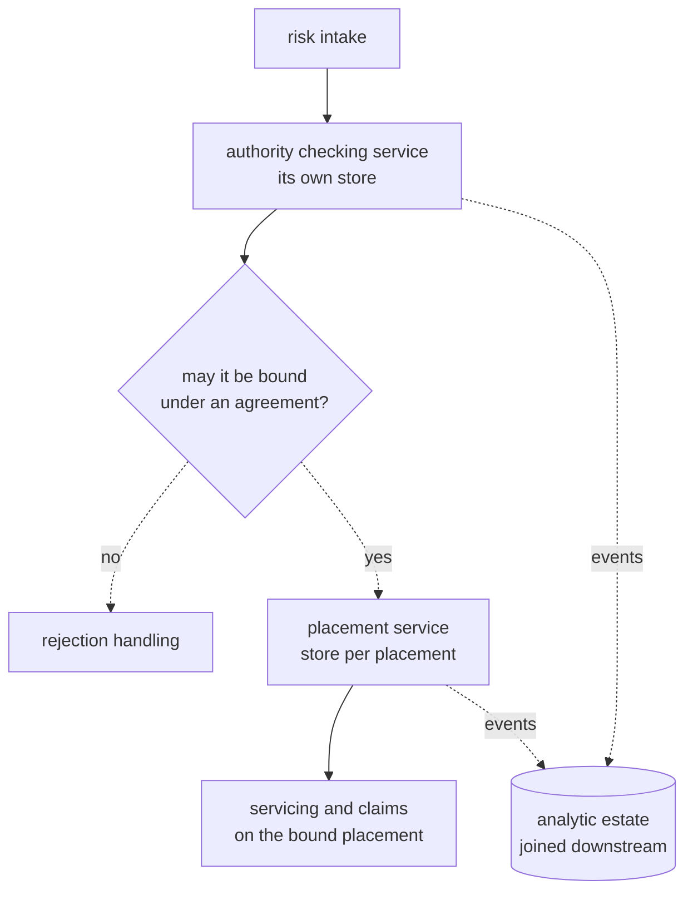
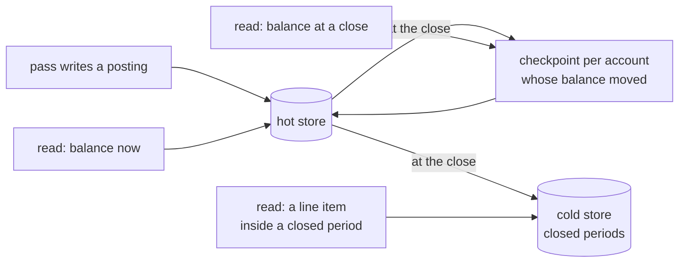
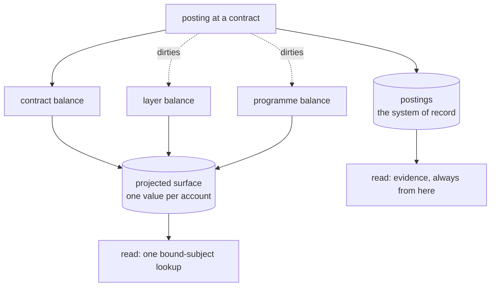
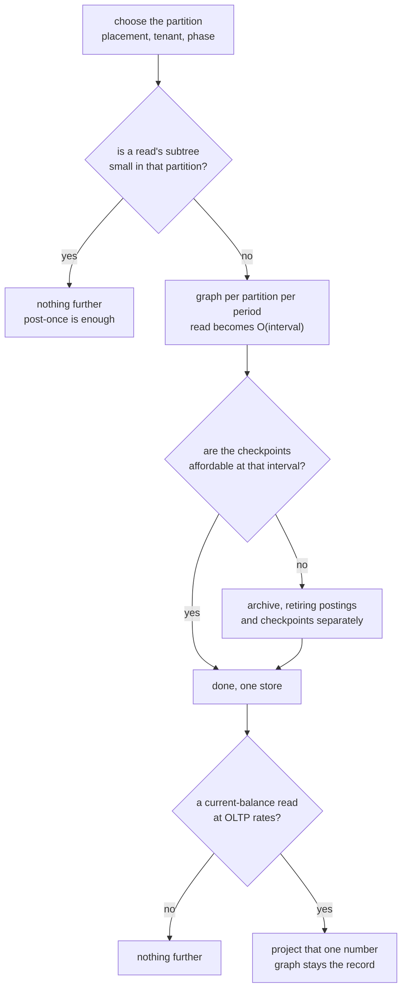

<!-- SPDX-License-Identifier: CC-BY-SA-4.0 -->

# Sketch: boundaries in the runtime, archiving and projection

**Unit:** `ledger`, reaching into `persistence` and `surface`
**Status:** exploratory, 2026-10-24. Nothing here is decided.
**Reads on:** [ledger-history-and-runtime.md](ledger-history-and-runtime.md) §5.2 and §6, [ledger-folds-and-stores.md](ledger-folds-and-stores.md) §6 and §7, the [Persistence README](../../../ontology/persistence/README.md) §5.6, the [Surface README](../../../ontology/surface/README.md) §11 and §12
**Measured on:** `benchmark/ledger-posting-cost`, runs of 2026-10-24 and 2026-10-27, Oxigraph 0.5.13 (run R-I of the discovery record), depth 3

## 1. Premise

[ledger-history-and-runtime.md](ledger-history-and-runtime.md) §5.2 claims that closing a period bounds the cost of reading an aggregate's balance. The benchmark measured that claim and found it true of the arithmetic and false of the time. A checkpoint cuts the postings a programme read folds from 3,604 to 42 and the fold stops growing with the history, while the time falls only from 43.1 ms to 32.8 ms. The position bound in the fold was a `FILTER`, so the engine visited every posting in the subtree before discarding nearly all of them. The arithmetic was bounded and the scan was not.

That result opens a question wider than the ledger. A read whose cost is set by the volume of data the engine must *visit*, rather than by the volume it must *use*, has three remedies. The data it must not visit can be in a graph the query does not name, or in a store the query does not reach, or the answer can be computed already.

**Two measurements have since removed the problem on this engine.** Putting each period's postings in a named graph keyed by layer and period makes "the postings since the last checkpoint" a graph selection rather than a filtered scan. Deriving the checkpoint's IRI from the account and the close position, rather than searching for the latest checkpoint by its properties, removes the one term that still grew.

| Programme read, run of 2026-10-24 | 1,000 events | 5,000 | 20,000 | 100,000 |
|---|---|---|---|---|
| post-once | 2.66 ms | 11.12 ms | 43.14 ms | 261.13 ms |
| post-once-checkpointed | 2.19 ms | 8.81 ms | 32.84 ms | 217.53 ms |
| post-once-period-graphs | **0.40 ms** | **0.34 ms** | **0.34 ms** | **0.54 ms** |

Flat over a hundredfold range, with the postings folded and the stored triples identical to the checkpointed strategy's at every account and read point. The whole gain is in postings the engine no longer visits. The second measurement is [TSD-36](../../architecture/triple-store-discovery.md#tsd-36-a-bound-object-does-not-give-the-seek-a-bound-subject-gives): the lookup cost 0.04 ms at 2 closes an account and 1.06 ms at 200, and naming the checkpoint directly is flat at 0.020 to 0.023 ms. Binding the position as an object rather than naming the subject gives only half the saving and still grows, which refines [efficient-queries](../../architecture/efficient-queries-and-shapes.md) R8.

**But the deeper correction is about the layout, not the mechanism.** This sketch first quantified a scenario of 10 million events a year in one account tree, and took it as the expected case. It is a worst case. In an operational system the partition is the placement, because a claim is calculated against one tower and no query that must be correct crosses two. The enterprise rate spread over some thousands of active programmes gives each one a few thousand postings a year, which post-once reads in about 9 ms with no mechanism at all.

So the mechanisms below are what a layout that cannot be partitioned cleanly would need, and **the thing that decides the runtime is the partition**. §4 is therefore the centre of the sketch and §5 and §7 are contingencies. Each remains available because an adopter may be unable to partition that way, which is the framework rule rather than a hedge.

Two things are out of scope. Federated query, where one plan spans stores it does not control, is a hard problem and nothing here depends on solving it. The analytic question is treated in §9 only to say why it is not the driver.

## 2. What LATTICE already has

The constraining facts, checked against the sources.

**Persistence already addresses the boundary, partly.** §5.6's dimensions include an aggregate boundary whose default is one named graph per aggregate root (`dal:NamedGraphBoundary`, with `dal:graphIriTemplate`), a scope that selects by graph prefix (`dal:GraphPatternScope`, `dal:graphPrefix`), a resource role for the IRI that says **where a graph is stored** (`dal:GraphLocatorRole`, documented as deployment-local), a meta topology with shard counts, a retention stance on receipts (`dal:PrefixOnlyRetention`, `dal:BucketAnyRetention`, `dal:asOfFloorSource`), an epoch bumped on restore or migration, and an erasure strategy that can drop a per-subject graph.

So the vocabulary for *naming* a graph and for saying where it lives exists. What does not exist is any statement that a read may need more than one store, which store answers which read, or how an answer that crosses a boundary is composed. `dal:GraphLocatorRole` names the locator without saying what reads it.

**Persistence also already has the identity strategy TSD-36 needs.** `dal:PositionDerivedEvent` mints an IRI from the target and the position, which is exactly what a checkpoint is once a closing recurrence fixes the positions at which checkpoints exist. Its documented hazard applies here: two writers that both believe they won mint the identical subject, so the profile requires a separate uniqueness witness (`dal:uniquenessWitnessRequired`). For a close, minting the same IRI twice is the idempotence we want, and the witness is still the thing that makes a double close detectable.

**Surface already addresses projection, and already constrains it.** §1 declares promotion, indexing and projection, and projection lowers into a MORK mapping graph rather than emitting directly. §11 decides staleness by read-set hashes, with no change classification needed. §12 states two consequences that decide §7.

> A conformant surface does not raise the conformance level of the graph it indexes.

> A surface is never the evidence for an admissibility decision or an execution record. Those cite declarations.

A projected aggregate balance can therefore make a limit check fast. It can never be the number shown to a regulator, which must be read from the postings. That is already settled, so a projection is an addition to the ledger read path and never a replacement for it.

**Quantification already models the closing interval.** `qnt:Recurrence`, `qnt:RecurrenceBin` and `qnt:AnchorBinding` carry a per-account closing recurrence, as §5.2 of the history sketch uses. That declaration does more than set a storage dial. It is what makes a checkpoint's position computable, and so what makes TSD-36's derived IRI available at all.

**The store's behaviour on graph selection was already recorded.** [TSD-04](../../architecture/triple-store-discovery.md) observes that a `GRAPH ?g` inside an inner group, with `?g` bound outside it, passes the binding in and reads one graph, on both rdflib and Oxigraph. §1's measurement is that finding holding at the scale that matters.

## 3. Four boundaries, not one

"Split the store" conflates four separable decisions. Each bounds a different cost and each charges a different price.

```mermaid
flowchart LR
    subgraph G["1. graph, one dataset"]
        GA["graph per partition<br/>per closing period"]
        GB["graph per aggregate root"]
    end
    subgraph D["2. store, one deployment"]
        DA["hot: in demand"]
        DB["cold: archived or dormant"]
    end
    subgraph S["3. service, one process"]
        SA["intake and routing"]
        SB["placement, servicing, claims"]
    end
    subgraph E["4. estate, another technology"]
        EA["analytic store"]
        EB["event feed"]
    end

    G -->|"keeps every guarantee<br/>bounds the scan"| D
    D -->|"loses the transaction<br/>bounds the working set"| S
    S -->|"adds a call<br/>bounds contention"| E
```

| Boundary | What it bounds | What a read across it costs | Transaction scope | Declared today |
|---|---|---|---|---|
| **graph**, one dataset | what the engine visits for one read | nothing, one query names several graphs | unchanged, one store's guarantees hold | `dal:NamedGraphBoundary`, `dal:graphIriTemplate` |
| **store**, one deployment | the size of the working set, and so index depth and cache behaviour | a second query and a join outside the store | lost, no update spans both | `dal:GraphLocatorRole` names where, nothing says who reads it |
| **service**, one process | write contention, and the blast radius of a failure | a call, with its latency and its failure modes | lost, and now a distributed-failure question | nothing |
| **estate**, another technology | the cost of a question the graph answers badly | a transform, and a staleness window | lost, and the model differs on both sides | `dal:DerivedFeed` as an ordering tier only |

Each should be reached for only when the cheaper one above it does not bound the cost in question. The graph boundary is nearly free and keeps every guarantee. The estate boundary costs a second model of the data and buys a question the graph cannot answer at all.

**The ladder is subordinate to §4.** It says what to reach for once the partition is fixed. It does not choose the partition, and choosing the partition well removes most of the need to climb at all.

## 4. Where the boundary goes, and who decides

A boundary is safe when no query that must be correct crosses it. That is the whole test, and it makes the choice a question about the queries rather than about the data.

| Axis | Bounds | Breaks | Safe because |
|---|---|---|---|
| **placement** | the subtree any one read folds, and the blast radius of a write | a read over several placements, which is a reporting read | a claim is calculated against one tower, so correctness never crosses it. The aggregate root is already the unit of consistency (Persistence §5.6.1) |
| **tenant** | the working set, and contention, almost completely | a read across tenants, which should not exist | correctness never crosses it, and privacy says it should not |
| **lifecycle phase** | the working set of each phase, and the write rate each sees | a later phase reading an earlier phase's output | the earlier phase's data is immutable once it closes, so the later phase reads a fixed thing |
| **period** | the scan for a read of recent state | an as-of read inside a closed period | a closing is already an act in the domain, and a closed period is immutable |
| **line of business or segment** | the working set | an aggregate over the whole book | a business categorisation, so it tracks how the work is organised |

**The placement is the primary axis** and the period is a refinement within it. Of the five, only the period is forced by the runtime. The rest are offered by the domain, and none of them is LATTICE's to choose. What LATTICE owes an adopter is the vocabulary to say which axis they chose and generated reads that respect it.

### 4.1 Processing granularity, demarcated architecturally

The axes above are data boundaries. They are chosen alongside a second question, which is where the *processing* boundary falls, and the two answers constrain each other. A worked pattern is clearer than a rule.

Checking whether a risk may be bound under a delegated-authority agreement is a question asked during routing. It is answered by a query to a service that owns that data, and the answer decides which desk the risk goes to. **It is not a join**, so the agreements and the placements need not share a store, and binding placements underneath an agreement would be the wrong shape for a broker, where operating under such an agreement is the exception rather than the rule. A market participant that does front many risks that way has the same pattern with a larger service behind it, and the analytic view of agreements against placements is built downstream where latency stops mattering.

Three properties make that boundary work, and they generalise to the other patterns.

| Property | Why it matters |
|---|---|
| the question is a query, not a join | the answer is one value, so the caller needs no access to the callee's model |
| the answer is used to route, not to compute | a stale answer delays or misroutes, and does not corrupt a balance |
| the analytic join exists, downstream | nothing is lost by separating them, because the combined view is built where it is cheap |

Two further patterns follow the same shape and both came out of this review rather than out of the model.

- **Proposed against bound.** While a tower is being structured, queries run across the permutations of layers, quotes and vehicles, to compare options and optimise the structure for the client. That work is simulation. Once every contract is bound, the permutations have no further use: they go downstream to analytics or are deleted, and the decisions taken during optimisation are already serialised downstream as events. **The volume that dominates placement is mostly not record at all**, which is a larger reduction than any mechanism in §5, and it is stronger than the droppable-graph treatment the history sketch gives speculative evaluation (LF-Q21). That question should be reopened as a lifecycle boundary rather than a graph flag.
- **Load shedding is not the store's problem.** Making sure claims are not mishandled or dropped when a catastrophe raises the arrival rate is a durability question for whatever accepts the events. Treating it as a store-contention question pushes a queue's job into the data model.

This section should graduate out of a sketch. Once the questions in §12 settle it belongs in `docs/architecture/` as durable guidance on how a deployment is demarcated, because an adopter needs it before they write a single profile.

## 5. Residency, and the three models nobody should impose

Which data is where, and when, is the axis this sketch originally got wrong by assuming one answer. There are at least three, they are all legitimate, and **the choice belongs to the adopter and their domain experts**. It is not LATTICE's, and it is not one answer for all adopters either, since two brokers may reasonably differ.

| Model | What it holds hot | Suits | Cost |
|---|---|---|---|
| **hot throughout** | everything, with closings to bound the read | a small partition, or one in constant demand | storage grows without limit unless something is retired |
| **cold by default, materialised on demand** | nothing, until an event touches the aggregate | a bound placement that sees a claim once a year | first-touch latency, and a materialisation path to keep correct |
| **threshold-driven** | an aggregate once its arrival rate crosses a declared high watermark, until it falls below a declared floor | a portfolio where demand is uneven and unpredictable | two thresholds to choose, and hysteresis to stop it thrashing |

The third is the one that fits an operational reality where demand is not known in advance, and it is the one that needs the most from the vocabulary, because the watermark and the floor are declarations rather than code. The second inverts §5.1's framing below, where the hot store is the normal state and the archive the exception. For a bound placement that is quiet for a year, holding it hot all year is the waste.

What LATTICE owes here is the declaration and the generated reads, not the policy. A design that picks one of these three and builds only it is wrong at the substrate.

### 5.1 Archive, what it is

At each close, the account's balance is checkpointed and the detail before the close moves out of the hot store. A balance read becomes the latest checkpoint plus a fold over the postings since.

Three reads, three costs. The first is bounded by the closing interval. The second is one derived-IRI lookup, provided the checkpoint it names is still in the hot store. The third is the expensive one, and it is the regulator's read.

**Closing is optional.** An account with no declared closing recurrence has no checkpoints, unbounded history and a read over its whole subtree, which is the right answer for a partition small enough that the subtree is small. Posting once and deriving the rollup is the sub-ledger and general-ledger split, and closing a period is the period close. Both are accounting mechanisms the domain already has, both are declared per account, and neither is imposed. §8 sets out how the choices compose.

### 5.2 Quantified

Two measured constants and arithmetic. At 20,000 events the run of 2026-10-24 read a programme in 43.1 ms over a subtree of about 10,000 postings, which is **4.3 µs per posting the engine visits**, and the period-graph fold took 0.34 ms over an interval's share of about 250 postings, which is **of the order of 2 µs per posting in the interval**.

**The partitioned case, which is the expected one.** Some thousands of active placements, each a programme with about 10 layers and 50 contracts, an enterprise rate of 10 million events a year spread across them.

| Quantity | Value |
|---|---|
| postings in one placement's year | about 2,000 |
| programme read over its own subtree, post-once, no close, no graph partition | **about 9 ms** |
| the same at ten times the rate | about 92 ms, and one close a year brings it back under 10 ms |
| mechanisms needed | none |

**The single-tree case, which is the worst one.** The same 10 million events in one tree, with a programme covering half the stream, which is how this sketch first stated the scenario.

| Closing interval | Postings in the interval, programme share | Period graphs | Filtered scan | Checkpoint triples a year, 100,000 accounts | Against 80M posting triples a year |
|---|---|---|---|---|---|
| hourly | 571 | 1.1 ms | 22 s | 3,500M | 44× |
| daily | 13,699 | 27 ms | 22 s | 146M | 1.8× |
| weekly | 95,890 | 0.19 s | 22 s | 20.8M | 0.26× |
| monthly | 416,667 | 0.83 s | 22 s | 4.8M | 0.06× |
| none, a year's history | 5,000,000 | 10 s | 22 s | 0 | — |

The two read columns are the measured constants times the postings. The scan column does not move with the interval, which is §1's measured finding restated as arithmetic. The checkpoint column is accounts times closes times 4 triples, which the benchmark's finding 6 establishes as a cost of accounts and closes rather than of events.

**The read frontier is gone and a storage frontier remains, in the worst case only.** Under the filtered scan no interval gave both an interactive read and affordable checkpoints. Under period graphs the read responds to the interval. The storage column has not moved: daily closing on a wide tree costs nearly twice in checkpoints what the postings cost, and checkpoints accumulate where postings do not, because every close adds a set and none is retired.

So archiving changes role twice over. It is not how the read is bounded, which the graph boundary does. And in the partitioned case it is not needed for storage either, because no single store holds the whole year. Where it is needed is a partition that cannot be made small, and there it is a storage mechanism rather than a speed one.

Two refinements to §5.2 of the history sketch, which stand either way.

- **A checkpoint only where the balance moved.** An untouched account's previous checkpoint still stands. On a tree of 100,000 contracts, 10,000 layers and 100 programmes taking 27,400 events a day, the accounts touched in a day are at most 27,400 contracts plus their ancestors, about 37,500 of 110,100. Daily checkpointing falls from 146M to **54.8M triples a year**, a third. This is MS-Q6, and it interacts with the derived IRI: skipping a close leaves no checkpoint at the computed position, so a read walks back period by period. Each step is a 0.02 ms lookup, so even ten steps are cheap, and a one-triple carry-forward at each close makes it always one step.
- **Retire old checkpoints too.** The cost accumulates because every close's checkpoints are kept. Retiring them on their own schedule is a second retention policy on a second kind of record, and it is the piece neither sketch has.

### 5.3 The regulator's read

| Question | Answered from | Cost |
|---|---|---|
| the balance at a past close | the checkpoint, by derived IRI | one lookup, flat |
| the balance at a moment inside a closed period | the period's archive, restored and folded | a restore, then the interval's fold |
| the line items behind a balance | the period's archive | a restore, then a scan |
| that the archive is the record that was written | a digest recorded at the close, checked on restore | one comparison |

A restore must land somewhere that cannot be mistaken for the record. **Answered 2026-10-27 (MS-Q4), and the epoch turns out not to be what carries it.** The restore target is a scratch dataset, and a different dataset is a different dataset, so the requirement is met structurally. Because the scratch dataset is a dataset in its own right, this is an ordinary whole-dataset restore of a small one: it takes its own epoch from the declared authority as any new dataset does, the production dataset is untouched, and no epoch is bumped on the record. `dal:EpochProfile` needs no change, so the persistence addendum this question expected is not owed.

Three things hold in the model as it stands. The restored book's quads carry positions minted under the original epoch, which is consistent, since under `dal:DatasetLevelGuard` a row keeps its older epoch until a write rebases it and a scratch dataset for an as-of read is never written to. The digest check reads the registry where the record lives, which is a query returning one value and used to decide rather than a join, so it has the property §4.1 requires of a boundary. And a read may not span the scratch dataset and the record, so the regulator's read runs wholly inside the scratch dataset. The scratch dataset's lifetime and who drops it are operational and are deliberately not modelled.

The fourth row matters more than it looks. An archive that cannot be shown to be what was written is worse than no archive, because it invites the argument that the record was changed. **Answered 2026-10-27 with no new mechanism.** [ADR-A34](../../architecture/decisions/ADR-A34-surface-graph-family-registry-and-immutable-identity.md)'s addendum of that date has a family declare where its graphs seal, and only a sealed graph may be registered. A period's book seals at its close, so the close is its registration event, and the content hash that ADR already verifies before registration is this digest. The restore path checks the registry rather than carrying a digest scheme of its own.

### 5.4 Consequences

| | Assessment |
|---|---|
| **design overheads** | the model does not change. Two retention policies, a restore path and an archive digest are new mechanisms, each with domain meaning, so none stratifies the T-Box |
| **runtime overheads** | the hot store stops growing. The restore path is slow and rare, and it falls on the regulator's read rather than the operational one |
| **space** | hot store becomes O(touched accounts × checkpoints retained + postings since the close) rather than O(every posting ever written) |
| **time** | little, now that the graph boundary bounds the read and the derived IRI bounds the lookup. Archiving keeps the index shallow |
| **throughput** | unchanged by archiving itself. The close is a write burst over the touched accounts, at a predictable moment |
| **what it does not fix** | a current-balance read at OLTP rates. 27 ms at a daily close is not a limit check at thousands a second |

## 6. The third residency model, and why it needs the vocabulary most

Threshold-driven residency deserves its own note because it is the only one of §5's three that cannot be expressed as a schedule.

An aggregate stays cold until its arrival rate crosses a declared high watermark, at which point it is materialised and stays hot until the rate falls below a declared floor. The two thresholds and the hysteresis between them are the whole policy, and they are per aggregate or per class rather than per system. What the runtime needs from the model is the declaration. What it needs from the implementation is a materialisation that produces the same answers as the cold path, which is the correctness question, and the agreement law of the ledger is what tests it.

Nothing here is designed. It is recorded because the model must not foreclose it, and a design that assumes a schedule does foreclose it.

## 7. Project the rollup

### 7.1 What it is

The current balance of every account is stored as one value, maintained as postings arrive, and read by a bound-subject lookup. Surface's promotion is the mechanism, and §11's read-set hashes decide when the value is stale.

The read is as cheap as a read gets. The dotted edges are the cost, and they are the thing §5.1 of the history sketch deliberately removed.

### 7.2 Quantified

| Quantity | Value | Basis |
|---|---|---|
| storage | 110,100 accounts × about 6 triples, **660,600 triples**, constant | one value, an as-of position, a pass and a hash per account |
| read | one bound-subject lookup, of the order of 0.02 ms | TSD-36's form C, measured on checkpoints |
| invalidation writes a year | 10M events × *d* = **30M** | every draw dirties the drawn account and each ancestor |
| contention | 30M writes over 110,100 rows, concentrated on 100 programme rows | the skew is the problem, not the total |
| staleness | one read-set entry per account, rehashed on every descendant write | Surface §11 |

**The write hotspot returns, and it returns exactly where it was removed.** §5.1 of the history sketch found that posting once and deriving the rollup means a programme aggregate drawn by a thousand contracts is never written by a draw. A projected rollup writes it on every draw. At 10 million events a year over 100 programme rows, that is of the order of 100,000 writes a year on each, each a read-modify-write on a contended row.

Asynchronous invalidation moves the contention off the write path and converts it into a staleness window. That is a real option and it is not free. A limit check against a stale balance can admit a draw the postings say exceeds availability, which is a correctness failure in the one place the ledger exists to prevent one.

### 7.3 Consequences

| | Assessment |
|---|---|
| **design overheads** | two models of the same quantity, with a staleness rule between them. Surface §12 already forbids the projection from being evidence, so the rule is stated rather than invented. The risk is that a reader forgets which one they hold |
| **runtime overheads** | the read is O(1) and the write is contended. Asynchronous invalidation trades the contention for a staleness window a limit check cannot ignore |
| **space** | constant in the number of accounts, nothing in the history |
| **time** | one lookup at any history size |
| **throughput** | worse than the derived rollup, by the hotspot above, unless invalidation is asynchronous |
| **what it does not fix** | any as-of read. A projection holds current state and answers nothing about a past position |

### 7.4 Why it stays narrow

Its cost lands on throughput, which §5.1 of the history sketch bought at some trouble, and what it buys is needed by one access pattern rather than by the general read. That sketch's §6 already carves the pattern out and sends it to a projected cache with the graph remaining the record. That carve-out stands.

The question this sketch opened was whether the general ancestor read would stay in the seconds, because then the projection becomes the read path and the ledger has two models of itself. The measurements answer no twice over, by the graph partition and by the partition of the data itself. What remains for the projection is the OLTP pattern alone.

## 8. How the choices compose

**Each mechanism addresses one cost, and they do not trade against each other.**

| Cost | Bounded by | Measured |
|---|---|---|
| read latency | the partition first, then the graph boundary, then the closing interval | yes, flat at 0.34 to 0.54 ms, and O(interval) by arithmetic |
| the lookup for a checkpoint | a derived IRI, since the recurrence fixes the position | yes, flat at 0.02 ms against 1.06 ms at 200 closes |
| hot store size | the partition, the residency model, and the archive where a partition cannot be small | partly, the storage arithmetic holds and the retirement is unbuilt |
| write contention | posting once and deriving the rollup, which the history sketch §5.1 decided | yes, as a storage factor of *d*, and the hotspot result is structural |

Each gate is a measurement rather than a judgement. The first is the layout question of §4, the second and third are measured, and the last is an access-pattern question the history sketch §6 answers.

**Every gate is a declaration, not a build-time choice.** Posting once, the closing recurrence, the graph partition, the residency model and the projection are five separate declarations, each defaulting to the simplest behaviour and each available per account or per class. An adopter who declares none of them gets post-once with unbounded history in one store, which is correct and is the right answer for a small partition. That is what makes this configuration rather than architecture, and it is the answer to whether sub-ledgers and closings are optional. They are.

## 9. The analytic question is not the driver

A read over a whole book, across tenants and across years, is a reporting question. It has a different latency budget, a different consistency requirement and often a different owner. Designing the operational store so that such a read is fast makes every operational read slower, by keeping data in one place that has no operational reason to be there.

The estate boundary of §3 is where this belongs. The options are an extract on a schedule, a feed consumed by whatever the adopter already runs, or a long-term analytic store in another technology. Persistence names `dal:DerivedFeed` as an ordering tier, which is the nearest existing hook, and it is about positions rather than transport.

Two things follow and neither needs deciding now.

- An adopter may refuse all of these and require the data pushed to a platform they already operate. LATTICE configures rather than decides.
- Whatever the transport, the operational model does not change for it. If it does, the analytic requirement has leaked into the operational design, which is the failure this section exists to name.

## 10. What Persistence would have to grow

Speculative, and marked as such. None of this should be written until §12 settles.

| What is missing | Nearest existing term | Why it is not enough |
|---|---|---|
| which store answers which read | `dal:GraphLocatorRole` | it names a locator's IRI and says nothing about who reads it or how a read picks one |
| how a read that crosses a boundary is composed | nothing | §3's table says a cross-store read costs a second query and an outside join. Nothing declares that |
| retention for two kinds of record on two schedules | `dal:PrefixOnlyRetention`, `dal:BucketAnyRetention` on `dal:ReceiptProfile` | receipts are one kind of record. §5.2 needs postings and checkpoints retired independently |
| a residency model, and thresholds for the third one | nothing | §5's three models are a declaration LATTICE does not have. The watermark and floor of §6 are values an adopter sets |
| the restore of one period | `dal:EpochProfile` | the epoch covers a whole-dataset restore. Whether it serves a partial one is MS-Q4. The archive digest is no longer missing, since ADR-A34's registry supplies it |
| the period in a graph template | `dal:graphIriTemplate` | the template exists. Whether a period is a legitimate template variable is MS-Q2 |

**The further step, and the reason to be careful about it.** Once Persistence records where a graph lives, which store answers which read and what transport reaches it, that record is close to a description of a deployment. Generating deployment control artefacts from it is a real possibility, and it is also how a configuration vocabulary turns into an orchestration tool it was not designed to be. The test is the one Persistence already passes: it records an adopter's choices so a compiler can turn them into portable SPARQL, and it decides nothing. "This graph lives in the hot store" passes. "Here is how to provision the hot store" does not, and belongs to whatever the adopter provisions with. That is MS-Q5.

## 11. Leaning

**Choose the partition first. The mechanisms are for the layout that cannot be partitioned well.**

1. **The partition, primary.** The placement is the natural boundary, with the tenant and the lifecycle phase above it. Under it the expected read is about 9 ms with no mechanism at all, which is the result that matters most and the one this sketch originally missed.
2. **The graph boundary, adopted where a partition cannot be small.** A graph per partition per closing period costs nothing in transactional guarantees, stores not one triple more, and makes the read flat in the history. This is what rescues §5.2 of the history sketch, without a second store.
3. **The derived checkpoint IRI, adopted outright.** It is cheaper than any of the three options first offered for MS-Q8, needs no new vocabulary, adds no storage and keeps the record append-only. Persistence's `dal:PositionDerivedEvent` already covers it.
4. **Residency, declared and not chosen here.** Three models, all legitimate, the adopter's call. Threshold-driven is the one to keep room for.
5. **The archive, for storage in a large partition**, and not for speed.
6. **The projection last and narrowly**, for the OLTP pattern alone, graph remaining the record.

**The stratification to a second T-Box is not needed**, which strengthens §6 of the history sketch rather than overturning it, and now rests on measurement.

**The caveats.** The graph count grows as partitions times periods, and MS-Q9 is now answered: the sweep took the graphs to 13,082 with no read ceiling, so what bounds point 2 is storage rather than the engine's graph handling. Not every measurement is Oxigraph's any more, since CAP-85 replicated the partition's shape on Jena TDB2, but one result there runs against the design and is unexplained, a write costing 1.32 s against 0.63 s with the partition on, where Oxigraph showed no difference. Nothing measures a restore, a late posting into a closed period, or a materialisation path.

## 12. Questions

| ID | Question | Options | Leaning | Needed by |
|---|---|---|---|---|
| **MS-Q1** | Does the graph boundary bound the ancestor read on a real engine? | (a) yes, periods in named graphs. (b) no, the scan floor survives | **answered (a)** on Oxigraph, 2026-10-24. Flat at 0.34 to 0.54 ms over a hundredfold growth, same fold, same stored triples | answered |
| **MS-Q2** | Is the closing period a variable in a graph IRI template? | (a) yes, `dal:graphIriTemplate` gains a period variable bound from the account's recurrence. (b) no, a separate dimension. (c) no, graphs are per aggregate root and the period is a filter | **answered**, 2026-10-27, by [ADR-A13](../../architecture/decisions/ADR-A13-dataset-graph-role-model.md)'s addendum. Not (a): the grammar stands. The period sits inside a minted period-book node, which is itself the aggregate root, and the role is declared once per family rather than per graph. STD-276 records why the grammar must not gain a second variable | answered |
| **MS-Q3** | Are postings and checkpoints retired on separate schedules? | (a) yes, two retention declarations. (b) one schedule for both. (c) checkpoints are never retired | (a), where a partition is large enough to need retirement at all | persistence |
| **MS-Q4** | How is one archived period restored for an as-of read? | (a) a partial restore into a scratch dataset under a bumped epoch. (b) a whole-dataset restore. (c) the archive is queried in place | **answered (a)**, 2026-10-27, checked against MEC-64 and PAT-37. The epoch question dissolves rather than being answered: a scratch dataset is a dataset, so this is an ordinary whole-dataset restore of a small one, the production epoch is never bumped, and **`dal:EpochProfile` needs no change**. A read may not span the scratch dataset and the record, so the as-of read runs wholly in the scratch dataset with the record consulted only for the registered digest, which is a query for one value rather than a join (§4.1). The scratch dataset is operational and is not declared in the ontology | answered, no persistence addendum needed |
| **MS-Q5** | Does Persistence record where a graph lives and which store answers a read? | (a) yes, extending `dal:GraphLocatorRole`. (b) yes, and it generates deployment artefacts. (c) no, this sits outside the ontology | (a). §10's test admits (a) and refuses (b) | after the partition question settles |
| **MS-Q6** | Is a checkpoint written for every account at a close, or only where the balance moved? | (a) only where it moved, with a carry-forward to keep the derived IRI one lookup. (b) every account, as §5.2 of the history sketch says today | (a), a third of the storage, and what a closing means | ledger, a correction to §5.2 |
| **MS-Q7** | What bounds the staleness of a projected balance used by a limit check? | (a) the check reads the postings and the projection is for display only. (b) a declared bound, the check refusing when exceeded. (c) synchronous invalidation | (a), since §7.2 shows a stale balance admitting a draw the postings refuse | only for the OLTP pattern |
| **MS-Q8** | How is the checkpoint lookup bounded? | (a) retire old checkpoints. (b) checkpoints in a graph per period. (c) promote the latest onto the account. (d) derive the checkpoint's IRI from the account and the close position | **answered (d)**, 2026-10-24. Flat, no new storage, no mutable triple, and it fixes the as-of read as well as the current one, which (c) does not. TSD-36 | answered |
| **MS-Q9** | Does the engine degrade on a large number of graphs? | (a) no, the partition can be fine. (b) yes, which caps partitions times periods | **answered (a)**, 2026-10-27, by the partition sweep (CAP-84). No read ceiling in range: the graphs rise 327 times, from 40 to 13,082, and the read falls monotonically from 6.683 ms to 0.132 ms. The cost is storage and write time, rising 6.5 and 5.5 times, which is the `accounts × closes × 4` checkpoint arithmetic rather than anything to do with graphs. **So the limit on partition fineness is storage.** Two caveats: it is Oxigraph alone, the SST-file and open-file parts being RocksDB's, and the sweep shortens the period while holding events fixed, so the finest partition also has the smallest fold and the read falls for two reasons at once | answered |
| **MS-Q10** | Which residency models does the model support, and how are they declared? | (a) all three of §5, declared per class or per account. (b) hot throughout only. (c) hot and cold on demand, without thresholds | (a), since the adopter's domain decides and a schedule forecloses the third | persistence, after §4.1 graduates |
| **MS-Q11** | Is the proposed-against-bound split a lifecycle boundary rather than a graph flag? | (a) yes, which reopens LF-Q21. (b) no, a droppable graph is enough | **answered (a), scoped**, 2026-10-27, the maintainer. It is a lifecycle boundary, and it does not compete with LF-Q21: the two cover different cases and both are needed. The pre-commitment phase's permutations are a boundary, and **LATTICE implements no such phase**. What LATTICE owes is what §4 already says it owes for every axis, the vocabulary to declare the boundary and generated reads that respect it. LF-Q21 narrows rather than reverses, to speculative evaluation against committed record inside one dataset | answered, LF-Q21 narrowed |

## 13. What this changes elsewhere

| Unit | Effect |
|---|---|
| `ledger` | §5.2 of the history sketch records the measured result, the graph partition and the derived checkpoint IRI, and carries MS-Q6's correction, all applied 2026-10-27. Its §6 judgement stands and is now measured. LF-Q21 should be reopened per MS-Q11, which is the one thing here still open |
| `persistence` | MS-Q3, MS-Q5 and MS-Q10 are its questions. MS-Q2 is answered, and the period-book node it settles on needs minting, which LF-Q19 already decided. MS-Q5 and MS-Q10 wait on §4.1 |
| `surface` | nothing. §12's two laws already decide what a projection may be, and the projection is off the general read path |
| `quantification` | nothing new, and the closing recurrence gains a second role as what makes a checkpoint addressable |
| `docs/architecture/` | §4.1 should graduate here as durable guidance on demarcating a deployment, once §12 settles |
| benchmark | the fifth strategy answered MS-Q1, the derived lookup answered MS-Q8, and the partition sweep (CAP-84) answered MS-Q9. The store comparison (CAP-85) replicated MS-Q1's shape on Jena TDB2. Nothing measures an archive, a restore or a materialisation, and MS-Q4 is the next it could answer |
| `docs/architecture/triple-store-discovery.md` | TSD-36 added. The graph-selection result is TSD-04 holding at scale |
| `ensemble` | nothing directly. C4 waits on LF-Q9 and LF-Q17 |
