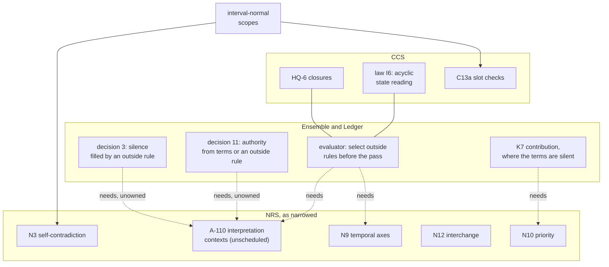
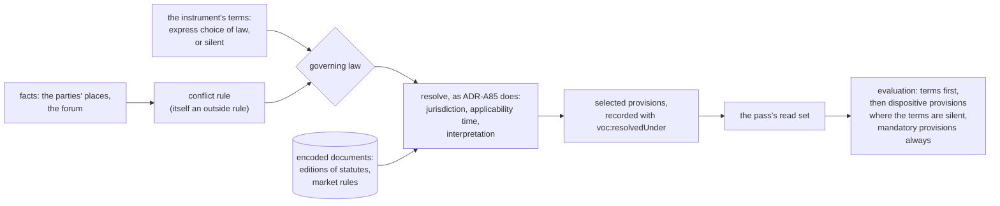
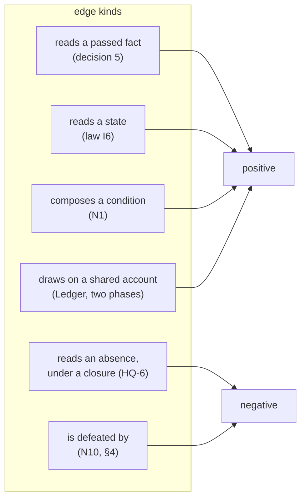

<!-- SPDX-License-Identifier: CC-BY-SA-4.0 -->

# Normative rules, ensembles and ledgers

**Unit:** cross-unit synthesis (sketch). **Status:** sketch, 2026-10-21, for the maintainer's review.
Nothing here is ratified.
**Units it spans:** the [normative rule substrate](../plans/normative-rule-substrate.md) (NRS, with its
[status record](../status/normative-rule-substrate.md)), [Ensemble](../plans/ensemble.md) (ADR-A130,
Proposed), [Ledger](../plans/ledger.md) (ADR-A131, Proposed), the
[evaluator implementation plan](../plans/evaluator-implementation.md), the
[interval-normal scopes plan](../plans/interval-normal-scopes.md), and CCS
([plan](../plans/computable-contract-substrate.md), C12, C13, HQ-6).
**Reads with:** the [rule layers sketch](rule-layers.md) (the compiled normative tier),
[rule layers cross-check](rule-layers-cross-check.md), the
[LegalRuleML mapping](legalruleml-mapping.md) §14 (interpretation contexts), the
[normative wire protocol](normative-wire-protocol.md), and the
[relations sketch](instrument-relations.md) §10 and §11.

## Contents

1. [The question](#1-the-question)
2. [Where each unit stands](#2-where-each-unit-stands)
3. [Outside rules: what they are and how one is chosen](#3-outside-rules-what-they-are-and-how-one-is-chosen)
4. [Precedence: two families, not five](#4-precedence-two-families-not-five)
5. [One stratification graph](#5-one-stratification-graph)
6. [Absence across instruments](#6-absence-across-instruments)
7. [Time: positions and applicability](#7-time-positions-and-applicability)
8. [Lifecycles, timers and transport](#8-lifecycles-timers-and-transport)
9. [Lowering, several cores and derived engines](#9-lowering-several-cores-and-derived-engines)
10. [Public surfaces and deployment surfaces](#10-public-surfaces-and-deployment-surfaces)
11. [What changes, if the leanings are taken](#11-what-changes-if-the-leanings-are-taken)
12. [Questions NE-Q1 to NE-Q8](#12-questions-ne-q1-to-ne-q8)

---

## 1. The question

The design closure of Ensemble and Ledger on 2026-10-21 made three statements that reach into the
normative rule substrate:

- **Silence.** Where the terms are silent on a relation's effect, the effect comes from a rule
  outside them that binds the members, selected by governing law through the normative rule
  substrate, never from a default built into the layer (ADR-A130 decision 3).
- **Authority.** A representative's authority comes from the members' terms or from such a rule
  (decision 11, ES-Q2).
- **Selection in the pass.** A pass selects any outside rule by governing law before it evaluates,
  and the selected rule's version is in the read set (ADR-A130's evaluator consequence).

Phase 7 relies on the same mechanism (P7-7), and so does contribution (K7, ES-8), where the law gives
a right of contribution although the terms are silent.

NRS, meanwhile, was narrowed on 2026-10-10 to integration with other rule languages. No unit
currently delivers "a rule outside the terms, chosen by governing law". This sketch asks how NRS sits
beside Ensemble and Ledger, finds where they already meet, and proposes what each owes the others.
It also asks how the public evaluation and composition surfaces meet the engines a deployment builds
on top of them.

## 2. Where each unit stands

| Unit | Holds | State |
|---|---|---|
| CCS | Instrument's terms and legal relations (ADR-A104), Behaviour's runtime (ADR-A106), closures (HQ-6, ADR-A105 not yet drafted), condition composition acyclicity and the rule-body fragment (N1, N2), scheduled triggers and breach chains (N6, N8, absorbed by C12 and C13) | in progress |
| NRS | self-contradiction (N3), the OASIS corpus (N7), multi-axis temporal scope (N9, A-108), norm priority (N10, A-107), controlled English (N11), interchange (N12, A-111), the §504 milestone (N13). Interpretation contexts (A-110) recorded, not scheduled | proposed, nothing started. D1, D4, D5 open |
| Ensemble | sets of instruments, relations K1 to K8, composition as a least fixpoint over units and positions | ADR-A130 Proposed, plan proposed |
| Ledger | accounts, postings, balances, merge rules, two phases at one position | ADR-A131 Proposed, plan proposed |
| Evaluator implementation | a pure core behind the codec and kit, generated for several hosts, the terms digest, read sets | plan proposed |
| Interval-normal scopes | conditions as interval unions, decisions by arithmetic, two Surface index forms | sketch and plan proposed |

The dotted edges are the finding. Ensemble's statements rest on mechanisms NRS has recorded and not
scheduled.

## 3. Outside rules: what they are and how one is chosen

**The premise, from the law.** Most of contract law is dispositive: it applies unless the parties
agree otherwise. The Marine Insurance Act 1906 makes several subscriptions distinct contracts
"unless the contrary is expressed" (s. 24(2)), and gives contribution between insurers who
over-insure (s. 80). Article 9 of the Uniform Commercial Code sets default rules for secured
transactions that the parties may vary. Some law is mandatory and overrides the terms: the
Insurance Act 2015 makes a term that puts the insured in a worse position than the Act of no effect,
or of effect only on stated conditions (ss. 15 to 17), and UCC § 9-602 lists rules of Article 9 the
parties cannot waive. Which law applies is itself decided by a rule: an express choice of law in the
terms, or where there is none, the conflict rules of the forum.

**What an outside rule is.** It needs no new kind of meaning. A statute's default rule says what a
term would say if the parties had written it. Instrument already evaluates terms, and CCS C9c already
incorporates an encoded document by reference. The difference is the route by which the rule reaches
an instrument: by operation of law, not by the parties' agreement.

| Option | What it is | Consequence |
|---|---|---|
| (a) an encoded document of provisions, stated as terms Instrument already evaluates, reaching an instrument by operation of law | a new route, the same meaning | no new evaluation semantics (ADR-A130 decision 3, X5). Every implementation of the evaluator runs it. The provisions carry the jurisdiction and the period they apply to |
| (b) a norm of its own kind, LegalRuleML-shaped | a new kind of meaning beside terms | a second semantics to keep in agreement with Instrument's, which the rule layers sketch §6 names as the main risk |
| (c) a default built into each layer, overridable by terms | no outside rule at all | refused by decision 3. Defaults would differ by jurisdiction, so a built-in one is right in one place and wrong in another |

**How one is chosen.** The LegalRuleML mapping §14 already proposes interpretation contexts (A-110)
as a generalisation of `voc:BindingScope`: evaluation takes a context as a parameter, as it already
takes a binding scope and a resolution time, and records it with `voc:resolvedUnder`. Selecting an
outside rule is the same act: resolve, from the instrument's governing law (stated, or found by the
forum's conflict rules) and the time that law makes relevant, to one edition of an encoded document,
and record the resolution on every decision that used it. ADR-A85's resolution of scheme editions by
scope and time is the model.

**Leaning (NE-Q1, NE-Q2):** (a), chosen by a resolution modelled on ADR-A85, which is A-110's
narrowest useful form. A-110's competing readings (an insurer's and an insured's) come later, as a
further dimension of the same resolution.

## 4. Precedence: two families, not five

LATTICE now has, or plans, five orderings:

| Ordering | What it orders | Where |
|---|---|---|
| `ins:prevailsOver` | which of two overlapping definitions or documents is read | Instrument (C7c, C9c) |
| norm priority and defeasibility | which of two conflicting rules governs, for example a mandatory provision over a term, a term over a dispositive provision, an endorsement over a form | NRS N10, A-107, deferred on D5 |
| evidence resolution | which of several evidenced assertions of one attribute stands | AIR substrate S7, "with N10" |
| ranking between agreements | which instrument draws, pays or recovers first | Ensemble K3 |
| priority merge | which draw on one account is met first | Ledger decision 6 |

The NRS status record already warns that N10 and S7 designed apart give "two precedence
vocabularies that do not compose". The five fall into two families with different semantics:

| Family | Question | Members | How it is evaluated |
|---|---|---|---|
| **precedence of meaning** | which statement governs | `ins:prevailsOver`, N10, the mandatory and dispositive split of §3, S7 | an acyclic priority compiled into stratified negation: "this applies unless a statement that prevails over it applies" (rule layers sketch §2) |
| **precedence of resource** | who is met first from an amount | K3, Ledger's priority merge | an order of draws and restorations on accounts, by Ledger's two phases |

**Leaning (NE-Q3):** one mechanism per family, each a partial order with a stated source (a term, an
outside rule, or a recorded determination). Precedence of meaning is N10's, designed with S7 as the
AIR plan already says, and extended to `ins:prevailsOver`. Precedence of resource stays with K3 and
Ledger. This also answers NRS D5: priority cannot wait for applied Phase 5, since Ensemble's silence
rule needs mandatory provisions to prevail over terms, and phase 7 needs both before AIR-7.1.

## 5. One stratification graph

Four acyclicity rules are being designed separately:

| Rule | Over | Where |
|---|---|---|
| law I6 | breach, exercise and state-reading edges within one instrument | ADR-A104 decision 15, checked with C13 |
| N1 | conditions composed into profiles | CCS (moved from NRS) |
| ADR-A130 decision 5 | dependencies between evaluation units at positions | ES-3 |
| stratification of negation | rules that read the absence of a fact, or that are defeated by a prevailing rule | rule layers sketch §3, N10 |

They are one graph with several kinds of edge. A node is an evaluation unit at a position (decision
5). Each edge says why one node reads another:

**The rule:** the graph over units and positions is acyclic, as decision 5 already says. A cycle
that remains may be admitted by an addendum only if it has no negative edge, since a negative edge
is not monotone and has no least fixpoint (relations sketch §11.3). So a closure over absence, or a
priority that defeats, can never sit inside an admitted cyclic component. It must sit strictly below
it.

**Leaning (NE-Q4):** one graph builder, shared by C13's check of I6 and ES-3's planner, and one
stratification lemma in formal methods track E serving E4b, I6 and N10.

## 6. Absence across instruments

A cross-default clause reads whether another agreement is in default. A drop-down term reads whether
an underlying aggregate is exhausted. Some reads are of absence: "no notice of cancellation has been
given under the underlying policy".

Under decision 5's least fixpoint, a passed fact is Undetermined until the unit that produces it has
run. Once it has run, the fact is determined, true or false, at its position. "Not in default at
*p*" is then a determined fact, not an absence the receiver infers. But the producer may itself have
concluded it from absence, and that needs a licence (HQ-6, ADR-A105).

**The rule (NE-Q5):** a passed fact that a producer concluded from absence carries the closure it
relied on, inside the read-set digest decision 5 already requires. A receiving unit never closes over
the producer's raw data. It reads the producer's determined fact and cites the producer's closure.
This keeps decision 12's confidentiality (the receiver never reads the producer's terms or data), and
puts each closure where its authority lies.

## 7. Time: positions and applicability

Ledger and Ensemble order by position, a logical order supplied by whatever posts (LG-Q4). Outside
rules add another question: which edition of a law applies. A statute may apply as in force when the
contract was made, when the loss occurred, or when the claim was made. LegalRuleML names in-force,
efficacy and applicability as separate times, and NRS N9 proposes several axes on `fnd:TemporalScope`,
a MAJOR change to Foundation, gated on NRS D4.

**Leaning (NE-Q6):** do not wait for N9. The resolution of §3 records which time it used to choose an
edition, so the axis is explicit on every decision from the start. N9 later generalises the temporal
scope, and the resolution reads the axis from there. Deadlines stay as the rule layers sketch §4
says: time is an input, as a position or a stream of ticks, never a clock.

## 8. Lifecycles, timers and transport

The rule layers sketch §5 states the rule for state machines with timers: the evaluator is
authoritative for normative state, and a state machine is a projection and a scheduler. It arms
timers for deadlines the evaluator has derived, publishes a tick or a request to re-evaluate when one
fires, and runs side effects. It never decides.

The same rule settles part of Ensemble's ES-Q6. If SPC carries passed facts between processes or
organisations, its subjects are projections and schedulers too. A session type, monitored at the
edges, checks that the right party sends the right fact in the right order. Whether that fact is true
is the evaluator's.

Two alignments follow:

- **The passed fact and the decision on the wire are one family.** The normative wire protocol §10
  returns a three-valued decision with `because`, `needs`, `clause` and `replay`. A passed fact
  (decision 5) carries its producer, version, position and read-set digest. Both are decision
  records, and should share one codec type with two views.
- **Replay by position.** The wire's `replay` block carries `evaluatedAt`. Under B3 and the rule
  layers sketch §4, replay should cite the pass's positions and read-set digest, with any timestamp
  recorded as transaction time only.

## 9. Lowering, several cores and derived engines

The rule layers sketch §2 compiles rules to plans, not source, and lowers each class of rule to a
target: SHACL and SPARQL for stateless rules, a stratified plan for derivations with negation,
parameters for obligation lifecycles, validators at admission. Its §6 names the risk of two
semantics drifting apart, and its answer is one IR, many lowerings, and a conformance suite every
lowering passes.

That is the evaluator implementation plan's position, reached from the rules side:

| Rule layers sketch | Evaluator implementation plan |
|---|---|
| one IR, many lowerings | one model, generated cores (SC1, SC6) |
| a rule-backend conformance suite | the conformance kit and the N-version gate (SC2, SC3) |
| plans identified by digest, including the compiler's version | the codec's schema digest, and the plan entry point's schedule as data |
| static checks that refuse | the stratification graph of §5, the closure licence, the fragment of ADR-A104 decision 15 |

So a lowering that decides normative outcomes is a semantic core, held by the N-version gate. It is
not a separate tier.

**Interval arithmetic is a derived decision procedure.** The interval-normal scopes sketch decides
joint satisfiability, entailment and coverage by arithmetic for conditions in its fragment, and NRS
N3 (self-contradiction) and CCS C13a use it, with the reasoner as differential partner (IX-L3, IX-L4).
It is the public example of a derived engine: faster, narrower, and held to the semantics by a stated
law.

**The plan entry point should return the selected outside rules (NE-Q7).** Any engine that compiles
the semantics into another form, public or a deployment's own, must use the same outside rules the
core used, or it disagrees whenever the terms are silent. If the plan returns, per unit, the provisions
selected and the resolution that chose them, a derived engine reads the selection and never repeats
it. The terms digest (EV-Q11) keys terms. A second digest, of the selection, keys outside rules, so
two contracts with the same terms under different laws never share a key.

## 10. Public surfaces and deployment surfaces

| Surface | Public | What a deployment builds on it |
|---|---|---|
| evaluation of one instrument (CCS C12) | yes | nothing semantic. Hosts, shells, user interfaces |
| composition (Ensemble ES-3: plan, evaluate a unit, evaluate a component) | yes | schedulers, parallel runners, distribution across organisations |
| Ledger (postings, balances, two phases) | yes | streaming views of balances, reconciled to postings |
| outside rules and their resolution (§3) | yes, the mechanism and the encodings of public law | encodings of a deployment's own rules, such as an organisation's delegated authority, held as its configuration |
| precedence (§4) and the stratification graph (§5) | yes | nothing semantic |
| interval-normal scopes, Surface index forms | yes | indexes and partitions for its own queries |
| the terms digest and the selection digest (§9) | yes | keys for its caches |
| the wire protocol and the passed fact (§8) | yes | transports and services |
| derived engines | the agreement-law pattern is public (IX-L3, IX-L4) | its own engines, each held to a semantic core by its own stated law, calling the public entry points |

The line is the one the evaluator implementation plan draws: semantic cores are public, and derived
engines are a deployment's own. The normative rule substrate adds one thing to each side. Publicly,
the mechanism for outside rules and the encodings of public law. Privately, a deployment's own rule
sets, which are configuration.

## 11. What changes, if the leanings are taken

| Where | Change |
|---|---|
| NRS plan | a new slice for outside rules (§3): encoded provisions reaching an instrument by operation of law, and their resolution by governing law and applicability time, modelled on ADR-A85. A-110 scheduled in that narrow form. D5 answered: N10 does not wait for applied Phase 5. N10 designed with S7 and extended to `ins:prevailsOver` |
| CCS plan | C13's check of law I6 and Ensemble's planner share one graph builder (§5). HQ-6's closures travel inside passed facts (§6) |
| ADR-A130 | decision 5's admitted cyclic components exclude negative edges (§5). The plan entry point returns selected outside rules, and passed facts carry closures in their read-set digest (§6, §9). Decision 3's silence rule names the mandatory exception (§3, §4) |
| Ensemble plan | ES-3 consumes the outside-rule resolution. ES-7 (authority from an outside rule) and ES-8 (contribution where the terms are silent) wait on the NRS slice for outside rules |
| evaluator implementation plan | EV-0's plan output includes the selected outside rules. EV-9 gains the selection digest |
| normative wire protocol | the decision and the passed fact share a codec type. `replay` cites positions and the read-set digest |
| formal methods | one stratification lemma (track E) for I6, decision 5 and N10. C4 includes the rule that admitted components have no negative edge |
| phase 7 | P7-7's "what applies where the terms are silent is a normative rule" is delivered by the NRS slice for outside rules, which phase 7's AIR-7.0 examples then use |

## 12. Questions NE-Q1 to NE-Q8

| # | Question | Options | Leaning |
|---|---|---|---|
| **NE-Q1** | What an outside rule is | (a) encoded provisions stated as terms, reaching an instrument by operation of law. (b) a norm of its own kind. (c) defaults built into layers | **Answered 2026-10-21, as leaned:** (a). No second semantics, every core runs it |
| **NE-Q2** | How one is chosen | (a) a resolution modelled on ADR-A85: governing law, applicability time, later interpretation, recorded on every decision. (b) authored per instrument | **Answered 2026-10-21, as leaned:** (a). It is A-110's narrowest form, and authoring per instrument restates the law in every contract |
| **NE-Q3** | Precedence | (a) two families, meaning and resource, one mechanism each. (b) one mechanism for all five. (c) as today, separately | **Answered 2026-10-21, as leaned:** (a). Meaning compiles to stratified negation, resource to the order of draws, and they answer different questions |
| **NE-Q4** | Acyclicity | (a) one graph with edge kinds, one builder, one lemma. (b) four checks | **Answered 2026-10-21, as leaned:** (a) |
| **NE-Q5** | Absence across instruments | (a) a producer's negative fact carries its closure. (b) the receiver closes over the producer's data | **Answered 2026-10-21, as leaned:** (a). It keeps closures with their authority, and keeps decision 12 |
| **NE-Q6** | Temporal applicability before N9 | (a) the resolution records the time it used. (b) wait for N9 | **Answered 2026-10-21, as leaned:** (a) |
| **NE-Q7** | Do derived engines read the core's selection of outside rules? | (a) yes, from the plan output, with a selection digest. (b) each engine selects | **Answered 2026-10-21, as leaned:** (a). Otherwise every engine disagrees with the core whenever terms are silent |
| **NE-Q8** | Where the outside-rule work lives | (a) NRS, reopened for it. (b) CCS. (c) a new unit | **Answered 2026-10-21, as leaned:** (a). NRS kept "norms beyond contracts" (NQ-1), and a statute's default rule is one. Ensemble's ES-7 and ES-8 depend on it |
