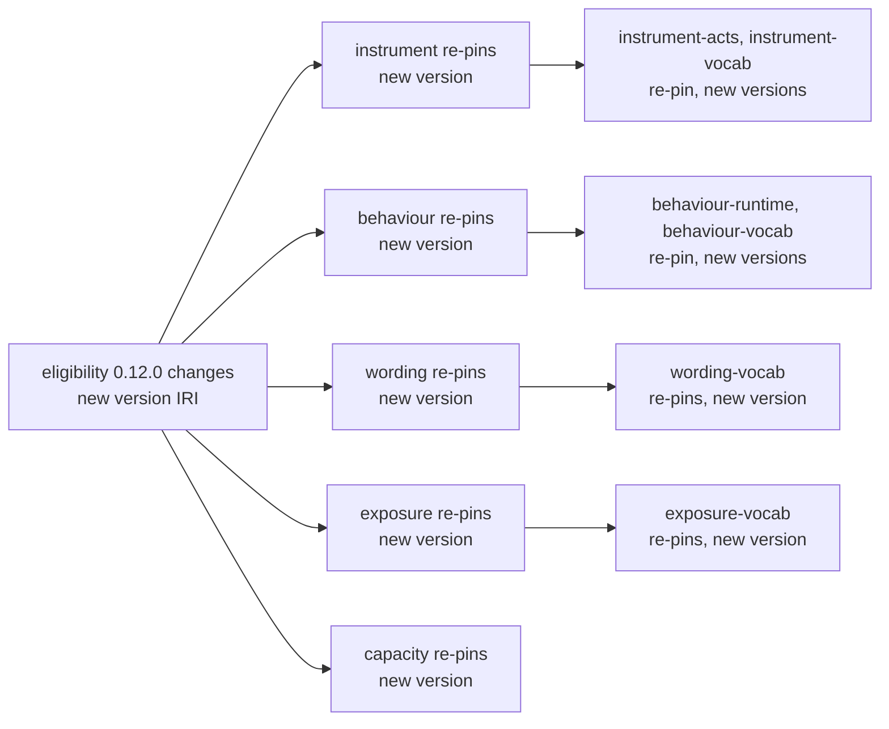

<!-- SPDX-License-Identifier: CC-BY-SA-4.0 -->

# How ontology imports pin their versions — sketch

**Status:** Sketch, 2026-10-18. Widened on 2026-10-19 by the [release model sketch](ontology-release-model.md),
which records the checks of §6 and would replace this sketch's questions. Not planned.
**Question prefix:** IMP
**Raised by:** the maintainer, during `improved-ontology-documentation` OD6 (OD6-Q6, option d), because regular
re-pinning has become a burden.
**Would amend:** [ADR-A86](../../architecture/decisions/ADR-A86-ontology-semantic-versioning.md)'s import pinning
bullet, which left "a dependency-range import mechanism" open "if the cascade cost becomes a real source of
friction". It touches [ADR-A88](../../architecture/decisions/ADR-A88-ontology-import-resolution-for-consumers.md)
(the XML catalog and the consumer pattern), [ADR-A113](../../architecture/decisions/ADR-A113-breaking-changes-at-major-version-zero.md)
(major version zero) and [ADR-A121](../../architecture/decisions/ADR-A121-repository-catalogue.md) (the repository
catalogue, whose module entries already state imports).

## 1. The scene

**What exists.** Every `owl:imports` inside `ontology/` names an exact version IRI, for example
`<https://www.nebularis.org/neuro-semantic/lattice/eligibility/0.12.0>`. A change to a document's content
needs a new version IRI. Each importer must then re-pin, and the re-pin is itself a content change, so the
importer takes a version of its own and its importers re-pin in turn. Each new version needs a release row
and a tag, which the maintainer creates.

**What it costs, measured 2026-10-18.**

- **The import graph.** 33 documents carry a version IRI, and 74 `owl:imports` pin one exactly.
- **The cascade from one change at each substrate layer:**

  | A change to | Re-pins and re-versions | In modules |
  |---|---|---|
  | Foundation | 29 documents | 16 |
  | Vocabulary | 25 | 12 |
  | Quantification | 22 | 10 |
  | Party | 19 | 9 |
  | Eligibility | 12 | 6 |
  | Behaviour | 6 | 3 |
  | Wording | 4 | 2 |
  | Instrument | 2 | 1 |

- **The register.** 216 released versions. Of these, 49 are first releases, 157 are MINOR and 10 are PATCH.
  Release notes mention re-pinning 32 times, and 13 releases record that a re-pin was their only change.
- **This unit.** Each README migration adds Dublin Core to its layer's headers, so it changes the graph and
  starts a cascade. The unit batches them on its branch and releases once (OD-D43), but that only defers the
  cost.

**Facts that constrain the options.**

1. **OWL allows importing by either IRI.** The OWL 2 structural specification (§3.1, §3.4) lets `owl:imports`
   name an ontology IRI or a version IRI. Importing by the ontology IRI means "the current version", and a
   tool finds it through a catalog.
2. **Our catalog already maps both IRIs.** ADR-A88's generated `catalog-v001.xml` maps every ontology IRI and
   every version IRI to its file, and its check fails on an import with no entry. So importing by ontology IRI
   already resolves in Protégé, in our tests and in the reasoning harness.
3. **Ontology IRIs and version IRIs differ in 24 of 33 documents.** ADR-A86's baseline moved version IRIs under
   `lattice/`, for example `.../neuro-semantic/lattice/eligibility/0.12.0`, but not the ontology IRIs, for example
   `.../neuro-semantic/eligibility`. Changing an ontology IRI is a MAJOR change under the policy.
4. **The import guard reads the layer from an imported IRI**, with the pattern `neuro-semantic/lattice/<layer>`.
   That matches version IRIs and misses most ontology IRIs.
5. **Downstream projects pin LATTICE by commit or tag** and chain their catalog to ours (ADR-A88 decision 4).
   That pin is what makes a consumer reproducible, whatever our imports say.
6. **A release tag freezes a whole commit.** Every document at a tag is mutually consistent there, whatever
   form its imports take.
7. **The repository catalogue's module entries already list each module's permitted imports** (ADR-A121
   decision 2), by module, without versions.

## 2. Pictures

How one change spreads today, with Eligibility as an example.

Where each option keeps "which version did this import mean".

```mermaid
flowchart TB
    subgraph A["A. exact pins (today)"]
        A1["in each owl:imports"]
    end
    subgraph B["B. by ontology IRI"]
        B1["owl:imports names the current version"] --> B2["the release tag freezes a consistent set"]
    end
    subgraph C["C. minor-line IRIs"]
        C1["owl:imports names X.Y"] --> C2["owl:versionInfo holds X.Y.Z"]
    end
    subgraph D["D. by ontology IRI, with ranges"]
        D1["owl:imports names the current version"] --> D2["the catalogue entry states a range"]
        D2 --> D3["a check holds current versions inside it"]
    end
```

## 3. Options

### A. Keep exact pins, and automate the cascade

A task computes the cascade from the import graph (the authoring skill's method), rewrites every pin in the
Turtle and the literate READMEs, bumps each re-pinned document, writes the release notes' re-pin lines and adds
the release rows.

- **Design.** Nothing changes in meaning. Every document still says exactly what it was checked against.
- **Cost.** The edits become a command, but nothing else shrinks. A Foundation change still yields 29 new
  versions, 29 release rows and 29 tags. Release notes still fill with re-pin-only entries.
- **Risk.** Low, since it automates what is done by hand today.

### B. Import by ontology IRI, with exactness kept at the release tag

`owl:imports` names an ontology IRI. Inside the repository a document always imports the current version of
another. A release tag records a consistent set, and the register already lists each version per tag.

- **Design.** A change re-versions only the document that changed. Importers are untouched unless they
  change themselves. The import guard has to learn ontology IRIs, which it can read from the XML catalog or
  the repository catalogue.
- **What is lost.** A document no longer states which version of its import it was built against, so
  "instrument 0.17.0 was checked with eligibility 0.12.0" lives only in the tag, and in a release manifest if
  we generate one. A breaking change below no longer forces the importer's author to look. The importer's
  tests and the reasoning checks have to catch it instead.
- **Fact 3.** Importing by the current ontology IRIs works as they stand, since the catalog maps them, and
  normalising them is optional. It would be a MAJOR change for 24 documents. It could share a release with
  TD-20's rename, which is MAJOR for Foundation anyway.
- **Cost of a Foundation change.** One new version, one release row and one tag.

### C. Version IRIs on the minor line

A version IRI names `X.Y`, for example `.../eligibility/0.12`, and the full version sits in `owl:versionInfo`.
A PATCH release keeps the IRI, so importers need not re-pin.

- **Design.** Exact pins otherwise stay. The versioning check would read `owl:versionInfo` for PATCH changes.
- **What it saves.** Only 10 of the 167 releases after a first release were PATCH. At major version zero an
  additive change is a MINOR (ADR-A113), so most changes still cascade. It saves about one cascade in
  seventeen.

### D. Import by ontology IRI, with ranges in the repository catalogue

As B, and each module's catalogue entry states, for each module it imports, the range of versions it
supports, for example `eligibility = ">=0.12, <0.13"`. A check fails when a current version falls outside a
declared range, and a release manifest generated at tag time records the exact versions.

- **Design.** B's saving, and an author still says what they support, in one place per module rather than in
  every `owl:imports`. The catalogue already lists imports by module (fact 7), so this adds a version to each.
  OWL tools see a plain ontology-IRI import and ignore the range.
- **At major version zero.** A range up to the next MINOR breaks on every MINOR, which is almost every
  release, so it would be updated as often as pins are today. A range open above, such as `>=0.12`, relies on
  release notes and tests to flag a breaking MINOR. Ranges pay off once layers reach 1.0, where MINOR is
  additive only.
- **Cost of a Foundation change.** One new version, plus a catalogue range edit in each importer whose range
  it leaves. With open-above ranges, usually none.

### Space and time, side by side

| | A. automated | B. ontology IRI | C. minor line | D. B with ranges |
|---|---|---|---|---|
| Documents re-versioned by a Foundation change | 29 | 1 | 29 for a MINOR, 1 for a PATCH | 1 |
| Tags for it | 29 | 1 | as A for most releases | 1 |
| Human edits per change | 0 (a command) | 0 | as A | 0 to N range edits |
| Where "built against" is recorded | every import | the tag | every import | the catalogue range and the tag |
| Breaking change below forces a look | yes | no, tests catch it | yes | yes, when it leaves a range |
| New machinery | a re-pin task | import guard reads ontology IRIs, optional manifest | `owl:versionInfo` checks | as B, plus ranges and their check |
| ADR change | none | amends ADR-A86 | amends ADR-A86 | amends ADR-A86 and ADR-A121 |

## 4. KISS

- **Is it needed now?** Yes. The cost is measured, and every README migration in this unit adds a cascade.
- **The smallest change that removes the cost is B.** It needs the import guard to read ontology IRIs, and
  ADR-A86's pinning bullet amended. It keeps every tool working, since the catalog resolves ontology IRIs
  today.
- **D adds safety B lacks, but is weak at major version zero.** The range field can wait until a layer
  approaches 1.0, and it would sit in the catalogue entry we already have.
- **A treats the symptom.** It is worth having only if the maintainer wants exact pins kept.

**Leaning: B now, with a release manifest generated per tag, and D's ranges added once layers approach 1.0.**
This is a hypothesis to test against the reasoning harness and the downstream consumer pattern, below.

## 5. Questions

- **IMP-Q1. Which option:** A, B, C or D?
- **IMP-Q2. Do we normalise ontology IRIs to the version IRIs' base** (`.../lattice/<layer>`)? It is MAJOR for
  24 documents. The options are now, with TD-20's rename, or never, leaving the catalog to map them.
- **IMP-Q3. Do we generate a release manifest per tag**, listing every document's exact version at that tag,
  for example as a section of `ontology-releases.md`?
- **IMP-Q4. How do downstream consumers learn of a breaking change below,** once their imports no longer pin?
  For example, from the release notes, the manifest, or a check in the consumer's own gate (ADR-A88 decision 4).
- **IMP-Q5. When does it land, relative to this unit's release slice (OD-REL)?** If B lands first, OD-REL
  re-versions only the documents that changed. If after, OD-REL performs one last full cascade.

## 6. What to check before deciding

- **The reasoning harness and pySHACL tests** resolve imports through the catalog. Run them with ontology-IRI
  imports on one layer, as a spike.
- **Protégé** follows ADR-A88's stub catalogs, which map ontology IRIs already. Confirm it opens a layer
  imported by ontology IRI.
- **MORK's** documents use `http://` IRIs and their own pins. Count what B changes there.

## 7. Next

🔴 PLAN FIRST. IMP-Q1 to IMP-Q5 need answers, IMP-Q1 and IMP-Q5 first, since IMP-Q5 decides how much of OD-REL
is a cascade.
