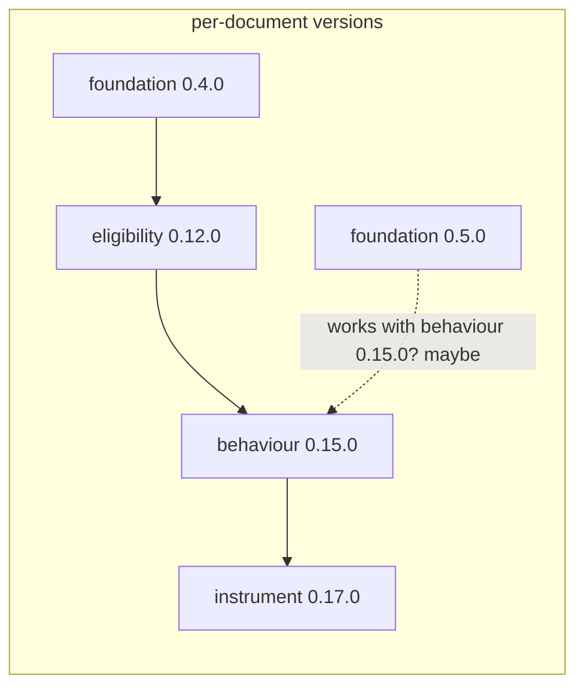
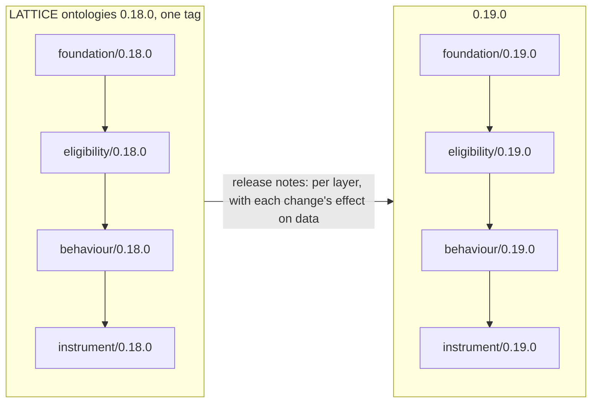

<!-- SPDX-License-Identifier: CC-BY-SA-4.0 -->

# One release for LATTICE's ontologies — sketch

**Status:** Sketch, 2026-10-19. Questions REL-Q1 to REL-Q6 open. Not planned.
**Question prefix:** REL
**Raised by:** the maintainer, 2026-10-19, while deciding IMP-Q1 of the
[import pinning sketch](ontology-import-pinning.md), which this sketch widens and would replace.
**Would supersede:** [ADR-A86](../../architecture/decisions/ADR-A86-ontology-semantic-versioning.md)'s per-document
versioning and pinning. It touches
[ADR-A113](../../architecture/decisions/ADR-A113-breaking-changes-at-major-version-zero.md) (major version zero),
[ADR-A88](../../architecture/decisions/ADR-A88-ontology-import-resolution-for-consumers.md) (the XML catalog and
consumers) and [ADR-A121](../../architecture/decisions/ADR-A121-repository-catalogue.md) (the catalogue).

## 1. The question

Today each of 33 documents has its own semantic version, and each `owl:imports` pins an exact version of
another. That model claims something we never test: that a document at one version works with other documents
at versions other than the ones it was released beside. For example, it suggests a deployment could move
Foundation from 0.4.0 to 0.5.0 and keep Behaviour 0.15.0. Whether that works depends on what changed, and
proving it would need a migration story for every individual the change touches.

Two observations make that claim doubtful.

1. **Nobody runs a mixed set.** A runtime loads an import closure. Every test, shape check and reasoner run in
   this repository loads the documents of one commit together. Downstream projects pin LATTICE by commit or tag
   (ADR-A88 decision 4), so they take a whole set too.
2. **"Additive" does not mean safe for data.** A new restriction, shape, disjointness, domain or key can make a
   graph that was valid invalid, or inconsistent, or change what a reasoner infers from it. So a production
   graph's compatibility is a property of the whole set it was validated against, not of one document's
   version number.

So the hypothesis is that the unit of compatibility, and so of release, is the set.

## 2. What the import pinning checks found (§6 of that sketch), 2026-10-19

| Check | Result |
|---|---|
| A spike moving Instrument's 9 imports to ontology IRIs | `ontology_catalog.py check` passes, so the XML catalog resolves ontology IRIs. 13 tests fail, every one asserting an exact import IRI or that the README is the source, which a real change would update |
| The SHACL and reasoning tests | all pass, but they prove nothing about imports. Each test merges a hand-written list of files (`graph_cache(*LOWER, SPEC, VOCAB)`) and never follows `owl:imports` |
| The import guard | blind to ontology-IRI imports. It reads a layer from `neuro-semantic/lattice/<layer>`, so a planted import of Instrument by Vocabulary, written by ontology IRI, passed with 0 violations |
| Protégé | not run, since it is a desktop application. Each directory's stub catalog chains to the root catalog, which maps every ontology IRI to its file, so resolution should work. Unconfirmed |
| MORK | 9 documents import, only 2 by version IRI (both Foundation 0.4.0). Option B changes 2 |

So option B works mechanically, but needs the import guard taught ontology IRIs, and the tests never exercised
imports in either form.

## 3. The numbers today

- 33 versioned documents, with versions from 0.1.0 to 0.17.0, and 17 shape or projection directories with
  their own `.version`.
- 217 rows in the release register and 220 tags.
- A Foundation change re-versions 29 documents in 16 modules (the import pinning sketch, §1).

## 4. Pictures

Today: versions per document, and what a deployment might mix.

One release: every document carries the release's number.

## 5. Options

### A. Per-document versions, as today (ADR-A86), with the cascade automated

Keeps the per-document claim, and removes the hand edits. A Foundation change still makes 29 versions, rows and
tags, and the claim about mixed sets stays untested.

### B. Per-document versions, imports by ontology IRI (the import pinning sketch's leaning)

One document re-versions per change. A document no longer says what it was built against, and the per-document
number still suggests mixed sets work. Needs the import guard to read ontology IRIs (§2).

### C. One release for the set (a release train)

Every versioned document, and every shape and projection directory, carries one number, the release's. A
change anywhere is a new release of all of them. A document's version IRI keeps its path and takes the
release's number, for example `.../lattice/eligibility/0.18.0`, and its imports name the same release's
version IRIs. One tag and one register row per release.

- **Moving to a release** rewrites one number everywhere, a single substitution the release task does. Nothing
  cascades, since everything moves at once.
- **What a version means.** A version IRI says "this document as released in 0.18.0". A document unchanged
  since 0.17.0 has the same content under a new IRI, which is honest, since its import closure is new.
- **What semantic versioning then describes** is the set, which is what is tested. ADR-A113's major-zero rule
  applies to the set.
- **What is lost.** The version number no longer shows which layer changed. Release notes do, with a section
  per layer.

### D. C, and each release says what it does to existing data

As C, and every change in a release's notes is classed by its effect on a graph that was valid under the
previous release:

| Class | Example | What the release owes |
|---|---|---|
| no effect | a definition, a label, a new term no shape requires | nothing |
| may invalidate | a new restriction, shape, disjointness, key or domain | the rule, so an adopter can validate first |
| changes meaning | a renamed or removed term, a changed law | a migration, for example a SPARQL Update, and a check that a migrated graph conforms |

After 1.0.0, a release whose changes are all "no effect" is a PATCH or MINOR, and one with a change of
either other class is a MAJOR. ELC is an example of "changes meaning": a renamed property, and statements
removed from profiles and from single conditions. Its graph rewrite script is the kind of migration a release
would ship.

### Space and time, side by side

| | A | B | C | D |
|---|---|---|---|---|
| Versions created by a Foundation change | 29 | 1 | all 33 documents, one release | as C |
| Tags and register rows for it | 29 | 1 | 1 | 1 |
| Hand edits per release | 0, automated | 0 | 0, one substitution | as C, plus the classification |
| "Built against" recorded | every import | the tag | every import, all one number | as C |
| Mixed sets implied to work | yes, untested | yes, untested | no | no |
| Data migration story | none | none | none | per release |
| Import guard | unchanged | must learn ontology IRIs | unchanged | unchanged |
| ADRs | none | amends A86 | supersedes A86, amends A113 | as C, plus a release-notes rule |

## 6. KISS

- **Is a change needed?** Yes. The cost is measured, and the per-document model makes a compatibility claim
  that is neither tested nor, as §1 argues, likely to hold.
- **C is the smallest model that is true.** One number, one tag, one register row, and every import names the
  same release. The release task's work is one substitution. The import guard, the XML catalog and every tool
  keep working, since imports stay version IRIs.
- **D is cheap on top of C** while it is only a column in the release notes. Shipping migrations is real work,
  but only needed for a "changes meaning" change once someone holds production data.
- **B solves the cost, not the claim**, and it weakens the import guard.

**Leaning: C now, with D's classification in every release note from the first release, and D's migrations
written when an adopter holds production data.** A hypothesis, to test against the release tooling and the
downstream consumer pattern.

## 7. What C changes

- **The versioning policy and ADR-A86.** A new ADR supersedes per-document versioning. ADR-A113's major-zero
  rule applies to the set.
- **`tools/ontology_version_check.py`.** It fails when anything in the set changed and the release number did
  not, rather than per document. TD-51 (text, not graph) is unaffected.
- **`tools/ontology_releases.py`.** One register row per release, listing its documents. The 217 existing rows
  stay as history.
- **`.version` files.** The 17 shape and projection directories take the release's number, or the files go and
  the number lives in one place, the catalogue's conventions.
- **The literate READMEs.** Section 2's header tables name the release's number. The release task rewrites them
  with the Turtle, so they never drift.
- **The MTP pins** (`build:mtp`) follow MORK's number, which is now the release's.
- **OD-REL** becomes the first release on the new model, so it creates no cascade at all.

## 8. Questions

- **REL-Q1. Which model:** A, B, C or D?
- **REL-Q2. What is in the release?**
  - (a) Every versioned document under `ontology/`: substrate, MORK, SPC, Surface, Persistence and the applied
    modules
  - (b) The substrate only, with the others on their own trains pinned to a substrate release
  - (c) The substrate and the standalone modules, with the applied modules on their own train

  Leaning (a), the smallest model. An applied module that later needs its own life can move to its own train,
  pinned to a release.
- **REL-Q3. How imports name the release:** the same release's version IRIs, rewritten by the release task, or
  ontology IRIs? Leaning version IRIs, so documents say what they were released with and the import guard keeps
  working.
- **REL-Q4. The first number.** Every document's next version must exceed its own, so the first release is at
  least 0.18.0, past Instrument's 0.17.0. Or 1.0.0, which under ADR-A113 promises that a MINOR is additive only.
  Leaning 0.18.0, since the layers are still changing in breaking ways.
- **REL-Q5. Shapes and projections:** keep a `.version` per directory with the release's number, or drop the files
  and read the number from one place? Leaning one place, the catalogue's conventions, since 17 copies of one
  number can disagree.
- **REL-Q6. D's data classification:** in every release note from the first release, with migrations when an
  adopter holds production data? Leaning yes.

## 9. Next

🔴 PLAN FIRST. REL-Q1 decides whether OD-REL is the first release on the new model, and REL-Q2 its scope. If C
or D is chosen, an ADR superseding ADR-A86 comes first, then a slice changing the version tooling, then OD-REL
as the first release.
