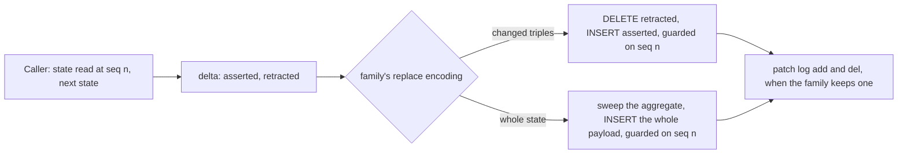

<!-- SPDX-License-Identifier: CC-BY-SA-4.0 -->

# Writing only what changed, as a persistence mode (sketch)

**Unit type:** a multi-slice unit, `persistence-delta-replace` (DR)
**Status:** raised by the maintainer on 2026-10-31. DR-Q1 to DR-Q7 answered the same day
**Touches:** `ontology/persistence/` (the vocabulary), `tools/persistence` (the compiler), `packages/persistence/python` and `packages/persistence/java` (the callers), the conformance suites, `contracts/config-studio/persistence-profile.ttl`, ADR-A123, ADR-A149

## 1. The scene

The maintainer answered SQ-Q1 on 2026-10-31. A write writes only what changed, and a write clears and rewrites a whole aggregate only where the profile chose that model. The persistence history sketch already prices an in-place edit with a patch log as the triples removed and the triples added (its S2), and that is the behaviour asked for.

What exists today:
- every `dal:InPlace` family's replace (`cas-replace`) sweeps the aggregate's graph or its composite members and inserts the whole payload. On a store that evaluates the sweep once per payload solution it is quadratic (the linear replace sketch, TD-42, TD-136)
- a `dal:PatchLog` family's replace already takes the delta, in the request-time slots `assertTriples` and `retractTriples`, and writes it to the revision's `/add` and `/del` graphs. It writes the whole payload into the aggregate beside them
- `dal:DeltaMembership` (ADR-A123 addendum of 2026-10-20) already writes a version as its added and dropped members, for `dal:AppendVersions`
- the studio's writer now replaces a part and a document by hand with their delta (`StudioOperations.replaceDelta`, TD-136): the generated replace with its sweep taken out, the retracted triples deleted and the asserted inserted. On TDB2 a save of 3,000 triples went from 233 ms to 121 ms, and from 178 ms before phase D.

## 2. Why the guard is what makes a delta safe

A delta is right only when it is applied to the state it was computed from. Under `dal:Optimistic` the version-row guard proves the row is still at the sequence the caller read, so the aggregate is the state the caller read, as long as every write of it is one of the family's operations. A stale delta finds the row moved and writes nothing, as a stale whole replace does. Without a guard (`dal:ProvidedConcurrency`, `dal:LockingConcurrency`) a delta applied to a state its caller never read merges triple by triple, which is a different model of concurrency from either replace, so it needs its own name if it is wanted.

A graph changed outside the family's operations, by hand for example, keeps its drift under a delta and is healed by a whole replace. The patch log already assumes no such change, since it rebuilds every past revision from the deltas.

## 3. Cost

k counts changed triples, the retracted and the asserted together, so an edited value is two, one retracted and one asserted.

| Encoding | Quads changed in the aggregate of N | Quads added to a patch log | Request size | Order on a store that is not snapshot |
|---|---|---|---|---|
| whole state, today | N deleted and N inserted, about 2N | k, and about 6 for the revision | N triples | quadratic (M × N), the linear replace sketch |
| changed triples | k | k, and about 6 for the revision | k triples | linear in k |

Measured on the studio's parts on TDB2, through the harness, each save changing one triple: a 1,000-triple part's update took 121 ms of Fuseki's time written whole, and the whole save, end to end, went from 183 ms to 110 ms as a delta, and from 233 ms to 121 ms for 3,000 triples (Validation Pack `studio-quality`).

## 4. Questions

**DR-Q1. How does a profile choose?** (a) a new axis beside `dal:MembershipEncoding`, `dal:ReplaceEncoding`, with `dal:ChangedTriples` and `dal:WholeState`, on `dal:InPlace` families. (b) a new write discipline beside `dal:InPlace`. (c) a new operation kind, `cas-delta`, generated beside `cas-replace`. **Answered 2026-10-31, (a), with an operation for bulk loads offered as well (DR-Q6).**

**DR-Q2. Which is the default?** `dal:ChangedTriples` under `dal:Optimistic`, since the guard makes it safe, and `dal:WholeState` required to be named. A family under `dal:ProvidedConcurrency` or `dal:LockingConcurrency` keeps `dal:WholeState`, and a shape refuses `dal:ChangedTriples` there until a merge model is named. Existing profiles change their generated replace on regeneration, so every vector and conformance expectation of a replace is regenerated in the same change. **Answered 2026-10-31, as stated, with the conformance of a merge model sketched in §5 for later.**

**DR-Q3. What does a delta replace digest?** (a) the delta alone, `assertTriples` then `retractTriples`, which a caller always has. (b) the whole next state as today, which a caller may not hold, and which costs a sort of N triples a write. (c) the delta for the request's identity, and a digest of the state it leaves on the version row, which finds a graph changed outside the operations at O(N) a write. **Answered 2026-10-31, (a), with (c) a family's option where finding drift matters.** The studio digests the whole state today so that its delta replace leaves exactly the quads the generated replace does, and moves to (a) with the compiler.

**DR-Q4. What does a family without a patch log take?** Under `dal:ReceiptOnly` the replace takes no delta slots today. With `dal:ChangedTriples` it takes `assertTriples` and `retractTriples` and writes them to the aggregate only. **Answered 2026-10-31, yes,** the slots are the same names whatever the receipt model. A family that feeds an incremental materialisation spanning aggregates keeps a patch log (the projection maintenance sketch §4).

**DR-Q5. Where is the delta computed?** The studio's browser sends the whole part, the service sends it whole over the queue, and the writer reads the stored part to compute the delta, so the write is O(k) and the transfer and the read are O(N). (a) by the writer against the stored state, as now, which every client can use. (b) by the client, which sends what it added and removed with the revision it read, O(k) throughout, which only a client that knows its edit can use, and the Word add-in and a file import do not. (c) both, a patch where the client has one and the whole state otherwise. **Answered 2026-10-31, (c), the form of a patch DR-Q7.**

**DR-Q6. What is the bulk load operation?** (a) `load-whole`, a guarded write of many aggregates' whole states in one request, each guarded on its own row, a create where there is none and a whole replace where there is one. (b) `load-initial`, an unguarded create of many aggregates, refused where any has a row, for loading an empty family. (c) both. (a) serves a reload over existing data and costs its rows' guards. (b) is the cheapest and is safe only where nothing else writes the family while it loads. **Leaning (a),** since an import into a live store is the common case. **Answered 2026-10-31, (a).**

**DR-Q7. What form does a client's patch take?** (a) RDF Patch, Jena's text format of added and deleted triples with a header naming the base revision. (b) two Turtle documents, what is added and what is removed, with the base revision in a header. (c) SPARQL Update from the client, which the service would have to check is only a delta. (b) needs no new parser and keeps the service's Turtle checks. (a) is a published format other tools write. (c) puts arbitrary updates in the client's hands. **Answered 2026-10-31, (b) now, with (a) accepted later if a client writes it.**

## 5. The conformance of a merge model, for later

DR-Q2 (c), a delta under `dal:ProvidedConcurrency` with no guard, would land every writer's delta triple by triple. Before it is offered, its conformance would say:
- **what a history may show.** Each triple's presence after a set of concurrent deltas is the effect of the last delta to touch it in the store's commit order. Deltas that touch disjoint triples all land, in any order. Two deltas that touch the same triple, one asserting it and one retracting it, leave the effect of the one the store applied last
- **what is checked.** Each triple is a register written by assert and retract. A history of concurrent deltas is linearisable per triple if some order consistent with real time explains every read, which the Jepsen test of the studio quality kit (SQ5, Knossos) can check with each triple as its own key
- **what it does not promise.** No delta is atomic with respect to a reader, beyond what the store's update gives, and no invariant across triples holds, since two deltas each valid alone can leave a state neither writer meant. A family needing such an invariant keeps the guard.

## 6. What follows

The compiler gains the encoding, its static checks and its vectors, both callers fill the delta slots, the conformance suites run the delta replace on every engine, and the studio's writer moves its parts and documents back onto the generated replace, which closes TD-136. The linear replace sketch's questions then bear only on `dal:WholeState`. Estimate, 400k tokens across three slices: the vocabulary and the compiler, the callers and the conformance runs, and the studio.
