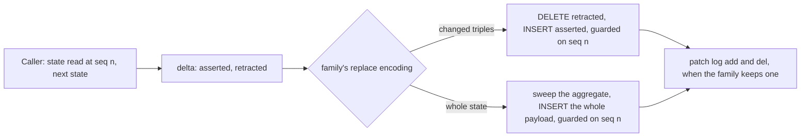

<!-- SPDX-License-Identifier: CC-BY-SA-4.0 -->

# Writing only what changed, as a persistence mode (sketch)

**Unit type:** a multi-slice unit, `persistence-delta-replace` (DR)
**Status:** raised by the maintainer on 2026-10-31. Questions DR-Q1 to DR-Q4 open
**Touches:** `ontology/persistence/` (the vocabulary), `tools/persistence` (the compiler), `packages/persistence/python` and `packages/persistence/java` (the callers), the conformance suites, `contracts/config-studio/persistence-profile.ttl`, ADR-A123, ADR-A149

## 1. The scene

The maintainer answered SQ-Q1 on 2026-10-31. A write writes only what changed, and a write clears and rewrites a whole aggregate only where the profile chose that model. The persistence history sketch already prices an in-place edit with a patch log as the triples removed and the triples added (its S2), and that is the behaviour asked for.

What exists today:
- every `dal:InPlace` family's replace (`cas-replace`) sweeps the aggregate's graph or its composite members and inserts the whole payload. On a store that evaluates the sweep once per payload solution it is quadratic (the linear replace sketch, TD-42, TD-136)
- a `dal:PatchLog` family's replace already takes the delta, in the request-time slots `assertTriples` and `retractTriples`, and writes it to the revision's `/add` and `/del` graphs. It writes the whole payload into the aggregate beside them
- `dal:DeltaMembership` (ADR-A123 addendum of 2026-10-20) already writes a version as its added and dropped members, for `dal:AppendVersions`
- the studio's writer now replaces a part and a document by hand with their delta (`StudioOperations.replaceDelta`, TD-136): the generated replace with its sweep taken out, the retracted triples deleted and the asserted inserted. On TDB2 a save of 3,000 triples went from 233 ms to 121 ms, and from 178 ms before phase D.

## 2. Why the guard is what makes a delta safe

A delta is right only when it is applied to the state it was computed from. Under `dal:Optimistic` the version-row guard proves the row is still at the sequence the caller read, so the aggregate is the state the caller read, as long as every write of it is one of the family's operations. A stale delta finds the row moved and writes nothing, as a stale whole replace does. Without a guard (`dal:ProvidedConcurrency`, `dal:LockingConcurrency`) a delta applied to a state its caller never read merges triple by triple, which is a different model of concurrency from either replace, so it needs its own name if it is wanted.

A graph changed outside the family's operations, by hand for example, keeps its drift under a delta and is healed by a whole replace. The patch log already assumes no such change, since it rebuilds every past revision from the deltas.

## 3. Cost

| Encoding | Quads written for k changed triples in an aggregate of N | Request size | Order on a store that is not snapshot |
|---|---|---|---|
| whole state, today | 2N + 2k with a patch log, N + N otherwise | N triples | quadratic (M × N), the linear replace sketch |
| changed triples | 2k, plus 2k in the patch log | k triples | linear in k |

Measured on the studio's parts on TDB2, through the harness, each save changing one triple: a 1,000-triple part's update took 121 ms of Fuseki's time written whole, and the whole save, end to end, went from 183 ms to 110 ms as a delta, and from 233 ms to 121 ms for 3,000 triples (Validation Pack `studio-quality`).

## 4. Questions

**DR-Q1. How does a profile choose?** (a) a new axis beside `dal:MembershipEncoding`, `dal:ReplaceEncoding`, with `dal:ChangedTriples` and `dal:WholeState`, on `dal:InPlace` families. (b) a new write discipline beside `dal:InPlace`. (c) a new operation kind, `cas-delta`, generated beside `cas-replace`. (a) keeps one replace a family, named by the same operation kind, and mirrors how membership is already chosen. (c) generates both and lets the caller pick per call, which is a choice of concurrency model made at runtime. **Leaning (a).**

**DR-Q2. Which is the default?** `dal:ChangedTriples` under `dal:Optimistic`, since the guard makes it safe, and `dal:WholeState` required to be named. A family under `dal:ProvidedConcurrency` or `dal:LockingConcurrency` keeps `dal:WholeState`, and a shape refuses `dal:ChangedTriples` there until a merge model is named. Existing profiles change their generated replace on regeneration, so every vector and conformance expectation of a replace is regenerated in the same change. **Leaning as stated.**

**DR-Q3. What does a delta replace digest?** (a) the delta alone, `assertTriples` then `retractTriples`, which a caller always has. (b) the whole next state as today, which a caller may not hold, and which costs a sort of N triples a write. **Leaning (a).** The studio digests the whole state today so that its delta replace leaves exactly the quads the generated replace does, and moves to (a) with the compiler.

**DR-Q4. What does a family without a patch log take?** Under `dal:ReceiptOnly` the replace takes no delta slots today. With `dal:ChangedTriples` it takes `assertTriples` and `retractTriples` and writes them to the aggregate only. **Leaning yes,** the slots are the same names whatever the receipt model.

## 5. What follows

The compiler gains the encoding, its static checks and its vectors, both callers fill the delta slots, the conformance suites run the delta replace on every engine, and the studio's writer moves its parts and documents back onto the generated replace, which closes TD-136. The linear replace sketch's questions then bear only on `dal:WholeState`. Estimate, 400k tokens across three slices: the vocabulary and the compiler, the callers and the conformance runs, and the studio.
