<!-- SPDX-License-Identifier: CC-BY-SA-4.0 -->

# Persistence: history, versions and the receipt models (sketch)

**Unit:** [`formal-methods-track-h`](../status/formal-methods-track-h.md), the patch-log half of H2.6b and H2.10, held for this sketch
on 2026-10-14 (H-D33)
**Status:** draft for the maintainer, 2026-10-14. Questions VH-Q1 to VH-Q7 are open. VH-Q7 researched 2026-10-14 (§6.1). §9 cross-references the placement vision papers, 2026-10-14
**Touches:** Foundation's versioning, Behaviour's runtime records, Wording's references by identity
([ADR-A112 addendum](../../architecture/decisions/ADR-A112-wording-layer.md#addendum-2026-10-06-references-by-identity)),
the bi-temporal model ([ADR-A67](../../architecture/decisions/ADR-A67-bi-temporal-model.md)), the receipt models of
[guide Chapter 20](../../architecture/rdf-sparql-patterns-guide.md#chapter-20--receipts-patches-or-snapshots-f9) and the persistence
README §7.4, aggregate ownership ([ADR-A122](../../architecture/decisions/ADR-A122-aggregate-ownership.md)), TD-42, TD-46, TD-47, TD-48

## 1. Why this sketch exists

Planning H2.6b's patch log, the maintainer asked how deep a patch must track a change, using a broker's tower and a carrier's requote as the
case. Working it through showed that persistence keeps history with a mechanism of its own, the receipt models, which never refers to the
versioning Foundation already defines, and that the two disagree. This sketch sets out the facts, the use cases, and the options, and
proposes what persistence should do with history. It decides nothing.

## 2. The scene, checked against the source on 2026-10-14

1. **Foundation versions things.** `fnd:Version` is a mixin. The individual is the version, carries one `fnd:hasIdentity`, and is followed
   by its successor through `fnd:supersededBy`. A version is never edited (the architecture skill's "identity and versions" principle).
2. **Wording references by identity, and the root fixes the version** (ADR-A112 addendum, points 1 and 2). A clause names the identity of
   what it mentions, and the assembled wording's `wrd:includes` lists the versions in force. The property-endorsement example reuses the
   unchanged `ex:sec-2` in `wording-v2` and adds only `cl-2-1-v2`.
3. **Behaviour versions its configuration and never its runtime records.** State spaces, transitions and operational profiles are
   `fnd:Version` subclasses. Runtime records are immutable individuals, evidenced and temporally scoped, and "records are never reopened"
   (nested-states sketch §4). A state occupancy names its subject's persistent identity, "so the state outlives a new version" (ADR-A106
   decision 5). An allowance account is one functional balance per record, and the ordered-draws example writes a new account record per
   change, chained by `prov:wasDerivedFrom`, with no shared identity.
4. **ADR-A67 forbids in-place correction of runtime data.** A correction is a new version superseding the old, which stays queryable.
   Transaction time is stated per assertion graph.
5. **Persistence knows nothing of versions.** Nothing under `ontology/persistence` names `fnd:Version`, and the ontology imports nothing. A
   write to a composite aggregate sweeps the owned closure and writes the caller's new state (README §7.1). The receipt models record history
   beside the data: receipt only, patch log, snapshot (README §7.4). The validator requires a patch log for every composite family.
6. **So the two conflict.** If a versioned node is inside an owned closure, a replace that writes its new version deletes the old one,
   against point 4, unless the caller resends every old version on every write.
7. **The workload note already assumes versions are kept in the payload.** Its medium programme counts 8 layers, 15 carriers per layer and
   2.5 indication versions per carrier at 80 triples a version, 24,400 triples ([workload modelling §5.2](../notes/rdf-engine/workload-modelling.md)).

## 3. Four kinds of history

| Kind | Question it answers | Where LATTICE keeps it today |
|---|---|---|
| state over time | what state was the licence in, what was the allowance, on 30 September | Behaviour's records, in the data, append-only |
| version history | what did the quote say before the requote | Foundation's versions, in the data |
| in force | which version governed the loss on 5 March, as known on 10 March | temporal scope, assents and effective dates, bi-temporal (ADR-A67) |
| transaction history | what did the store hold after commit 42, and what did commit 42 change | persistence's receipt models, beside the data |

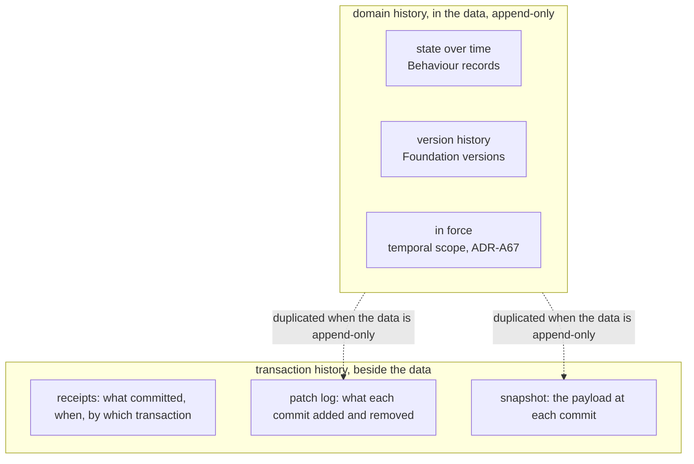

The first three are domain facts and belong to the layers that state them. When they are append-only, the payload never loses a fact, so a
patch log or a snapshot of it duplicates them. What a storage log adds is transaction history for data that *is* edited in place, change
capture for downstream consumers, and an audit of what each commit did.

## 4. How deep a change goes

A triple-level log never needs the path from the root. A triple names its own subject, and replay is set arithmetic. Depth shows up through
four other things, which are the real design dimensions.

| Dimension | Effect on the cost of one change |
|---|---|
| whether node IRIs survive a write | a re-minted subgraph makes every triple look changed |
| whether the change is an edit or a new thing in law | a requote is a new offer, so editing it in place loses a fact |
| whether a reference pins a version or names an identity | pinning forces a new version of every node on the path, as git rewrites trees |
| how finely versioned nodes are cut | a version is copied whole, so a coarse node is copied for one value |

### 4.1 The requote, four ways

The path is tower, layer, quote, terms, premium. A quote version is 80 triples (the workload note's figure), and the premium is one value
on the terms.

| Way | Written per requote | History per requote | Current read | As-of read |
|---|---|---|---|---|
| A. edit the premium in place, patch log | 1 removed, 1 added, receipt | 2 in the log | direct | backward replay (TD-48) |
| B. rebuild the quote with new IRIs inside the tower's aggregate, patch log | the tower swept and rewritten | 160 in the log | direct | backward replay |
| C. a new quote version pinning new member versions | about 80, nothing removed | in the data | follow the current pointer | the version current at t |
| D. a new version of the smallest versioned node, members named by identity, the root's manifest fixing versions | the changed node plus one manifest entry per member | in the data | resolve through the manifest | the manifest current at t |

B is what the composite strategy does today if the quote sits in the tower's aggregate. No new nodes are created. The whole tower is
deleted and written back. A medium programme's tower holds about 9,600 quote triples (8 layers, 15 carriers, 80 triples), so a
one-value change rewrites about 19,200 triples (9,600 out, 9,600 back), and TD-42's quadratic sweep makes that roughly 92 million template
fills today. C, with the quote in its own aggregate, adds one quote version of about 80 triples and touches nothing else. A writes 2.
Clarified 2026-10-14: an earlier wording read as if the 19,000 were new nodes under C.

### 4.2 Where the quote belongs

The maintainer's answer, 2026-10-14. The quote's versions and history are not part of the tower's aggregate. A `NegotiationThread`
aggregate, not yet defined, references the tower and governs the quotes. A quote attaches to the layer it is for, though the carrier knows
nothing of layers, a broking construct, and quotes only against an attachment point and a limit. A quote is structurally a contract, an
instrument on `ins:`, with a different epistemic status: an indication, a quote, a binding offer, firming as its details build up. This
matches the computable-contract-substrate sketch's account of proposals "at different levels of commitment", checked by the same shapes as
a contract.

So in the worked case the tower is written rarely, the thread is written per move, and each firming or requote is a new quote version.
Defining the thread and the quote's status is domain modelling for another unit (§7).

## 5. Options

### 5.1 Where history lives (VH-Q1)

| Option | Says | Consequences |
|---|---|---|
| (a) **domain history in the data** | versions, records and temporal scope hold domain history. The storage log is transaction history and change capture only, and is optional | one source for each fact. As-of reads are queries over versions, with no replay. The storage log shrinks to what in-place data needs. Persistence must write versions without deleting them (VH-Q3, VH-Q4) |
| (b) **the storage log is history**, as guide Chapter 20 reads | patch log or snapshot per family, the payload holds current state only | conflicts with ADR-A67 and Foundation for versioned classes. Depth and re-minting decide the log's size (§4). A pruned log loses history the domain still needs |
| (c) both, per family | a family declares which | every reader must know which a family uses, and the guide already warns that a consumer must not assume replay |

### 5.2 How versions refer to each other (VH-Q2)

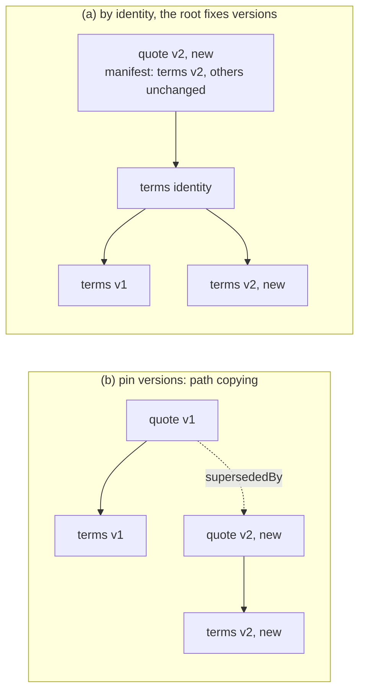

| Option | Says | Consequences |
|---|---|---|
| (a) **ADR-A112's rule, generalised** | a reference names an identity, and the aggregate root's version lists the member versions it fixes, as an assembled wording does | one rule across Wording and persistence. A change writes the changed node and a new root version with its manifest, O(members) pointers. As-of is one hop to the root version current at t |
| (b) pin versions | a reference names a version | a change at depth d writes d versions. Each root version is a complete state, so a snapshot is free |
| (c) per edge, declared beside `dal:ownership` | the adopter classifies each edge | most flexible, and a second classification on every edge |

### 5.3 How persistence learns a class is versioned (VH-Q3)

| Option | Says | Consequences |
|---|---|---|
| (a) read `fnd:Version` membership by IRI from the adopter's ontology, with no import, as a boundary shape names domain properties by IRI | the compiler checks `rdfs:subClassOf* fnd:Version` offline | no new import. Couples the compiler to one Foundation IRI, and does nothing for an adopter who versions without Foundation |
| (b) **a persistence declaration**, for example a write mode `dal:AppendVersions` on the family, with a shape that warns when a `fnd:Version` class is written by replace | the adopter states it, persistence stays import-free | domain-neutral and framework-like. The warning catches the conflict of §2 point 6 |
| (c) persistence imports Foundation | the ontology reasons about versions directly | an edge in the layer order, so an ADR (ADR-A01) |

### 5.4 The write for a versioned family (VH-Q4)

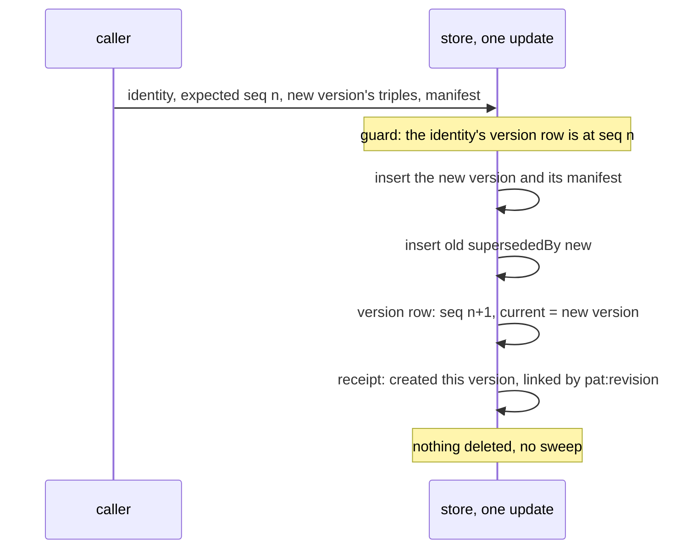

| Option | Says | Consequences |
|---|---|---|
| (a) **append, and move a current pointer on the identity's version row** | the version row, keyed by persistent identity, holds the current version beside `pat:seq` and `pat:head` | a current read is one lookup. The CAS is on the identity, so two requotes race as two writes to one quote do today. No sweep, so TD-42 does not apply. The new version links to its receipt with `pat:revision`, as an event does, which gives ADR-A67's transaction time inside a shared graph |
| (b) append, and derive current as "not superseded" | no pointer | every current read pays a `FILTER NOT EXISTS`, and a fork leaves two currents |

### 5.5 What remains of the receipt models (VH-Q5)

| Family writes | Receipt model | Why |
|---|---|---|
| by appending versions | receipt only, naming the versions created | history is in the data. The refusal `CompositeBoundaryReceiptOnly` does not apply, since nothing is swept |
| in place, history wanted | patch log, triple-level, read backward (TD-48) | transaction history and change capture for data with no versions |
| in place, no history wanted | receipt only | as today |

The snapshot model (H2.10) becomes either the root version's manifest under VH-Q2 (a), free under (b), or a copy for in-place data. Each
option keeps H2.6b's `ReceiptModelNotHonoured` warning until the model is built.

### 5.6 Retention (VH-Q6)

Superseded versions are kept until a policy prunes them, which is housekeeping (ADR-A80, TD-47). The questions are where the policy is
declared, per family or per class, and whether a version that something still references by version, an assembled wording's `includes`
for example, may be pruned at all. Leaning: never prune a version a retained version references, the version-level form of the guide's
pinned heads.

## 6. Behaviour's versioning (VH-Q7)

The maintainer suspects Behaviour's different approach has a reason, to be researched. What the source shows:

| Behaviour holds | How | Reading |
|---|---|---|
| configuration: state spaces, transitions, profiles | `fnd:Version` | things that change by being edited and restated, so versions |
| runtime records: occupancies, executions, findings | immutable individuals, never reopened, temporally scoped and evidenced | each is an occurrence, not a state of a continuant, so nothing to version |
| occasion occupancies | derived artefacts, `prov:wasDerivedFrom` their read set (law B1) | derived, so provenance, not succession |
| allowance accounts | a new record per change, `prov:wasDerivedFrom` the last and the execution, no shared identity | the odd one out: a balance is a state of a continuant, the account |

### 6.1 Research, 2026-10-14

Sources read: ADR-A08 (the four tiers), ADR-A92 (derived artefacts), ADR-A106 decision 5, the nested-states sketch §4, the
[evaluation-context sketch](evaluation-context.md) §5, §8 and §9 (unplanned since 2026-10-02), the examples `ordered-draws.ttl` and
`sequential-allowance.ttl`, and `bhv:AllowanceAccountShape`.

**Finding 1. Behaviour has three disciplines, and each has a reason.**

| Discipline | Behaviour's members | Why not versions |
|---|---|---|
| authored and edited, so **versions** | configuration | it is what versions are for |
| something that happened, so an **immutable record** | stimuli, executions, act and exercise records, state occupancies | an occurrence has no later state. A resumed state is a new occupancy, never a reopened one (nested-states §4) |
| computed from records, so a **derived artefact** | occasion occupancies (law B1), and in practice the allowance balances | a judgement is evaluated from facts, never authored (AGENTS.md, "Modelling"). Its provenance is its read set, which can span several accounts |

**Finding 2. A balance is computed state, and its order is the stimulus log's.** The evaluation-context sketch makes the ledger at
position p + 1 a function of the ledger at p and the pass at p + 1 (§8), positions come from the stimulus log because the engine never
reads a clock (law B3), and the Datalog form is `balance(Account, V, p)` (§9). A sequential pass adds micro-positions (p, i) in priority
order. So a balance record is keyed by its account and its position, and the log order already orders it. Because positions are log
order, which only grows, a late stimulus takes a later position, and the balance at an earlier position is never recomputed. That is
why no succession link is needed (a hypothesis, holding while law B3 and the evaluation-context design stand).

**Finding 3. `prov:wasDerivedFrom` carries what `fnd:supersededBy` cannot.** In `ordered-draws.ttl` the alert draw's guard reads the seat
bundle as the seat draw left it, so `alerts-1` derives from `alerts-0`, from the execution and from `bundle-2`, another account. Succession
links one identity's states. A read set crosses identities.

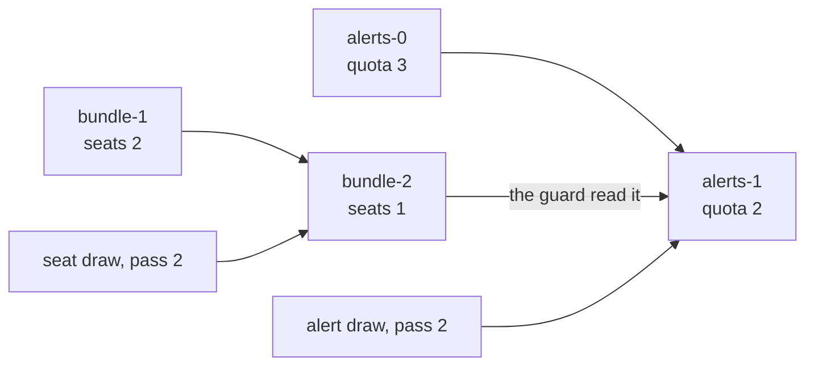

Arrows are `prov:wasDerivedFrom`, from source to derived record. Under versions, `bundle-2` would succeed `bundle-1` and `alerts-1`
would succeed `alerts-0`, and the edge from `bundle-2` to `alerts-1`, the reason the alert fired, would have nowhere to go.

**Finding 4. The account record is under-keyed.** Three gaps, each a gap between a stated design and the model:

1. `bhv:AllowanceAccount` is not typed `fnd:DerivedArtefact`, although its examples treat it as one and occasion occupancies are (B1).
2. A record names no owner and no position. The shape requires only `bhv:tracksAllowance` and `bhv:availableBalance`. The
   evaluation-context sketch says a ledger belongs to a persistent identity, as regime state does (ADR-A106 decision 5). Two licences on
   one allowance definition write records nobody can tell apart, and "current" can be read only from `fnd:recordedAt`, which is
   recording time, not the log position.
3. The name `AllowanceAccount` is used for a balance at a position. The account itself, the thing with an identity, has no node. The
   evaluation-context sketch's EC-Q2, whether allowances become ledger accounts, is the open question that would settle this.

The balances in the examples are blank nodes. Persistence writes no blank node (guide Chapter 5), so a balance quantity needs a minted
IRI before it is stored.

### 6.2 Options, revised

| Option | Says | Consequences |
|---|---|---|
| (a) **keep the three disciplines, and key the balance** | state the disciplines in Behaviour's README. A balance record is a `fnd:DerivedArtefact`, names its account's owner (a persistent identity) and its position, and keeps its read set in `prov:wasDerivedFrom`. Current is the record at the greatest position | matches the evaluation-context sketch and B3. About 2 more triples a record (owner, position). Each draw writes one record, append-only, so persistence writes it as a record-append family. A breaking change to Behaviour (ADR-A113), smaller if EC-Q2 decides it |
| (b) the balance becomes versions of an account identity | `fnd:hasIdentity` and `fnd:supersededBy` per record | loses the cross-account read set unless `prov:wasDerivedFrom` is kept too. Treats a computed value as authored, against the modelling rule. Within one pass, succession repeats the micro-position order |
| (c) both | allowed, since `fnd:Version` and `fnd:DerivedArtefact` are not disjoint | succession duplicates the position order at 2 triples a record, and invites a reader to edit a computed value as a version |

**Leaning (a)**, revised by §6.4. Behaviour is right to differ: what persistence calls "versioning" is one of three disciplines, and the
sketch's §5 should be read as "a versioned family" for the first, "a record family" for the other two. Finding 4 is input to EC-Q2, not a
change this sketch makes.

### 6.4 The roadmap, 2026-10-14

At the maintainer's request, before deciding anything for Behaviour, we read the planned and sketched work that touches the same
ground: the CCS plan, status and held questions, the evaluation-context, contract-amounts, reference-evaluator and terms-in-time
sketches, the capacity design and its execution profile, the AIR plans for Phases 5 and 6, the platform's phase 3 plan, the pending
design decisions and the debt register.

**Each need already has a home.**

| Need | Where it is planned or sketched | State |
|---|---|---|
| an account with an identity, keyed balances, a ledger of accounts on a tree, debits by path | [evaluation-context](evaluation-context.md) §5 and EC-Q2 ("generalising allowances into ledger accounts … at the cost of a breaking change to Behaviour"), [contract-amounts](contract-amounts.md) §3 items 1, 4, 8 | unplanned, and "comes back in" at CCS C12 (a pass as a run of the context), C13 and AIR Phase 5, which "should not start its contract module without this designed" |
| the balance at a position as a function of the previous one and the pass | evaluation-context §8, §9. [Reference evaluator](reference-evaluator.md) laws RE2 (a pass commits whole) and RE4 | sketched. RE2 and RE4 are conformance laws for formal-methods tracks B and E |
| repairing Behaviour's allowance contract: effect, application, definition, account | the [capacity design](../../architecture/capacity-domain-analysis-and-design.md) §12, Phase 0, whose exit criterion is "one unambiguous Behaviour contract for consuming a declared allowance and updating a tracked balance" | no unit. Capacity's source ontology (`cap:`) is designed, not authored, and AIR does not author it before Phase 5 |
| a capacity resource as the persistent thing a balance belongs to | `cap:CapacityResource`, linked by `cap:hasCapacityAccount` to "the balance record" | designed, not authored |
| a current balance for the hot path | `capx:ExecutableBalance`, one per resource (`capx:balanceRef` is functional), updated in place with its own `capx:balanceVersion` token and `capx:lastUpdatedAt` ([ADR-A-CAP1](../../architecture/decisions/ADR-A-CAP1-capacity-runtime-projection-profile_Version2.md), Proposed) | authored, 0.10.0, a projection materialised from the source |
| an instance stores only what differs, generated nodes shared by content address | CCS C7c D1 to D5, decided. CCS C16b builds the sharing, its cache and invalidation (TD-19) | planned, required before CCS closes |
| a record that cites exactly the data it saw | AIR-6.1: `sbm:Submission` is versioned and cites an exposure set *version*, "so an insurer's quote always refers to the data it saw". `sbm:InformationGap` is a derived artefact | briefed, in AIR's current trip |
| the quote and its firming, placements split across policies | CCS HQ-1 (a proposal arriving as data, without words), HQ-7 (several instruments covering portions of one order), AIR-6.1's `sbm:Approach` with status `Quoted`, insurml-alignment Phase 5 (placement records) | held questions and later phases. `NegotiationThread` appears only in the workload note |
| `fnd:Version` renamed `fnd:Versioned` | TD-20, "a Foundation maintenance unit, planned with its full cascade" | unplanned |
| the engine that writes Behaviour's runtime records | the platform's [phase 3 plan](../plans/phase-3-plan.md): the behaviour engine loads configuration and writes stimuli, executions, occupancies and records | rolling-wave placeholder |

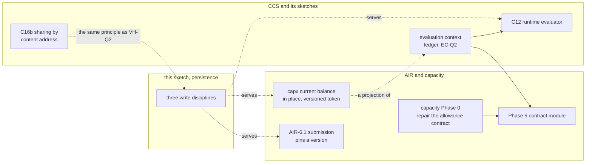

**What this changes.**

1. **Behaviour should not change in Track H.** The account's identity and keying (finding 4) is EC-Q2's to decide, and EC-Q2 comes back
   at CCS C12 and AIR Phase 5, where capacity's Phase 0 needs the same answer. Changing `bhv:AllowanceAccount` here would pre-empt both. Our
   finding 4 is input to EC-Q2, not a change of our own.
2. **The word "account" is open.** The evaluation-context sketch says "ledger account", capacity says "resource" with an "account",
   and the maintainer asks for a less domain-bearing word. That choice belongs with EC-Q2 too.
3. **The three disciplines are confirmed across the roadmap.** AIR-6.1 versions its submission, records its approaches, and derives its
   information gaps. Capacity versions its dependencies and rules, records its demands and draws, and projects a current balance.
4. **Two balance forms coexist, by design.** Behaviour's records hold the history, and capacity's `capx:ExecutableBalance` is the current
   value for the hot path, which is ADR-A67's two-path split. The projection is an in-place family. Its `capx:balanceVersion` is an
   optimistic-concurrency token of its own, which a persistence profile's version row already provides. That is input to VH-Q5.
5. **VH-Q2 needs a refinement.** References by identity hold inside content (ADR-A112), but a record that must cite exactly what it saw
   pins a version: the assembled wording pins its elements, and AIR-6.1's submission pins its exposure set. So the rule is "by identity
   inside content, pinned at the root and wherever a record is evidence of what was seen".
6. **CCS C16b is where "point, do not copy" is already decided** for generated meaning (TD-19). VH-Q2 should cite it rather than restate it.
7. **TD-20 and VH-Q3 touch the same term.** A Foundation unit renaming `fnd:Version` is the natural moment for any change VH-Q3 makes
   that touches Foundation, and the reason VH-Q3 leans away from importing Foundation into persistence.

### 6.3 What this changes for persistence

Persistence needs three write disciplines, not two, which VH-Q4 and VH-Q5 should name:

| Discipline | Persistence write | History |
|---|---|---|
| versions | append a version, move the identity's current pointer (VH-Q4) | in the data |
| records, occurrences and derived artefacts | append only, never replace, keyed by what they are about and their position | in the data. Derived records can be regenerated from the records they derive from, so retention may treat them as a cache |
| in place | replace, as today | a storage log, if wanted (VH-Q5) |

## 7. Out of scope here

- Defining `NegotiationThread`, the quote's epistemic status and the attachment of a quote to a layer. They are domain modelling, for an
  applied unit, and this sketch uses them only as the worked case.
- The in-force question, which ADR-A67 and the instrument layer answer.
- The event slots of H2.6b, which do not depend on any of this.

## 8. Questions for the maintainer

| # | Question | Leaning |
|---|---|---|
| VH-Q1 | where history lives (§5.1) | (a), domain history in the data |
| VH-Q2 | how versions refer to each other (§5.2) | (a), ADR-A112's rule generalised, refined by §6.4 point 5: by identity inside content, pinned at the root and wherever a record is evidence of what was seen |
| VH-Q3 | how persistence learns a class is versioned (§5.3) | (b), a persistence declaration with a warning shape |
| VH-Q4 | the write for a versioned family (§5.4) | (a), append and move a current pointer on the identity's row |
| VH-Q5 | what remains of the receipt models (§5.5) | the table in §5.5 |
| VH-Q6 | retention of superseded versions (§5.6) | never prune a version a retained version references |
| VH-Q7 | Behaviour's versioning (§6) | **decided 2026-10-20**: Behaviour's three disciplines are right, and no change to Behaviour here. The keying of a balance is the ledger plan's |

Answers decide whether the patch log is built as planned in H2.6b's held half, rebuilt as an append write for versioned families, or
narrowed to in-place data, and what H2.10 builds. An ADR follows the answers, since VH-Q1 and VH-Q3 change how persistence relates to
Foundation.

## 9. The vision papers, LATTICE, and the data a placement makes (2026-10-14)

At the maintainer's request, before the examples are designed, we read a series of vision papers
against LATTICE's layers and the plans under way. The papers predate LATTICE. LATTICE's designs 
supersede theirs, and their end-state goals stay as direction: a broker's programme connected to 
large volumes of data, every decision traced to evidence, and history reconstructable at any time. 
LATTICE serves more than placement. Delegated authority in the London market (Open CBAA, through 
Instrument's `ins:boundUnder` and powers) and the other domains of Instrument's worked examples 
(facilities, licences, trials, frameworks) put the same questions to data management.

### 9.1 Where each idea of the papers lands

| Idea in the papers | In LATTICE | State |
|---|---|---|
| a contract's structure (elements, term applications, facets, flow directives) | Wording elements, Instrument's stated and bound terms, relations and qualifiers, Quantification's amounts, Eligibility's conditions | built (CCS C3 to C9b2). The template library is C8a, planned |
| a quote as a "proto-contract", structurally a contract | an instrument version whose words are a proposal (CCS sketch, "proposals are many, and are fragments of instruments") | modelled in outline. A proposal arriving as data without words is held question HQ-1 |
| epistemic status: commitment, precision, completeness, as an overlay on the terms | "precision … and completeness are recorded beside its terms, never inside them" (CCS sketch §7.4). Commitment reads from legal acts: a binding quote is the carrier's `ins:Assent` to a version, and binding is the client's assent to the same version. "Pending, decided and lapsed are derived, never stored" (`ins:Proposal`) | acts built (C9b1). The overlay's terms are not yet defined |
| `p_bind` copies the quote's structure into a child contract | no copy: the bound contract is the version both parties assented to. A change at binding, such as a signed-down line, is an amendment | a hypothesis for the examples to test |
| master contract, arrangement assembly, panels and subscription | Instrument's sections (§16), Party's groups, held question HQ-7 (several instruments covering portions of one order) | partly modelled. PDD-09 |
| tower, block, coverage term set, the contract-tower and fulfilment bindings | the AIR contract module's "coverage, layers, term parameters" (Phase 5), AIR-4.4's coverage requirements, AIR-6.1's submission | not modelled. Phase 5 is deferred |
| negotiation thread as an append-only sequence of moves, state derived | legal acts (Instrument) and records (Behaviour), with state evaluated from them | the pieces exist. PDD-09 |
| a fact ledger, immutable, hash-chained, superseded by corrections | `fnd:Evidence`, Behaviour's records, ADR-A67's corrections as new versions, persistence's receipts and request digests | built in parts |
| `VersionedEntity` with valid-from and valid-to, "never deleted, superseded" | `fnd:Version` with `fnd:supersededBy`, `fnd:TemporalScope` for valid time, persistence for transaction time, a current pointer (VH-Q4) | built, VH-Q4 open |
| a terms hash that followers acknowledge | content-addressed element versions (ADR-A51, C7c D2) | built |
| a term delta fact, an endorsement change fact: the diff in business terms | `wrd:Amendment`'s operations and `ins:Amendment`, which already record the change in the words and its legal effect | built (C5, C9a) |
| coverage gaps and spans, materialised and recomputed within minimal scope | derived artefacts (ADR-A92), Surface projections with read-set invalidation (ADR-A27), interval geometry (workload note §19) | built in parts |
| the behaviour model's tank state, per scenario | the evaluation context's ledger (PDD-08), the reference evaluator's laws | sketched |
| an exposure set versioned with every member | AIR's exposure module, with members shared across versions (TD-49) | built on the AIR branch, TD-49 to fix |
| a coverholder binding risks under an authority, bordereaux, an income limit | `ins:boundUnder` and powers, Open CBAA's migration after C9 and C12, the ledger for the limit (PDD-08) | partly built |

Four places where LATTICE departs from the papers, each a hypothesis the examples should test:

1. **State is read, not authored.** The papers keep a thread state, a quote status, a binding status
   and a fulfilment status side by side. LATTICE evaluates state from acts and records, so four
   stored statuses become one derivation and cannot disagree.
2. **Binding points, it does not copy.** See the table.
3. **Versioning is chosen per family**, not applied to every entity, by the three disciplines of §6.3.
4. **History of the words lives in the words.** Wording's amendments are the domain-level patch log
   the papers built as delta facts.

### 9.2 How much data a placement makes, revisited

The workload note counts a quote version as 80 triples. Once a quote carries wording and meaning, the
count depends on which of LATTICE's rules are applied. Judgement, for a policy form of about 150
elements whose bound meaning is about 1,000 nodes (TD-19):

| What a quote version stores | Triples per version | 300 versions, a medium programme |
|---|---|---|
| everything, copied: its wording and its bound meaning | about 5,000 | about 1,500,000 |
| only what differs from its form (C7c D1): inclusions, about 30 values, parties, header. Stated meaning shared by content address (D2). Bound meaning generated, not stored (D4) | about 270 | about 81,000 |
| as above, and a requote shares the unchanged inclusions and values of the version it follows (VH-Q2) | about 5 to 20 for a one-value requote | about 6,000 |

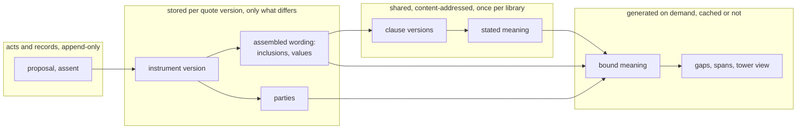

### 9.3 The levers, decided and open

| Lever | Saves | State |
|---|---|---|
| content-addressed element versions and stated meaning | restating a clause, across every instrument that uses it | decided, C7c D2 |
| an instance stores only what differs from its form | copying the form into each instance | decided, C7c D1 |
| bound meaning generated, cached as need dictates | storing about 1,000 nodes per instrument version | decided, C7c D4. Sharing across instruments is C16b |
| sharing within an instrument by resolution signature | one bound term per section with the same words | decided, C7c D5 |
| references by identity, versions fixed at the root | a version per ancestor for every change | decided for Wording (ADR-A112). VH-Q2 for persistence |
| members shared across versions of a set | copying unchanged members | TD-49 for exposure. VH-Q2 for inclusions and values |
| derived artefacts and projections, regenerated within minimal scope | storing what can be computed, and recomputing more than changed | decided (ADR-A92, ADR-A27). Which to materialise is open |
| the hot set sized by Little's law, the rest tiered and partitioned by tenant | keeping prior years hot | workload note §6.2, §17, unratified |
| a write discipline per family, a retention per kind | keeping history no one reads, or losing history someone needs | this sketch, TD-47 |

### 9.4 The strategies the examples should exercise

The examples should show each of these where it fits, so that guidance on "what works best when" rests
on worked cases:

| # | Strategy | Keeps | Costs | Likely fit |
|---|---|---|---|---|
| S1 | edit in place, receipts only | current state, who wrote when | 9 triples per write | working drafts, a broker's design workspace |
| S2 | edit in place with a patch log | current state, and what each write changed | 11 plus the change | data edited often whose history matters but whose old states are not cited |
| S3 | append versions, members shared, a current pointer | every version, each citable | the changed nodes plus pointers | instruments, wordings, submissions, exposure sets: what is cited as "as it was" |
| S4 | append records, state derived | every act and observation | one record per event | negotiation moves, assents, findings, stimuli |
| S5 | derived artefact, generated on demand | nothing but its recipe | compute per read, or a cache | bound meaning, gaps, spans, balances |
| S6 | content-addressed sharing | one node for equal content | a hash per node | library wording, stated meaning, bound meaning across instruments (C16b) |
| S7 | a projection, materialised and current | a fast read for a known query | refresh on change | "load my tower" within the 1 to 2 second budget (workload note §10) |
| S8 | tiering and export, an outgoing event stream | everything, cold or elsewhere | a columnar store, a stream | closed years, change capture to other systems |

A family declares its strategy, as it declares its receipt model today. That the declaration belongs
to persistence or to the domain layer is VH-Q3.

## 10. Questions for the examples and the strategy menu (2026-10-20)

The examples come in ADR-A-C2's order: the generic premise in writing, at least two worked examples from unrelated fields, then the
mechanism. Applied cases test the mechanism afterwards. Each example states its writes, what is kept, what is shared, what is generated,
and its cost in triples per write and per read, with diagrams (skill `lattice-design`).

**The generic premise, a draft.** A record that people act on changes over time. Some changes make a new thing a reader must be able to
cite as it was, some correct or refine a working draft, some record that something happened, and some are computed from the rest. Each
kind needs a different write, a different history and a different retention, and most of a record's content is shared with its earlier
states or with other records.

| # | Example | Field | Exercises (§9.4) |
|---|---|---|---|
| E1 | a software licence: a plan change mid-term, seats drawn and restored | software | S3 instrument versions, S4 records, S5 balances |
| E2 | a lending facility: an amendment, drawdowns and repayments | lending | S3 with shared wording, S4, S5 |
| E3 | a purchase order: lines revised before acceptance, partial deliveries after | procurement | S1 and S2 for the draft, S3 once accepted, S4 for deliveries |
| E4 | a trial protocol: an amendment in force at some sites before others | clinical research | S3 with valid time per site, references by identity |
| E5 | an exposure schedule: one location of 500 changes mid-term | insurance, applied | S3 with shared members (AIR-4.2a) |
| E6 | an offer revised, then accepted by assent, with no copy at acceptance | insurance, applied | S4 acts, S2 or S3 for the offer, S5 for state |
| E7 | an endorsement mid-term | insurance, applied | Wording's amendments as the history of the words |
| E8 | insurances bound under a delegated authority, declared against an income limit | insurance, applied | S4 at volume, S5 for the limit's balance |

| # | Question | Options | Leaning |
|---|---|---|---|
| EX-Q1 | which examples, in which order | (a) E1, E2 and E3 as the generic set, then E5, E6 and E8 as applied tests, E4 and E7 if they add a case the others miss. (b) all eight. (c) a smaller set, E1, E3, E5 | (a) |
| EX-Q2 | how deep each example goes | (a) on paper: a section per example, with diagrams and counts. (b) also fixtures, a TriG file per example with its stored triples, checked by a test. (c) also measured on both engines, as a benchmark (ADR-A124) that fails on a wrong count, never on time | (a) for all, (b) for the strategies we choose, (c) for S2 against S3 |
| EX-Q3 | how cost is counted | (a) triples per write, per read and kept per year, store-independent. (b) also bytes, which depend on the store | (a) |
| FS-Q1 | is the menu S1 to S8 right | (a) as listed. (b) S1 and S2 merged into one strategy with a receipt model, since they differ only in that. (c) others added once the examples show a gap | (b), then (c) |
| FS-Q2 | what declares a strategy | (a) a family, as a receipt model is declared today. (b) a class. (c) an edge of a boundary shape, as ownership is (§5.2) | (a), with (c) for what is shared (VH-Q2) |
| FS-Q3 | whether one record mixes strategies | (a) yes, by splitting it into families, for example an instrument's versions appended while a working draft beside it is edited in place. (b) one strategy per aggregate | (a) |
| FS-Q4 | how guidance on "what works best when" is given | (a) a decision table in the Persistence README. (b) compile-time advice, a warning where a declaration fits badly, for example a versioned class written by replace. (c) both | (c) |
| FS-Q5 | where an outgoing event stream (S8) is declared | (a) in the persistence profile. (b) in the platform, with work queues (ADR-A59) and housekeeping (ADR-A80), persistence recording only what each commit changed | (b) |
| FS-Q6 | which projections (S7) LATTICE ships | (a) none, a deployment declares its own in Surface. (b) a generic current view for each versioned family | (a) |
| FS-Q7 | where retention is declared (TD-47) | (a) per family, in the persistence profile. (b) in deployment configuration, ADR-A80's "how aggressively" | (a) for what may be pruned, (b) for when |

**Decided 2026-10-20.** EX-Q1 (b), all eight examples. EX-Q2 (a) for all, (b) for the chosen strategies, (c) for S2 against S3.
EX-Q3 (a). FS-Q1 to FS-Q7 at their leanings.


### 10.1 E1. A software licence: a plan change mid-term, seats drawn and restored

**The scene.** A vendor licenses a tool to a customer for 12 months on the Standard plan with 50 seats. The licence is assembled from the
vendor's form (120 elements, 25 values). In month 5 both parties agree to move to the Team plan, which raises the quota to 80 seats, changes
three plan clauses and four values, and takes effect on the first of the month. Seats are drawn when a user is assigned and restored when
the assignment ends, about 6,000 events a year. The customer asks two things later, what the plan said when seat 51 was refused in month 3,
and how many seats were free on 30 September.

**Terms.** `ins:Instrument` (a `fnd:Version`), `wrd:AssembledWording` with `wrd:includes`, `ins:Amendment`, `ins:Assent`, `bhv:AllowanceAccount`
and `bhv:TransitionExecution` exist. Proposed and not yet existing are the owner and position on a balance record, the typing of a balance as
`fnd:DerivedArtefact` (§6.1 finding 4), the write mode `dal:AppendVersions` (§5.3) and the version row's current pointer (§5.4).

**Counting rules (all examples).** A receipt is 9 triples (S1). An event record (stimulus plus execution) is 11. A balance record is 11, of
which 2 are the proposed owner and position and 2 the minted quantity IRI. A fully copied instrument version is about 270 (§9.2). Bound
meaning of about 1,000 nodes is generated, never counted as stored.

#### Events

| # | Event | Strategy | Written | Kept | Shared with earlier states | Generated on demand |
|---|---|---|---|---|---|---|
| 1 | licence formed, two assents | S3 first version, S6 for library clauses | ex:licence-v1 and its assembled wording (about 270), 2 assents (10), version row (2), receipt (9). About 290 | everything | all 120 clause versions and their stated meaning, by content address | bound meaning, on first evaluation |
| 2 | seat drawn, balance 50 to 49 | S4 | stimulus, execution, balance record `ex:seats-p1` derived from the execution (11 + 11), receipt (9). 31 | all three records | none needed, the record names its owner and position | none |
| 3 | seat restored, 49 to 50 | S4 | the same shape, `ex:seats-p2` derived from `ex:seats-p1` and the execution. 31 | all | as above | none |
| 4a | plan change agreed | S3 | ex:licence-v2: assembled wording (5), 3 changed includes (3), 4 values (16), instrument (8), ins:Amendment (6), 3 wrd:Amendment (12), statement (3), 2 assents (10), supersededBy (1), row move (2 removed, 2 added), receipt (9). About 75 | v1 stays untouched | 117 includes, 21 values, the parties, all unchanged clause meaning (a delta manifest, proposed under VH-Q2) | bound meaning of v2 |
| 4b | quota raised by 30 | S4 | an adjustment record `ex:seats-p3` derived from `ex:seats-p2` and from the amendment, with the execution. 31 | all | none | none |
| 5 | seat drawn under v2 | S4 | 31 | all | none | none |
| 6 | "seats free on 30 September" | S5 over S4 | nothing | nothing new | none | the record with the greatest position at or before that date, 11 triples read |
| 7 | "what did the plan say in month 3" | S3 read | nothing | nothing new | none | the version current at that date, found through the row and the supersededBy chain |

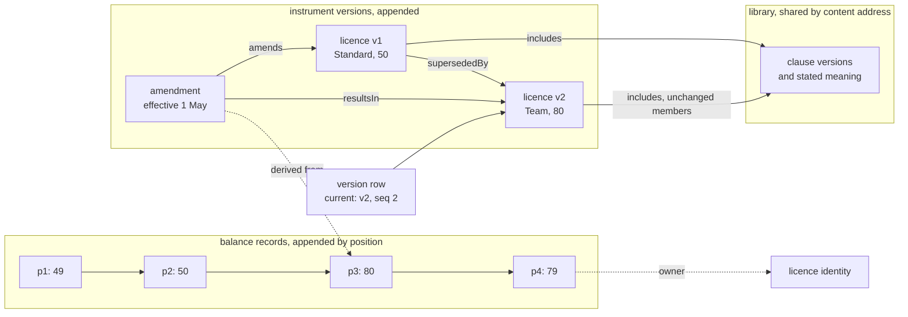

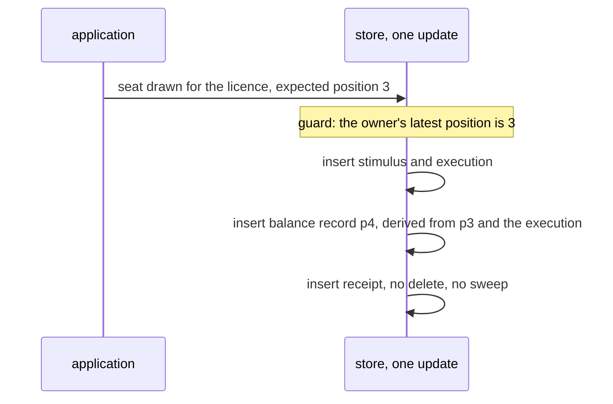

#### Cost

| Measure | S3 shared, S4 balance records (chosen) | S3 copied | S5 only, no balance records |
|---|---|---|---|
| plan change, triples written | about 75 | about 310 | about 75 |
| seat event, triples written | 31 | 31 | 20 |
| current instrument, triples read | row (2) plus header (8) | the same | the same |
| current balance, triples read | 11 | 11 | 11 for each event since the last checkpoint, about 33,000 by mid-year |
| kept in year one | 290 + 75 + 6,000 x 31 = about 186,400 | about 186,600 | about 120,400 |

Judgement, store-independent. The S5 column assumes no checkpoint. A checkpoint record every 100 events adds 60 balance records (660) and
bounds a read at about 1,100.

#### What goes wrong with a different strategy

- **Balance edited in place (S1).** 11 triples a write, and a current read of 1. The record of why seat 51 was refused is gone, so the
  customer's second question cannot be answered. Two simultaneous draws race on one row and one is lost or retried, where appended
  records take distinct positions.
- **Balance with a patch log (S2).** 13 triples a write and the history survives, but only in the log, which retention prunes from the
  oldest end (README §7.4). A guard that read another account has no place to cite it (§6.1 finding 3).
- **Balances as versions of one identity (S3 for records).** 2 more triples a record for a succession chain that repeats the position order,
  and the cross-account read set has nowhere to go. A reader may also edit a computed value as a version (§6.2 option c).
- **Plan change in place (S1 or S2).** The assent names a version, so there is nothing to assent to. The seat 51 refusal cites a plan that no
  longer exists, and the answer to the second question depends on log retention.
- **Plan change as a copied version.** Correct, and 4 times the cost (about 310 against 75), repeated for every amendment.

#### Supports

S3 for what a reader cites as it was, with unchanged members shared. S4 for each occurrence, S5 for a balance read when events are few and
a checkpoint when they are many. S6 for clauses. S1 and S2 do not fit a licence's record, though S1 fits the vendor's draft order form
before signature (see E3).

---

### 10.2 E2. A lending facility: an amendment, drawdowns and repayments

**The scene.** A lender group (two lenders, 60% and 40%) commits to a revolving facility of 10,000,000 to a borrower, from a lender's form of
150 elements and 30 values. About 24 drawdowns and repayments occur in a year. On 3 February the parties record an amendment that takes
effect on 1 January. It replaces the leverage covenant (clause 7.1) and changes the margin. The three parties assent over a fortnight and the
amendment is agreed on 20 February. A drawdown was made on 15 January, and interest for January must now use the new margin.

**Terms.** As in E1, plus `ins:Proposal` and `ins:Exercise` (legal acts, §6.4) for the borrower's request if the facility states drawdown as a
power, `wrd:Amendment` with a bespoke element `prov:wasRevisionOf` the library clause (wording §5.13), and `fnd:TemporalScope` for valid time.
The available commitment as an allowance balance is proposed on the same terms as E1. Whether a drawdown is a legal act or only an event is
the facility's wording, so the example counts the act (5 triples) as an option.

#### Events

| # | Event | Strategy | Written | Kept | Shared | Generated on demand |
|---|---|---|---|---|---|---|
| 1 | facility signed | S3, S6 | v1 with wording and values (about 300), 3 assents (15), row (2), receipt (9). About 325 | all | 150 clause versions and stated meaning | bound meaning, shared across sections by signature (D5) |
| 2 | drawdown 15 Jan | S4 | request act (5), execution (6), balance record 10,000,000 to 8,000,000 (11), receipt (9). 31 | all | none | none |
| 3 | repayment 28 Jan | S4 | same shape, balance back to 9,000,000. 31 | all | none | none |
| 4a | amendment proposed 3 Feb, effective 1 Jan | S3 append, S4 for the proposal | v2: bespoke clause 7.1 with its stated meaning (8 + 15), 1 include, 1 value (4), wording (5), instrument (8), ins:Amendment (6), 2 wrd:Amendment (8), proposal (5), receipt (9). About 70. The row does not move | v1 stays current | 148 includes, 29 values, parties, all other clause meaning | bound meaning of v2, when read |
| 4b | three assents, 3 to 20 Feb | S4 | 3 x (5 + 9). 42 | all | none | agreement, read from the assents (§6.3) |
| 4c | agreed 20 Feb | S3 pointer move | supersededBy (1), row (2 removed, 2 added), receipt (9). 12 | the old row state is in the receipt | all of v1 and v2 | none |
| 5 | drawdown 25 Feb | S4 | 31, the limit read from v2 through the row | all | none | none |
| 6 | interest for January, valid time 1 to 31 Jan, known on 1 Mar | S5 | nothing | nothing | balances and versions | margin from the version in force on those dates as known on 1 Mar, balance by position, then the amount |

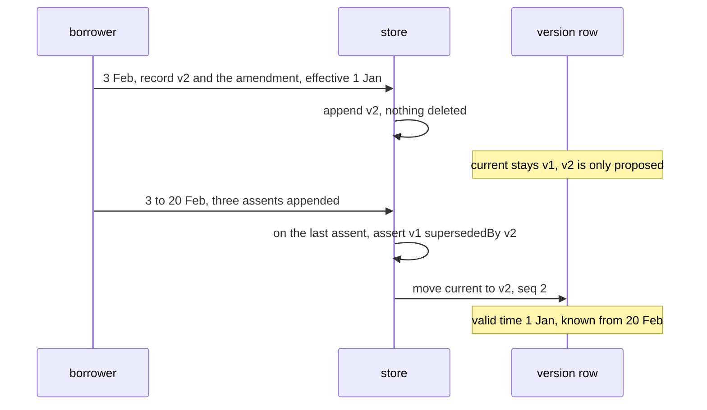

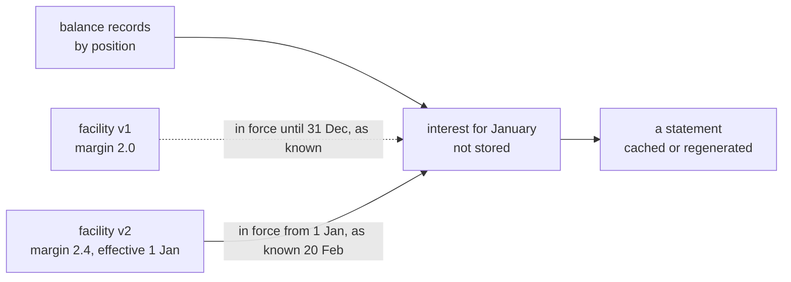

#### Cost

| Measure | Chosen (S3 shared, S4, S5 for interest) | S3 copied | Interest stored (S4) |
|---|---|---|---|
| amendment, triples written | about 125 (70 + 42 + 12 + proposal receipt) | about 380 | about 125 |
| drawdown or repayment, written | 31 | 31 | 31 + 12 for the interest record |
| current availability, read | 11 (balance) + 2 (row) + 4 (commitment value) = 17 | 17 | 17 |
| January interest, read | about 80 (6 balances, 2 versions, their values) | about 80 | 12, plus a check that none is stale |
| kept in year one | 325 + 125 + 24 x 31 = about 1,200 | about 1,450 | about 1,500 |

Judgement, store-independent. The 125 for the amendment folds the proposal's receipt into 4a.

#### What goes wrong with a different strategy

- **Pointer moved at proposal.** A reader of "current" sees an amendment nobody has agreed, and `ins:AgreedChainShape` allows several
  pending proposals against v1, so "latest written" is not "the agreed one". The chosen reading moves the pointer on agreement.
- **Interest stored when computed (S4 for a derived value).** The backdated amendment makes the stored January interest wrong with no
  new fact about January. A correction record is then needed (ADR-A67), and two interest values exist. Deriving it (S5) reads the version
  in force at the valid time as known at the read time and cannot disagree with the versions.
- **Balance recomputed on the backdated amendment.** The 15 January drawdown was admitted under v1. Rewriting its balance would change a
  record that happened. Position order never reruns (law B3), so only derived values, the interest, move.
- **Amendment edited in place (S1 or S2).** v1 vanishes, the three assents have no version to refer to, and "the covenant on 20 January"
  cannot be answered without log replay (TD-48) and log retention.
- **Amendment copied.** About 380 against 125, and every unchanged clause restated. A lender with many facilities on one form pays this on
  every amendment.

#### Supports

S3 with a pointer that moves on agreement, valid and recording time kept apart. S4 for acts and drawdowns. S5 for anything computed from
them, interest, headroom and covenant tests, since a late or backdated fact changes the result without a new record of the result. S6 for the
form. S8 once the facility closes, since its records are then read rarely.

---

#### Open points found

1. **The balance record is under-keyed** (§6.1 finding 4). Both examples assume an owner and a position (2 triples) and minted quantity IRIs.
   The counts change if EC-Q2 decides otherwise.
2. **What "current" means for a version row** (VH-Q4). E2 needs the pointer to move on agreement, not on write, and the layers that know
   agreement (Instrument, from assents) are not the layer that writes the row. Who asserts supersededBy and moves the pointer is undecided.
3. **Sharing of includes across versions is proposed.** Today `wrd:includes` is recorded per assembled wording. The shared counts (75 and 70)
   assume a delta manifest (VH-Q2). Without it a version adds the full inclusion list (about 120 and 150 triples more).
4. **Who writes the quota adjustment** (E1 event 4b). The engine that writes Behaviour's records is a placeholder (phase 3), and
   whether an amendment arrives as a stimulus is not stated.
5. **Backdated amendments and decisions already taken** (E2). Law I14 keeps existing occasions, but a guard that refused a draw under v1 and would
   admit it under v2 has no stated treatment.
6. **Receipt share.** 9 of every 31 triples in a record append are the receipt. One receipt for a batch of records, or none for append-only
   families, is a question for VH-Q5.
7. **Drawdown as legal act or event** depends on the facility's wording. The sketch should say the family is declared per class, not per field
   of law.
8. **Interest and covenant tests need a rule engine for S5.** Both read counts assume the evaluator exists (CCS C12).

### 10.3 E3. A purchase order, lines revised before acceptance, partial deliveries after

**Scene.** A buyer drafts a purchase order of 40 lines. The draft is revised several times before anyone outside sees it. The buyer
issues it as an offer. The supplier asks for two lines to change, the buyer reissues, and the supplier accepts. The goods arrive in
three partial deliveries. After the first delivery the parties agree to reduce one line. Nothing in the premise is specific to one
trade. Any record that is worked on privately, then offered, then performed in parts has this shape.

**Assumptions (judgement).** A line is a table entry with 4 value records, 12 triples. The header (instrument version, assembled
wording, 12 inclusions of template elements) is 30. A draft is therefore 30 + 40 x 12 = 510 triples. A receipt is 9 triples (§9.4 S1).
A version row update removes 2 triples and adds 2. A new version adds 1 `fnd:supersededBy` triple. An assent is 9 triples (act, scope,
evidence). A delivery record is 10 triples plus 3 per line delivered, so 34 for 8 lines. Sharing is at line granularity, one pointer per
line in the new version's manifest.

**Terms.** Real: `ins:Instrument`, `ins:Assent` (`ins:assentBy`, `ins:assentTo`), `ins:Amendment` (`ins:amends`, `ins:resultsIn`),
`wrd:AssembledWording`, `wrd:VariableValue` with `wrd:forEntry`, `fnd:supersededBy`, `bhv:ActRecord`. Proposed, not in the source,
`ex:PurchaseOrderDraft` (a family, not a class in the ontology), `ex:Delivery` (a subclass of `bhv:ActRecord` naming line identities
and quantities), and a per-line member node that a manifest points to.

#### Sequence

| # | Event | Strategy (§9.4) | Triples written | Kept | Shared | Generated on demand |
|---|---|---|---|---|---|---|
| 1 | the buyer creates the draft | S1, family `ex:PurchaseOrderDraft`, one graph per draft | 510 + 9 receipt | the draft and its receipt | the template's 12 elements, by inclusion | nothing |
| 2 | five revision sessions, 3 values each | S1, replace the draft's graph | per session 510 added, 510 removed, 9 receipt | the latest draft, 5 receipts | as above | nothing |
| 3 | the buyer issues the offer | S3, first version of the order's identity. The draft is retired | 510 + version row 4 + 9 receipt, then the draft's 510 dropped | version 1, the draft's 6 receipts | template elements | the bound meaning of the order (C7c D4) |
| 4 | the supplier asks for 2 lines to change, the buyer reissues | S3, version 2, 38 lines shared with version 1 | 30 header + 24 changed lines + 38 pointers + 1 supersededBy + 9 receipt + row 2 added, 2 removed | versions 1 and 2, both citable | 38 line nodes | nothing |
| 5 | the supplier accepts version 2 | S4, an `ins:Assent` to version 2. No copy | 9 + 9 receipt | the assent | version 2 is pointed at, not copied | whether the order is formed, read from the assent |
| 6 | three partial deliveries of 8 lines | S4, one `ex:Delivery` each, naming line identities | 34 + 9 receipt each | every delivery | none | outstanding quantity per line |
| 7 | the buyer asks what is still due | S5, read only | 0 | nothing | none | delivered and outstanding per line |
| 8 | after delivery 1 the parties reduce one line | S3, version 3, plus an `ins:Amendment`, plus two assents (S4) | 30 + 12 + 39 + 1 + 9 + row 2 added, 2 removed, plus amendment 12, plus 2 x 18 | versions 1 to 3, the amendment | 39 line nodes | outstanding quantity now uses version 3 |

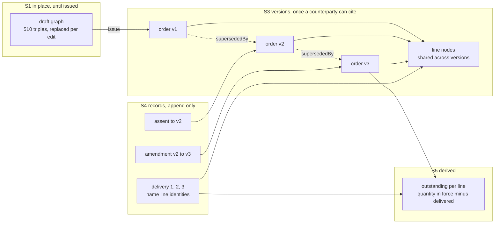

A delivery names a line by its identity, never by the line's version. It therefore stays correct when version 3 changes the line, and
the outstanding quantity is evaluated from the delivery and the quantity of the version in force when the delivery was made.

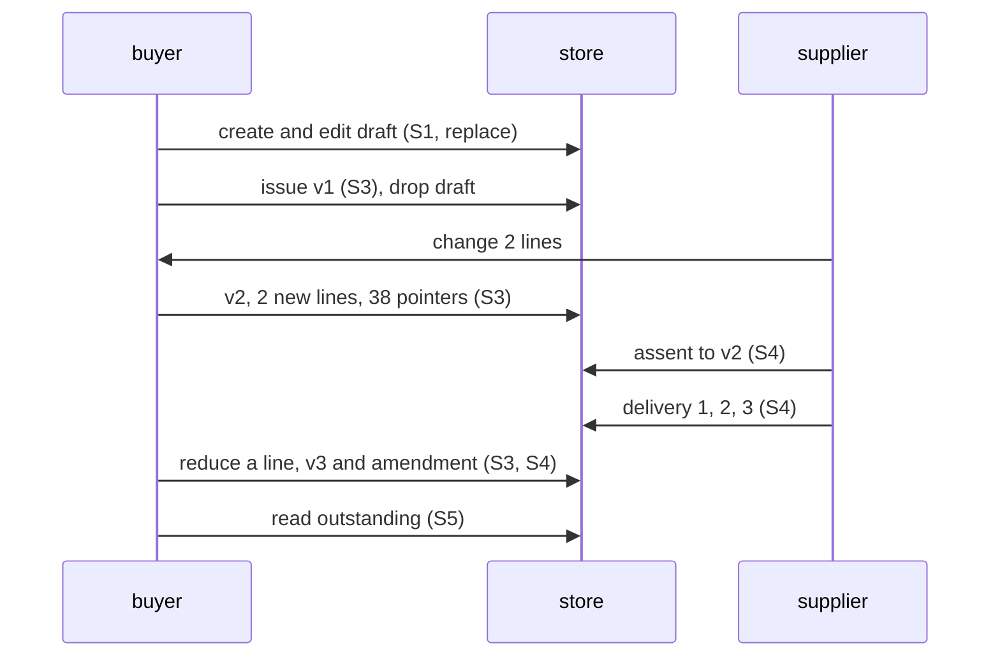

#### Cost (triples, store-independent, judgement)

| | Per write | Per read | Kept per order |
|---|---|---|---|
| draft create, S1 | 519 added | the draft, 510 | 519 until retired |
| draft edit, S1 replace | 1,029 touched (510 + 510 + 9) | 510 | +9 per edit, 45 for five |
| draft edit, one value, `dal:NoBoundary` guard | 13 touched (1 + 1 + 9 + a guard) | 510 | +9 |
| draft edit, S2 | S1 cost + 11 + 6 changed | 510, or backward replay for an earlier draft | +17 per edit |
| issue, S3 | 523 added, 510 dropped | current: row 4 + 550 (header, 40 pointers, 480 line triples) | 523 |
| reissue, S3 shared | 104 added, 2 removed | as above | +102 |
| reissue, S3 copied | 523 added | as above | +521 |
| assent, S4 | 18 | 9 | 18 |
| delivery, S4 | 43 | 34 | 43 |
| outstanding, S5 | 0 | 4 + 550 + 34 per delivery, 656 after three | 0 |
| amendment and v3 | 105 + 36 assents | | +139 |

Kept per order with this mix is about 965 triples (54 draft receipts, 523, 102, 18, 129, 139). At 5,000 orders a year (assumption) that is
about 4.8 million triples a year. Copying every version in full adds about 840 per order and makes it about 1,800. A projection (S7) of
delivered and outstanding per line would add about 32 triples of in-place churn per delivery and cut the read to 80.

#### If a different strategy were chosen

| Choice | Correctness | Consistency and cost |
|---|---|---|
| S1 throughout, after issue too | the supplier accepted "the order", and no version says what that was. The line reduction rewrites the quantity the earlier deliveries were measured against | smallest to keep (about 510). A patch log (S2) recovers old states by backward replay (TD-48) but cannot be cited by the assent |
| S3 for the draft | every edit becomes a version nobody cited. They need a retention rule to be removed (TD-47) | about +100 per edit session kept, and a long supersession chain |
| S1 for the delivered quantity, a field edited in place | two receiving docks race on one value, and a correction leaves no trace of the wrong figure | the guard (`dal:NoBoundary`) makes one lose and retry. History is lost unless S2 is added |
| pin versions in deliveries | a delivery would name version 2's line, and version 3 would have no delivery against it | a read must follow supersession to join them |
| S5 balance kept as an edited quantity | the stored figure and the deliveries can disagree | one value to keep right, and a recomputation to detect drift |

**Guidance this supports.** Split a record by lifecycle (FS-Q3 (a)). Edit in place while only the author can see it, and drop the
graph when it is issued. Append a version at the moment a counterparty can cite it, and share the unchanged members. Record what
happens as records that name members by identity, and compute the balance. A receipt-only model is enough for the draft. A patch log
earns its cost only if drafts are audited.

---

### 10.4 E4. A trial protocol, an amendment in force at some sites before others

**Scene.** A trial runs at 12 sites under one protocol. The sponsor amends it once, changing a visit window from 7 to 5 days and adding
a week 24 visit. The amendment is approved centrally on 1 March. Each site starts using it on its own date once its local review and
training are done. Three sites start on 1 March, four on 15 March, five on 2 April. One site reports its start 10 days after it
happened. A question arises for a visit at a site on 20 March, as known on 18 March and as known on 30 March. The premise is any
document of one authored text that takes effect on different dates for different holders, such as a standard, a policy or a rate card.

**Assumptions (judgement).** The protocol's assembled wording includes 120 element versions, 1 pointer each, and 25 variable values of 4
triples. The header is 30. Version 1 is 30 + 120 + 100 = 250. The amendment changes 1 value (4 triples), adds 1 bespoke element (10)
placed under the wording (`wrd:placedUnder`), 2 new cells (8), and 2 `wrd:Amendment` operations plus an `ins:Amendment` (24). Clauses
refer to the visit window by variable identity (ADR-A112), so no clause changes version. A site activation record is 9 triples. A
receipt is 9.

**Terms.** Real: `ins:Instrument`, `ins:Amendment` (`ins:amends`, `ins:resultsIn`), `wrd:AssembledWording` with `wrd:includes` and
`wrd:hasValue`, `wrd:Amendment`, `wrd:placedUnder`, `fnd:hasTemporalScope` with `fnd:validFrom`, `fnd:hasEvidence` with
`fnd:recordedAt`, `bhv:Record` (which is `fnd:Evidenced` and `fnd:TemporallyScoped`). Proposed, `ex:SiteActivation`, a subclass of
`bhv:Record` that names a site, the version it starts using, and carries the valid time. Its end is derived from the site's next
activation, since records are never reopened.

#### Sequence

| # | Event | Strategy (§9.4) | Triples written | Kept | Shared | Generated on demand |
|---|---|---|---|---|---|---|
| 1 | protocol version 1 is issued | S3, first version | 250 + row 4 + 9 | version 1 | 120 element versions and their stated meaning | bound meaning |
| 2 | 12 sites activate version 1 | S4, `ex:SiteActivation` each, valid time and recorded time | 18 each, 216 | 12 records | version 1 is pointed at | nothing |
| 3 | the sponsor amends, effective 1 March | S3, version 2 with `ins:Amendment` | about 220 (shared values) + 1 + 9, row 2 added, 2 removed | version 2, the amendment | 120 inclusions are the same element versions, 24 values shared | bound meaning of version 2 |
| 4 | sites activate version 2 on 1 and 15 March and 2 April | S4, one record per site, 12 keys that never contend | 18 each, 216 | 12 records | version 2 pointed at | nothing |
| 5 | site 9 reports on 25 March a start on 15 March | S4, a record with valid time before recorded time | 18 | the record | none | findings for visits at site 9 from 15 to 25 March, regenerated within their read set (ADR-A27, ADR-A92) |
| 6 | which version governed a visit at site 4 on 20 March | S5, read only | 0 | nothing | none | the site's latest activation not after 20 March and recorded not after the "known" date, then one hop to the version |

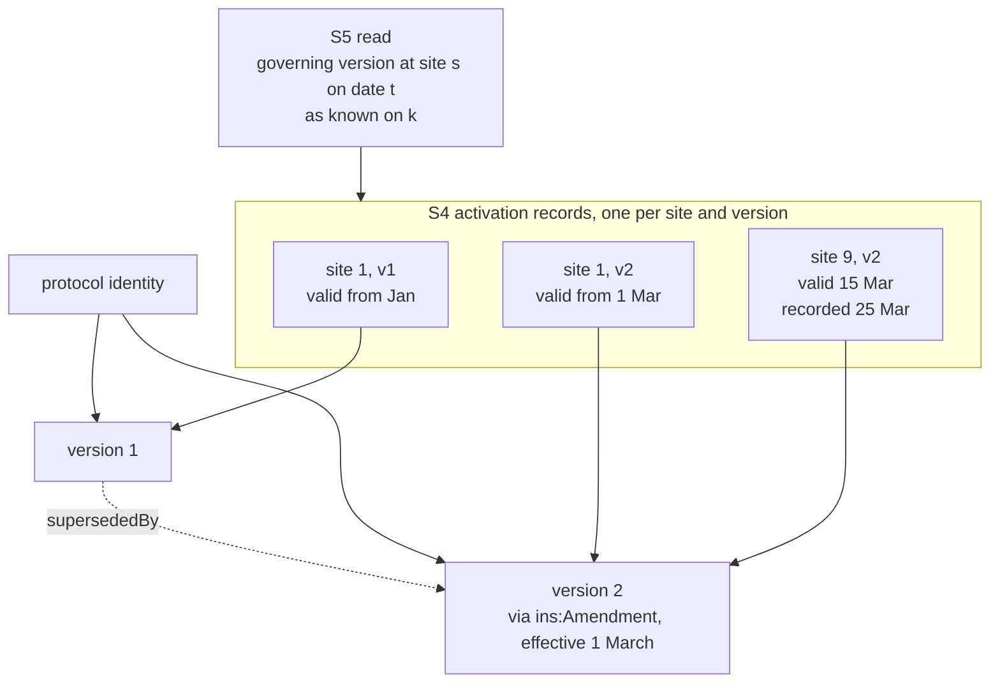

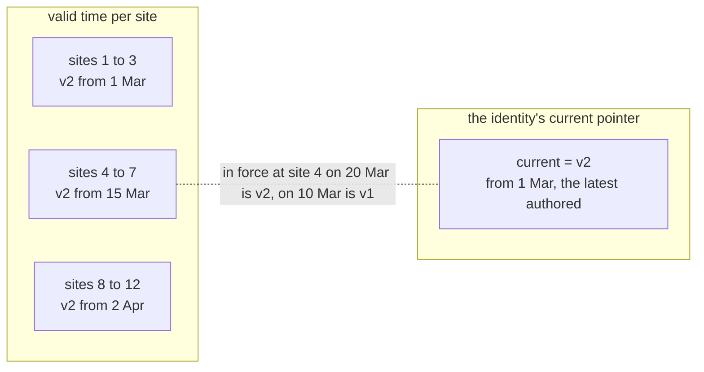

The identity's current pointer (VH-Q4) answers "the latest authored version" and is v2 from the day the amendment is issued. It does not
answer "in force", which depends on the site and the date.

#### Cost (triples, store-independent, judgement)

| | Per write | Per read | Kept |
|---|---|---|---|
| issue version 1, S3 | 263 | 4 + 250 | 263 |
| amendment, S3 shared values | 233 added, 2 removed | 4 + 250 + 6 | +231 |
| amendment, S3 values copied (today's `wrd:hasValue`) | 293 + 12 = about 305 | same | +303 |
| site activation, S4 | 18 | | 18 each, 24 per protocol and amendment round |
| governing version at site s, date t, known k, S5 | 0 | 3 activations x 9 + 4 + 1 hop, about 32 | 0 |
| every site's governing version, S5 | 0 | about 330 | 0 |
| the same, S7 projection (site, version, since) | 3 changed per activation | 36 | 36 |

Kept per amendment round is 231 + 12 x 18 = about 450. Two rounds a year is about 900 per protocol, and 200 protocols is about 180,000
triples a year. A copy of the protocol per site per amendment would write 12 x 293 = 3,516 per round, about 3,600 kept, and 8 times as
much.

#### If a different strategy were chosen

| Choice | Correctness | Consistency and cost |
|---|---|---|
| S1, edit the protocol in place | version 1 is gone while 7 sites still follow it. No site can cite the text it used. A visit evaluated yesterday cannot be explained | cheapest, and unrecoverable except by a patch log |
| S2 plus a "site status" row edited in place | a patch log orders changes by commit, not by valid time, so site 9's back-dated start lands after the visits it governs and a replay gives the wrong answer | all 12 sites contend on one row's guard. Old states by backward replay (TD-48) |
| a protocol version per site (S3 x 12) | the sites no longer share one text. Equality of the amendment across sites must be proved by comparing 12 copies | about 3,600 kept per round |
| one `ins:Amendment` per site, each with its own scope | `ins:resultsIn` is functional and one agreed amendment per version is a rule (`ins:AgreedChainShape`), so 12 amendments cannot all produce version 2 | rejected by the shapes |
| pin versions in clauses, not identities | the visit window's change ripples into the 15 clauses that mention it and the 6 sections above them, 21 new element versions of about 8 triples | about 170 more triples per round, and every site document that names a clause is stale |
| read "current" as in force | 7 sites are wrongly shown on version 2 between 1 and 15 March, and 5 until 2 April | no extra cost, wrong answers |
| activation records pin the version | none, a record of what was started must say which version. Participants' consent records pin it too, for the same reason | the rule is "by identity inside content, pinned in evidence" (§6.4 point 5) |

**Guidance this supports.** Version the text once and share what does not change. Record the dates on which each holder starts using it
as records with valid time, never as edits to the text or to a shared row. Derive "in force" from the records, and treat a current
pointer as "latest authored". Reference by identity inside content and pin in records of what was seen. Regenerate derived findings
within their read set when a late record arrives, and keep both the valid time and the recorded time so a past answer can be reproduced.

---

#### Open points found

1. `wrd:hasValue` is inverse-functional, so a value record belongs to one assembled wording and cannot be shared by the next version.
   Sharing values (E3 events 4 and 8, E4 event 3) needs that relaxed, or a value set node a manifest can point to. This is VH-Q2's
   open edge, and the saving is large for 12-triple lines and small for E4 (about 70 of 300).
2. Sharing pays when a member is heavy. Where the member is already a pointer, as `wrd:includes` is, a version costs O(members) either
   way. The granularity of a manifest (per line, per value record, 152 pointers rather than 40) needs deciding.
3. `ins:Amendment` has one temporal scope, and agreement is read from the assents of every party. Neither expresses an entry into force
   that differs per holder. E4 uses a proposed record, `ex:SiteActivation`. Whether that belongs in Instrument, in Behaviour, or in an
   applied layer is a modelling question outside persistence.
4. VH-Q4's current pointer means latest authored. A family must not read it as in force. A shape or a name should say so.
5. Records are never reopened, so an activation's end is derived and a correction of a wrong date has no succession link. ADR-A67 says a
   correction is a new version, and records are not `fnd:Version`. Needs an answer, possibly `prov:wasRevisionOf`.
6. At issue, a draft in one family becomes an instrument version in another. Who mints the order's persistent identity, and whether the
   draft's identity continues, is not stated (FS-Q3 (a) splits the family but not the identity).
7. No class for a delivery exists. `bhv:AcceptanceRecord` is deprecated in favour of `ins:Assent`, so E3 uses `ins:Assent` and a
   proposed `bhv:ActRecord` subclass.
8. A late record (E4 event 5) forces regeneration of findings for visits already evaluated. That depends on read-set invalidation
   (ADR-A27), which this sketch assumes and does not specify.
9. All counts are judgement. A line of 12 triples, a header of 30 and a receipt of 9 are assumptions. The ordering of the options
   holds across a wide range, the absolute figures do not.

### 10.5 E5. An exposure schedule of 500 locations, one location changes mid-term

**Scene.** An insured's exposure schedule (`aeo:ExposureSet`, one persistent identity) lists 500 locations. Each location has a building
asset and a valuation. The schedule is issued as of 2027-01-01. On 2027-07-01 one location moves to a new address and its valuation is
restated. Other systems cite the schedule "as it was", so version 1 must stay readable unchanged after version 2 exists. The shape is that of
`ontology/applied/insurance/exposure/examples/versions.ttl` (AIR-4.2a, TD-49), at 500 locations.

**Assumed sizes** (a judgement, from the fixture's shape).

| Node | Triples | Counted as |
|---|---|---|
| location version | 7 | type, identity, address (link, type, label), territory, geo precision |
| building asset version | 4 | type, identity, class, located-at |
| valuation version | 11 | type, scope (3), value-of, type, basis, amount (link, 3) |
| membership pointers from the set | 3 per location | `aeo:hasLocation`, `aeo:hasAsset`, `aeo:hasValuation` |
| set header | 10 | type, identity, scope (3), governance state, reporting unit, evidence, and two spare |
| receipt | 10 | the 9 of S1 plus the `pat:revision` link |
| identity's version row | 3 on first write, then 2 out and 2 in | current pointer and `pat:seq` |

So one location with its pointers is 25 triples, and the first version of the schedule is 500 x 25 + 10 = 12,510 triples.

#### Sequence of events

| # | Event | Strategy | Written | Kept | Shared | Generated |
|---|---|---|---|---|---|---|
| 1 | schedule issued, version 1 | S3 | 12,510 + row 3 + receipt 10 = 12,523 | all of it | nothing yet | nothing |
| 2 | the change is keyed in a working draft, three edits | S1 | about 13 per edit (receipt 9, 2 out, 2 in) | the draft's last state (10) and 3 receipts (27) | none | nothing |
| 3 | the draft is issued, version 2 | S3 | 1,549 added, 3 removed | version 1 whole, version 2's own nodes | 499 locations, 499 assets, 499 valuations (10,978 triples) | nothing |
| 4 | a record cites version 1 or version 2 | S3 | a pointer to the version | the pointer | the whole version | nothing |
| 5 | "what changed on 2027-07-01" is asked | S5 | nothing | nothing | none | 3 member pairs, from the supersession links |

**Event 3 in detail.** The address change forces a new location version. The asset states `aeo:locatedAt` the location version, and the
valuation states `aeo:valueOf` it, so each pins a version and each gets a new version too. This is the "pin a version" cost of §4, and it stops
at depth two because the set lists members and does not own them.

| Item | Added | Removed |
|---|---|---|
| location v2, asset v2, valuation v2 | 22 | 0 |
| `fnd:supersededBy` on the three old members | 3 | 0 |
| set v2 header | 10 | 0 |
| set v2 pointers, 3 per location, 500 locations | 1,500 | 0 |
| set v1 `fnd:supersededBy` and governance state turned to Superseded | 2 | 1 |
| version row (pointer and `pat:seq`) | 2 | 2 |
| receipt linked by `pat:revision` | 10 | 0 |
| total | 1,549 | 3 |

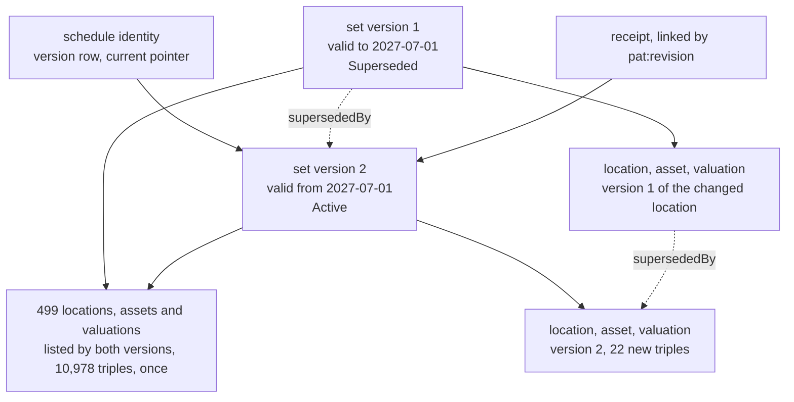

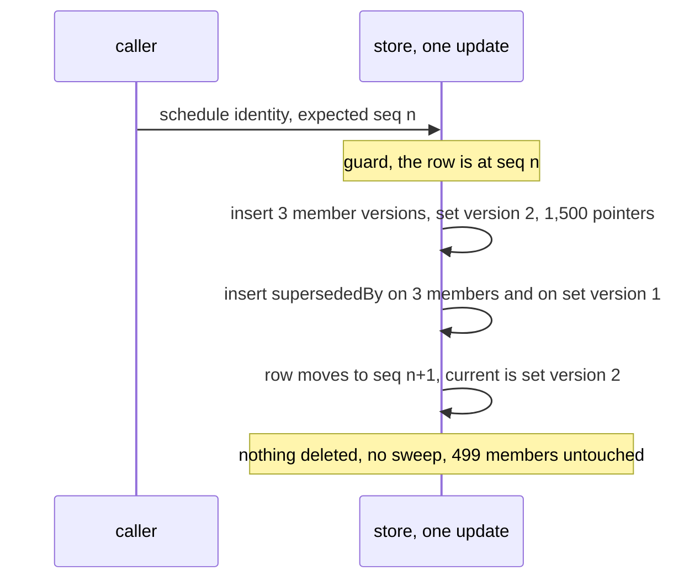

#### Cost

| Measure | S3 as written | Copy every member into each version | Edit in place, S2 | Manifest as a delta (open) |
|---|---|---|---|---|
| triples per write of the first version | 12,523 | 12,523 | 12,523 | 12,523 |
| triples per one-location change | 1,549 added, 3 removed | about 12,530 added | about 19 (11 + 4 in the log + 4 changed) | about 55 |
| triples per current read | 12,513 (row 3, header 10, pointers 1,500, members 11,000) | 12,513 | 12,510 | 12,513 plus a walk back along the chain |
| triples per as-of read | the same, plus the choice of version, about 240 header reads | the same | replay of the log backward, TD-48 | the same, plus a walk |
| kept after a year of 24 changes | 12,523 + 24 x 1,546 = 49,627 | 12,523 + 24 x 12,530 = 313,243 | 12,510 + 24 x 15 = 12,870 | 12,523 + 24 x 55 = 13,843 |
| old version citable as it was | yes | yes | only by replay, until the log is pruned | yes |

Assumptions are 24 single-location changes in the year, no renewal, the sizes above, and a kept count that nets removals out. The kept
figure for S3 is dominated by the 1,500 pointers of each version (97 percent of a change), not by the changed nodes. The judgement, true on
any store, is that sharing removes the member copies (10,978 triples per change) and leaves a cost proportional to the member count.

#### What other strategies get wrong

- **S1 or S2 on the set, as the composite write does today.** The replace deletes version 1 (§2 point 6), so version 2 overwrites what a
  citing record saw. ADR-A67 is broken, and a patch log can restore it only while the log is kept.
- **Copying every member** keeps history and loses identity. The 499 copies are separate nodes with equal content, so "what changed"
  needs a content diff, and a reader cannot tell by node that the factory is the same factory.
- **Pinning a version at the set** with members that pin it too, without the set owning them, is the cascade of event 3. If the set
  owned its members the cascade would reach the root and rewrite the set whole.
- **A stored "changed members" list** can disagree with the versions. S5 derives it from `fnd:supersededBy`, so it cannot.

#### Guidance this supports

1. A schedule that others cite is S3, with members listed by identity and shared. A working draft beside it is S1 (FS-Q3 a).
2. Membership must stay non-inverse-functional (TD-49), or a reasoner merges the two set versions.
3. The pointer list is the remaining cost and grows with the member count, so how a set version names its members is the lever to settle
   (open point 1).

---

### 10.6 E6. An offer revised once, then accepted by assent, with no copy at acceptance

**Scene.** A market response (an offer) proposes one instrument version. Before it is issued it is a working draft. After issue it is
revised once (an end date is moved), and then accepted. The accepting party's assent is the only thing written at acceptance. There is no
status field and no second instrument. The offer is the instrument version both parties assented to (§9.1 hypothesis 2).

**Assumed sizes** (a judgement, from §9.2).

| Node | Triples | Counted as |
|---|---|---|
| instrument version of the offer | 270 | header and parties 60, inclusion pointers 150, 30 value nodes of 2 triples |
| `ins:Proposal` | 9 | type, proposed-by, proposes, scope (3), evidence (3) |
| `ins:Assent` | 10 | type, assent-by, assent-to, scope (3), evidence (3), one spare |
| receipt | 9 | S1 and S4 writes carry no version row |

#### Sequence of events

| # | Event | Strategy | Written | Kept | Shared | Generated |
|---|---|---|---|---|---|---|
| 1 | the offer is drafted, three edits | S1 | about 13 per edit | the draft's last state and 3 receipts | none | nothing |
| 2 | the offer is issued as version 1 | S3, S4 | 270 + proposal 9 + offeror's assent 10 + row 3 + receipt 10 = 302 | all | clause versions and stated meaning, by content address (S6) | bound meaning, on demand (S5) |
| 3 | the offeror revises the end date, version 2 | S3, S4 | see below | version 1 whole, version 2's own nodes | 149 of 150 inclusions and 29 of 30 values | nothing |
| 4 | the other party accepts | S4 | one assent, 10 + receipt 9 = 19 | the assent | the whole of version 2 | nothing |
| 5 | "is the offer open, is it formed" is asked | S5 | nothing | nothing | none | the answer, from the acts and the chain |
| 6 | the same question as known on an earlier date | S5 | nothing | nothing | none | the answer, from acts whose evidence time is no later |

**Event 3 in detail.** The new instrument version names the same persistent identity as version 1. The old version gains
`fnd:supersededBy`. A new proposal puts version 2 to the party, and the offeror assents to it. Nothing is deleted, and version 1's proposal
and assent stay as written, naming version 1. What they now mean is derived (event 5).

| Way to write version 2 | Triples for the version | Total with proposal 9, assent 10, supersession 1, row 4, receipt 10 |
|---|---|---|
| copy the whole version | 270 | 304 |
| header and parties new, pointers to the same inclusions and values, one new value | 60 + 150 + 30 + 2 = 242 | 276 |
| header new, the predecessor named, one changed value (the band of §9.2) | about 15 | about 49 |

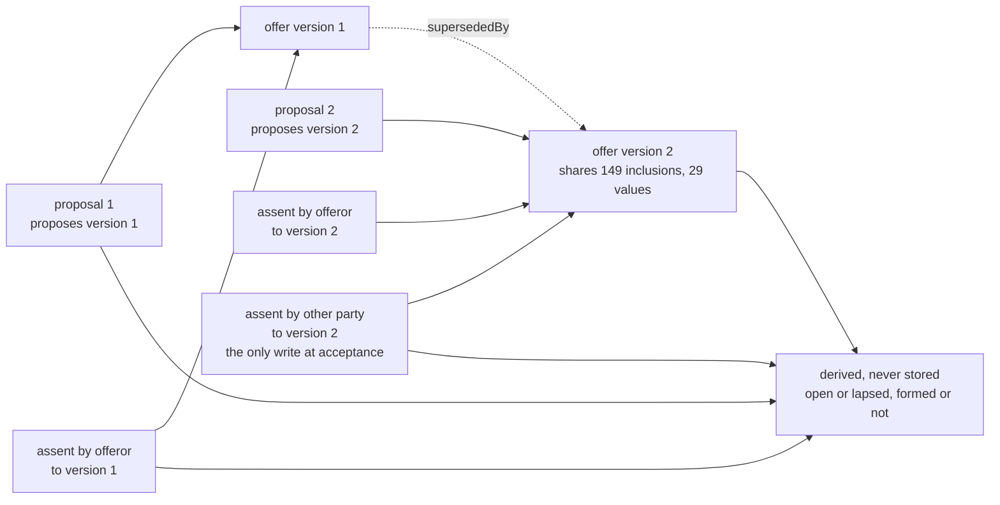

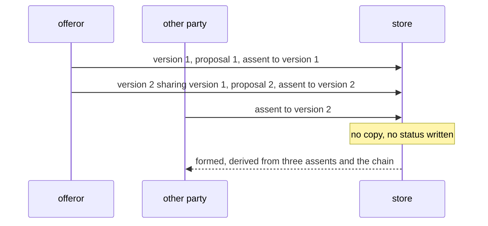

**Event 5 in detail.** The evaluator reads the acts and the chain. It takes the latest version in the chain valid at the date, reads the
parties that version names, and reads the assents to it. When every named party has assented (`ins:OnAcceptance`), the instrument is formed
from the valid time of the last assent. Version 1's proposal is found to have lapsed because a later version of the same identity exists
and no assent reached it from the other party. The rule that makes it lapse is open point 3. As-of reads filter on evidence time, so a
late-recorded assent does not change the answer for a date before it was known.

#### Cost

| Measure | As written | Copy the offer at acceptance and store a status |
|---|---|---|
| triples per revision | 276 shared by manifest, about 49 as a delta | 304 |
| triples per acceptance | 19 | about 270 for the copy, plus 2 to 6 for status edits, plus the link between them |
| triples per read of the state | acts 2 x 9 + 3 x 10 = 48, two version headers about 30, parties about 6, so about 85 | about 10 for a status read |
| kept per offer (one revision, one acceptance) | 302 + 276 + 19 = 597, or 370 with deltas | 302 + 304 + 280 = about 886 |
| kept per thousand offers, same path | about 597,000, or 370,000 | about 886,000 |
| status can disagree with the acts | no, it is derived | yes |

Assumptions are one revision and one acceptance per offer, the sizes above, and no cache. The extra read cost of about 75 triples is the
price of deriving state. It is a few lookups and is paid only when someone asks. A cache (S7) trades it back for a refresh on every act, and
none is needed for this record alone.

#### What other strategies get wrong

- **S1 or S2 on the issued offer.** Version 1 is overwritten, and the assent to "version 1" now points at words the party never saw. The
  question "what did they agree" has no answer. A patch log restores it only by replay, and only while kept.
- **A stored status** (open, revised, accepted) beside the acts can say accepted when no assent exists, or open after the last assent. The
  derivation cannot.
- **A copy at acceptance** makes two instruments that can drift, and the assent names one while the parties act on the other.
- **Applying `ins:Amendment` to the pre-issue revision** would make agreement require every party's assent to the result, which is wrong for
  an offer that was never agreed (open point 2).

#### Guidance this supports

1. State that acts can establish (open, formed, lapsed) is derived (S5) and never stored. The acts are append-only records (S4).
2. A document that others can assent to is S3 from the moment it is issued. Before then it is S1, in a separate family.
3. Acceptance writes the assent and nothing else. A bound instrument is the version assented to, so no copy is made.

---

#### Open points found

1. **How a set version names its members.** E5 shows 97 percent of a change is the full list of pointers. A delta manifest ("the
   predecessor plus these changes") cuts a one-location change from about 1,549 to about 55 triples, and moves cost to reads, which walk
   the chain. §9.2's band of 5 to 20 triples for a requote assumes the delta. Both E5 and E6 need this decided under VH-Q2.
2. **Is the revision of an offer an `ins:Amendment`.** §6.3 allows an amendment to be recorded before agreement, but its agreement rule is
   every party's assent to the result. Whether a pre-formation revision is a new version of the offer only, as written here, needs the
   instrument layer's answer. A change of the instrument layer is outside this sketch.
3. **What makes a superseded proposal lapse.** `ins:Withdrawal` withdraws a declaration, not a proposal, and withdrawal has no default
   (§6.4). The instrument or a deployment's evaluation profile would have to state that a later proposal on the same identity lapses the
   earlier one.
4. **Whether `ins:proposes` takes an instrument version directly.** It takes exactly one resource, so this works, but the shapes have not
   been run on it.
5. **Closing a superseded version.** E5 writes a governance state edit and `fnd:supersededBy` on version 1, and leaves `validTo` to be
   read from the successor. The fixture writes `validTo` on version 1 itself. If versions are never edited, the state edit should go too.
6. **Pinned references and the cascade.** E5's asset and valuation pin the location version, so a location change makes three new versions.
   Naming the location by identity would make it one. Whether those edges pin or name is for the exposure module (VH-Q2, §6.4 point 5).
7. **Retention.** Version 1 is referenced by assents and by citing records, so under VH-Q6 it is never pruned while they are retained.
   The per-year figures grow without bound until a policy runs (TD-47).
8. **Numbering.** The headings assume E1 to E4 occupy 10.1 to 10.4. Counts are judgements from the fixture and §9.2 and are not measured.

### 10.7 E7. An endorsement mid-term to a policy

**Scene.** A commercial property policy runs for a year. Its wording is assembled from a library form of about 150 elements and carries
about 30 values. Mid-term the insured asks to add a second site. The insurer agrees by endorsement, effective from the date asked for,
which is before the agreement (the case in `property-endorsement.ttl`). Clause 2.1 is replaced. Nothing else in the words changes.

**Assumptions** (judgement, labelled as such).

- A policy version stores about 270 triples when nothing is shared (§9.2). Of these about 150 are inclusions, about 90 are values at 3
  triples each, and about 30 are header, parties and links.
- A clause element version is 10 triples. Its stated meaning is 16 triples, shared by content address when the text was seen before (S6).
- An endorsement document is 14 triples, a `wrd:Amendment` 5, an `ins:Amendment` 12 (scope and evidence included), an `ins:Assent` 10.
- A receipt is 9 triples (§9.4 S1) and a version row is 3. A new version adds one `pat:revision` link.
- A policy has two endorsements in a year (the workload note's figure for a bound risk, §3.2).

**Sequence of events.**

| # | Event | Strategy | Written | Kept | Shared | Generated |
|---|---|---|---|---|---|---|
| 1 | 20 Feb. The broker records the request and the proposed endorsement | S3 for the new clause, the endorsement document, wording v2 and policy v2. S4 for the amendment and the insured's assent | see below, 91 triples | v1 whole, v2 whole, the request | 149 clause versions and their stated meaning, by identity and content address (S6) | bound meaning of v2, on demand (S5) |
| 2 | 10 Mar. The insurer assents | S4 for the assent. S3 for the pointer | assent 10, `supersededBy` 1, row 2 added and 2 removed, receipt 9 | the assent with its own valid and recorded times | nothing new | nothing |
| 3 | A reader asks for the words in force on 5 Mar, as known on 6 Mar, then as known from 10 Mar | S3 read, S5 | none | none | none | the answer, from amendments and assents |

Event 1 in detail, with inclusions shared (C below).

| Part | Triples | Note |
|---|---|---|
| clause 2.1 v2, `prov:wasRevisionOf` v1 | 10 | same identity as v1 (ADR-A112) |
| stated meaning of v2 | 16 | would be 0 if the text was seen before |
| endorsement document, one paragraph | 14 | new |
| `wrd:Amendment`, Replace, `amendsElement` v1, `replacement` v2, `expressedIn` | 5 | the change in the words |
| assembled wording v2, header and the one changed inclusion | 6 | needs a representation of "v1 except this" (open point 1) |
| policy v2, header and parties | 7 | |
| `ins:Amendment` v1 to v2, effective 1 Mar, recorded 20 Feb | 12 | |
| insured's `ins:Assent` | 10 | valid 20 Feb |
| receipt and two `pat:revision` links | 11 | |
| **total** | **91** | |

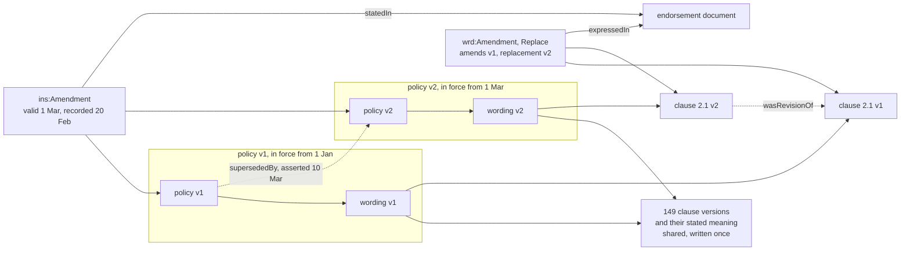

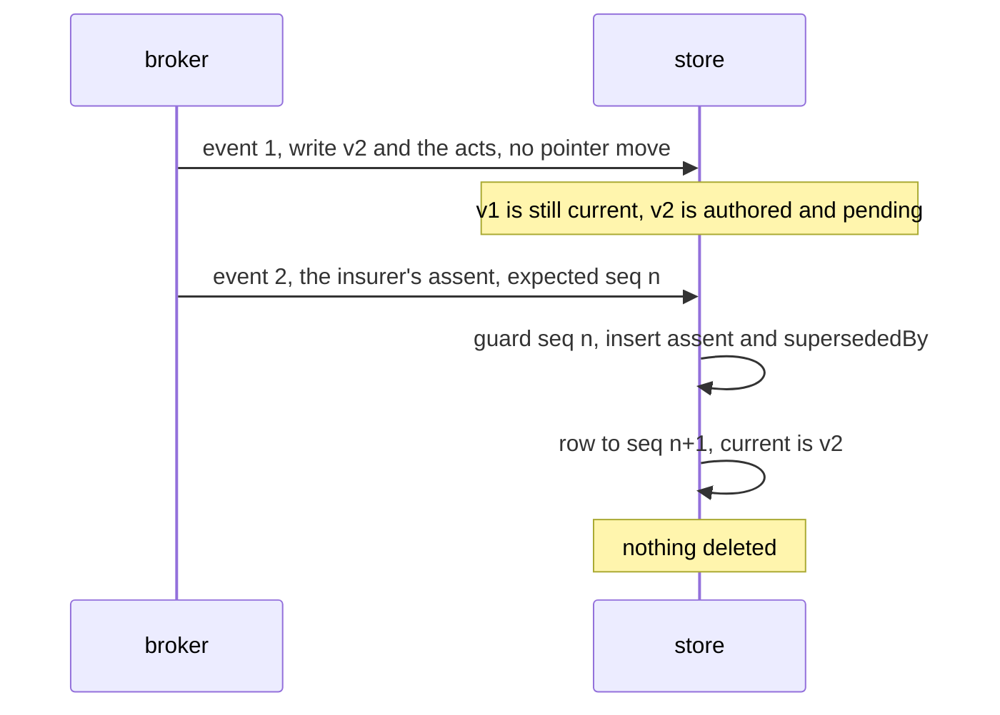

**Cost** (store-independent triples, judgement).

| Variant | Event 1 | Event 2 | Per endorsement | A policy's year (inception 284, two endorsements) |
|---|---|---|---|---|
| A. S3, wording v2 restated whole | 355 | 22 | 377 | about 1,040 |
| B. S3, inclusions shared, the 30 values restated (about 120) | 211 | 22 | 233 | about 750 |
| C. S3, inclusions and values shared | 91 | 22 | 113 | about 510 |
| D. S2, the clause edited in place, patch log, the acts still written | about 80 in one write | | about 80 | about 450 |

| Read | Triples touched |
|---|---|
| current words, any variant | pointer 2, policy 7, wording 270, 150 elements at 10, so about 1,800. C adds one hop through v1's inclusions, about 150 more |
| what the endorsement changed | the `wrd:Amendment` 5 and the two clause versions about 20, no diff and no replay |
| words in force at a valid time, as known at a recording time | the identity's amendments and assents, 22 per endorsement, then one hop to the version |

Judgement. C costs about 40% more per endorsement than editing in place (D) and keeps every version citable. The saving of C over A is
the whole restated manifest, about 260 triples, so what is shared decides the cost and the strategy does not. The write is one append
and one row move, with no sweep.

**What other strategies break.**

| Strategy | Consequence |
|---|---|
| S1 or S2 on the clause, v1 not kept | `ins:amends` and `ins:resultsIn` name two versions and there is one node. `ins:AgreedChainShape` and `ins:OvertakingShape` cannot be checked. A decision made under v1 cannot cite it by IRI, and a patch log replays commit time, not valid and recorded time, so it cannot answer "as known on 6 Mar" |
| composite replace of the policy's aggregate | deletes v1 (§2 point 6), the same fault by another route |
| B in §4.1, rebuilding the wording with new IRIs | every element looks changed, the content addresses change and S6 is lost, so stated meaning of 150 clauses is restated |
| pointer derived as "not superseded" (VH-Q4 b) | `supersededBy` is asserted at agreement, so between events 1 and 2 both v1 and v2 are unsuperseded and there are two currents. The pointer must move at event 2 |
| only the amendments stored, v2 derived (S5) | `ins:assentTo` names v2, so v2 needs a node and an identity anyway, and an overtaking amendment leaves a window no stored version holds |

**Guidance this supports.**

1. An instrument with its assembled wording is a versioned family. It appends and moves a pointer (S3) and does not replace.
2. The history of the words is the Wording amendments. A patch log adds nothing for it, so the family keeps a receipt only (VH-Q5).
3. "Current" is the last agreed version, not the last authored. The pointer moves with the agreeing act.

> **Reconciled with VH-D1, 2026-10-20.** The sketch decides the other way: persistence's pointer names the latest version written, its
> head, and which version is agreed or in force is evaluated from the assents. Between events 1 and 2 the head is the proposed v2, and a
> reader that needs the agreed version reads it through that evaluation, or a projection of it (S5, S7), never from the head. This
> example's case for moving the pointer at agreement is kept for the maintainer's review of VH-D1.
4. Sharing decides the cost. Sharing the 149 unchanged elements is free (S6). Sharing inclusions and values is worth about 260 triples per
   endorsement and needs a representation (VH-Q2).

**Open points.**

1. How v2 says "v1's inclusions except this". Options are a stored delta, a pointer to an inclusion set, or deriving it from the
   `wrd:Amendment` (`amendsElement` removes, `replacement` adds). Deriving conflicts with "recorded at assembly, never recomputed".
2. `wrd:hasValue` is inverse functional, so v2 cannot point at v1's value records. Sharing values needs that axiom relaxed.
3. In `property-endorsement.ttl`, `ex:sec-2` still comprises `ex:cl-2-1-v1`, so the tree reads through `wrd:includes`, not through the section.
4. Delta chains grow with endorsements. A full manifest every few versions (a checkpoint) bounds a read, and two a year does not need it.

### 10.8 E8. Insurances bound under a delegated authority

**Scene.** A grantor gives a holder an authority to bind insurances on its behalf. The authority is an instrument whose stated powers
include a power to bind and a premium income limit for the period. Each insurance the holder binds is its own instrument, with
`ins:boundUnder` naming the generated bound power. Mid-term, insurances are endorsed. Once a month the holder sends a declaration batch,
one line for each bind or endorsement that moved premium, and the limit is read against the total declared.

**Assumptions** (judgement unless marked fact).

- One authority binds 2,500 risks in a year, with a premium limit of 25 million. Each risk has 2 endorsements in the year and each bind
  and endorsement carries a premium movement (the workload note's figures: 2.6M binds a year market-wide at a 10,000 average, about 2
  endorsements per bind, §3.2). So 7,500 declarations a year, in 12 batches of about 625.
- A short form, 40 inclusions and 12 values. A bound insurance version is about 100 triples, with `ins:boundUnder` and the parties.
- Components as E7. An endorsement here changes a value, so it has an endorsement document (14), no `wrd:Amendment`, an `ins:Amendment`
  (12), two assents (20), policy v2 header (8) and a wording v2 of 9 when shared or 90 when restated.
- A declaration is 10 triples. A balance record is 13 (E7's conventions plus owner and position, the keying of §6.1 finding 4).
- Fact, from the workload note: the hot set is about 150 triples a risk, judged for contract, endorsements and checks.

**Sequence of events.**

| # | Event | Strategy | Written | Kept | Shared | Generated |
|---|---|---|---|---|---|---|
| 1 | The authority is agreed, with its limit | S3 for the authority instrument. S4 for the opening balance record | the authority, once, plus 13 | the authority v1 | library elements | the bound powers, deterministic IRIs (S5) |
| 2 | A risk is bound | S3, a new identity, a first version | 100 + row 3 + receipt 9 + 2 links = 114 | the instrument | 40 library elements | its bound meaning, on demand |
| 3 | The risk is endorsed mid-term | S3, S4 for the acts | 77 shared, 158 restated | v1 and v2 | unchanged inclusions and values | bound meaning of v2 |
| 4 | Month end. The batch of 625 declarations | S4, one commit | 625 x 10 + receipt 9, then one checkpoint balance 13, about 6,270 | every declaration | nothing | the balance (S5) |
| 5 | The limit is raised from 25 to 30 million from 1 July | S3 for the authority v2 | about 40 | authority v1 and v2 | all library elements | bound powers of v2. The IRIs of v1's powers are unchanged |
| 6 | A reader asks the balance at 30 June, or now | S5 | none | none | none | limit in force minus declarations up to the position |

Event 2 and event 3 write nothing to the authority. The insurances point up with `ins:boundUnder` and no aggregate of the authority
owns them. A bind made after event 5 names v2's power by IRI and the earlier ones keep naming v1's, so no bound insurance is rewritten.

```mermaid
flowchart TB
  subgraph auth["authority, written rarely"]
    A1["authority v1<br/>limit 25M"] --> A2["authority v2<br/>limit 30M from 1 Jul"]
    A1 --> BP1["bound power v1<br/>generated"]
    A2 --> BP2["bound power v2<br/>generated"]
  end
  subgraph ins["insurances, one family each, appended"]
    I1["insurance 1 v1"] -- "boundUnder" --> BP1
    I2["insurance 2 v1 and v2"] -- "boundUnder" --> BP2
  end
  subgraph dec["declarations, appended per batch"]
    D1["declaration<br/>10 triples"] -- "of instrument version" --> I1
    D2["declaration"] -- "of instrument version" --> I2
  end
  D1 --> BAL["balance<br/>limit in force minus declared<br/>derived"]
  D2 --> BAL
```

```mermaid
sequenceDiagram
  participant H as holder
  participant S as store
  H->>S: batch of 625 declarations, expected authority ledger seq n
  Note over S: guard seq n, then insert 625 records and a receipt
  S->>S: seq n+1, optional checkpoint balance record
  H->>S: a bind that reads the balance first
  Note over S: reads checkpoint plus later declarations, binds, no write to the authority
```

**Cost** (triples, judgement).

| Item | Written | Per read | Kept per year, one authority |
|---|---|---|---|
| bind | 114 | instrument about 500 (100 + 40 elements at 10) | 2,500 x 114 = 285,000 |
| endorsement, shared | 77 | as above, one more hop | 5,000 x 77 = 385,000 |
| endorsement, restated | 158 | as above | 5,000 x 158 = 790,000 |
| declaration | 10 | 4 touched to sum (link, premium, value, power) | 7,500 x 10 = 75,000 |
| batch, 625 declarations | 6,259 in one write | | 12 receipts |
| balance, derived, no checkpoint | none | up to 4 x 7,500 = 30,000 at year end | none |
| balance, monthly checkpoint | 13 a month | 13 + at most 4 x 625 = 2,513 | 156 |
| balance record for every declaration | 13 each | 13 | 7,500 x 13 = 97,500 |
| **authority total, shared with checkpoints** | | | **about 745,000** |
| **authority total, restated** | | | **about 1,150,000** |

Per risk this is 114 + 2 x 77 + 3 x 10, or 298 shared and 460 restated, against the note's 150. Our count is about twice the note's, since
the note's 150 does not obviously include two assents and an amendment record per endorsement. At the central case of 2.6M risks the hot
set is about 775M triples shared and 1.2B restated, against the note's 390M.

Write rates, by the note's method (B.1), counting only writes, 3 a risk. Central case, 7.8M writes a year, 0.5 a second on average and about
4 at the 8x peak, about 90 triples a write, so about 360 triples a second. High-volume case, 39.3M writes, 2.5 and about 20 a second, so
about 1,800 triples a second. For one authority the average is 0.0005 a second, and the batch is the burst, 6,259 triples in one commit.

**What other strategies break.**

| Strategy | Consequence |
|---|---|
| balance held in place, one row (S1 or S7 only) | every declaration is a CAS on one row, so 625 serialise. The balance at 30 June is lost unless a patch log is kept (S2), and a corrected declaration cannot revise later balances. Balance and declarations are two sources of one fact and can disagree |
| declarations inside the authority's aggregate, written by replace | each batch deletes and rewrites the aggregate. Over the year 6,250 x (2k - 1) summed for k = 1 to 12 is about 900,000 triples moved for 75,000 kept, 12 times, with TD-42's sweep on top. Every bind would also need a write to the authority |
| a balance record for every declaration | history at every position, at 13 each, 97,500 a year, 130% more than the declarations. Any corrected declaration makes later records stale, so they are a cache and need a retention (VH-Q6) |
| `ins:boundUnder` by the authority's identity | the authority amended at event 5 changes what every earlier bind names. "Which terms was this bound under" then needs an as-of lookup. Naming the generated power fixes it, as §6.4 point 5 says for records that are evidence of what was seen |
| limit enforced by refusing a declaration | a declaration records what happened. A refusal would hide a fact. The balance can go below zero and says so |

**Guidance this supports.**

1. Declarations are a record family. Append, one commit a batch, nothing replaced (S4).
2. The balance is derived (S5), with a checkpoint record each batch as a cache. Its read set is `prov:wasDerivedFrom` the declarations, which
   is why Behaviour's records and not versions fit (§6.1 finding 3).
3. Bound insurances own nothing of the authority and point up by a generated IRI. The authority is written only when it is amended.
4. Reading the balance before a bind is a read. Making the limit a hard stop needs a guard on the authority's ledger sequence, and at 0.0005 a
   second per authority that is no contention. Whether it should be a stop is not modelled here.
5. Closed years leave the hot set by tiering (S8). A year of one authority is about 745,000 triples.

**Open points.**

1. The workload note's 150 triples a risk looks low against 298 here. It should be re-based once E7's counts are agreed.
2. A corrected declaration. Options are a reversing record plus a new one (20 triples), or a new record `prov:wasRevisionOf` the old, which
   ADR-A67 would call a correction and Behaviour a new record.
3. The balance record's owner and position are EC-Q2's. This example assumes the keying of §6.1 finding 4 and changes nothing in Behaviour.
4. Whether a premium movement on every endorsement is the right assumption. Fewer declarations reduce the declaration rows only.
5. Whether `ins:boundUnder` can name a generated power that a later authority version does not regenerate. The IRI is fixed by the
   instrument version (§16.3), so it should, and a test would show it.

### 10.9 Open points from the examples, with our leanings (2026-10-20)

Taken at our leanings for the maintainer's review, as the rest of this round.

| # | Point | From | Leaning |
|---|---|---|---|
| EP-1 | a full membership list per root version, or only the changes | E1, E5, E6, E7 | VH-D2: the full list for now. It is most of E5's cost (1,500 of 1,549 triples), so E5's benchmark decides (EX-Q2 (c)) |
| EP-2 | which version the head names when an amendment is pending | E2, E4, E7 | VH-D1: the latest written. Agreed and in force are evaluated. E7's opposite case is kept for review |
| EP-3 | `wrd:hasValue` is inverse-functional, so a new assembled wording cannot share its predecessor's values | E3, E7 | relax it, as TD-49 did for exposure. A debt row records it |
| EP-4 | an entry into force that differs per holder, for example per site | E4 | an Instrument question for CCS, not ours: a pending design decision |
| EP-5 | a correction to a record, which is never reopened | E4, E8 | a new record naming the one it corrects with `prov:wasRevisionOf`, and for a declaration, a reversing record plus a new one |
| EP-6 | whether revising an offer before it is agreed is an amendment | E6 | no: a revised offer is a new instrument version that a new `ins:Proposal` proposes. An amendment changes an agreed version. With EP-4 |
| EP-7 | what makes a superseded proposal lapse | E6 | evaluated, from a later proposal of the same matter or its own window. With EP-4 |
| EP-8 | AIR's exposure fixture edits version 1 when it is superseded (`validTo`, governance state) | E5 | versions are never edited: the succession and the derived state say it. A debt row for AIR |
| EP-9 | an asset's `aeo:locatedAt` names a location version, so a location change cascades to its assets and valuations | E5 | name the location's identity inside content (VH-Q2), fixed by the set version's membership. With EP-8 |
| EP-10 | Instrument's property-endorsement example keeps `ex:sec-2` comprising the superseded clause version | E7 | with EP-3, in Wording's debt row |
| EP-11 | the workload note's 150 triples a bound risk | E8 | re-based to about 300 once these counts are agreed. A note on the workload paper |

## 11. Rationale for the leanings of VH-Q1 to VH-Q6 (2026-10-20)

The workflows set the correctness needs. A party assents to one exact version, and formation is read from the assents. An amendment may
take effect before it is agreed, so the answer to "was it covered?" depends on when it is asked (Instrument's property-endorsement
example). A regulator or a court asks what was agreed, and what was known, on a date. A delegated authority binds about 2.6 million
insurances a year market-wide, each with about two later changes (workload note §3.2), and a popular authority takes many binds in a short
window. The counts below are judgement, store-independent, in triples.

| # | Leaning | Correctness and consistency it gives | Runtime size and cost | What it costs us |
|---|---|---|---|---|
| VH-Q1 | (a) domain history in the data, for anything a party assents to, relies on or cites. A working draft keeps an in-place history (S2) | an assent, a reliance or a citation names a node that exists, not a reconstruction from a log that retention may prune (TD-48). The words' history is in Wording's amendments already | a version costs what changed plus pointers (VH-Q2), not a copy. A one-value change to a quote under C7c's rules costs about 270 triples unshared, 5 to 20 shared (§9.2), against about 15 for an edit in place with a patch log (§4.1) | the family must say which records are cited, which is a modelling choice an adopter has to make (FS-Q2) |
| VH-Q2 | (a) references by identity, versions fixed at the root, a version pinned wherever a record is evidence of what was seen | a revised definition leaves every clause naming it unchanged, with the same hash (ADR-A112). As-of is one hop to the root version current at the time | a new root version lists its members: 500 pointers for a 500-location schedule, about 540 triples with the one changed location, against about 20,000 copied. Pinning every reference instead writes a version of each ancestor, so a change at depth d costs d versions | a root lists all its members per version. A manifest stored as a change against the last one would cut that to the changes, at the cost of resolving a chain on read, which E5's benchmark should measure (EX-Q2 (c)) |
| VH-Q3 | (b) a persistence declaration, with a shape that warns when a versioned class is written by replace | Persistence stays import-free (ADR-A78), and serves an adopter who versions without Foundation. The warning catches the mistake TD-49 was, a version rule broken by a write rule | none at runtime. One shape at compile time | an adopter declares the write discipline beside the class's versioning, twice in principle, which the warning keeps in step |
| VH-Q4 | (a) append, and move a current pointer on the identity's version row | two writers of one record, for example two revisions of one offer, race on one row's seq, as two replaces do today. A current read is one lookup, and a fork cannot leave two currents | per write: the new version's triples, one `fnd:supersededBy`, the row's three rewritten triples and a receipt of 9. No sweep, so TD-42's quadratic cost never applies: about 100 fills where a replace of a 9,600-triple aggregate costs about 92 million | a hot record, such as a popular authority's balance, serialises on its row. That is the contention the workload note asks to test, not a new one |
| VH-Q5 | the table in §5.5: receipt only for append families, a patch log read backward for in-place data that wants history, receipt only otherwise | each kind of history is kept once. A consumer is told which model a family uses, so no one assumes replay where none exists (guide Chapter 20) | a receipt is 9 triples per write, a patch log 11 plus the change. The snapshot model is unnecessary for append families, where the root version and its manifest are the snapshot | the refusal of a receipt-only composite family is relaxed for append families, a change to a shipped rule |
| VH-Q6 | never prune a version that a retained version references | an assent, a later version's lineage or a pinned reference always resolves, as a pinned head keeps a dormant stream's head (guide §24.2) | retention is less aggressive for cited records. Market-wide, about 2.6 million binds with two changes each, at about 270 triples a version, keep about 2 billion triples a year before sharing, partitioned by tenant (workload note §17), so a few gigabytes per tenant. Drafts under S2 and derived artefacts under S5 prune freely | a retention job must read references before it drops a version, a query per candidate, run in housekeeping (ADR-A80), not on the write path |

**Decided 2026-10-20 at our leanings, for the maintainer's review at the end of the branch's work.** VH-Q1 (a), refined as §11
says: history in the data for what a party assents to, relies on or cites, and S2 for working drafts. VH-Q2 (a), with a version pinned
wherever a record is evidence of what was seen. VH-Q3 (b). VH-Q4 (a). VH-Q5, the table of §5.5. VH-Q6, never prune a version a retained
version references.

Two points the examples raised, decided the same way:

| # | Point | Decision |
|---|---|---|
| VH-D1 | which version the current pointer names when several proposals are pending against one version | the pointer is persistence's: the latest version written for the identity, its head. Which version is in force, or agreed, is evaluated from the assents (Instrument §6.3), never stored. `fnd:supersededBy` is asserted when an amendment is agreed, as `ins:AgreedChainShape` already expects |
| VH-D2 | whether a new root version lists every member or only what changed | every member, as `wrd:includes` and AIR-4.2a's membership do today. A manifest stored as changes waits for E5's benchmark (EX-Q2 (c)) |

**Maintainer's review, 2026-10-20.**

| # | Decision |
|---|---|
| VH-Q1 | approved. The shared cost needs TD-65 fixed, since Wording restates every inclusion and value today |
| VH-Q2 | (a) by default, (b) where a record is evidence of exactly what it saw, unless (c) an edge-specific reference is declared. Our reading: pinned is one value of the per-edge declaration, so nothing overrides anything. A warning, not a rule, where an edge from a record or evidence to a versioned class is declared by identity |
| VH-Q3 | (b) |
| VH-Q4 | (a) |
| VH-Q5 | (2) the refusal relaxed for the append disciplines, (3) the snapshot model retired for appending families. (1) asked back: a receipt is not needed for every family (VH-Q5a below) |
| VH-Q6 | agreed |
| VH-D1 | agreed: agreement is evaluated, not stored |
| VH-D2 | **revised: a choice per family.** A full membership list per root version (fast reads) or one stored as changes against the last (small writes, a chain to resolve on read), declared by the family. The full list stays the default |
| R2 | (a): `append-version` links versions with a persistence term of its own, never `fnd:supersededBy`, which the domain asserts under its own rule (Instrument once a version is agreed) |
| R4 to R8 | accepted: the examples and EP-1 to EP-11, TD-63 to TD-66 and PDD-11, H2.6c's eight decisions taken alone, its twelve expected profiles, its two changed tests |

**VH-Q5a, approved 2026-10-20 at the leaning below.** Which families need no receipt. The version row's seq decides a race without one, and the transaction claim, which
is separate, confirms an outcome after a lost reply. A receipt gives order, the head chain, gap and fork audits, transaction time for a
version, and change capture. Families that need none: an unconditional write and a value-guarded write, which already write none, and
derived artefacts and projections, which can be regenerated. Leaning: a `dal:NoReceipt` model for an in-place family that wants no
history, refused for the append disciplines, whose versions and records take their position and transaction time from the receipt. The
claim stays wherever a retry can happen.

