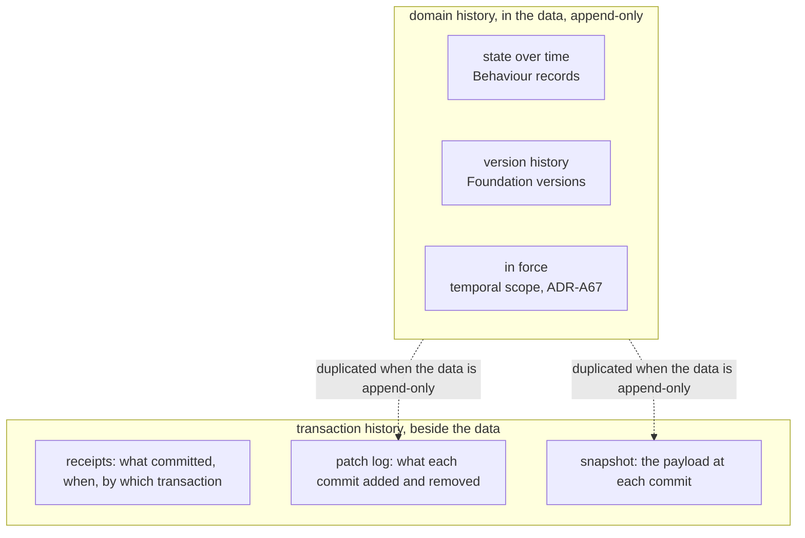
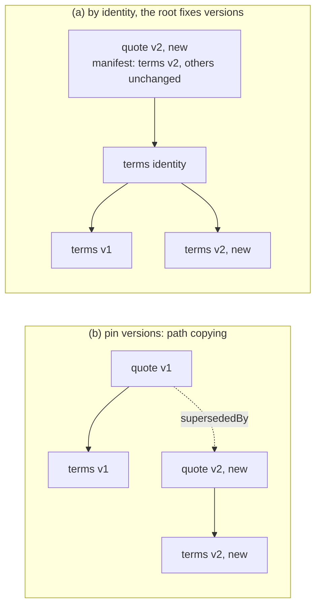
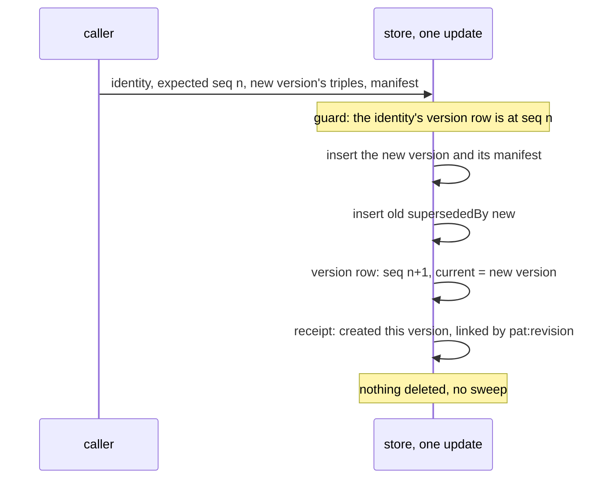

<!-- SPDX-License-Identifier: CC-BY-SA-4.0 -->

# Persistence: history, versions and the receipt models (sketch)

**Unit:** [`formal-methods-track-h`](../status/formal-methods-track-h.md), the patch-log half of H2.6b and H2.10, held for this sketch
on 2026-10-14 (H-D33)
**Status:** draft for the maintainer, 2026-10-14. Questions VH-Q1 to VH-Q7 are open
**Touches:** Foundation's versioning, Behaviour's runtime records, Wording's references by identity
([ADR-A112 addendum](../../architecture/decisions/ADR-A112-wording-layer.md#addendum-2026-10-06-references-by-identity)),
the bi-temporal model ([ADR-A67](../../architecture/decisions/ADR-A67-bi-temporal-model.md)), the receipt models of
[guide Chapter 20](../../architecture/rdf-sparql-patterns-guide.md#chapter-20--receipts-patches-or-snapshots-f9) and the persistence
README §7.4, aggregate ownership ([ADR-A122](../../architecture/decisions/ADR-A122-aggregate-ownership.md)), TD-42, TD-46, TD-47, TD-48

## 1. Why this sketch exists

Planning H2.6b's patch log, the maintainer asked how deep a patch must track a change, using a broker's tower and a carrier's requote as the
case. Working it through showed that persistence keeps history with a mechanism of its own, the receipt models, which never refers to the
versioning Foundation already defines, and that the two disagree. This sketch sets out the facts, the use cases, and the options, and
proposes what persistence should do with history. It decides nothing.

## 2. The scene, checked against the source on 2026-10-14

1. **Foundation versions things.** `fnd:Version` is a mixin. The individual is the version, carries one `fnd:hasIdentity`, and is followed
   by its successor through `fnd:supersededBy`. A version is never edited (the architecture skill's "identity and versions" principle).
2. **Wording references by identity, and the root fixes the version** (ADR-A112 addendum, points 1 and 2). A clause names the identity of
   what it mentions, and the assembled wording's `wrd:includes` lists the versions in force. The property-endorsement example reuses the
   unchanged `ex:sec-2` in `wording-v2` and adds only `cl-2-1-v2`.
3. **Behaviour versions its configuration and never its runtime records.** State spaces, transitions and operational profiles are
   `fnd:Version` subclasses. Runtime records are immutable individuals, evidenced and temporally scoped, and "records are never reopened"
   (nested-states sketch §4). A state occupancy names its subject's persistent identity, "so the state outlives a new version" (ADR-A106
   decision 5). An allowance account is one functional balance per record, and the ordered-draws example writes a new account record per
   change, chained by `prov:wasDerivedFrom`, with no shared identity.
4. **ADR-A67 forbids in-place correction of runtime data.** A correction is a new version superseding the old, which stays queryable.
   Transaction time is stated per assertion graph.
5. **Persistence knows nothing of versions.** Nothing under `ontology/persistence` names `fnd:Version`, and the ontology imports nothing. A
   write to a composite aggregate sweeps the owned closure and writes the caller's new state (README §7.1). The receipt models record history
   beside the data: receipt only, patch log, snapshot (README §7.4). The validator requires a patch log for every composite family.
6. **So the two conflict.** If a versioned node is inside an owned closure, a replace that writes its new version deletes the old one,
   against point 4, unless the caller resends every old version on every write.
7. **The workload note already assumes versions are kept in the payload.** Its medium programme counts 8 layers, 15 carriers per layer and
   2.5 indication versions per carrier at 80 triples a version, 24,400 triples ([workload modelling §5.2](../notes/rdf-engine/workload-modelling.md)).

## 3. Four kinds of history

| Kind | Question it answers | Where LATTICE keeps it today |
|---|---|---|
| state over time | what state was the licence in, what was the allowance, on 30 September | Behaviour's records, in the data, append-only |
| version history | what did the quote say before the requote | Foundation's versions, in the data |
| in force | which version governed the loss on 5 March, as known on 10 March | temporal scope, assents and effective dates, bi-temporal (ADR-A67) |
| transaction history | what did the store hold after commit 42, and what did commit 42 change | persistence's receipt models, beside the data |

The first three are domain facts and belong to the layers that state them. When they are append-only, the payload never loses a fact, so a
patch log or a snapshot of it duplicates them. What a storage log adds is transaction history for data that *is* edited in place, change
capture for downstream consumers, and an audit of what each commit did.

## 4. How deep a change goes

A triple-level log never needs the path from the root. A triple names its own subject, and replay is set arithmetic. Depth shows up through
four other things, which are the real design dimensions.

| Dimension | Effect on the cost of one change |
|---|---|
| whether node IRIs survive a write | a re-minted subgraph makes every triple look changed |
| whether the change is an edit or a new thing in law | a requote is a new offer, so editing it in place loses a fact |
| whether a reference pins a version or names an identity | pinning forces a new version of every node on the path, as git rewrites trees |
| how finely versioned nodes are cut | a version is copied whole, so a coarse node is copied for one value |

### 4.1 The requote, four ways

The path is tower, layer, quote, terms, premium. A quote version is 80 triples (the workload note's figure), and the premium is one value
on the terms.

| Way | Written per requote | History per requote | Current read | As-of read |
|---|---|---|---|---|
| A. edit the premium in place, patch log | 1 removed, 1 added, receipt | 2 in the log | direct | backward replay (TD-48) |
| B. rebuild the quote with new IRIs inside the tower's aggregate, patch log | the tower swept and rewritten | 160 in the log | direct | backward replay |
| C. a new quote version pinning new member versions | about 80, nothing removed | in the data | follow the current pointer | the version current at t |
| D. a new version of the smallest versioned node, members named by identity, the root's manifest fixing versions | the changed node plus one manifest entry per member | in the data | resolve through the manifest | the manifest current at t |

B is what the composite strategy does today if the quote sits in the tower's aggregate. A medium programme's tower holds about 9,600 quote
triples (8 layers, 15 carriers, 80 triples), and TD-42's sweep fills about M × N of them per write, so roughly 92 million template fills
for a one-value change, and about 19,000 once TD-42 is fixed. A requote in its own aggregate, written by appending, writes about 80.

### 4.2 Where the quote belongs

The maintainer's answer, 2026-10-14. The quote's versions and history are not part of the tower's aggregate. A `NegotiationThread`
aggregate, not yet defined, references the tower and governs the quotes. A quote attaches to the layer it is for, though the carrier knows
nothing of layers, a broking construct, and quotes only against an attachment point and a limit. A quote is structurally a contract, an
instrument on `ins:`, with a different epistemic status: an indication, a quote, a binding offer, firming as its details build up. This
matches the computable-contract-substrate sketch's account of proposals "at different levels of commitment", checked by the same shapes as
a contract.

So in the worked case the tower is written rarely, the thread is written per move, and each firming or requote is a new quote version.
Defining the thread and the quote's status is domain modelling for another unit (§7).

## 5. Options

### 5.1 Where history lives (VH-Q1)

| Option | Says | Consequences |
|---|---|---|
| (a) **domain history in the data** | versions, records and temporal scope hold domain history. The storage log is transaction history and change capture only, and is optional | one source for each fact. As-of reads are queries over versions, with no replay. The storage log shrinks to what in-place data needs. Persistence must write versions without deleting them (VH-Q3, VH-Q4) |
| (b) **the storage log is history**, as guide Chapter 20 reads | patch log or snapshot per family, the payload holds current state only | conflicts with ADR-A67 and Foundation for versioned classes. Depth and re-minting decide the log's size (§4). A pruned log loses history the domain still needs |
| (c) both, per family | a family declares which | every reader must know which a family uses, and the guide already warns that a consumer must not assume replay |

### 5.2 How versions refer to each other (VH-Q2)

| Option | Says | Consequences |
|---|---|---|
| (a) **ADR-A112's rule, generalised** | a reference names an identity, and the aggregate root's version lists the member versions it fixes, as an assembled wording does | one rule across Wording and persistence. A change writes the changed node and a new root version with its manifest, O(members) pointers. As-of is one hop to the root version current at t |
| (b) pin versions | a reference names a version | a change at depth d writes d versions. Each root version is a complete state, so a snapshot is free |
| (c) per edge, declared beside `dal:ownership` | the adopter classifies each edge | most flexible, and a second classification on every edge |

### 5.3 How persistence learns a class is versioned (VH-Q3)

| Option | Says | Consequences |
|---|---|---|
| (a) read `fnd:Version` membership by IRI from the adopter's ontology, with no import, as a boundary shape names domain properties by IRI | the compiler checks `rdfs:subClassOf* fnd:Version` offline | no new import. Couples the compiler to one Foundation IRI, and does nothing for an adopter who versions without Foundation |
| (b) **a persistence declaration**, for example a write mode `dal:AppendVersions` on the family, with a shape that warns when a `fnd:Version` class is written by replace | the adopter states it, persistence stays import-free | domain-neutral and framework-like. The warning catches the conflict of §2 point 6 |
| (c) persistence imports Foundation | the ontology reasons about versions directly | an edge in the layer order, so an ADR (ADR-A01) |

### 5.4 The write for a versioned family (VH-Q4)

| Option | Says | Consequences |
|---|---|---|
| (a) **append, and move a current pointer on the identity's version row** | the version row, keyed by persistent identity, holds the current version beside `pat:seq` and `pat:head` | a current read is one lookup. The CAS is on the identity, so two requotes race as two writes to one quote do today. No sweep, so TD-42 does not apply. The new version links to its receipt with `pat:revision`, as an event does, which gives ADR-A67's transaction time inside a shared graph |
| (b) append, and derive current as "not superseded" | no pointer | every current read pays a `FILTER NOT EXISTS`, and a fork leaves two currents |

### 5.5 What remains of the receipt models (VH-Q5)

| Family writes | Receipt model | Why |
|---|---|---|
| by appending versions | receipt only, naming the versions created | history is in the data. The refusal `CompositeBoundaryReceiptOnly` does not apply, since nothing is swept |
| in place, history wanted | patch log, triple-level, read backward (TD-48) | transaction history and change capture for data with no versions |
| in place, no history wanted | receipt only | as today |

The snapshot model (H2.10) becomes either the root version's manifest under VH-Q2 (a), free under (b), or a copy for in-place data. Each
option keeps H2.6b's `ReceiptModelNotHonoured` warning until the model is built.

### 5.6 Retention (VH-Q6)

Superseded versions are kept until a policy prunes them, which is housekeeping (ADR-A80, TD-47). The questions are where the policy is
declared, per family or per class, and whether a version that something still references by version, an assembled wording's `includes`
for example, may be pruned at all. Leaning: never prune a version a retained version references, the version-level form of the guide's
pinned heads.

## 6. Behaviour's versioning (VH-Q7)

The maintainer suspects Behaviour's different approach has a reason, to be researched. What the source shows:

| Behaviour holds | How | Reading |
|---|---|---|
| configuration: state spaces, transitions, profiles | `fnd:Version` | things that change by being edited and restated, so versions |
| runtime records: occupancies, executions, findings | immutable individuals, never reopened, temporally scoped and evidenced | each is an occurrence, not a state of a continuant, so nothing to version |
| occasion occupancies | derived artefacts, `prov:wasDerivedFrom` their read set (law B1) | derived, so provenance, not succession |
| allowance accounts | a new record per change, `prov:wasDerivedFrom` the last and the execution, no shared identity | the odd one out: a balance is a state of a continuant, the account |

Hypothesis. The split between versions and records is principled: a version is a state of something that persists, and a record is
something that happened. The allowance account is the case to examine, since it is a persisting thing's state written as a chain of
derivations. Options to research:

| Option | Says |
|---|---|
| (a) keep, and state the principle in Behaviour's README: records are never versioned, derived state is a `fnd:DerivedArtefact` chained by `prov:wasDerivedFrom` | the account record is typed as a derived artefact, and current is the latest by recording time |
| (b) the account becomes versions of an account identity | current is a pointer, as VH-Q4 (a). Loses the derivation's read set unless kept as well |
| (c) both: an account record is a version of the account and a derived artefact | `fnd:Version` and `fnd:DerivedArtefact` are not disjoint, so this is allowed. Succession and provenance each recorded once |

The research reads the nested-states sketch, CCS C11 and C12 plans and ADR-A92 for why the ledger was written this way, and checks the
evaluator's reads (law B8) against each option.

## 7. Out of scope here

- Defining `NegotiationThread`, the quote's epistemic status and the attachment of a quote to a layer. They are domain modelling, for an
  applied unit, and this sketch uses them only as the worked case.
- The in-force question, which ADR-A67 and the instrument layer answer.
- The event slots of H2.6b, which do not depend on any of this.

## 8. Questions for the maintainer

| # | Question | Leaning |
|---|---|---|
| VH-Q1 | where history lives (§5.1) | (a), domain history in the data |
| VH-Q2 | how versions refer to each other (§5.2) | (a), ADR-A112's rule generalised |
| VH-Q3 | how persistence learns a class is versioned (§5.3) | (b), a persistence declaration with a warning shape |
| VH-Q4 | the write for a versioned family (§5.4) | (a), append and move a current pointer on the identity's row |
| VH-Q5 | what remains of the receipt models (§5.5) | the table in §5.5 |
| VH-Q6 | retention of superseded versions (§5.6) | never prune a version a retained version references |
| VH-Q7 | Behaviour's versioning (§6) | research first, then (a) or (c) |

Answers decide whether the patch log is built as planned in H2.6b's held half, rebuilt as an append write for versioned families, or
narrowed to in-place data, and what H2.10 builds. An ADR follows the answers, since VH-Q1 and VH-Q3 change how persistence relates to
Foundation.
