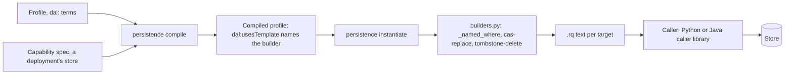
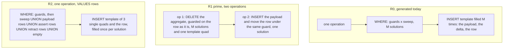

<!-- SPDX-License-Identifier: CC-BY-SA-4.0 -->

# A replace that is linear in the aggregate's size (sketch)

**Unit type:** a brief for investigation, then a decision
**Status:** raised 2026-10-31 by the studio-publication unit's PB-Q13. Investigated 2026-10-31 on the branch `claude/persistence-linear-replace`: the stores' update engines read in source, four forms measured on six engines under a benchmark, the probes recorded as TSD-65 to TSD-67. LR-Q1 to LR-Q3 have a leaning each (§7) and wait for the maintainer. The maintainer decided on 2026-10-31 that a write writes only what changed unless the profile chose a whole replace ([persistence-delta-replace.md](persistence-delta-replace.md)), so this brief bears on the whole-state replace alone, the opt-in one
**Raised from:** the [studio-publication sketch](studio-publication.md) §9, where the maintainer answered PB-Q13 (b) on 2026-10-31, so the studio writes its large aggregates by hand until this is settled
**Touches:** `tools/persistence` (the builders of the named-graph and composite replace, the capability record), `packages/persistence` (the two caller libraries, for R2), the capability record of formal-methods track H, ADR-A123 decision 7, TD-42, TD-136, PDD-06, PDD-17, TSD-01, TSD-02, TSD-05, TSD-06, TSD-50, TSD-53, TSD-65, TSD-66, TSD-67, TSD-Q13

## 1. The problem

Every replace the persistence compiler generates, for a named-graph family and for a composite one, carries its payload in the `INSERT` template of an operation whose `WHERE` sweeps the aggregate, one solution per stored triple. SPARQL 1.1 Update fills a template once per solution, and every engine we measured does so literally. So for an aggregate of M stored triples replaced by a payload of N, a store builds M × N insertion quads before it removes the copies. The cost is quadratic in the aggregate's size, in time on every engine and in memory on Oxigraph (TSD-02, TSD-65).

This has been known for the composite replace since 2026-10-10 (TD-42). What the studio-publication unit found on 2026-10-31 is that the named-graph replace has the same form, and that an aggregate the size of an ordinary authored artefact already makes it unusable on the studio's own store: 28 s for 3,000 triples on Jena, 17 s on TDB2 and on Fuseki (§3).

Nothing generated today is wrong. Each form is correct wherever it finishes, and the redundancy that costs M × N is exactly what makes it correct on every store whatever order the store applies an update in (§4). Choosing a linear form therefore means relying on a property of the store, which has to be known for each store, and that is why the maintainer held the change back until it was investigated.

## 2. Where it sits

- **The text.** `tools/persistence/src/persistence/builders.py`, `_named_where`, builds the `WHERE` of the named-graph `cas-replace` and `tombstone-delete`, with their dataset-guard variants. It ends with `OPTIONAL { GRAPH ?g { ?s ?p ?o } }`, the sweep. The composite builders sweep the aggregate with one property path inside the family's data graph, to the same effect. `persistence.ir` and `persistence.ir_render` are the only source of the SPARQL (ADR-A123).
- **The selection.** ADR-A79's consequences require any conditional structure to be selected in `compile`, from the profile and the deployment's capability spec, never in `instantiate`, and recorded as which `dal:Template` a `dal:GeneratedOperation` uses. `instantiate` already follows that record: `build_operation` reads the builder's id from `dal:usesTemplate` and the run choices from `dal:guardStatus` and `dal:graphNaming`. So a form selected in `compile` reaches the text with no change to `instantiate`. Track H's H5 was to extend the capability record and select the form from it, with protocol models proving each form safe under the capabilities it needs. ADR-A123 decision 7 names two forms and two capabilities and leaves the choice to that selection.
- **The callers.** The Python caller library (`packages/persistence/python`) and the Java one (`packages/persistence/java`, PB11) fill the slots and the parameters, check them, and never parse the text. Both already render an append's events as `VALUES` rows (`Rows`, the `eventRows` slot).
- **Who waits.** The Configuration Studio's writer, whose parts and documents are named-graph aggregates (ADR-A149 decision 13), writes them by hand until a generated form exists (TD-136). Since 2026-10-31 that hand-written form writes the delta, which the delta replace sketch makes the generated default. Every adopter whose profile chooses the whole-state replace for a family above a few hundred triples is affected in the same way on every store.

## 3. What was measured

The figures are TSD-65's, from `benchmark/persistence-replace-forms` (rdflib 7.6.0, Oxigraph 0.5.13) and `benchmark/persistence-replace-forms-jvm` (Jena 5.1.0 in memory, Jena TDB2 on disk, Fuseki main over HTTP on TDB2, RDF4J 6.1.0 MemoryStore), 2026-10-31, on an Apple arm64 laptop. Each form replaced M stored triples by a payload of N = M that kept half of them and changed half, with the real delta in the patch-log slots, three times, best time kept, and every result was checked as sets. Milliseconds.

| Form | M | Jena in memory | TDB2 on disk | Fuseki over HTTP | Oxigraph | rdflib | RDF4J |
|---|---|---|---|---|---|---|---|
| R0, generated, real delta | 3,000 | 27,986 | 17,380 | 17,172 | 6,466 | 95,133 | 2,397 |
| R0, empty delta | 3,000 | 155 | 209 | 239 | 2,647 | 49,314 | 1,084 |
| R2′, payload under a variable graph | 10,000 | 8,829 | 9,113 | 10,962 | 14,235 | not run | not run |
| R1′, two operations | 10,000 | 278 | 385 | 401 | 44 | 186,344 | 1,368 |
| R2, `VALUES` rows | 10,000 | 907 | 1,245 | 1,178 | 271 | not run | not run |

R0 at 3,000 on Jena in memory is the scratch figure of the first draft, reproduced exactly. The scratch's "two guarded operations" column is R1′. R2′ and R2 were not run on rdflib and RDF4J because probe P1 marks both per-solution stores (§4), on which neither is right. R0 at 10,000 was not run (TSD-02 recorded it not finishing on Oxigraph in 8 GB). Every run that ran left exactly the payload and the delta.

The composite family, `cas-replace-composite-property-patch-log` over the project example's owned path with a bystander aggregate in the same data graph, was measured the same way on 2026-11-01, M = 2 + 2K triples with half the members kept. It has the same shape, and every form left the bystander untouched. The RDF4J column is §5.3's.

| Form | M | Jena in memory | TDB2 on disk | Fuseki over HTTP | Oxigraph | rdflib | RDF4J |
|---|---|---|---|---|---|---|---|
| R0, generated, real delta | 3,000 | 24,824 | 16,705 | 15,828 | 7,872 | 89,737 | wrong |
| R0, empty delta | 3,000 | 165 | 231 | 266 | 3,450 | 47,560 | wrong |
| R1′, two operations | 10,000 | 469 | 664 | 654 | 54 | not finished in 900 s | wrong |
| R2, `VALUES` rows | 10,000 | 1,021 | 1,361 | 1,408 | 271 | not run | not run |
| the sweep alone, as a `SELECT` | 10,000 | 41 | 22 | 35 | 6 | 102 | 92 |

## 4. What the stores do

### 4.1 Read in source, 2026-10-31

**Jena ARQ 5.1.0** (`jena-arq`, `org.apache.jena.sparql.modify.UpdateEngineWorker`, `visit(UpdateModify)`, at the tag `jena-5.1.0`). The `WHERE` is evaluated once and every binding is collected into a `DataBag` before anything is written. `execDelete` then runs over all the bindings and `execInsert` after it, the specification's order, which TSD-53 observed. Inside each, the template's quads are split into **ground quads**, those with no variable, applied **once per operation** when the `WHERE` has a solution, and template quads, instantiated once per binding by `TemplateLib.calcQuads`, which substitutes the binding into every quad, mints a fresh blank node per binding, and drops a quad left non-concrete. So on Jena, with every parameter substituted, R0's payload is ground and inserted once, and the blocks instantiated M times are those whose graph is a variable: the patch log's `GRAPH ?addGraph` and `GRAPH ?delGraph`, and the receipt's `GRAPH ?logGraph`. R0 on Jena costs M × D for a delta of D, which is why its empty-delta run is linear and its real-delta run is 28 s.

**Jena TDB2 5.1.0** (`org.apache.jena.tdb2.modify.UpdateEngineTDB`). It extends `UpdateEngineMain`, overrides nothing but its constructor and its factory's `accept`, and so runs the same `UpdateEngineWorker`. Fuseki serves the dataset's engine. TSD-66 confirms all of it by observation.

**Oxigraph 0.5.12 and later.** Every mutation is collected, then every deletion is applied and then every insertion (TSD-01 step 7, source and release notes). A template quad whose graph is unbound is skipped (TSD-05).

**rdflib 7.6.0.** Each solution's deletions and then its insertions are applied in turn, in an order that follows the process's hash seed (TSD-01). A template quad whose graph variable is unbound is written into a new blank-node graph (TSD-05, TD-44).

**RDF4J 6.1.0.** Its source could not be fetched at that tag. TSD-67 has it by observation.

### 4.2 The table

| Store | Applies a `DELETE`/`INSERT` | Skips a template quad whose graph is unbound | A ground template quad | A request whose second operation fails | Source |
|---|---|---|---|---|---|
| rdflib 7.6.0 | per solution, remove then add, in an order following the hash seed | **no**, writes it to a blank-node graph | per solution | keeps the first | TSD-01, TSD-05, TSD-06 |
| Oxigraph 0.5.12 to 0.5.13 | every deletion, then every insertion | yes | per solution | rolled back | TSD-01, TSD-05, TSD-06 |
| Jena ARQ 5.1.0 in memory | every deletion, then every insertion | yes | **once per operation** | rolled back | TSD-53, TSD-50, TSD-65, source |
| Jena TDB2 5.1.0, and Fuseki over it | the same, by source and by probe | yes | once per operation | rolled back, and a request the client abandons is applied all the same | TSD-66 |
| RDF4J 6.1.0 MemoryStore | per solution | **no**, writes one quad | not read | rolled back | TSD-67 |
| GraphDB, Virtuoso, Neptune | not probed | not probed | not probed | Virtuoso's `log_enable` modes may not make one operation atomic | TSD-Q13, TSD-06's documented notes |

The brief's first draft had Jena as "not probed" for the order, four days after TSD-53 recorded it. The index answered `find update evaluation order --kind discovery` with TSD-53 in its third row.

## 5. The forms

| Form | Quads filled | Correct when | Payload carrier | Measured | Status |
|---|---|---|---|---|---|
| R0 | M × (N + D + k), on Jena N + M × (D + k) | always, whatever the store's order | the `{{{payloadTriples}}}` slot | quadratic on all six engines | generated |
| R1 | M + M × k + N | the request is atomic for failure and isolated from other writers | the slot | not measured | the typed IR sketch §4.3 did not propose it, since a writer between the operations makes the second a no-op while the first already moved the row |
| **R1′** | **M + N + D + k** | the request is one transaction, or each operation is atomic and the request is atomic for failure (§5.2) | the slot | **linear on all six**, the fastest | the studio ran it on 2026-10-31. Not generated |
| R2′ | M × (N + D + k), all but N + D + k discarded | the store is snapshot and skips an unbound template graph | the slot | **quadratic on all four that ran it** | refuted (§5.1) |
| **R2** | **(M + N + 2D + 1) × (3 + k)** | every deletion is applied before any insertion (P1) | `VALUES` rows | **linear on all four that ran it**, three to six times R1′ | not generated |

k is the version row, claim and receipt, about 12 quads. D is the delta's size. "All six" are the engines of §3, and "all four" are those P1 marks snapshot.

### 5.1 R2′, and what refuted it

The first draft of this investigation proposed R2′: keep every slot, make the sweep one branch of a `UNION` whose other branch is a single solution of `BIND`s, and name every `INSERT` block's graph by a variable only that insert solution binds, so that the specification skips the whole `INSERT` in each of the M sweep solutions. It was built through the IR with `Union_`, `Bind` and a template graph tagged `Binding.OPTIONAL_ALLOWED`, which the checker accepted without a new construct, and it was right on Oxigraph and Jena. It was also quadratic on both, 14.2 s and 8.8 s at 10,000, because the specification's definition is that each template is *filled* once per solution. An engine substitutes the binding into each quad and tests it before it skips it, at about 45 to 70 ns a quad, so the form did M × (N + D + k) substitutions and discarded them. That is 20 to 70 times cheaper than R0's insertions and still quadratic (TSD-65). The lesson, now a sentence in TSD-65: a form that keeps the payload in a template filled by M solutions cannot be linear on an engine that follows the definition, whatever names its graphs. A linear form has to take the payload out of the template, by a second operation (R1′) or by carrying it in the solutions (R2).

R2′ also showed on rdflib what the second store property is for. Under four of six hash seeds the kept triples were lost (the order, P1), and under every seed the whole `INSERT` was written once per sweep solution into fresh blank-node graphs, 21,300 quads at M = 100 (the skip, P4, TSD-05's addendum).

### 5.2 R1′ and R2, the two linear forms

**R1′.** Two operations in one request. The first deletes the aggregate's graph under the whole guard, including the sweep, M solutions and one template quad. The second is R0 without the sweep: one solution, the payload, the delta, the row move, the claim and the receipt. The row moves only in the second, so a writer that finds the row at the expected sequence between the two operations deletes nothing new and writes its own complete state, and the first writer's second operation then finds the row moved and writes nothing, no claim and no receipt, which the caller reads as stale. Every interleaving of two writers' four operations was traced in the first draft and ends in one writer's complete state. What the form cannot survive on its own is a request applied in part: the first operation committed and the second not, leaving an empty aggregate at its old sequence with no receipt, which a reader would take for a real state. So R1′ needs **the request to be one transaction**, which makes the interleaving argument unnecessary, or failing that each operation atomic and the request atomic for failure, which makes it necessary. On Jena's family the request is one write transaction, by documentation and by TSD-66's probes: a failing second operation rolls the first back on TDB2 and over HTTP, a request the client abandoned is applied whole 22 s later, and Fuseki admits one writer at a time (TSD-62). On Oxigraph the failure half holds (TSD-06) and the isolation half is not probed. On rdflib it does not hold.

**R2.** One operation. The `OPTIONAL` sweep becomes five `UNION` branches: the sweep, the payload as `VALUES (?ps ?pp ?po)` rows, the asserted and the retracted delta as rows, and an empty group, one solution, so that a replace of an empty aggregate by an empty payload still moves the row. The `INSERT` holds `GRAPH $g { ?ps ?pp ?po }`, `GRAPH ?addGraph { ?as ?ap ?ao }`, `GRAPH ?delGraph { ?ds ?dp ?do }` and R0's row, claim and receipt blocks. Each solution fills three single quads and k, so the operation builds (M + N + 2D + 1) × (3 + k) quads. It needs **every deletion applied before any insertion**, since a kept triple is deleted by its sweep solution and inserted by its row's solution, and that a template quad with an unbound subject is skipped, which is the specification and which every snapshot store we measured does. It is one operation, so it is atomic wherever one operation is, needs nothing of requests or other writers, and has no interleaving to argue and no partial state.

| | R1′ | R2 |
|---|---|---|
| store property needed | the request is one transaction (`atomicUpdateRequest`), or per-operation atomicity with failure atomicity and the hand argument | deletions before insertions (`snapshotUpdateSemantics`, P1) |
| protocol model needed | none where the request is one transaction, the interleaving model otherwise (H5) | none |
| safe today on | Jena in memory, TDB2, Fuseki (TSD-66). Oxigraph's failure half (TSD-06), isolation unprobed | Jena in memory, TDB2, Fuseki (TSD-53, TSD-66), Oxigraph from 0.5.12 (TSD-01) |
| not safe on | rdflib (TSD-06), RDF4J's isolation unprobed | rdflib (TSD-01), RDF4J (TSD-67) |
| time at 10,000 on TDB2 | 0.4 s | 1.2 s |
| the IR | a new construct: a generated operation that is a request of two operations sharing parameters and slots, rendered with `;`, with the static checks that parse a template taught to accept two | none, `RowValues` and `RowsSlot` exist (H2.6b) |
| the slots and the callers | unchanged | the payload and the two delta slots become rows slots. Both callers render rows already, for `eventRows` |
| the digest | unchanged | the payload parts are defined over the same triples, so the digest's bytes do not change. The contract names the rows slots as their source |
| blank nodes in a payload | as today | impossible in `VALUES`. Already refused by both callers, and TSD-66's P6 shows R0 would write M copies of each, so nothing is lost |
| the composite family | the same split of its sweep, built and measured (§5.3) | the same five branches over `_composite_sweep`, built and measured (§5.3) |

### 5.3 The composite family, the empty cases and the zero-length path

Three things the first run left out were run on 2026-11-01, in both benchmarks (TSD-65, TSD-67).

**The composite family has the same shape.** Its R0 differs from the named-graph R0 in two ways only: the sweep is `$root <owned path> ?s . ?s ?p ?o` inside an `OPTIONAL`, over the shared data graph, and the delta comes in as slots rather than being computed. R1′ and R2 are derived by the same split, R1′ moving the sweep and its one template quad into a first operation and R2 carrying the payload and the delta as rows beside the sweep's branch. The figures in §3 grow as the named-graph family's do, R0 quadratic on every engine and R1′ and R2 linear, and the bystander aggregate in the same graph is untouched by every form at every size, which is the sweep's path doing its work in each. The sweep alone costs 6 to 102 ms at 10,000 on every engine, under 1% of R0 at 3,000, so the sweep is never the cost. The template fill is.

**The empty cases are right on every engine, with one exception that is not about emptiness.** Five cases were run per form per family on every engine, each on a fresh store and checked as sets: E1 from an empty aggregate to 50 triples, E2 from 50 to empty, E3 from empty to empty, E4 an identical re-save of 50, and E5 the composite's create with the root in no triple. R0, R1′ and R2 each left exactly what §5.2 says, wherever the form runs: E1 and E5 create, E2 leaves the graph empty, E3 and E4 move the row and write a receipt and two empty delta graphs, which is LR-Q4's case, and R2's empty `UNION` branch gives E3 its one solution. After E2, Jena's three engines no longer list the data graph and Oxigraph and rdflib still do, since Jena's dataset does not record an empty graph (TSD-50). No form depends on the difference, since every guard is on the version row and the composite's graph still holds the bystander. The one failure is RDF4J on the composite family, E2 and E4, and it is the same failure as its sized rows below.

**The zero-length path is not a problem for the sweep.** With the root in no triple of the data graph, the sweep yields 0 solutions on every engine, because `?s ?p ?o` must match too. Without that pattern the path alone yields the root itself on Jena in memory, TDB2, Fuseki, rdflib and RDF4J, and nothing on Oxigraph 0.5.13, which extends TSD-08 and TSD-51 from three engines to six and leaves Oxigraph the one outlier. So E5 is right on every engine and every form, as TSD-08 said it would be.

**RDF4J gives a wrong result on the generated composite R0.** On RDF4J 6.1.0's MemoryStore, every composite R0 replace of a non-empty aggregate, in the sized rows and in E2 and E4, leaves the old members in the data graph beside the new, the old `pat:head` beside the new, and the add and del graphs empty, while the new payload, the new row and the claim are written. R1′ on the same store deletes nothing in its first operation and is otherwise right, so the failing part is the guarded sweep delete, and the named-graph family, whose sweep has no property path, is right there in every row. The same `WHERE` as a `SELECT` binds every variable, and the update behaves as if none were bound: the variable quads are skipped and the blocks under `GRAPH ?addGraph` and `GRAPH ?delGraph` land in the default graph. A diagnostic at M = 4 isolated the trigger to the owned path's `?` and `*`. Without the `OPTIONAL`, or inside an explicit transaction, the result is the same, and with the path replaced by a plain pattern or by one step it is right. The cause inside RDF4J is open (TSD-Q36). RDF4J is not an engine the conformance run covers, so this is a finding about a store we measured and not a defect in a supported path, but it means the leaning's "R0 everywhere else" gives RDF4J no correct composite operation today, since every composite sweep is such a path.

## 6. What was investigated, and what is left

1. **Reproduce the measurement** under a benchmark, on Jena in memory, TDB2 and Fuseki, M = N from 100 to 10,000, R0 against the candidates. **Done**, §3, TSD-65. Both benchmarks run on demand and never inside `check`.
2. **Probe each store's update order** and the skip of an unbound template graph, on Jena's family and RDF4J. **Done**, TSD-66 and TSD-67.
3. **Probe failure atomicity on TDB2 and Fuseki**, TSD-Q13. **Done**, TSD-66, with a failing second operation and with an abandoned request. TSD-Q13 keeps Virtuoso and Neptune.
4. **Check R1′'s interleavings.** Argued by hand in the first draft. Unnecessary where the request is one transaction. Left to H5 for a store where it is not.
5. **Decide the selection.** §7.
6. **Check the callers.** R1′ changes neither. R2 adds rows slots for the payload and the delta to both, beside the rows they render for events.
7. **Build and measure the composite family, run the empty cases, count the zero-length path.** **Done**, §5.3, TSD-65 and TSD-67. Both families, five edge cases per form per engine, the bare sweep counted and timed.
8. **Left.** The cause of RDF4J's wrong composite R0 (TSD-Q36). The tombstone was not measured: its template is k quads and, with a patch log, one swept quad per solution, so it is M × k and not quadratic. Whether PDD-17's scan changes under either form is not measured. GraphDB, Virtuoso and Neptune are not probed.

## 7. Questions for the maintainer

| ID | Question | Options known | Leaning |
|---|---|---|---|
| LR-Q1 | Which linear form the compiler generates, and on which stores | R1′ where the request is one transaction, R2 where the store applies deletions before insertions, both, or neither until H5's models exist | **R2**, selected where the capability spec declares `snapshotUpdateSemantics`, which today is Jena in memory, TDB2, Fuseki and Oxigraph from 0.5.12, and R0 everywhere else, rdflib and RDF4J included, noting that no composite operation is right on RDF4J today, whatever its form (§5.3). R2 is one operation whose correctness is the specification plus one probed property, needs no transaction semantics, which SPARQL 1.1 leaves to the store and TSD-06 shows varies, and fits the IR as it is. R1′ is three times faster at 10,000 and keeps the payload's wire form, and is the form to choose instead if that wire form must not change, at the price of a new IR construct and a dependence on request atomicity. Not both, since each is a second write path to keep in step with R0 **Answered 2026-11-01, R2 selected by capability.** R1′ is not dropped, see LR-Q5 |
| LR-Q2 | Whether this is track H's H5 or goes ahead of it | a slice of H5, or a capability-selected form ahead of H5 | **ahead of H5.** R2 needs no protocol model. The slice adds `dal:providesSnapshotUpdateSemantics` to `dal:CapabilitySpec` and `persistence.capability.CapabilitySpec`, an `xsd:boolean` beside `dal:providesSingleWriter`, absent meaning unknown, adds the builders `cas-replace-named-graph-rows` and `cas-replace-composite-property-rows` with their receipt and dataset-guard variants to `BUILDERS` and the goldens, the rows slots to the contract's digest parts, the rows rendering of a payload to both callers with conformance vectors, and has `compile` select the rows builder, recorded in `dal:usesTemplate`, where the field is true. `instantiate` and the expected profiles of today's examples do not change. H5's record extension then subsumes the field, and P1 stays its probe in `check:persistence-conformance` **Answered 2026-11-01, ahead of H5.** 17 s autosaves are not acceptable for as long as H5 has no date |
| LR-Q3 | What a store with no declared capabilities gets | R0, as today, or a linear form behind an explicit opt-in on the profile | **R0.** The capability record treats unknown as pessimistic, and this is a store fact, so it is declared in the deployment's capability spec and not on the profile. The studio's deployment declares it for Fuseki over TDB2 **Answered 2026-11-01, R0 for an undeclared store, and the opt-in stays.** A store that declares nothing cannot be assumed to follow the specification, so it gets the safest form on a best-efforts basis, and an operator who knows their store may take responsibility for R2 through an explicit opt-in on the profile, because LATTICE is a framework and offers the option rather than deciding for the deployment. The opt-in's name and its place on the profile are the slice's to settle, and the profile records that the choice was the operator's |
| LR-Q4 | Whether an applied write that changes nothing moves the version row and writes a receipt. Raised by the maintainer on 2026-10-31 from the empty-aggregate case, and not special to it, since R0 does the same for any re-save of an identical payload | (a) as today, every applied write is a revision, and the sequence counts writes and not changes. (b) as (a), with the caller skipping a write whose delta is empty, which the studio's writer can do since it computes the delta. (c) the operation itself writes nothing when the payload equals the stored state, which needs a set comparison in the `WHERE` and so a sweep of the payload against the graph, the cost this brief exists to remove | **(b).** Nothing in the model needs a revision for a write that changes nothing, and one costs a row move, a claim, a receipt, a log entry and two empty delta graphs, about 14 quads, for every autosave of unchanged content, while every reader of the chain then walks empty revisions and every client sees a revision it must treat as a change. It happens today for a mechanical reason only: the operation is a compare-and-set whose template moves the row whenever the guard holds, and an engine cannot tell that the payload equals the state without the sweep this brief exists to remove, so to the operation "applied" and "revision" are one thing. The decision therefore belongs to the caller, which under the delta encoding always holds the delta: a write whose delta is empty is not sent, and the caller answers "already at this sequence". That is a caller obligation to add beside the three the libraries have. It leaves the operation's semantics alone, so an applied write stays one revision, and the concurrency token stays sound: a writer whose delta was non-empty against the sequence it read sends, is refused if the row moved, re-reads, and skips once its delta is empty. The one caller that cannot do this is a whole-state writer that sends a state without having read the stored one, and for it a revision that records the assertion it made without looking is the honest outcome. Measured against (a), which keeps today's behaviour, and (c), which puts the comparison in the operation at the sweep's cost |
| LR-Q5 | Whether R1′ is added later as a second capability-selected form, once H5 gives the record `atomicUpdateRequest` and the IR a two-operation request. Raised by the maintainer on 2026-11-01 | (a) never, R2 is the one linear form. (b) yes, selected where the store declares request atomicity and not snapshot semantics, which is the one case R2 cannot serve. (c) yes, and preferred wherever both hold, for its three-fold speed at 10,000 | **(b), as H5's slice.** R1′'s value is a different capability axis and not its speed. Its first operation is a pure delete, which a per-solution store applies correctly, so R1′ is linear on a store that applies each solution in turn but makes a request one transaction, where R2 is not safe. That is the case H5's record would name, and RDF4J is the candidate once its isolation half is probed and TSD-Q36 is answered. Where both properties hold, R2 stays the form, so that the common case has one write path and the 0.9 s at 10,000 on TDB2 does not buy a third set of goldens. The IR construct and the interleaving argument are H5's, which is where the form belongs |

**What follows from the answers to LR-Q1 to LR-Q3, and from LR-Q4's leaning if accepted.** ADR-A123 gains an addendum to decision 7 recording that the `UNION` form carries the payload as rows and not in the template, why (TSD-65), and the selection. TD-42 narrows to the stores that stay on R0. TD-136's closing condition is the delta replace sketch's, since the studio's whole-state writes, where it has any, move onto the generated form with the rest. The `atomicUpdateRequest` field stays in H5's plan, where LR-Q5 places R1′. The slice brief adds the profile opt-in beside the capability field, both selecting the rows builder.

🔴 PLAN FIRST, on LR-Q4 only. LR-Q1 to LR-Q3 are answered and the slice brief can be written.

## 8. Done when

The maintainer has answered LR-Q4, the chosen form is generated and selected by `compile`, the conformance run and the two benchmarks run it on every engine, and the studio's writer moves its whole-state replaces, where it has any, onto the generated form.
