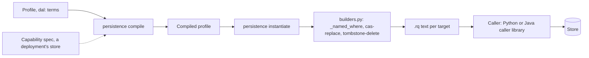

<!-- SPDX-License-Identifier: CC-BY-SA-4.0 -->

# A replace that is linear in the aggregate's size (sketch)

**Unit type:** a brief for investigation, then a decision
**Status:** raised 2026-10-31 by the studio-publication unit's PB-Q13, waiting for an agent to investigate
**Raised from:** the [studio-publication sketch](studio-publication.md) §9, where the maintainer answered PB-Q13 (b) on 2026-10-31, so the studio writes its large aggregates by hand until this is settled
**Touches:** `tools/persistence` (the builders of the named-graph and composite replace and tombstone), the capability record of formal-methods track H, TD-42, PDD-17, TSD-01, TSD-06, TSD-50, TSD-Q13

## 1. The problem

Every replace the persistence compiler generates, for a named-graph family and for a composite one, builds its new state once per triple it already holds. For an aggregate of M stored triples replaced by a payload of N, a store builds M × N insertion quads before it removes the copies. The cost is quadratic in the aggregate's size, in time on every engine measured and in memory on Oxigraph.

This has been known for the composite replace since 2026-10-10 (TD-42). What the studio-publication unit found on 2026-10-31 is that the named-graph replace has the same form, and that an aggregate the size of an ordinary authored artefact already makes it unusable. A mapping scheme of a few thousand triples, such as the ODRL mappings sample, takes about half a minute per save on Jena.

Nothing generated today is wrong. Each form is correct wherever it finishes, and the redundancy that costs M × N is exactly what makes it correct on every store whatever order the store applies an update in (§4). Choosing a linear form therefore means relying on a property of the store, which has to be known for each store, and that is why the maintainer held the change back until it is investigated.

## 2. Where it sits

- **The text.** `tools/persistence/src/persistence/builders.py`, `_named_where` (about line 414), builds the `WHERE` of the named-graph `cas-replace` and `tombstone-delete`, with their dataset-guard variants. It ends with `OPTIONAL { GRAPH ?g { ?s ?p ?o } }`, the sweep. The composite builders sweep the aggregate with one property path inside the family's data graph, to the same effect. `persistence.ir` and `persistence.ir_render` are the only source of the SPARQL (ADR-A123).
- **The selection.** ADR-A79's consequences require any conditional structure to be selected in `compile`, from the profile and the deployment's capability spec, never in `instantiate`. Track H's H5 was to extend the capability record and select the form from it, with protocol models (TLA+ or Quint, not yet chosen) proving each form safe under the capabilities it needs.
- **The callers.** The Python caller library (`packages/persistence/python`) and the Java one (`packages/persistence/java`, PB11) fill the slots and the parameters, and neither changes with the form, unless a form takes a different slot, as R2 would (§5).
- **Who waits.** The Configuration Studio's writer, whose parts and documents are named-graph aggregates (ADR-A149 decision 13), writes them by hand until a linear form exists (TD-136). Every adopter with a named-graph or composite family above a few hundred triples is affected in the same way.

## 3. What was measured

| M = N | rdflib 7.6.0, composite (TD-42) | Oxigraph 0.5.11, composite (TD-42) | Jena ARQ 5.1.0 in memory, named graph (2026-10-31) | Jena, two guarded operations, R1′ of §5 (2026-10-31) |
|---|---|---|---|---|
| 100 | 0.17 s | 0.0056 s | | |
| 300 | | | 0.46 s | 0.12 s, JVM warm-up |
| 1,000 | 9.2 s | 0.59 s | 2.5 s | 0.06 s |
| 3,000 | 83 s | 14.4 s | 28 s | 0.11 s |
| 10,000 | 983 s | did not finish, more than 8 GB | not run | not run |

The rdflib and Oxigraph columns are `benchmark/persistence-composite-cost`. The Jena columns come from a scratch script, not committed, run on an Apple laptop. It instantiated the studio's part family (`contracts/config-studio/persistence-profile.ttl`, a `dal:PatchLog` family with the graph named by the query), substituted every parameter into the text, loaded M stored triples and a version row at seq 1 into `DatasetGraphFactory.createTxnMem()`, and timed `UpdateAction.parseExecute` of the replace with N fresh payload triples and empty deltas. After each run the graph held exactly the payload. The two-operation column split the same text into the two operations §5 calls R1′. **Neither column has been repeated on TDB2, on Fuseki, or under the benchmark harness**, and the first job of the investigation is to bring them into `benchmark/persistence-graph-naming-cost-jvm` or a sibling, so they are reproducible and fail only on a wrong result (STD-290).

## 4. What the stores are known to do

SPARQL 1.1 Update defines `DELETE … INSERT … WHERE` as one evaluation of `WHERE` over the state before the operation, each template filled once per solution, then every deletion removed and every insertion added. A store that does exactly this is **snapshot**. A request of several operations *should* be atomic, which the working group chose not to require.

| Store | Applies an update | A request whose second operation fails | Isolation between operations of one request | Source |
|---|---|---|---|---|
| rdflib 7.6.0 | per solution, remove then add, in an order following the hash seed | keeps the first | not probed | TSD-01, TSD-06 |
| Oxigraph 0.5.11 | per solution, in solution order | rolled back | not probed | TSD-01, TSD-06 |
| Jena ARQ in memory | **not probed.** Reading `UpdateEngineWorker` suggests it collects the solutions, then deletes for all and inserts for all, which would be snapshot. A hypothesis only | rolled back | not probed | TSD-50 |
| Jena TDB2, and Fuseki over it | not probed | not probed | not probed | TSD-Q13 |
| GraphDB, Virtuoso, Neptune, RDF4J | not probed | Virtuoso's `log_enable` modes may not even make one operation atomic | not probed | TSD-Q13, TSD-06's documented notes |

So no linear form is known safe on the studio's own store today.

## 5. The forms

```mermaid
flowchart TB
  subgraph R0[R0, generated today]
    A0[one operation] --> B0["WHERE: guards x sweep, M solutions"]
    B0 --> C0["INSERT the whole payload in every solution, M x N"]
  end
  subgraph R1[R1, the typed IR sketch]
    A1["op 1: delete the aggregate, move the version row"] --> B1["op 2: insert the payload, guarded on the row op 1 wrote"]
  end
  subgraph R1p[R1 prime, measured 2026-10-31]
    A2["op 1: delete the aggregate, guarded on the row as it is"] --> B2["op 2: insert the payload and move the row, under the same guard"]
  end
  subgraph R2[R2, the typed IR sketch]
    A3["one operation: guards x UNION of empty, sweep, VALUES payload"] --> B3["1 + M + N solutions"]
  end
```

| Form | Quads built | Correct when | Payload | Status |
|---|---|---|---|---|
| R0 | M + M × (N + k) | always, whatever the store's order | the `{{{payloadTriples}}}` slot | generated |
| R1 | M + M × k + N | the request is atomic for failure and isolated from other writers | the slot | in the typed IR sketch §4.3, not proposed there, since a writer between the operations makes the second a no-op while the first already moved the row, leaving a receipt that says a write applied which never did |
| R1′ | M + N + k | hypothesis: the request is atomic for failure, and each operation is atomic on its own | the slot | measured on Jena in memory, not modelled |
| R2 | M + N + (1 + M + N) × k | the store is snapshot | `VALUES` rows, which admit no blank node | in the typed IR sketch §4.3, unsafe on rdflib and Oxigraph |

**Why R1′ may need less than R1.** Both of R1′'s operations guard on the version row as it was, and only the second moves it. A writer B that runs a whole replace between A's operations moves the row, so A's second operation finds the row moved and writes nothing, no row and no receipt, and A confirms its write by reading its transaction claim and reads stale (the caller's third obligation). B's first operation deleted what A's first had already deleted, and B's second wrote B's payload, so B's state stands. If B's first operation runs between A's two and A's second runs before B's, A's second moves the row and B's second then finds it moved. B's first deleted nothing A wrote, since A's payload is written by A's second. In every interleaving we traced, the outcome is one writer's complete state and that writer's receipt alone. What R1′ still needs is failure atomicity. If the connection drops after the first operation is applied and before the second, the aggregate is empty at its old seq with no receipt, which a reader would take for a real state. **This argument is a hypothesis.** It is the kind of claim H5's protocol models exist to check, and it rests on each operation being atomic on its own, which TSD-Q13 doubts for Virtuoso.

The patch log is unaffected by the choice. Its add and del graphs are the caller's delta in every form, written with the row move.

## 6. What to investigate

1. **Reproduce the measurement** under a benchmark, on Jena in memory, on TDB2 and on Fuseki over HTTP, for the named-graph replace and the tombstone, M = N from 100 to 10,000, R0 against R1′ and R2.
2. **Probe each store's update order** for Jena ARQ, TDB2 and Fuseki, as TSD-01 did for rdflib and Oxigraph, with the fixture that forces a payload solution before a sweep solution. If Jena is snapshot, R2 is linear there with one operation.
3. **Probe failure atomicity on TDB2 and Fuseki**, TSD-Q13, with a failing second operation and with a large update interrupted.
4. **Check R1′'s interleavings**, by hand first and then in a protocol model if H5's toolchain is chosen, including a writer that replays the same transaction, a tombstone racing a replace, and the dataset-guard variants.
5. **Decide the selection.** Which capability names each form needs, `atomicUpdateRequest` split into its failure and isolation halves or `snapshotUpdateSemantics`, how a deployment declares them in its capability spec, what `unknown` selects (R0, pessimistic), and how the generated text, the goldens, the expected profiles and the witness fixtures change.
6. **Check the callers.** R1′ keeps the slots and parameters, so neither caller library changes. R2 replaces the payload slot with `VALUES` rows, which changes both libraries, the vectors and the digest contract.

## 7. Questions this should answer for the maintainer

| ID | Question | Options known |
|---|---|---|
| LR-Q1 | Which linear form the compiler generates, and on which stores | R1′ where failure atomicity holds, R2 where the store is snapshot, both, or neither until H5's models exist |
| LR-Q2 | Whether this is track H's H5 or goes ahead of it | a slice of H5, or a capability-selected form ahead of H5 with its interleavings argued by hand and modelled later |
| LR-Q3 | What a store with no declared capabilities gets | R0, as today, or a linear form behind an explicit opt-in on the profile |

## 8. Done when

The maintainer has answered LR-Q1 to LR-Q3 with the measurements and probes of §6 in the discovery record, and the chosen form is generated and selected by `compile`. The studio's writer then moves its parts and documents onto the generated replace, removing its hand-written one, and TD-136 and TD-42 are closed or narrowed.
