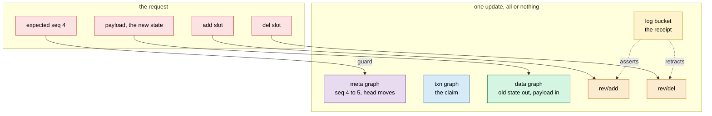

<!-- SPDX-License-Identifier: CC-BY-SA-4.0 -->

# Persistence: the README as a literate specification, told through its examples (sketch)

**Unit:** [`formal-methods-track-h`](../status/formal-methods-track-h.md), slice H2.11 ([plan §4.19](../plans/formal-methods-track-h.md#419-h211-the-persistence-readme-as-a-literate-specification-planned-2026-10-20)),
after H2.9 and the rest of Track H's H2 work
**Status:** sketch, 2026-10-20, for the maintainer. Questions RL-Q1 to RL-Q7 are open
**Builds on:** [ADR-A126](../../architecture/decisions/ADR-A126-literate-specification-layout-and-grammar.md) (the layout and the section 6
grammar), [ADR-A127](../../architecture/decisions/ADR-A127-published-architecture-decisions.md) (what a user-facing document may cite),
[literate specifications](../../architecture/literate-specifications.md), the Eligibility migration (OD6) and Vocabulary's (OD7) of the
documentation epic, which left Persistence out ("catalogue entries only")

## 1. Why

`ontology/persistence/README.md` is the one module README that is neither literate (TD-01) nor in the ADR-A126 layout. Its Turtle is
excerpts, so `spec/persistence.ttl`, `spec/persistent-foundation.ttl` and the shapes cannot be regenerated from it or checked against it.
It has grown slice by slice through Track H, and it explains the configuration model well but rarely shows what a generated update does
to a graph. The maintainer asks for two things at once:

1. **Conformance.** The README in the thirteen-section layout, its section 6 the only source of the two documents' axioms, its shapes in
   section 7, checked by `check:literate-migration` to generate the same graphs as today.
2. **A better read.** Narrative woven through, drawing on the examples we have built and tested, with more diagrams that show SPARQL
   working on the graph at runtime, a walk through best practices, gotchas and considerations, and pictures that are more colourful and
   pleasant to look at. The Examples section keeps its usual contents.

## 2. The scene, checked 2026-10-20

| Fact | Consequence |
|---|---|
| 1,777 lines, 18 mermaid diagrams, sections 1 to 15 of its own | every section moves, so the migration is a rewrite in place, not an edit |
| two documents, `persistence` (about 320 subjects in its spec) and `persistent-foundation`, each with a spec and a shapes file | section 6 holds both, the second in `output-file` regions, as Behaviour's README holds its runtime document |
| `shapes/constraints.ttl` is mostly SHACL-SPARQL | section 7 carries it in hidden blocks naming their file, as Eligibility's constraints are |
| it cites ADR-A67, A78, A79, A80, A82, A84, A114 and A121. Only A121 is Published, and A67, A82 and A84 are Proposed | a migrated README fails the sources check on an unpublished citation (ADR-A127). Either the maintainer publishes them first, or the text stops citing them (RL-Q3) |
| about 36 example files, the expected profiles, the membership fixtures and every behaviour test pass on rdflib and Oxigraph | the narrative can show real, tested graphs and real generated SPARQL, never invented ones |
| the generated class diagram of the Overview (OD5) draws every class | for about 320 subjects it would be unreadable (RL-Q6) |
| the triple-store record and efficient queries and shapes are architecture documents | the gotchas may cite them, since they are not working documents |

## 3. The narrative thread

One running case, told through the README's Detailed Design, each step a real example file and a real generated operation:

```mermaid
flowchart LR
    A["1. Declare<br/>a profile"]:::author --> B["2. Compile<br/>the profile"]:::tool
    B --> C["3. Generate<br/>the operations"]:::tool
    C --> D["4. Write<br/>one update, the graphs before and after"]:::store
    D --> E["5. Race and retry<br/>the seq guard and the claim"]:::store
    E --> F["6. History<br/>receipts, patch log, versions"]:::history
    F --> G["7. Read back<br/>current, as of, members"]:::history
    G --> H["8. Keep it small<br/>sharing, retention"]:::history
    classDef author fill:#fde2e4,stroke:#c0392b,color:#000
    classDef tool fill:#d6eaf8,stroke:#2874a6,color:#000
    classDef store fill:#d5f5e3,stroke:#1e8449,color:#000
    classDef history fill:#fff3cd,stroke:#b7950b,color:#000
```

| Step | Draws on | Pictures |
|---|---|---|
| 1. declare | `baseline-single-class.ttl`, `composite-project-ownership.ttl` | the profile as a tree of dimensions, with the classified boundary shape drawn as the aggregate it selects |
| 2. compile | the expected profiles | the resolution of scopes and precedence, a refusal and a warning with their witnesses |
| 3. generate | the builders' recorded outputs | one operation's contract: parameters, graph roles, access, digest parts |
| 4. write | `cas-replace-composite-property` on the project example | the named graphs as boxes, the triples deleted and inserted, before and after |
| 5. race | the behaviour tests of the seq guard and the claim | a sequence diagram of two writers, the loser writing nothing, a retry after a lost reply |
| 6. history | `write-discipline-*` examples, the patch-log tests, the membership fixtures | the receipt chain, the add and del graphs, a version chain with shared members, full and delta lists |
| 7. read back | the members read, the audits' three outcomes | the chain to a checkpoint, an audit reporting nothing examined |
| 8. keep it small | the benchmark's counts, AIR-style sharing | a table of stored triples per strategy, a retention timeline |

### 3.1 Pictures of SPARQL on the graph

The new kind of diagram the README lacks: a generated update shown against the graphs it touches. For example, a compare-and-set replace
under a patch log:

## 4. Best practices, gotchas and considerations

A section of Detailed Design, each item tied to an example or a test, and to the finding that taught us it:

| Topic | The gotcha | Source |
|---|---|---|
| datatypes | an integer literal is not an `xsd:long`, and Oxigraph stores a derived integer as `xsd:integer` | TSD-07, the parameter guards, the caller check |
| order of solutions | rdflib applies an update solution by solution in an order that follows the hash seed | TSD-01 |
| `NOT EXISTS` and graphs | on rdflib a `NOT EXISTS` with no `GRAPH` of its own inside a `GRAPH` block may read the default graph | TSD-34, the checker rule |
| atomicity | a request of several operations is not atomic on every store, one operation is | TSD-06 |
| an empty `VALUES` | rdflib raises, Oxigraph gives no solution | TSD-21 |
| sweep cost | a composite replace fills its payload once per stored triple | TD-42, the composite cost benchmark |
| inverse functional properties | they are not uniqueness constraints, and a reasoner merges what shares a value | the patterns guide, the exposure correction |
| blank nodes | never in a payload, skolemised under the parent | the payload type, ADR-A51 |
| guards off | the caller then owns every check the store would have made | the `ParameterGuardsOff` diagnostic |
| no receipt | a family without receipts needs its own meta shard | `NoReceiptSharesMetaShard` |
| pinned or by identity | pin where a record is evidence of what it saw | the reference modes, the evidence warning |
| full or delta membership | delta writes a handful of triples and reads a chain | the membership benchmark |
| events | an event may name an aggregate but never describe it | the event-subject rule |

Each is a short paragraph, a picture where the mechanism is structural, and a pointer to the test that holds it.

## 5. The palette

Every diagram uses one set of classes, so a colour means the same thing everywhere. Light fills with dark text, which read on GitHub's
light and dark themes. Rendered and checked in both before handoff.

| Class | Fill | Stroke | Means |
|---|---|---|---|
| `author` | `#fde2e4` | `#c0392b` | what an adopter writes |
| `caller` | `#fde2e4` | `#c0392b` | what a caller sends |
| `tool` | `#d6eaf8` | `#2874a6` | the compiler and the library |
| `meta` | `#e8daef` | `#7d3c98` | version rows |
| `txn` | `#d6eaf8` | `#2874a6` | claims |
| `data` | `#d5f5e3` | `#1e8449` | aggregate data |
| `log` | `#fff3cd` | `#b7950b` | receipts |
| `delta` | `#fdebd0` | `#ca6f1e` | patch content |
| `history` | `#fff3cd` | `#b7950b` | history as a concern |
| `refused` | `#f5b7b1` | `#922b21` | a refusal or a failed guard |
| `store` | `#d5f5e3` | `#1e8449` | what the store does |

## 6. Questions for the maintainer

| # | Question | Options | Leaning |
|---|---|---|---|
| RL-Q1 | one slice or two | (a) H2.11a conformance: the layout, section 6 and 7, checked graph for graph, no narrative change, then H2.11b the narrative, the pictures and the gotchas, prose and diagrams only. (b) one slice | (a). The migration check judges a and a reviewer judges b, and neither hides the other's diff |
| RL-Q2 | the running case | (a) the shipped examples, the project aggregate of `composite-project-ownership` for writes and history, `baseline-single-class` for the named-graph family. (b) a new running example. (c) the history and versioning sketch's E1 to E8 | (a). They are tested, domain-neutral, and already the expected profiles' sources. The sketch's examples are a working document the README may not cite |
| RL-Q3 | citations of unpublished ADRs | (a) the maintainer publishes ADR-A78, A79, A80, A114, A122, A123 and A132 before H2.11a merges, and the text stops citing A67, A82, A84 and A128 while they are Proposed. (b) the README cites none of them and states what they decided | (a) for the accepted ones, since publication also gives readers the decisions. (b) for the proposed ones |
| RL-Q4 | `persistent-foundation` | (a) in this README, in `output-file` regions, as today. (b) a README of its own | (a) |
| RL-Q5 | the palette | (a) §5 here, applied to this README, and proposed to the literate specifications conventions as a shared palette afterwards. (b) a shared palette first | (a) |
| RL-Q6 | the Overview's generated class diagram | (a) the generated diagram restricted to the top classes (profiles, dimensions, compiled profile, operation contract), with the rest in each section's own diagrams, which needs a filter in the generator. (b) the full generated diagram in a collapsed block. (c) no generated diagram for this module | (b), since it needs no tool change and keeps the generated view checked, and the narrative pictures carry the explanation |
| RL-Q7 | the section 6 definitions | every term needs a definition, and some have none or only a comment. (a) drafted from the README's prose and reviewed by the maintainer, as OD6 did for 32 Eligibility terms. (b) left as they are | (a) |
