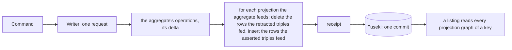
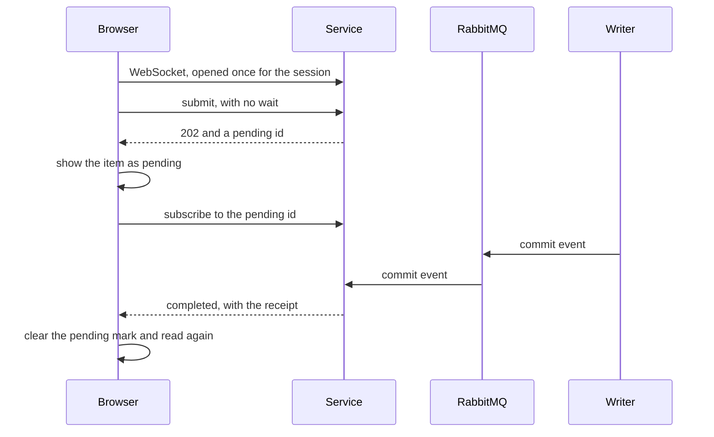

<!-- SPDX-License-Identifier: CC-BY-SA-4.0 -->

# Projections maintained in the write, and replies that do not wait (sketch)

**Unit type:** a multi-slice unit, `projection-maintenance` (PM)
**Status:** raised by the maintainer on 2026-10-31, answering SQ-Q2 with (a) now and (b) as a supported pattern. PM-Q1, PM-Q5 and the slice order answered the same day. PM-Q2 to PM-Q4 and PM-Q6 open
**Touches:** `tools/surface`, `contracts/config-studio/projections.ttl` and `workspace-summaries.rq`, the studio's writer, service and worker, `apps/config-studio`, ADR-A149 decision 14, BL-09, BL-10, BL-11

## 1. The scene

The studio's five projections are rebuilt whole by a refresh job, which the worker runs over the whole store and the writer applies, two commits after the write that made them stale (ADR-A149 decision 14 and its addendum on the cost of a refresh). A publish waits for that refresh, so it takes about 295 ms on TDB2 against 90 ms before phase D. Every save also queues one, batched over half a second.

The maintainer asked on 2026-10-31 for BL-09 now, so the writer keeps a projection current in the request of the write that changes it, and for a reply that does not wait as a pattern the client may choose, marking what is pending and learning of its completion by a WebSocket message. They asked for the studio to move from polling to WebSockets as soon as it can, to take load off the HTTP service.

Each of the studio's projection rows comes from one aggregate:

| Projection | Row | Read from | Written by |
|---|---|---|---|
| registry | `{lineage} prj:current {version}` | the lineage's graph | publish |
| jobs | `{job} prj:workspace {ws}` | the job's graph | submit and delete a job |
| holders | `{ws} prj:dependsOn {held}`, `{ws} prj:holdsImport {held}` | the workspace's description | set dependencies, import, fence, release |
| terms | `{concept} prj:prefLabel {label}`, `prj:inScheme {version}` | the version's graph, immutable | publish |
| summaries | a workspace's label, owner, mode, time, and each part's and document's sequence | the description and the version rows | every write of a workspace |

## 2. Three tiers

A projection is in one of three tiers, by what its rows depend on.

| Tier | Rows depend on | Kept | Fresh |
|---|---|---|---|
| 1, in the write | one aggregate | in the source's own request, from its delta, in one graph a source | always, in the same commit |
| 2, after the write | several aggregates, reached by their links | by a maintainer for each scope, from the committed deltas, incrementally | at a recorded watermark, behind its sources by a known lag |
| 3, at read time | anything | not stored | always |

A tier 2 materialisation is never part of a source's atomic write. It exists because some answers are slow to reach with SPARQL, and a shape built for the read, for example one flattened row an answer where the query would walk a path, makes them fast. Every tier is derived and can be rebuilt from the aggregates (PRI-52), and every tier is kept in the graph. A store outside the graph is not used (PM-Q5).

## 3. Tier 1, in the write



**One graph a source, kept by its delta (PM-Q1, (a′)).** Each projection keeps one graph a source aggregate, `urn:lattice:studio:projection:{key}/{source}`, so 33 aggregates feeding one projection give it 33 graphs, however many rows each holds. A graph costs one entry in the store's node table, since a quad holds its graph whichever graph it is in, so the layout costs no more space than one shared graph. No graph is shared by two aggregates, so writers of different aggregates never contend for one, and a listing reads `GRAPH ?g { ?c prj:current ?o }`, which a store answers from a predicate index.

A projection graph is changed by the source's delta, never cleared and written again, since a source of 180,000 projected triples changed in one would otherwise write 180,000. For a promotion, which restates a property, the projection's delta is the source's delta for the promoted property, so the generated operations are, for a promotion of `cst:current` to `prj:current`:

```sparql
DELETE DATA { GRAPH $projection { <the retracted cst:current triples, restated> } } ;
INSERT DATA { GRAPH $projection { <the asserted cst:current triples, restated> } }
```

A projection whose rows are derived rather than restated keys each row to the node it derives from, so a change recomputes the rows of the nodes it touched and no others. A change that touches many nodes, such as a value many rows share, costs those rows, which is the data's cost and not the layout's.

**The summaries projection** is a query, not a promotion, since it builds part roots. It becomes a template with `$w` bound, run for the workspace a write changed, its 12 version-row lookups and its description, about 30 triples.

**The refresh job stays as a rebuild**, run when the service starts and on demand, for a store migrated or repaired outside the writer (PM-Q3). No write queues one, so the `Refresher`'s batching and every `awaitFresh` go.

| | today, a refresh job | tier 1 |
|---|---|---|
| commits for a publish | 1, then 2 for the refresh | 1 |
| what is read to keep the projections | the whole store | the delta the write already holds |
| a save | 1 commit, and a refresh every half second of saves | 1 commit, a few more quads in it |
| a listing after a write | waits for a refresh, or may lag | always agrees with the write |

Expected, not measured: a publish back to about 90 ms on TDB2, the cost of its one commit.

## 4. Commit events

The writers publish an event for each command they commit, on an exchange the service and the tier 2 maintainers consume. An event names what changed and carries none of its content:

| Field | For example | Size |
|---|---|---|
| the family and the root | `Part`, the part's root IRI | about 100 bytes |
| the new sequence and the revision it minted | 7, `urn:rev:studio/.../e.../7` | about 100 bytes |
| the command and its receipt | the command's id | about 50 bytes |
| the delta's size | 2 asserted, 1 retracted | a few bytes |

About 300 bytes whatever the size of the aggregate or of its change. A consumer that needs the delta reads it from the patch log, the revision's `/add` and `/del` graphs, which a `dal:PatchLog` family writes in the same commit, so nothing is serialised twice and a bulk change puts no triples on the queue. An aggregate that feeds an incremental tier 2 materialisation therefore keeps a patch log. Without one its maintainer recomputes the affected rows from the source as it is, which is right and not incremental, and the configuration's checks report the combination.

## 5. Replies that do not wait

The client chooses for each request whether to wait. What completes later, a job, a tier 2 materialisation reaching a write, is reported the same way.



The service pushes an event only to a WebSocket whose principal may read what it names. The browser's polling of jobs moves to the WebSocket first, which takes its repeated reads off the HTTP service. A client that opens no WebSocket polls as today.

## 6. Tier 2, after the write

- **One maintainer a scope.** A materialisation spanning aggregates is written only by its scope's maintainer, never by the writers of its sources, and maintainers are partitioned by scope key as writers are by workspace, so no two contend for a scope's graphs.
- **Incremental.** A dependency index maps each source to the scopes that read it, and within a scope to the rows it feeds, the surface compiler's invalidation planning answering the first half. A change of k triples recomputes the rows those triples feed.
- **Batched.** The commit events of one scope that arrive together are applied in one pass, one commit a batch, as the `Refresher` batches today.
- **A watermark.** Each materialisation records, for each source, the sequence it reflects. A reader chooses to accept the lag, to wait up to a limit until the watermark covers its own write, or to reply now with the item marked pending and the completion sent over the WebSocket (§5).

Whether a scope's maintainer keeps up with its writers under heavy concurrency depends on the configuration: how many sources a scope reads, how often they change, how many rows a change feeds. An author needs to see that before deploying, which BL-10 (an estimate) and BL-11 (a measurement on generated data) are for.

## 7. Questions

**PM-Q1. How are a projection's rows kept?** Answered 2026-10-31, (a′): one graph a source aggregate, changed by the source's delta, derived rows keyed to the node they derive from (§3).

**PM-Q2. Where is the maintenance generated?** (a) by a new backend of `tools/surface`, emitting the delta operations of each promotion, which is BL-09, with the summaries template written beside its query. (b) by hand in the writer. **Leaning (a),** since the contract is then the one statement of each projection.

**PM-Q3. Does the refresh job stay?** (a) as a rebuild only, at start and on demand. (b) removed, with a migration rebuilding the graphs once. **Leaning (a),** since a store written outside the writer has no other repair.

**PM-Q4. What moves to the WebSocket first?** (a) the browser's polling of jobs, then any write a client chooses not to wait for. (b) everything at once. **Leaning (a).**

**PM-Q5. Where may a tier 2 materialisation live?** Answered 2026-10-31: in the graph only. No store outside the graph yet.

**PM-Q6. How fine is a watermark?** (a) one sequence a source a scope. (b) one position in the commit event stream a scope. (a) lets a reader wait for its own write by the source it wrote, and a scope reads few enough sources for it to stay small. (b) is one number, but a reader cannot tell from it whether its own write is covered without knowing where its commit fell. **Leaning (a).**

## 8. Slices

| Slice | What | Done when |
|---|---|---|
| PM1 | the surface backend generating each promotion's delta operations, and the summaries template | each promotion's operations, run after a write, leave what a rebuild leaves |
| PM2 | the writer maintains every projection in its request, the projection graphs move to one a source, the reads follow, the refresh job becomes a rebuild | the studio's projection tests pass with no refresh, and a publish is one commit |
| PM3 | the commit events, the service's WebSocket, and the browser's pending marks, jobs first | a job's completion reaches a subscribed browser without polling |
| PM4 | the tier 2 maintainer, its dependency index, batching and watermark, and the reader's three choices | a materialisation spanning two aggregates reaches each write, and a reader waiting for its write is released when the watermark covers it |

The maintainer accepted this order on 2026-10-31. PM3 touches the service, the browser and the writer's publishing only, not the surface compiler or the projections, so it can be built beside PM1 if the WebSocket is wanted sooner.
