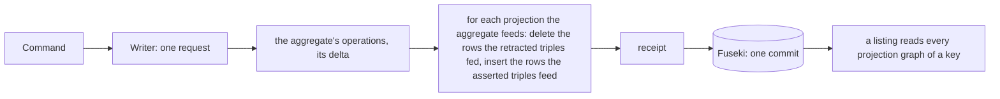
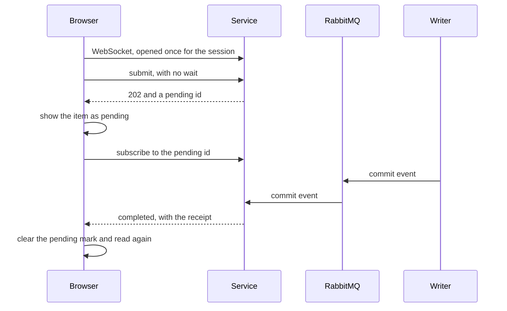

<!-- SPDX-License-Identifier: CC-BY-SA-4.0 -->

# Projections maintained in the write, and replies that do not wait (sketch)

**Unit type:** a multi-slice unit, `projection-maintenance` (PM)
**Status:** raised by the maintainer on 2026-10-31, answering SQ-Q2 with (a) now and (b) as a supported pattern. PM-Q1 to PM-Q9 and the slice order answered the same day, and PM-Q10 to PM-Q12 on 2026-11-01. PM-Q1, PM-Q7 and PM-Q8 are restated without assuming a named graph, since where surface output lands is a choice (PM-Q9)
**Touches:** `tools/surface`, `contracts/config-studio/projections.ttl` and `workspace-summaries.rq`, the studio's writer, service and worker, `apps/config-studio`, ADR-A149 decision 14, BL-09, BL-10, BL-11

## 1. The scene

The studio's five projections are rebuilt whole by a refresh job, which the worker runs over the whole store and the writer applies, two commits after the write that made them stale (ADR-A149 decision 14 and its addendum on the cost of a refresh). A publish waits for that refresh, so it takes about 295 ms on TDB2 against 90 ms before phase D. Every save also queues one, batched over half a second.

The maintainer asked on 2026-10-31 for BL-09 now, so the writer keeps a projection current in the request of the write that changes it, and for a reply that does not wait as a pattern the client may choose, marking what is pending and learning of its completion by a WebSocket message. They asked for the studio to move from polling to WebSockets as soon as it can, to take load off the HTTP service.

Each of the studio's projection rows comes from one aggregate:

| Projection | Row | Read from | Written by |
|---|---|---|---|
| registry | `{lineage} prj:current {version}` | the lineage's graph | publish |
| jobs | `{job} prj:workspace {ws}` | the job's graph | submit and delete a job |
| holders | `{ws} prj:dependsOn {held}`, `{ws} prj:holdsImport {held}` | the workspace's description | set dependencies, import, fence, release |
| terms | `{concept} prj:prefLabel {label}`, `prj:inScheme {version}` | the version's graph, immutable | publish |
| summaries | a workspace's label, owner, mode, time, and each part's and document's sequence | the description and the version rows | every write of a workspace |

## 2. Three tiers

A projection is in one of three tiers, by what its rows depend on.

| Tier | Rows depend on | Kept | Fresh |
|---|---|---|---|
| 1, in the write | one aggregate | in the source's own request, from its delta, in one partition a source | always, in the same commit |
| 2, after the write | several aggregates, reached by their links | by a maintainer for each scope, from the committed deltas, incrementally | at a recorded watermark, behind its sources by a known lag |
| 3, at read time | anything | not stored | always |

A tier 2 materialisation is never part of a source's atomic write. It exists because some answers are slow to reach with SPARQL, and a shape built for the read, for example one flattened row an answer where the query would walk a path, makes them fast. Every tier is derived and can be rebuilt from the aggregates (PRI-52), and every tier is kept in the RDF store. A store outside it is not used (PM-Q5). Where in the store a tier's output lands is a choice, never forced: a graph role may be a physical graph or an equivalent provenance partition (ADR-A13), a contract may be `DefinitionOnly` and store nothing (ADR-A15, ADR-A16), and a source aggregate may itself be a named graph or a composite in a shared graph (PM-Q9).

## 3. Tier 1, in the write



**One partition a source, kept by its delta (PM-Q1, (a′)).** Each projection keeps the rows of each source aggregate apart from every other source's, in the partition PM-Q9 places them in, so 33 aggregates feeding one projection give it 33 partitions, however many rows each holds. For the studio, whose aggregates are named graphs, that is a graph a source, `urn:lattice:studio:projection:{key}/{source}`, which costs one entry in the store's node table, since a quad holds its graph whichever graph it is in. No partition is shared by two aggregates, so writers of different aggregates never contend for one, and a listing reads `GRAPH ?g { ?c prj:current ?o }`, which a store answers from a predicate index.

A projection's partition is changed by the source's delta, never cleared and written again, since a source of 180,000 projected triples changed in one would otherwise write 180,000. For a promotion, which restates a property, the projection's delta is the source's delta for the promoted property, so the generated operations are, for a promotion of `cst:current` to `prj:current`:

```sparql
DELETE DATA { GRAPH $projection { <the retracted cst:current triples, restated> } } ;
INSERT DATA { GRAPH $projection { <the asserted cst:current triples, restated> } }
```

A projection whose rows are derived rather than restated keys each row to the node it derives from, so a change recomputes the rows of the nodes it touched and no others. A change that touches many nodes, such as a value many rows share, costs those rows, which is the data's cost and not the layout's.

**The summaries projection** is a query, not a promotion, since it builds part roots. It becomes a template with `$w` bound, run for the workspace a write changed, its 12 version-row lookups and its description, about 30 triples.

**The refresh job becomes a rebuild** (PM-Q3). No write queues one, so the `Refresher`'s batching and every `awaitFresh` go. A rebuild is still needed where no commit event arises: a projection's contract changes, data is written outside the writer by a migration, a restore or a hand edit, or a fault left a projection wrong.

| | today, a refresh job | tier 1 |
|---|---|---|
| commits for a publish | 1, then 2 for the refresh | 1 |
| what is read to keep the projections | the whole store | the delta the write already holds |
| a save | 1 commit, and a refresh every half second of saves | 1 commit, a few more quads in it |
| a listing after a write | waits for a refresh, or may lag | always agrees with the write |

Expected, not measured: a publish back to about 90 ms on TDB2, the cost of its one commit.

## 4. Commit events

The writers publish an event for each command they commit, on an exchange the service and the tier 2 maintainers consume. An event names what changed and carries none of its content:

| Field | For example | Size |
|---|---|---|
| the family and the root | `Part`, the part's root IRI | about 100 bytes |
| the new sequence and the revision it minted | 7, `urn:rev:studio/.../e.../7` | about 100 bytes |
| the command and its receipt | the command's id | about 50 bytes |
| the delta's size | 2 asserted, 1 retracted | a few bytes |

About 300 bytes whatever the size of the aggregate or of its change. A consumer that needs the delta reads it from the patch log, the revision's `/add` and `/del` graphs, which a `dal:PatchLog` family writes in the same commit, so nothing is serialised twice and a bulk change puts no triples on the queue. An aggregate that feeds an incremental tier 2 materialisation therefore keeps a patch log. Without one its maintainer recomputes the affected rows from the source as it is, which is right and not incremental, and the configuration's checks report the combination.

## 5. Replies that do not wait

The client chooses for each request whether to wait. What completes later, a job, a tier 2 materialisation reaching a write, is reported the same way.



The service pushes an event only to a WebSocket whose principal may read what it names. The browser's polling of jobs moves to the WebSocket first, which takes its repeated reads off the HTTP service. A client that opens no WebSocket polls as today.

## 6. Tier 2, after the write

- **One maintainer a scope.** A materialisation spanning aggregates is written only by its scope's maintainer, never by the writers of its sources, and maintainers are partitioned by scope key as writers are by workspace, so no two contend for a scope's graphs.
- **Incremental.** A dependency index maps each source to the scopes that read it, and within a scope to the rows it feeds, the surface compiler's invalidation planning answering the first half. A change of k triples recomputes the rows those triples feed.
- **Batched.** The commit events of one scope that arrive together are applied in one pass, one commit a batch, as the `Refresher` batches today.
- **A watermark.** Each materialisation records, for each source, the sequence it reflects. A reader chooses to accept the lag, to wait up to a limit until the watermark covers its own write, or to reply now with the item marked pending and the completion sent over the WebSocket (§5).

Whether a scope's maintainer keeps up with its writers under heavy concurrency depends on the configuration: how many sources a scope reads, how often they change, how many rows a change feeds. An author needs to see that before deploying, which BL-10 (an estimate) and BL-11 (a measurement on generated data) are for.

## 7. Questions

**PM-Q1. How are a projection's rows kept?** Answered 2026-10-31, (a′): one partition a source aggregate, changed by the source's delta, derived rows keyed to the node they derive from (§3). It was first written as one graph a source, which PM-Q9 generalises.

**PM-Q2. Where is the maintenance generated?** Answered 2026-10-31, (a): by a new backend of `tools/surface`, emitting the delta operations of each promotion, which is BL-09, with the summaries template written beside its query.

**PM-Q3. When does a rebuild run?** Answered 2026-10-31. Each projection's graphs record the version of the contract that built them. At start the service rebuilds a projection whose contract changed only where the change is purely additive, new promotions and nothing changed or removed. A change that is not additive is not rebuilt: the service logs that the contract is out of date, the studio shows that its start had warnings, and the rebuild command is not offered for it. An admin command rebuilds on demand, after data was written outside the writer or a fault was fixed. A change that alters or removes rows needs a migration that keeps their history, which is BL-12 and out of scope for now, and these constraints go when it exists. How additive is decided is PM-Q7.

**PM-Q4. What moves to the WebSocket first?** Answered 2026-10-31: none yet. The plumbing waits until the store's writes are shown consistent and stable, so PM-3 follows the delta replace unit and PM-2.

**PM-Q5. Where may a tier 2 materialisation live?** Answered 2026-10-31: in the graph only. No store outside the graph yet.

**PM-Q6. How fine is a watermark?** (a) one sequence a source a scope, one triple each, two quads changed a source a pass. (b) one position in the commit event stream a scope, which is a position a partition, and needs every reply to carry its event's position. (c) a pass number a scope with the source sequences each pass covered, a row a pass that grows until pruned. (d) none, so a reader can only accept the lag or wait for the WebSocket. (a) lets a reader wait for its own write by the sequence its reply already carries. **Answered 2026-10-31, (a).** It is one triple a source a scope, so a scope reading 33 sources keeps 33.

**PM-Q7. How is a contract change found to be additive?** The surface layer has three kinds of contract, and additive means for each that nothing it produced before is removed or altered:

| Kind | Additive |
|---|---|
| `srf:PromotionContract` | new promotions, or more values handled, no existing assertion removed or altered |
| `srf:IndexContract` | more values handled, a new index form or a wider population or closure, no existing symbol or membership removed or altered. A changed naming policy renames symbols and is not additive |
| `srf:ProjectionContract` | a new contract only. An existing one altered is not additive |

Since an altered value is a triple removed and one added, the test for all three is that every row the old contracts produced the new ones produce too. (a) by the contracts: each partition records the digest of each contract that built it, and a change is additive when no recorded contract changed or went and some are new. It is cheap, and it refuses a widening of an existing contract, which is safe and stricter than the definition. (b) by effect: a rebuild into staging, the rows each contract produced before, found by the contract's target namespace wherever they sit, checked to be a subset of those it produces now, then swapped, or the old kept with a warning. It is exact, and costs a whole rebuild and twice the space while staging, at a start whose contract changed. (c) both: (a) first, nothing done where no digest changed, only the new contracts built where only new ones appeared, and (b) only where an existing contract changed. **Answered 2026-10-31, (c).**

**PM-Q8. What is the studio's derived data called?** ADR-A149 calls it projections, and the surface layer names a different thing `srf:ProjectionContract`, a contract lowered into MORK, which tier 2 may use, so the one word would name two things. (a) each is named by the kind of contract that produces it, promotions and index entries, whatever its placement, and "projection" is kept for `srf:ProjectionContract`'s output. (b) read models, a term no layer here defines. (c) keep the name, with the clash recorded. **Answered 2026-10-31, (a),** renamed in the ADR, the contract, the code and the graph names in one change, before PM-2 moves them.

**PM-Q9. Where does surface output land?** Persistence profiles decide how data is grouped (ADR-A78, ADR-A122): a family's aggregate is a named graph (`dal:NamedGraphBoundary`), the members of a composite in a shared data graph (`dal:CompositePropertyBoundary`), or properties in a data graph (`dal:NoBoundary`). Surface output must not force another grouping on a deployment.

| Option | What it is | Consequence |
|---|---|---|
| (i) `DefinitionOnly` | no rows, the answer left to an entailment regime | no maintenance and no storage, every read pays, the case materialisation exists to avoid |
| (ii) beside the source | the derived triples in the source's own partition, its graph or its composite | the same delta and commit keep them, no partition added. The aggregate then holds derived triples, which its published digest, its patch log and a client's read must each exclude, by the contract's target namespace. A promotion onto a property a consuming layer declares (ADR-A16) cannot be told from an authored triple, so it cannot use (ii) |
| (iii) a partition of its own a source | a derived family with its own persistence profile, whose boundary mirrors the source's: a sibling graph for a named-graph source, a composite keyed by the source's root in a shared graph for a composite source | the aggregate stays as authored and no writers contend. Its placement is a persistence choice, generated by the persistence compiler like any write path (PRI-60) |
| (iv) one partition a contract | every source's rows in one shared partition | fine for one writer. Many writers contend for it, so only for tier 2, whose scope maintainer is the one writer |

**Answered 2026-10-31: (iii) as the default, its derived family's boundary mirroring the source's unless its profile says otherwise, (ii) allowed where every promoted property is in the contract's target namespace, (i) where the read is not hot, and (iv) for tier 2 only, each the user's choice.** Treating materialised output as a derived family puts its grouping where every other grouping is decided, in a persistence profile, rather than in the surface layer or the studio.

**PM-Q10. What topology delivers a completion?** (a) one event stream, a CloudEvent on one exchange for each commit and each finished job, consumed by one notifier a transport, each checking that its subscriber may read what the event names. (b) a pipeline a kind of client, each with its own publication and its own check. (c) clients subscribe at the broker over Web MQTT, Web STOMP, MQTT or AMQP, with the broker's topic permissions mirroring who may read each workspace, which changes as owners and modes change. **Answered 2026-11-01, (a).** The read check stays where the store can answer it (MEC-99, the service checks a workspace's mode on reads), and a new transport adds a notifier and changes nothing upstream. Polling a 5-second job costs about 9 reads, against one event of about 300 bytes and one frame a subscriber.

**PM-Q11. How does a client name its completion channel?** AMQP headers cannot carry it, since a client of the service speaks HTTP. (a) on each request. (b) a standing subscription, registered once. (c) both, by the channel's lifetime. **Answered 2026-11-01, (c).** A channel that lives with a session, a WebSocket or server-sent events, is named on the request or by a subscribe frame on a socket already open. A durable channel, a webhook or an AMQP queue, is a subscription resource held in the store with its owning principal, and its targets are on an allowlist an administrator keeps, since a callback to any URL a client names is a request forgery.

**PM-Q12. What does PM-3 build, in what form?** **Answered 2026-11-01:** every event is a CloudEvent in JSON on every transport, using `platform-outbox`'s types. The WebSocket carries CloudEvents frames with no STOMP or MQTT sub-protocol, since the service ends the connection. PM-3 builds the exchange, the WebSocket notifier and the subscribe frame. The webhook notifier and the AMQP queue grant wait as BL-13.

## 8. Slices

| Slice | What | Done when |
|---|---|---|
| PM-1 | the surface backend generating each promotion's delta operations, and the summaries template | each promotion's operations, run after a write, leave what a rebuild leaves |
| PM-2 | the writer maintains every projection in its request, each projection's rows move to one partition a source as PM-Q9 places them, the reads follow, the refresh job becomes a rebuild | the studio's projection tests pass with no refresh, and a publish is one commit |
| PM-3 | the commit events, the service's WebSocket, and the browser's pending marks, jobs first | a job's completion reaches a subscribed browser without polling |
| PM-4 | the tier 2 maintainer, its dependency index, batching and watermark, and the reader's three choices | a materialisation spanning two aggregates reaches each write, and a reader waiting for its write is released when the watermark covers it |

The maintainer accepted this order on 2026-10-31, with PM-3 after the delta replace unit and PM-2 (PM-Q4).
