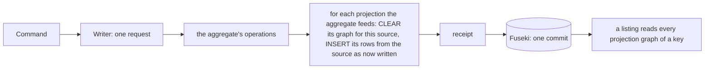
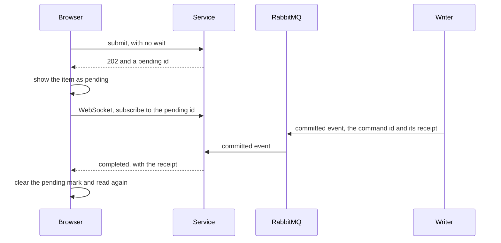

<!-- SPDX-License-Identifier: CC-BY-SA-4.0 -->

# Projections maintained in the write, and replies that do not wait (sketch)

**Unit type:** a multi-slice unit, `projection-maintenance` (PM)
**Status:** raised by the maintainer on 2026-10-31, answering SQ-Q2 with (a) now and (b) as a supported pattern. Questions PM-Q1 to PM-Q4 open
**Touches:** `tools/surface`, `contracts/config-studio/projections.ttl` and `workspace-summaries.rq`, the studio's writer, service and worker, `apps/config-studio`, ADR-A149 decision 14, BL-09

## 1. The scene

The studio's five projections are rebuilt whole by a refresh job, which the worker runs over the whole store and the writer applies, two commits after the write that made them stale (ADR-A149 decision 14 and its addendum on the cost of a refresh). A publish waits for that refresh, so it takes about 320 ms on TDB2 against 90 ms before phase D. Every save also queues one, batched over half a second.

The maintainer asked on 2026-10-31 for BL-09 now, so the writer keeps each projection current in the request of the write that changes it. They also asked for a reply that does not wait as a pattern the client may choose, which shows that something is pending and learns of its completion by a WebSocket message.

Each projection row comes from one aggregate:

| Projection | Row | Read from | Written by |
|---|---|---|---|
| registry | `{lineage} prj:current {version}` | the lineage's graph | publish |
| jobs | `{job} prj:workspace {ws}` | the job's graph | submit and delete a job |
| holders | `{ws} prj:dependsOn {held}`, `{ws} prj:holdsImport {held}` | the workspace's description | set dependencies, import, fence, release |
| terms | `{concept} prj:prefLabel {label}`, `prj:inScheme {version}` | the version's graph, immutable | publish |
| summaries | a workspace's label, owner, mode, time, and each part's and document's sequence | the description and the version rows | every write of a workspace |

## 2. The shape



**Rows grouped by their source.** Each projection keeps one graph a source, `urn:lattice:studio:projection:{key}/{source}`, for example the registry's row of a lineage in the graph named for that lineage's graph. Maintaining it is two operations generated from the contract and placed after the aggregate's own, in the same request:

```sparql
CLEAR SILENT GRAPH $projection ;
INSERT { GRAPH $projection { ?c prj:current ?o } } WHERE { GRAPH $source { ?c a fnd:PersistentIdentity ; cst:current ?o } }
```

It reads the source as the request has just left it, so it is right whether the write applied or found its guard stale, and it costs the size of the source's rows, not the store's. A listing reads `GRAPH ?g { ?c prj:current ?o }`, which every store answers from a predicate index, and no graph is shared by two aggregates, so concurrent writers of different aggregates never contend for a projection graph.

**The summaries projection** is a query, not a promotion, since it builds part roots. It becomes a template with `$w` bound, run the same way for the workspace a write changed, 12 version-row lookups and the description.

**The refresh job stays as a rebuild**, run when the service starts and on demand, writing every source's graph, for a store migrated or repaired outside the writer. No write queues one, so the `Refresher`'s batching and every `awaitFresh` go.

## 3. Cost

| | today, a refresh job | maintained in the write |
|---|---|---|
| commits for a publish | 1, then 2 for the refresh | 1 |
| what a refresh reads | the whole store | the sources the write changed |
| a save | 1 commit, and a refresh every half second of saves | 1 commit, about 30 more quads in it |
| a listing after a write | waits for a refresh, or may lag | always agrees with the write |

Expected, not measured: a publish back to about 90 ms on TDB2, the cost of its one commit.

## 4. Replies that do not wait

With every projection maintained in the write, no reply waits for a projection. What still completes later is a job, which the browser now polls. The pattern for both is the same.



The writers publish an event for each receipt they commit, on an exchange the service consumes. The service pushes it to each WebSocket subscribed to that command or job, and never sends one a principal could not read. A client that does not subscribe polls as today.

## 5. Questions

**PM-Q1. How are a projection's rows kept?** (a) one graph a source, cleared and written whole for that source, as §2. (b) one graph a projection, as today, each write deleting its source's rows by their key. (a) needs no key in the rows and no shared graph, and a listing scans one predicate in every graph. (b) keeps five graphs, and every writer of every aggregate writes the same graph, which the design standards forbid where concurrent writers contend. **Leaning (a).**

**PM-Q2. Where is the maintenance generated?** (a) by a new backend of `tools/surface`, emitting the two operations for each promotion, which is BL-09, with the summaries template written beside its query. (b) by hand in the writer. **Leaning (a),** since the contract is then the one statement of each projection.

**PM-Q3. Does the refresh job stay?** (a) as a rebuild only, at start and on demand, as §2. (b) removed, with a migration rebuilding the graphs once. **Leaning (a),** since a store written outside the writer has no other repair.

**PM-Q4. When is the no-wait pattern built, and for what first?** (a) after the maintenance, for jobs first, replacing the browser's polling, then for any write a client chooses not to wait for. (b) before it, so publish stops waiting now. **Leaning (a),** since with the maintenance a publish has nothing to wait for.

## 6. Slices

| Slice | What | Done when |
|---|---|---|
| PM1 | the surface backend generating per-source maintenance, and the summaries template | each promotion's operations, run after a write, leave what a rebuild leaves |
| PM2 | the writer maintains every projection in its request, the projection graphs move to one a source, the reads follow, the refresh job becomes a rebuild | the studio's projection tests pass with no refresh, and a publish is one commit |
| PM3 | the committed-event exchange, the service's WebSocket, and the browser's pending marks for jobs | a job's completion reaches a subscribed browser without polling |
