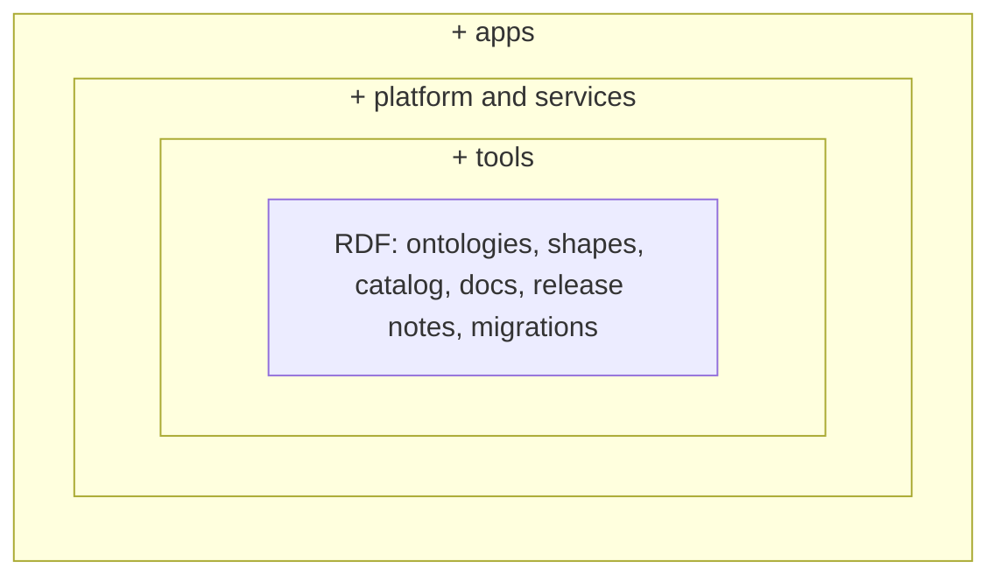
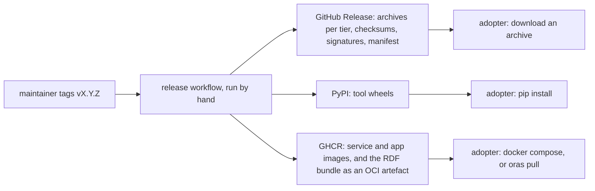

<!-- SPDX-License-Identifier: CC-BY-SA-4.0 -->

# What a LATTICE release ships — sketch

**Status:** Sketch, 2026-10-19. Questions BUN-Q1 to BUN-Q7 open. Not planned.
**Question prefix:** BUN
**Raised by:** the maintainer, 2026-10-19, with REL-Q1 of the [release model sketch](ontology-release-model.md):
a release ships more than ontologies, and an adopter should be able to take only part of it.
**Would need:** a new ADR on distribution. It builds on the one-release model (REL), and may reuse
[ADR-A40](../../architecture/decisions/ADR-A40-oci-reference-export-restore-and-command-adapters.md)'s OCI bundle
and signing adapters. ADR-A31 and ADR-A39 are about the platform releasing its users' semantic content, not
about shipping LATTICE, and are not changed.

## 1. The scene

**Today a release is a git tag.** An adopter clones or pins a tag (ADR-A88 decision 4). There are 220 tags, one
per document version, no release assets, no packages in a registry, and no images. The three GitHub workflows
run by hand only.

**What could be shipped**, measured 2026-10-19:

| Tier | What | Built by | Count |
|---|---|---|---|
| RDF | the substrate's spec, vocab, shapes and projections, the XML catalog, examples and fixtures, the READMEs | the literate extractor, by hand for some | 33 versioned documents, 17 artefact directories |
| tools | Python packages with a `pyproject.toml` (`lattice-reference-eligibility`, `mork-compilers`, `lattice-vocabulary-resolver`, `lattice-surface-compiler`, `lattice-persistence-compiler`, `lattice-minting`, `spc-toolchain` and others), and loose scripts such as the literate extractor and the catalogue reader | pip | 10 packages |
| platform | Java services under `platform/` (one Maven reactor, `org.nebularis.lattice`, 0.1.0-SNAPSHOT), the Python workers, the data contracts, the compose environment | Maven, pip | 8 modules |
| apps | `mork-review-workbench`, `surface-contract-studio` (Vite) and `word-authoring-addin` | Yarn | 3 |

## 2. Pictures

The tiers are cumulative. Each depends on the one inside it.

How a release moves from a tag to an adopter, in the option leaned towards below.

## 3. What each bundle holds

- **RDF.** The ontology release (REL): every document of the substrate train, the XML catalog, the shapes, a
  manifest listing each document's version IRI and digest, the release notes with each change's data class, any
  migrations, and the licence files. Examples and test fixtures in a separate optional archive, since a runtime
  needs neither.
- **Tools.** Wheels for the tool packages, built against the RDF bundle of the same release, and the RDF bundle.
  The literate extractor and the catalogue reader become a package first (RC5).
- **Platform.** Container images for each service and the workers, the Maven artefacts, the data contracts
  (OpenAPI and event schemas), and a compose file naming the images by digest.
- **Apps.** Container images, or static builds, of the three apps, and the platform bundle they need.

Each bundle carries a manifest naming the release, every artefact and its digest, so an adopter can check
that what they hold is the release.

## 4. Options

### Versions across the tiers

- **V1. One number for everything.** A release of the tools alone moves every ontology's version IRI, with
  unchanged content.
- **V2. The ontology release keeps its own number** (REL), and the product release names it. For example,
  LATTICE 1.4.0 ships ontologies 0.18.0. An ontology release happens only when an ontology changes, and a
  product release names the ontology release it was tested with.

### Channels

| Channel | Carries | Cost |
|---|---|---|
| GitHub Releases | archives per tier, checksums, signatures, the manifest | none, it is where the tag already is |
| PyPI | tool wheels, so `pip install lattice-tools` works | a project per package, or one meta-package with extras |
| Maven Central, or GitHub Packages | the Java artefacts | Central needs a verified namespace and signing |
| GHCR | service and app images, and the RDF bundle as an OCI artefact (`oras pull`) | none on a public repository |
| the IRIs themselves | each ontology served at its version IRI, so a tool needs no catalog | hosting at `www.nebularis.org`, with content negotiation |

### Who builds it

- **B1. A release workflow, run by hand on the maintainer's tag**, builds every bundle in a clean environment and
  publishes it, with build provenance.
- **B2. A `mise` task builds the bundles locally**, and the maintainer uploads them.

## 5. KISS

- **The smallest useful step is the RDF bundle on a GitHub Release**, with its manifest and checksums. It needs
  no registry account, and it is what an adopter of the ontologies needs first.
- **Tools follow on PyPI** once RC5 makes the shared tooling a package. Until then a tools archive of wheels on
  the GitHub Release serves.
- **Platform and apps wait** until a service is meant to run outside this repository's compose environment.
- **V2 keeps the ontology versions meaningful.** Under V1 a tools fix would re-version every ontology.

**Leaning: V2, B1, and GitHub Releases first, the RDF bundle in the first release, tools next, platform and
apps when a deployment needs them. GHCR for images when they come, and serving the IRIs left for later.**

## 6. Questions

- **BUN-Q1. The tiers and their contents** as in §3? In particular, examples and fixtures in a separate optional
  archive?
- **BUN-Q2. Versions:** V1 or V2?
- **BUN-Q3. Channels:** GitHub Releases first, then PyPI for tools and GHCR for images? Maven Central or GitHub
  Packages for the Java artefacts, or neither until a Java consumer exists?
- **BUN-Q4. Who builds:** B1 or B2?
- **BUN-Q5. Signing and provenance:** checksums only, or also signatures (for example cosign, as ADR-A40's
  adapters already wrap) and build provenance attested by the workflow?
- **BUN-Q6. Applied ontologies:** one bundle for every applied module, pinned to a substrate release, or one per
  module?
- **BUN-Q7. Serving the IRIs:** do version IRIs become dereferenceable at `www.nebularis.org`, and when?

## 7. Next

🔴 PLAN FIRST. BUN-Q2 and BUN-Q4 shape the first release's tooling. The RDF bundle could ship with OD-REL, as a
step of its release task, if the answers come before it.
