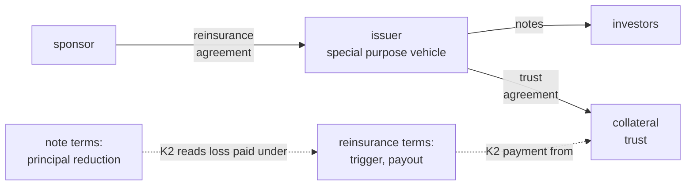
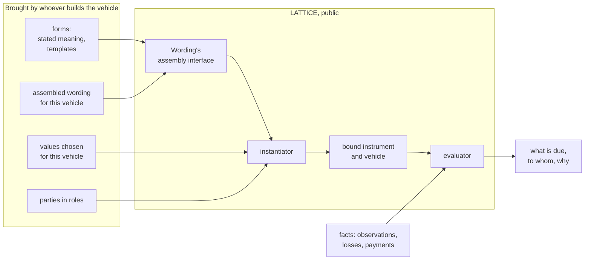

<!-- SPDX-License-Identifier: CC-BY-SA-4.0 -->

# Risk-capital vehicles: what LATTICE describes and evaluates

**Unit:** `applied-insurance-reference` (epic), proposed phase 7
([plan](../plans/applied-insurance-reference-phase-7.md)). **Status:** sketch, 2026-10-18. Nothing
here is ratified. The vehicle model is expected to change substantially before its first slice.
**Reads with:** [relations between instruments](instrument-relations.md) (the kinds of [ADR-A130](../../architecture/decisions/ADR-A130-ensemble-layer.md)), the
[Instrument README](../../../ontology/instrument/README.md) §10 (legal triggers), §11 (regimes),
§13 (anchored time) and §16 (sections), the
[claims sketch](insurance-claims-ontology.md) §10 (recoveries, reinsurance, towers), and
[ADR-A104](../../architecture/decisions/ADR-A104-instrument-terms-and-legal-relations.md) (stated and
bound meaning, instantiation).

## Contents

1. [The scene](#1-the-scene)
2. [What a vehicle is](#2-what-a-vehicle-is)
3. [The line LATTICE draws](#3-the-line-lattice-draws)
4. [Generic mechanisms first](#4-generic-mechanisms-first)
5. [The applied vehicle module](#5-the-applied-vehicle-module)
6. [How instantiation makes a vehicle](#6-how-instantiation-makes-a-vehicle)
7. [Evaluating what a vehicle pays](#7-evaluating-what-a-vehicle-pays)
8. [Slices](#8-slices)
9. [Questions RV-Q1 to RV-Q6](#9-questions-rv-q1-to-rv-q6)

---

## 1. The scene

The applied insurance modules describe perils, exposures, submissions and claims. Nothing yet
describes the capital that answers a claim when it is not a single insurer writing on its own
balance sheet: a facility, a quota share, a collateralised reinsurance, a catastrophe bond, a
parametric cover, a pool, a captive behind a fronting insurer. Each of these is a set of
instruments, linked to each other, whose terms decide when money moves and how much.

Three pieces of the substrate are needed and not yet present:

- **links between instruments** (the [relations sketch](instrument-relations.md), now [ADR-A130](../../architecture/decisions/ADR-A130-ensemble-layer.md) and the [Ensemble plan](../plans/ensemble.md)), since a bond's
  reinsurance agreement, note terms and collateral trust are separate instruments
- **richer conditions over observed values**, for parametric and index triggers: a count of events
  within a window, a sequence with a maximum delay, a value sustained for a duration (§4.1)
- **allocation rules with conservation**, for pools and for anything that shares one amount among
  several parties (§4.2)

## 2. What a vehicle is

A vehicle is a legal arrangement by which capital stands behind risk. In law it is always one or
more instruments, so LATTICE models it as instruments and their links, with nothing a vehicle can do
that its instruments do not say.

| Vehicle | Instruments that constitute it | Terms that decide payment |
|---|---|---|
| facility, lead and follow | a facility agreement, the policies written under it (K1), each insurer's share (K4) | the policies' terms, each insurer's several share |
| quota share or surplus treaty | a reinsurance agreement | the cession, the share or line, inuring order (K3) |
| excess of loss, per risk or catastrophe | a reinsurance agreement | retention and limit, reinstatements, an hours clause, the ultimate net loss |
| collateralised reinsurance, sidecar | a reinsurance agreement with a special purpose vehicle, a trust or security agreement holding collateral, the investors' notes or shares | the reinsurance terms, payment from the collateral account, release of collateral |
| catastrophe bond | a reinsurance or retrocession agreement between sponsor and issuer, the notes, a collateral trust | the trigger (indemnity, industry loss, modelled loss, parametric, index), reduction of principal, extension and maturity |
| parametric cover | one policy | the trigger on an observed index, the payout schedule |
| pool, mutual or risk pool | the pool's constitution and each member's participation | contributions, the allocation of payouts among members, what happens when the pool is short |
| captive with a fronting insurer | a fronting policy, a reinsurance to the captive (K2, K3), collateral such as a letter of credit | the fronting terms, the reinsurance, drawing on collateral |

## 3. The line LATTICE draws

LATTICE **describes a vehicle and evaluates what it does**: which instruments it is made of, how
they are linked, when its trigger is met, what it pays and to whom, how collateral is drawn and
released, and how a pool's payout is allocated. A counterparty to any of these instruments must be
able to check those answers, so they belong in the open model.

LATTICE **does not design vehicles**. How a vehicle is structured, sized, priced, placed with
capital, matched to a need or monitored as a portfolio is a deployment's concern, built on LATTICE
by whoever offers that service. LATTICE provides the mechanism and a small number of clean-room
example forms. It does not provide a library of product forms or rules for assembling them.

| In LATTICE | Left to deployments |
|---|---|
| vehicle kinds, roles and their instruments | product form libraries and assembly rules |
| links between the instruments | structuring, tranching and waterfall design |
| trigger conditions and their evaluation | choosing trigger thresholds, basis risk analysis |
| payout, principal reduction, reinstatement as terms | sizing, attachment selection, pricing |
| collateral as terms: account, permitted assets, drawing, release | collateral optimisation |
| pool allocation rules and their conservation law | pool design |
| claims and payouts evaluated from facts | portfolio analytics, capacity tracking, forecasting |

## 4. Generic mechanisms first

Both mechanisms below are domain-neutral, so they go to the substrate through the clean-room
procedure (ADR-A-C2): a generic premise, then examples from several domains.

### 4.1 Conditions over observed values

**Premise.** A term may turn on how an observed value behaves over time: a threshold crossed, a
count of qualifying events within a window, one event followed by another within a delay, or a
value held for a duration. Instrument already has conditions (`ins:OnCondition`), threshold regimes
on a measured value (§11.2) and anchored windows (§13.3). The new forms are:

| Form | Examples |
|---|---|
| count within a window | "two missed payments in any twelve months" in a consumer credit agreement "three or more qualifying events in the risk period" in an aggregate parametric cover |
| sequence within a delay | an SLA: a P1 incident not resolved within four hours of being raised an earthquake followed by a tsunami warning within 24 hours |
| sustained for a duration | a price-adjustment clause: an index above a level for 30 consecutive days river level above a gauge height for 72 hours |
| combination | any of the above joined by and, or, not, at least *m* of *n* a multi-index trigger |

An observed value is a fact with its source and time. An index published by a named authority, or
supplied by an agreed calculation agent, is evidence like any other. The condition evaluates to
true, false or Undetermined, as every Eligibility condition does, and a missing observation is
Undetermined, never false.

### 4.2 Allocation with conservation

**Premise.** A term may share one amount among several parties by a rule: pro rata to a stated
share, in order of priority until each claim is met, or by a formula. Whatever the rule, the parts
sum to the amount shared and none exceeds the amount available. This is a law, checked by a shape
and proved once.

| Rule | Examples |
|---|---|
| pro rata | a syndicated loan's pro rata sharing clause a pool sharing a payout by members' contributions |
| priority | an insolvency waterfall, an intercreditor agreement (K3) reinsurance in inuring order, a bond's principal reduction across classes |
| capped | a partnership distributing profits subject to a cap a pool paying no more than its funds, then pro rata |

Where each lives is question RV-Q2. One amount shared among several accounts is a Ledger merge rule
([ADR-A131](../../architecture/decisions/ADR-A131-ledger-layer.md) decision 6, Ledger slice LG-4).
Priority across instruments is Ensemble's K3.

## 5. The applied vehicle module

`ontology/applied/insurance/vehicle/`, literate (AIR-2.0), prefix `rcv:` (RV-Q1).

| Part | Holds |
|---|---|
| vehicle kinds | a SKOS scheme: facility, quota share, surplus, excess of loss, collateralised reinsurance, sidecar, catastrophe bond, parametric cover, pool, captive and fronting. Kinds are concepts, so a new kind needs no new class |
| `rcv:Vehicle` | an identified, versioned arrangement naming the instruments that constitute it, by role (sponsor's agreement, notes, trust, member participation) |
| roles | sponsor, issuer, investor, cedent, reinsurer, member, fronting insurer, calculation agent, trustee, as Party roles |
| trigger kinds | indemnity, industry loss, modelled loss, parametric, index, as concepts classifying a vehicle's trigger condition |
| collateral terms | the account, permitted assets, the draw and release terms, as Instrument terms with their regimes |
| lifecycle | risk period, extension, maturity, reset, as regimes of the vehicle's instruments |
| examples | three or four clean-room vehicles, chosen when slice RV-0 starts (RV-Q5). Candidates: a parametric cover with a count-within-window trigger, a pool with pro rata allocation and a shortfall, a collateralised reinsurance drawing on its trust |

**What the module does not hold.** No product form library, no structuring or sizing vocabulary,
no pricing measures, no matching or portfolio terms (§3).

## 6. How instantiation makes a vehicle

Instantiation is how every LATTICE instrument gets its meaning, and a vehicle is no exception
(ADR-A104, Instrument §5.2, `tools/instrument_instantiator.py`).

1. A **form** holds stated meaning: terms written once, in the words of roles and variables, such as
   "the Issuer", "the Trigger Level", "{limit}". Each stated term is an `ins:Template`.
2. An **instance** brings the assembled wording for one vehicle, built through Wording's assembly
   interface from the form's clauses, the variable values chosen for this vehicle, and the parties
   who fill each role.
3. **Instantiation**, `instantiate(graph, instrument)`, generates the bound meaning: each stated
   term bound once for each group of sections whose words and values resolve alike, with
   `ins:boundFrom` naming the stated term it came from. It reports an unresolved word, a variable
   with no value, a cycle or an overlap of definitions, and never guesses. It does not evaluate.
4. The **evaluator** then answers questions of the bound instrument from facts: did the trigger
   fire, what is paid, how is it allocated (§7).

So the mechanism is public and the same for every instrument. What varies is the input. LATTICE
ships the mechanism and a few clean-room forms to show it working. A deployment brings its own
forms and decides its own values. Once instantiated, a vehicle is ordinary LATTICE data. Anyone
holding it can evaluate what it pays and check every answer back to the words, but nothing in it
records how its forms were chosen or its values decided, unless the deployment records that as
provenance.

## 7. Evaluating what a vehicle pays

From facts, as for any instrument:

| Question | How it is answered |
|---|---|
| did the trigger fire | the trigger condition (§4.1) over the observations, true, false or Undetermined |
| what is paid | the payout terms, under the vehicle's ledger accounts (limit, aggregate, reinstatement, [ADR-A131](../../architecture/decisions/ADR-A131-ledger-layer.md)) |
| from where | for a collateralised vehicle, a draw on the collateral account, under its draw terms |
| to whom, in what shares | the allocation rule (§4.2), with its conservation law checked |
| what follows for the notes | principal reduction, read from the loss paid under the reinsurance agreement (K2) |
| what changes next | regimes: an aggregate eroded, a reinstatement, an extension entered, collateral released |

## 8. Slices

Proposed for the phase 7 plan. Estimates are in tokens.

| Slice | Delivers | Depends on | Estimate |
|---|---|---|---|
| RV-0 | examples first: the clean-room vehicles of §5, as data the model must accept | this sketch's questions answered | 150k |
| RV-1 | substrate: conditions over observed values (§4.1), with examples from several domains | RV-0, an ADR | 300k |
| RV-2 | substrate: allocation with conservation (§4.2), built as Ledger slice LG-4 | RV-0, ADR-A131, Ledger LG-2 and LG-Q3 | 250k |
| RV-3 | the vehicle module: kinds, `rcv:Vehicle`, roles, trigger kinds, collateral terms, lifecycle | RV-0, Ensemble ES-6, Ledger LG-4 | 300k |
| RV-4 | evaluation of the examples end to end: trigger, payout, allocation, collateral draw | RV-1 to RV-3, CCS C12, Ensemble ES-3 where it reads across instruments | 300k |

## 9. Questions RV-Q1 to RV-Q6

| ID | Question | Options | Leaning |
|---|---|---|---|
| **RV-Q1** | The module's name and prefix | `vehicle/` with `veh:`, or `capital/` with `cap:`, which Capacity already uses | **Answered 2026-10-18:** `vehicle/`, with the prefix `rcv:` |
| **RV-Q2** | Where allocation lives | Behaviour beside allowances, Ensemble for priority across instruments, or both | **Answered 2026-10-18:** both. **Revised 2026-10-19:** one amount's allocation is a Ledger merge rule rather than Behaviour's (ADR-A131), and priority across instruments is Ensemble's K3 |
| **RV-Q3** | Where conditions over observed values live | Eligibility, as condition forms, or Instrument, as trigger kinds | **Answered 2026-10-18:** Eligibility |
| **RV-Q4** | Is a vehicle an instrument, or a set of instruments | a set of instruments with an identity of its own, or one instrument with sections | **Answered 2026-10-18:** a set of instruments with its own identity |
| **RV-Q5** | How many example vehicles ship | three (§5), or one per kind | **Answered 2026-10-18:** three or four, sketched when RV-0 starts |
| **RV-Q6** | Observed values from an index publisher | a fact with a source like any other, or a dedicated observation class | **Answered 2026-10-18:** a fact with a source, with the calculation agent as a Party role |
