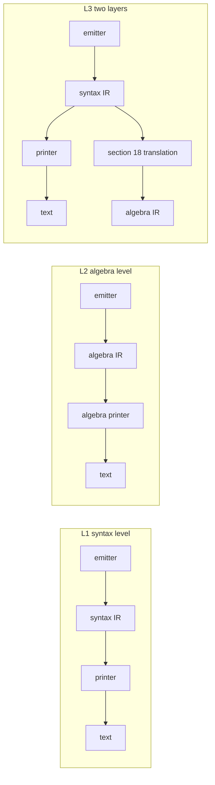
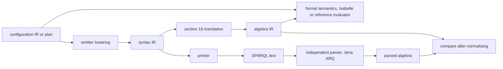
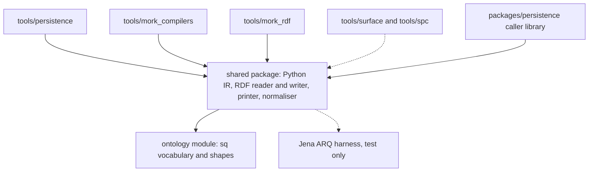

<!-- SPDX-License-Identifier: CC-BY-SA-4.0 -->
# One SPARQL IR for every emitter, held as RDF (sketch)

**Unit:** none yet. It grows pending decision PDD-06 from the persistence compiler to every LATTICE component that emits SPARQL
**Status:** Draft, 2026-10-29, for the maintainer's review. Nothing in it is decided
**Builds on:** PDD-06, the [typed IR sketch §9](formal-methods-track-h-typed-ir.md#9-toward-a-stored-ir-h2-q7-decided-2026-10-12), [track H plan §5.1](../plans/formal-methods-track-h.md#51-later-a-sparql-semantic-ir-pdd-06-raised-2026-10-12), [ADR-A79](../../architecture/decisions/ADR-A79-persistence-compiler-toolchain.md), [ADR-A123](../../architecture/decisions/ADR-A123-typed-operation-ir.md), [ADR-A128](../../architecture/decisions/ADR-A128-efficient-queries-and-shapes.md), PRI-55, PRI-58, and MR-Q6 of `tools/mork_rdf/README.md` §18 (branch `claude/config-authoring-studio`)
**Proposes:** options and questions for PDD-06's ADR, in §12

## 1. The scene

PDD-06 asks whether the persistence compiler gains a second IR, one that models SPARQL's semantics, between the configuration IR (`persistence.ir`) and the text. It was raised on 2026-10-12 after the H2.1 review, where two of the checker's rules about SPARQL scope were written from memory, were wrong, and were found only by running queries on rdflib (track H plan §5.1). On 2026-10-29, answering MR-Q6 ("should the compiled mapping be described in RDF"), the maintainer suggested that a SPARQL IR of our own would help well beyond MORK, for verification, validation, query optimisation and introspection.

Three facts make the question wider than the persistence compiler.

- **Five toolchains write SPARQL text, and only one of them from a typed tree** (§2). Each has its own idea of a property path, and three of them interpolate IRIs into text without the encoder PRI-55 asks for.
- **A query held as an opaque string cannot be reasoned about.** ADR-A79 decision 2 says so, and keeps literal query text out of the compiled profile for that reason. MORK's `mork:queryText` and the Eligibility backend's `SparqlArtefact` (`ontology/mork/spec/Executable.ttl`) still hold text, and MR-Q6, answered yes on 2026-10-29, now needs a structured description.
- **H2-Q5's option (b), the whole IR as RDF, was declined on 2026-10-10 because nobody would consume it.** MORK's compiled mappings, Eligibility's fragment gate (FM-Q2), the efficient-query rules of ADR-A128 and the formal-methods track are four consumers now, so the reason given then may no longer hold. That is a hypothesis for the maintainer to test, not a reversal.

SPIN, the obvious prior art for SPARQL in RDF, is deprecated by its authors in favour of SHACL, and was never more than a W3C Member Submission (§4.3).

## 2. Today's emitters

Checked against the source on 2026-10-29. "Encoder" means PRI-55's typed term encoder (`Iri.encode`, `Literal.encode` in `packages/persistence/python/src/lattice_persistence/terms.py`), or an equivalent that refuses a bad IRI.

| Emitter | What it emits | Structure before text | How terms reach the text | Determinism |
|---|---|---|---|---|
| Persistence compiler, `tools/persistence` (`ir.py`, `ir_render.py`) | guarded `DELETE`/`INSERT` updates, `SELECT` reads and audits, for every operation of a compiled profile | a typed syntax tree of frozen dataclasses (`ir.py`:99-435), every pattern in a `GraphBlock` with a `GraphRole`, checked by named `RULES` (`ir_render.py`:50-83) before printing | `Const` holds only encoded terms (`ir.py`:13-15). Request-time parameters print as `$name`, and payload slots as `{{{name}}}` markers filled by one pass (`fill_slots`, `ir_render.py`:43) | sorted prefixes and path options, property tests (`tests/test_ir_render.py`:318, `tests/test_select_fragment.py`:184) |
| Eligibility's SPARQL backend, `tools/mork_compilers` (`sparql_backend.py`) | one `SELECT` per condition plan, profile queries, and SHACL-SPARQL constraints through `shacl_backend.py`:75-170 | typed plans (`eligibility_ir.py`:78-240), no typed query. The text is built from f-strings | IRIs interpolated as `<{x}>` with no check (`sparql_backend.py`:122, :147, :153, :169, :222, :234, :355, :359). Numbers through Python `repr` | `sorted` at :134 and :534. No determinism test found |
| MORK RDF-to-RDF compiler, `tools/mork_rdf` (`compile.py`, branch `claude/config-authoring-studio`) | one `CONSTRUCT` and one check `SELECT` per mapping | a parsed path tree only. The query is an f-string (`compile.py`:225, :232) | terms through `_term()` (`compile.py`:26-30), paths parsed and rewritten (`paths.py`), values as sorted `VALUES` blocks | README §11 and §13 claim a pure function of the mapping graph, under PRI-58 |
| Surface compiler, `tools/surface/src/surface/compile.py`:784-800 | an `sh:SPARQLRule` with `sh:construct` per contract | none | IRIs interpolated as `<{x}>`, unchecked | not checked here |
| SPC ingress and egress, `tools/spc/python/src/spc/ingress/` | `CONSTRUCT` templates (`egress_config_gen.py`:94-125), `INSERT DATA` (`rml_executor.py`:64-73) | none | f-strings, unchecked | not checked here |

Text that is only run, never generated from a structure, is out of scope: the knowledge tools' own queries, `tools/exposure_derivations.py`'s fixed templates, `mork_communities/sparql_templates.py`, and the engine harnesses. `tools/mork/src/morkSC.py`:951 passes an authored `sh:select` through and is in scope only if MORK's authored queries are (SIR-Q9).

### 2.1 Three property-path models

| | Persistence, `persistence/paths.py` | Eligibility, `mork_compilers` | MORK RDF, `mork_rdf/paths.py` |
|---|---|---|---|
| Representation | a tree: `Eps`, `Step(predicate, inverse)`, `Seq`, `Alt`, `Star`, `Opt` | a tuple of (property, inverse) steps (`EvidencePath`, `eligibility_ir.py`:96-104), joined to text | a tree: `Iri`, `Inverse`, `Seq`, `Alt`, `Mod` (`*`, `+`, `?`), `NegSet` |
| Operators | `/`, `\|`, `*`, `?`, and `^` on one step | `/` and `^` per step. `*` and `+` written inline for the hierarchy walk (`sparql_backend.py`:233-246) | the whole of SPARQL 1.1 §9.1 |
| Built from | state elimination over the ownership automaton (`eliminate`, :158) | the evidence binding | parsing a mapping's path text |
| Canonical form | yes. Smart constructors flatten, de-duplicate and sort (:92-138) | no | no, it keeps the mapping's order |
| Printing | `render` (:74), then prefixes compacted by a regex over the printed text (`ir_render.py`:854) | full IRIs, a constant prefix block | full IRIs, every compound part parenthesised |
| Held in the IR as | rendered text, `PropertyPath` (`terms.py`:13-34), which breaks SI-5 | text | a tree, then text |

The task brief speaks of two path models. There are three, since `mork_rdf` reuses neither of the others. None imports another.

### 2.2 What the inventory shows

- **PRI-55 holds by construction only in the persistence compiler.** The Eligibility backend, the surface compiler and SPC splice IRIs into text. Their IRIs come from compiled ontology graphs today, not from a request, so the hazard is a malformed artefact more than an injection, but the principle draws no such line. TD-85 records that the guardrails are mostly unenforced. It names no emitter.
- **FM-Q2's proposed gate and Eligibility's output disagree.** The formal-methods sketch §8.4 proposes a fragment with "no property paths", and the backend emits `^p/q` evidence paths (ADR-A91), `r*`, `r+` and `a/rdfs:subClassOf*`. FM-Q2 is open, so this is no contradiction yet, but a gate checked "mechanically on every output" has nothing to check against while the output is text.
- **Only the persistence compiler checks its query before printing.** `templatecheck.py` re-parses text with rdflib for the S-3 and S-4 checks, which is translation validation in miniature, against one parser that is also one of the engines under test.

## 3. What a shared IR has to serve

| Need | Who asks | What the IR must make possible |
|---|---|---|
| verification, that a query means what its source means | PDD-06, formal methods §8.4 (Eligibility compiler correctness), track H's checker rules | a formal semantics over the IR, in Isabelle or as an executable reference evaluator (track B's manner) |
| validation, that the text means what the IR means | ADR-A79 decision 5 (an independent parser), the injection corpus | parse the printed text independently and compare with the IR, or print by an extracted, proved function |
| structural checks of the efficient-query rules | ADR-A128, STD-026 to STD-033 and STD-279 | the rules written as SHACL or code over the IR, before a query runs |
| PRI-55 by construction | every emitter | no path from a string to query syntax except through one printer of typed terms |
| PRI-58 | every emitter | equal IRs print equal bytes, whatever the triple order or blank-node labels of the stored form |
| introspection | MR-Q6, ADR-A79 decision 2, the Persistence README's literate specification | ask "which compiled queries read property P in graph role R" with SPARQL over the IR |
| optimisation | the maintainer's 2026-10-29 suggestion | IR-to-IR rewrites with a stated engine scope and an equivalence argument |
| round trips | MORK (authored path text), the golden `.rq` files of ADR-A123 decision 9 | text to IR to text, with a stated notion of "the same" |
| storage | typed IR sketch §9.4 (SI-1 to SI-6), §9.5, ADR-A142 | an IR whose nodes are values, so a versioned owner can point at them |

## 4. Algebra or syntax

SPARQL 1.1 defines its meaning in two steps. §18.2 translates the syntax tree into an algebra expression (`BGP`, `Join`, `LeftJoin`, `Filter`, `Union`, `Graph`, `Extend`, `Minus`, `Group`, `Aggregation`, `ToList`, `OrderBy`, `Project`, `Distinct`, `Reduced`, `Slice`, `Table` for `VALUES`), and §18.5 to §18.6 give the algebra its semantics. SPARQL 1.1 Update has its own formal model over datasets, in which `DELETE`/`INSERT`/`WHERE` is defined from the query algebra. Three places to put the IR follow.



- **L1, syntax level, in SPIN's manner.** The IR mirrors the grammar, with groups holding their elements in order, `OPTIONAL`, `FILTER` where the author put it, property paths as written. `persistence.ir` is already of this kind.
- **L2, algebra level.** The IR is the §18 algebra. An emitter builds algebra directly, and a printer turns algebra into text.
- **L3, two layers.** Emitters build the syntax IR and print from it. One function, the §18 translation, derives the algebra, and checks and proofs read the algebra.

### 4.1 Compared

| | L1 syntax | L2 algebra | L3 both |
|---|---|---|---|
| **verification** | a semantics has to include the §18 translation, since the semantics is defined on algebra. Every rule about scope (H2.1's F4) lives in that translation | direct. The Isabelle model or reference evaluator is the §18.5 semantics over the IR | direct over the algebra, plus one translation to verify once, shared by every emitter |
| **validation against text** | parse the text, compare syntax trees. Equality is near-textual and easy to state | parse the text with an independent parser, translate to algebra, compare after normalising (§8.1). Jena ARQ's and rdflib's algebras differ in detail, so the normaliser is real work | either comparison. The syntax comparison catches printer faults, the algebra one catches translation faults |
| **efficient-query rules** | R2, R3 and R4 are about groups and their order, which the syntax keeps | R4, R6 and R9 read well. R2 and R3 need the join order, which the algebra keeps as nesting, but `FILTER` is collected to the end of its group by §18.2.2.2, so "guard in its own group, first" (R3) is only partly visible | each rule reads the layer it is about |
| **optimisation** | rewriting syntax is awkward, since scope is implicit | the natural place. Rewrites are algebra laws | rewrite the algebra, but printing then needs L2's algebra printer anyway |
| **introspection** | close to what a reader wrote, so answers match the text a reviewer sees | answers are about meaning, and a reader must map them back | both, at the price of two vocabularies |
| **round trip** | text to IR to text keeps the author's form, apart from whitespace and prefixes | text to algebra to text gives a canonical text, not the author's. Paths of `/` and `^` are expanded to joins by §18.2.2.4 unless the IR keeps them as path nodes | the syntax layer round-trips, the algebra layer is derived and never printed |
| **printer** | simple, close to `ir_render.py` | hard. Algebra does not map back to syntax uniquely (`LeftJoin` with an expression is `OPTIONAL { ... FILTER }`, `Extend` placement, sub-select boundaries). Oxigraph's `spargebra` and Jena's `OpAsQuery` print algebra, and both have had faults there (rdflib's `translateAlgebra` has an issue on record, `upstream-sparql-engine-reports.md`:432) | as L1 |
| **size of the vocabulary** | about forty node kinds, SPARQL 1.1's grammar | about twenty-five operators plus expressions and paths | both |

### 4.2 What the comparison suggests

The verification and optimisation needs point at the algebra, and the round trip, the printer, the efficient-query rules and today's code point at syntax. L3 gives each need its own layer at the cost of the translation, which is one function written once for every emitter, against today's position where each checker rule about scope is a separate claim. A hypothesis worth testing is that L3's algebra layer need not be stored at all. It can be derived on demand from the stored syntax layer, so only one vocabulary is published and the algebra stays an in-memory value of the verifier (SIR-Q1, SIR-Q2).

### 4.3 Reuse SPIN, or our own vocabulary

SPIN's `sp:` vocabulary is syntax level (L1). It covers SPARQL 1.1 with gaps, represents group elements and arguments with `rdf:List`s of blank nodes, and has no maintained shapes or printer outside TopBraid. Reusing it would tie a published LATTICE contract to an unmaintained namespace whose blank-node structure works against PRI-58 and against ADR-A142's identity rule (§5.2). Its value is as a reference for coverage and as an import format, if an adopter holds SPIN queries (SIR-Q3). Other prior art is not RDF. Jena's SSE prints the algebra as S-expressions, `sparqlalgebrajs` holds it as JSON, and `spargebra` as Rust types. Each is useful to calibrate the node kinds against, and SSE is the natural format for comparing with Jena (§8.1).

## 5. A vocabulary outline

Written for L3, with the syntax layer stored. The prefix `sq:` and every name below are placeholders (SIR-Q4). Nothing here declares a term.

### 5.1 Node kinds

| Group | Classes (syntax layer) | Notes |
|---|---|---|
| operations | `sq:Select`, `sq:Construct`, `sq:Ask`, `sq:Describe`, `sq:Modify` (`DELETE`/`INSERT`/`WHERE`), `sq:InsertData`, `sq:DeleteData`, `sq:UpdateRequest` (an ordered sequence) | an operation names its prologue only through the printer, never as stored text |
| solution modifiers | properties of the operation: `sq:projection`, `sq:distinct`, `sq:groupBy`, `sq:having`, `sq:orderBy`, `sq:limit`, `sq:offset` | each fragment can refuse any of them by shape, as ADR-A123's 2026-10-13 addendum does |
| patterns | `sq:Group`, `sq:Optional`, `sq:Union`, `sq:Minus`, `sq:GraphBlock`, `sq:Filter`, `sq:Bind`, `sq:Values`, `sq:SubSelect`, `sq:TriplePattern`, `sq:PathPattern`, `sq:Service` | `sq:GraphBlock` may carry the LATTICE graph role (SI-4) as an annotation the printer ignores |
| paths | `sq:Link`, `sq:Inverse`, `sq:Sequence`, `sq:Alternative`, `sq:ZeroOrMore`, `sq:OneOrMore`, `sq:ZeroOrOne`, `sq:NegatedSet` | the union of the three models of §2.1. Persistence's canonical constructors become a normalisation, not a different model |
| expressions | `sq:Var`, `sq:Param`, `sq:Term`, `sq:Call` (a function or operator by IRI), `sq:Exists`, `sq:NotExists`, `sq:Aggregate` | operators named by IRI from a closed scheme, so `+` and `sameTerm` are values of one property |
| request-time slots | `sq:TripleSlot` | the `{{{name}}}` convention of ADR-A123's 2026-10-14 addendum. A set of triples cannot be a variable, so the IR must name the slot as one |

### 5.2 Identity, order and quotation

- **A node is a value, so its IRI is content-addressed.** A node's IRI is a hash of its kind and its children's IRIs, a Merkle tree, so equal subtrees are one node and an IR graph has no blank nodes. A compiled profile, which is versioned, then meets ADR-A142 rule 1 for every edge into the IR, and two operations that share a sub-select share its nodes without contention, since nothing writes them after they are minted. The cost is one hash per node at compile time.
- **Order is explicit where SPARQL makes it matter.** Group elements, `UNION` branches, sequence steps, function arguments, `ORDER BY` keys and update operations carry an `sq:index` integer from 0, never an `rdf:List`, so a SHACL shape can state "indices are 0 to n-1, each once" and a printer needs no list walking. Where order does not matter (the options of an `Alternative` after normalisation, the triples of a `VALUES` row), the printer sorts.
- **Query terms are quoted, never asserted.** An IRI or literal that the query mentions is the object of `sq:term` on a `sq:Term` node, and nothing else in the IR graph uses it. So an IR that mentions `rdf:type` or `owl:sameAs` asserts nothing about them, an OWL reasoner run over a graph holding the IR draws nothing from it, and "which queries mention P" is one triple pattern. A query's blank node is a `sq:Var` flagged `sq:blank`, never an RDF blank node.
- **Variable and parameter names are literals constrained by SHACL to SPARQL's `VARNAME` production.** They are the only strings that reach the text as syntax.

### 5.3 An example

```sparql
SELECT ?v WHERE { GRAPH ?g { $root ex:p/ex:q ?v } FILTER NOT EXISTS { GRAPH ?g { ?v ex:retired true } } }
```

```turtle
# names are illustrative. Real node IRIs are hashes
sqn:op1 a sq:Select ; sq:projection [ sq:index 0 ; sq:var sqn:v ] ; sq:where sqn:g1 .
sqn:g1 a sq:Group ;
  sq:element [ sq:index 0 ; sq:node sqn:gb1 ] , [ sq:index 1 ; sq:node sqn:f1 ] .
sqn:gb1 a sq:GraphBlock ; sq:graph sqn:g ; sq:pattern sqn:pp1 .
sqn:pp1 a sq:PathPattern ; sq:subject sqn:root ; sq:path sqn:seq1 ; sq:object sqn:v .
sqn:seq1 a sq:Sequence ; sq:step [ sq:index 0 ; sq:node sqn:lp ] , [ sq:index 1 ; sq:node sqn:lq ] .
sqn:lp a sq:Link ; sq:term ex:p .
sqn:root a sq:Param ; sq:name "root" ; sq:paramKind sq:IriParam .
sqn:v a sq:Var ; sq:name "v" .
```

The index nodes are written as blank nodes here for brevity. Under §5.2 they would be content-addressed too, or the index would move onto the child, which is simpler but forbids sharing a child at two positions (SIR-Q5).

## 6. Well-formedness shapes

The vocabulary's type rules are SHACL shapes, run at design time over a compiled IR graph. Three tiers, each a separate shapes graph so a fragment can add to the base without editing it.

| Tier | Example rules | Engine-independent? |
|---|---|---|
| **grammar** | each node has one kind, the properties its kind allows and no others (`sh:closed`), indices are dense, a variable's name matches `VARNAME`, `sq:term` holds an IRI or a literal, a `Link` has one IRI term | yes |
| **SPARQL's static rules** | §11.4's rules on projection and grouping (ADR-A123's `UngroupedProjection`, `HavingNotGrouped`), a variable `BIND` assigns is not in scope before it, no blank node in a `DELETE` template, a `VALUES` row's arity equals its variables | yes. Some need a scope analysis that SHACL-SPARQL states badly, so they are code over the IR, reported in the same SHACL report form |
| **a fragment** | Persistence's closed `Select` (no `ORDER BY` in a sub-select), Eligibility's fragment gate (FM-Q2), every pattern inside a `GraphBlock` (SI-4) | yes as rules. Which fragment is robust across engines is a store finding |

Cost under STD-020. The focus nodes are IR nodes of one kind, so a shape's cost is linear in the IR's size, which is set at compile time and is small (§10). Each SPARQL-based shape is itself a constraint query and keeps R1 to R6. Claims for speed are for rdflib with pySHACL, the engine the checks run on today.

## 7. A deterministic printer

One printer, a pure function from an IR node to text, in a shared package (§9).

- **It is the only producer of SPARQL syntax.** It reads kinds, indices, names and quoted terms. Terms go through one encoder, the one now in `lattice_persistence.terms`, which refuses an IRI with `<>"{}|^`\` or a C0 control and escapes literals. No IR property holds query text, so SI-5 holds for every emitter.
- **Its output is canonical.** Prefixes are declared from a fixed map, sorted, and only those used, as `ir_render.py` does at :1086, but by printing a term as a prefixed name when the map covers it rather than by a regex over printed text (`ir_render.py`:854). Nested arithmetic is always parenthesised (TSD-17). Whitespace and line breaks follow one layout.
- **It is tested as PRI-58 asks.** The same IR graph loaded in a shuffled triple order prints the same bytes, a hundred times, and every printed operation parses to exactly one operation, as ADR-A79 decision 5 asks of its injection corpus.
- **Request-time values stay outside it.** `$name` parameters are bound by the caller library or by initial bindings where the store offers them (TSD-Q2 is open for Oxigraph's updates). Slots are filled by `fill_slots` as today.

## 8. What it serves

### 8.1 The formal-methods track



- **Translation validation** keeps the toolchain in Python. Every printed query is parsed by Jena ARQ, which is already in the test harness (`platform/sparql-testkit`, CAP-91, CAP-92), its algebra is read back as SSE, and it is compared with the IR's algebra after a normaliser removes differences that do not change meaning (associativity of `Join`, `BGP` merging, `Filter` conjunctions). rdflib's `translateQuery` gives a second parser, but rdflib is also an engine under test, so it does not count as independent. A failed comparison is a refusal at compile time. This gives assurance per output, not for every input.
- **Extraction** writes the printer, and perhaps the §18 translation, in Isabelle and exports Haskell or Scala code (FM-D1, PDD-06's text). It covers every input, but runs outside the Python toolchain, as a worker of the formal toolchain sketch, and needs H6's Isabelle setup first.
- **The semantic check, that the SPARQL behaves as the configuration intends,** is the part PDD-06 was raised for. It needs a model of the algebra's semantics for the fragment the emitters use. With a shared IR, one model of the fragment serves Persistence's guarded updates and Eligibility's compiler correctness (§8.4 of the formal-methods sketch), where today each would need its own.

### 8.2 The efficient-query rules as structural checks

| Rule | STD | Structural over the IR? | How |
|---|---|---|---|
| R1 | STD-026 | partly | a group pattern whose only new variable is used nowhere else can be flagged. Whether it was meant as a test of a fact is judgement |
| R2 | STD-027 | yes | count a group's operands and their shared variables. The rationale is rdflib's evaluation, so it is a warning scoped to rdflib |
| R3 | STD-028 | partly | a guard group ahead of the first enumerating element is visible on the syntax layer. "Cheap" is judgement |
| R4 | STD-029 | yes | `OPTIONAL` followed by `FILTER(!BOUND(?x))` on a variable only the optional binds, or `HAVING(COUNT(..) < 1)` |
| R5 | STD-030 | the presence of a SPARQL target only | narrowness needs the ontology |
| R6 | STD-031 | yes | a `FILTER` whose expression has no variable and no parameter |
| R7 | STD-032 | no | a process rule |
| R8 | STD-033 | partly | a `*` or `+` path whose subject and object are both unbound at that position, by a binding analysis over the group's earlier elements |
| R9 | STD-279 | mostly | an aggregate over a variable that is not certainly bound, using ADR-A123's 2026-10-13 rules |
| H1 to H8 | STD-034 to STD-041 | no | rules for the test harness |

Five rules become checks that run before a query exists as text, on every emitter's output, which is the enforcement TD-85 says the guardrails lack. Whether a check refuses or warns follows the rule's scope tag in ADR-A128's record (SIR-Q7).

### 8.3 PRI-55 by construction

With the IR, an emitter cannot write SPARQL syntax at all. It builds nodes whose terms are RDF terms, and the printer is the one place that turns a term into text, through one encoder. The injection corpus of ADR-A79 decision 5 then runs over the printer once, for every emitter, instead of once per emitter or not at all. The Eligibility backend, the surface compiler and SPC would move onto the IR to close their gaps of §2.2. What remains outside is `fill_slots`, which places caller triples into a slot by substitution, and is covered by the caller library's checks (ADR-A123's 2026-10-20 addendum).

### 8.4 MORK's compiled mapping (MR-Q6)

MR-Q6 was answered yes on 2026-10-29, with the vocabulary to be settled. With the IR, a compiled RDF-to-RDF mapping is described by an edge from the mapping to its `CONSTRUCT` and check `SELECT` as IR nodes, the counterpart of `mork:generatesTransformDefinition` for a `TransformMapping` compiled to RML, which Mork.ttl already describes as "structured RDF, fully traversable and queryable within the RDF graph". The mapping's digest (`compile.py`:412, RDFC canonical N-Quads) would then cover the compiled query's structure, and `mork_rdf`'s full path parser becomes the IR's parser for authored path text. `SparqlArtefact` (`ontology/mork/spec/Executable.ttl`) and `mork:queryText` could carry the IR in place of text, which answers ADR-A79 decision 2's objection to query text on an RDF node. Whether `mork:queryText` stays for authored queries is SIR-Q9.

### 8.5 Introspection and optimisation

- **Introspection.** A compiled profile's read and write sets (ADR-A123 decision 3) become SPARQL over the IR instead of a Python walk, and so do questions no one has a tool for today, such as which operations of every profile read a given property under a closure, or which Eligibility queries depend on a SKOS hierarchy. A diff between two compiled profiles is an RDF diff of content-addressed nodes, so an unchanged operation shows as unchanged without comparing text.
- **Optimisation.** Rewrites such as pushing a guard ahead of an enumeration (R3) or starting a path from the bound end (R8) are algebra laws, but whether one pays depends on the engine and its version (TSD-40 is one case). A rewrite therefore carries an engine scope, as ADR-A128's rules do, and is a hypothesis to measure with the benchmarks of ADR-A124, not a default. It is the least urgent of the needs.

## 9. Where it lives, and what depends on it



- **A new shared dependency.** Today the three emitters share nothing. After the change, a change to the IR package releases with all of them, and a fault in the printer is a fault in every emitter. That coupling is the point, since the printer is then proved or validated once, but it makes the package a component with its own version and contract, and arguably an ADR of its own.
- **The term encoder moves.** It lives in `packages/persistence` today. A shared printer cannot depend on Persistence's caller library, so the encoder moves into the shared package, or into a smaller one both depend on (SIR-Q8).
- **The vocabulary is a semantic asset**, so it belongs under `ontology/`. Whether it is a new module there, which is a new kind of thing in the ontology tree and needs an accepted ADR, or part of an existing technical module, is SIR-Q4. It is domain neutral, so it sits below every layer that describes a compiled artefact.
- **A relational backend.** PDD-06 notes that a relational realisation then needs its own path. The logical operation contract of H2-Q6 stays the input both would share, so the SPARQL IR does not narrow it. An LPG sibling IR (`lpg-backend-options.md`:774) is the same shape of answer.

## 10. Cost

- **Storage.** The IR is written at compile time, never at request time, so it adds nothing per write and nothing to the four runtime drivers of the ontology-authoring skill. Per stored query, triples grow linearly in the syntax tree's nodes, at about one type triple plus one triple per field per node, and less after content addressing shares equal subtrees.
- **Time.** One hash per node, one shapes run per compiled graph, one print per query, and for translation validation one Jena parse per query, which a batch call amortises over the JVM start.
- **Reads at runtime.** None. The runtime reads text, as today.

### 10.1 Measured on today's corpus

Measured on 2026-10-29 by building every `dal:generatedOperation` of the 12 expected profiles (`ontology/persistence/test/expected-profiles/`) with `persistence.instantiate.build_operation`, and every query of the 13 Eligibility examples (`ontology/eligibility/examples/`, three conditions left out because they do not compile from one file alone). The triple estimate counts one `rdf:type` per node, one triple per non-empty field or child, and two per tuple element. §5.2's index nodes cost about one triple more per element than a list cell, so the estimate is low by up to the element count.

| Corpus | Queries | IR nodes, median and max | Estimated triples, median, max and total | Text bytes, median, max and total |
|---|---|---|---|---|
| Persistence, 12 profiles | 91 (27 distinct operation ids, of 52 builders) | 34 and 212 | 127, 814 and 22,023 | 358, 1,994 and 52,516 |
| Eligibility, 13 examples | 25 | not measured, no tree exists | about 24,000 in total, extrapolated from Persistence's 0.42 triples per byte | 2,141, 6,192 and 56,870 |

So the stored IR is of the order of 250 triples per query, against about 600 bytes of text, and a profile of ten operations adds a few thousand triples to a compiled profile. The largest Persistence operation, `tombstone-delete-named-graph-patch-log-dataset-guard`, is 212 nodes. Content addressing would shrink the Persistence total further, since the 91 operations are 27 operation ids repeated over 12 configurations, and graph blocks and guards recur within each, but how much is not measured. A shapes run over the whole Persistence corpus has about 5,800 focus nodes at most, which is small by the record's standards, but no shape has been run, so no time is claimed.

## 11. PDD-06's six storage questions, against this sketch

| §9.5 question | What this sketch adds |
|---|---|
| 1. which IR is stored | under L3, the syntax layer of the shared SPARQL IR, with the algebra derived. The configuration IR stays in memory, as H2-Q5 (a) decided |
| 2. where | beside the compiled profile as its own graph, linked by content-addressed IRIs, or inside it. ADR-A142 holds either way, since the nodes are content-addressed |
| 3. encoding | a LATTICE vocabulary rather than SPIN's (§4.3), with its type rules as SHACL in three tiers (§6) |
| 4. who builds it | each emitter's lowering. For Persistence the builders would move into `compile`, so the profile can carry the IR, or `instantiate` keeps them and writes the IR as a second output |
| 5. how it is verified against text | translation validation by Jena ARQ first, extraction after H6 (§8.1) |
| 6. versioning and migration | the vocabulary's own version, and a one-time change to every golden `.rq` file if the printer's layout differs from `ir_render.py`'s |

## 12. Options and questions for the maintainer

Nothing below is decided. Each question names the options, and a leaning where one exists, with its reason.

**SIR-Q1. Should PDD-06 widen from the persistence compiler to every SPARQL emitter?** (a) yes, one shared IR, (b) Persistence first with the vocabulary designed for all, others adopting later, (c) Persistence only, as PDD-06 stands. Leaning (b). It keeps track H's sequence, and MR-Q6 needs the vocabulary now, while moving the Eligibility backend, surface and SPC can wait for their own slices.

**SIR-Q2. At which level is the IR?** (a) L1 syntax, (b) L2 algebra, (c) L3, syntax stored and algebra derived, (d) L3 with both stored. Leaning (c), for §4.2's reasons. It is a hypothesis until the §18 translation for the emitters' fragment has been written once and compared with Jena on the existing golden queries.

**SIR-Q3. SPIN or our own vocabulary?** (a) our own, with no SPIN dependency, (b) our own with an importer from `sp:`, (c) a profile of `sp:`. Leaning (a). SPIN is deprecated and its list-and-blank-node encoding works against PRI-58 and ADR-A142.

**SIR-Q4. Where does the vocabulary live, and under what name?** (a) a new technical module under `ontology/`, which needs an accepted ADR for a new kind of module, (b) inside an existing module such as MORK's executable vocabulary, (c) beside the shared package, outside `ontology/`. No leaning. (a) fits "semantic assets only", (b) couples every emitter to MORK, and (c) breaks the root table's split.

**SIR-Q5. Node identity.** (a) content-addressed IRIs for every node, index nodes included, (b) content-addressed nodes with the index on the child, (c) blank nodes, canonicalised by RDFC when hashed. Leaning (a). It is the only option that lets two operations share a subtree and keeps ADR-A142 without copying.

**SIR-Q6. How is the printed text verified?** (a) translation validation by Jena ARQ, (b) extraction from Isabelle after H6, (c) (a) now and (b) later for the fragment H6 models. Leaning (c).

**SIR-Q7. Do the efficient-query checks of §8.2 refuse or warn?** (a) refuse for engine-independent rules (R4, R6) and warn for engine-scoped ones (R2, R8), (b) warn for all, (c) refuse for all. Leaning (a), following each rule's scope tag.

**SIR-Q8. Where does the term encoder live?** (a) moved into the shared IR package, (b) a small terms package both depend on, (c) left in `packages/persistence`, with the IR package depending on it. Leaning (b). The caller library needs it without the printer, and (c) points a shared component at one consumer.

**SIR-Q9. What happens to authored SPARQL in MORK** (`mork:queryText`, `morkSC.py`:951)? (a) parsed into the IR on load, so every query in a mapping graph is structure, (b) kept as text, with only compiled queries as IR, (c) parsed and checked but stored as text. No leaning. (a) needs a full SPARQL parser into the IR, and `mork_rdf` has one for paths only.

**SIR-Q10. Is H2-Q5 reopened?** H2-Q5 declined the whole IR as RDF in the compiled profile because no one consumed it. If SIR-Q1 is (a) or (b), MORK, Eligibility and the structural checks consume it. (a) reopen H2-Q5 in PDD-06's ADR, (b) leave it, and publish the IR beside the profile only. Leaning (a), so the profile and the IR are decided together.

**SIR-Q11. Does the PRI-55 gap in the Eligibility backend, the surface compiler and SPC wait for the IR?** (a) record it now as debt and fix it with the encoder in the meantime, (b) record it as debt that the IR closes, (c) leave it, since their IRIs come from compiled graphs. Leaning (a). The fix is small and the principle draws no line between a request's IRI and a graph's.
