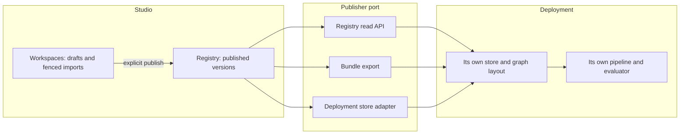
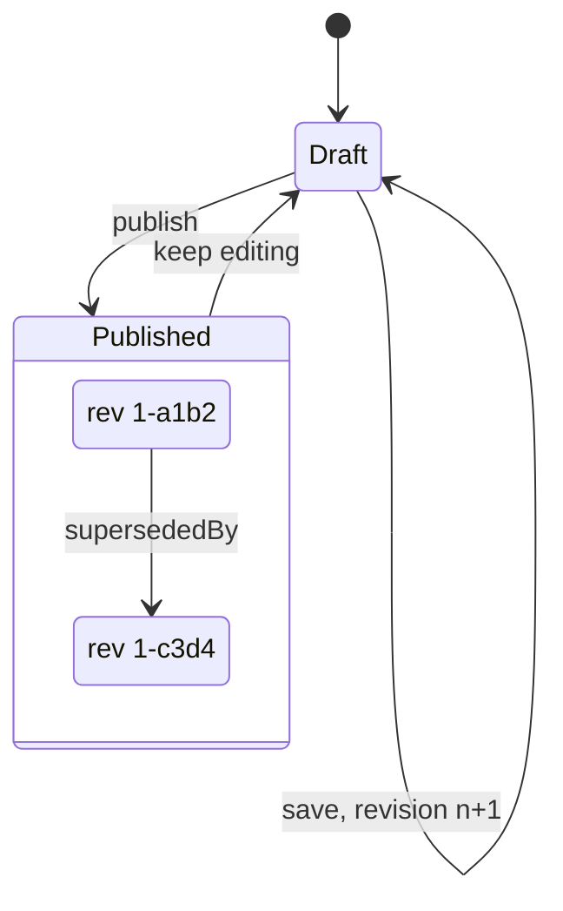
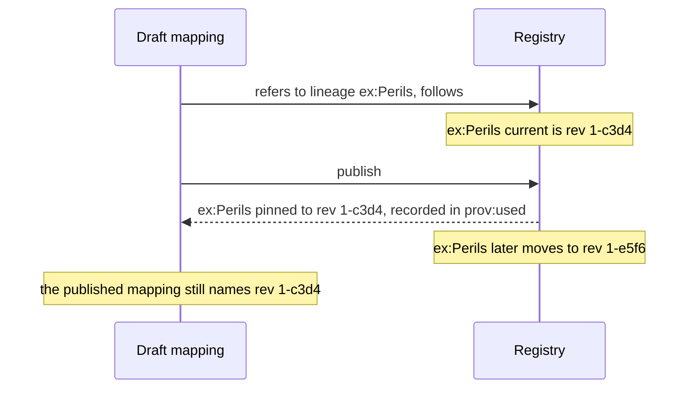
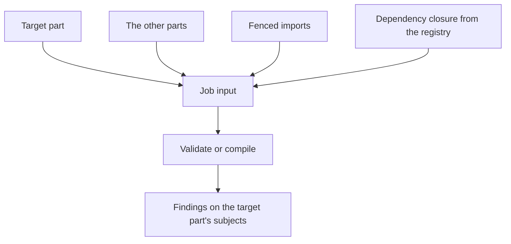
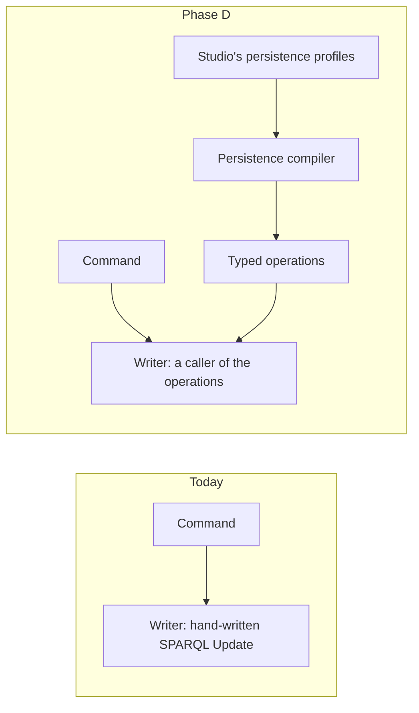
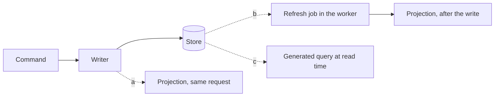

<!-- SPDX-License-Identifier: CC-BY-SA-4.0 -->

# Publication from the Configuration Studio, a sketch

**Unit ID:** `studio-publication` (PB)
**Plan:** [studio-publication.md](../plans/studio-publication.md)
**Status record:** [studio-publication.md](../status/studio-publication.md)
**ADR:** [A-149](../../architecture/decisions/ADR-A149-publication-from-the-studio.md), Proposed

## 1. The scene

The studio authors an adopter's configuration: vocabularies, quantification, eligibility, persistence and surface configurations, mappings, forms and stated meaning. Today all of it lives in workspaces, and nothing leaves a workspace except an export of the whole workspace as TriG and the artefacts a compile job writes.

Four facts about the current model constrain the design.

- **A part sees only itself.** A workspace keeps each part as its own named graph, and a job reads one part with the baseline and the layers (`workers/src/lattice_workers/config_studio_jobs.py`, `_SPECS`). The rule that sorts a subject into a part (MEC-94) also decides what a job can see, so a mapping cannot read the source codes the vocabulary part holds, and the `policies` sample's `Peril` writes nothing (TD-133). The assemble job already merges every part, in the browser (`apps/config-studio/src/ui/BuilderView.tsx`), so sharing exists, but undeclared.
- **A workspace is the only container.** No workspace reads another's content, so two workspaces that need one vocabulary each hold a copy. The insurance vocabularies are 10,048 triples, 2.1 MiB as N-Triples, and every copy is another thing to keep consistent.
- **Nothing is versioned.** A workspace part has a revision for optimistic concurrency, but a revision is a save counter, not a version anyone can pin. An artefact a deployment takes, a compiled RML mapping for example, names no version of the configuration it came from.
- **Nobody is anyone.** The service has no authentication and binds to loopback (`docs/architecture/configuration-studio.md`). A command's sender is unauthenticated (TD-99), and PRI-54 asks every write to carry its principal.

The substrate already has most of what publication needs, unused by the studio.

| Need | Mechanism |
|---|---|
| a thing with versions | `fnd:Versioned`, `fnd:PersistentIdentity`, `fnd:supersededBy` (MEC-01, PRI-02) |
| the IRIs of a lineage, a content revision, a promotion and the current pointer | [ADR-A51](../../architecture/decisions/ADR-A51-iri-and-identity-policy.md) |
| one digest of RDF content | RDFC-1.0 with SHA-256 ([ADR-A143](../../architecture/decisions/ADR-A143-one-canonicalisation.md)) |
| a meaning-bearing edge from a version is owned, pinned or content-addressed | [ADR-A142](../../architecture/decisions/ADR-A142-meaning-bearing-edges.md) |
| a unit written whole, edges leaving it by identity or pinned | aggregates and boundary shapes ([ADR-A122](../../architecture/decisions/ADR-A122-aggregate-ownership.md)) |
| fixed or ambulatory reliance on an edition | `wrd:reliesOnEdition` and `wrd:reliesAsAmended` (MEC-38) |
| a scheme versioned in editions, an edition selected per scope and period | `voc:ConceptScheme` (MEC-08) and `voc:SchemeBinding` (MEC-10) |
| a product derived from declared sources | `fnd:DerivedArtefact` and `fnd:DerivationRun` with `prov:used` |
| a port that publishes compiled output by digest | the Surface output publisher ([ADR-A38](../../architecture/decisions/ADR-A38-surface-output-publication-and-studio-authoring-boundary.md)) |

## 2. Where the boundaries are

The studio is an authoring tool in front of a deployment's own services. A deployment runs its own pipeline, for example an RML mapping inside an integration framework, and its own evaluator, and reads its data where its own persistence profiles put it. It never calls the studio to do its work. What crosses from the studio to a deployment is a published version, named by its IRI and never by the graph the studio keeps it in.

So a vocabulary built in the studio is published as scheme editions, and a deployment loads each edition into whichever graph its persistence profile names. The studio's own graph names stay internal, as ADR-A136 decision 7 already has them.

## 3. Publication

**What is published.** A unit of publication is an aggregate: a root and the nodes it owns. The units are a concept scheme, a scheme contract, a scheme binding set, a quantification declaration, an eligibility profile, a persistence profile, a surface contract, a mapping scheme, a form and the stated meaning of a form. Each is published on its own, as a version of its own lineage, and its references to other units are pinned to their versions (PB-Q1).

**When.** Only when a user publishes it. A unit nobody has published is unpublished, however long it has existed (PB-Q6).

**Its IRIs** follow ADR-A51. The lineage is the draft root's own IRI, which is its persistent identity. A version is minted at `{lineage}/rev/1-{digest}`, its digest the first 16 hexadecimal digits of the RDFC-1.0 SHA-256 of its content, so publishing unchanged content again names the same version and stores nothing new. The act of publishing is an event, `{lineage}/evt/e{epoch}/{seq}`, a `prov:Activity` with its principal, its time and the revisions it read, chained to the event before it. A current pointer names the lineage's latest version.

**Its content.** The root is rewritten to the version's IRI and carries `fnd:hasIdentity` to the lineage. The nodes it owns keep their IRIs and are read inside the version's own immutable graph, as a concept keeps its IRI across a scheme's editions (MEC-08). An edge from the unit to another unit's lineage is rewritten to the version it was pinned to, which ADR-A142 asks of a meaning-bearing edge.

**References while drafting** (PB-Q3). A draft refers to another unit either by its lineage, which follows the latest published version, or by a version's IRI, which is pinned. Publishing resolves each followed reference to the version current at that moment and records it, as a lockfile does. A draft that refers to something never published cannot be published until that is.

**Where versions live** (PB-Q2). A registry inside the studio's store holds every published version, readable by any signed-in user from any workspace. The publisher port gives a deployment its copy: the registry's read API, a bundle export of a version with everything it pins, and later an adapter that writes into a deployment's store through that deployment's own generated write path.

## 4. Fenced imports and dependencies

**An import is fenced.** What an import leaves in the graph, such as ODRL's vocabulary, an uploaded SKOS hierarchy or the nodes a document import produces, is stored once, by the digest of its content, read only, and referred to like anything else in the graph. Editing it means drafting a new unit from it. A fenced import is unpublished until a user publishes it. Uploaded files that are not graph data, such as an XML or JSON sample, wait for their own design (BL-08).

**A workspace declares its dependencies.** A dependency is a published version or a lineage to follow, from any workspace. Its content is fenced in the workspace that depends on it, never copied.

**A large vocabulary.** An uploaded SKOS hierarchy is a fenced import. Published, it is a scheme edition (MEC-08), stored once. A workspace that only refers to it depends on it. A workspace that edits it drafts a new edition from it, which holds one working copy until the edition is published. Bindings (MEC-10) then select an edition per scope and period, so the vocabulary-specific form of a dependency carries the scope and the time a plain dependency lacks.

| Peril taxonomy, 10,048 triples | Triples stored |
|---|---|
| 20 workspaces and 50 mapping releases, each with its own copy | 703,360 |
| one copy in a registry, each workspace and release pinning it | 10,048 for each edition published |
| a workspace editing it | 10,048 more until it publishes its edition |

## 5. What a job reads

A part decides only where a statement is saved, for the revision check. A job reads its target part, the workspace's other parts, its fenced imports and the closure of its dependencies, and reports findings about the target part's own subjects. The rule that sorts an import sends a concept with its scheme, so a representation scheme's codes stay with the mapping part.

## 6. Who may do what

Authentication is pluggable. The default, `local`, needs no provider. It offers a few named developer principals and is allowed only on a loopback address. A deployment configures `oidc` instead, which validates the bearer tokens of any OpenID Connect provider, for example Okta, Microsoft Entra ID or AWS Cognito, and reads an administrator from a configured claim. Every command carries its principal (PRI-54).

A workspace's creator is its owner and chooses its mode.

| Mode | Who reads | Who writes |
|---|---|---|
| locked | the owner and administrators | the owner and administrators |
| read only | everyone signed in | the owner and administrators |
| shared | everyone signed in | everyone signed in |

The revision check stays in every mode, since one person in two tabs, or an agent and its user, still race (PB-Q7).

## 7. The studio on its own substrate

The studio's working store is shaped by its own needs: per-part revisions, one writer per workspace, receipts and job graphs. Those are what persistence profiles declare. Once publication exists, the studio's own graph layout is declared as persistence profiles and its write path generated (PRI-60), so the studio is a deployment of the substrate like any other, while what it publishes leaves in the form a deployment chooses (PB-Q5).

## 8. Questions

| ID | Question | Answer |
|---|---|---|
| PB-Q1 | The unit of publication | Answered 2026-10-31, an aggregate published per unit with its dependencies pinned (P3), now ADR-A149 decision 2 |
| PB-Q2 | Where published versions live | Answered 2026-10-31, a registry in the studio with a publisher port's adapters, now ADR-A149 decision 4 |
| PB-Q3 | References while drafting | Answered 2026-10-31, follow a lineage until publishing, then pin, now ADR-A149 decision 5 |
| PB-Q4 | When authentication and workspace modes come | Answered 2026-10-31, now, the maintainer asking for pluggable authentication with a simple default and leaving the timing of modes to the unit, now ADR-A149 decisions 8 and 9 |
| PB-Q5 | When the studio's own store moves onto persistence and surface profiles | Answered 2026-10-31, after publication, as phase D, chosen by the unit at the maintainer's request, now ADR-A149 decision 11 |
| PB-Q6 | Whether anything is published implicitly | Answered 2026-10-31, never. Publication is explicit, now ADR-A149 decision 1 |
| PB-Q7 | Which modes need optimistic concurrency | Answered 2026-10-31, every mode, now ADR-A149 decision 9 |

## 9. Phase D, the studio on its own substrate (PB10)

**The scene.** The studio's working store is written by one Java component, the store writer, which turns each command into SPARQL Update by hand: a save compares a part's revision and replaces its graph, a publication guards on a lineage's current version, and each command leaves a receipt (ADR-A136's amendments). Those are what a persistence profile declares: an aggregate's boundary (ADR-A122, including a named graph as a boundary), its concurrency, its receipts and its write discipline. PRI-60 asks a write path a profile governs to be generated by the persistence compiler, never written by hand. The compiler emits typed operations (ADR-A123), and the only caller library that runs them is Python's (ADR-A132). A Java one is the backlog's BL-06.

| ID | Question | Options | Leaning |
|---|---|---|---|
| PB-Q8 | How the Java writer runs generated operations | (a) a Java caller library for the typed operation IR, beside Python's, which is BL-06's first language. (b) the writer keeps its SPARQL, and a conformance test holds it equal to what the compiler generates, so the profile is the specification and the code is checked against it, which PRI-60 does not allow as it stands. (c) the writes move to a Python writer that uses the existing caller library, which changes ADR-A136's topology | Answered 2026-10-31, (a), now ADR-A149 decision 12 |
| PB-Q9 | What the studio's aggregates are | (a) each workspace part a named-graph aggregate with optimistic concurrency. (b) the whole workspace one aggregate, which serialises edits of different parts. (c) the registry's lineages as aggregates too, with append-only versions | Answered 2026-10-31, (a) and (c), with two refinements below, now ADR-A149 decision 13 |
| PB-Q10 | What the studio's own surface contracts project | (a) the registry's listing and each workspace's summary, which today are a scan of every graph (`StudioStore.registry()`'s ponytail note). (b) none yet | Answered 2026-10-31, (a), with three more below, now ADR-A149 decision 14 |
| PB-Q11 | What happens to stores written before phase D | (a) migrated in place, once, by a task. (b) exported and imported again, which TD-135 shows loses held imports today | Answered 2026-10-31, (a). One machine holds a store, so no compatibility path is kept |

**PB-Q9, as answered.** Walking (a) through showed that a named-graph family maps one root to one graph, so each part has a root of its own and the workspace description is an aggregate of its own, holding the name, owner, mode, dependencies, imports and document titles. A version is created once and never replaced, and a lineage is replaced under its current version's guard, since `dal:AppendVersions` keeps every version in one data graph and the bundle and the worker read a version by its graph. Two refinements were answered with it.

- **A command that writes several aggregates orders its operations so a partial write is harmless.** One request runs as one transaction, but a guard that fails makes only its own operation a no-op. Publishing writes the version before the lineage, so a lost race leaves an orphan version that publishing again reuses. Creating and importing write the parts before the description, so a workspace is not listed until it is whole. Deleting tombstones the description first, so a half-deleted workspace is already hidden and a sweep finishes it.
- **Every part keeps its history in the persistence patch log** (`dal:PatchLog`), replacing the full copy of the baseline written on each save. An earlier revision is read by replaying the deltas backward from the current state.

| A 3,000-triple baseline after 50 saves of 20 changed triples | Stored | Reading an earlier revision |
|---|---|---|
| a copy per save, as before phase D | about 150,000 triples | one graph |
| the patch log | about 3,000 + 50 x 40 = 5,000 triples | the current graph and k deltas |

**A replace that is quadratic in the part's size.** The generated named-graph `cas-replace` has the form TD-42 measured for the composite replace. Its sweep gives one solution per stored triple, and the `INSERT` template, holding the whole payload, is filled once per solution. Measured on Jena in memory on 2026-10-31 with a scratch script, a part replaced by a payload of its own size, M = N:

| M = N | the generated replace | two guarded operations in one request |
|---|---|---|
| 300 | 0.46 s | 0.12 s |
| 1,000 | 2.5 s | 0.06 s |
| 3,000 | 28 s | 0.11 s |

The ODRL mappings sample holds a mapping part of a few thousand triples, so every save of it would take half a minute. The two-operation form is R1 of the [typed IR sketch](formal-methods-track-h-typed-ir.md), the first operation deleting the graph under the version row's guard and the second inserting the payload and moving the row under the same guard. It is safe only where a request whose second operation fails keeps nothing of the first (TSD-06). Jena in memory and Oxigraph do (TSD-50), rdflib does not, and Fuseki on TDB2, the studio's store, is untested (TSD-Q13). Track H's H5 was to select it from a store's capabilities.

| ID | Question | Options | Leaning |
|---|---|---|---|
| PB-Q13 | How the studio's large aggregates are replaced | (a) the compiler gains R1 for the named-graph replace and tombstone now, selected where a deployment's capability spec declares that a failing request rolls back, with Fuseki on TDB2 probed first to close TSD-Q13 for it, and the persistence conformance run holding R1 equal to the generated form on every engine that has the capability. (b) the writer keeps its own replace for the parts and documents until H5, and runs generated operations only for the description, the versions and the lineages, recorded as debt against PRI-60. (c) accept the quadratic replace | Answered 2026-10-31, (b). The maintainer holds the compiler change until a linear form is investigated, in the [linear replace sketch](persistence-linear-named-graph-replace.md). The debt is TD-136, now ADR-A149 decision 12's addendum |

**PB-Q10, as answered.** The maintainer accepted two more projections, jobs by workspace and holders, and asked for the terms of published versions now rather than later.

| Projection | Answers | Replaces |
|---|---|---|
| the registry listing | every lineage and its current version | a scan of every registry graph |
| workspace summaries | each workspace's name, owner, mode and part revisions | a read of the description and its version rows |
| jobs by workspace | a workspace's jobs, and those past their expiry | `COMPILE_JOBS_QUERY`, `jobsOf` and `EXPIRED_JOBS_QUERY`, each a scan of every job graph |
| holders | the workspaces that follow or pin each lineage, and hold each import | nothing today. It answers who reads a version before a change is published, keeps a pinned version from being pruned, and finds an import no workspace holds (TD-135) |
| terms of published versions | each term every version defines, with its label, kind and version | nothing today. It lets a binding's chooser and a proposer find a term across the registry |

## 10. How the studio's projections stay fresh (PB17)

**The scene.** A surface contract is compiled by `tools/surface`, a Python generator that reads a graph and materialises a generated surface with the read set it was built from (the Surface README's "Derived records and staying fresh"). It is a batch compiler. It has no operation a writer runs per write, and nothing in the studio runs it today. Each projection of §9 is derived and can be rebuilt from the graph (PRI-52), so the question is when it is brought up to date, and what a reader sees in between.

| ID | Question | Options | Leaning |
|---|---|---|---|
| PB-Q12 | When a projection is brought up to date | (a) in the writer's own request, by maintenance updates generated from each contract, which needs a surface backend that does not exist and a Java port of it. (b) by a refresh job the writer queues after each write that changes a projection's source, which the worker runs with `tools/surface` over the changed aggregates, so a projection lags its source by a job's latency and records the read set it was built from. (c) never stored, each contract compiled to a query the service runs on read, which keeps the scans and moves them into generated text | Answered 2026-10-31, (b), now ADR-A149 decision 14. A surface backend for (a) is BL-09 |

PB-Q12 and PB-Q13 were answered on 2026-10-31.

**How each projection is expressed.** A surface promotion restates a property of a carrier class, reached by a read path of edges, into a generated module with its read set and manifest. Tried on 2026-10-31 with `tools/surface` on the Surface layer's subscription example, it wrote an assertions module of the restated triples, a core module and a manifest, 123 lines for two carriers.

| Projection | Carrier and read path | A promotion fits |
|---|---|---|
| the registry listing | `fnd:PersistentIdentity`, `cst:current` | yes |
| jobs by workspace | `cst:Job`, `cst:workspace` | yes |
| holders | `cst:Workspace`, `cst:dependsOn` and `cst:holdsImport` | yes |
| terms of published versions | each unit's member class, such as `skos:Concept`, its label and the version its member property names | yes, one contract per unit kind of the units table |
| workspace summaries | `cst:Workspace` to each part's version row | no. A part's row is joined to its workspace by its root's prefix, `{workspace}/part/{name}`, not by an edge, and the summary keys each sequence by the part's name |

| ID | Question | Options | Leaning |
|---|---|---|---|
| PB-Q14 | How PB17 expresses its projections | (a) a surface promotion each, the description gaining a `cst:part` edge to each part's root so a read path reaches the rows, and the summary a projection contract that keys each sequence by its part. (b) a surface promotion each for the four that fit, and the workspace summary a query kept beside them in the contract, run by the same refresh job and recorded as a gap in Surface. (c) every projection a query kept in the contract, with no surface contract | (b), since four are what a promotion is for and the fifth needs a join Surface has no read path for, so forcing it adds an edge to the description that only the projection reads |

