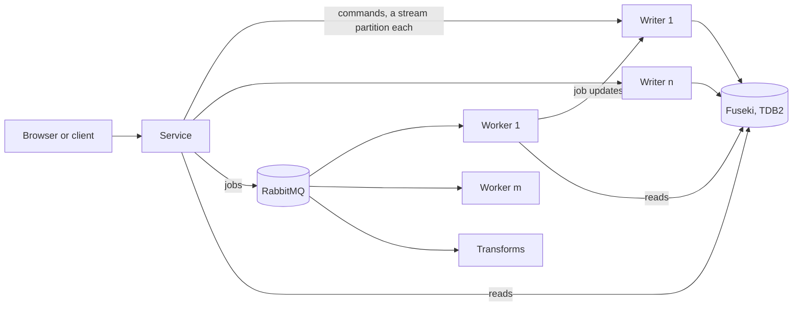
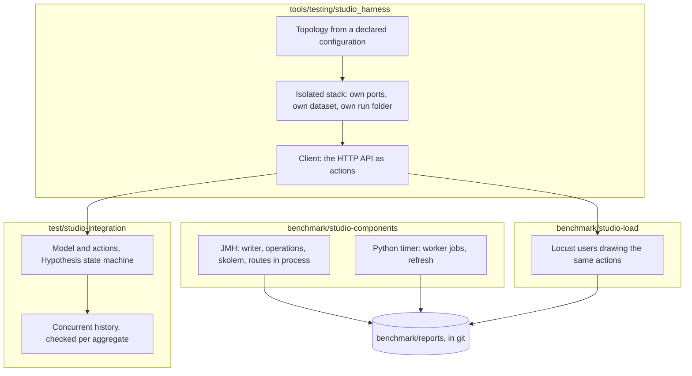

<!-- SPDX-License-Identifier: CC-BY-SA-4.0 -->

# Performance, integration and load testing for the studio (sketch)

**Unit type:** a multi-slice unit, `studio-quality` (SQ)
**Status:** raised by the maintainer on 2026-10-31, with the tool choices left to the unit. Decisions SQ-D1 to SQ-D8 taken alone, for ratification, and ADR-A150 drafted
**Plan:** [studio-quality.md](../plans/studio-quality.md)
**Touches:** `benchmark/` (ADR-A124), `test/`, `tools/testing/` (ADR-A125), the Configuration Studio's topology (ADR-A136, ADR-A149)

## 1. The scene

Phase D of the publication unit moved the studio's store onto generated persistence operations. That added work to every write: a request digest, a caller check, skolem names, a patch-log delta that reads the part first, and a version row and a claim beside each aggregate. Nothing measures whether a save, a publish or a listing got slower, and nothing would notice next time.

The maintainer asked for four things:
- a check for performance regressions from phase D, now
- a kit that measures each component on its own, run on demand, with reports kept in git, so runs can be compared across time
- integration tests that wire configurations of the studio's topology together and check them for correctness, then optionally again under load, reporting throughput and timings
- model-based testing of a deployment's correctness, in Python or on the JVM, and not F#.

The studio's topology is the first system the kit tests, and the harness it uses for integration and load.

## 2. What exists

- `benchmark/` is a root for checks that measure, run on demand, which fail on a wrong result and never on time (ADR-A124, STD-290, PRI-65). Each writes a generated, git-ignored report today.
- `test/` holds end-to-end suites, `tools/testing/` test-support packages (ADR-A125).
- `tools/config_studio_stack.py` starts the whole topology as local processes, or Fuseki and RabbitMQ in Docker. It uses fixed ports and the developer's own store.
- No property-based or model-based testing library is a dependency. The Java tests use JUnit 5, the Python ones pytest.

## 3. The shape

### 3.1 The harness

`tools/testing/studio_harness`, a test-support package, starts a topology from a declared configuration and gives a client whose methods are the studio's actions over its HTTP API. A topology declares the number of writers (stream partitions), the number of workers, the store (Fuseki on TDB2, or Fuseki in memory), the authentication (`local`, or `oidc` against a test key the harness signs with) and whether RabbitMQ and Fuseki run as local processes or in Docker. It always runs on its own ports, its own dataset and its own run folder, so it never touches a developer's store, and it stops everything it started. It reuses the stack script's way of starting each process.

A topology runs in one of two ways. **Processes:** each component a local process, as the stack script starts them, the quickest to start. **Docker Compose:** each component in its own container on its own network, from a compose file the harness generates for the topology, so a deployment that spans machines is rehearsed as containers that reach each other only over the network, and a fault, such as a container stopped or cut off, can be injected between them. The client and the checks are the same either way.

### 3.2 Component benchmarks

`benchmark/studio-components` measures each component alone, in process, with no network:
- the writer applying a batch of each command against Jena in memory, and against TDB2 in a temporary folder
- `StudioOperations` building and checking each operation, and the skolemisation of a part, by part size
- the service's routes in process, a part read, a save, the workspace listing and the registry listing
- the worker's validate, compile and refresh jobs, by part size.

The Java ones use JMH, the JVM's standard harness for microbenchmarks, which handles warm-up and dead-code elimination. The Python ones use a small timer of our own over `time.perf_counter_ns`, with repeats and warm-up, since pytest-benchmark would add a plugin for one report.

### 3.3 Integration and model-based correctness

`test/studio-integration` runs each declared topology and checks it in two ways.
- **Sequential, against a model.** A Hypothesis state machine holds a model of the studio: workspaces with their parts and revisions, modes and owners, dependencies, held imports, and the registry's lineages and current versions. Its rules are the actions, each with a precondition and a postcondition comparing the reply and a following read with the model. Hypothesis searches sequences of actions and shrinks a failure to the shortest sequence that fails.
- **Concurrent, against the same model.** Several clients run random actions at once, against a topology with several writers. Each records a history of invocations and completions with times. A checker then asks whether some order of the operations, consistent with real time, explains every reply under the model (linearisability, Wing and Gong's search). Each aggregate is checked on its own, since an operation on one part never reads another, which keeps the search small (P-compositionality).

### 3.4 Load

`benchmark/studio-load` drives a topology with Locust users, each drawing the same actions with declared weights, for example many reads, some saves, few publishes, at a declared rate and length. It runs only on demand, after the topology passed its correctness run, and reports throughput and the latency percentiles of each action, with errors. Its histories can be fed to the same checker, so a load run is also a correctness run.

### 3.5 Reports and comparison

Every benchmark run writes a report to `benchmark/reports/{benchmark}/{date}-{commit}.json`, kept in git: each measure with its unit, repeats, median and spread, the commit, the date, and the kind of machine (operating system, architecture, processor count, memory, Java and Python versions, power mode where known), never its name or its owner (ADR-A124 decision 5). `mise run benchmark:compare -- {benchmark} [--base {report}]` tables each measure against a base, the last report by default, and marks a change beyond the noise of both runs. It never fails on time (STD-290). It warns when the two runs are on different kinds of machine, and reminds the reader to check power mode and load first (STD-040).

## 4. The phase D regression check

The service's HTTP API is the same before and after phase D, so the check drives the API, not internal classes. It runs one scenario on two commits, `4029bd0f` (before PB13) and the current head, each in its own worktree with its own isolated stack, on the same machine one after the other:
- create a workspace, save a part of 100, 1,000 and 3,000 triples, ten times each, read it back, list the workspaces, publish a concept scheme and list the registry
- each measured as the median and spread of its repeats, written as a report under `benchmark/reports/studio-api/` for each commit, and compared.

What it should show, as a hypothesis: a save costs more after phase D, since it reads the part to compute its delta and writes the delta and a row beside it, and that cost grows with the part's size. A listing costs about the same, and less once PB17's projections are read. A save of 3,000 triples is the case to watch, since TD-136 keeps it linear.

## 5. Choices, taken alone for ratification

| ID | Choice | Why | Instead |
|---|---|---|---|
| SQ-D1 | Model-based testing with Hypothesis's state machines, in Python | the established property-based library for Python, with stateful testing and shrinking. The clients and the worker's tests are Python already, so no new language or platform | jqwik's action chains on the JVM, whose stateful API is still marked experimental. Jepsen in Clojure, a new language on the JVM, which adds fault injection and Elle's transaction checker, worth revisiting when a deployment spans machines |
| SQ-D2 | Our own linearisability checker in Python, per aggregate | no maintained Python checker was found, and Wing and Gong's search is small when each aggregate is checked alone | Knossos or Porcupine, which are Clojure and Go |
| SQ-D3 | Locust for load, in Python | it draws the same actions the model uses, and reports throughput and percentiles per action | Gatling's Java DSL, a stronger load generator on the JVM, worth revisiting if Locust saturates first |
| SQ-D4 | JMH for the Java components, a small timer for Python | JMH is the JVM's standard and guards against warm-up and dead-code effects | timing with JUnit, which those effects make wrong |
| SQ-D5 | The harness under `tools/testing/`, integration suites under `test/`, component and load benchmarks under `benchmark/` | each goes where ADR-A124 and ADR-A125 already put its kind, so no new root | a new root for the whole kit, which an ADR would have to justify |
| SQ-D6 | Reports kept in git under `benchmark/reports/`, one file per run | the maintainer asked to compare runs across time. One file per run never conflicts in a merge | a generated report, git-ignored, as ADR-A124 has it, which loses the history |
| SQ-D7 | Integration correctness runs on demand too, `mise run studio:integration`, never inside `check` | it starts processes and takes minutes | a gate in `check`, which would make every check slow |
| SQ-D8 | A topology always runs isolated, on its own ports and dataset | a test must never write the developer's store | sharing the running stack, which risks the maintainer's workspaces |

SQ-D6 changes what ADR-A124 says of reports, so ADR-A150 records it, Proposed.
