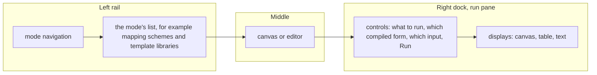
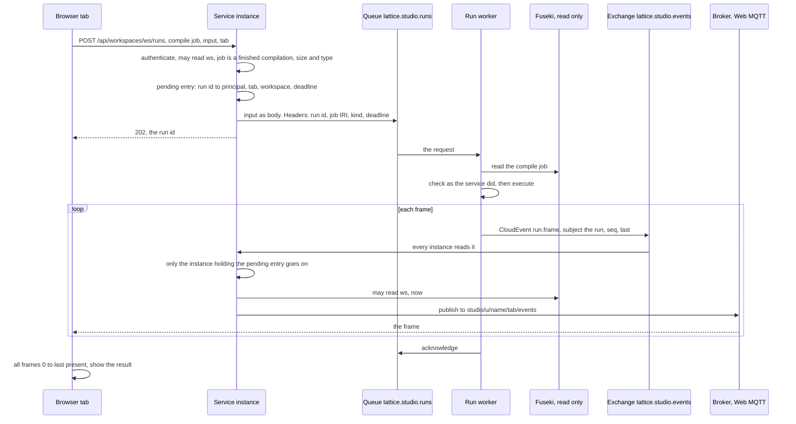
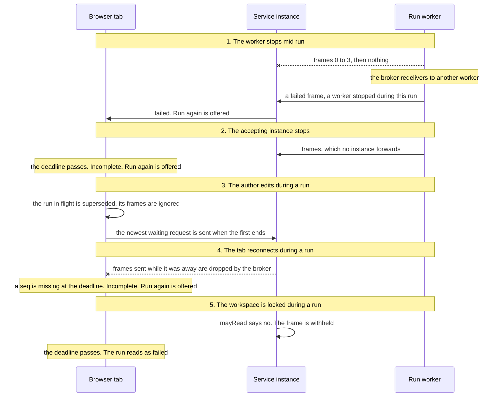
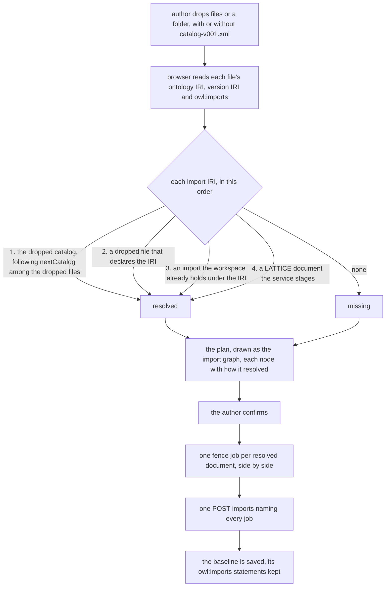
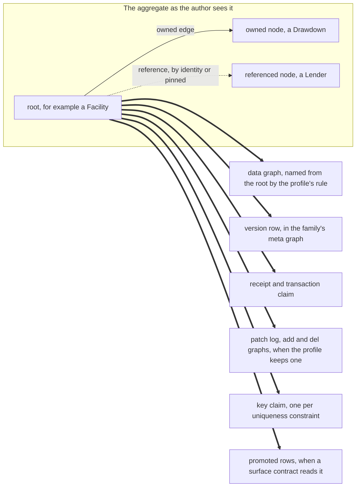

<!-- SPDX-License-Identifier: CC-BY-SA-4.0 -->

# Sketch: baseline management, canvases and run panes for the Configuration Studio

**Unit:** `studio-visual-authoring` (SVA), raised by the maintainer on 2026-11-12
**Status:** sketch. SVA-Q1, SVA-Q2 and SVA-Q4 to SVA-Q16 answered 2026-11-12. SVA-Q3 open, with the maintainer's questions on size answered in section 8.2
**Plan:** [studio-visual-authoring.md](../plans/studio-visual-authoring.md)
**Status record:** [studio-visual-authoring.md](../status/studio-visual-authoring.md)
**Builds on:** [ADR-A136](../../architecture/decisions/ADR-A136-configuration-studio.md) and its amendments (the studio, its writers and its worker), [ADR-A149](../../architecture/decisions/ADR-A149-publication-from-the-studio.md) (fenced imports, dependencies, units), [ADR-A88](../../architecture/decisions/ADR-A88-ontology-import-resolution-for-consumers.md) (the XML catalog), [ADR-A148](../../architecture/decisions/ADR-A148-mork-transform-backends.md) (the transforms worker), the [events sketch](browser-events-over-web-mqtt.md) (PM-Q18, PM-Q20), [ADR-A132](../../architecture/decisions/ADR-A132-persistence-caller-library.md) (the caller library)

## 1. The scene

The maintainer asked for six things. The baseline should import ontologies with their imports, resolved through an XML catalog as Protege resolves them, and show how ontologies and vocabularies relate. An ontology element should show its axioms in a form. The ontology should be drawn in several views. Persistence and surface configuration should each have an editable canvas and a simulator. Mapping mode should list its mapping schemes, gain reusable template libraries, and replace its automatic sample run with a pane where the author picks what to run and reads what it wrote.

What exists today, each fact read from the source on 2026-11-12.

| Area | Today | Where |
|---|---|---|
| baseline | one part of a workspace. An uploaded graph is sorted into parts by namespace. The view is a class tree, a class's properties and a Replace button | `BaselineView.tsx`, `rdf/split.ts` |
| `owl:imports` | no code in the browser, the service or the worker reads it | a search of `apps/config-studio/src`, `platform/config-studio-*` and the worker |
| fenced imports | a workspace holds read-only graphs stored once by the digest of their content, which every job reads as context. A `fence` job digests one, and `POST …/imports?job=` holds it | ADR-A149 decision 6, the contract's HTTP table |
| the catalog | `ontology/catalog-v001.xml` is generated, with a stub in each directory that chains to it by `nextCatalog`. rdflib has no catalog support, so the same tool holds a small resolver | ADR-A88, `tools/ontology_catalog.py` (CAP-18) |
| forms | every field is derived from SHACL shapes first, then `rdfs:domain` and `rdfs:range` | `rdf/shapes.ts`, `rdf/vocabulary.ts`, the architecture's "Forms are read from the ontology" |
| mapping schemes | a `select` appears when a workspace holds more than one scheme | `MappingView.tsx`, the `Mapping scheme` select |
| the mapping canvas | React Flow 12, one node a mapping, links for parent, template and source. Positions are kept in the browser, never in the graph | `MappingCanvas.tsx` |
| templates | a template is merged only when it is among the mappings of the scheme being read (`if t in present`), and the canvas draws a template link only inside one scheme | `tools/mork_rdf/src/mork_rdf/read.py`, `MappingCanvas.tsx` |
| the sample run | a text box and a file button. The part reruns 800 ms after it or the sample changes. A Turtle sample is a `dry-run` job. An XML or JSON sample compiles the part, then posts to `/transforms`, where the service waits up to 30 seconds on RabbitMQ's direct reply-to | `useSampleRun` in `MappingView.tsx`, `RabbitJobBus.java`, the contract's Transforms section |
| an earlier answer | XJ-Q8 chose the waiting request for a transform on 2026-10-30, "for now", with a push for jobs that run long. The push it drew used Web STOMP, before PM-Q18 chose Web MQTT for the studio's events | the [mork-transforms plan](../plans/mork-transforms.md), XJ-Q8 |
| the transforms worker | takes one request at a time (`basicQos(1)`), writes nothing, and replies with a Turtle graph | `TransformsMain.java` |
| events | the writer publishes a CloudEvent for each applied job update, holding the status and the workspace and never content. Each service instance reads every event and every watch frame through queues of its own, and publishes to a tab's own MQTT topic after checking `mayRead` | `Relay.java`, `Notifier.java`, the contract's Completion events section |
| persistence | `compile` writes a `dal:CompiledProfile`, `instantiate` writes one SPARQL file per operation and target. A caller binds parameters, fills request-time slots and checks the request with the caller library, which has a Java port the writer uses | `tools/persistence/README.md`, ADR-A149 decision 12 |
| surface | promotions are maintained in the write by a clear and a fill per source family. A projection lowers to a MORK mapping graph | the contract's Promotions section, ADR-A18 |
| RML | the studio compiles a scheme to RML and nothing in the studio runs it. `tools/spc` holds a wrapper that calls RMLMapper as a subprocess | `mork2rml.py`, `tools/spc/python/src/spc/ingress/rml_executor.py`, TD-151 |

Three of these constrain every option below.

1. **A blocked request is the studio's only way to return a result that is not stored.** The transforms route holds an HTTP request open while one worker runs one transform. A simulator that answers each edit would hold many.
2. **Events are hints.** They are sent at QoS 0 on a clean session, and a reader that misses one reads the job again from the store. Nothing that is sent only as an event can be read again.
3. **The store's commit is the cost of a write.** A small update on TDB2 costs about its commit ([TSD-44](../../architecture/triple-store-discovery.md#tsd-44-a-small-update-on-fuseki-tdb2-costs-its-commit-so-batching-updates-is-the-lever-for-write-throughput)), a workspace's writes are applied in order by one writer, and a delete leaves space TDB2 reclaims only by compaction.

## 2. Terms

- **Mapping scheme** is the repository's term for what the request calls a mapping graph, a `mork:MappingScheme` and the mappings that name it. This sketch uses it throughout.
- **A run** executes compiled artefacts over an input that is not saved, and stores nothing. It is a deterministic function of the compile job, the input and a time the request states.
- **A simulator** is a pane whose runs show what a write would do to the graph. Persistence and surface each have one.
- **The sample pane** is mapping mode's pane. It runs a compiled mapping over a sample source, which is a test and no simulation, so it is labelled Sample.
- **A sample world** is the small dataset a tab holds for a workspace's simulators, as TriG, with the steps that made it.

## 3. The shell

Every mode keeps the navigation on the left and its editor or canvas in the middle. The right-hand dock holds the inspector today. It gains a second tab, the run pane, laid out the same way in every mode.

| Mode | Left list | Canvas | Run pane |
|---|---|---|---|
| Baseline | ontologies and imports, with what is missing | the import graph, class and property views | none |
| Persistence | scopes: aggregates, profiles, scope nodes | the exploded view | Simulator |
| Surface | contracts by kind | read paths and what each contract instantiates | Simulator |
| Mapping | schemes and template libraries | the mapping canvas, as today | Sample |

The controls sit on the left of the pane and the displays on the right, as the maintainer asked. A pane says which compile job its picture comes from, and says so when the configuration has moved since, which keeps the rule of [ux-design.md](../../architecture/ux-design.md) that nothing is shown as done before the server confirms it.

## 4. Runs

This section decides how a result that is not stored reaches a browser without a request waiting for it. It is the part of the design where concurrent flows can go wrong, so it is drawn in full.

### 4.1 Three ways to carry a run

- **(a) Every run is a job.** The input and the result are graphs in the store, written by the workspace's writer, and events say when to read.
- **(b) Every run is a request that waits,** as a transform is today.
- **(c) A run is accepted at once, and its result comes as frames on the tab's own events topic,** relayed by the service instance that accepted it.

| | (a) job | (b) waiting request | (c) frames |
|---|---|---|---|
| writes to the store per run | two commands and a delete | none | none |
| where a run waits | behind the workspace's saves, in its partition | on an HTTP request | nowhere. The request answers `202` |
| partial results | one more write each | none | one frame each |
| a lost result | read again from the store | the request fails, run again | the deadline passes, run again |
| state outside the graph | none | one pending reply per request | one pending entry per run, in the accepting instance |
| store growth | each run's graphs until they are deleted, then dead space until compaction | none | none |
| new to assure | nothing | nothing | frame order, duplicates, loss and the deadline |

A worked example, one author stepping a persistence simulator 20 times in a minute, each result 60 KB of quads, with 10 saves in the same minute.

| | (a) job | (b) waiting request | (c) frames |
|---|---|---|---|
| commands to the workspace's writer | 60 for the runs, beside 10 saves | 10 saves | 10 saves |
| commits on TDB2, at one batch a command | up to 70 | 10 | 10 |
| bytes written to the store and later dead | about 2.4 MB, the input and the result twice over | 0 | 0 |
| requests held open | 0 | 20, each for the run's length | 0 |
| MQTT publishes | 40 status events | 0 | 40 frames of at most 48 KiB |

(a) crosses (c) at the first run, since every run costs commits the others do not. (b) crosses (c) when runs overlap or a result is wanted in steps. (a) remains right for anything worth reading again later, which is why compilation stays a job.

**Answered (c)** for the sample pane and both simulators, with compilation unchanged (SVA-Q1).

### 4.2 The flow under (c)

The rules, each one a line of the contract when built.

1. **The request never waits.** The service checks, records a pending entry, publishes and answers `202` with the run's id, `urn:lattice:studio:run:{uuid}`.
2. **The accepting instance relays.** Every instance reads every event, as today, and only the one holding the pending entry forwards a run's frames. So a frame reaches a tab once, in the order one consumer read it, and who may hear it never travels in a message.
3. **The check is still at delivery.** The relay asks `mayRead` for the workspace before each frame, as it does for a job's events, so locking a workspace withholds the next frame with no change in the broker (PM3-T5 holds). A run withheld reads to its author as a run that failed.
4. **A run is deterministic.** Its output is ordered canonically and takes its time and its identifiers from the request (PRI-56), so two executions of one request give the same frames, and the function is tested with a permutation and a repeat (PRI-58).
5. **A frame is `(run, seq, last, data)`.** The browser keeps the first frame it sees for each `seq`, ignores a frame of a run it no longer shows, and has the result when `0` to `last` are present.
6. **A deadline bounds everything.** The request states it, as an absolute time. The message expires at it, the worker stops an execution that passes it, and the accepting instance sends a failed frame for a run it has not seen end by then and drops the pending entry. The browser keeps the same deadline for the case where that instance has stopped, and then shows the run as incomplete with Run again. XJ-Q8's push drew the timeout as a message dead-lettered into the events exchange. The accepting instance already holds the deadline, so no second message races the worker.
7. **A redelivered run is not run again.** A worker that receives a run with the broker's redelivered flag sends a failed frame saying a worker stopped during it, and acknowledges. This follows ADR-A136's amendment of 2026-11-05 and keeps an input that ends a worker from ending the next one.
8. **One run in flight per pane.** The browser numbers a pane's runs. While one is in flight a newer request waits, and only the newest waiting one is sent, as live validation keeps one job in flight per graph.
9. **Limits.** A frame's data is at most 48 KiB and a run sends at most 128 frames, about 6 MiB. A result over that fails with a message that says to narrow what is run. A tab holds at most 4 pending runs, and the service answers `429` beyond.
10. **Without events the same run answers on the request.** When a deployment offers no events, or the tab's connection is down, the browser sends `wait=true`. The accepting instance then collects the frames from its own events queue into the response, or answers `504` at the deadline. The worker behaves the same either way.

### 4.3 What can go wrong, and what the author sees

Two more cases need no drawing. A compile job deleted before the worker reads it gives a failed frame, and the browser compiles again. Two tabs of one principal each have their own tab identifier, pending entries and sample world, so they do not see one another's runs.

**What this design does not protect.** A frame lost between the relay and the tab is found only at the deadline. An interactive run's deadline is short, 15 seconds by default, so the cost is a wait and a click. Whether the broker drops QoS 0 messages to a slow tab before 128 frames, and what its largest packet is, are facts to probe before the limits of rule 9 are fixed (slice SVA-R0), as PM-3a probed the HTTP backend.

### 4.4 Queues and the worker

The transforms worker already runs compiled artefacts over a sample, warm between requests, and writes nothing. The run worker is that component generalised. It consumes two queues, since a mapping over a 5 MiB sample should not delay a simulator's step, as ADR-A136's fourth amendment split long jobs from short ones.

| Queue | Carries | Deadline by default |
|---|---|---|
| `lattice.studio.runs.interactive` | simulator steps | 15 seconds |
| `lattice.studio.runs` | sample runs | 120 seconds |

A worker takes a queue from its configuration and a bounded number of requests at once. `POST …/transforms` stays through a deprecation, answered by the same worker, as the contract requires of a change that would break a client.

**Which engine executes a simulation** is SVA-Q4. The facts: Fuseki runs Jena, the Java caller library exists and the writer already binds generated operations with it, the transforms worker is Java, and rdflib differs from Jena on corners the triple-store record lists, for example [TD-44](../technical-debt.md). The answer is Jena's in-memory dataset in the run worker, with every simulator display saying it shows the write as Jena evaluates it. Oxigraph as a second engine is BL-21.

## 5. Baseline management

### 5.1 Importing an ontology with its imports

- **The browser resolves, since only the browser has the files.** A catalog maps an IRI to a path relative to the catalog, and a dropped folder gives each file's relative path. The worker takes no path and fetches nothing, which ADR-A35 already requires of it.
- **Nothing is fetched from the web by default.** LATTICE's version IRIs do not dereference (ADR-A88), and a fetch chosen by a document's content is a request-forgery risk. An import that is neither dropped, held nor staged is missing, and the author supplies the file (SVA-Q5).
- **An imported document is a fenced import.** It is stored once by its digest, read-only, and every job reads it as context, all of which ADR-A149 already gives. The baseline part holds only the author's own ontology (SVA-Q6).
- **The closure is held in one write.** The fence jobs digest in parallel, since each reads only its own body. One command then names them all, so the description is replaced once and no reader sees half a closure. Today's route takes one job, so it gains repeated `job` parameters, an additive change.
- **A held import records what it is.** Its root gains the ontology IRI and the version IRI it declares, so the import graph is drawn from the description without reading every import.
- **Missing imports are reported, never refused.** A baseline saves with an import missing. The Baseline view shows the import as a missing node, and validation reports an `owl:imports` with no held document as a warning on the statement (SVA-Q7).
- **RDF/XML.** The browser's parser reads Turtle. For an RDF/XML file it reads only the ontology header with the browser's XML parser, and the service converts the body when it is fenced, as it converts any RDF/XML body today.

The cost is one job and one stored graph per imported document, once, however many workspaces hold it. A closure of 12 documents is 12 fence jobs and one description write. The 5 MiB body limit bounds one document, which a large published ontology can exceed, and such a document is reported with its size.

### 5.2 How ontologies and vocabularies relate

The import graph is one of the Baseline canvas's views. Its nodes and edges are read from what the browser already holds.

| Node | Read from |
|---|---|
| the workspace's ontology | the baseline part's `owl:Ontology` |
| a held import, or a missing one | the description, and the `owl:imports` statements |
| a concept scheme | the vocabulary part and the workspace's dependencies |

| Edge | Stated or derived |
|---|---|
| imports | stated, `owl:imports` |
| binds | stated, a scheme contract's binding names the scheme, and the contract's property belongs to an ontology |
| uses terms of | derived in the browser from the namespaces a document's terms use. It is never stored |

## 6. Viewing an ontology element

Selecting a class, a property or an individual opens a form of its axioms, read-only in the first slice (SVA-Q9). The form states every axiom the element has, and puts what it does not recognise in a plain table, so nothing about an element is hidden.

| Element | Sections |
|---|---|
| class | annotations by language. Superclasses, named and as restrictions. Equivalent classes, disjoint classes and keys. Properties by domain, direct and inherited. The shapes that target it, each constraint a row. Individuals. What configures it, as today |
| property | characteristics. Domain and range. Super-properties, inverse and chain. The shapes that name it as a path |
| individual | types and assertions |

A class expression is shown as a nested structure and never as a line of text. A restriction is a row of property, quantifier or cardinality, and filler, and an intersection, union, complement or enumeration nests its members. The reader is a new module, `rdf/axioms.ts`, that turns the RDF lists and blank nodes of OWL into that tree.

## 7. Rendering the ontology

| View | Nodes | Edges |
|---|---|---|
| classes and object properties | classes | one edge per object property between the classes it links |
| class hierarchy | classes | `rdfs:subClassOf` |
| import graph | section 5.2 | section 5.2 |

A toggle chooses where a property's ends come from. **Domain and range only** draws an edge from each `rdfs:domain` to each `rdfs:range`. **With shapes** adds an edge from class C to class D when a node shape targeting C has a property shape whose path is the property and whose `sh:class`, or `sh:node` with a target class, is D. It is the reading the forms already use, so `rdf/shapes.ts` is reused, and an edge that comes from a shape is drawn in a second style and names its shape. OWL restrictions are shown in the element's form and are not a third source of edges in this unit.

Everything is derived in the browser from graphs it already holds, so these views add no request and no concurrent flow. A large ontology is the risk. A view opens on the neighbourhood of the selected class, two hops by default, and offers the whole graph on request. The layout is our own layered layout, as the mapping canvas has, reached through one function of the canvas kit so that `elkjs` or `dagre` can be added as a second implementation later (SVA-Q8, BL-23). The time to lay out 500 classes is a figure to measure in the first canvas slice, not one this sketch claims, and a layout that proves slow moves into a web worker.

A shared canvas kit is taken out of `MappingCanvas.tsx` for all of these: node and edge types, context menus, positions kept in the browser, and laying out again. The mapping canvas then uses it too.

## 8. The persistence canvas and simulator

### 8.1 The exploded view

The canvas draws, for the scope the author picks, one domain object in the middle and every place its data lands when written. It is a function of the compile job's `compiled-profile.ttl`, the configuration and the baseline, so it needs no run.

- **The scope picker** has three lenses, which is the leaning the maintainer asked for (SVA-Q10). *Aggregate* shows one root with the closure of its boundary shape, and is the default. *Profile* shows every target that resolves to one profile, so a choice shared by many classes is seen once. *Scope node* shows what one `dal:` scope matches. Each lens lists only what the compile job holds.
- **Each landing place is labelled by the worker's reading of the compiled profile,** never by the browser matching IRI patterns.
- **Edits on the canvas are the form's edits.** A click opens the element's editor in the dock. A drag or a menu choice makes the same change to the graph that the form field makes, through the model's one edit function, so it is undoable and validated like any edit. Which gestures exist is fixed against the `dal:` shapes in the slice's brief. Where an aggregate's boundary is a shape in the baseline, an edit of the boundary is an edit of the baseline part (SVA-Q11).

### 8.2 The simulator

The author makes or changes a domain object in the pane, and the display shows the write.

| Control | Does |
|---|---|
| the object | a form derived from the aggregate's boundary shape, an uploaded instance in Turtle, or one generated from the boundary shape (SVA-Q12) |
| the operation | create, replace, delete or append, limited to what the target's profile compiles |
| as another writer | sends the step with an earlier expected position, to show the guard refusing a lost race |
| step back | removes the last step from the sample world |

A step's result has four parts, each a group of frames, shown in order.

1. **The checks** the caller library makes before anything is sent, and the payload check.
2. **The request** as it would be sent, the operation's SPARQL with its parameters bound and its slots filled.
3. **The delta**, the quads added and removed in each graph, grouped by the landing places of the exploded view, which light up on the canvas.
4. **The outcome**, read as the caller's confirmation read classifies it: applied, lost race or refused.

**The state is the tab's** (SVA-Q3). A step's request carries the sample world as TriG and the edit, and the worker returns the delta, so a step is a function of its request. No worker holds a session, any worker serves any step, and a step sent twice gives the same answer. The sample world is bounded by the service's limit on a request body, 5 MiB (`StudioApi.MAX_BODY_BYTES`), which is a rule of the HTTP API and has nothing to do with MQTT. The frames bound the response, at 48 KiB each and 128 a run.

How much that is, measured on the facility sample's six files on 2026-11-12 with rdflib:

| Syntax | Bytes a triple | Triples in 5 MiB |
|---|---|---|
| Turtle or TriG, with prefixes | 36 to 50 | about 100,000 to 145,000 |
| N-Triples or N-Quads | 126 to 188 | about 28,000 to 41,000 |

A step is small beside that. As an estimate to be measured in SVA-P3, an aggregate of the facility sample is some tens of triples, and each write adds a version row, a receipt, a claim and, under a patch log, its delta, so a world of ten aggregates after twenty steps is a few thousand quads, 100 to 300 KB as TriG. The response is the step's delta alone, tens to hundreds of quads. The cost of (a) is that every step sends the whole world again and the worker parses it again, so twenty steps on a 300 KB world send 6 MB and parse it twenty times. Should that be measured as slow, the remedy is a worker that keeps a parsed world by its digest and is sent it again only when it has forgotten it, which stays a function of the request.

The simulator shows what the generated operations do to a small dataset. It does not estimate cost at size, which is BL-10, and it does not generate data from a baseline, which is BL-11. Its executor and its display are what those two would build on.

## 9. The surface canvas and simulator

The canvas draws each contract from its carrier class along its read path to what it instantiates.

| Contract | Drawn as | Instantiates |
|---|---|---|
| promotion | carrier, each hop of the read path, the promoted property | a row in the source's promoted partition |
| index | carrier, the indexed paths | the index's entries |
| projection | carrier, role bindings, the MORK mapping it lowers to (ADR-A18) | what the lowered mapping writes |

A read path is built on the canvas by clicking from class to class along the properties the ontology view of section 7 draws, which writes the same `srf:readProperty` or `srf:hasPathStep` the hop-by-hop control writes today.

The simulator reads the same sample world as the persistence simulator (SVA-Q13). A step runs the staged clear and each fill of the source's family over the world, and the projection's compiled queries, and returns the derived rows before and after. So one edit of a domain object shows the write and what the write maintains, which is how the studio's own writer keeps its promotions (PM-2). The display lists the rows retracted and asserted by contract, and names each contract whose read set the edit touched.

## 10. Mapping mode

### 10.1 The schemes on the left

The left list shows every mapping scheme of the workspace and every template library, each with its count of mappings, its review state and whether the last sample run wrote anything for it. Selecting one opens it. The `select` goes.

### 10.2 Template libraries

A library is a set of templates that other schemes instantiate. The model is SVA-Q14, and its facts are these.

- `mork:DataMapping` is a `skos:Concept`, and MORK's own comment says a mapping carries a `skos:note` explaining its logic. So annotating what a template is for needs no new term: `skos:prefLabel`, `skos:definition`, `skos:scopeNote` for when to use it, and `skos:example`.
- A mapping is a template only because another mapping names it (`isTemplate` in `rdf/mapping.ts`). A template nothing uses yet cannot be told from a mapping, so a library needs a statement that it is one.
- The compilers merge a template only inside the scheme being read. Reuse across schemes is a change to `mork_rdf`, `mork2rml` and `mork_transforms`, and to what MORK's README section 5.5 says.
- A mapping scheme is already a unit a workspace publishes and another follows or pins (ADR-A149). A published library is therefore shared across workspaces by a dependency, with no new mechanism.
- A scheme declares the prefixes its source paths use, which `mork_rdf` reads (`prefixes(g, scheme)`). A library declares its own the same way.

**Leaning.** MORK gains a class for a library, a kind of mapping scheme whose mappings are templates, and states that an instantiation may name a template of a library its scheme can read. The studio gains a Libraries section that edits one on the same canvas, with the annotations as form fields.

**Proposals read them as cards.** The proposer's tools and the MCP server gain a template cards tool, one line per template of the libraries the workspace can read, built from the annotations, beside the target and source cards. A library is given to a model as Turtle or as MCN. Whether MCN's codebook carries the annotations today is a fact to read in the slice, and a gap there is a change to MCN.

### 10.3 The sample pane

| Control | Offers |
|---|---|
| the scheme | a mapping scheme, with the libraries it instantiates from listed under it |
| the compiled form | each form the last compilation wrote for the scheme, with whether a runtime exists for it |
| the sample | a file or a text box, with its format |
| Run | compiles when the scheme has changed since the last compilation, then runs |

| Source | Compiled form | Runtime |
|---|---|---|
| RDF | SPARQL CONSTRUCT, by `mork_rdf` | yes |
| XML | XSLT 3.0 | yes |
| JSON | JOLT | yes |
| JSON, XML, CSV, YAML | RML | none. Shown as waiting on BL-20 |

The run happens when the author presses Run, and never by itself (SVA-Q15). The counts on the canvas and the tree come from the last run and are marked as out of date once the scheme changes. TD-151 bears on the RML form, since today one RML file is written for schemes of two formats.

### 10.4 Reading the output

The display has three renderings of what a run wrote, per mapping and stratum as today, and the same component serves the simulators.

| Rendering | For | Shows |
|---|---|---|
| canvas | RDF | a node-link graph of the output, on the canvas kit |
| canvas | JSON, XML | a collapsible tree |
| text | all | the source text. RDF is Turtle by default, with N-Triples offered |
| table | RDF | subject, predicate, object and graph, filterable |

The sample stays in the browser's storage, as today. Storing it beside the workspace's graphs is BL-08 and is not in this unit. The pane's sample control is written so a stored sample would be one more source.

## 11. Placement, and what is left out

All of this is tooling over the substrate and MORK, with no applied content, so its commits carry `Placement: T0`. The template cards serve mappings of structured sources.

Left out, each with where it lives: cost estimates at size (BL-10), generated test data and sizing (BL-11), stored samples (BL-08), an RML runtime (BL-20, added with this sketch), Oxigraph as a second simulation engine (BL-21), a catalog directory a deployment configures (BL-22), other layout libraries (BL-23), boundary edits on the persistence canvas (BL-24), other notifiers (BL-13), and the verification rig's views (`v-rig-studio`, which will use the same shell and canvas kit).

## 12. Questions

**SVA-Q1. How does a run's result reach the browser?** (a) Every run a job in the store. (b) A request that waits, as a transform does. (c) Accepted at once, with frames on the tab's events topic, relayed by the accepting instance, and the same frames collected into the response when a tab has no events. Section 4.1 compares them. This reopens XJ-Q8, whose answer was (b) for now with a push for long jobs, since a simulator's steps are many and short where a transform was one. Leaning (c), with compilation staying a job. **Answered 2026-11-12, (c).**

**SVA-Q2. May an event carry content?** The contract says a job's event holds its status and workspace, never its content. (a) Keep that for jobs, and allow content in a run's frames, which go only to the submitting tab and are checked at delivery. (b) Keep it for everything, which leaves (a) or (b) of SVA-Q1. Leaning (a). **Answered 2026-11-12, (a).**

**SVA-Q3. Where does a simulator's state live?** (a) In the tab, each step a function of the sample world and the edit. (b) In a worker's memory, with every step of a session routed to it. (c) In a scratch dataset on Fuseki. (b) needs affinity and loses the session with the worker. (c) adds writes and a second kind of data to the store. Leaning (a).

**SVA-Q4. Which runtime and engine execute a simulation?** (a) The Java run worker, on Jena's in-memory dataset, with the Java caller library. (b) The Python worker on rdflib. (c) The Python worker on Oxigraph. (a) evaluates as the studio's own store does and reuses what the writer uses. (b) is where the compilers are, and differs from Jena on recorded corners. (c) adds an engine the worker does not ship. Leaning (a), each display saying which engine it shows. **Answered 2026-11-12, (a), with (c) kept as an option to add later, BL-21.**

**SVA-Q5. Where is an import resolved?** (a) In the browser, from dropped files and their catalog, then held imports, then LATTICE's staged documents, and never the web. (b) In the service, from a catalog directory a deployment configures. (c) By fetching the IRI. (b) suits a shared deployment with a house set of ontologies and can be added beside (a) later. (c) is refused by default for the reason in section 5.1. Leaning (a). **Answered 2026-11-12, (a) now, with (b) later, BL-22.**

**SVA-Q6. How is an imported ontology held?** (a) Each document a fenced import. (b) Merged into the baseline part, as uploading everything together does today. (b) makes imported terms editable and lets them drift from their source. Leaning (a). **Answered 2026-11-12, (a).**

**SVA-Q7. Does a missing import block a save?** (a) No, it is a warning and a missing node. (b) Yes. Leaning (a), since LATTICE imposes a decision only where correctness needs one, and validation already reports an undeclared term. **Answered 2026-11-12, (a).**

**SVA-Q8. Which layout library?** (a) `elkjs`, which the lockfile already holds through mermaid, runs in a web worker, and is licensed EPL-2.0. (b) `dagre`, MIT, smaller, layered layouts only. (c) Our own layered layout, as the mapping canvas has. Leaning (a), as a hypothesis until its licence is checked against the dependency audit and its time is measured. **Answered 2026-11-12, (c), to keep the choice open, with (a) and (b) as options to add later, BL-23. The canvas kit therefore takes its layout through one function, so another layout is one more implementation of it.**

**SVA-Q9. Are a baseline's axioms edited in the studio?** (a) Rendered only. (b) Edited, for the workspace's own ontology. The request asks for rendering. (b) makes the studio an ontology editor, which Protege already is. Leaning (a). **Answered 2026-11-12, (a). The studio does not compete with Protege.**

**SVA-Q10. What scopes does the persistence canvas offer?** (a) Aggregate, profile and scope node. (b) Aggregate only. Leaning (a), with aggregate the default. **Answered 2026-11-12, (a).**

**SVA-Q11. May the persistence canvas edit an aggregate's boundary when the boundary shape is in the baseline?** (a) Yes, as an edit of the baseline part, shown as such. (b) No, the boundary is shown and edited where it is declared. Leaning (b) for the first slice, since it keeps a canvas to one part, with (a) reconsidered once the canvas is in use. **Answered 2026-11-12, (b), with a review once the canvas is in use, BL-24.**

**SVA-Q12. Where do a simulator's domain objects come from?** (a) A form derived from the boundary shape. (b) An uploaded instance. (c) Generated from the baseline. Leaning (a) and (b). (c) is BL-11. **Answered 2026-11-12, (a), (b) and (c), each offered. (c) here generates one small object from the boundary shape, and data at size stays BL-11.**

**SVA-Q13. Do the two simulators share a sample world?** (a) Yes, one per workspace and tab. (b) No. Leaning (a). **Answered 2026-11-12, (a).**

**SVA-Q14. How is a template library modelled?** (a) MORK gains a library class and cross-scheme template resolution, in its specification, shapes, README and three compilers, released as a MORK minor version. (b) The studio marks a scheme as a library in its own vocabulary, and the worker copies a library's templates into a scheme's compile input. (c) No library, templates stay in their scheme. (b) is smaller and leaves a mapping pack used outside the studio without reuse. Leaning (a). **Answered 2026-11-12, (a).**

**SVA-Q15. Does the sample ever run by itself?** (a) Only on Run. (b) On Run, with an automatic toggle. Leaning (a). **Answered 2026-11-12, (a).**

**SVA-Q16. Does `POST …/transforms` go?** (a) Deprecated when runs are built, removed a release later. (b) Kept beside runs. Leaning (a). **Answered 2026-11-12, (a) for the studio. A waiting transform route returns once a sidecar architecture is defined, which the `xslt-sidecar` unit plans.**

## 13. Slices

The [plan](../plans/studio-visual-authoring.md) lists them. Phase R, the run protocol, comes first since three panes rest on it. Phases B and O need no backend change beyond one route and can proceed beside it.
