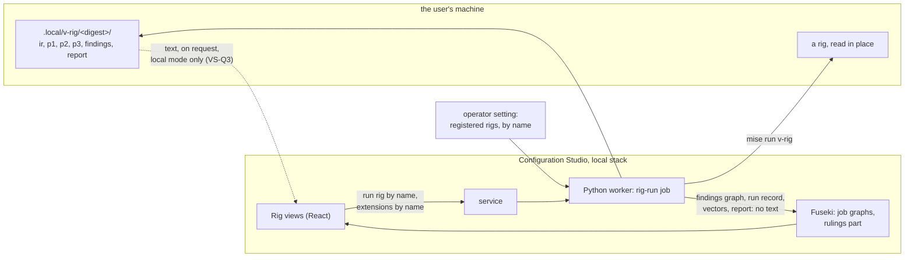

<!-- SPDX-License-Identifier: CC-BY-SA-4.0 -->

# A studio module for the verification rig

**Unit:** `v-rig-studio`, prefix VS. **Plan:** [v-rig-studio.md](../plans/v-rig-studio.md). **Status:** sketched 2026-11-08, for a team other than the one that built the rig tool, from the tool as built in [v-rig](../plans/v-rig.md).

## 1. What exists, and what is missing

The verification rig tool ([`tools/v_rig`](../../../tools/v_rig/README.md)) reads a rig named at run time and writes, under `.local/v-rig/<rig digest>/`, the representation, the blind view, the layer graph with its shape reports and competency answers, a generated theory, one vector per case and reading, a findings graph whose identifiers are stable across runs, and a report rendered from it. Everything it writes is byte for byte the same for a rig revision, and two runs diff by finding id. It is a command line, and a run's results are read in an editor.

What is missing is the surface the two evaluations are read through. A maintainer triaging 264 findings on the mini-rig, and far more on a rig, wants them by kind, by document and by locator, wants the findings a revision resolved and the ones it added, wants a case drawn as its tower with the three fact states visible, wants a read case dropped in and its disagreements shown against the declared view, and wants each finding's ruling recorded, a requirement for a plan, a mapping to fix, or a thing the layers are not meant to say, since the plan says the rig's owner keeps the rulings (VR-Q1, VR-Q7). None of that needs the tool to change, since every input of the surface is a file the tool already writes.

The [Configuration Studio](../../architecture/configuration-studio.md) is where LATTICE already shows findings on the thing that caused them, follows a job and reads what it produced, and keeps a user's work in a local store. Its worker runs the repository's own tools. Its rule that a worker never takes a path, a command or a graph of its own choosing from a message is the one thing a rig run cuts across, since a rig is named by a path, and its store is exported and published, which a rig's text must never be. The design below is shaped by those two facts.

## 2. The shape

Three lines hold the shape together.

- **A rig is named, never pathed.** The operator registers each rig the worker may read, a name to a directory and its extensions, in the worker's settings, as the studio's other operator settings are set. A job names a rig and its extensions by those names. The worker resolves the names and runs `mise run v-rig` with the paths it holds, so no message carries a path and the worker's rule stands.
- **Text never enters the store.** The worker writes into the job graph what the report holds and no more, the run record, the findings graph, the competency answers, the vectors and the generated theory, none of which carries a line of a rig's body, and the deny list's digest so a later run can say the list changed. The representation, the blind view, the layer graph and the mapping source stay under `.local/`, where the tool put them. A view that wants the text behind a locator reads it from disk through a local-only route the service exposes only when the stack runs on the user's own machine (VS-Q3), or shows the locator and leaves the file to the user.
- **Rulings are the user's, in a part of their own.** A ruling on a finding is a `vrig:Finding` identifier with a decision and a note, kept as a workspace part, `rig-rulings`, so it is saved, versioned and exported as the studio's parts are, and never written into the repository. The identifiers are stable, so a ruling survives a revision of the rig that leaves the finding in place, and a resolved finding's ruling is shown as settled.

## 3. The views

| View | Shows | Reads |
|---|---|---|
| Rigs | the registered rigs, each with its last run's digest, commit, substrate release and finding counts, and a Run button with the extensions and read cases to include | the worker's registry through the service, the job graphs |
| Run | one run's identifying lines first, the counts by kind, then the findings as a table filtered by kind, document, layer and key, grouped as the report groups them, each row opening the node's locator and its ruling | `findings.ttl` and `run.json` as job artefacts |
| Diff | two runs of one rig side by side, the findings only the earlier has, only the later has, and both, by identifier, with the rulings carried across | two job graphs |
| Case | one case under one reading, drawn as its tower, each layer a band with its attachment and limit and its placements as segments by share, the three states shown as a value, a hatched band for unknown and an empty band for absent, the contracts beside it, and each event's inputs | the vector |
| Readings | the same case under each reading it states, side by side, which is what principle 4 asks to be seen never merged | the vectors |
| Projection | the layer graph's shape reports by layer, the competency questions with their answers or the finding each left, and the compiled queries for a reviewer | `p1/shapes/*.txt`, `p1/competency.json`, `p1/compiled.sparql` |
| Theory | the generated theory, and the build log where the run built it | `p2/VRigP2.thy`, `p2/build.log` |
| Read cases | drop a Turtle read case, see it validated against the module's shapes, and the disagreements it raises against the declared view | the job's disagreement findings |
| Rulings | every ruling, by finding kind and by the plan it is a requirement for, exportable as Turtle for the rig's owner | the `rig-rulings` part |

The tower drawing is the one piece of design that is new. A layer is a horizontal band from its attachment to its attachment plus its limit, placements split the band by share, a formula limit is drawn to the height its inputs give once bound and dotted until then, and an unknown attachment is drawn as a band with no lower edge. The drawing reads the vector alone, so it is a function of a JSON document under a tracked schema and nothing else.

## 4. Options not taken

| Option | Why not |
|---|---|
| A separate local application beside the studio | It would rebuild the job model, the local store and the findings table the studio has, and the studio is where an adopter already reads findings. The views are a module of the studio, shown only where the worker has a registered rig |
| Running the tool in the browser | The tool needs Oxigraph, pySHACL and the layers' specifications, and a rig must be read in place. The worker is where the repository's tools run |
| Loading the representation into the store | It holds the body's text, and the store is exported and published. The findings carry locators and ids, which is what triage needs, and the text is one click away on the user's own disk |
| Keeping rulings in the repository | VR-Q1 settled that the rig's owner keeps them. A part of the local store is theirs, exportable, and never committed |

## 5. Costs

A run's job graph holds the findings graph, about ten triples per finding, so 264 findings on the mini-rig are about 2,600 triples and a rig of several thousand findings a few tens of thousands, written once per run by the writer in one batch. The vectors and the theory are text artefacts of the job, a few kilobytes each. The views read one job graph at a time, and the Diff view two, each a GET of a job graph as the Build view reads one today. Nothing here adds a store write path, a worker engine or a dependency, and the tower drawing is SVG over a JSON document.

## 6. Questions VS-Q1 to VS-Q6

**VS-Q1. How a rig is registered.** (a) The worker's settings file names each rig, its directory and its extensions, set by the operator, as the studio's other settings are. (b) The browser sends a path, and the worker checks it against an allow list. *Leaning (a). The worker's rule is that no message carries a path, and (b) weakens it for no gain.*

**VS-Q2. What a run writes into the store.** (a) The findings graph, the run record, the competency answers, the vectors and the theory. (b) Those and the layer graph. (c) Those and the representation. *Leaning (a). The layer graph carries text parts, and the representation the body, and the store is exported and published. (a) is everything the views of section 3 need except the text behind a locator, which VS-Q3 decides.*

**VS-Q3. Whether the browser ever sees a rig's text.** (a) Never. A finding shows its locator and the user opens the file. (b) A local-only route of the service reads the file behind a locator from `.local/` when the stack runs on the user's own machine, off by default, and the text is shown and never stored. *Leaning (b) as a later slice, off by default. Triage without the text is slow, and the route adds nothing to what the user already has on disk.*

**VS-Q4. Where rulings live.** (a) A workspace part `rig-rulings`, exportable as Turtle. (b) The job graph of the run. *Leaning (a). A ruling outlives the run it was made on, since the identifier is stable.*

**VS-Q5. Whether the Case view draws from the vector or the layer graph.** (a) The vector, under its tracked schema. (b) The layer graph. *Leaning (a). The vector is the evaluation's input, carries the three states as shapes, and is what the differential tests read, so a drawing of it is a drawing of what an implementation sees.*

**VS-Q6. Whether the theory build runs from the studio.** (a) No, the run reads a build log where the command line produced one. (b) A Build button runs `isabelle build` on the worker's machine. *Leaning (a) now. One Isabelle build at a time is a rule on at least one machine, and the worker cannot know what else is building.*
