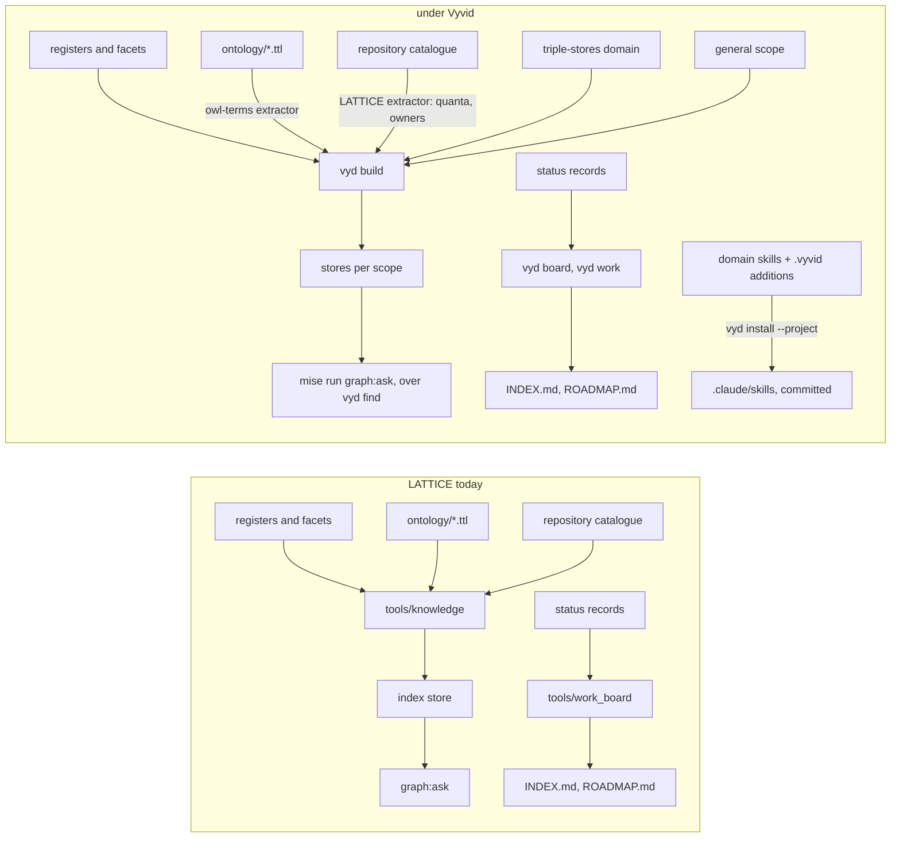
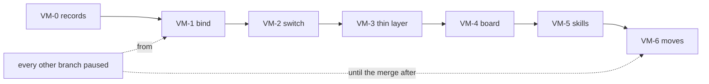

<!-- SPDX-License-Identifier: CC-BY-SA-4.0 -->

# LATTICE adopts Вивід: what moves, what stays, and in which order — Sketch

**Unit ID:** `vyvid-migration`
**Status:** Answered. VM-Q1 to VM-Q6 answered 2026-11-05, recorded in §6. The plan is [vyvid-migration](../plans/vyvid-migration.md) and the status record [vyvid-migration](../status/vyvid-migration.md). Rewritten 2026-11-05 against Вивід 0.2.1 and its handoff patch.
**Date:** 2026-11-04, rewritten 2026-11-05
**Bears on:** [ADR-A134](../../architecture/decisions/ADR-A134-knowledge-index-and-design-shape-vocabulary.md) (the knowledge index), [ADR-A133](../../architecture/decisions/ADR-A133-git-hooks.md) (the post-merge rebuild and the identifiers check), [ADR-A151](../../architecture/decisions/ADR-A151-the-work-board.md) (the work board), [ADR-A121](../../architecture/decisions/ADR-A121-repository-catalogue.md) (the catalogue the owners come from), [ADR-A117](../../architecture/decisions/ADR-A117-agent-guidance-and-skill-library.md) (AGENTS.md and the skills), [ADR-A29](../../architecture/decisions/ADR-A29-repository-toolchain-and-environment-boundary.md) (`mise` as the one entry point), and Вивід's own plan, `vyvid-framework`, whose slice VYD-2b is this move seen from its side.

---

## 1. Why

[Вивід](https://github.com/nebularis/vyvid), `vyd` at the command line, is LATTICE's knowledge index extracted into a framework of its own: registers whose header is their schema, facets as SKOS schemes, a derived index ranked by meaning, identifiers resolved on a normalised key, and on top of them scopes layered from general to project, domains with registers and skills of their own, recipes, a managed knowledge base with a git policy, trust and containment of a domain someone else wrote, private documents beside public code, and symbol search over source. LATTICE is its first project, and its plan names the switch, slice VYD-2b, as LATTICE's index tooling becoming a configuration of Вивід plus a thin layer for what is LATTICE's own.

The facts this sketch rests on, read on 2026-11-05 from Вивід at version 0.2.1, one commit past its tag `v0.2.1`.

- **Retrieval parity is measured.** Вивід's bake-off asks LATTICE's `find` and its own the same 48 questions with the same embedding model. After ADR-A134 decision 34 hid slices from `find`, both rank them identically, hit@5 0.884 and MRR 0.806 on the 43 scored. Adoption is not a retrieval risk, and VM-1 reruns the bake-off on the merged `main` to confirm it.
- **The core is already out.** `tools/knowledge/` is about 5,800 lines of Python, of which only `quanta.py` and its test, about 280 lines, derive something Вивід has no notion of. Вивід's package is about 8,300 lines, LATTICE's modules generalised with their tests plus what LATTICE never had.
- **The triple-store record is already a domain.** `vyvid-triple-stores` holds the 64 findings, 25 open questions and 30 query rules as `RDF-1` to `RDF-30`, citing no project, and through a scratch configuration all 1,457 mentions of a moved identifier in LATTICE resolved there without a rewrite.
- **Since the first draft of this sketch, Вивід built what the draft said it lacked.** VYD-15 to VYD-20 and VYD-22 were built on 2026-11-05 and released as 0.2.0 then 0.2.1. A project's skills are composed from a domain's skill plus the project's additions by heading, written into the project by `vyd install --project`, committed, and held to their sources by `vyd check skills`, which also proves that every line of an old skill has a home. A reminder hook reminds, and never refuses, when a search tool runs in a session before the index is asked. `vyd board`, `vyd work` and `vyd here` give every feature of LATTICE's board across branches, with the level names, locations and state ladder set by configuration. The identifiers check reads no mention from a declared generated region. The lifecycle domain holds the lifecycle, design, branching and publication skills, citing no project.
- **The binding is drafted.** Вивід's side handed over a patch of 35 files that applies cleanly to this branch, the project file `vyvid.toml`, the reminder hook's settings for Claude Code and Copilot, LATTICE's additions under `.vyvid/`, the fifteen composed skills, and eleven coverage maps saying where each line of the ten skills of today went.
- **Nothing is bound yet.** `vyd context` in this checkout finds no project, so every `vyd` command here answers from the general scope alone.
- **LATTICE's tooling is wired in 28 places** for the index, the four `mise` tasks `graph:ask`, `build:knowledge`, `check:knowledge` and `check:identifiers`, the post-merge hook and the identifiers hook check, AGENTS.md's index section, and the skills. The board adds eight tasks, the `work` hook check and the post-merge regeneration.
- **Windows is proven after the switch**, by Вивід's VYD-14, not before. Until then every hook and task that calls `vyd` must skip cleanly, saying so, where `vyd` is missing or fails, and never block a commit.

## 2. What Вивід supplies, and what stays LATTICE's

Command for command, Вивід has what LATTICE's tooling has: `find`, `read`, `node`, `reaches`, `exists`, `sparql`, `misses`, `gap` and `close`, the flags `!`, `~`, `TD`, `BL` and `?`, `--exclude`, terms and slices shown only when asked, `check identifiers` with a baseline, `removable` families, `defined_only` patterns, skip globs and generated regions, and `board`, `work build`, `work roadmap`, `work check`, `work parse`, `work rename`, `work normalise`, `work adopt` and `here` for the board.

What it does not have is the thin layer VYD-2b leaves to LATTICE, and the table is the whole of it.

| LATTICE's own | Under Вивід |
|---|---|
| architectural quanta, derived per view from the catalogue (`tools/knowledge/quanta.py`, ADR-A134's addendum of 2026-10-25), and the catalogue's owners, `ki:ownedBy` from `repository-catalogue.md` | one LATTICE extractor command, `[[project.extractors]]`, run by `vyd build` inside the checkout, reading one JSON request and writing its quads and the units it declares, so an `Owner` cell becomes an edge |
| the OWL term summary, `--kind term` | Вивід's `owl-terms` extractor over `ontology/**/*.ttl`, already in the patch |
| the work board's rules, STD-300 to STD-307 and STD-317, the state words, the level names and where the records live | `[project.work]` in `vyvid.toml`, already in the patch, and `vyd board`, `vyd work` and `vyd here` reading it. The `mise` task names stay as wrappers, so no skill text changes |
| the generated regions' markers | declared in `[project.work.markers]`, and `vyd check identifiers` reads no mention from them |
| the knowledge tests, 139 across seven modules | every one runs against the store `vyd build` writes before any is deleted (VM-Q4). The ones that duplicate Вивід's own suite go once LATTICE's pass, the quanta, owner, register-conformance and decision-status tests stay |
| the T-Box, `knowledge.ttl` | Вивід's packaged one, which carries `ki:Slice`, plus LATTICE's additions |
| the two skills that are wholly LATTICE's, architecture and ontology authoring, as `.vyvid/own/`, and LATTICE's additions to each domain skill by heading, as `.vyvid/skills/<domain>/<skill>.md` | the domain skills, the composition into `.claude/skills/`, each opening on the index-first header, and `vyd check skills` holding the committed copies to their sources |
| `AGENTS.md`, LATTICE's contract, with an index section cut to what is LATTICE's, after the install and `vyd context` | the general rules, asking first and reading the flags, written to the client by `vyd install` and printed by `vyd context` |
| the identifier exceptions baseline, one file | read by both checks while both run |
| mechanisms, capabilities, principles, debt, pending decisions, backlog, questions and slices | stay LATTICE's, as Вивід's sketch says |

The ten skills of today become fifteen. `lattice-toolchain` becomes `lattice-mise`, `lattice-windows`, `lattice-environment-lessons` and part of `lattice-constrained-environments`. `lattice-triple-stores` becomes `lattice-probing` and `lattice-query-writing`. `lattice-testing` gives up `lattice-shacl-testing`, and `lattice-ontology-authoring` gives up `lattice-ontology-modelling`. The coverage maps place every line of the old ten, one line marked for review, so the removal of an old skill waits on `vyd check skills --from <old file> --map <its map>` passing.

What Вивід's sketch says of LATTICE's registers, which this sketch takes as given: the query-writing standards, R1 to R8 and the H rules, go to the triple-stores domain as rows, already declared as moves in the patch and pinned to the LATTICE commit they were read at, the writing rules to the general scope, and the general facet schemes to the general scope with LATTICE keeping the values only it uses.

## 3. The order

Six slices, run one after another on this branch with every other branch paused until the unit merges (VM-Q2). Nothing LATTICE has is removed before its replacement is proven on this checkout, so each slice but the last can be taken back by a revert. The moves come last, since they change how every branch's mentions resolve, and the pause is what makes them safe.

| | Slice | Delivers | Undo |
|---|---|---|---|
| VM-0 | **the records** | this sketch rewritten, the plan and the status record | delete |
| VM-1 | **bind** | the patch's `vyvid.toml`, hook settings and `.vyvid/` additions, the user-configuration entry for the paths one machine knows (VM-Q1), `uv` and `bootstrap:vyvid` installing Вивід pinned to `v0.2.1` in `mise.toml` (VM-Q3), `vyd trust`, `vyd build`, and every difference listed in the status record, `vyd find` beside `graph:ask` on the bake-off rerun on the merged `main`, `vyd check identifiers` beside `check:identifiers`, the 105 unresolved question mentions among them, `vyd board` beside `work:board`, `vyd work build --check` beside `build:work --check`. The old skills stay | delete the files and the task |
| VM-2 | **switch** | `graph:ask`, `build:knowledge` and `check:identifiers` as `mise` tasks over `vyd`, the post-merge hook running `vyd build`, each skipping with a message where `vyd` is missing or fails, a `mise run vyd -- <args>` passthrough for the rest, AGENTS.md's index section cut to LATTICE's, and the ADR, Proposed | restore the tasks |
| VM-3 | **the thin layer** | the LATTICE extractor command for quanta and owners, every knowledge test re-pointed at the store `vyd build` writes and passing, `check:knowledge` proving the whole knowledge base consistent (VM-Q4), then and only then the removal of `extract.py`, `ask.py`, `identifiers.py`, `facets.py`, `anchors.py` and `embed.py` with the tests Вивід's suite already holds, `knowledge.ttl` reduced to LATTICE's additions, and `facets.md` kept for the values the general scope lacks | a revert |
| VM-4 | **the board** | `work:board`, `build:work`, `build:roadmap`, `work:here`, `work:rename`, `work:normalise` and `work:adopt` as tasks over `vyd`, the `work` hook check over `vyd work check --staged`, each agreeing with the old tool on this checkout and across every branch before `tools/work_board.py`, `tools/work_migrate.py` and their 58 tests go (VM-Q5) | a revert |
| VM-5 | **the skills** | the patch's fifteen composed skills, regenerated by `vyd install --project` against the domains of the day, `vyd check skills --from` each old skill with its map passing before that skill is removed, the one line marked for review placed by hand, AGENTS.md's skills table and the 94 citations of the two old names in 30 files, the 201 register pointers into skill files re-pointed by the maps, `build:agent-guidance`, and `vyd check skills` as a hook check | a revert |
| VM-6 | **the moves** | `vyd move check --ref` on every branch, LATTICE's copies of the triple-store record and the thirty query-writing standards removed, a page at the record's old path saying what each finding means for LATTICE keyed to the domain's identifiers and pinned to a tag of the domain, the writing rules and the general facets moved, the bake-off rerun, and TD-2 cleared in Вивід's register | a revert, but a branch opened in between resolves differently, which the pause prevents |

## 4. Consequences, counted

| | Today | After VM-4 | After VM-6 |
|---|---|---|---|
| code LATTICE maintains for the index and the board | about 8,200 lines, `tools/knowledge/` and the two board tools with their tests | about 500, the extractor, its wrapper and the tests that stay | the same |
| where a rule about asking the index lives | AGENTS.md and ten skills, repeated | the general scope once, printed by `vyd context`, and LATTICE's specifics in AGENTS.md | the same |
| where a rule about mise, probing a store or writing a query lives | three LATTICE skills | the same | a domain skill plus LATTICE's additions, composed and committed |
| where a triple-store finding lives | `docs/architecture/triple-store-discovery.md` | the same | `vyvid-triple-stores`, with a LATTICE page at the old path |
| a bare `TSD-42` in LATTICE | LATTICE's | resolves to the domain by the declared move, the copy still present | resolves to `triple-stores:TSD-42`, no text rewritten |
| what `bootstrap` installs | the venv and the hooks | the venv, the hooks and `vyd` pinned | the same |
| a contributor without `vyd` | has the index and the board | has the build and the hooks, which say what they skipped | the same |
| `check:knowledge` | 139 tests, about 8 s | the tests that stay, against Вивід's store | the same |
| the skills | ten, each repeating the index header | ten | fifteen, each opening on the header Вивід writes |
| tokens | | VM-1 60k, VM-2 90k, VM-3 80k, VM-4 40k | VM-5 60k, VM-6 80k |

The one irreversible edge is a public URL. The triple-store record is linked from about eleven published documents, and a link into a domain is a public dependency on it, which Вивід's own VYD-Q6 answered with a LATTICE page at the old path, pinned to a tag or commit of the domain. The page is written before the copy goes.

## 5. KISS

Not now: a claims store (VYD-12, Вивід's, optional, built last), moving any register that is LATTICE's own, a second code path for a checkout without `vyd`, Windows before the switch, and the private rules as a domain (VM-Q6).

Needed now: the binding, the switch of the tasks and the hooks, the extractor for quanta and owners, the tests proven against Вивід before the deletions, the board over `vyd`, the composed skills with their coverage proven, the two moves with the pointer page, and the ADR.

## 6. Questions, answered

- **VM-Q1. Where the binding lives.** A `vyvid.toml` in the repository travels with every checkout and worktree and is public, and runs nothing until each person trusts it. A user-configuration entry is one person's and binds by remote. Answered 2026-11-05, both, the file for what is public and the entry for the paths only one machine knows.
- **VM-Q2. When.** The moves rewrite how every branch's mentions resolve. Answered 2026-11-05, all of it now, with LATTICE paused, every other branch waiting until the unit merges.
- **VM-Q3. The dependency.** LATTICE's checks come to need `vyd` installed. Answered 2026-11-05, a `uv` tool pinned to Вивід `v0.2.1` in `mise.toml`, installed by `bootstrap`. Where it is missing or fails, a hook or task skips with a message and never blocks a commit, since Windows is proven after the switch.
- **VM-Q4. What of `check:knowledge` stays.** Answered 2026-11-05, as leaned, the table of §2, and two conditions. `check:knowledge` must prove the whole knowledge base consistent, and every one of LATTICE's knowledge tests must pass against Вивід before any is deleted.
- **VM-Q5. The work board and INDEX.md.** Answered 2026-11-05, no loss of function. The board moves to Вивід, INDEX.md stays the generated register, written by `vyd work build` through the same task names, and the old tools go once `vyd board`, `vyd work` and `vyd here` replace them.
- **VM-Q6. The private rules.** Answered 2026-11-05, later, after this move.

Estimate, in tokens: about 410k in all, as §4 counts.

🟢 READY TO BRANCH: the branch is `vyvid-migration`, cut from `main`, and VM-1 starts on the maintainer's word.
