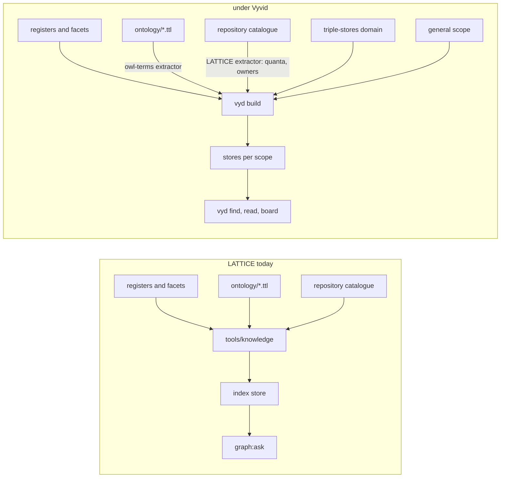
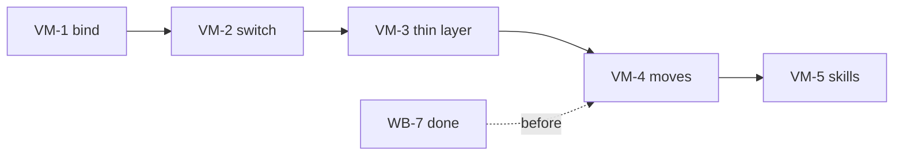

<!-- SPDX-License-Identifier: CC-BY-SA-4.0 -->

# LATTICE adopts Вивід: what moves, what stays, and in which order — Sketch

**Unit ID:** `vyvid-migration`
**Status:** Sketch. VM-Q1 to VM-Q6 open. Nothing built, and no plan or status record yet.
**Date:** 2026-11-04
**Bears on:** [ADR-A134](../../architecture/decisions/ADR-A134-knowledge-index-and-design-shape-vocabulary.md) (the knowledge index), [ADR-A133](../../architecture/decisions/ADR-A133-git-hooks.md) (the post-merge rebuild and the identifiers check), [ADR-A151](../../architecture/decisions/ADR-A151-the-work-board.md) (the work board), [ADR-A121](../../architecture/decisions/ADR-A121-repository-catalogue.md) (the catalogue the owners come from), `AGENTS.md`'s "Asking the knowledge index", the lifecycle, design and triple-stores skills, and Вивід's own plan, `vyvid-framework`, whose slice VYD-2b is this move seen from its side.

---

## 1. Why

[Вивід](https://github.com/nebularis/vyvid), `vyd` at the command line, is LATTICE's knowledge index extracted into a framework of its own: registers whose header is their schema, facets as SKOS schemes, a derived index ranked by meaning, identifiers resolved on a normalised key, and on top of them scopes layered from general to project, domains with registers and skills of their own, recipes, a managed knowledge base with a git policy, trust and containment of a domain someone else wrote, private documents beside public code, and symbol search over source. LATTICE is its first project, and its plan already names the switch, slice VYD-2b, as LATTICE's index tooling becoming a configuration of Вивід plus a thin layer for what is LATTICE's own.

The facts this sketch rests on, read on 2026-11-04 from the editable checkout `vyd` runs, level with its remote at 62 commits, version 0.1.0.

- **Retrieval parity is measured.** Вивід's bake-off asks LATTICE's `find` and its own the same 48 questions with the same embedding model. After ADR-A134 decision 34 hid slices from `find`, both rank them identically, hit@5 0.884 and MRR 0.806 on the 43 scored. Adoption is not a retrieval risk.
- **The core is already out.** `tools/knowledge/` is 6,300 lines. Вивід's package is about 8,500, of which `ask`, `extract`, `identifiers`, `facets`, `anchors`, `embed` and `registers` are LATTICE's modules generalised, with their tests, and the rest is what LATTICE never had.
- **The triple-store record is already a domain.** `vyvid-triple-stores` holds the 64 findings, 25 open questions and 30 query rules as `RDF-1` to `RDF-30`, citing no project, and through a scratch configuration all 1,457 mentions of a moved identifier in LATTICE resolved there without a rewrite.
- **Nothing is bound yet.** `vyd config` in this checkout finds no configuration file and no project, so every `vyd` command here answers from the general scope alone.
- **LATTICE's tooling is wired in 28 places**, the four `mise` tasks `graph:ask`, `build:knowledge`, `check:knowledge` and `check:identifiers`, the post-merge hook and the identifiers hook check, AGENTS.md's index section, and the lifecycle, design and triple-stores skills.

## 2. What Вивід supplies, and what stays LATTICE's

Command for command, Вивід has what LATTICE's tooling has: `find`, `read`, `node`, `reaches`, `exists`, `sparql`, `misses`, `gap` and `close`, the flags `!`, `~`, `TD`, `BL` and `?`, `--exclude`, terms and slices shown only when asked, and `check identifiers` with a baseline, `removable` families, `defined_only` patterns, skip globs and a generated-file rule. `vyd board` reads a project's slice boards in the shape WB-2 gave every record, `Slice`, `Deliverable`, `State`, `Blocked on`, from one checkout.

What it does not have is the thin layer VYD-2b leaves to LATTICE, and the table is the whole of it.

| LATTICE's own | Under Вивід |
|---|---|
| architectural quanta, derived per view from the catalogue (`tools/knowledge/quanta.py`, ADR-A134's addendum of 2026-10-25) | a LATTICE extractor command, `[[projects.extractors]]`, run by `vyd build` inside the checkout, writing its quads and the units it declares |
| the catalogue's owners, `ki:ownedBy` from `repository-catalogue.md` | the same extractor |
| the OWL term summary, `--kind term` | Вивід's OWL domain extractor, `owl-terms`, configured for `ontology/**/*.ttl` |
| the work board across branches, `work:board`, the `work` hook check and `work:here` | stays. `vyd board` never reads another branch, and Вивід's agent-coordination sketch proposes a claims store as its optional VYD-12, built last, keeping the branch mark until a shared store exists |
| the identifiers check reading no mention from a generated region | a gap. Вивід skips a file by glob or by its first 200 characters, not a region, so the roadmap's generated sections and the crosswalk need a `skip` there or a region rule in Вивід |
| the 60 knowledge tests | about 40 are the core's and already run in Вивід's suite. The quanta, owner, register-conformance and decision-status tests stay with the thin layer |
| the T-Box, `knowledge.ttl` | Вивід's packaged one, which already carries `ki:Slice`, plus LATTICE's additions |

What Вивід's sketch says of LATTICE's registers, which this sketch takes as given: mechanisms, capabilities, principles, debt, pending decisions, backlog, questions and slices stay LATTICE's. The query-writing standards, R1 to R8 and the H rules, go to the triple-stores domain as rows, the writing rules to the general scope, the general facet schemes to `kb:general` with LATTICE keeping the values only it uses, and AGENTS.md and the skills stay LATTICE's contract with their general parts no longer repeated.

## 3. The order

Five slices, the first three the switch and the last two the moves. The switch changes no register and removes LATTICE's copy of nothing, so each of its steps can be taken back by a revert. The moves change how every branch's mentions resolve, which is why they come after WB-7 and before the next long-lived branch opens.

| | Slice | Delivers | Undo |
|---|---|---|---|
| VM-1 | **bind** | a `vyvid.toml` at the root, or a project entry in the configuration, with the families, the OWL extractor and the `tools` specialisation. `vyd build`, then `vyd find` beside `graph:ask` on the bake-off's questions in this checkout, and `vyd check identifiers` beside `check:identifiers`. Every difference listed, the generated-region gap first | delete the file |
| VM-2 | **switch** | `graph:ask`, `build:knowledge` and `check:identifiers` as thin `mise` tasks over `vyd`, the post-merge hook running `vyd build`, `bootstrap` installing Вивід pinned, and AGENTS.md's index section cut to what is LATTICE's, since `vyd install` writes the general rules to the client | restore the tasks |
| VM-3 | **the thin layer** | the LATTICE extractor for quanta and owners, the tests that stay, and the removal of `extract.py`, `ask.py`, `identifiers.py`, `facets.py`, `anchors.py` and `embed.py` with their tests. `knowledge.ttl` reduced to LATTICE's additions | a revert |
| VM-4 | **the moves** | `[[projects.moves]]` for the triple-store record and the query-writing standards, `vyd move check --ref` on every unmerged branch first, LATTICE's copies removed, a page at the record's old path saying what each finding means for LATTICE keyed to the domain's identifiers and pinned to a tag, the writing rules and the general facets moved, TD-2 cleared | a revert, but a branch opened in between resolves differently |
| VM-5 | **the skills** | `lattice-triple-stores` becomes the domain's skill installed by `vyd install`, and the lifecycle and design skills lose the index text the general scope carries | a revert |

## 4. Consequences, counted

| | Today | After VM-3 | After VM-5 |
|---|---|---|---|
| code LATTICE maintains for the index | 6,300 lines | about 800, the extractor and the tests that stay | the same |
| where a rule about asking the index lives | AGENTS.md and three skills, repeated | the general scope once, LATTICE's specifics in AGENTS.md | the same |
| where a triple-store finding lives | `docs/architecture/triple-store-discovery.md` | the same | `vyvid-triple-stores`, with a LATTICE page at the old path |
| a bare `TSD-42` in LATTICE | LATTICE's | LATTICE's | resolves to `triple-stores:TSD-42` by the move, no text rewritten |
| what `bootstrap` installs | the venv | the venv and `vyd` pinned | the same |
| a contributor without `vyd` | has the index | has no index and the build | the same |
| `check:knowledge` | 60 tests, 8 s | about 20 tests, the core's 40 in Вивід | the same |
| tokens | | the switch about 150k, the thin layer about 50k | the moves about 100k, the skills about 20k |

The one irreversible edge is a public URL. The triple-store record is linked from published documents, and a link into a domain is a public dependency on it, which Вивід's own VYD-Q6 asks about. The page at the old path is the answer this sketch leans to, and it is written before the copy goes.

## 5. KISS

Not now: a claims store (VYD-12, Вивід's, optional, built last), the work board moved into Вивід, moving any register that is LATTICE's own, a second code path for a checkout without `vyd`.

Needed now: the binding, the switch of the four tasks and the hook, the extractor for quanta and owners, the removals, the two moves and the pointer page, and the skills.

## 6. Questions and leanings

- **VM-Q1. Where the binding lives.** A `vyvid.toml` in the repository travels with every checkout and worktree and is public, and runs nothing until each person trusts it. A user-configuration entry is one person's and binds by remote. Leaning: both, the file for what is public and the entry for the paths only one machine knows, since the file is what a new clone reads first.
- **VM-Q2. When.** The moves rewrite how every branch's mentions resolve, so after WB-7, which is where the branches stand on 2026-11-04, and before the next long-lived branch opens. Leaning: VM-1 to VM-3 at once, VM-4 and VM-5 in the same week.
- **VM-Q3. The dependency.** LATTICE's checks come to need `vyd` installed. Leaning: `bootstrap` installs it as a uv tool at a version pinned in `mise.toml`, and a contributor without it loses the index and keeps the build.
- **VM-Q4. What of `check:knowledge` stays.** Leaning: the table of §2, with `test_extract.py`'s names sorted into the core's and LATTICE's, the core's deleted here since they run in Вивід.
- **VM-Q5. The work board and INDEX.md.** Вивід defines a slice from the boards in `status/*.md` directly, so INDEX.md's generated Work table stops being the definition the identifiers check needs. Leaning: keep INDEX.md as the register the index reads until VM-3, then decide whether `build:work` still writes it or `vyd board` replaces it.
- **VM-Q6. The private rules.** Вивід's VYD-10 makes a user's private rules a domain bound by a remote, kept private by its author. Whether the private guidance a maintainer keeps today becomes such a domain is the maintainer's question, and nothing of it is written here.

Estimate, in tokens: about 320k in all, as §4 counts.

🔴 PLAN FIRST: VM-Q1 to VM-Q6, then a plan for the unit on this branch.
