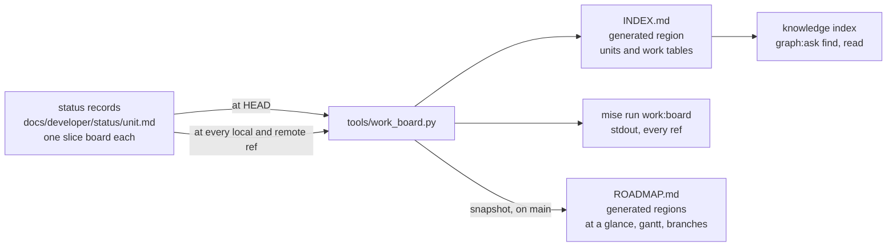
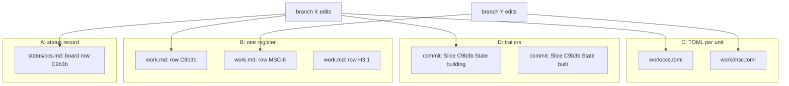
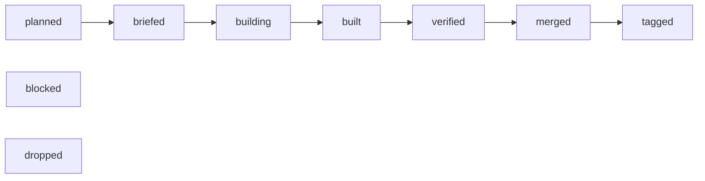
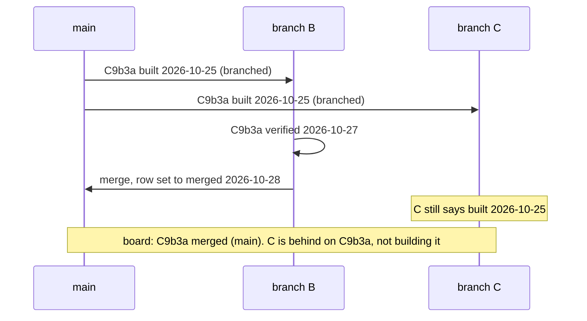
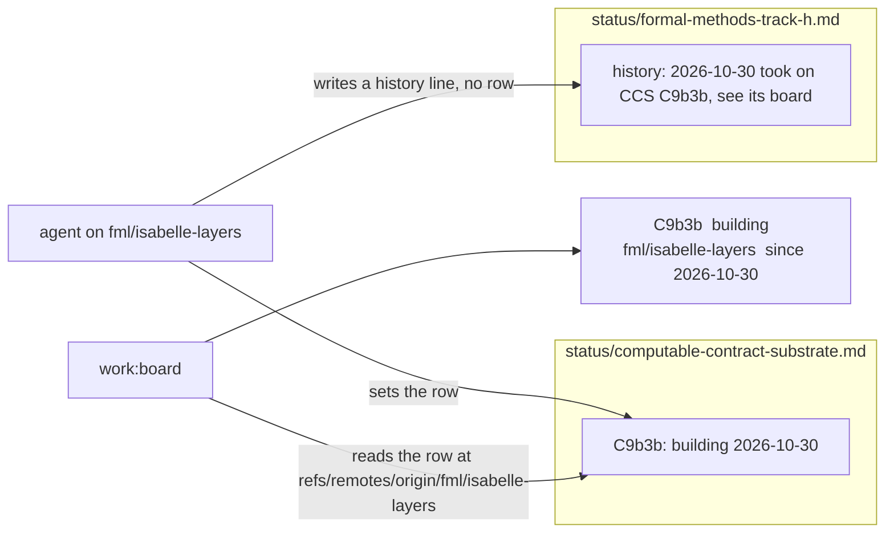
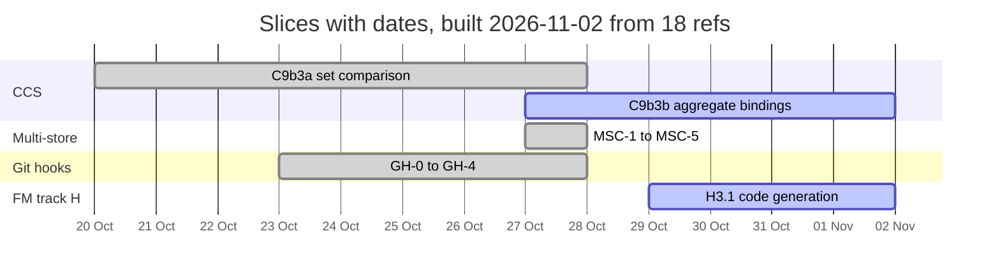
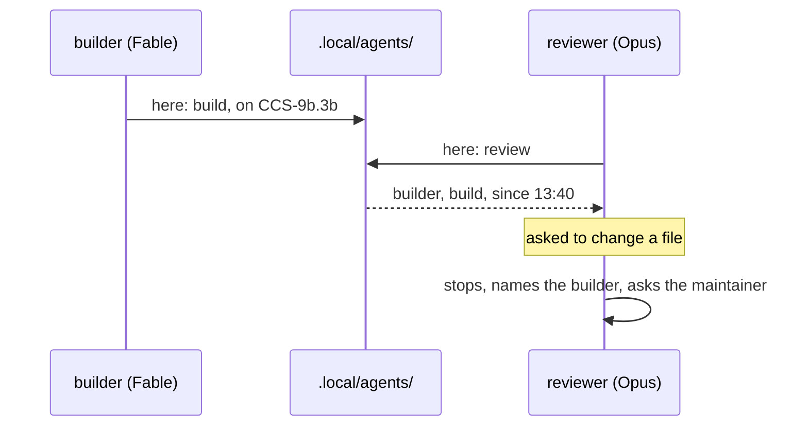

<!-- SPDX-License-Identifier: CC-BY-SA-4.0 -->

# Where the work is: marking units and slices across branches — Sketch

**Unit ID:** `work-board`
**Status:** Sketch. WB-Q1 to WB-Q8 answered 2026-11-02. WB-Q9 open. Nothing built.
**Date:** 2026-11-02
**Bears on:** [ADR-A133](../../architecture/decisions/ADR-A133-git-hooks.md) (the hooks and their four moments), [ADR-A134](../../architecture/decisions/ADR-A134-knowledge-index-and-design-shape-vocabulary.md) (what the index reads), [ADR-A121](../../architecture/decisions/ADR-A121-repository-catalogue.md) (a generated region in a hand-written file), the lifecycle and branching skills, [ROADMAP.md](../ROADMAP.md) §12, [INDEX.md](../INDEX.md).

---

## 1. Why

Agents build in parallel, each in its own worktree on its own branch, pushing its own branch and never merging unless the maintainer says so, and nobody merges into `main` but the maintainer or an agent the maintainer tells to. The question "where is slice X being built, and what is on branch Y" is answered today by reading, which is slow and goes stale.

The facts, measured on 2026-11-02 from this checkout after a fetch.

- **18 refs hold commits `main` lacks, and 15 worktrees are checked out.** The commit counts say nothing. `realign/config-authoring-studio` is 152 commits ahead and, measured by content in an earlier session, almost wholly merged, because branches are squash-merged (skill `lattice-branching`). Only content measurement answers, and it is a dozen git commands per branch.
- **Two branches that looked live mark nothing.** `fml/isabelle-layers` (31 commits) and `docs/placement-vehicles-structure` (112 commits) change no plan and no status record, so no document anywhere says what they hold. Measured by content for §12, the first is wholly on `main` already and the second nets to deletions, which took three minutes of git to learn and a mark would have said.
- **The coordination index is hand-written and stale.** [INDEX.md](../INDEX.md) is 1,102 lines. Its header says last updated 2026-10-24 and its footer says 2026-09-25. ROADMAP.md §12 already records that it is stale and must be regenerated from the status records or folded into the roadmap. Reading INDEX.md and ROADMAP.md together costs about 20,000 tokens, before any branch is looked at.
- **Branches are named in free text, in the wrong documents.** Thirteen status records and one plan carry a `**Branch:**` line. Plans move between branches as agents pick slices up, so a branch written in a plan is wrong soon after it is written.
- **Slice boards have no one shape.** The CCS record's board has the columns `#, Slice, Tranche, State, Blocked on`, the multi-store record's `Slice, State`, the AIR lanes table `Seq, Slice, Where, Built on, Agent, Start after`, and the state cells are prose, such as "merged (`5da9412`), tagged" and "built 2026-10-27: `platform/sparql-testkit`, ...". A script cannot compare them.
- **The knowledge index cannot be asked.** By ADR-A134 it reads the registers (tables whose first column is `ID` or `#`), the decisions and the questions plans raise, never a status record or the rest of a plan. `find "where is C9b3b being built"` returns a weak match, as it did for this sketch.

## 2. What is needed

| | Need | Why |
|---|---|---|
| R1 | An agent marks work **on its own branch, in its own worktree**, pushes only that branch and never merges, unless the maintainer says otherwise, as the contract in AGENTS.md already has it | two agents merging or pushing one branch is the disaster to avoid |
| R1a | An agent marks **before its first edit**, never after | a mark written at handoff is invisible to the board for the whole build, and the board is then wrong exactly when it is needed |
| R2 | The mark is at a **fixed path**, readable with `git show <ref>:<path>` on every local and remote ref, so no checkout is needed to read it | one script reads every branch from one checkout |
| R3 | A mark is a **row keyed by a stable identifier** with a **state from a closed set** and a date | a script can join rows across refs. Free text cannot be compared (design standards) |
| R4 | The joined view is a **command whose output is a few hundred tokens** | the point is to stop paying for reading |
| R5 | [INDEX.md](../INDEX.md) is the agents' and the index's view, [ROADMAP.md](../ROADMAP.md) the maintainer's summary, both **generated** | a hand-written tracker is stale by construction |
| R6 | Picking up or finishing a plan, a unit or a slice, **above all a slice of another plan**, writes to one known place, and the registers are regenerated | a thing is recorded once |
| R7 | **A plan names no branch** | plans move across branches |
| R8 | The **hooks** keep the marks well formed and the generated files in agreement | the hooks are the floor (ADR-A133) |

## 3. The shape

One tool reads the marks, at `HEAD` for the files committed on a branch and across every ref for the live board.



What is written by hand is the slice board row, and only that. Everything to its right is derived, and a derived file is regenerated, never edited.

## 4. Where the mark lives, WB-Q1

Five places could hold the row. The first four are compared, the fifth is dismissed.

| | Option | The row is |
|---|---|---|
| A | **the home unit's status record**, its slice board, with the columns and the state cell standardised | the slice's row in `docs/developer/status/<unit>.md` |
| B | **one register**, `docs/developer/work.md`, one table for the whole programme | a row keyed by slice in one file every branch edits |
| C | **one TOML file per unit**, `docs/developer/work/<unit>.toml` | a `[slices.<id>]` table, read with `tomllib` |
| D | **commit trailers**, `Slice: C9b3b` and `State: built` on each commit | the latest trailer in `git log main..ref` |
| E | git notes, or a branch description in `git config` | not pushed, or not pushed by default, so a remote ref has none. Fails R2 |



### Consequences

| | A status record | B one register | C TOML per unit | D trailers |
|---|---|---|---|---|
| Recorded once | yes. The slice board already is the record of slice state, and the lifecycle already says the record changes after every material action | no. Every slice is in its board and in the register, and the two diverge | no, the same duplication as B | yes for events, but the current state is only the last event, and a squash merge rewrites the events |
| Who conflicts at a merge | two branches that edit **one unit's** record. That is real contention, worth a conflict | **every** branch, on every merge, since all edit one file. Needs a key-union merge driver or a hand rule each time | as A | nobody |
| A mark without a commit | the row, staged with the work | the row | the file | impossible. An empty commit is a workaround |
| Parsing | a Markdown table found by its header names | one Markdown table | `tomllib`, stdlib, exact | `git log --format=%(trailers)` |
| Migration | the active records' boards take the standard columns, about 15 files. Closed records are left, and the check judges touched records only (ADR-A133 decision 3) | one new file, the boards stay as they are | a new kind of directory, which needs an ADR before it exists | none |
| The index can answer | through the generated INDEX.md region, see §9 | directly, it is a register | no, the index reads Markdown rows | no |
| What a pick-up writes | one cell in one row | one row | one table | one trailer per commit |

### Space and time

With R refs, U units and S slices in all. Today R is 18, U is 56 status records of which about 15 are active, S is about 150.

| | A | B | C | D |
|---|---|---|---|---|
| Blobs read for the board | R x U, about 1,000, through one `git cat-file --batch` process | R, 18 | R x U | R `git log` walks |
| Time for the board, this laptop, no fetch | on the order of a second | well under a second | on the order of a second | a few seconds |
| Files each branch edits for a mark | 1 | 1, the same one for all | 1 | 0 |
| Conflicts per merge into `main` | 0 unless two branches work one unit | about 1 | as A | 0 |
| Tokens to answer "where is X" | the board's filtered output, 1,000 to 2,000 | same | same | same |

B's cost crosses A's at the merge. Every one of the 18 branches would conflict on `work.md`, and the branching skill's union-by-row rule, mechanical for a register that gains rows, is not mechanical for one whose rows change state on both sides. A merge driver fixes it and is one more piece of machinery with a config that `bootstrap:hooks` would have to install in every clone. A's conflict is the one we want to see.

## 5. The state set and the join, WB-Q3

A state cell opens with a word from a closed, ordered set and the day the state was reached. The rest of the cell is free.



| State | Means | Who writes it |
|---|---|---|
| `planned` | in the plan, no brief | the planner |
| `briefed` | the brief is on `main` or on the branch | the planner |
| `building` | an agent has picked it up | the agent, on its branch, at pick-up |
| `built` | handed off with its Validation Pack | the agent, at handoff |
| `verified` | the validation gate passed, including the adversarial probe | the maintainer or the agent the maintainer tells |
| `merged` | on `main` | whoever merges, in the merge commit |
| `tagged` | released, where a tag applies | whoever tags |
| `blocked` | waiting on something named in the Blocked on cell | anyone, with the blocker |
| `dropped` | will not be built, with why | the planner |

A slice whose deliverable is an ADR or a document goes `built` when drafted and `merged` when accepted, since the maintainer's merge is the sign-off (lifecycle skill). "accepted", "done", "handed over", "waiting" and the other words the boards use today map onto these.

**The join.** The board reads one row per slice from every ref. The row that wins is the one furthest along the ladder, and between `blocked`, `dropped` and a tie, the later date. A branch whose row is behind `main`'s is stale on that slice, which the board says, and is not a claim.



**A day, not a commit.** The cell could carry the commit at which the state was reached instead of the day. For three states it cannot, because the commit that carries the mark does not exist when the mark is written. `built` is set in the commit that carries the handoff and `merged` in the merge commit, so a commit written in the cell is always one commit late, and recording the right one costs a second commit whose only content is a number. A commit written in a cell also stops resolving once its branch is squash-merged and deleted, which is this repository's habit, while a day always means what it says. What a commit would add is derivable. `work:board --commits` runs `git log -1 -S<cell> <ref> -- <record>` for each row it prints, 30 ms each on this laptop, and gives the commit that set the row's current state on that ref, which for a `building` row is the pick-up commit. So the day is the fact written, the order the join and the gantt need, and the commit is read from git, where it already is (STD-016). Dozens of commits on one day change nothing, since a slice reaches a state once, and a slice that goes `building`, `built` and `verified` in one day keeps all three in its trail, ordered by the ladder, not the day. Two refs holding the same state on the same day for one slice are not a tie to break, they are a double claim, and the board prints that row once with both refs and never chooses.

**The row.** The tool finds the first table in a status record whose header has a `Slice` and a `State` column, by name, never by position. Other columns, such as CCS's `Tranche`, are kept and ignored. A `Blocked on` column is read where present. The state cell may keep a trail, newest first, which costs about 25 characters a transition and is what the gantt's bars are drawn from.

```markdown
| Slice | Deliverable | State | Blocked on |
|---|---|---|---|
| C9b3a | set comparison, the plan and shapes | merged 2026-10-28, verified 2026-10-27, built 2026-10-25, briefed 2026-10-20 | |
| C9b3b | aggregate bindings | building 2026-10-30, briefed 2026-10-27 | |
| C9b4 | qualifying rules | planned | C9b3 |
```

## 6. Picking up and finishing

These become rules in the lifecycle skill, each a standard row pointing at its section.

1. **A slice's state is written in one place, the slice board of its home unit**, the unit whose plan defines it. An agent that builds a CCS slice on an Isabelle branch sets the row in the CCS status record, on that branch. The adopting unit's record says so in its history and names the slice in prose, and never carries a second row for it.
2. **Picking up is one edit, and it is the first edit.** Before any other file changes, set the row to `building <date>`, add a history line, run `mise run build:work`, and commit the mark on its own, so the board sees the claim from the first push. Name no branch anywhere. The board derives the branch from where it finds the row. The same holds for a unit or a plan picked up whole, rule 5, and for a slice adopted from another plan, rule 1. An agent that finds itself editing without having marked stops, marks, and commits the mark before going on.
3. **Handing off is one edit.** Set the row to `built <date>` in the commit that carries the Validation Pack's handoff.
4. **A merge into `main` flips the rows it delivers to `merged <date>`, in the merge commit**, as the branching skill's "Record the merge" already asks. The board flags a `built` row whose branch is merged by content so a forgotten flip is seen.
5. **A whole unit picked up, or a plan started**, is its status record created or its `**Status:**` line changed, in the same way. The board treats a unit without a parseable board as one row, the unit itself, in the state its `**Status:**` line opens with.
6. **No plan or status record names a branch.** The 13 `**Branch:**` lines and the one in a plan are removed. A machine or an agent name stays out too, since no query answers differently for it (design standards). The AIR lanes plan keeps its text as history.
7. **The registers are regenerated in the same commit.** `mise run build:work` rewrites INDEX.md's generated region, and the pre-commit check refuses a commit whose status records and region disagree, as the catalogue and agent-guidance checks do.



## 7. The tool

`tools/work_board.py`, stdlib and git only, root found through the repository catalogue (STD-273). Seven commands behind seven tasks.

| Task | Does | Reads | Writes |
|---|---|---|---|
| `work:board` | the live board, filtered to rows that differ from `main` and branches that mark nothing. `--all` prints every row, `--fetch` fetches every remote first, `--measure` adds merged-by-content per branch, `--commits` the commit that set each printed row | every local branch and every remote-tracking ref, through one `git cat-file --batch` | stdout, Markdown |
| `build:work` | INDEX.md's generated region from `HEAD` | the working tree | INDEX.md |
| `build:roadmap` | ROADMAP.md's generated regions from the board, dated | every ref | ROADMAP.md |
| `check:work` | every touched board is well formed and INDEX.md agrees with the tree | the working tree | nothing |
| `work:normalise` | rewrites a board into the standard columns and state words where its words map, and lists the cells it could not | the working tree | status records |
| `work:rename` | builds the slice crosswalk, then applies it, §9a | the working tree | working documents, Validation Pack names |
| `work:here` | writes or lists presence files, §11 | `.local/agents/` | `.local/agents/` |

**The board's output.** Three tables. Units, one row each, with the joined state and the next slice. Work, one row per slice that is further along on some ref than on `main`, with the ref and the date, and a `stale` column listing refs behind `main` on it. Branches, one row per branch with a commit `main` lacks, with its tip date, its local worktree path if any, how far the local branch is ahead of and behind its upstream, the slices it moves, and `no mark` where it moves none. Remotes that share a URL are folded into one, which here is `origin`, `origin-ssh` and `upstream`, and a branch that exists locally and remotely is one branch with an upstream, measured at whichever tip is further on, so a worktree that has not pushed, or has not pulled, is reported as such and never mistaken for the branch. `--measure` adds the branching skill's content measure, the share of a branch's added lines present on `main`, which costs one blob comparison per changed file per branch and is the slow part, seconds for 18 branches.

**Merged by content, not by ancestry.** The board never reports "ahead by n commits" as a state. The branching skill says why.

## 8. ROADMAP.md, WB-Q5

ROADMAP.md keeps its hand-written sections. §1 "The programme at a glance" and §7 "Branches" become generated regions between markers, as AGENTS.md's "Where things are" table is (ADR-A121), each headed with the date and the number of refs it was built from. §1 holds the units table and a gantt, §7 the branches table.

The gantt draws one bar per slice from the trail in its state cell, the earliest date to the latest, `done` for `merged` and `tagged`, `active` for `building` to `verified`, `crit` for `blocked`. A `planned` or `briefed` slice has no date and is not drawn, it is listed under the gantt in blocked-on order, since a bar invented for it would be a plan nobody made. An example from the records as they stand.



Two ways to keep it current.

- **(a) The post-merge hook regenerates it on `main`**, as it regenerates the knowledge index (ADR-A133 decision 9), leaving the file changed in the tree for the maintainer to commit. The snapshot is as fresh as the last merge and the last fetch. A branch never regenerates ROADMAP.md, so it never conflicts there.
- **(b) On demand only**, `mise run build:roadmap` when the maintainer wants it. Simpler, and the file says its date, so staleness is visible.

The leaning is (a) with (b) available, since a merge is the moment the picture changes.

## 9. INDEX.md and the knowledge index, WB-Q2

INDEX.md becomes the agents' register. Its generated region holds two tables the index reads, since each has `ID` as its first column.

- **Units.** `ID` the unit id, kind from the plan's `**Unit type:**` line, state, the next slice, and links to its plan, status record, review request and Validation Packs where the files exist.
- **Work.** `ID` the slice id as its plan writes it, unit, deliverable, state and date, blocked on, and the status record and line it was read from.

A row's claim is its text, so `find "aggregate bindings, who is building it"` ranks the C9b3b row, and `read CCS-9b.3b` resolves through the `slice` identifier family once the Work table is its definition and the ids are regular, §9a.

The index holds the state as of the tree it was built from. The board holds the state across branches. The skill says which to ask for which question, and the index entry for a row names the board task.

**The old content.** INDEX.md's Parts I to VII are a hand-written history of units, much of it now in the status records and all of it stale. Two ways to go.

- **(i) Replace.** INDEX.md becomes a short preamble and the generated region. The old text moves whole to `docs/developer/notes/coordination-index-2026-10.md`, which the link check still covers.
- **(ii) Keep and add.** The region is added at the top and the prose stays below it.

The leaning is (i). Two records of one unit diverge, and the lifecycle skill's "every unit and its documents" is what the Units table is.

### 9a. The slice grammar and the crosswalk, WB-Q4

Slice ids take about a dozen shapes today, counted on 2026-11-02 over the boards and plans: `AIR-4.2a`, `AOR-3b`, `C9b3b`, `C10a`, `F1`, `HQ-6a.1`, `H2.6d`, `B2.1`, `P0.1.1`, `MSC-3`, `OD0`, `DOC1`, `WA1`, `M0`, `CS12a`, `CS-B12`. The `slice` family in `tools/knowledge/identifiers.py` matches nine prefixes with a hyphen and has no definition rule, so it is counted and never checked (ADR-A134, CAP-10). The 177 Validation Packs are named in ten shapes, `applied-insurance-reference-0.1.md`, `FMH-H1-2b.md`, `computable-contract-substrate-c10a.md` among them. Neither `read` nor the identifiers check can work on this, which is the cost of the irregularity, and the crosswalk is mechanical because every shape is a regular expression over a unit's own documents.

**The grammar.**

```
slice   = PREFIX "-" segment ("." segment)*
segment = CAPITALS? digits letter?        CAPITALS at most three, letter one lowercase
PREFIX  = two to five capitals, declared on the unit's plan's **Prefix:** line
```

A mention pattern is built from the declared prefixes, never from `[A-Z]+`, so `ISO-8601` and `ADR-A133` never match. A slice is defined by its row in its home unit's board, which `build:work` copies into INDEX.md's Work table, the family's definition, so a slice mentioned and defined nowhere fails the identifiers check at the commit, as a decision mentioned and defined nowhere does today. A test id inside a Validation Pack, `AIR11-01` or `HQ6a1-03`, is local to its pack and stays as it is. A Validation Pack is named by its slice, `docs/developer/validation/CCS-9b.3b.md`.

| Unit | Today | Prefix | After |
|---|---|---|---|
| applied-insurance-reference | `AIR-4.2a` | AIR | unchanged |
| applied-ontology-readiness | `AOR-3b` | AOR | unchanged |
| computable-contract-substrate | `C9b3b`, `C10a`, `F1`, `HQ-6a.1` | CCS, and HQ stays its own | `CCS-9b.3b`, `CCS-10a`, `CCS-F1`, `HQ-6a.1` |
| formal-methods tracks B, C, E, H | `B2.1`, `C2.1`, `E1.0`, `H2.6d` | FMB, FMC, FME, FMH | `FMH-2.6d` |
| multi-store-conformance, git-hooks | `MSC-3`, `GH-2` | MSC, GH | unchanged |
| config-studio | `CS12a`, `CS-B12` | CS | `CS-12a`. The `CS-B` rows are a defect list, not slices, and are not read |
| word-authoring-poc | `WA1` | WA | `WA-1` |
| improved-ontology-documentation | `OD0`, `DOC1`, `MC1` | OD | `OD-0`, `OD-DOC1`, `OD-MC1` |
| identity-minting | `M0` | IM | `IM-0` |
| lattice-platform-agentic-development | `P0.1.1` | PLT | `PLT-0.1.1` |
| ledger | `LG1-05b` | LG | `LG-1.5b` |
| persistence-compiler-iri-sync | `slice-1` | PCI | `PCI-1` |
| work-board | | WB | `WB-1` |

The segment's optional capitals exist for `F1`, `DOC1`, `MC1` and `CS-B12`. Without them about 70 ids are renumbered by hand, and a hand renumbering is a second record of the slice for as long as anyone remembers the old number. With them the crosswalk stays mechanical, which was the point, at the cost of a grammar that admits `CCS-F1` beside `CCS-1`. The leaning is to admit them.

**The crosswalk.** `mise run work:rename` builds `docs/developer/notes/slice-crosswalk-2026-11.md`, a table of `Was`, `Is` and `Unit`, from each unit's prefix and one regular expression per old shape, for the maintainer to read before anything moves. Then it applies it, replacing whole-word mentions longest first (`C9b3b` before `C9b3` before `C9`) in `docs/developer/`, `docs/architecture/`, `.claude/skills/` and the identifier exceptions baseline, and renaming the Validation Packs with `git mv`. A unit's own documents are rewritten with that unit's rules. Elsewhere only an old id that one unit's crosswalk claims is replaced, and an old id two units claim is listed for the hand. By shape the overlap is small, since CCS writes `C9b` where track C writes `C2.1`, and the sweep reports the count. The task is idempotent, so a live branch runs it once after merging `main` and is then on the new ids, as a branch renumbers a colliding register row today (skill `lattice-branching`). The crosswalk file stays, so an old commit message or a tag note still resolves, and its first column is `Was`, not `ID`, so the index does not read it as a second entry per slice.

| | Count |
|---|---|
| mentions rewritten, working documents | on the order of 1,500 in about 40 files |
| Validation Packs renamed | about 120 of 177 |
| ids needing the hand | the two-unit overlaps, expected under 10 |
| live branches that run the task once | 10 today, §12 |
| tokens, the sweep | near none. Reading its diff, about 30k |

## 10. The hooks, WB-Q6

| Moment | Check `work` | Fails the moment |
|---|---|---|
| a commit | where a status record is staged, its board is well formed, every state word is in the set and dated from `building` on, and INDEX.md's region agrees with the tree. Where INDEX.md is staged, the same | yes, as the catalogue check does |
| a merge into `main` | the same over every record the merge changes, and the identifier check already refuses a slice id defined twice once the `slice` family is resolvable | yes |
| after a merge | `build:work`, then `build:roadmap` when the branch is `main`, after the knowledge index | never. It leaves the regenerated files in the tree, as the index rebuild does |

A conflict in a generated region is resolved as `knowledge.ttl` is, take `main`'s and regenerate. A conflict in a status record is a real one, resolved by hand with the join rule of §5.

What a hook does not do. It does not notice work that marks nothing, since a check cannot map a changed module to a unit. The board does, in its Branches table, which is why `no mark` is a row there and in the maintainer's queue.

### 10a. Blocking at a commit, WB-Q6

The check refuses a commit on three findings. A staged status record whose board has a state cell that does not open with a word of the set, or opens with `building` or later and carries no date. INDEX.md's generated region differing from a regeneration over the tree. A slice id in a staged file that no board defines, which is the identifiers check once the family has its definition. Each message names the cell or the id, the set, and the task that fixes it.

| Risk | When | Why it is bounded |
|---|---|---|
| a commit that only adds a history line to an old record is refused because that record's board is in the old shape | from the day the check lands until the record is normalised | the sweep normalises every record that has a board, the 56, not only the 15 active ones, in the change that lands the check. A record with no board is never malformed, it is one row, the unit |
| a live branch's first commit after merging `main` is refused, because its copy of a record is in the old shape or its region is stale | once per live branch, 10 today | `mise run work:normalise` rewrites a board into the standard shape where its words map, `work:rename` moves its ids, `build:work` its region. The branching skill's merge section lists them beside the index rebuild it already asks for |
| a state word the mapping does not know, such as "handed over" | at a hand edit | the message prints the set. One cell |
| a worktree that was never bootstrapped | always, since a hook runs on whatever venv is there | the check is stdlib only, like the others. This sketch's own commit ran the seven checks on a stdlib venv |
| the maintainer's merge into `main` is refused | the merge checks run the same `work` check | the same fix, and the post-merge hook never fails |

The serious problem is the second row, and it is ten branches, three tasks each, once. Everything else is one cell. So the answer to WB-Q6 is block, on the condition that the sweep and the three tasks land in the same change as the check, never before it.

What the check never does. It never refuses a branch that marks nothing, since a check cannot map a changed module to a unit. It never judges a row that is behind `main`, which is the join's job. It never reads a presence file, §11.

## 11. Presence in a shared worktree, WB-Q8

The maintainer sometimes has two agents on one worktree, usually two models reviewing each other's work. A mark on the board is pushed and says which branch a slice is on, never which session, and the design standards say an agent column answers no query. The question a reviewer needs answered is different and local: is someone else building here right now.

**What a client exposes.** Measured in this session. Claude Code sets, in every command it runs, `CLAUDE_CODE_SESSION_ID`, a UUID that is also the transcript's file name under `~/.claude/projects/`, `CLAUDE_CODE_ENTRYPOINT`, `claude-desktop` here and `cli` in a terminal, and `AI_AGENT`, the client and its version, `claude-code_2-1-309_agent` today. The desktop app adds `CLAUDE_CODE_HOST_SESSION_ID`. No variable names the model. Other clients were not probed, and the task below reads what it finds and takes the rest as arguments.

**The design.** A presence file per session at `.local/agents/<session>.toml` in the worktree. `.local/` is git-ignored and per worktree, which is exactly the scope of the question, one directory on one machine.

```toml
session = "ba8501af-c97c-4342-bb9d-08abd947c3f5"
client = "claude-code_2-1-309_agent"
model = "fable-5.1"
role = "review"            # build, review or read
on = ["CCS-9b.3b"]
since = "2026-11-02T13:40:00Z"
```

`mise run work:here -- --role review --model fable-5.1 --on CCS-9b.3b` writes it, filling session and client from the environment, and touches it on every later run. `mise run work:here` alone prints the sessions whose file was touched in the last twelve hours, so a crashed session ages out and no lock is ever held. The question here is liveness, which only a clock answers and no commit can, so the fact compared is the file's modification time, nothing written in the file, and `since` is there for the reader to see how long the builder has been at it. The clock is an input, `--now` for the tests (PRI-56). `--leave` stamps the file and it drops from the list. The role is the fact a reader compares, so it is a closed set.



**The rule**, in AGENTS.md since it is always on, §13. Before the first edit in any checkout, run `mise run work:here`. Where it lists another live session in role build, or you were asked to review, say who is here and ask the maintainer before writing. A reviewer's findings go to the review request or to chat, never into a file another live session is building.

**(a) The task and the rule, or (b) with a hook.** Claude Code can run a `SessionStart` hook from `.claude/settings.json` that writes the file from the session id and prints the other sessions into the agent's context, and a `SessionEnd` hook that stamps `--leave`. It is one client only, it needs the repository's settings trusted on each machine, and the hook's input carries the session id and the directory and not the model, so the model is still stated by hand. The leaning is (a) now, because the rule has to exist for the other clients anyway, and (b) as a slice once (a) has run for a few weeks and shows whether agents forget.

## 12. The branches today, WB-Q9

Measured on 2026-11-02 after fetching, over every local branch and every remote-tracking ref of `origin-ssh`, with a local branch and its remote folded into one row where their tips were the same commit, which they were for every branch but `main`, itself one commit behind its remote by the evening. 24 local branches, 17 remote refs, 9 worktrees under `lattice-wt/` and 7 under `.claude/worktrees/`. Share is the branching skill's content measure, the branch's added lines since its merge-base that are on `main` today, computed by the prototype of `--measure` in about three minutes for the set. Marks says which status records and plans the branch changes. The table is a snapshot, and the tool's Branches table with `--fetch` is what replaces it.

| Branch | Tip | Ahead | Share on `main` | Marks | Proposed disposition |
|---|---|---|---|---|---|
| `claude/persistence-delta-replace` | 11-02 | 137 | 88% | 8 records, 7 plans | live. The persistence replace work. Marks its slices in WB-7 |
| `claude/persistence-linear-replace` | 11-01 | 135 | 93%, and 100% inside delta-replace | the same | superseded by delta-replace. Delete |
| `realign/config-authoring-studio` | 11-02 | 154 | 0%, and 61% inside delta-replace | FM-H, PDR, PM records | 5,000 of its 12,844 added lines are on no other ref. Live or abandoned, the maintainer says |
| `claude/config-authoring-studio` | 11-02 | 151 | 0%, and 75% inside realign | PM, PDR, SQ | 1,500 lines on no other ref. As above |
| `ccs-trunk` | 10-29 | 53 | 99% | CCS, MSC | merged. Delete once the 43 lines are confirmed noise |
| the four CS12 subagent branches, `claude/config-studio-shape-forms`, `-showcase-sample`, `cs12b-authoring-domain`, `cs9-studio-operations` | 10-28 | 7 to 18 | 89% to 91% | config-studio, WA | residue of about 1,000 lines each. Confirm, then delete with their `.claude/worktrees/agent-*` worktrees |
| `claude/nice-bohr-pmj43u-wwhgle` | 10-20 | 45 | 88% | AIR, FM-H, PDD, TD | 2,000 lines not on `main`, remote and local. Ask |
| `docs/placement-vehicles-structure` | 11-02 | 112 | all. Its tree is `main`'s tree, so it holds nothing `main` lacks | none | merged by content. Ask what it was for, then delete |
| `fml/isabelle-layers` | 11-01 | 31 | 100% | none | squash-merged as `df0ddd1a`. Delete the branch, keep the worktree only while H3.1 continues there |
| `claude/fix-topology-links` | 10-23 | 1 | 56% | 8 old records | 80 lines. Ask |
| `persistence-mbt` | 09-23 | 1 | 1% | EC, PCI | 463 lines from September. Ask |
| `spikes/pol-map` | 10-16 | 2 | 0% | none | a spike of 4,205 lines. Keep as a spike |
| `origin-ssh/tutorial/guide` | 10-16 | 5 | 0% | lattice-tutorial | remote only, 2,208 lines. Ask |
| `origin-ssh/main-xg1czj`, `origin-ssh/config_studio_GD` | | 1, 0 | | none | one line, and at `main`'s parent. Delete |
| `docs/work-board` | 11-02 | 1 | | this sketch | live |
| `claude/epic-noyce-e09046`, `claude/happy-jones-abb1c4`, `claude/ontology-config-authoring-cc050f`, `worktree-agent-*` x 4 | | 0 | | | nothing ahead. Delete the branches and their worktrees |

**The migration, slice WB-7.** For each branch the maintainer names live, its agent, or the maintainer, merges `main` once the check is on it, runs `work:normalise`, `work:rename` and `build:work`, sets every slice the branch is building to `building <date>` in its home unit's record, with the date the work actually started, commits the mark on its own and pushes. Every other branch is deleted, locally and on the remote, with its worktree, by the maintainer. Done when `mise run work:board` shows no `no mark` row and no branch the maintainer did not name. From then on rule 2 of §6 keeps it so.

**The order of the slices.** WB-1 the tool, the board, `build:work` and the join, with the measure. WB-2 the grammar, the prefixes, the crosswalk, `work:rename` and `work:normalise`, run on `main`, with every board normalised, every Branch line removed and the `slice` family given its definition. WB-3 INDEX.md replaced and the ROADMAP regions. WB-4 the `work` check and the post-merge regeneration. WB-5 AGENTS.md, the skills, the standards and the ADR. WB-6 the presence task. WB-7 the branches. WB-2 to WB-4 land in one merge, since the check must never precede the sweep, §10a.

## 13. The words in AGENTS.md and the skills

Three bullets in AGENTS.md's "The contract", which is always loaded, since a rule in a skill is read only when the skill is.

- **Mark before you touch.** Before the first edit of anything you pick up, a slice, a unit or a plan, and above all a slice of another plan, set its row in its home unit's status record to `building <date>`, run `mise run build:work`, and commit that alone (skill `lattice-lifecycle`). An edit made before the mark is invisible to `mise run work:board`, and every view built from the board is then wrong.
- **Know who is here.** Before the first edit in any checkout, run `mise run work:here`. Where it lists another live session building there, or you were asked to review, say who is here and ask the maintainer before writing.
- **Ask the board, not the branches.** `mise run work:board` says where every unit and slice is across every local and remote branch, in a few hundred tokens. Read a branch only after it.

The lifecycle skill takes §6 as its "Picking up and finishing" section, each rule a standard row so the index answers `find who is building C9b3b and how do I take a slice over`. The branching skill's merge section adds the three tasks after merging `main`, and its worktree section the presence file. The design skill's plan header gains a `**Prefix:**` line and loses `**Branch:**`. The ADR records the grammar, the state set, the generated regions and the check, as Proposed.

## 14. KISS

Not now: a merge driver for one register (not needed under A), an agent or machine column on the board (no query across branches needs it, and presence is local, §11), the Claude Code presence hook (§11, after the task has run), auto-flipping a row at a merge (a hook that edits a status record is a hook that is wrong once), cross-branch content committed in INDEX.md (stale on commit, and it would conflict on every merge), bars for undated slices, a web view.

Needed now: the state set, the standard board, the slice grammar and the crosswalk, the tool with its tasks, the two generated regions, the `work` check, the rules in AGENTS.md and the skills, the Branch lines gone, every board normalised, the presence task, and an ADR drafted as Proposed at the next free number, A151 on every live branch on 2026-11-02.

## 15. Leaning and questions

- **WB-Q1. Where does the mark live?** Answered 2026-11-02, option A, the home unit's status record. It is already the authoritative live state, a pick-up is one cell, and the only conflict it causes is the one worth having.
- **WB-Q2. Is INDEX.md replaced or added to?** Answered 2026-11-02, replace, (i), the prose archived under `notes/`.
- **WB-Q3. The state set.** Answered 2026-11-02, the seven-step ladder with `blocked` and `dropped` aside, joined by furthest-then-latest.
- **WB-Q4. Slice identifiers.** Answered 2026-11-02, standardise, with a mechanical crosswalk from the historic ids. The grammar and the sweep are §9a, and the prefixes are WB-Q7.
- **WB-Q5. The roadmap snapshot.** Answered 2026-11-02, the post-merge hook regenerates on `main`, the maintainer commits, and `build:roadmap` serves on demand.
- **WB-Q6. The check's strictness.** Answered 2026-11-02, block at a commit on a malformed touched board, on the conditions in §10a. The cell carries a day and not a commit, §5.
- **WB-Q7. The unit prefixes.** Answered 2026-11-02, the table in §9a, with the segment's optional capitals admitted.
- **WB-Q8. Presence in a shared worktree.** Answered 2026-11-02, (a), the task and the rule, with the Claude Code hook (b) as a later slice, §11.
- **WB-Q9. Which branches are live.** The dispositions in §12 are proposed from content measurement, and the branching skill says the maintainer names the live set. Which rows are wrong?

Estimate, in tokens: the tool and its tests about 70k, the slice sweep and the crosswalk about 30k, the boards and Branch lines about 40k, AGENTS.md, the skills, standards and ADR about 35k, the INDEX and ROADMAP regions about 20k, the branch migration about 25k. Total about 220k.

🔴 PLAN FIRST: WB-Q9, then a plan on this branch and the slices in §12's order.
