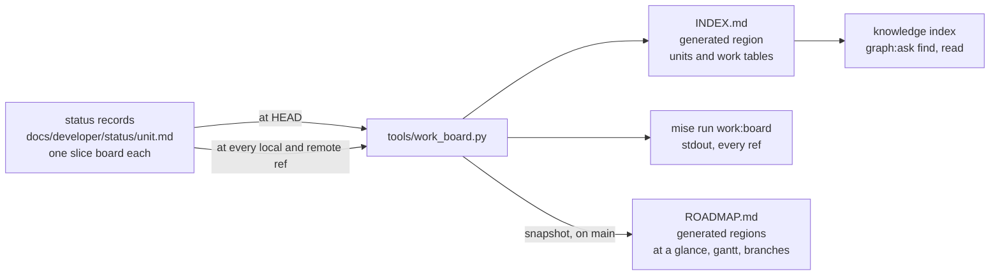
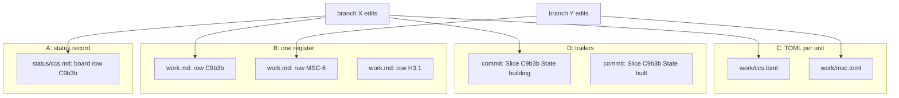
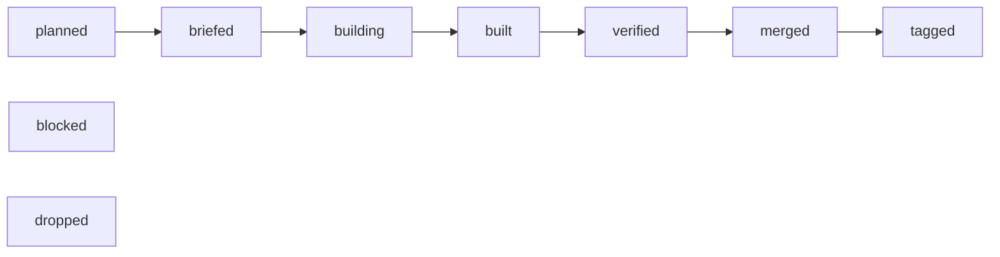
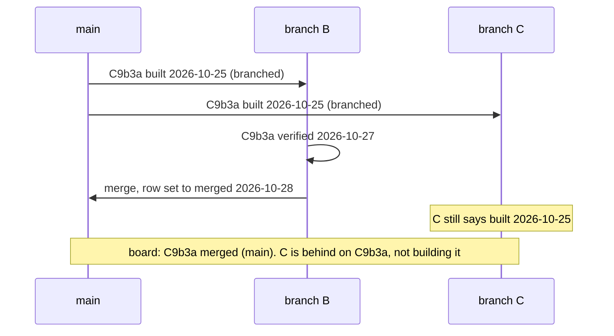
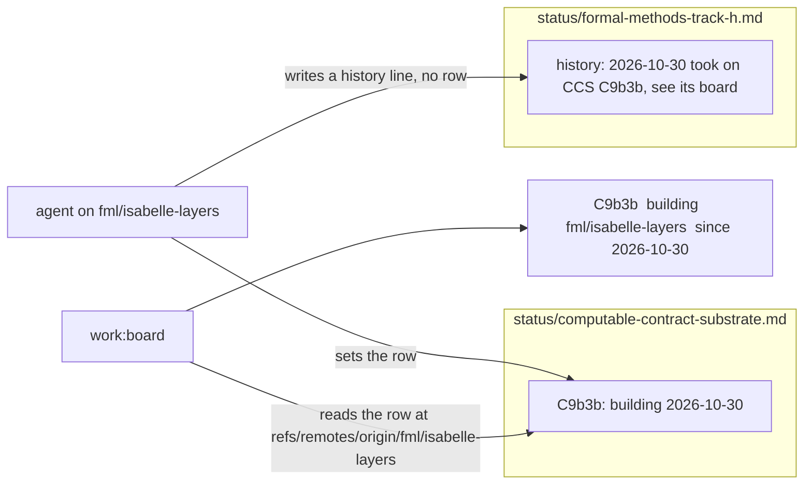
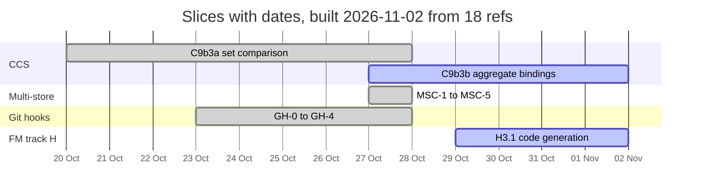

<!-- SPDX-License-Identifier: CC-BY-SA-4.0 -->

# Where the work is: marking units and slices across branches — Sketch

**Unit ID:** `work-board`
**Status:** Sketch. Options drawn, WB-Q1 to WB-Q6 open. Nothing built.
**Date:** 2026-11-02
**Bears on:** [ADR-A133](../../architecture/decisions/ADR-A133-git-hooks.md) (the hooks and their four moments), [ADR-A134](../../architecture/decisions/ADR-A134-knowledge-index-and-design-shape-vocabulary.md) (what the index reads), [ADR-A121](../../architecture/decisions/ADR-A121-repository-catalogue.md) (a generated region in a hand-written file), the lifecycle and branching skills, [ROADMAP.md](../ROADMAP.md) §12, [INDEX.md](../INDEX.md).

---

## 1. Why

Agents build in parallel, each in its own worktree on its own branch, and nobody pushes but the maintainer. The question "where is slice X being built, and what is on branch Y" is answered today by reading, which is slow and goes stale.

The facts, measured on 2026-11-02 from this checkout after a fetch.

- **18 refs hold commits `main` lacks, and 15 worktrees are checked out.** The commit counts say nothing. `realign/config-authoring-studio` is 152 commits ahead and, measured by content in an earlier session, almost wholly merged, because branches are squash-merged (skill `lattice-branching`). Only content measurement answers, and it is a dozen git commands per branch.
- **Two live branches mark nothing.** `fml/isabelle-layers` (31 commits) and `docs/placement-vehicles-structure` (112 commits) change no plan and no status record, so no document anywhere says what they hold.
- **The coordination index is hand-written and stale.** [INDEX.md](../INDEX.md) is 1,102 lines. Its header says last updated 2026-10-24 and its footer says 2026-09-25. ROADMAP.md §12 already records that it is stale and must be regenerated from the status records or folded into the roadmap. Reading INDEX.md and ROADMAP.md together costs about 20,000 tokens, before any branch is looked at.
- **Branches are named in free text, in the wrong documents.** Thirteen status records and one plan carry a `**Branch:**` line. Plans move between branches as agents pick slices up, so a branch written in a plan is wrong soon after it is written.
- **Slice boards have no one shape.** The CCS record's board has the columns `#, Slice, Tranche, State, Blocked on`, the multi-store record's `Slice, State`, the AIR lanes table `Seq, Slice, Where, Built on, Agent, Start after`, and the state cells are prose, such as "merged (`5da9412`), tagged" and "built 2026-10-27: `platform/sparql-testkit`, ...". A script cannot compare them.
- **The knowledge index cannot be asked.** By ADR-A134 it reads the registers (tables whose first column is `ID` or `#`), the decisions and the questions plans raise, never a status record or the rest of a plan. `find "where is C9b3b being built"` returns a weak match, as it did for this sketch.

## 2. What is needed

| | Need | Why |
|---|---|---|
| R1 | An agent marks work **on its own branch, in its own worktree**, and never pushes | parallel pushes are the disaster to avoid |
| R2 | The mark is at a **fixed path**, readable with `git show <ref>:<path>` on every local and remote ref, so no checkout is needed to read it | one script reads every branch from one checkout |
| R3 | A mark is a **row keyed by a stable identifier** with a **state from a closed set** and a date | a script can join rows across refs. Free text cannot be compared (design standards) |
| R4 | The joined view is a **command whose output is a few hundred tokens** | the point is to stop paying for reading |
| R5 | [INDEX.md](../INDEX.md) is the agents' and the index's view, [ROADMAP.md](../ROADMAP.md) the maintainer's summary, both **generated** | a hand-written tracker is stale by construction |
| R6 | Picking up or finishing a plan, a unit or a slice, **above all a slice of another plan**, writes to one known place, and the registers are regenerated | a thing is recorded once |
| R7 | **A plan names no branch** | plans move across branches |
| R8 | The **hooks** keep the marks well formed and the generated files in agreement | the hooks are the floor (ADR-A133) |

## 3. The shape

One tool reads the marks, at `HEAD` for the files committed on a branch and across every ref for the live board.



What is written by hand is the slice board row, and only that. Everything to its right is derived, and a derived file is regenerated, never edited.

## 4. Where the mark lives, WB-Q1

Five places could hold the row. The first four are compared, the fifth is dismissed.

| | Option | The row is |
|---|---|---|
| A | **the home unit's status record**, its slice board, with the columns and the state cell standardised | the slice's row in `docs/developer/status/<unit>.md` |
| B | **one register**, `docs/developer/work.md`, one table for the whole programme | a row keyed by slice in one file every branch edits |
| C | **one TOML file per unit**, `docs/developer/work/<unit>.toml` | a `[slices.<id>]` table, read with `tomllib` |
| D | **commit trailers**, `Slice: C9b3b` and `State: built` on each commit | the latest trailer in `git log main..ref` |
| E | git notes, or a branch description in `git config` | not pushed, or not pushed by default, so a remote ref has none. Fails R2 |



### Consequences

| | A status record | B one register | C TOML per unit | D trailers |
|---|---|---|---|---|
| Recorded once | yes. The slice board already is the record of slice state, and the lifecycle already says the record changes after every material action | no. Every slice is in its board and in the register, and the two diverge | no, the same duplication as B | yes for events, but the current state is only the last event, and a squash merge rewrites the events |
| Who conflicts at a merge | two branches that edit **one unit's** record. That is real contention, worth a conflict | **every** branch, on every merge, since all edit one file. Needs a key-union merge driver or a hand rule each time | as A | nobody |
| A mark without a commit | the row, staged with the work | the row | the file | impossible. An empty commit is a workaround |
| Parsing | a Markdown table found by its header names | one Markdown table | `tomllib`, stdlib, exact | `git log --format=%(trailers)` |
| Migration | the active records' boards take the standard columns, about 15 files. Closed records are left, and the check judges touched records only (ADR-A133 decision 3) | one new file, the boards stay as they are | a new kind of directory, which needs an ADR before it exists | none |
| The index can answer | through the generated INDEX.md region, see §9 | directly, it is a register | no, the index reads Markdown rows | no |
| What a pick-up writes | one cell in one row | one row | one table | one trailer per commit |

### Space and time

With R refs, U units and S slices in all. Today R is 18, U is 56 status records of which about 15 are active, S is about 150.

| | A | B | C | D |
|---|---|---|---|---|
| Blobs read for the board | R x U, about 1,000, through one `git cat-file --batch` process | R, 18 | R x U | R `git log` walks |
| Time for the board, this laptop, no fetch | on the order of a second | well under a second | on the order of a second | a few seconds |
| Files each branch edits for a mark | 1 | 1, the same one for all | 1 | 0 |
| Conflicts per merge into `main` | 0 unless two branches work one unit | about 1 | as A | 0 |
| Tokens to answer "where is X" | the board's filtered output, 1,000 to 2,000 | same | same | same |

B's cost crosses A's at the merge. Every one of the 18 branches would conflict on `work.md`, and the branching skill's union-by-row rule, mechanical for a register that gains rows, is not mechanical for one whose rows change state on both sides. A merge driver fixes it and is one more piece of machinery with a config that `bootstrap:hooks` would have to install in every clone. A's conflict is the one we want to see.

## 5. The state set and the join, WB-Q3

A state cell opens with a word from a closed, ordered set and the date the state was reached. The rest of the cell is free.



| State | Means | Who writes it |
|---|---|---|
| `planned` | in the plan, no brief | the planner |
| `briefed` | the brief is on `main` or on the branch | the planner |
| `building` | an agent has picked it up | the agent, on its branch, at pick-up |
| `built` | handed off with its Validation Pack | the agent, at handoff |
| `verified` | the validation gate passed, including the adversarial probe | the maintainer or the agent the maintainer tells |
| `merged` | on `main` | whoever merges, in the merge commit |
| `tagged` | released, where a tag applies | whoever tags |
| `blocked` | waiting on something named in the Blocked on cell | anyone, with the blocker |
| `dropped` | will not be built, with why | the planner |

A slice whose deliverable is an ADR or a document goes `built` when drafted and `merged` when accepted, since the maintainer's merge is the sign-off (lifecycle skill). "accepted", "done", "handed over", "waiting" and the other words the boards use today map onto these.

**The join.** The board reads one row per slice from every ref. The row that wins is the one furthest along the ladder, and between `blocked`, `dropped` and a tie, the later date. A branch whose row is behind `main`'s is stale on that slice, which the board says, and is not a claim.



**The row.** The tool finds the first table in a status record whose header has a `Slice` and a `State` column, by name, never by position. Other columns, such as CCS's `Tranche`, are kept and ignored. A `Blocked on` column is read where present. The state cell may keep a trail, newest first, which costs about 25 characters a transition and is what the gantt's bars are drawn from.

```markdown
| Slice | Deliverable | State | Blocked on |
|---|---|---|---|
| C9b3a | set comparison, the plan and shapes | merged 2026-10-28, verified 2026-10-27, built 2026-10-25, briefed 2026-10-20 | |
| C9b3b | aggregate bindings | building 2026-10-30, briefed 2026-10-27 | |
| C9b4 | qualifying rules | planned | C9b3 |
```

## 6. Picking up and finishing

These become rules in the lifecycle skill, each a standard row pointing at its section.

1. **A slice's state is written in one place, the slice board of its home unit**, the unit whose plan defines it. An agent that builds a CCS slice on an Isabelle branch sets the row in the CCS status record, on that branch. The adopting unit's record says so in its history and names the slice in prose, and never carries a second row for it.
2. **Picking up is one edit.** Set the row to `building <date>`, add a history line, commit with the first commit of the work. Name no branch anywhere. The board derives the branch from where it finds the row.
3. **Handing off is one edit.** Set the row to `built <date>` in the commit that carries the Validation Pack's handoff.
4. **A merge into `main` flips the rows it delivers to `merged <date>`, in the merge commit**, as the branching skill's "Record the merge" already asks. The board flags a `built` row whose branch is merged by content so a forgotten flip is seen.
5. **A whole unit picked up, or a plan started**, is its status record created or its `**Status:**` line changed, in the same way. The board treats a unit without a parseable board as one row, the unit itself, in the state its `**Status:**` line opens with.
6. **No plan or status record names a branch.** The 13 `**Branch:**` lines and the one in a plan are removed. A machine or an agent name stays out too, since no query answers differently for it (design standards). The AIR lanes plan keeps its text as history.
7. **The registers are regenerated in the same commit.** `mise run build:work` rewrites INDEX.md's generated region, and the pre-commit check refuses a commit whose status records and region disagree, as the catalogue and agent-guidance checks do.



## 7. The tool

`tools/work_board.py`, stdlib and git only, root found through the repository catalogue (STD-273). Four commands behind four tasks.

| Task | Does | Reads | Writes |
|---|---|---|---|
| `work:board` | the live board, filtered to rows that differ from `main` and branches that mark nothing. `--all` prints every row, `--fetch` fetches first, `--measure` adds merged-by-content per branch | every local branch and every remote-tracking ref, through one `git cat-file --batch` | stdout, Markdown |
| `build:work` | INDEX.md's generated region from `HEAD` | the working tree | INDEX.md |
| `build:roadmap` | ROADMAP.md's generated regions from the board, dated | every ref | ROADMAP.md |
| `check:work` | every touched board is well formed and INDEX.md agrees with the tree | the working tree | nothing |

**The board's output.** Three tables. Units, one row each, with the joined state and the next slice. Work, one row per slice that is further along on some ref than on `main`, with the ref and the date, and a `stale` column listing refs behind `main` on it. Branches, one row per ref with a commit `main` lacks, with its tip date, its local worktree path if any, the slices it moves, and `no mark` where it moves none. `--measure` adds the branching skill's content measure, the share of a branch's added lines present on `main`, which costs one blob comparison per changed file per branch and is the slow part, seconds for 18 branches.

**Merged by content, not by ancestry.** The board never reports "ahead by n commits" as a state. The branching skill says why.

## 8. ROADMAP.md, WB-Q5

ROADMAP.md keeps its hand-written sections. §1 "The programme at a glance" and §7 "Branches" become generated regions between markers, as AGENTS.md's "Where things are" table is (ADR-A121), each headed with the date and the number of refs it was built from. §1 holds the units table and a gantt, §7 the branches table.

The gantt draws one bar per slice from the trail in its state cell, the earliest date to the latest, `done` for `merged` and `tagged`, `active` for `building` to `verified`, `crit` for `blocked`. A `planned` or `briefed` slice has no date and is not drawn, it is listed under the gantt in blocked-on order, since a bar invented for it would be a plan nobody made. An example from the records as they stand.



Two ways to keep it current.

- **(a) The post-merge hook regenerates it on `main`**, as it regenerates the knowledge index (ADR-A133 decision 9), leaving the file changed in the tree for the maintainer to commit. The snapshot is as fresh as the last merge and the last fetch. A branch never regenerates ROADMAP.md, so it never conflicts there.
- **(b) On demand only**, `mise run build:roadmap` when the maintainer wants it. Simpler, and the file says its date, so staleness is visible.

The leaning is (a) with (b) available, since a merge is the moment the picture changes.

## 9. INDEX.md and the knowledge index, WB-Q2 and WB-Q4

INDEX.md becomes the agents' register. Its generated region holds two tables the index reads, since each has `ID` as its first column.

- **Units.** `ID` the unit id, kind from the plan's `**Unit type:**` line, state, the next slice, and links to its plan, status record, review request and Validation Packs where the files exist.
- **Work.** `ID` the slice id as its plan writes it, unit, deliverable, state and date, blocked on, and the status record and line it was read from.

A row's claim is its text, so `find "aggregate bindings, who is building it"` ranks the C9b3b row, and `read` of a prefixed id such as `MSC-3` or `HQ-6a` resolves through the existing `slice` identifier family once it is given this table as its definition. Ids such as `C9b3b`, `CS0` and `H2.6d` are not regular enough for a mention pattern that would not also match prose, so they answer by words and not by `read`. Whether to regularise them is WB-Q4.

The index holds the state as of the tree it was built from. The board holds the state across branches. The skill says which to ask for which question, and the index entry for a row names the board task.

**The old content.** INDEX.md's Parts I to VII are a hand-written history of units, much of it now in the status records and all of it stale. Two ways to go.

- **(i) Replace.** INDEX.md becomes a short preamble and the generated region. The old text moves whole to `docs/developer/notes/coordination-index-2026-10.md`, which the link check still covers.
- **(ii) Keep and add.** The region is added at the top and the prose stays below it.

The leaning is (i). Two records of one unit diverge, and the lifecycle skill's "every unit and its documents" is what the Units table is.

## 10. The hooks, WB-Q6

| Moment | Check `work` | Fails the moment |
|---|---|---|
| a commit | where a status record is staged, its board is well formed, every state word is in the set and dated from `building` on, and INDEX.md's region agrees with the tree. Where INDEX.md is staged, the same | yes, as the catalogue check does |
| a merge into `main` | the same over every record the merge changes, and the identifier check already refuses a slice id defined twice once the `slice` family is resolvable | yes |
| after a merge | `build:work`, then `build:roadmap` when the branch is `main`, after the knowledge index | never. It leaves the regenerated files in the tree, as the index rebuild does |

A conflict in a generated region is resolved as `knowledge.ttl` is, take `main`'s and regenerate. A conflict in a status record is a real one, resolved by hand with the join rule of §5.

What a hook does not do. It does not notice work that marks nothing, since a check cannot map a changed module to a unit. The board does, in its Branches table, which is why `no mark` is a row there and in the maintainer's queue.

## 11. KISS

Not now: a merge driver for one register (not needed under A), an agent or machine column (no query needs it), auto-flipping a row at a merge (a hook that edits a status record is a hook that is wrong once), cross-branch content committed in INDEX.md (stale on commit, and it would conflict on every merge), bars for undated slices, a web view.

Needed now: the state set, the standard board, the tool with its four tasks, the two generated regions, the `work` check, the three rules in the skills, the Branch lines gone, the 15 active boards normalised, and an ADR drafted as Proposed at the next free number, A151 on every live branch on 2026-11-02.

## 12. Leaning and questions

- **WB-Q1. Where does the mark live?** Option A, the home unit's status record. It is already the authoritative live state, a pick-up is one cell, and the only conflict it causes is the one worth having.
- **WB-Q2. Is INDEX.md replaced or added to?** Replace, (i), the prose archived under `notes/`.
- **WB-Q3. The state set.** The seven-step ladder with `blocked` and `dropped` aside, joined by furthest-then-latest. Open to a smaller set, not a larger one.
- **WB-Q4. Slice identifiers.** Leave the irregular ids and answer by words, and regularise a unit's ids when its plan is next rewritten, so `read` works for it. Not a migration now.
- **WB-Q5. The roadmap snapshot.** The post-merge hook regenerates on `main`, the maintainer commits, and `build:roadmap` serves on demand.
- **WB-Q6. The check's strictness.** Block at a commit on a malformed touched board, as drafted, or warn for a month while the boards are normalised, as the writing rules did.

Estimate, in tokens: the tool and its tests about 60k, the boards and Branch lines about 40k, the skills, standards and ADR about 30k, the INDEX and ROADMAP regions about 20k. Total about 150k.

🔴 PLAN FIRST: WB-Q1 to WB-Q6, then a branch from `main` for the unit.
