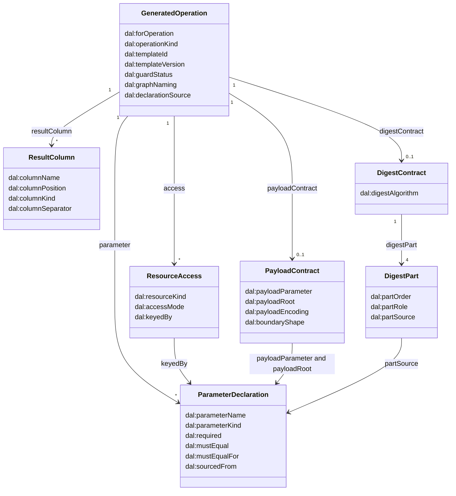

<!-- SPDX-License-Identifier: CC-BY-SA-4.0 -->

# Validation Pack: FMH-H2.6, the expected compiled profile and the paper check

**Unit:** [`formal-methods-track-h`](../status/formal-methods-track-h.md), slice H2.6, planned in
[plan §4.4](../plans/formal-methods-track-h.md#44-h26-the-expected-compiled-profile-examples-first-and-the-paper-check-planned-2026-10-13-built-2026-10-13) and
the [typed IR sketch §7.2](../sketches/formal-methods-track-h-typed-ir.md#72-the-paper-check-of-the-logical-resources-h26), after
[H2.5](FMH-H2-5.md). Examples first (`lattice-lifecycle`): this slice stops here for your review, and for your commit of the expected
profiles, before H2.7 is briefed against them.
**For the maintainer:** the model and the proposed names (below), the paper check, and eight questions at the end. The structure is fixed, so the
review is about names and about the questions.
**For countersignature (non-weakening rule):** none. No test was removed, skipped or loosened. The only change to code that earlier slices tested is
additive: an access now carries a mode, and the audit builders tag their result variables with kinds.

## Invariant

The compiled profile of an example, once H2.7 emits it, says for every generated operation what a caller in any language, a relational
realisation and a model checker need, and says it without SPARQL text and without a blank node. The files that say it are held to the builders
(so they cannot drift from the code that produces the queries) and to today's `compile` (so they cannot drift from the profile). Where the files
differ from the builders on purpose, the difference is listed with its reason and the slice that closes it.

## What changed

- **`persistence.contract`** (production code, plan step 1). `contract_of(operation)` derives the kind of an operation, its builder version, its guard
  status, its parameters, the logical resources it accesses with the mode and key of each access, the columns of an audit, and its payload and
  request-digest contracts. Three tables are kept there and nowhere else: `OPERATION_KINDS`, `resource_of` (a graph role, and for the keys graph the
  predicate, to a logical resource) and `BUILDER_VERSIONS`. `HAND_DECLARED` holds the contract of `cas-replace-value-guard`, which has no builder (TD-43).
- **`Access` carries a mode** (`persistence.ir.AccessMode`), set by the checker: an absence read inside `NOT EXISTS`, a whole-aggregate read through a
  path or of every triple of a root's graph, a scan, a point read, an insert, a delete. The audit builders tag their result variables with kinds.
- **The expected profiles**, nine files and one more, in `ontology/persistence/test/expected-profiles/`: the eight examples of plan H2.6-Q2
  and the variant `baseline-single-class.caller-named` (guards off, the caller names each graph), and `kinds.expected.ttl`, which declares the closed
  enumerations the others name. They are written by `tests/expected_profiles.py`, and the ontology README (§13) and the persistence README describe them.
- **Tests** (`test_expected_profiles.py`, `test_builder_versions.py`, 114 cases): parse, no blank node and no SPARQL text, the base profile, the
  agreement with the builders in three outcomes, the dataset-guard claim, the parameter names, minted IRIs, the enumerations, and the golden check on builder versions.
- **Documents.** This pack, the status record, the plan, the index. The Validation Pack of H2.5 is unchanged.

## The model (proposed names)

The structure follows the design review (2.6) and the plan. The review settles the names.



Every declaration node has an IRI, `<target with # as />/compiled/<operation name>#<part>`, for example
`https://example.org/lending/LoanApplication/compiled/cas-replace#param-root`, with the parts `param-<name>`, `access-<n>`, `result-<name>`, `payload`,
`digest` and `digest-part-<n>`. Nothing depends on an order the loader chose, and a test loads the example in three orders.

The closed enumerations are individuals, not classes, declared in `kinds.expected.ttl`:

| Enumeration | Members |
|---|---|
| `dal:OperationKind` | Create, Bootstrap, Replace, Tombstone, Append, UnconditionalWrite, ValueGuardedReplace, KeyClaimWrite, KeyClaimWriteDual, KeyClaimRetire, Quarantine, MergeRewrite, Audit |
| `dal:ResourceKind` | Aggregate, VersionRow, TransactionClaim, Receipt, Event, KeyClaim, MergeRecord, KeyQuarantine, DatasetEpoch, RetentionMark, PropertyValue |
| `dal:AccessMode` | PointRead, AbsenceRead, ScanRead, WholeAggregateRead, Insert, Delete |
| `dal:ParameterKind` | IriKind, LongKind, StringKind, LangStringKind, PositionKind, DigestKind, IriOrLiteralKind, LiteralKind, PayloadKind, RegistryListKind |
| `dal:ColumnKind` | IriColumn, PositionColumn, StringColumn, TermColumn, CountColumn, ConcatenationColumn |
| `dal:GuardStatus` | Guarded, GuardsOff, NoRequiredParameter, NotGenerated |
| `dal:GraphNaming` | QueryNamed, CallerNamed |
| `dal:DeclarationSource` | BuilderDerived, HandDeclared |

Each resource has a logical key, written in the file as `dal:logicalKey`. A bucket month is never part of a key.

| Resource | Logical key | SPARQL realisation (the graph role, and for the keys graph the predicate) | Touched by |
|---|---|---|---|
| Aggregate | root | the root's data graph, or the owned members in the family's data graph | create, replace, tombstone, unconditional write |
| VersionRow | root (a stream is the root of its row) | meta graph | the guarded writes, bootstrap, append, the gap scan |
| TransactionClaim | transaction id | transaction graph | every operation that takes `$txnId`, the fork audit |
| Receipt | target, epoch, seq | a log bucket, and the pinned graph for a retained head | the guarded writes, the receipt audits, the gap scan |
| Event | stream, seq | an event bucket | append |
| KeyClaim | claim | keys graph, the claim's own predicates | key-claim write, dual, retire, quarantine, merge, duplicate audit |
| MergeRecord | owner | keys graph, any other predicate (the merge relation) | merge-rewrite |
| KeyQuarantine | claim, owner | quarantine graph | quarantine |
| DatasetEpoch | dataset | dataset graph | the dataset-guard variants |
| RetentionMark | target | retention graph | the gap scan |
| PropertyValue | root, property | the default graph today (TD-43) | the value guard |

**Mapping findings** (plan step 1). Checked against all 27 builders. Only the keys graph holds two resources, told apart by predicate
(`MergeRecord` for any predicate outside the claim's own). The meta graph holds the version row only, and that includes the stream counter of
`append-event`, which is the stream's version row. `?log` ranges over the log buckets and the pinned graph, and the mapping takes both as
`Receipt` (NQ1, decided). The pinned graph is how retention is realised, and the paper check below tests that as a hypothesis.

## The expected profiles

Each file is today's compiled profile of the example, without `dal:templatePath`, and for every generated operation the contract of the
model. `value-based-cas` shows the one hand-declared operation (`dal:declarationSource dal:HandDeclared`, `dal:guardStatus dal:NotGenerated`).
`baseline-single-class` shows a payload contract with no boundary shape explicitly (`dal:boundaryShape dal:NoBoundaryShape`), and
`composite-project-ownership` shows a shape. The variant shows `dal:graphNaming dal:CallerNamed`, `dal:guardStatus dal:GuardsOff` and, on `$g`,
`dal:mustEqual dal:GraphNameOfRoot ; dal:mustEqualFor <…#param-root>`, which refers to the family's `dal:graphIriTemplate` and never repeats it.

| File | Operations | Shows |
|---|---|---|
| `baseline-single-class` | create, replace, tombstone, key-claim write, retire and duplicate audit, four audits | the named-graph family, a patch log, no boundary shape |
| `epoch-dataset-level-guard` | create, replace, tombstone, four audits | the dataset read in every guarded write |
| `composite-project-ownership` | create, replace, tombstone, four audits | whole-aggregate reads and deletes, a boundary shape |
| `append-stream-dataset-guard` | bootstrap, append, four audits | events, the stream's version row, the dataset read |
| `uniqueness-merge-policy` | unconditional write, claim write, retire, merge-rewrite, four audits | merge records |
| `uniqueness-quarantine-policy` | unconditional write, claim write, retire, quarantine, four audits | quarantine |
| `claim-scheme-dual-rotation` | unconditional write, dual claim write, retire, duplicate audit, four audits | the dual scheme |
| `value-based-cas` | the value guard, four audits | a hand-declared operation |
| `baseline-single-class.caller-named` | as the first | guards off, caller-named graphs |

### Intended differences between the files and the builders

The agreement test sorts each operation into equal, an intended difference from this table, or a failure. Every row must be used by some file,
or the test fails, and H2.7 empties the table. There is one row.

| Where | The file says | The builder says | Reason | Closed by |
|---|---|---|---|---|
| `cas-replace-named-graph`, with and without the dataset guard, under `dal:PatchLog` | `$assertGraph` and `$retractGraph` are required | optional | the patch log is the receipt model that records them (H2.3-Q3). The builder declares them optional for every model | H2.7 |

The composite dataset-guard variants have no file. A test asserts that each differs from its base by one extra access, a point read of the dataset
epoch, and by nothing else (H2.6-T6).

## The paper check

Against [lattice-sql.md](../notes/rdf-engine/lattice-sql.md) §9 (the persistence dimensions) and §4.2 (the concurrency primitives). It is on paper,
since no relational compiler exists (ADR-A-FM4 decision 1). Three outcomes: *logical* (both realisations have the resource), *realisation only* (an
artefact of one of them), *gap* (for you). The conclusions are hypotheses for you to confirm or reject, not decisions.

### Per resource

| Resource | Relational realisation | Key matches | Modes have a relational reading | Verdict |
|---|---|---|---|---|
| Aggregate | the root table and the child tables it owns, foreign keys with `ON DELETE CASCADE` (§9, M37) | the root is the primary key | insert and delete are row changes, a whole-aggregate read is a join over the owned tables, a whole-aggregate delete is the cascade, and the composite create's absence read is an insert with conflict detection (M38) | logical |
| VersionRow | a `version` column of the root row (§9, M41), with the epoch in the comparison (M47) | the version is a column of the root's own row, so the key is the aggregate's | the point read is a read of the column, the guarded replace is `UPDATE … WHERE version = $expected`, and the absence read of `deleted` is a predicate on the row | logical, realised as a column |
| TransactionClaim | an idempotency table with a primary key on the client transaction id (§4.2). **§9 has no row for it** | the transaction id is the primary key | the absence read and the insert are `INSERT … ON CONFLICT` | logical, and the silence of §9 is a gap in §9 |
| Receipt | a receipt table, one row per committed operation (M44), or a change table for a patch log | (target, epoch, seq) is a natural primary key. §9 does not state one | the insert is a row, the scans of the audits are queries, retention is a partition drop (M46) | logical |
| Event | an insert-only table (`AppendOnly`, M41) with a sequence per stream (M45) | (stream, seq) is the primary key | the insert | logical |
| KeyClaim | `UNIQUE` or a partial unique index with the scope columns first, and the claim-scheme digest as a generated column (M48) | the claim is the unique key | the absence read plus the insert is `INSERT` with a unique violation, and retire is an update | logical |
| MergeRecord | a merge table and a reconciliation procedure (M48) | the non-canonical owner is the primary key | an absence read and an insert are `ON CONFLICT DO NOTHING` | logical |
| KeyQuarantine | a quarantine table (M48) | (claim, owner) is the primary key | as the merge record | logical |
| DatasetEpoch | an epoch table (M47) | one row per dataset | the point read is a join in the version comparison | logical |
| RetentionMark | partitioning by time and detach or drop (M46) names the mechanism, **not where a per-target low-water mark is recorded** | the target | a point read | logical, with a gap in §9 on where the mark lives |
| PropertyValue | a column with an old-value compare, `UPDATE … SET col = $new WHERE id = $1 AND col = $old` | (root, property) is the row and the column | one statement for the read, delete and insert | logical, though its SPARQL realisation is the default graph (TD-43) |
| the pinned head | a foreign key from the version row to its head receipt keeps the receipt through a partition drop | none | none | **realisation only**: pinned heads exist because monthly buckets are dropped whole (README §7.4), so the contract treats the pinned graph as part of how `Receipt` is retained (NQ1) |
| registry and buckets | none (`metaTopology`, `registryGraph` have no relational meaning, §9) | none | none | **realisation only**, and not in the contract |

### Per operation kind, both ways

| Operation kind | §9 counterpart | Atomicity scope | Verdict |
|---|---|---|---|
| Create | `INSERT` with conflict detection (M38) | one transaction, one aggregate | logical |
| Bootstrap | `UPDATE` of a provisioned row (M38, `PreCreatedRow`) | one transaction | logical |
| Replace | `UPDATE … WHERE version = $expected` with the child rows replaced (M41, M37) | one transaction, one aggregate | logical |
| Tombstone | none stated. A flag on the root row, or a delete with the cascade | one transaction, one aggregate | **gap in §9** |
| Append | insert-only table and a sequence (M41, M45) | one transaction | logical |
| UnconditionalWrite | none. `ProvidedConcurrency` has no row in §9 | one transaction | **gap in §9** |
| ValueGuardedReplace | `UPDATE … WHERE col = $old` (the optimistic profile, with no version row) | one statement | logical, §9 does not say it for `NoBoundary` |
| KeyClaimWrite, KeyClaimWriteDual | a unique index (M48). The dual form is two unique keys in one transaction | one statement, and one transaction for the dual form | logical |
| KeyClaimRetire | an update of the claim row | one statement | logical |
| Quarantine, MergeRewrite | a quarantine table, a merge table and a reconciliation procedure (M48) | one set-based transaction | logical |
| Audit (five) | none. A primary key or a unique index makes the duplicate, fork and request-applied-twice audits impossible, and a sequence may legitimately leave gaps | a read at the isolation level the profile asks for (M43) | **realisation only**: detective controls for what the RDF realisation cannot prevent |

Reading it the other way, §9 names two artefacts the contract has no resource or operation for.

| §9 artefact | Contract | Finding |
|---|---|---|
| a change table for `PatchLog` | `$assertGraph` and `$retractGraph` are recorded on the receipt, but the patch triples themselves are written outside these operations | **gap for you**: no logical resource holds the patch content, so a relational realisation has nowhere to take its change table from |
| a history table for `SnapshotPerRevision`, erasure by cascade or key shredding, multi-aggregate lock order | no template generates a snapshot, an erasure or a multi-aggregate operation | outside the contract until a template does |

## Questions for the review

1. **The names.** Every `dal:` term above is a proposal, in `kinds.expected.ttl` and the files. Which would you change?
2. **`dal:templateId` keeps its `.mustache` suffix** in the files, so that the base-profile test stays a pure subset of `compile`. The builder's identity is the operation id without it. Should H2.7 drop the suffix, with H2.9?
3. **The set of resource kinds.** `Event`, `MergeRecord` and `KeyQuarantine` could each be folded into another (the event into the receipt, the merge record and the quarantine into the key claim). They have their own keys in both realisations, so they are kept apart. Agree?
4. **The pinned head as a realisation of `Receipt`** (NQ1 and the paper check). Confirm, or give the pinned graph a resource of its own.
5. **The digest of `append-event`.** The contract says the digest is taken over the operation kind, the target, the expected sequence and the sorted canonical N-Triples of the payload. Append has no payload parameter and no expected sequence, so its file shows both parts as `dal:NoSource`, and what the event contributes is undeclared. H2.8 builds the algorithm. Who decides the append's input?
6. **The patch content** (the gap above). Is the patch written by a separate generated operation, by the caller, or is it a resource of the receipt?
7. **The three gaps in §9** (the transaction claim, the retention mark, tombstone and `ProvidedConcurrency`). They are findings about `lattice-sql.md`, not the contract. Do you want them recorded as a review request on that note?
8. **`oldValue` and `newValue` of the value guard** are declared `IriOrLiteral`, since the template says nothing about their type. TD-43 settles it. Fine for now?

## Test cases

| ID | Given / When / Then | Level | Invariant | +/- |
|---|---|---|---|---|
| H2.6-T1 | the nine files and the enumerations / parse / nine profiles, no `dal:templatePath` | L1 | the files are well formed | + |
| H2.6-T2 | every new part / checked / no blank node, an IRI subject, no value that is a query | L3 | the two rules of the model | ± |
| H2.6-T3 | each file without its new terms / compared with `compile` without the template paths / isomorphic (9) | L3 | the files cannot drift from `compile` | + |
| H2.6-T4 | each operation of each file / read back and compared with the builder's contract / equal, or exactly one listed intended difference (9) | L3 | the files cannot drift from the builders | ± |
| H2.6-T5 | the intended-differences table and the value guard / checked / every row used, the value guard marked hand-declared | L3 | the table cannot go stale | ± |
| H2.6-T6 | the three composite creates, replaces and tombstones / base against dataset-guard variant / one extra access, the dataset read | L3 | the omission of the composite variants is safe | + |
| H2.6-T7 | every builder, with the query-named and the caller-named graph / declared names against the `$` names of the rendered query / equal (54) | L3 | the declarations match the text | + |
| H2.6-T8 | the value guard / declared names against the `$` names of its template / equal | L3 | as T7, for the one hand declaration | + |
| H2.6-T9 | three examples in three load orders / new triples compared / the same set, every new node an IRI | L2 | minted IRIs are deterministic | + |
| H2.6-T10 | a blank node added to a declaration / the rule of T2 / caught | L2 | T2 is not vacuous | - |
| H2.6-T11 | every class and individual a profile names / checked against the enumerations file / declared | L3 | the files are closed | + |
| H2.6-T12 to T15 | the builders, their record in `builder-goldens.json` / the rendered text and the versions / a changed text fails until the version is bumped, and the update refuses to record it otherwise | L3 | a builder's version follows its text | ± |

## One command

Run from the repository root. `check:persistence` is the gate.

```bash
mise run check:persistence                   # 2711 passed, 1 xfailed here (2597 before this slice, and 114 new cases)
mise run check:persistence-oxigraph          # 5 adapter tests and 189 Oxigraph cases (no new engine case)
mise run check:persistence-expected-profiles   # part of check:persistence. Fails with the names of the stale files. Regenerate with mise run build:persistence-expected-profiles
```

## Artefacts to inspect

- `ontology/persistence/test/expected-profiles/`, starting with `kinds.expected.ttl`, then `baseline-single-class.expected.ttl` and the caller-named
  variant, `composite-project-ownership.expected.ttl` and `value-based-cas.expected.ttl`.
- `tools/persistence/src/persistence/contract.py` for the three tables, and `tools/persistence/tests/test_expected_profiles.py` for the intended-differences table.
- This pack's model, paper check and questions.

## Adversarial probes

Run on 2026-10-13 on the staged slice, each file restored from the index afterwards.

| Mutation | Result |
|---|---|
| a parameter dropped from one expected file | H2.6-T4 fails for that file, and H2.6-T5, which needs every intended difference to be used |
| an undeclared name (`$newVal`) in the value guard's template | H2.6-T8 fails |
| an example's graph template changed without regenerating its file | H2.6-T3 fails for the two files of that example |
| a blank node for a parameter declaration in the emitter | H2.6-T9 fails. The first version of the test passed, because it looked only at nodes whose IRI contained `/compiled/`. It now compares every new triple across compiles, and refuses a blank node among them |
| the text a builder renders changes and its version does not | H2.6-T13 fails |
| the transaction graph mapped to the version row | 9 cases fail (the agreement test, every file) |
| an absence read reported as a point read | 8 cases fail |

## Deliberate non-coverage

- The vocabulary, its shapes and the compiler's emission (H2.7). The files are not validated against any shape, and the terms are not in the ontology.
- The composite dataset-guard variants as files. H2.6-T6 asserts what makes the omission acceptable.
- The relational realisation, which is on paper only (ADR-A-FM4 decision 1).
- The digest algorithm beyond its declaration (H2.8), and isolation semantics (H5).
- A file for each combination of receipt model and concurrency profile. The nine cover each operation kind and each resource.
