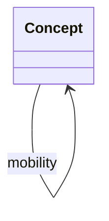

<!-- SPDX-License-Identifier: CC-BY-SA-4.0 -->

# Asset Class — Description Logic Elements

Literate specification for the cross-domain asset class module, in the layout of [ADR-A126](../../../docs/architecture/decisions/ADR-A126-literate-specification-layout-and-grammar.md).

---

## 1. Purpose and Scope

Asset class publishes a reference edition of asset classes, the kinds of thing an asset can be, for any domain that classifies assets: what a policy covers, what secures a loan, what a fund holds. It binds the edition to `cls-voc:AssetClassContract`, so `cls:assetClass` and every property that specialises it take their values from it wherever a deployment has bound no scheme of its own.

The edition is one SKOS scheme with a non-financial branch, produced and non-produced assets, and a financial branch. It follows the asset classification of the System of National Accounts 2008, the one international classification that spans both, and every concept cites the category it follows.

It also states mobility, whether a thing of a class is kept at one location in its normal use or moves between locations, where that holds for the whole class, so a check can read it.

Asset class answers what kind of thing an asset is, and nothing else. What the asset is used for, how it is built, which value of it is exposed, who holds a stake in it and the terms of a holding are other dimensions, held elsewhere. The module carries no domain vocabulary.

## 2. Namespace and Prefixes

| Document | Ontology IRI | Version IRI | Imports |
|---|---|---|---|
| `spec/asset-class.ttl` | <https://www.nebularis.org/neuro-semantic/lattice/applied/asset-class> | <https://www.nebularis.org/neuro-semantic/lattice/applied/asset-class/0.1.1> | <https://www.nebularis.org/neuro-semantic/lattice/foundation/0.21.1>, <https://www.nebularis.org/neuro-semantic/lattice/vocabulary/0.21.1> |
| `vocab/asset-class-vocab.ttl` | <https://www.nebularis.org/neuro-semantic/lattice/applied/asset-class/vocab> | <https://www.nebularis.org/neuro-semantic/lattice/applied/asset-class-vocab/0.1.1> | <https://www.nebularis.org/neuro-semantic/lattice/applied/asset-class/0.1.1>, <https://www.nebularis.org/neuro-semantic/lattice/applied/classification-vocab/0.6.1> |

| Prefix | Namespace |
|---|---|
| `asc:` | <https://www.nebularis.org/neuro-semantic/lattice/applied/asset-class#> |
| `asc-voc:` | <https://www.nebularis.org/neuro-semantic/lattice/applied/asset-class/vocab#> |
| `cls:` | <https://www.nebularis.org/neuro-semantic/lattice/applied/classification#> |
| `cls-voc:` | <https://www.nebularis.org/neuro-semantic/lattice/applied/classification/vocab#> |
| `fnd:` | <https://www.nebularis.org/neuro-semantic/lattice/foundation#> |
| `voc:` | <https://www.nebularis.org/neuro-semantic/lattice/vocabulary#> |
| `skos:` | <http://www.w3.org/2004/02/skos/core#> |

| Identifier | Role | Display name |
|---|---|---|
| <https://github.com/nebularis> | creator | Nebularis |

## 3. Extraction Contract

- Sections 1, 2 and 6 generate `spec/asset-class.ttl`, which declares `asc:mobility`, and `vocab/asset-class-vocab.ttl`, which holds the two schemes, their concepts and the contract binding. The individuals of 6.4 go to the vocab document.
- The block of section 7 generates `shapes/constraints.ttl`, naming its file. No restriction is checked in SHACL, so there is no structural shapes file.
- Extraction rewrites the class diagram (section 4) and the Axiom Index (6.7), which are never edited by hand.
- `turtle-example` blocks are illustrative only.

```bash
mise exec -- python tools/literate_extract.py ontology/applied/asset-class/README.md --layer applied/asset-class --root . --check
```

The module's entry in the [repository catalogue](../../../repository-catalogue.md) ([ADR-A121](../../../docs/architecture/decisions/ADR-A121-repository-catalogue.md)) follows.

```toml repository-catalogue
[module]
kind = "applied"
roles = ["examples", "shapes", "spec", "vocab"]

[module.extract]
spec = ["spec/asset-class.ttl"]
vocab = ["vocab/asset-class-vocab.ttl"]
shapes = ["shapes/constraints.ttl"]
```

## 4. Overview

The module declares no class. Its content is a scheme of concepts, `asc-voc:AssetClassScheme`, with two top concepts, `asc-voc:NonFinancialAsset` and `asc-voc:FinancialAsset`, and one property, `asc:mobility`, whose values come from a second scheme, `asc-voc:MobilityScheme`. The vocab document binds `cls-voc:AssetClassContract` to the edition.

```turtle-example
ex:asset cls:assetClass asc-voc:Vessel .
asc-voc:Vessel skos:broader asc-voc:TransportEquipment ; asc:mobility asc-voc:Mobile .
cls-voc:AssetClassContract voc:boundScheme asc-voc:AssetClassScheme .
```

The class diagram below is generated from section 6.

<!-- start: {"generated": "class-diagram"} -->



<!-- end -->

## 5. Detailed Design

### 5.1 One dimension per scheme

An asset carries several classifications, and each answers its own question. A scheme that mixed two would have members that are not mutually exclusive, so a value would answer neither question cleanly. Surface may combine dimensions later for runtime efficiency, and the specification keeps them apart.

| Question | Dimension | Where it lives |
|---|---|---|
| what kind of thing is it | asset class | this module |
| is it kept at one location, or does it move between locations | mobility, a characteristic of an asset class | this module |
| what is it used for, and by whom | occupancy or industry | `cls:industry` |
| how is it built, protected and maintained | construction and protection | a domain's attributes |
| which value of it is at stake | value type | a domain's own scheme |
| who holds a stake in it | interest | a domain's own scheme |
| when a debt falls due, whether a share is listed, what a fund invests in | maturity, listing, fund strategy | terms of a holding, not kinds (§13) |

So a factory used for semiconductor manufacturing is a `asc-voc:NonResidentialBuilding` whose industry is semiconductor manufacturing. The income an operation earns is not an asset class, since it is the value of the operation, carried by the assets whose loss would interrupt it.

### 5.2 Sources

| Source | What it gives | How the edition uses it |
|---|---|---|
| UN System of National Accounts 2008, Annex 1, and the European System of Accounts 2010, which follows it | the one classification spanning non-financial and financial assets, mutually exclusive and coded | the backbone. Each concept's `skos:note` cites its category |
| IMF Classification of Financial Assets and Liabilities, 2017 | the financial branch, as SNA's | confirms the financial branch |
| IAS 16, property, plant and equipment, and IAS 38, intangible assets | the classes an accountant keeps, among them land, buildings, machinery, ships, aircraft, motor vehicles, furniture and fixtures | the grain below SNA's transport equipment and other machinery |
| ISO 10962, classification of financial instruments | instrument categories, among them options, futures and swaps | the grain below SNA's forward-type contracts. Its codes are not reproduced |
| FIBO, the Financial Industry Business Ontology | instruments, securities, derivatives and loans as OWL classes | read for coverage. The edition keeps them as SKOS concepts |
| the Solvency II complementary identification code and the AIFMD reporting asset types | how regulated investors declare their holdings | read for coverage, candidate crosswalks |

The edition carries no mapping to any of these. A crosswalk is a reviewed artefact of its own, a SKOS mapping graph published beside the edition where the list owner's terms allow.

### 5.3 Where the edition departs from SNA

| Departure | Why |
|---|---|
| `asc-voc:BuildingOrStructure` and `asc-voc:Building` group dwellings (AN.111) with other buildings (AN.1121), which SNA places under different parents | a building is the class most domains name first, and SNA's split is by use, which the narrower concepts keep |
| houseboats, mobile homes and caravans used as residences are not dwellings | SNA counts them as dwellings by their use. The edition classes them by what they are, a vessel or a road vehicle, which keeps every dwelling stationary |
| transport equipment, other machinery and equipment, and computer software are split further | SNA stops at AN.1131, AN.1139 and AN.1173, where IAS 16's classes and a mobility check need road and rail vehicles, vessels, aircraft and mobile plant apart |
| maturity, listing and fund type are dropped | §5.1. Each is a term of a holding, which can change while the instrument stays the same |
| futures and swaps are concepts under forward-type contracts | SNA names them in its description of AF.712 without codes, and ISO 10962 separates them |
| AN.116, the costs of ownership transfer on non-produced assets, is left out | a cost the national accounts capitalise into an asset, not a class anything is |

### 5.4 Mobility

`asc:mobility` is stated on a concept only where it holds for everything the concept covers, and then on every concept below it, which a shape checks. A value on a broad concept can therefore be trusted for all of its narrower concepts. A concept that covers both, for example information and communication equipment, inventories, which may be held in store or in transit, or livestock, or one where location means nothing, an intangible or a financial asset, states no mobility.

### 5.5 How a deployment uses the edition

The edition is the unscoped fallback for the contract, as every reference edition LATTICE publishes is. A deployment that binds its own scheme to `cls-voc:AssetClassContract`, everywhere or within a scope, uses that scheme instead, and its concepts may state `asc:mobility` too, which the shapes check alike. A domain that needs a narrower classification declares a sub-property of `cls:assetClass` and binds its own contract.

## 6. Description Logic Encoding

### 6.1 Classes

None.

### 6.2 Object Properties

#### `asc:mobility`

**Definition.** Whether a thing of an asset class is kept at one location in its normal use, or moves between locations.

**Utility.** Subject: an asset class concept. Value: a concept of `asc-voc:MobilityScheme`. State it only where it holds for everything the concept covers, and then on every narrower concept too. A check reads it, for example to decide whether an asset has one location or a series of presences.

**Label.** "mobility"@en

**Domain.** `skos:Concept`

**Range.** `skos:Concept`

**Characteristics.** functional

### 6.3 Datatype Properties

None.

### 6.4 Individuals

**Concept schemes.**

| Individual | Type | Preferred label | `skos:definition` | `fnd:hasIdentity` | `fnd:hasGovernanceState` | `skos:hasTopConcept` | `skos:editorialNote` |
|---|---|---|---|---|---|---|---|
| `asc-voc:AssetClassScheme` | `voc:ConceptScheme` | "Reference asset classes"@en | "The kinds of thing an asset can be, after the asset classification of the System of National Accounts 2008."@en | `asc-voc:AssetClassScheme-identity` | `fnd:Active` | `asc-voc:NonFinancialAsset`, `asc-voc:FinancialAsset` | "Reference edition published by LATTICE. Not a statistical or market standard. A scheme a deployment binds to cls-voc:AssetClassContract takes precedence."@en |
| `asc-voc:MobilityScheme` | `voc:ConceptScheme` | "Reference mobility"@en | "Whether a thing is kept at one location in its normal use, or moves between locations."@en | `asc-voc:MobilityScheme-identity` | `fnd:Active` | `asc-voc:Stationary`, `asc-voc:Mobile` | "Reference edition published by LATTICE."@en |

**`asc-voc:MobilityScheme`.**

| Individual | Type | Preferred label | `skos:definition` | `skos:inScheme` | `skos:topConceptOf` | `skos:note` |
|---|---|---|---|---|---|---|
| `asc-voc:Stationary` | `skos:Concept` | "Stationary"@en | "Kept at one location in its normal use."@en | `asc-voc:MobilityScheme` | `asc-voc:MobilityScheme` | "A thing of a stationary class has one location."@en |
| `asc-voc:Mobile` | `skos:Concept` | "Mobile"@en | "Moves between locations in its normal use."@en | `asc-voc:MobilityScheme` | `asc-voc:MobilityScheme` | "A thing of a mobile class has a location for each period, not one."@en |

**`asc-voc:AssetClassScheme`, top concepts.**

| Individual | Type | Preferred label | `skos:definition` | `skos:inScheme` | `skos:topConceptOf` | `skos:note` |
|---|---|---|---|---|---|---|
| `asc-voc:NonFinancialAsset` | `skos:Concept` | "Non-financial asset"@en | "An asset that is not a financial claim: a thing produced, or a natural resource, contract, lease, licence or goodwill that was not."@en | `asc-voc:AssetClassScheme` | `asc-voc:AssetClassScheme` | "Follows SNA 2008 AN, non-financial assets."@en |
| `asc-voc:FinancialAsset` | `skos:Concept` | "Financial asset"@en | "A financial claim on another party, or gold held by a monetary authority as a reserve asset."@en | `asc-voc:AssetClassScheme` | `asc-voc:AssetClassScheme` | "Follows SNA 2008 AF, financial assets, and the IMF Classification of Financial Assets and Liabilities 2017."@en |

**Produced assets.**

| Individual | Type | Preferred label | `skos:definition` | `skos:inScheme` | `skos:broader` | `asc:mobility` | `skos:note` |
|---|---|---|---|---|---|---|---|
| `asc-voc:ProducedAsset` | `skos:Concept` | "Produced asset"@en | "A non-financial asset that came into existence as the output of production: a fixed asset, an inventory or a valuable."@en | `asc-voc:AssetClassScheme` | `asc-voc:NonFinancialAsset` | | "Follows SNA 2008 AN.1, produced non-financial assets."@en |
| `asc-voc:FixedAsset` | `skos:Concept` | "Fixed asset"@en | "A produced asset used repeatedly or continuously in production for more than one year."@en | `asc-voc:AssetClassScheme` | `asc-voc:ProducedAsset` | | "Follows SNA 2008 AN.11, fixed assets."@en |
| `asc-voc:BuildingOrStructure` | `skos:Concept` | "Building or structure"@en | "A building or another structure, or an improvement to land."@en | `asc-voc:AssetClassScheme` | `asc-voc:FixedAsset` | `asc-voc:Stationary` | "Groups SNA 2008 AN.111, dwellings, and AN.112, other buildings and structures, which SNA places side by side."@en |
| `asc-voc:Building` | `skos:Concept` | "Building"@en | "An enclosed structure with a roof and walls, used as a residence or for any other purpose."@en | `asc-voc:AssetClassScheme` | `asc-voc:BuildingOrStructure` | `asc-voc:Stationary` | "Groups SNA 2008 AN.111, dwellings, and AN.1121, buildings other than dwellings, which SNA places under different parents."@en |
| `asc-voc:Dwelling` | `skos:Concept` | "Dwelling"@en | "A building, or a designated part of one, used wholly or mainly as a residence."@en | `asc-voc:AssetClassScheme` | `asc-voc:Building` | `asc-voc:Stationary` | "Follows SNA 2008 AN.111, dwellings, less the houseboats, mobile homes and caravans SNA counts as dwellings by their use, which this edition classes as vessels and road vehicles."@en |
| `asc-voc:NonResidentialBuilding` | `skos:Concept` | "Non-residential building"@en | "A building other than a dwelling, for example a factory, warehouse, office, shop, school or hospital."@en | `asc-voc:AssetClassScheme` | `asc-voc:Building` | `asc-voc:Stationary` | "Follows SNA 2008 AN.1121, buildings other than dwellings."@en |
| `asc-voc:OtherStructure` | `skos:Concept` | "Other structure"@en | "A structure other than a building, for example a road, bridge, tunnel, railway, pipeline, power or communication line, dam or harbour."@en | `asc-voc:AssetClassScheme` | `asc-voc:BuildingOrStructure` | `asc-voc:Stationary` | "Follows SNA 2008 AN.1122, other structures."@en |
| `asc-voc:LandImprovement` | `skos:Concept` | "Land improvement"@en | "Work that improves the quantity, quality or productivity of land, such as clearance, contouring, drainage or irrigation."@en | `asc-voc:AssetClassScheme` | `asc-voc:BuildingOrStructure` | `asc-voc:Stationary` | "Follows SNA 2008 AN.1123, land improvements."@en |
| `asc-voc:MachineryAndEquipment` | `skos:Concept` | "Machinery and equipment"@en | "Transport equipment, information and communication equipment, and other machinery and equipment used in production."@en | `asc-voc:AssetClassScheme` | `asc-voc:FixedAsset` | | "Follows SNA 2008 AN.113, machinery and equipment."@en |
| `asc-voc:TransportEquipment` | `skos:Concept` | "Transport equipment"@en | "Equipment for moving people or objects."@en | `asc-voc:AssetClassScheme` | `asc-voc:MachineryAndEquipment` | `asc-voc:Mobile` | "Follows SNA 2008 AN.1131, transport equipment."@en |
| `asc-voc:RoadVehicle` | `skos:Concept` | "Road vehicle"@en | "A motor vehicle, trailer or semi-trailer for use on roads, including a mobile home or caravan."@en | `asc-voc:AssetClassScheme` | `asc-voc:TransportEquipment` | `asc-voc:Mobile` | "Follows SNA 2008 AN.1131, transport equipment, at the grain of the motor vehicles of IAS 16."@en |
| `asc-voc:RailVehicle` | `skos:Concept` | "Rail vehicle"@en | "A locomotive, carriage or wagon for use on rails."@en | `asc-voc:AssetClassScheme` | `asc-voc:TransportEquipment` | `asc-voc:Mobile` | "Follows SNA 2008 AN.1131, transport equipment, at the grain of rolling stock."@en |
| `asc-voc:Vessel` | `skos:Concept` | "Vessel"@en | "A ship, boat or other craft for use on or under water, including a houseboat."@en | `asc-voc:AssetClassScheme` | `asc-voc:TransportEquipment` | `asc-voc:Mobile` | "Follows SNA 2008 AN.1131, transport equipment, at the grain of the ships of IAS 16."@en |
| `asc-voc:Aircraft` | `skos:Concept` | "Aircraft"@en | "An aeroplane, helicopter or other craft for use in the air."@en | `asc-voc:AssetClassScheme` | `asc-voc:TransportEquipment` | `asc-voc:Mobile` | "Follows SNA 2008 AN.1131, transport equipment, at the grain of the aircraft of IAS 16."@en |
| `asc-voc:Spacecraft` | `skos:Concept` | "Spacecraft"@en | "A satellite, launch vehicle or other craft for use in space."@en | `asc-voc:AssetClassScheme` | `asc-voc:TransportEquipment` | `asc-voc:Mobile` | "Follows SNA 2008 AN.1131, transport equipment."@en |
| `asc-voc:IctEquipment` | `skos:Concept` | "Information and communication equipment"@en | "Devices using electronic controls, and their electronic components, such as computers and telecommunications equipment."@en | `asc-voc:AssetClassScheme` | `asc-voc:MachineryAndEquipment` | | "Follows SNA 2008 AN.1132, ICT equipment."@en |
| `asc-voc:ComputerHardware` | `skos:Concept` | "Computer hardware"@en | "Computers, and their peripheral and storage devices."@en | `asc-voc:AssetClassScheme` | `asc-voc:IctEquipment` | | "Follows SNA 2008 AN.11321, computer hardware."@en |
| `asc-voc:TelecommunicationsEquipment` | `skos:Concept` | "Telecommunications equipment"@en | "Equipment for transmitting and receiving signals, such as switching and transmission equipment and telephones."@en | `asc-voc:AssetClassScheme` | `asc-voc:IctEquipment` | | "Follows SNA 2008 AN.11322, telecommunications equipment."@en |
| `asc-voc:OtherMachineryAndEquipment` | `skos:Concept` | "Other machinery and equipment"@en | "Machinery and equipment that is neither transport nor information and communication equipment."@en | `asc-voc:AssetClassScheme` | `asc-voc:MachineryAndEquipment` | | "Follows SNA 2008 AN.1139, other machinery and equipment."@en |
| `asc-voc:PlantAndMachinery` | `skos:Concept` | "Plant and machinery"@en | "Machinery installed at a site to produce, process, generate or distribute, such as production lines, machine tools, generators, boilers and lifts."@en | `asc-voc:AssetClassScheme` | `asc-voc:OtherMachineryAndEquipment` | `asc-voc:Stationary` | "Follows SNA 2008 AN.1139, other machinery and equipment, at the grain of the machinery of IAS 16."@en |
| `asc-voc:MobilePlant` | `skos:Concept` | "Mobile plant"@en | "Self-propelled or transportable machinery that works at changing sites, such as cranes, excavators and agricultural machinery."@en | `asc-voc:AssetClassScheme` | `asc-voc:OtherMachineryAndEquipment` | `asc-voc:Mobile` | "Follows SNA 2008 AN.1139, other machinery and equipment, apart from installed plant by its mobility."@en |
| `asc-voc:FurnitureAndFittings` | `skos:Concept` | "Furniture, fixtures and fittings"@en | "Furniture, and the fixtures and fittings attached to a building that are not part of its structure."@en | `asc-voc:AssetClassScheme` | `asc-voc:OtherMachineryAndEquipment` | `asc-voc:Stationary` | "Follows SNA 2008 AN.1139, other machinery and equipment, at the grain of the furniture and fixtures of IAS 16."@en |
| `asc-voc:WeaponsSystem` | `skos:Concept` | "Weapons system"@en | "Vehicles and other equipment used continuously in providing defence, such as warships, military aircraft, tanks and missile launchers."@en | `asc-voc:AssetClassScheme` | `asc-voc:FixedAsset` | | "Follows SNA 2008 AN.114, weapons systems."@en |
| `asc-voc:CultivatedBiologicalResource` | `skos:Concept` | "Cultivated biological resource"@en | "Animals and plants yielding repeat products, whose natural growth and regeneration is under the direct control of an owner."@en | `asc-voc:AssetClassScheme` | `asc-voc:FixedAsset` | | "Follows SNA 2008 AN.115, cultivated biological resources."@en |
| `asc-voc:AnimalResource` | `skos:Concept` | "Animal resource yielding repeat products"@en | "Animals kept for what they yield repeatedly, such as breeding stock, dairy cattle, draught animals and sheep for wool."@en | `asc-voc:AssetClassScheme` | `asc-voc:CultivatedBiologicalResource` | | "Follows SNA 2008 AN.1151, animal resources yielding repeat products."@en |
| `asc-voc:PlantResource` | `skos:Concept` | "Tree, crop and plant resource yielding repeat products"@en | "Trees, vines and shrubs cultivated for what they yield repeatedly, such as orchards, vineyards and plantations."@en | `asc-voc:AssetClassScheme` | `asc-voc:CultivatedBiologicalResource` | `asc-voc:Stationary` | "Follows SNA 2008 AN.1152, tree, crop and plant resources yielding repeat products."@en |
| `asc-voc:IntellectualPropertyProduct` | `skos:Concept` | "Intellectual property product"@en | "The result of research, development, investigation or innovation, whose use is restricted by law or other means, used in production for more than one year."@en | `asc-voc:AssetClassScheme` | `asc-voc:FixedAsset` | | "Follows SNA 2008 AN.117, intellectual property products."@en |
| `asc-voc:ResearchAndDevelopment` | `skos:Concept` | "Research and development"@en | "Creative work undertaken to increase the stock of knowledge and to devise new applications of it."@en | `asc-voc:AssetClassScheme` | `asc-voc:IntellectualPropertyProduct` | | "Follows SNA 2008 AN.1171, research and development."@en |
| `asc-voc:MineralExploration` | `skos:Concept` | "Mineral exploration and evaluation"@en | "The exploration for mineral and energy deposits, and the evaluation of what is found."@en | `asc-voc:AssetClassScheme` | `asc-voc:IntellectualPropertyProduct` | | "Follows SNA 2008 AN.1172, mineral exploration and evaluation."@en |
| `asc-voc:SoftwareAndDatabases` | `skos:Concept` | "Computer software and databases"@en | "Computer programs with their descriptions and supporting materials, and files of data organised for efficient access and use."@en | `asc-voc:AssetClassScheme` | `asc-voc:IntellectualPropertyProduct` | | "Follows SNA 2008 AN.1173, computer software and databases."@en |
| `asc-voc:ComputerSoftware` | `skos:Concept` | "Computer software"@en | "Computer programs, with their descriptions and supporting materials, for systems and applications."@en | `asc-voc:AssetClassScheme` | `asc-voc:SoftwareAndDatabases` | | "Follows SNA 2008 AN.11731, computer software."@en |
| `asc-voc:Database` | `skos:Concept` | "Database"@en | "A file of data organised for efficient access and use."@en | `asc-voc:AssetClassScheme` | `asc-voc:SoftwareAndDatabases` | | "Follows SNA 2008 AN.11732, databases."@en |
| `asc-voc:ArtisticOriginal` | `skos:Concept` | "Entertainment, literary or artistic original"@en | "The original film, sound recording, manuscript, tape or model on which a performance, broadcast, literary or artistic work is recorded."@en | `asc-voc:AssetClassScheme` | `asc-voc:IntellectualPropertyProduct` | | "Follows SNA 2008 AN.1174, entertainment, literary or artistic originals."@en |
| `asc-voc:OtherIntellectualProperty` | `skos:Concept` | "Other intellectual property product"@en | "An intellectual property product of no other class."@en | `asc-voc:AssetClassScheme` | `asc-voc:IntellectualPropertyProduct` | | "Follows SNA 2008 AN.1179, other intellectual property products."@en |
| `asc-voc:Inventory` | `skos:Concept` | "Inventory"@en | "Produced goods and services held for sale, for use in production or for other use at a later date."@en | `asc-voc:AssetClassScheme` | `asc-voc:ProducedAsset` | | "Follows SNA 2008 AN.12, inventories."@en |
| `asc-voc:MaterialsAndSupplies` | `skos:Concept` | "Materials and supplies"@en | "Goods held to be used as inputs into production."@en | `asc-voc:AssetClassScheme` | `asc-voc:Inventory` | | "Follows SNA 2008 AN.121, materials and supplies."@en |
| `asc-voc:WorkInProgress` | `skos:Concept` | "Work in progress"@en | "Output produced but not yet processed far enough to be supplied to others."@en | `asc-voc:AssetClassScheme` | `asc-voc:Inventory` | | "Follows SNA 2008 AN.122, work in progress."@en |
| `asc-voc:CultivatedWorkInProgress` | `skos:Concept` | "Work in progress on cultivated biological resources"@en | "Livestock raised for what it yields on slaughter, and trees and crops yielding once only, not yet slaughtered or harvested."@en | `asc-voc:AssetClassScheme` | `asc-voc:WorkInProgress` | | "Follows SNA 2008 AN.1221, work in progress on cultivated biological resources."@en |
| `asc-voc:OtherWorkInProgress` | `skos:Concept` | "Other work in progress"@en | "Work in progress other than on cultivated biological resources, such as partly completed goods."@en | `asc-voc:AssetClassScheme` | `asc-voc:WorkInProgress` | | "Follows SNA 2008 AN.1222, other work in progress."@en |
| `asc-voc:FinishedGoods` | `skos:Concept` | "Finished goods"@en | "Goods produced and not yet sold or otherwise supplied."@en | `asc-voc:AssetClassScheme` | `asc-voc:Inventory` | | "Follows SNA 2008 AN.123, finished goods."@en |
| `asc-voc:MilitaryInventory` | `skos:Concept` | "Military inventory"@en | "Single-use items delivered by weapons, such as ammunition, missiles, rockets and bombs."@en | `asc-voc:AssetClassScheme` | `asc-voc:Inventory` | | "Follows SNA 2008 AN.124, military inventories."@en |
| `asc-voc:GoodsForResale` | `skos:Concept` | "Goods for resale"@en | "Goods acquired to be resold without further processing."@en | `asc-voc:AssetClassScheme` | `asc-voc:Inventory` | | "Follows SNA 2008 AN.125, goods for resale."@en |
| `asc-voc:Valuable` | `skos:Concept` | "Valuable"@en | "A produced good of considerable value acquired and held mainly as a store of value, and not for production or consumption."@en | `asc-voc:AssetClassScheme` | `asc-voc:ProducedAsset` | | "Follows SNA 2008 AN.13, valuables."@en |
| `asc-voc:PreciousMetalsAndStones` | `skos:Concept` | "Precious metals and stones"@en | "Precious metals and stones held as stores of value, and not as monetary gold or as inputs into production."@en | `asc-voc:AssetClassScheme` | `asc-voc:Valuable` | | "Follows SNA 2008 AN.131, precious metals and stones."@en |
| `asc-voc:ArtAndAntiques` | `skos:Concept` | "Antiques and other art objects"@en | "Paintings, sculptures and other objects recognised as works of art, and antiques."@en | `asc-voc:AssetClassScheme` | `asc-voc:Valuable` | | "Follows SNA 2008 AN.132, antiques and other art objects."@en |
| `asc-voc:OtherValuable` | `skos:Concept` | "Other valuable"@en | "A valuable of no other class, such as a collection, or jewellery of significant value."@en | `asc-voc:AssetClassScheme` | `asc-voc:Valuable` | | "Follows SNA 2008 AN.133, other valuables."@en |

**Non-produced assets.**

| Individual | Type | Preferred label | `skos:definition` | `skos:inScheme` | `skos:broader` | `asc:mobility` | `skos:note` |
|---|---|---|---|---|---|---|---|
| `asc-voc:NonProducedAsset` | `skos:Concept` | "Non-produced asset"@en | "A non-financial asset that came into existence other than through production: a natural resource, a contract, lease or licence, or goodwill and marketing assets."@en | `asc-voc:AssetClassScheme` | `asc-voc:NonFinancialAsset` | | "Follows SNA 2008 AN.2, non-produced non-financial assets."@en |
| `asc-voc:NaturalResource` | `skos:Concept` | "Natural resource"@en | "Land, mineral and energy reserves, biological resources, water and other resources occurring in nature over which ownership can be enforced."@en | `asc-voc:AssetClassScheme` | `asc-voc:NonProducedAsset` | | "Follows SNA 2008 AN.21, natural resources."@en |
| `asc-voc:Land` | `skos:Concept` | "Land"@en | "The ground, with its soil and any associated surface water, without the buildings, structures, crops, trees, animals and subsoil assets on or under it."@en | `asc-voc:AssetClassScheme` | `asc-voc:NaturalResource` | `asc-voc:Stationary` | "Follows SNA 2008 AN.211, land."@en |
| `asc-voc:MineralAndEnergyReserve` | `skos:Concept` | "Mineral and energy reserve"@en | "A known deposit of minerals or energy that can be exploited commercially at current prices and technology."@en | `asc-voc:AssetClassScheme` | `asc-voc:NaturalResource` | `asc-voc:Stationary` | "Follows SNA 2008 AN.212, mineral and energy reserves."@en |
| `asc-voc:NonCultivatedBiologicalResource` | `skos:Concept` | "Non-cultivated biological resource"@en | "Animals and plants whose natural growth is not under the direct control of an owner, such as wild forests and fish stocks, over which ownership can be enforced."@en | `asc-voc:AssetClassScheme` | `asc-voc:NaturalResource` | | "Follows SNA 2008 AN.213, non-cultivated biological resources."@en |
| `asc-voc:WaterResource` | `skos:Concept` | "Water resource"@en | "Surface and ground water whose scarcity gives rise to ownership or use rights and a market value."@en | `asc-voc:AssetClassScheme` | `asc-voc:NaturalResource` | `asc-voc:Stationary` | "Follows SNA 2008 AN.214, water resources."@en |
| `asc-voc:OtherNaturalResource` | `skos:Concept` | "Other natural resource"@en | "A natural resource of no other class, such as a radio spectrum."@en | `asc-voc:AssetClassScheme` | `asc-voc:NaturalResource` | | "Follows SNA 2008 AN.215, other natural resources."@en |
| `asc-voc:ContractLeaseOrLicence` | `skos:Concept` | "Contract, lease or licence"@en | "An agreement giving its holder a right whose value is its own, distinct from the value of what it concerns."@en | `asc-voc:AssetClassScheme` | `asc-voc:NonProducedAsset` | | "Follows SNA 2008 AN.22, contracts, leases and licences."@en |
| `asc-voc:MarketableOperatingLease` | `skos:Concept` | "Marketable operating lease"@en | "A lease of another party's asset whose holder can realise its value by subletting it."@en | `asc-voc:AssetClassScheme` | `asc-voc:ContractLeaseOrLicence` | | "Follows SNA 2008 AN.221, marketable operating leases."@en |
| `asc-voc:NaturalResourcePermit` | `skos:Concept` | "Permit to use natural resources"@en | "A right to use a natural resource, apart from owning it, that its holder can sell on."@en | `asc-voc:AssetClassScheme` | `asc-voc:ContractLeaseOrLicence` | | "Follows SNA 2008 AN.222, permits to use natural resources."@en |
| `asc-voc:ActivityPermit` | `skos:Concept` | "Permit to undertake specific activities"@en | "A permit limited in number that lets its holder earn more than it could without, and that its holder can sell on."@en | `asc-voc:AssetClassScheme` | `asc-voc:ContractLeaseOrLicence` | | "Follows SNA 2008 AN.223, permits to undertake specific activities."@en |
| `asc-voc:FutureGoodsEntitlement` | `skos:Concept` | "Entitlement to future goods and services on an exclusive basis"@en | "A right to future goods or services that no one else may have, which its holder can sell on."@en | `asc-voc:AssetClassScheme` | `asc-voc:ContractLeaseOrLicence` | | "Follows SNA 2008 AN.224, entitlement to future goods and services on an exclusive basis."@en |
| `asc-voc:GoodwillAndMarketingAsset` | `skos:Concept` | "Purchased goodwill and marketing assets"@en | "What is paid for an enterprise as a going concern above its net assets, and marketing assets such as brand names and trademarks sold apart from it."@en | `asc-voc:AssetClassScheme` | `asc-voc:NonProducedAsset` | | "Follows SNA 2008 AN.23, purchases less sales of goodwill and marketing assets."@en |

**Financial assets.**

| Individual | Type | Preferred label | `skos:definition` | `skos:inScheme` | `skos:broader` | `skos:note` |
|---|---|---|---|---|---|---|
| `asc-voc:MonetaryGoldAndSdr` | `skos:Concept` | "Monetary gold and special drawing rights"@en | "Gold held by a monetary authority as a reserve asset, and the international reserve assets the IMF creates."@en | `asc-voc:AssetClassScheme` | `asc-voc:FinancialAsset` | "Follows SNA 2008 AF.1, monetary gold and SDRs."@en |
| `asc-voc:MonetaryGold` | `skos:Concept` | "Monetary gold"@en | "Gold to which a monetary authority has title and which it holds as a reserve asset."@en | `asc-voc:AssetClassScheme` | `asc-voc:MonetaryGoldAndSdr` | "Follows SNA 2008 AF.11, monetary gold."@en |
| `asc-voc:SpecialDrawingRight` | `skos:Concept` | "Special drawing right"@en | "An international reserve asset created by the IMF and allocated to its members."@en | `asc-voc:AssetClassScheme` | `asc-voc:MonetaryGoldAndSdr` | "Follows SNA 2008 AF.12, special drawing rights."@en |
| `asc-voc:CurrencyAndDeposit` | `skos:Concept` | "Currency and deposits"@en | "Notes and coins, and claims on a deposit-taking institution."@en | `asc-voc:AssetClassScheme` | `asc-voc:FinancialAsset` | "Follows SNA 2008 AF.2, currency and deposits."@en |
| `asc-voc:Currency` | `skos:Concept` | "Currency"@en | "Notes and coins of fixed nominal value issued or authorised by a central bank or government."@en | `asc-voc:AssetClassScheme` | `asc-voc:CurrencyAndDeposit` | "Follows SNA 2008 AF.21, currency."@en |
| `asc-voc:TransferableDeposit` | `skos:Concept` | "Transferable deposit"@en | "A deposit exchangeable on demand at par and usable directly for payments."@en | `asc-voc:AssetClassScheme` | `asc-voc:CurrencyAndDeposit` | "Follows SNA 2008 AF.22, transferable deposits."@en |
| `asc-voc:OtherDeposit` | `skos:Concept` | "Other deposit"@en | "A deposit that is not transferable, such as a savings or fixed-term deposit."@en | `asc-voc:AssetClassScheme` | `asc-voc:CurrencyAndDeposit` | "Follows SNA 2008 AF.29, other deposits."@en |
| `asc-voc:DebtSecurity` | `skos:Concept` | "Debt security"@en | "A negotiable instrument serving as evidence of a debt, such as a bill, bond or note."@en | `asc-voc:AssetClassScheme` | `asc-voc:FinancialAsset` | "Follows SNA 2008 AF.3, debt securities, without its split by original maturity, which is a term of the holding and not a kind."@en |
| `asc-voc:Loan` | `skos:Concept` | "Loan"@en | "A claim created when a creditor lends funds directly to a debtor, evidenced by a document that is not negotiable."@en | `asc-voc:AssetClassScheme` | `asc-voc:FinancialAsset` | "Follows SNA 2008 AF.4, loans, without its split by original maturity, which is a term of the holding and not a kind."@en |
| `asc-voc:EquityAndFundShare` | `skos:Concept` | "Equity and investment fund shares"@en | "Claims on the residual value of a corporation or a fund after the claims of all its creditors."@en | `asc-voc:AssetClassScheme` | `asc-voc:FinancialAsset` | "Follows SNA 2008 AF.5, equity and investment fund shares."@en |
| `asc-voc:Equity` | `skos:Concept` | "Equity"@en | "A claim on the residual value of a corporation after the claims of all its creditors."@en | `asc-voc:AssetClassScheme` | `asc-voc:EquityAndFundShare` | "Follows SNA 2008 AF.51, equity."@en |
| `asc-voc:Share` | `skos:Concept` | "Share"@en | "A share in a corporation, listed or not."@en | `asc-voc:AssetClassScheme` | `asc-voc:Equity` | "Groups SNA 2008 AF.511, listed shares, and AF.512, unlisted shares, since listing is a term that can change while the share stays the same."@en |
| `asc-voc:OtherEquity` | `skos:Concept` | "Other equity"@en | "Equity that is not in shares, such as in a partnership, a quasi-corporation or an international organisation."@en | `asc-voc:AssetClassScheme` | `asc-voc:Equity` | "Follows SNA 2008 AF.519, other equity."@en |
| `asc-voc:InvestmentFundShare` | `skos:Concept` | "Investment fund share"@en | "A share or unit in a collective investment undertaking."@en | `asc-voc:AssetClassScheme` | `asc-voc:EquityAndFundShare` | "Follows SNA 2008 AF.52, investment fund shares or units, without its split into money market fund and other fund shares, since a fund's strategy is a term of the fund and not a kind."@en |
| `asc-voc:InsuranceAndPensionClaim` | `skos:Concept` | "Insurance, pension and standardised guarantee schemes"@en | "The claims of policyholders, beneficiaries, scheme members and guarantee holders on the reserves held for them."@en | `asc-voc:AssetClassScheme` | `asc-voc:FinancialAsset` | "Follows SNA 2008 AF.6, insurance, pension and standardised guarantee schemes."@en |
| `asc-voc:NonLifeReserve` | `skos:Concept` | "Non-life insurance technical reserves"@en | "Prepaid premiums and reserves against outstanding claims, held for non-life policyholders and beneficiaries."@en | `asc-voc:AssetClassScheme` | `asc-voc:InsuranceAndPensionClaim` | "Follows SNA 2008 AF.61, non-life insurance technical reserves."@en |
| `asc-voc:LifeAndAnnuityEntitlement` | `skos:Concept` | "Life insurance and annuity entitlements"@en | "The claims of life policyholders and annuitants on the reserves held for them."@en | `asc-voc:AssetClassScheme` | `asc-voc:InsuranceAndPensionClaim` | "Follows SNA 2008 AF.62, life insurance and annuity entitlements."@en |
| `asc-voc:PensionEntitlement` | `skos:Concept` | "Pension entitlement"@en | "The claims of current and future pensioners on a pension scheme."@en | `asc-voc:AssetClassScheme` | `asc-voc:InsuranceAndPensionClaim` | "Follows SNA 2008 AF.63, pension entitlements."@en |
| `asc-voc:PensionManagerClaim` | `skos:Concept` | "Claim of a pension fund on its pension manager"@en | "A pension fund's claim on the employer that manages it, for a shortfall."@en | `asc-voc:AssetClassScheme` | `asc-voc:InsuranceAndPensionClaim` | "Follows SNA 2008 AF.64, claims of pension funds on pension managers."@en |
| `asc-voc:NonPensionBenefitEntitlement` | `skos:Concept` | "Entitlement to non-pension benefits"@en | "The claims of members of a social insurance scheme on its funds for benefits other than pensions."@en | `asc-voc:AssetClassScheme` | `asc-voc:InsuranceAndPensionClaim` | "Follows SNA 2008 AF.65, entitlements to non-pension benefits."@en |
| `asc-voc:StandardisedGuaranteeProvision` | `skos:Concept` | "Provisions for calls under standardised guarantees"@en | "The claims of the holders of many similar guarantees, such as of export credit or student loans, on the guarantor's reserves."@en | `asc-voc:AssetClassScheme` | `asc-voc:InsuranceAndPensionClaim` | "Follows SNA 2008 AF.66, provisions for calls under standardised guarantees."@en |
| `asc-voc:DerivativeAndEmployeeOption` | `skos:Concept` | "Financial derivatives and employee stock options"@en | "Instruments linked to another instrument, an indicator or a commodity, through which a risk can be traded in its own right, and options granted to employees on their employer's equity."@en | `asc-voc:AssetClassScheme` | `asc-voc:FinancialAsset` | "Follows SNA 2008 AF.7, financial derivatives and employee stock options."@en |
| `asc-voc:FinancialDerivative` | `skos:Concept` | "Financial derivative"@en | "An instrument linked to another instrument, an indicator or a commodity, through which a specific financial risk can be traded in its own right."@en | `asc-voc:AssetClassScheme` | `asc-voc:DerivativeAndEmployeeOption` | "Follows SNA 2008 AF.71, financial derivatives."@en |
| `asc-voc:Option` | `skos:Concept` | "Option"@en | "A contract giving its purchaser the right, but not the obligation, to buy or sell an underlying item at a stated price on or before a stated date."@en | `asc-voc:AssetClassScheme` | `asc-voc:FinancialDerivative` | "Follows SNA 2008 AF.711, options."@en |
| `asc-voc:ForwardTypeContract` | `skos:Concept` | "Forward-type contract"@en | "An unconditional contract by which two parties agree to exchange an underlying item at an agreed price and date."@en | `asc-voc:AssetClassScheme` | `asc-voc:FinancialDerivative` | "Follows SNA 2008 AF.712, forward-type contracts."@en |
| `asc-voc:Future` | `skos:Concept` | "Future"@en | "A forward-type contract traded on an organised exchange, on standard terms and margined daily."@en | `asc-voc:AssetClassScheme` | `asc-voc:ForwardTypeContract` | "Follows SNA 2008 AF.712, forward-type contracts, which names futures in its description, and the futures category of ISO 10962."@en |
| `asc-voc:Swap` | `skos:Concept` | "Swap"@en | "A forward-type contract by which two parties exchange streams of payments, or currencies, on agreed terms over a period."@en | `asc-voc:AssetClassScheme` | `asc-voc:ForwardTypeContract` | "Follows SNA 2008 AF.712, forward-type contracts, which names swaps in its description, and the swaps category of ISO 10962."@en |
| `asc-voc:EmployeeStockOption` | `skos:Concept` | "Employee stock option"@en | "An option an employer grants an employee to buy the employer's equity at a stated price within a stated period."@en | `asc-voc:AssetClassScheme` | `asc-voc:DerivativeAndEmployeeOption` | "Follows SNA 2008 AF.72, employee stock options."@en |
| `asc-voc:AccountsReceivable` | `skos:Concept` | "Other accounts receivable"@en | "Trade credit and advances, and other amounts due to be received."@en | `asc-voc:AssetClassScheme` | `asc-voc:FinancialAsset` | "Follows SNA 2008 AF.8, other accounts receivable."@en |
| `asc-voc:TradeCreditAndAdvance` | `skos:Concept` | "Trade credit and advances"@en | "Credit extended directly by suppliers to buyers of goods and services, and advances for work in progress or to be undertaken."@en | `asc-voc:AssetClassScheme` | `asc-voc:AccountsReceivable` | "Follows SNA 2008 AF.81, trade credit and advances."@en |
| `asc-voc:OtherReceivable` | `skos:Concept` | "Other receivable"@en | "An amount due to be received of no other class, such as taxes, dividends, rent or wages accrued and not yet paid."@en | `asc-voc:AssetClassScheme` | `asc-voc:AccountsReceivable` | "Follows SNA 2008 AF.89, other accounts receivable."@en |

### 6.5 Disjointness and Keys

None.

### 6.6 Other Axioms

The edition binds the classification module's asset class contract, as an unscoped fallback. A deployment's own binding takes precedence.

```turtle-vocab
cls-voc:AssetClassContract voc:boundScheme asc-voc:AssetClassScheme .
```

### 6.7 Axiom Index

<!-- start: {"generated": "axiom-index"} -->

| Term | Kind | Summary |
|---|---|---|
| `asc:mobility` | Object property | Domain `skos:Concept`. Range `skos:Concept`. Functional. |
| `asc-voc:AccountsReceivable` | Individual | Type `skos:Concept`. |
| `asc-voc:ActivityPermit` | Individual | Type `skos:Concept`. |
| `asc-voc:Aircraft` | Individual | Type `skos:Concept`. |
| `asc-voc:AnimalResource` | Individual | Type `skos:Concept`. |
| `asc-voc:ArtAndAntiques` | Individual | Type `skos:Concept`. |
| `asc-voc:ArtisticOriginal` | Individual | Type `skos:Concept`. |
| `asc-voc:AssetClassScheme` | Individual | Type `voc:ConceptScheme`. |
| `asc-voc:Building` | Individual | Type `skos:Concept`. |
| `asc-voc:BuildingOrStructure` | Individual | Type `skos:Concept`. |
| `asc-voc:ComputerHardware` | Individual | Type `skos:Concept`. |
| `asc-voc:ComputerSoftware` | Individual | Type `skos:Concept`. |
| `asc-voc:ContractLeaseOrLicence` | Individual | Type `skos:Concept`. |
| `asc-voc:CultivatedBiologicalResource` | Individual | Type `skos:Concept`. |
| `asc-voc:CultivatedWorkInProgress` | Individual | Type `skos:Concept`. |
| `asc-voc:Currency` | Individual | Type `skos:Concept`. |
| `asc-voc:CurrencyAndDeposit` | Individual | Type `skos:Concept`. |
| `asc-voc:Database` | Individual | Type `skos:Concept`. |
| `asc-voc:DebtSecurity` | Individual | Type `skos:Concept`. |
| `asc-voc:DerivativeAndEmployeeOption` | Individual | Type `skos:Concept`. |
| `asc-voc:Dwelling` | Individual | Type `skos:Concept`. |
| `asc-voc:EmployeeStockOption` | Individual | Type `skos:Concept`. |
| `asc-voc:Equity` | Individual | Type `skos:Concept`. |
| `asc-voc:EquityAndFundShare` | Individual | Type `skos:Concept`. |
| `asc-voc:FinancialAsset` | Individual | Type `skos:Concept`. |
| `asc-voc:FinancialDerivative` | Individual | Type `skos:Concept`. |
| `asc-voc:FinishedGoods` | Individual | Type `skos:Concept`. |
| `asc-voc:FixedAsset` | Individual | Type `skos:Concept`. |
| `asc-voc:ForwardTypeContract` | Individual | Type `skos:Concept`. |
| `asc-voc:FurnitureAndFittings` | Individual | Type `skos:Concept`. |
| `asc-voc:Future` | Individual | Type `skos:Concept`. |
| `asc-voc:FutureGoodsEntitlement` | Individual | Type `skos:Concept`. |
| `asc-voc:GoodsForResale` | Individual | Type `skos:Concept`. |
| `asc-voc:GoodwillAndMarketingAsset` | Individual | Type `skos:Concept`. |
| `asc-voc:IctEquipment` | Individual | Type `skos:Concept`. |
| `asc-voc:InsuranceAndPensionClaim` | Individual | Type `skos:Concept`. |
| `asc-voc:IntellectualPropertyProduct` | Individual | Type `skos:Concept`. |
| `asc-voc:Inventory` | Individual | Type `skos:Concept`. |
| `asc-voc:InvestmentFundShare` | Individual | Type `skos:Concept`. |
| `asc-voc:Land` | Individual | Type `skos:Concept`. |
| `asc-voc:LandImprovement` | Individual | Type `skos:Concept`. |
| `asc-voc:LifeAndAnnuityEntitlement` | Individual | Type `skos:Concept`. |
| `asc-voc:Loan` | Individual | Type `skos:Concept`. |
| `asc-voc:MachineryAndEquipment` | Individual | Type `skos:Concept`. |
| `asc-voc:MarketableOperatingLease` | Individual | Type `skos:Concept`. |
| `asc-voc:MaterialsAndSupplies` | Individual | Type `skos:Concept`. |
| `asc-voc:MilitaryInventory` | Individual | Type `skos:Concept`. |
| `asc-voc:MineralAndEnergyReserve` | Individual | Type `skos:Concept`. |
| `asc-voc:MineralExploration` | Individual | Type `skos:Concept`. |
| `asc-voc:Mobile` | Individual | Type `skos:Concept`. |
| `asc-voc:MobilePlant` | Individual | Type `skos:Concept`. |
| `asc-voc:MobilityScheme` | Individual | Type `voc:ConceptScheme`. |
| `asc-voc:MonetaryGold` | Individual | Type `skos:Concept`. |
| `asc-voc:MonetaryGoldAndSdr` | Individual | Type `skos:Concept`. |
| `asc-voc:NaturalResource` | Individual | Type `skos:Concept`. |
| `asc-voc:NaturalResourcePermit` | Individual | Type `skos:Concept`. |
| `asc-voc:NonCultivatedBiologicalResource` | Individual | Type `skos:Concept`. |
| `asc-voc:NonFinancialAsset` | Individual | Type `skos:Concept`. |
| `asc-voc:NonLifeReserve` | Individual | Type `skos:Concept`. |
| `asc-voc:NonPensionBenefitEntitlement` | Individual | Type `skos:Concept`. |
| `asc-voc:NonProducedAsset` | Individual | Type `skos:Concept`. |
| `asc-voc:NonResidentialBuilding` | Individual | Type `skos:Concept`. |
| `asc-voc:Option` | Individual | Type `skos:Concept`. |
| `asc-voc:OtherDeposit` | Individual | Type `skos:Concept`. |
| `asc-voc:OtherEquity` | Individual | Type `skos:Concept`. |
| `asc-voc:OtherIntellectualProperty` | Individual | Type `skos:Concept`. |
| `asc-voc:OtherMachineryAndEquipment` | Individual | Type `skos:Concept`. |
| `asc-voc:OtherNaturalResource` | Individual | Type `skos:Concept`. |
| `asc-voc:OtherReceivable` | Individual | Type `skos:Concept`. |
| `asc-voc:OtherStructure` | Individual | Type `skos:Concept`. |
| `asc-voc:OtherValuable` | Individual | Type `skos:Concept`. |
| `asc-voc:OtherWorkInProgress` | Individual | Type `skos:Concept`. |
| `asc-voc:PensionEntitlement` | Individual | Type `skos:Concept`. |
| `asc-voc:PensionManagerClaim` | Individual | Type `skos:Concept`. |
| `asc-voc:PlantAndMachinery` | Individual | Type `skos:Concept`. |
| `asc-voc:PlantResource` | Individual | Type `skos:Concept`. |
| `asc-voc:PreciousMetalsAndStones` | Individual | Type `skos:Concept`. |
| `asc-voc:ProducedAsset` | Individual | Type `skos:Concept`. |
| `asc-voc:RailVehicle` | Individual | Type `skos:Concept`. |
| `asc-voc:ResearchAndDevelopment` | Individual | Type `skos:Concept`. |
| `asc-voc:RoadVehicle` | Individual | Type `skos:Concept`. |
| `asc-voc:Share` | Individual | Type `skos:Concept`. |
| `asc-voc:SoftwareAndDatabases` | Individual | Type `skos:Concept`. |
| `asc-voc:Spacecraft` | Individual | Type `skos:Concept`. |
| `asc-voc:SpecialDrawingRight` | Individual | Type `skos:Concept`. |
| `asc-voc:StandardisedGuaranteeProvision` | Individual | Type `skos:Concept`. |
| `asc-voc:Stationary` | Individual | Type `skos:Concept`. |
| `asc-voc:Swap` | Individual | Type `skos:Concept`. |
| `asc-voc:TelecommunicationsEquipment` | Individual | Type `skos:Concept`. |
| `asc-voc:TradeCreditAndAdvance` | Individual | Type `skos:Concept`. |
| `asc-voc:TransferableDeposit` | Individual | Type `skos:Concept`. |
| `asc-voc:TransportEquipment` | Individual | Type `skos:Concept`. |
| `asc-voc:Valuable` | Individual | Type `skos:Concept`. |
| `asc-voc:Vessel` | Individual | Type `skos:Concept`. |
| `asc-voc:WaterResource` | Individual | Type `skos:Concept`. |
| `asc-voc:WeaponsSystem` | Individual | Type `skos:Concept`. |
| `asc-voc:WorkInProgress` | Individual | Type `skos:Concept`. |

<!-- end -->

## 7. Shapes

`shapes/constraints.ttl` holds four SHACL-SPARQL shapes. Two keep the reference edition a documented tree, and two keep mobility consistent in any scheme whose concepts state it, the reference edition or a deployment's own. Each targets its nodes by name or by the property it checks, so validating a large data graph does not scan it.

| Shape | Rule |
|---|---|
| `asc:ReferenceTreeShape` | in each reference scheme, a top concept is listed by the scheme both ways, has no broader concept, and every other concept has exactly one broader concept in the scheme and reaches a top concept through `skos:broader` |
| `asc:ReferenceDocumentationShape` | in each reference scheme, every concept has one preferred label, one definition and at least one note, each in `@en` |
| `asc:MobilityValueShape` | a concept states at most one mobility, and its value is in `asc-voc:MobilityScheme` |
| `asc:MobilityInheritedShape` | every narrower concept of a concept that states a mobility states the same one |

```turtle-shapes
# @output-file "shapes/constraints.ttl"
# Constraints of the asset class module (README section 7). SHACL-SPARQL only,
# so pySHACL's sh:sourceShape names the shape itself.

@prefix sh:      <http://www.w3.org/ns/shacl#> .
@prefix skos:    <http://www.w3.org/2004/02/skos/core#> .
@prefix asc:     <https://www.nebularis.org/neuro-semantic/lattice/applied/asset-class#> .
@prefix asc-voc: <https://www.nebularis.org/neuro-semantic/lattice/applied/asset-class/vocab#> .

asc:ReferenceTreeShape a sh:NodeShape ;
    sh:targetNode asc-voc:AssetClassScheme, asc-voc:MobilityScheme ;
    sh:sparql [
        sh:message "A top concept of a reference scheme is listed by the scheme as a top concept, and the other way round." ;
        sh:select """
            PREFIX skos: <http://www.w3.org/2004/02/skos/core#>
            SELECT $this ?value WHERE {
              { ?value skos:topConceptOf $this . FILTER NOT EXISTS { $this skos:hasTopConcept ?value } }
              UNION
              { $this skos:hasTopConcept ?value . FILTER NOT EXISTS { ?value skos:topConceptOf $this } }
            }
        """ ] ;
    sh:sparql [
        sh:message "A concept of a reference scheme other than a top concept has exactly one broader concept, in the same scheme." ;
        sh:select """
            PREFIX skos: <http://www.w3.org/2004/02/skos/core#>
            SELECT $this ?value WHERE {
              {
                SELECT $this ?value (COUNT(DISTINCT ?b) AS ?n) (COUNT(DISTINCT ?c) AS ?m) WHERE {
                  ?value skos:inScheme $this .
                  FILTER NOT EXISTS { ?value skos:topConceptOf $this }
                  OPTIONAL { ?value skos:broader ?b }
                  OPTIONAL { ?value skos:broader ?c . ?c skos:inScheme $this }
                } GROUP BY $this ?value
              }
              FILTER (?n != 1 || ?m != 1)
            }
        """ ] ;
    sh:sparql [
        sh:message "A top concept of a reference scheme has no broader concept." ;
        sh:select """
            PREFIX skos: <http://www.w3.org/2004/02/skos/core#>
            SELECT $this ?value WHERE {
              ?value skos:topConceptOf $this ; skos:broader ?b .
            }
        """ ] ;
    sh:sparql [
        sh:message "Every concept of a reference scheme reaches one of its top concepts through skos:broader." ;
        sh:select """
            PREFIX skos: <http://www.w3.org/2004/02/skos/core#>
            SELECT $this ?value WHERE {
              ?value skos:inScheme $this .
              FILTER NOT EXISTS { ?value skos:broader* ?top . ?top skos:topConceptOf $this }
            }
        """ ] .

asc:ReferenceDocumentationShape a sh:NodeShape ;
    sh:targetNode asc-voc:AssetClassScheme, asc-voc:MobilityScheme ;
    sh:sparql [
        sh:message "Every concept of a reference scheme has one preferred label, one definition and at least one note, each in @en." ;
        sh:select """
            PREFIX skos: <http://www.w3.org/2004/02/skos/core#>
            SELECT $this ?value WHERE {
              {
                SELECT $this ?value (COUNT(DISTINCT ?l) AS ?nl) (COUNT(DISTINCT ?d) AS ?nd) (COUNT(DISTINCT ?o) AS ?no) WHERE {
                  ?value skos:inScheme $this .
                  OPTIONAL { ?value skos:prefLabel ?l . FILTER (langMatches(lang(?l), "en")) }
                  OPTIONAL { ?value skos:definition ?d . FILTER (langMatches(lang(?d), "en")) }
                  OPTIONAL { ?value skos:note ?o . FILTER (langMatches(lang(?o), "en")) }
                } GROUP BY $this ?value
              }
              FILTER (?nl != 1 || ?nd != 1 || ?no < 1)
            }
        """ ] .

asc:MobilityValueShape a sh:NodeShape ;
    sh:targetSubjectsOf asc:mobility ;
    sh:sparql [
        sh:message "A concept states at most one mobility, and its value is a concept of asc-voc:MobilityScheme." ;
        sh:select """
            PREFIX skos: <http://www.w3.org/2004/02/skos/core#>
            PREFIX asc: <https://www.nebularis.org/neuro-semantic/lattice/applied/asset-class#>
            PREFIX asc-voc: <https://www.nebularis.org/neuro-semantic/lattice/applied/asset-class/vocab#>
            SELECT $this ?value WHERE {
              { $this asc:mobility ?value , ?other . FILTER (?other != ?value) }
              UNION
              { $this asc:mobility ?value . FILTER NOT EXISTS { ?value skos:inScheme asc-voc:MobilityScheme } }
            }
        """ ] .

asc:MobilityInheritedShape a sh:NodeShape ;
    sh:targetSubjectsOf asc:mobility ;
    sh:sparql [
        sh:message "Every narrower concept of a concept that states a mobility states the same one." ;
        sh:select """
            PREFIX skos: <http://www.w3.org/2004/02/skos/core#>
            PREFIX asc: <https://www.nebularis.org/neuro-semantic/lattice/applied/asset-class#>
            SELECT $this ?value WHERE {
              $this asc:mobility ?m .
              ?value skos:broader $this .
              FILTER NOT EXISTS { ?value asc:mobility ?m }
            }
        """ ] .
```

## 8. Examples

The examples in [`examples/`](examples/) are validated with the shapes of section 7, the vocab document and Vocabulary's shapes, by `tools/test_asset_class.py`.

- `well-formed.ttl` classifies a few things by the edition through `cls:assetClass`, and adds a deployment's own scheme whose concepts state mobility consistently.
- `refusal-mobility.ttl` is a deployment's scheme that states a stationary concept below a mobile one, which `asc:MobilityInheritedShape` refuses.

The tests break the edition one rule at a time, in memory, for the other refusals.

## 9. Canonicalisation

Not applicable.

## 10. Formalisation

Not applicable.

## 11. Dependencies

The spec document imports Foundation and Vocabulary at release 0.21.0. The vocab document imports the spec and the classification module's vocab document at 0.6.0, for the contract it binds. No domain module is imported, and any domain may import this one, as the [applied modules' layout](../README.md) describes.

## 12. Release Notes

- **0.1.0**.
  - no effect. The first release: the reference asset class edition after SNA 2008, the mobility scheme and `asc:mobility`, the binding of `cls-voc:AssetClassContract`, and the constraints of section 7.

## 13. Open Issues

- **SNA 2025.** The UN Statistical Commission adopted the 2025 SNA in March 2025, and its final text is due in 2026. It revises the asset classification, for example for data and crypto assets. The edition moves when the final text is published, as a release that may invalidate (ASC-Q7).
- **The SNA codes cited in the notes** were written from the published classification's structure and should be checked against Annex 1 of the 2008 SNA, which could not be read when the edition was written.
- **Terms of a holding.** Maturity, listing and fund strategy become characteristics when a check or a query reads one (ASC-Q8).
- **Crosswalks** to the CBAA and OED hierarchies used in insurance, the Solvency II complementary identification code, the AIFMD asset types and ISO 10962, each a reviewed artefact published beside the edition where the owner's terms allow (ASC-Q9). ISO 10962's terms are not yet known. FIBO is published under the MIT licence, to be confirmed before a FIBO crosswalk is published.
- **Groupings across branches,** such as immovable property, which joins land with the buildings on it, or real estate, are collections a domain may want. A `skos:Collection` would add them without disturbing the tree.
- **Mobility where it is mixed.** Inventories, livestock and ICT equipment state no mobility. A domain that needs one for them classes its assets more finely in its own scheme.
