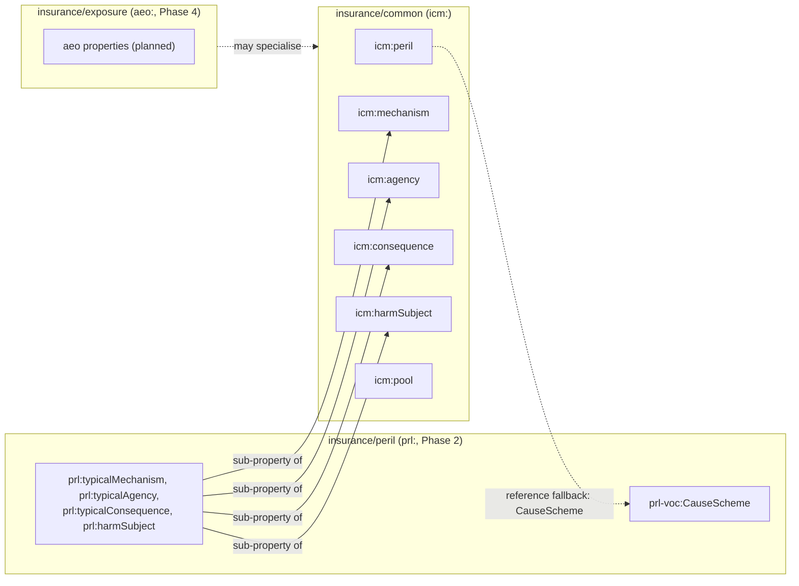
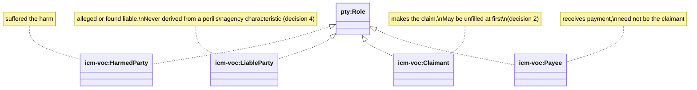

<!-- SPDX-License-Identifier: CC-BY-SA-4.0 -->

# Insurance Common (`icm:`)

Literate specification for `insurance/common`, built by the
[`applied-insurance-reference`](../../../../docs/developer/plans/applied-insurance-reference.md)
epic (AIR-1.2). Insurance scheme contracts shared by two or more of the applied insurance
domain's modules ([ADR-A98](../../../../docs/architecture/decisions/ADR-A98-applied-insurance-domain-layout.md)
decision 1, epic D7), and the liability role types of
[ADR-A102](../../../../docs/architecture/decisions/ADR-A102-liability-direction-from-party-roles.md).

## 1. Purpose and scope

Several of the applied insurance domain's modules need to classify something by peril, mechanism,
agency, consequence, harm subject or risk pool: a cause of loss, an exposure, a claim, a contract
term. Rather than each module inventing its own property and scheme contract for the same axis,
`insurance/common` declares six properties once, each with a [Vocabulary](../../../vocabulary/README.md)
`voc:SchemeContract`, so the peril vocabulary (Phase 2), the exposure ontology (Phase 4) and later
modules all read the same classification.



A module that only needs to classify by one axis (say, mechanism) without the full peril
vocabulary can depend on `insurance/common` alone, and specialise `icm:peril` with a sub-property
of its own (the peril module's `prl:typicalAgency` and the rest do exactly this, §4). None of the
six contracts binds a scheme here: a reference edition binds itself once it exists (the peril
vocabulary's AIR-2.2 onwards), and a deployment binds its own (ADR-A99 decision 1, the reference
is always the unscoped fallback).

Insurance Common imports Foundation, Vocabulary, Party and `classification/`, all by exact
version IRI, and is imported in turn by `insurance/peril` and later applied insurance modules.

## 2. Namespace and prefixes

```turtle-spec
@prefix icm:  <https://www.nebularis.org/neuro-semantic/insurance/common#> .
@prefix fnd:  <https://www.nebularis.org/neuro-semantic/lattice/foundation#> .
@prefix skos: <http://www.w3.org/2004/02/skos/core#> .
@prefix owl:  <http://www.w3.org/2002/07/owl#> .
@prefix rdf:  <http://www.w3.org/1999/02/22-rdf-syntax-ns#> .
@prefix rdfs: <http://www.w3.org/2000/01/rdf-schema#> .
```

## 3. Extraction contract

- `turtle-spec` blocks generate `spec/common.ttl`.
- `turtle-vocab` blocks generate `vocab/common-vocab.ttl`.
- No `turtle-shapes` blocks: this module declares no shapes of its own.

```bash
python3 tools/literate_extract.py ontology/applied/insurance/common/README.md \
    --layer applied/insurance/common --root . --check
```

## 4. The six shared classifications

```turtle-spec
<https://www.nebularis.org/neuro-semantic/insurance/common>
    rdf:type owl:Ontology ;
    owl:versionIRI <https://www.nebularis.org/neuro-semantic/insurance/common/0.5.0> ;
    rdfs:label "Insurance domain shared contracts"@en ;
    rdfs:comment "Insurance scheme contracts shared by two or more of the domain's modules (ADR-A98 decision 1, epic D7): peril, mechanism, agency, consequence, harm subject and pool classifications. The liability role types of ADR-A102 are declared in vocab/common-vocab.ttl, alongside these properties' scheme contracts. The loss event (AIR-4.4) and the liability direction scheme (Phase 5) are not yet declared here." ;
    owl:imports <https://www.nebularis.org/neuro-semantic/lattice/foundation/0.4.0> ,
                <https://www.nebularis.org/neuro-semantic/lattice/vocabulary/0.4.0> ,
                <https://www.nebularis.org/neuro-semantic/lattice/party/0.9.0> ,
                <https://www.nebularis.org/neuro-semantic/lattice/applied/classification/0.2.0> .

icm:peril a owl:ObjectProperty ;
    rdfs:range skos:Concept ;
    rdfs:label "peril"@en ;
    rdfs:comment "A classification by peril (initiating cause)." ;
    fnd:utility "Link anything needing a peril classification to a concept in a cause scheme, most often the reference peril vocabulary's prl-voc:CauseScheme. Declared with no domain, so peril, exposure and later modules may specialise it with a sub-property (for example aeo:peril rdfs:subPropertyOf icm:peril) rather than each inventing an unrelated one." .

icm:mechanism a owl:ObjectProperty ;
    rdfs:range skos:Concept ;
    rdfs:label "mechanism"@en ;
    rdfs:comment "A classification by mechanism of harm." ;
    fnd:utility "Link anything needing a mechanism classification to a concept in a mechanism scheme, for the same reason as icm:peril." .

icm:agency a owl:ObjectProperty ;
    rdfs:range skos:Concept ;
    rdfs:label "agency"@en ;
    rdfs:comment "A classification by agency (natural, accidental, negligent, malicious, sovereign, belligerent, undetermined)." ;
    fnd:utility "Link anything needing an agency classification to a concept in an agency scheme, for the same reason as icm:peril." .

icm:consequence a owl:ObjectProperty ;
    rdfs:range skos:Concept ;
    rdfs:label "consequence"@en ;
    rdfs:comment "A classification by consequence (head of loss)." ;
    fnd:utility "Link anything needing a consequence classification to a concept in a consequence scheme, for the same reason as icm:peril." .

icm:harmSubject a owl:ObjectProperty ;
    rdfs:range skos:Concept ;
    rdfs:label "harm subject"@en ;
    rdfs:comment "A classification by what was harmed." ;
    fnd:utility "Link anything needing a harm-subject classification to a concept in a harm-subject scheme, for the same reason as icm:peril. Never used to derive liability direction (ADR-A102 decision 4)." .

icm:pool a owl:ObjectProperty ;
    rdfs:range skos:Concept ;
    rdfs:label "pool"@en ;
    rdfs:comment "A classification by risk pool (a national terrorism or flood pool, for example)." ;
    fnd:utility "Link anything needing a pool classification to a concept in a pool scheme, for the same reason as icm:peril." .
```

| Contract | Constrains | Typically bound to (from Phase 2 onwards) |
|---|---|---|
| `icm-voc:PerilContract` | `icm:peril` | `prl-voc:CauseScheme` |
| `icm-voc:MechanismContract` | `icm:mechanism` | `prl-voc:MechanismScheme` |
| `icm-voc:AgencyContract` | `icm:agency` | `prl-voc:AgencyScheme` |
| `icm-voc:ConsequenceContract` | `icm:consequence` | `prl-voc:ConsequenceScheme` |
| `icm-voc:HarmSubjectContract` | `icm:harmSubject` | `prl-voc:HarmSubjectScheme` |
| `icm-voc:PoolContract` | `icm:pool` | the pools scheme (AIR-2.7) |

`icm:mechanism`/`icm:agency`/`icm:consequence`/`icm:harmSubject` mirror the peril vocabulary's
characteristic and companion axes ([ADR-A99](../../../../docs/architecture/decisions/ADR-A99-reference-vocabularies-and-peril-structure.md)
§3) at the domain-shared level, so a module that only needs to classify by one of these axes,
without the full peril vocabulary, can depend on `common/` alone.

```turtle-vocab
@prefix icm:     <https://www.nebularis.org/neuro-semantic/insurance/common#> .
@prefix icm-voc: <https://www.nebularis.org/neuro-semantic/insurance/common/vocab#> .
@prefix voc:     <https://www.nebularis.org/neuro-semantic/lattice/vocabulary#> .
@prefix fnd:     <https://www.nebularis.org/neuro-semantic/lattice/foundation#> .
@prefix pty:     <https://www.nebularis.org/neuro-semantic/lattice/party#> .
@prefix skos:    <http://www.w3.org/2004/02/skos/core#> .
@prefix owl:     <http://www.w3.org/2002/07/owl#> .
@prefix rdf:     <http://www.w3.org/1999/02/22-rdf-syntax-ns#> .
@prefix rdfs:    <http://www.w3.org/2000/01/rdf-schema#> .
@base <https://www.nebularis.org/neuro-semantic/insurance/common/vocab> .

<https://www.nebularis.org/neuro-semantic/insurance/common/vocab>
    rdf:type owl:Ontology ;
    owl:versionIRI <https://www.nebularis.org/neuro-semantic/insurance/common-vocab/0.5.0> ;
    owl:imports <https://www.nebularis.org/neuro-semantic/insurance/common/0.5.0> .

icm-voc:PerilContract a voc:SchemeContract ;
    fnd:hasIdentity icm-voc:PerilContract-identity ;
    fnd:hasGovernanceState fnd:Active ;
    skos:prefLabel "Peril scheme contract"@en ;
    voc:constrainsProperty icm:peril .

icm-voc:MechanismContract a voc:SchemeContract ;
    fnd:hasIdentity icm-voc:MechanismContract-identity ;
    fnd:hasGovernanceState fnd:Active ;
    skos:prefLabel "Mechanism scheme contract"@en ;
    voc:constrainsProperty icm:mechanism .

icm-voc:AgencyContract a voc:SchemeContract ;
    fnd:hasIdentity icm-voc:AgencyContract-identity ;
    fnd:hasGovernanceState fnd:Active ;
    skos:prefLabel "Agency scheme contract"@en ;
    voc:constrainsProperty icm:agency .

icm-voc:ConsequenceContract a voc:SchemeContract ;
    fnd:hasIdentity icm-voc:ConsequenceContract-identity ;
    fnd:hasGovernanceState fnd:Active ;
    skos:prefLabel "Consequence scheme contract"@en ;
    voc:constrainsProperty icm:consequence .

icm-voc:HarmSubjectContract a voc:SchemeContract ;
    fnd:hasIdentity icm-voc:HarmSubjectContract-identity ;
    fnd:hasGovernanceState fnd:Active ;
    skos:prefLabel "Harm subject scheme contract"@en ;
    voc:constrainsProperty icm:harmSubject .

icm-voc:PoolContract a voc:SchemeContract ;
    fnd:hasIdentity icm-voc:PoolContract-identity ;
    fnd:hasGovernanceState fnd:Active ;
    skos:prefLabel "Pool scheme contract"@en ;
    voc:constrainsProperty icm:pool .
```

## 5. The four liability role types (ADR-A102)



| Role | Meaning |
|---|---|
| `icm-voc:HarmedParty` | suffered the harm |
| `icm-voc:LiableParty` | alleged or found liable |
| `icm-voc:Claimant` | makes the claim |
| `icm-voc:Payee` | receives payment |

Each is a `pty:Role` `owl:NamedIndividual`, declared the same way [Party](../../../party/README.md)
declares its own roles (`pty:Obligor`, `pty:Obligee`). Contracts name role types and populations,
never people: at claim time, `pty:RoleOccupancy` instances of these roles are created and filled,
possibly unfilled at first if a notice names the role before an actor is known (ADR-A102 decision
2). Liability direction (first party, third party, insured against insured, derivative, fourth
party) is derived from filled occupancies and the relationship graph, never asserted, and never
from the peril vocabulary's agency characteristic (ADR-A102 decisions 3 and 4). The derivation
rules themselves are specified with the contract module (Phase 5).

```turtle-vocab
icm-voc:HarmedParty a owl:NamedIndividual , pty:Role ;
    rdfs:label "Harmed party"@en ;
    rdfs:comment "The role of having suffered the harm a cause of loss occasioned." ;
    fnd:utility "Type a pty:RoleOccupancy with this role for whoever was harmed, independently of who is alleged liable, who claims, or who is paid (ADR-A102)." .

icm-voc:LiableParty a owl:NamedIndividual , pty:Role ;
    rdfs:label "Liable party"@en ;
    rdfs:comment "The role of being alleged or found liable for the harm." ;
    fnd:utility "Type a pty:RoleOccupancy with this role for whoever is alleged or found liable. Distinct from the harmed party and from any peril's agency characteristic (ADR-A102 decision 4: agency is not direction)." .

icm-voc:Claimant a owl:NamedIndividual , pty:Role ;
    rdfs:label "Claimant"@en ;
    rdfs:comment "The role of making a claim under the contract." ;
    fnd:utility "Type a pty:RoleOccupancy with this role for whoever claims. May be created unfilled when a notice names the role before an actor is known (ADR-A102 decision 2)." .

icm-voc:Payee a owl:NamedIndividual , pty:Role ;
    rdfs:label "Payee"@en ;
    rdfs:comment "The role of receiving payment under the contract." ;
    fnd:utility "Type a pty:RoleOccupancy with this role for whoever is paid, which need not be the claimant (for example a loss payee)." .
```

## 6. What arrives later

| Content | Arrives in |
|---|---|
| units of measure (QUDT-aligned), for exposure values and intensity thresholds | AIR-2.6 |
| ISO 4217 currencies | AIR-2.6 |
| class of business, industry, domicile and legal form on the legal entity | AIR-4.x (Phase 4) |
| the loss event, shared by exposure and claims | AIR-4.4 |
| the liability direction scheme (ADR-A102) | Phase 5 |

## 7. Documentation rule

Every concept this module's vocabulary publishes (units, currencies, class-of-business codes from
AIR-2.6 onwards) follows the documentation rule of
[`insurance/peril`](../peril/README.md#7-documentation-rule): at least one `skos:note` naming the
published standards, scales or sources it follows, and `rdfs:seeAlso` to a stable public entry
where one exists. No concept is published by this slice, so the rule has nothing to check yet.

## 8. Fixture and tests

This module declares no shapes of its own, so it has no dedicated example fixture.
[`tools/test_peril_vocabulary.py`](../../../../tools/test_peril_vocabulary.py) loads `common/` as
part of the peril vocabulary's import closure, and checks the four bound contracts conform to
Vocabulary's own shapes (AIR-2.2). [`tools/test_applied_shared_contracts.py`](../../../../tools/test_applied_shared_contracts.py)
checks this module parses, every import resolves, and the six contracts and four role individuals
exist with the right types.

## 9. Release notes

| Version | Change |
|---|---|
| `0.1.0` | AIR-1.2: the six shared classification properties, the six scheme contracts, the four liability role types |
| `0.5.0` | re-pinned by the computable-contract-substrate unit's Foundation, Vocabulary and Party cascades (no content change) |
