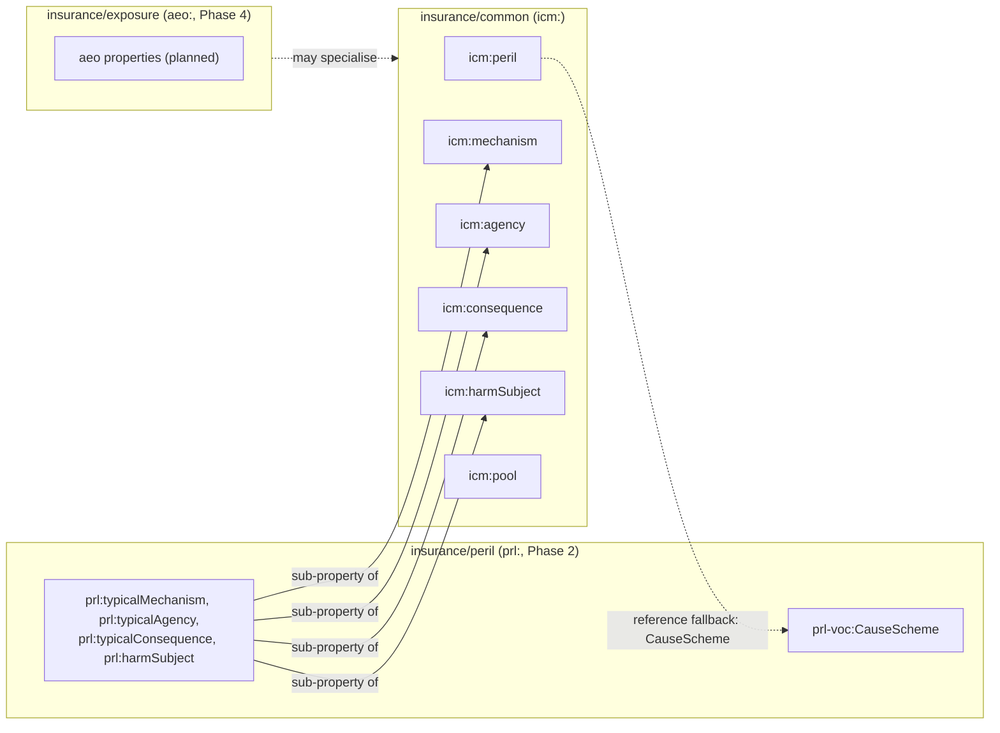

<!-- SPDX-License-Identifier: CC-BY-SA-4.0 -->

# Insurance Common (`icm:`)

Literate specification for `insurance/common`, built with the
applied insurance modules. Insurance scheme contracts shared by two or more of the applied insurance
domain's modules ([ADR-A98](../../../../docs/architecture/decisions/ADR-A98-applied-layout-and-insurance-modules.md)
decision 1, epic D7), and the liability role types of
[ADR-A102](../../../../docs/architecture/decisions/ADR-A102-liability-direction-from-party-roles.md).

## 1. Purpose and scope

Several of the applied insurance domain's modules need to classify something by peril, mechanism,
agency, consequence, harm subject or risk pool: a cause of loss, an exposure, a claim, a contract
term. Rather than each module inventing its own property and scheme contract for the same axis,
`insurance/common` declares six properties once, each with a [Vocabulary](../../../vocabulary/README.md)
`voc:SchemeContract`, so the peril vocabulary (Phase 2), the exposure ontology (Phase 4) and later
modules all read the same classification.



A module that only needs to classify by one axis (say, mechanism) without the full peril
vocabulary can depend on `insurance/common` alone, and specialise `icm:peril` with a sub-property
of its own (the peril module's `prl:typicalAgency` and the rest do exactly this, §4). None of the
six contracts binds a scheme here: a reference edition binds itself once it exists (the peril
vocabulary's AIR-2.2 onwards), and a deployment binds its own (ADR-A99 decision 1, the reference
is always the unscoped fallback).

Insurance Common imports Foundation, Vocabulary, Party and `classification/`, all by exact
version IRI, and is imported in turn by `insurance/peril` and later applied insurance modules.

## 2. Namespace and prefixes

```turtle-spec
@prefix icm:  <https://www.nebularis.org/neuro-semantic/insurance/common#> .
@prefix fnd:  <https://www.nebularis.org/neuro-semantic/lattice/foundation#> .
@prefix skos: <http://www.w3.org/2004/02/skos/core#> .
@prefix owl:  <http://www.w3.org/2002/07/owl#> .
@prefix rdf:  <http://www.w3.org/1999/02/22-rdf-syntax-ns#> .
@prefix rdfs: <http://www.w3.org/2000/01/rdf-schema#> .
```

## 3. Extraction contract

- `turtle-spec` blocks generate `spec/common.ttl`.
- `turtle-vocab` blocks generate `vocab/common-vocab.ttl`.
- No `turtle-shapes` blocks: this module declares no shapes of its own.

```bash
mise exec -- python tools/literate_extract.py ontology/applied/insurance/common/README.md \
    --layer applied/insurance/common --root . --check
```

The module's entry in the [repository catalogue](../../../../repository-catalogue.md)
([ADR-A121](../../../../docs/architecture/decisions/ADR-A121-repository-catalogue.md)) follows.

```toml repository-catalogue
[module]
kind = "applied"
roles = ["spec", "vocab"]

[module.extract]
spec = ["spec/common.ttl"]
vocab = ["vocab/common-vocab.ttl"]
```

## 4. The six shared classifications

```turtle-spec
<https://www.nebularis.org/neuro-semantic/insurance/common>
    rdf:type owl:Ontology ;
    owl:versionIRI <https://www.nebularis.org/neuro-semantic/insurance/common/0.8.0> ;
    rdfs:label "Insurance domain shared contracts"@en ;
    rdfs:comment "Insurance scheme contracts shared by two or more of the domain's modules (ADR-A98 decision 1, epic D7): peril, mechanism, agency, consequence, harm subject and pool classifications. The liability role types of ADR-A102 are declared in vocab/common-vocab.ttl, alongside these properties' scheme contracts. The loss event (AIR-4.4) and the liability direction scheme (Phase 5) are not yet declared here." ;
    owl:imports <https://www.nebularis.org/neuro-semantic/lattice/foundation/0.19.0> ,
                <https://www.nebularis.org/neuro-semantic/lattice/vocabulary/0.19.0> ,
                <https://www.nebularis.org/neuro-semantic/lattice/party/0.19.0> ,
                <https://www.nebularis.org/neuro-semantic/lattice/applied/classification/0.4.0> .

icm:peril a owl:ObjectProperty ;
    rdfs:range skos:Concept ;
    rdfs:label "peril"@en ;
    rdfs:comment "A classification by peril (initiating cause)." ;
    fnd:utility "Link anything needing a peril classification to a concept in a cause scheme, most often the reference peril vocabulary's prl-voc:CauseScheme. Declared with no domain, so peril, exposure and later modules may specialise it with a sub-property (for example aeo:peril rdfs:subPropertyOf icm:peril) rather than each inventing an unrelated one." .

icm:mechanism a owl:ObjectProperty ;
    rdfs:range skos:Concept ;
    rdfs:label "mechanism"@en ;
    rdfs:comment "A classification by mechanism of harm." ;
    fnd:utility "Link anything needing a mechanism classification to a concept in a mechanism scheme, for the same reason as icm:peril." .

icm:agency a owl:ObjectProperty ;
    rdfs:range skos:Concept ;
    rdfs:label "agency"@en ;
    rdfs:comment "A classification by agency (natural, accidental, negligent, malicious, sovereign, belligerent, undetermined)." ;
    fnd:utility "Link anything needing an agency classification to a concept in an agency scheme, for the same reason as icm:peril." .

icm:consequence a owl:ObjectProperty ;
    rdfs:range skos:Concept ;
    rdfs:label "consequence"@en ;
    rdfs:comment "A classification by consequence (head of loss)." ;
    fnd:utility "Link anything needing a consequence classification to a concept in a consequence scheme, for the same reason as icm:peril." .

icm:harmSubject a owl:ObjectProperty ;
    rdfs:range skos:Concept ;
    rdfs:label "harm subject"@en ;
    rdfs:comment "A classification by what was harmed." ;
    fnd:utility "Link anything needing a harm-subject classification to a concept in a harm-subject scheme, for the same reason as icm:peril. Never used to derive liability direction (ADR-A102 decision 4)." .

icm:pool a owl:ObjectProperty ;
    rdfs:range skos:Concept ;
    rdfs:label "pool"@en ;
    rdfs:comment "A classification by risk pool (a national terrorism or flood pool, for example)." ;
    fnd:utility "Link anything needing a pool classification to a concept in a pool scheme, for the same reason as icm:peril." .

icm:classOfBusiness a owl:ObjectProperty ;
    rdfs:range skos:Concept ;
    rdfs:label "class of business"@en ;
    rdfs:comment "A classification by class or line of business (AIR-4.4)." ;
    fnd:utility "Link anything needing a class of business to a concept in a class of business scheme, for the same reason as icm:peril. Declared with no domain, so exposure, claims and the contract module may specialise it. A deployment binds an edition by territory scope, for example the lines of business of Solvency II's Annex I." .

icm:LossEvent a owl:Class ;
    rdfs:subClassOf fnd:Evidenced , fnd:TemporallyScoped , fnd:NaturallyKeyed ;
    rdfs:label "Loss event"@en ;
    rdfs:comment "One occurrence in the world (a storm, an earthquake, a cyber campaign) that many losses can share (AIR-4.4)." ;
    fnd:utility "Subject: a loss event. Its temporal scope is the event's span, its perils are icm:peril values and its territories cls:territory values. Identify it by a natural key such as a GLIDE number (icm-voc:GlideNumber). It is not an insurance occurrence: grouping losses into one occurrence under a contract is the contract's rule, not this class's." .
```

| Contract | Constrains | Typically bound to (from Phase 2 onwards) |
|---|---|---|
| `icm-voc:PerilContract` | `icm:peril` | `prl-voc:CauseScheme` |
| `icm-voc:MechanismContract` | `icm:mechanism` | `prl-voc:MechanismScheme` |
| `icm-voc:AgencyContract` | `icm:agency` | `prl-voc:AgencyScheme` |
| `icm-voc:ConsequenceContract` | `icm:consequence` | `prl-voc:ConsequenceScheme` |
| `icm-voc:HarmSubjectContract` | `icm:harmSubject` | `prl-voc:HarmSubjectScheme` |
| `icm-voc:PoolContract` | `icm:pool` | the pools scheme (AIR-2.7) |

`icm:mechanism`/`icm:agency`/`icm:consequence`/`icm:harmSubject` mirror the peril vocabulary's
characteristic and companion axes ([ADR-A99](../../../../docs/architecture/decisions/ADR-A99-reference-vocabularies-and-peril-structure.md)
§3) at the domain-shared level, so a module that only needs to classify by one of these axes,
without the full peril vocabulary, can depend on `common/` alone.

```turtle-vocab
@prefix icm:     <https://www.nebularis.org/neuro-semantic/insurance/common#> .
@prefix icm-voc: <https://www.nebularis.org/neuro-semantic/insurance/common/vocab#> .
@prefix voc:     <https://www.nebularis.org/neuro-semantic/lattice/vocabulary#> .
@prefix fnd:     <https://www.nebularis.org/neuro-semantic/lattice/foundation#> .
@prefix pty:     <https://www.nebularis.org/neuro-semantic/lattice/party#> .
@prefix skos:    <http://www.w3.org/2004/02/skos/core#> .
@prefix owl:     <http://www.w3.org/2002/07/owl#> .
@prefix rdf:     <http://www.w3.org/1999/02/22-rdf-syntax-ns#> .
@prefix rdfs:    <http://www.w3.org/2000/01/rdf-schema#> .
@base <https://www.nebularis.org/neuro-semantic/insurance/common/vocab> .

<https://www.nebularis.org/neuro-semantic/insurance/common/vocab>
    rdf:type owl:Ontology ;
    owl:versionIRI <https://www.nebularis.org/neuro-semantic/insurance/common-vocab/0.8.0> ;
    owl:imports <https://www.nebularis.org/neuro-semantic/insurance/common/0.8.0> .

icm-voc:PerilContract a voc:SchemeContract ;
    fnd:hasIdentity icm-voc:PerilContract-identity ;
    fnd:hasGovernanceState fnd:Active ;
    skos:prefLabel "Peril scheme contract"@en ;
    voc:constrainsProperty icm:peril .

icm-voc:MechanismContract a voc:SchemeContract ;
    fnd:hasIdentity icm-voc:MechanismContract-identity ;
    fnd:hasGovernanceState fnd:Active ;
    skos:prefLabel "Mechanism scheme contract"@en ;
    voc:constrainsProperty icm:mechanism .

icm-voc:AgencyContract a voc:SchemeContract ;
    fnd:hasIdentity icm-voc:AgencyContract-identity ;
    fnd:hasGovernanceState fnd:Active ;
    skos:prefLabel "Agency scheme contract"@en ;
    voc:constrainsProperty icm:agency .

icm-voc:ConsequenceContract a voc:SchemeContract ;
    fnd:hasIdentity icm-voc:ConsequenceContract-identity ;
    fnd:hasGovernanceState fnd:Active ;
    skos:prefLabel "Consequence scheme contract"@en ;
    voc:constrainsProperty icm:consequence .

icm-voc:HarmSubjectContract a voc:SchemeContract ;
    fnd:hasIdentity icm-voc:HarmSubjectContract-identity ;
    fnd:hasGovernanceState fnd:Active ;
    skos:prefLabel "Harm subject scheme contract"@en ;
    voc:constrainsProperty icm:harmSubject .

icm-voc:PoolContract a voc:SchemeContract ;
    fnd:hasIdentity icm-voc:PoolContract-identity ;
    fnd:hasGovernanceState fnd:Active ;
    skos:prefLabel "Pool scheme contract"@en ;
    voc:constrainsProperty icm:pool .

icm-voc:ClassOfBusinessContract a voc:SchemeContract ;
    fnd:hasIdentity icm-voc:ClassOfBusinessContract-identity ;
    fnd:hasGovernanceState fnd:Active ;
    skos:prefLabel "Class of business scheme contract"@en ;
    skos:note "Follows the lines of business of Annex I to Commission Delegated Regulation (EU) 2015/35 (Solvency II) as the model edition a deployment binds. No reference scheme here: unbound until a deployment binds an edition by territory scope. AIR-4.6 binds an example edition."@en ;
    voc:constrainsProperty icm:classOfBusiness .

icm-voc:GlideNumber a fnd:KeyScheme ;
    rdfs:label "GLIDE numbers"@en ;
    skos:note "The GLobal IDEntifier number the Asian Disaster Reduction Center assigns to a disaster, in the form of a hazard type code, a year, a six digit serial number and an ISO 3166 country code (for example FL-2002-000217-AFG). The open reference key for a loss event. Insurance industry event identifiers (catastrophe serial numbers, industry loss index event codes) are key schemes their publishers own, declared where they are used (AIR-4.6's examples)."@en ;
    fnd:reissuesValues false ;
    fnd:sensitiveDataScheme false ;
    fnd:valuePattern "^[A-Z]{2,3}-[0-9]{4}-[0-9]{6}-[A-Z]{3}$" ;
    fnd:keyNormalisation "NfkcTrimUppercase" .
```

## 5. The four liability role types (ADR-A102)


| Role | Meaning |
|---|---|
| `icm-voc:HarmedParty` | suffered the harm |
| `icm-voc:LiableParty` | alleged or found liable |
| `icm-voc:Claimant` | makes the claim |
| `icm-voc:Payee` | receives payment |

Each is a `pty:Role` `owl:NamedIndividual`, declared the same way [Party](../../../party/README.md)
declares its own roles (`pty:Obligor`, `pty:Obligee`). Contracts name role types and populations,
never people: at claim time, `pty:RoleOccupancy` instances of these roles are created and filled,
possibly unfilled at first if a notice names the role before an actor is known (ADR-A102 decision
2). Liability direction (first party, third party, insured against insured, derivative, fourth
party) is derived from filled occupancies and the relationship graph, never asserted, and never
from the peril vocabulary's agency characteristic (ADR-A102 decisions 3 and 4). The derivation
rules themselves are specified with the contract module (Phase 5).

```turtle-vocab
icm-voc:HarmedParty a owl:NamedIndividual , pty:Role ;
    rdfs:label "Harmed party"@en ;
    rdfs:comment "The role of having suffered the harm a cause of loss occasioned." ;
    fnd:utility "Type a pty:RoleOccupancy with this role for whoever was harmed, independently of who is alleged liable, who claims, or who is paid (ADR-A102)." .

icm-voc:LiableParty a owl:NamedIndividual , pty:Role ;
    rdfs:label "Liable party"@en ;
    rdfs:comment "The role of being alleged or found liable for the harm." ;
    fnd:utility "Type a pty:RoleOccupancy with this role for whoever is alleged or found liable. Distinct from the harmed party and from any peril's agency characteristic (ADR-A102 decision 4: agency is not direction)." .

icm-voc:Claimant a owl:NamedIndividual , pty:Role ;
    rdfs:label "Claimant"@en ;
    rdfs:comment "The role of making a claim under the contract." ;
    fnd:utility "Type a pty:RoleOccupancy with this role for whoever claims. May be created unfilled when a notice names the role before an actor is known (ADR-A102 decision 2)." .

icm-voc:Payee a owl:NamedIndividual , pty:Role ;
    rdfs:label "Payee"@en ;
    rdfs:comment "The role of receiving payment under the contract." ;
    fnd:utility "Type a pty:RoleOccupancy with this role for whoever is paid, which need not be the claimant (for example a loss payee)." .
```

## 6. Units and currencies (AIR-2.6)

Quantification ships no unit inventory of its own (its substrate role is the value-space
machinery, not a catalogue of units). Exposure values and intensity thresholds both need units, so
they go here, the lowest level that covers both the peril vocabulary and the exposure ontology
(ADR-A98 decision 5), and would move to a cross-domain module if a second domain needed them.

Each physical unit is a `qnt:Unit`, `skos:exactMatch` to its [QUDT](http://qudt.org/vocab/unit/)
unit, with a `skos:note` naming the SI definition or the convention it follows. A measure's
averaging period or scale (for example a 1-minute versus 10-minute sustained wind) is part of the
*measure*, never of the unit (`insurance/peril`'s AIR-2.6, sketch §6.4): the units below are plain
physical units, reused by any measure that needs them.

| Unit family | Units (canonical first) |
|---|---|
| acceleration | `icm-voc:G` (standard gravity), `icm-voc:MPerSec2` |
| speed | `icm-voc:MPerSec`, `icm-voc:Knot`, `icm-voc:MilePerHour`, `icm-voc:KiloMPerHour` |
| pressure | `icm-voc:KiloPascal`, `icm-voc:HectoPascal` |
| length | `icm-voc:Metre`, `icm-voc:MilliMetre`, `icm-voc:KiloMetre`, `icm-voc:Foot`, `icm-voc:Mile` |
| area | `icm-voc:SquareMetre`, `icm-voc:SquareFoot` |
| mass per area | `icm-voc:KiloGramPerSquareMetre` |
| power per length | `icm-voc:KiloWattPerMetre` |
| temperature | `icm-voc:DegreeCelsius` |
| duration | `icm-voc:Hour`, `icm-voc:Day`, `icm-voc:Month`, `icm-voc:Year` (the last two `qnt:CalendarUnit`s, ADR-A94: their length in days depends on the calendar and the date counted from, so any conversion to days is Contextual) |

Four conversions, each a `qnt:Conversion` with its exact factor: 1 knot = 1852/3600 m/s, 1 mph =
0.44704 m/s, 1 g = 9.80665 m/s², 1 hPa = 0.1 kPa.

### Currencies

Exposure, loss and requirement amounts need money units. Every active [ISO 4217](https://www.iso.org/iso-4217-currency-codes.html)
List One currency is a `qnt:Unit` on one money value space, `icm-voc:Money`: its alphabetic code as
local name (`icm-voc:USD`), its numeric code as `skos:notation`, its English name as
`skos:prefLabel`, and a note citing ISO 4217 and giving its minor unit (the number of decimal
places: 2 for most currencies, 0 for the yen, 3 for the dinar). Funds codes and precious metals
(`XAU`, `XDR` and the like) are left out, and the money space's own note says so. No conversion is
declared between currencies: a rate depends on a date and a source, so it is a `qnt:Conversion`
under a `qnt:ConversionContext` (Quantification's own pattern), authored by whoever converts.

**Scope of this slice's list.** The table below is a working draft of the major active
currencies, drafted from the standard. It is not yet checked against the maintenance agency's
current published List One for completeness (every one of the roughly 170 active codes), which is
recorded as open in the Handoff for R to complete or confirm at verification, per the brief's own
division of labour (S drafts, R checks the edition and completeness).

```turtle-vocab
@prefix icm:     <https://www.nebularis.org/neuro-semantic/insurance/common#> .
@prefix icm-voc: <https://www.nebularis.org/neuro-semantic/insurance/common/vocab#> .
@prefix qnt:     <https://www.nebularis.org/neuro-semantic/lattice/quantification#> .
@prefix skos:    <http://www.w3.org/2004/02/skos/core#> .
@prefix rdfs:    <http://www.w3.org/2000/01/rdf-schema#> .
@prefix fnd:     <https://www.nebularis.org/neuro-semantic/lattice/foundation#> .

#################################################################
#    Units (AIR-2.6). Plain qnt:Unit individuals: no value space
#    of their own here, since each measure that uses one declares
#    its own qnt:ValueSpace (insurance/peril's AIR-2.6).
#################################################################

icm-voc:G a qnt:Unit ;
    skos:exactMatch <http://qudt.org/vocab/unit/G> ;
    rdfs:label "standard gravity"@en ;
    skos:note "9.80665 m/s², the standard acceleration due to gravity."@en .
icm-voc:MPerSec2 a qnt:Unit ;
    skos:exactMatch <http://qudt.org/vocab/unit/M-PER-SEC2> ;
    rdfs:label "metre per second squared"@en ;
    skos:note "The SI derived unit of acceleration."@en .
icm-voc:MPerSec a qnt:Unit ;
    skos:exactMatch <http://qudt.org/vocab/unit/M-PER-SEC> ;
    rdfs:label "metre per second"@en ;
    skos:note "The SI derived unit of speed."@en .
icm-voc:Knot a qnt:Unit ;
    skos:exactMatch <http://qudt.org/vocab/unit/KN> ;
    rdfs:label "knot"@en ;
    skos:note "One nautical mile per hour, 1852/3600 m/s. The IHO's preferred abbreviation."@en .
icm-voc:MilePerHour a qnt:Unit ;
    skos:exactMatch <http://qudt.org/vocab/unit/MI-PER-HR> ;
    rdfs:label "mile per hour"@en ;
    skos:note "0.44704 m/s, following the US customary mile."@en .
icm-voc:KiloMPerHour a qnt:Unit ;
    skos:exactMatch <http://qudt.org/vocab/unit/KiloM-PER-HR> ;
    rdfs:label "kilometre per hour"@en ;
    skos:note "The SI-derived metric speed unit most national weather services report wind speed in."@en .
icm-voc:KiloPascal a qnt:Unit ;
    skos:exactMatch <http://qudt.org/vocab/unit/KiloPA> ;
    rdfs:label "kilopascal"@en ;
    skos:note "1000 pascals, the SI derived unit of pressure with the kilo prefix."@en .
icm-voc:HectoPascal a qnt:Unit ;
    skos:exactMatch <http://qudt.org/vocab/unit/HectoPA> ;
    rdfs:label "hectopascal"@en ;
    skos:note "100 pascals, equal to one millibar, the unit meteorology reports atmospheric pressure in."@en .
icm-voc:Metre a qnt:Unit ;
    skos:exactMatch <http://qudt.org/vocab/unit/M> ;
    rdfs:label "metre"@en ;
    skos:note "The SI base unit of length."@en .
icm-voc:MilliMetre a qnt:Unit ;
    skos:exactMatch <http://qudt.org/vocab/unit/MilliM> ;
    rdfs:label "millimetre"@en ;
    skos:note "One thousandth of a metre."@en .
icm-voc:KiloMetre a qnt:Unit ;
    skos:exactMatch <http://qudt.org/vocab/unit/KiloM> ;
    rdfs:label "kilometre"@en ;
    skos:note "One thousand metres."@en .
icm-voc:Foot a qnt:Unit ;
    skos:exactMatch <http://qudt.org/vocab/unit/FT> ;
    rdfs:label "foot"@en ;
    skos:note "0.3048 m, the international foot."@en .
icm-voc:Mile a qnt:Unit ;
    skos:exactMatch <http://qudt.org/vocab/unit/MI> ;
    rdfs:label "mile"@en ;
    skos:note "1609.344 m, the international statute mile."@en .
icm-voc:SquareMetre a qnt:Unit ;
    skos:exactMatch <http://qudt.org/vocab/unit/M2> ;
    rdfs:label "square metre"@en ;
    skos:note "The SI derived unit of area."@en .
icm-voc:SquareFoot a qnt:Unit ;
    skos:exactMatch <http://qudt.org/vocab/unit/FT2> ;
    rdfs:label "square foot"@en ;
    skos:note "0.09290304 m², the square of the international foot."@en .
icm-voc:KiloGramPerSquareMetre a qnt:Unit ;
    skos:exactMatch <http://qudt.org/vocab/unit/KiloGM-PER-M2> ;
    rdfs:label "kilogram per square metre"@en ;
    skos:note "The SI derived unit of areal density, used for snow and ash load."@en .
icm-voc:KiloWattPerMetre a qnt:Unit ;
    skos:exactMatch <http://qudt.org/vocab/unit/KiloW-PER-M> ;
    rdfs:label "kilowatt per metre"@en ;
    skos:note "The unit of Byram's fireline intensity, the rate of heat release per unit length of fire front."@en .
icm-voc:DegreeCelsius a qnt:Unit ;
    skos:exactMatch <http://qudt.org/vocab/unit/DEG_C> ;
    rdfs:label "degree Celsius"@en ;
    skos:note "The SI-accepted unit of temperature on the Celsius scale."@en .
icm-voc:Hour a qnt:Unit ;
    skos:exactMatch <http://qudt.org/vocab/unit/HR> ;
    rdfs:label "hour"@en ;
    skos:note "3600 seconds, an SI-accepted unit of duration."@en .
icm-voc:Day a qnt:Unit ;
    skos:exactMatch <http://qudt.org/vocab/unit/DAY> ;
    rdfs:label "day"@en ;
    skos:note "24 hours, an SI-accepted unit of duration."@en .
icm-voc:Month a qnt:CalendarUnit ;
    skos:exactMatch <http://qudt.org/vocab/unit/MO> ;
    rdfs:label "month"@en ;
    skos:note "A calendar unit (ADR-A94): its length in days depends on the calendar and the date counted from, so any conversion to days is Contextual, naming the calendar and the starting position."@en .
icm-voc:Year a qnt:CalendarUnit ;
    skos:exactMatch <http://qudt.org/vocab/unit/YR> ;
    rdfs:label "year"@en ;
    skos:note "A calendar unit (ADR-A94), for the same reason as icm-voc:Month."@en .

icm-voc:KnotConversion a qnt:Conversion ;
    qnt:fromUnit icm-voc:Knot ; qnt:toUnit icm-voc:MPerSec ;
    qnt:conversionKind qnt:Exact ;
    skos:note "1 knot = 1852/3600 m/s exactly, by the definition of the international nautical mile."@en .
icm-voc:MphConversion a qnt:Conversion ;
    qnt:fromUnit icm-voc:MilePerHour ; qnt:toUnit icm-voc:MPerSec ;
    qnt:conversionKind qnt:Exact ;
    skos:note "1 mph = 0.44704 m/s exactly, by the definition of the international mile."@en .
icm-voc:GConversion a qnt:Conversion ;
    qnt:fromUnit icm-voc:G ; qnt:toUnit icm-voc:MPerSec2 ;
    qnt:conversionKind qnt:Exact ;
    skos:note "1 g = 9.80665 m/s² exactly, the standard acceleration due to gravity (CGPM 1901)."@en .
icm-voc:HpaConversion a qnt:Conversion ;
    qnt:fromUnit icm-voc:HectoPascal ; qnt:toUnit icm-voc:KiloPascal ;
    qnt:conversionKind qnt:Exact ;
    skos:note "1 hPa = 0.1 kPa exactly, both decimal multiples of the pascal."@en .

#################################################################
#    Currencies (AIR-2.6, Q14). Every active ISO 4217 List One
#    currency, as a qnt:Unit on one money space. Draft list: see
#    the README's "Scope of this slice's list" note.
#################################################################

icm-voc:Money a qnt:ValueSpace ;
    qnt:spaceKey "iso-4217-money" ; qnt:orderKind qnt:NoOrder ; qnt:densityKind qnt:Dense ;
    qnt:spaceHash "iso-4217-money-v1" ;
    skos:note "Every active ISO 4217 List One currency. Funds codes and precious metals (XAU, XDR and the like) are left out. No conversion is declared between currencies here: a rate depends on a date and a source, so it is a qnt:Conversion under a qnt:ConversionContext, authored by whoever converts."@en .

icm-voc:USD a qnt:Unit ; qnt:onSpace icm-voc:Money ; skos:exactMatch <http://qudt.org/vocab/unit/CCY_USD> ; skos:notation "840" ; skos:prefLabel "US Dollar"@en ;
    skos:note "ISO 4217. Minor unit 2 (cents)."@en .
icm-voc:EUR a qnt:Unit ; qnt:onSpace icm-voc:Money ; skos:exactMatch <http://qudt.org/vocab/unit/CCY_EUR> ; skos:notation "978" ; skos:prefLabel "Euro"@en ;
    skos:note "ISO 4217. Minor unit 2 (cents)."@en .
icm-voc:GBP a qnt:Unit ; qnt:onSpace icm-voc:Money ; skos:exactMatch <http://qudt.org/vocab/unit/CCY_GBP> ; skos:notation "826" ; skos:prefLabel "Pound Sterling"@en ;
    skos:note "ISO 4217. Minor unit 2 (pence)."@en .
icm-voc:JPY a qnt:Unit ; qnt:onSpace icm-voc:Money ; skos:exactMatch <http://qudt.org/vocab/unit/CCY_JPY> ; skos:notation "392" ; skos:prefLabel "Yen"@en ;
    skos:note "ISO 4217. Minor unit 0."@en .
icm-voc:CHF a qnt:Unit ; qnt:onSpace icm-voc:Money ; skos:exactMatch <http://qudt.org/vocab/unit/CCY_CHF> ; skos:notation "756" ; skos:prefLabel "Swiss Franc"@en ;
    skos:note "ISO 4217. Minor unit 2 (centimes)."@en .
icm-voc:CAD a qnt:Unit ; qnt:onSpace icm-voc:Money ; skos:exactMatch <http://qudt.org/vocab/unit/CCY_CAD> ; skos:notation "124" ; skos:prefLabel "Canadian Dollar"@en ;
    skos:note "ISO 4217. Minor unit 2 (cents)."@en .
icm-voc:AUD a qnt:Unit ; qnt:onSpace icm-voc:Money ; skos:exactMatch <http://qudt.org/vocab/unit/CCY_AUD> ; skos:notation "036" ; skos:prefLabel "Australian Dollar"@en ;
    skos:note "ISO 4217. Minor unit 2 (cents)."@en .
icm-voc:NZD a qnt:Unit ; qnt:onSpace icm-voc:Money ; skos:exactMatch <http://qudt.org/vocab/unit/CCY_NZD> ; skos:notation "554" ; skos:prefLabel "New Zealand Dollar"@en ;
    skos:note "ISO 4217. Minor unit 2 (cents)."@en .
icm-voc:CNY a qnt:Unit ; qnt:onSpace icm-voc:Money ; skos:exactMatch <http://qudt.org/vocab/unit/CCY_CNY> ; skos:notation "156" ; skos:prefLabel "Yuan Renminbi"@en ;
    skos:note "ISO 4217. Minor unit 2 (jiao/fen)."@en .
icm-voc:HKD a qnt:Unit ; qnt:onSpace icm-voc:Money ; skos:exactMatch <http://qudt.org/vocab/unit/CCY_HKD> ; skos:notation "344" ; skos:prefLabel "Hong Kong Dollar"@en ;
    skos:note "ISO 4217. Minor unit 2 (cents)."@en .
icm-voc:SGD a qnt:Unit ; qnt:onSpace icm-voc:Money ; skos:exactMatch <http://qudt.org/vocab/unit/CCY_SGD> ; skos:notation "702" ; skos:prefLabel "Singapore Dollar"@en ;
    skos:note "ISO 4217. Minor unit 2 (cents)."@en .
icm-voc:INR a qnt:Unit ; qnt:onSpace icm-voc:Money ; skos:exactMatch <http://qudt.org/vocab/unit/CCY_INR> ; skos:notation "356" ; skos:prefLabel "Indian Rupee"@en ;
    skos:note "ISO 4217. Minor unit 2 (paise)."@en .
icm-voc:KRW a qnt:Unit ; qnt:onSpace icm-voc:Money ; skos:exactMatch <http://qudt.org/vocab/unit/CCY_KRW> ; skos:notation "410" ; skos:prefLabel "Won"@en ;
    skos:note "ISO 4217. Minor unit 0."@en .
icm-voc:SEK a qnt:Unit ; qnt:onSpace icm-voc:Money ; skos:exactMatch <http://qudt.org/vocab/unit/CCY_SEK> ; skos:notation "752" ; skos:prefLabel "Swedish Krona"@en ;
    skos:note "ISO 4217. Minor unit 2 (ore)."@en .
icm-voc:NOK a qnt:Unit ; qnt:onSpace icm-voc:Money ; skos:exactMatch <http://qudt.org/vocab/unit/CCY_NOK> ; skos:notation "578" ; skos:prefLabel "Norwegian Krone"@en ;
    skos:note "ISO 4217. Minor unit 2 (ore)."@en .
icm-voc:DKK a qnt:Unit ; qnt:onSpace icm-voc:Money ; skos:exactMatch <http://qudt.org/vocab/unit/CCY_DKK> ; skos:notation "208" ; skos:prefLabel "Danish Krone"@en ;
    skos:note "ISO 4217. Minor unit 2 (ore)."@en .
icm-voc:ZAR a qnt:Unit ; qnt:onSpace icm-voc:Money ; skos:exactMatch <http://qudt.org/vocab/unit/CCY_ZAR> ; skos:notation "710" ; skos:prefLabel "Rand"@en ;
    skos:note "ISO 4217. Minor unit 2 (cents)."@en .
icm-voc:BRL a qnt:Unit ; qnt:onSpace icm-voc:Money ; skos:exactMatch <http://qudt.org/vocab/unit/CCY_BRL> ; skos:notation "986" ; skos:prefLabel "Brazilian Real"@en ;
    skos:note "ISO 4217. Minor unit 2 (centavos)."@en .
icm-voc:MXN a qnt:Unit ; qnt:onSpace icm-voc:Money ; skos:exactMatch <http://qudt.org/vocab/unit/CCY_MXN> ; skos:notation "484" ; skos:prefLabel "Mexican Peso"@en ;
    skos:note "ISO 4217. Minor unit 2 (centavos)."@en .
icm-voc:AED a qnt:Unit ; qnt:onSpace icm-voc:Money ; skos:exactMatch <http://qudt.org/vocab/unit/CCY_AED> ; skos:notation "784" ; skos:prefLabel "UAE Dirham"@en ;
    skos:note "ISO 4217. Minor unit 2 (fils)."@en .
icm-voc:SAR a qnt:Unit ; qnt:onSpace icm-voc:Money ; skos:exactMatch <http://qudt.org/vocab/unit/CCY_SAR> ; skos:notation "682" ; skos:prefLabel "Saudi Riyal"@en ;
    skos:note "ISO 4217. Minor unit 2 (halalas)."@en .
icm-voc:KWD a qnt:Unit ; qnt:onSpace icm-voc:Money ; skos:exactMatch <http://qudt.org/vocab/unit/CCY_KWD> ; skos:notation "414" ; skos:prefLabel "Kuwaiti Dinar"@en ;
    skos:note "ISO 4217. Minor unit 3 (fils), one of the few three-decimal currencies."@en .
icm-voc:BHD a qnt:Unit ; qnt:onSpace icm-voc:Money ; skos:exactMatch <http://qudt.org/vocab/unit/CCY_BHD> ; skos:notation "048" ; skos:prefLabel "Bahraini Dinar"@en ;
    skos:note "ISO 4217. Minor unit 3 (fils)."@en .
icm-voc:THB a qnt:Unit ; qnt:onSpace icm-voc:Money ; skos:exactMatch <http://qudt.org/vocab/unit/CCY_THB> ; skos:notation "764" ; skos:prefLabel "Baht"@en ;
    skos:note "ISO 4217. Minor unit 2 (satang)."@en .
icm-voc:MYR a qnt:Unit ; qnt:onSpace icm-voc:Money ; skos:exactMatch <http://qudt.org/vocab/unit/CCY_MYR> ; skos:notation "458" ; skos:prefLabel "Malaysian Ringgit"@en ;
    skos:note "ISO 4217. Minor unit 2 (sen)."@en .
icm-voc:IDR a qnt:Unit ; qnt:onSpace icm-voc:Money ; skos:exactMatch <http://qudt.org/vocab/unit/CCY_IDR> ; skos:notation "360" ; skos:prefLabel "Rupiah"@en ;
    skos:note "ISO 4217. Minor unit 2 (sen)."@en .
icm-voc:PHP a qnt:Unit ; qnt:onSpace icm-voc:Money ; skos:exactMatch <http://qudt.org/vocab/unit/CCY_PHP> ; skos:notation "608" ; skos:prefLabel "Philippine Peso"@en ;
    skos:note "ISO 4217. Minor unit 2 (centavos)."@en .
icm-voc:TWD a qnt:Unit ; qnt:onSpace icm-voc:Money ; skos:exactMatch <http://qudt.org/vocab/unit/CCY_TWD> ; skos:notation "901" ; skos:prefLabel "New Taiwan Dollar"@en ;
    skos:note "ISO 4217. Minor unit 2."@en .
icm-voc:PLN a qnt:Unit ; qnt:onSpace icm-voc:Money ; skos:exactMatch <http://qudt.org/vocab/unit/CCY_PLN> ; skos:notation "985" ; skos:prefLabel "Zloty"@en ;
    skos:note "ISO 4217. Minor unit 2 (groszy)."@en .
icm-voc:CZK a qnt:Unit ; qnt:onSpace icm-voc:Money ; skos:exactMatch <http://qudt.org/vocab/unit/CCY_CZK> ; skos:notation "203" ; skos:prefLabel "Czech Koruna"@en ;
    skos:note "ISO 4217. Minor unit 2 (haleru)."@en .
icm-voc:HUF a qnt:Unit ; qnt:onSpace icm-voc:Money ; skos:exactMatch <http://qudt.org/vocab/unit/CCY_HUF> ; skos:notation "348" ; skos:prefLabel "Forint"@en ;
    skos:note "ISO 4217. Minor unit 2 (filler)."@en .
icm-voc:TRY a qnt:Unit ; qnt:onSpace icm-voc:Money ; skos:exactMatch <http://qudt.org/vocab/unit/CCY_TRY> ; skos:notation "949" ; skos:prefLabel "Turkish Lira"@en ;
    skos:note "ISO 4217. Minor unit 2 (kurus)."@en .
icm-voc:ILS a qnt:Unit ; qnt:onSpace icm-voc:Money ; skos:exactMatch <http://qudt.org/vocab/unit/CCY_ILS> ; skos:notation "376" ; skos:prefLabel "New Israeli Sheqel"@en ;
    skos:note "ISO 4217. Minor unit 2 (agorot)."@en .
icm-voc:RUB a qnt:Unit ; qnt:onSpace icm-voc:Money ; skos:exactMatch <http://qudt.org/vocab/unit/CCY_RUB> ; skos:notation "643" ; skos:prefLabel "Russian Ruble"@en ;
    skos:note "ISO 4217. Minor unit 2 (kopeks)."@en .
icm-voc:EGP a qnt:Unit ; qnt:onSpace icm-voc:Money ; skos:exactMatch <http://qudt.org/vocab/unit/CCY_EGP> ; skos:notation "818" ; skos:prefLabel "Egyptian Pound"@en ;
    skos:note "ISO 4217. Minor unit 2 (piastres)."@en .
icm-voc:NGN a qnt:Unit ; qnt:onSpace icm-voc:Money ; skos:exactMatch <http://qudt.org/vocab/unit/CCY_NGN> ; skos:notation "566" ; skos:prefLabel "Naira"@en ;
    skos:note "ISO 4217. Minor unit 2 (kobo)."@en .
icm-voc:KES a qnt:Unit ; qnt:onSpace icm-voc:Money ; skos:exactMatch <http://qudt.org/vocab/unit/CCY_KES> ; skos:notation "404" ; skos:prefLabel "Kenyan Shilling"@en ;
    skos:note "ISO 4217. Minor unit 2 (cents)."@en .
icm-voc:ARS a qnt:Unit ; qnt:onSpace icm-voc:Money ; skos:exactMatch <http://qudt.org/vocab/unit/CCY_ARS> ; skos:notation "032" ; skos:prefLabel "Argentine Peso"@en ;
    skos:note "ISO 4217. Minor unit 2 (centavos)."@en .
icm-voc:CLP a qnt:Unit ; qnt:onSpace icm-voc:Money ; skos:exactMatch <http://qudt.org/vocab/unit/CCY_CLP> ; skos:notation "152" ; skos:prefLabel "Chilean Peso"@en ;
    skos:note "ISO 4217. Minor unit 0."@en .
icm-voc:COP a qnt:Unit ; qnt:onSpace icm-voc:Money ; skos:exactMatch <http://qudt.org/vocab/unit/CCY_COP> ; skos:notation "170" ; skos:prefLabel "Colombian Peso"@en ;
    skos:note "ISO 4217. Minor unit 2 (centavos)."@en .
icm-voc:VND a qnt:Unit ; qnt:onSpace icm-voc:Money ; skos:exactMatch <http://qudt.org/vocab/unit/CCY_VND> ; skos:notation "704" ; skos:prefLabel "Dong"@en ;
    skos:note "ISO 4217. Minor unit 0 (in practice, though the standard lists 2)."@en .
icm-voc:PKR a qnt:Unit ; qnt:onSpace icm-voc:Money ; skos:exactMatch <http://qudt.org/vocab/unit/CCY_PKR> ; skos:notation "586" ; skos:prefLabel "Pakistan Rupee"@en ;
    skos:note "ISO 4217. Minor unit 2 (paisa)."@en .
icm-voc:BDT a qnt:Unit ; qnt:onSpace icm-voc:Money ; skos:exactMatch <http://qudt.org/vocab/unit/CCY_BDT> ; skos:notation "050" ; skos:prefLabel "Taka"@en ;
    skos:note "ISO 4217. Minor unit 2 (poisha)."@en .
icm-voc:ISK a qnt:Unit ; qnt:onSpace icm-voc:Money ; skos:exactMatch <http://qudt.org/vocab/unit/CCY_ISK> ; skos:notation "352" ; skos:prefLabel "Iceland Krona"@en ;
    skos:note "ISO 4217. Minor unit 0."@en .
```

## 7. What arrives later

| Content | Arrives in |
|---|---|
| industry, domicile and legal form on the legal entity | AIR-4.x (Phase 4) |
| the liability direction scheme (ADR-A102) | Phase 5 |

## 8. Documentation rule

Every concept this module's vocabulary publishes (units, currencies, class-of-business codes from
AIR-4.x onwards) follows the documentation rule of
[`insurance/peril`](../peril/README.md#7-documentation-rule-air-20): at least one `skos:note` naming the
published standards, scales or sources it follows, and `rdfs:seeAlso` to a stable public entry
where one exists. Units and currencies carry `skos:note` as drafted above (§6); `rdfs:seeAlso` is
added where QUDT or ISO 4217 publish a stable entry.

## 9. Fixture and tests

This module declares no shapes of its own, so it has no dedicated example fixture.
[`tools/test_peril_vocabulary.py`](../../../../tools/test_peril_vocabulary.py) loads `common/` as
part of the peril vocabulary's import closure, and checks the four bound contracts conform to
Vocabulary's own shapes (AIR-2.2). [`tools/test_applied_shared_contracts.py`](../../../../tools/test_applied_shared_contracts.py)
checks this module parses, every import resolves, and the six contracts and four role individuals
exist with the right types. [`tools/test_peril_intensity.py`](../../../../tools/test_peril_intensity.py)
checks the units and currencies drafted in §6 (AIR-2.6): every physical unit's QUDT `skos:exactMatch`,
every conversion's factor, and every currency's notation, QUDT match and placement on `icm-voc:Money`.

## 9a. Sources consulted

- [QUDT](http://qudt.org/vocab/unit/), the unit vocabulary every physical unit in §6 matches
  (`skos:exactMatch`)
- ISO 4217, the currency code standard every currency unit in §6 follows. S drafts the list from
  the standard's text, current as of this slice. R checks it against the maintenance agency's
  published List One at verification and records the edition date here

## 10. Release notes

| Version | Change |
|---|---|
| next version | re-pinned to the substrate's next release, in which Ledger joins ([ADR-A131](../../../../docs/architecture/decisions/ADR-A131-ledger-layer.md)). No content change |
| `0.1.0` | AIR-1.2: the six shared classification properties, the six scheme contracts, the four liability role types |
| `0.5.0` | re-pinned by the computable-contract-substrate unit's Foundation, Vocabulary and Party cascades (no content change) |
| `0.6.0` (spec) | AIR-4.4: `icm:LossEvent` and `icm:classOfBusiness`. The vocabulary adds `icm-voc:ClassOfBusinessContract` and `icm-voc:GlideNumber` and re-pins to the spec's 0.6.0 |
| `0.6.0` | AIR-2.6: QUDT-aligned units across nine families, four exact conversions, and a draft list of ISO 4217 currencies on one money value space (common-vocab only, no spec change) |
| `0.8.0` | spec and vocab re-pinned to the substrate release 0.19.0, with no content change |
